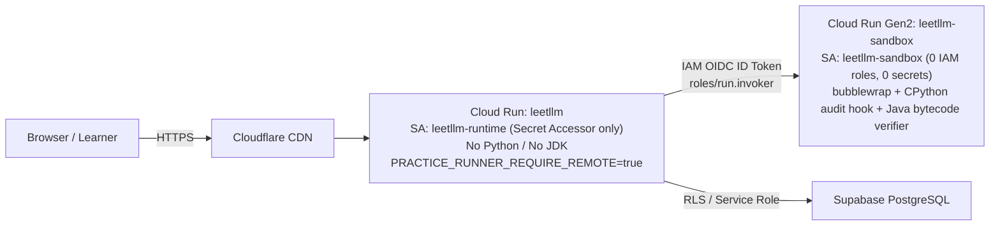

# LeetLLM

[](https://leetllm.com)
[](https://github.com/bvolpato/leetllm/actions/workflows/pr-ci.yml)
[](https://nextjs.org)
[](https://typescriptlang.org)
[](./LICENSE)

> An open-source, first-principles curriculum for AI/ML and LLM engineering: 199 progressive lessons, 47 coding practice problems (Python and Java), 757 glossary entries, a buildable PDF monograph, Vizmatic illustrations and films, and a native iOS/Mac app.

LeetLLM is a free, open-source educational project under the [MIT License](./LICENSE). Read online at **[leetllm.com](https://leetllm.com)**, build the curriculum locally, or contribute lessons, visuals, and code.

---

## What Is Inside

- **199 progressive lessons** across 15 roadmap phases, from Git, Python, NumPy, and linear algebra to FlashAttention, distributed training, alignment, agents, inference serving, and 17 open-source project deep dives.
- **47 coding practice problems** at `/practice` with sample and hidden test suites in Python and Java, backed by an isolated execution sandbox.
- **757 glossary definitions** linked inline at first technical use.
- **1,889 scored mastery quiz questions** and end-of-lesson checkpoints.
- **Theme-aware Vizmatic illustrations, interactive motion films, and Mermaid diagrams** rendered at build time.
- **738-page curated PDF handbook** (`./build-book.sh`) and **native SwiftUI iOS / Mac Catalyst app** (`mobile/ios/LeetLLM`).

| Phase | Lessons | Focus |
|-------|--------:|-------|
| **Computing Foundations** | 9 | Git, Docker, Python, NumPy, CUDA/MPS, data structures, SQL, algorithms |
| **Math & Statistics** | 9 | Calculus, linear algebra, probability, Bayesian inference, MCMC, optimization, hypothesis testing |
| **Preparation & Prerequisites** | 13 | Neural networks, CNNs, RNNs, Transformers, language modeling, first AI app |
| **ML Algorithms & Evaluation** | 15 | Regression, ensembles, learning theory, conformal prediction, VAEs, causal inference, PyTorch |
| **Production ML Systems** | 6 | Feature pipelines, gradient boosted trees, ranking, forecasting, monitoring |
| **Core LLM Foundations** | 8 | Tokenization, embeddings, evaluation, file ingestion, chunking |
| **Applied LLM Engineering** | 25 | RAG, tool use, privacy, context engineering, prompt optimization, observability, caching, routing |
| **Portfolio Capstones** | 9 | End-to-end systems: ETA prediction, ranking, vision, document QA, evals, classifier, research |
| **Transformer Deep Dives** | 8 | Attention mechanisms, vision encoders, normalization, interpretability |
| **Advanced Training & Adaptation** | 17 | Scaling laws, mixed precision, FSDP/ZeRO, training ops, RLHF/DPO/RLVR, distillation, merging |
| **Advanced Agents & Retrieval** | 17 | GraphRAG, enterprise RBAC, multi-agent orchestration, memory, sandboxing, agent capstone |
| **Inference & Production Scale** | 31 | GPU hardware, Triton/CUDA kernels, KV paging, continuous batching, speculative decoding, serving |
| **System Design Capstones** | 10 | Production architecture breakdowns for real AI systems |
| **AI Lab Interviewing** | 4 | Systems coding, architecture design, behavioral evidence, technical presentations |
| **Project Deep Dives** | 17 | vLLM, SGLang, FlashAttention, FlashInfer, DeepGEMM, NCCL, Megatron, DeepSpeed, PyTorch, Transformers, Ray, MLflow, SkyRL, slime, DeepEP, Tinker, Light-PEFT |

---

## Quickstart (Local Development)

You can browse the full curriculum, take mastery quizzes, inspect the glossary, and run coding practice problems locally without any cloud accounts or secrets.

### Prerequisites

- **Node.js 22+**
- **pnpm 10.33.0** (`corepack enable`)
- **Python 3.12+** and **[uv](https://docs.astral.sh/uv/)** (for content validators and Python practice runs)
- **OpenJDK 21** (optional, required only for Java practice tests)

### Run Locally

```bash
git clone https://github.com/bvolpato/leetllm.git
cd leetllm/web
pnpm install --frozen-lockfile
pnpm dev
```

Open [http://localhost:3000](http://localhost:3000).

To render illustrations or diagrams locally:

```bash
cd web
pnpm illustrations:build
pnpm diagrams:build
```

---

## Private & Local-Only Configuration (`secrets/` and `private/`)

This repository contains **zero secrets, private keys, or signing certificates**. Any credentials, signing artifacts, and deployment identifiers must stay in gitignored local files that are also excluded from Docker (`.dockerignore`) and Cloud Build (`.gcloudignore`):

| Local Path (Gitignored) | Tracked Template | Purpose |
|---|---|---|
| `web/.env.local` | [`web/.env.local.example`](./web/.env.local.example) | Supabase URL/keys, optional `GEMINI_API_KEY`, `RESEND_API_KEY`, `PRACTICE_RUNNER_URL`, `CLOUDFLARE_CACHE_PURGER` |
| `secrets/deploy.env` | [`deploy.env.example`](./deploy.env.example) | GCP project/account, Cloud Run service names, Cloudflare zone ID, Supabase project ref, optional `IOS_PRIVATE_BLOG_EMAIL` and `IOS_TEAM_ID` |
| `secrets/codex/auth.json` | Generated via `./scripts/codex_auth_device_login.py` | Isolated Codex OAuth credentials (mode `600`); synced to Secret Manager at deploy time |
| `secrets/ios/` | [`mobile/ios/LeetLLM/signing/README.md`](./mobile/ios/LeetLLM/signing/README.md) | Apple Distribution `.p12` certificates, `.mobileprovision` profiles, and App Store Connect `AuthKey_*.p8` keys |
| `web/secrets/service-account.json` | None | Optional Google Indexing API service account key (`GOOGLE_APPLICATION_CREDENTIALS`) |
| `.env` | See [`mobile/ios/RELEASE.md`](./mobile/ios/RELEASE.md) | Local iOS signing paths and App Store Connect credentials (mode `600`) |
| `private/` | None | Optional local scratch or unpublished drafts excluded from Git and builds |

### Setting Up Optional Cloud Services (Supabase & AI Features)

1. Copy [`web/.env.local.example`](./web/.env.local.example) to `web/.env.local`.
2. Create a Supabase project, set `NEXT_PUBLIC_SUPABASE_URL` and `NEXT_PUBLIC_SUPABASE_PUBLISHABLE_KEY`, and apply SQL migrations in [`supabase/schema/`](./supabase/schema/) in numerical order (`000` through `009`).
3. Keep `SUPABASE_SERVICE_ROLE_KEY`, `GEMINI_API_KEY`, and `RESEND_API_KEY` server-only (never prefix with `NEXT_PUBLIC_`). In production, bind them strictly from Google Cloud Secret Manager.

---

## Security & Practice Sandbox Isolation

Untrusted user code submitted to `POST /api/practice/run` is **never** executed inside the production web container. LeetLLM isolates execution in a dedicated Cloud Run service in the same GCP project under a zero-permission service account:



### Least-Privilege Service Accounts

| Service Account | Attached Service | Project IAM Roles | Resource-Scoped Permissions | Secrets Mounted |
|---|---|---|---|---|
| `leetllm-runtime@<project>.iam.gserviceaccount.com` | `leetllm` (Next.js web) | **None (0)** | `secretAccessor` on the 4 LeetLLM secrets (+ `secretVersionAdder` on Codex token secret), `roles/run.invoker` on `leetllm-sandbox` only | 4 Secret Manager secrets |
| `leetllm-sandbox@<project>.iam.gserviceaccount.com` | `leetllm-sandbox` (Practice runner) | **None (0)** | **None (0)** | **None (0)** |

### Defense-in-Depth Layers

1. **Process & Credential Separation:** Production sets `PRACTICE_RUNNER_REQUIRE_REMOTE=true` and omits `python3` and `openjdk21-jdk` from [`Dockerfile`](./Dockerfile). Even a full escape inside `leetllm-sandbox` reaches zero secrets and a zero-IAM metadata identity.
2. **Private IAM Ingress:** `leetllm-sandbox` deploys with `--no-allow-unauthenticated`; only `leetllm-runtime` holds `roles/run.invoker` on that service.
3. **OS & Language Sandboxing:** [`Dockerfile.sandbox`](./Dockerfile.sandbox) runs as non-root UID `1001` with Linux `bubblewrap` (`--unshare-user --unshare-pid --unshare-net --unshare-ipc --unshare-uts`) when permitted by the kernel, strict `rlimit` caps, an irremovable CPython `sys.addaudithook` + AST filter in [`web/src/lib/practice-runner.ts`](./web/src/lib/practice-runner.ts), and Java source + `.class` constant-pool/memberref verification in [`web/src/lib/practice-java-sandbox.ts`](./web/src/lib/practice-java-sandbox.ts).
4. **Abuse Controls:** [`web/src/app/api/practice/run/route.ts`](./web/src/app/api/practice/run/route.ts) enforces per-IP rate limiting, payload size caps, and global concurrency limits.
5. **Local Development Ergonomics:** When `PRACTICE_RUNNER_URL` is unset locally, contributors get automatic local execution through the same hardened Python/Java sandbox with zero cloud setup.

See [`SECURITY.md`](./SECURITY.md) for responsible disclosure and full security details.

---

## Project Structure

```text
leetllm/
├── web/                       # Next.js 16+ App Router application
│   ├── src/
│   │   ├── app/               # Public pages, auth, dashboard, API routes
│   │   ├── components/        # UI components (Tailwind CSS + Radix)
│   │   ├── content/           # 199 lessons + blog + practice + glossary
│   │   │   ├── foundations/      # Foundations, research methods, and capstones (48)
│   │   │   ├── preparation/      # Free 0-to-1 prerequisite on-ramp (14)
│   │   │   ├── fundamentals/     # Transformer and inference fundamentals (42)
│   │   │   ├── agents/           # Agent systems and orchestration (16)
│   │   │   ├── retrieval/        # Retrieval and RAG systems (9)
│   │   │   ├── llmops/           # Evaluation, privacy, deployment, monitoring (18)
│   │   │   ├── training/         # Training and adaptation (20)
│   │   │   ├── system-design/    # System design capstones (11)
│   │   │   ├── interviewing/     # AI lab interview preparation (4)
│   │   │   ├── projects/         # AI infrastructure project deep dives (17)
│   │   │   ├── blog/             # Blog post bundles (23)
│   │   │   └── practice/         # Coding practice problems (47)
│   │   └── lib/               # Content loaders, Supabase clients, practice sandbox & proxy
│   └── tools/                 # Vizmatic illustrations, Mermaid diagrams, PDF book generator
├── services/
│   └── practice-sandbox/      # Standalone zero-secret HTTP runner for Cloud Run sandbox
├── supabase/schema/           # Ordered PostgreSQL + RLS migrations (000..009)
├── videos/                    # Vizmatic lesson film sources, captions, quality checks
├── mobile/ios/LeetLLM/        # Native SwiftUI iOS and Mac Catalyst app
├── scripts/                   # Content validators, sandbox & iOS tooling
├── docs/                      # Architecture, auth, visual pipeline, troubleshooting
├── Dockerfile                 # Production Next.js web container (no Python/JDK)
├── Dockerfile.sandbox         # Isolated practice execution container
├── deploy.sh                  # Full validated Cloud Run deployment
└── scripts/deploy-sandbox.sh  # Dedicated zero-privilege sandbox deployment
```

---

## Deployment

Copy [`deploy.env.example`](./deploy.env.example) to `secrets/deploy.env` (gitignored), configure `web/.env.local`, and deploy:

```bash
# Deploy or update the isolated zero-secret practice sandbox
./scripts/deploy-sandbox.sh

# Validate, build, deploy main web service, and run candidate + production smoke tests
./deploy.sh
```

Pass `--with-sandbox` to `./deploy.sh` to redeploy both services together. See [`AGENTS_DEPLOY.md`](./AGENTS_DEPLOY.md) for the complete deployment runbook.

---

## Contributing

Contributions are warmly welcome, whether fixing a typo, tightening a mathematical derivation, adding a test case, or building a new lesson.

- Read **[CONTRIBUTING.md](./CONTRIBUTING.md)** for setup, validation commands, and PR guidelines.
- Review **[CONTENT_GUIDELINES.md](./CONTENT_GUIDELINES.md)** and **[ILLUSTRATION_GUIDELINES.md](./ILLUSTRATION_GUIDELINES.md)** for editorial and visual standards.
- Follow our **[Code of Conduct](./CODE_OF_CONDUCT.md)**.

### Key Validation Commands

```bash
# Web security audit, lint, unit tests, typecheck, and production build
cd web
pnpm audit:dependencies
pnpm lint
pnpm test --run
pnpm typecheck
pnpm build
pnpm practice:validate

# Content, citation, quiz, and runnable Python example checks (from repo root)
uv run scripts/validate-metadata.py
uv run scripts/update-time-estimates.py --check
uv run scripts/validate-references.py --skip-http
uv run scripts/validate-content-structure.py
uv run scripts/validate-next-callouts.py
uv run scripts/validate-mastery-quizzes.py
uv run scripts/validate-python-examples.py
```

---

## Documentation

| Document | Purpose |
|---|---|
| [CONTRIBUTING.md](./CONTRIBUTING.md) | Contributor setup, checks, and PR workflow |
| [SECURITY.md](./SECURITY.md) | Vulnerability reporting and security architecture |
| [CONTENT_GUIDELINES.md](./CONTENT_GUIDELINES.md) | Editorial standards, prose clarity, citations, and math |
| [ILLUSTRATION_GUIDELINES.md](./ILLUSTRATION_GUIDELINES.md) | Vizmatic visual quality standards and review workflow |
| [BOOK.md](./BOOK.md) | PDF monograph build pipeline |
| [AGENTS.md](./AGENTS.md) | Project overview and agent workflow conventions |
| [AGENTS_TESTING.md](./AGENTS_TESTING.md) | Full test and validation matrix |
| [AGENTS_DEPLOY.md](./AGENTS_DEPLOY.md) | Cloud Run and sandbox deployment guide |
| [AGENTS_MONITOR.md](./AGENTS_MONITOR.md) | Cloud Logging, metrics, and analytics queries |
| [docs/architecture.md](./docs/architecture.md) | Deep architecture and database reference |
| [mobile/ios/RELEASE.md](./mobile/ios/RELEASE.md) | iOS and Mac Catalyst release tooling |

---

## License

MIT. See [LICENSE](./LICENSE) for details.
