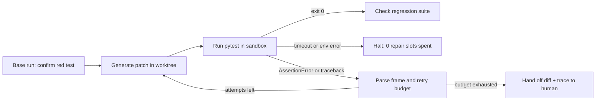

---
{
  "id": "ai-coding-workflow-with-agents",
  "title": "AI Coding Workflow with Agents",
  "slug": "ai-coding-workflow-with-agents",
  "section": "Advanced Agents & Retrieval",
  "category": "LLM Agents & Tool Use",
  "difficulty": "Hard",
  "order": 8,
  "coverImage": "illustrations/_generated/coding_agent_workflow_dark.png",
  "companies": [
    "GitHub",
    "OpenAI",
    "Anthropic",
    "Google",
    "Microsoft"
  ],
  "shortDescription": "Build reliable coding-agent workflows using AST repo-map localization, fail-first reproduction in isolated git worktrees, and finite-budget traceback repair loops.",
  "keyConceptsTested": [
    "Agent-computer interfaces and repository navigation",
    "AST symbol call graphs and PageRank context slicing",
    "Fail-first reproduction and red-to-green verification",
    "Git worktree and git write-tree workspace isolation",
    "Traceback-driven generate-test-repair state machines",
    "Unbiased pass@k trajectory scaling and localization ceilings",
    "Separating local execution sandboxes from branch protection",
    "Diff-first pull request review for regression prevention"
  ],
  "prerequisites": [
    "code-generation-agents-sandboxing",
    "prompt-injection-defense-strategies"
  ],
  "relatedQuestions": [
    "agent-memory-persistence-patterns",
    "agent-failure-states-retry-fallback",
    "multi-agent-dags-langgraph-orchestration",
    "observability-monitoring-llm-systems"
  ]
}
---

A coding agent receives a straightforward bug report for a Python HTTP router: `parse_header_line("X-Forward-Host: api.internal:8443")` raises `ValueError` because `line.split(":")` splits on every colon instead of only the first delimiter. Without a structured harness, an autonomous model can easily wander into adjacent modules, patch the test suite with a mock that strips ports from test strings, and leave `http_parse.py` untouched. The edited tests turn green, yet the production parser still crashes the moment an upstream proxy forwards a host-and-port pair or callback URI.

Reliable coding-agent workflows prevent that silent regression by turning repository editing into an inspectable, feedback-driven engineering loop rather than a single-shot generation pass. Before touching source code, the harness localizes the fault with static syntax indexing, reproduces the crash against unmodified files, isolates trial edits inside an ephemeral working tree, and iterates on real test tracebacks under a strict retry budget. Earlier lessons covered execution sandboxing ([Code Generation & Sandboxing](/learn/code-generation-agents-sandboxing)) and keeping privileged actions outside the model ([Human-in-the-Loop Agent Architecture](/learn/agent-failure-states-retry-fallback)). Here those pieces come together to support trustworthy repository automation from localization through pull-request review.

<figure>
  
  <figcaption>A finite-budget coding-agent loop narrows the repository via AST call ranking, reproduces the failure before editing, isolates candidate patches inside a worktree, and treats every non-zero test exit as structured feedback for repair.</figcaption>
</figure>

## Agent-computer interfaces and capability separation

An inline autocomplete model predicts the next few tokens around a cursor, whereas a coding agent couples a language model to repository search tools, file editors, and a shell runner. SWE-agent formalizes this tool layer as an **agent-computer interface (ACI)**, showing that compact file viewers, symbol search commands, and concise linter diagnostics raise issue resolution rates substantially on real GitHub repositories.[^yang2024sweagent] Because the model chooses its own exploration commands turn by turn, trimming noisy stdout and catching malformed edits early preserves scarce context across multi-step runs. Clean tool ergonomics multiplies the effectiveness of the underlying model.

Production harnesses such as GitHub Copilot's cloud coding agent and Claude Code read codebases, modify files, and run test suites inside isolated environments.[^github2026copilotcloudagent][^anthropic2026claudecodeoverview] Across these tools, reliable teams divide the workflow into four distinct operational roles. Keeping generation, sandboxing, grading, and release approval separate ensures that giving an agent richer code navigation never silently expands its deployment permissions.

| Stage responsibility | System owner | Primary artifact |
|---|---|---|
| Localize symbols, edit code, and choose checks | Coding agent | Unified diff and patch summary |
| Enforce filesystem, process, and network limits | Sandbox runtime | Container or OS sandbox profile |
| Evaluate test reproduction and regression coverage | Test runner and CI | Exit codes and parsed stack tracebacks |
| Approve remote push or protected branch merge | Human reviewer | Signed review on inspected diff |

Tool-using loops often follow the interleaved thought, action, and observation structure of ReAct,[^yao2023a] yet human reviewers never need to rely on free-form reasoning text to trust a patch. Instead, the harness records concrete, reproducible artifacts: the files opened during localization, the unified diff, the failing unpatched test output, and the full passing regression summary. Inspecting filesystem and test evidence directly catches mocked workarounds that plausible explanations can otherwise hide.

```checkpoint
Why is an inline linter or concise traceback summary part of an effective agent-computer interface?
---
Uncapped stdout floods the model context with thousands of irrelevant lines, drowning out the failing assertion frame and causing hallucinated edits. Truncating or structuring tool output around file paths, line numbers, and local syntax errors keeps context sharp across repair iterations.
```

## Localizing faults with AST symbol maps

Dumping an entire microservice into the prompt wastes tokens and lowers patch precision because transformer attention dilutes across unrelated modules. Hierarchical workflows such as Agentless show that decoupling repository localization from patch synthesis yields higher repair accuracy at a fraction of the token cost.[^xia2024agentless] Static abstract syntax analysis gives that localization stage a deterministic, sub-second foundation. When a repository has hundreds of modules, graph-based symbol ranking narrows attention to the handful of functions sitting along the failing call path.

Python's built-in `ast` module parses source files into syntax trees without importing modules or running top-level side effects. Walking each module AST extracts function definitions, local line spans, and static call references across files to build a cross-module **repository map**. Running personalized PageRank biased toward symbols named in an issue description or stack trace lifts `split_headers` and `parse_header_line` above peripheral helpers such as `backoff_delay`. Pairing AST call structure with keyword teleportation weights compresses multi-file context down to a focused slice of under thirty lines.

The script below builds a cross-file symbol graph over four Python modules, biases PageRank random walks toward traceback symbols, and extracts the highest-ranked implementation for editing.

<!-- leetllm: test, deps=numpy, output=show -->
```python title="ast_repo_map_ranker.py"
import ast
import numpy as np

REPO_FILES = {
    "http_parse.py": '''
def parse_header_line(line: str):
    key, value = line.split(":")
    return key.strip().lower(), value.strip()

def split_headers(raw_block: str):
    headers = {}
    for line in raw_block.splitlines():
        if not line.strip():
            continue
        k, v = parse_header_line(line)
        headers[k] = v
    return headers
''',
    "router.py": '''
from http_parse import split_headers
from retry import backoff_delay

def dispatch_request(raw_headers: str, attempt: int = 0):
    parsed = split_headers(raw_headers)
    if parsed.get("x-retry") == "1":
        return {"wait": backoff_delay(attempt), "headers": parsed}
    return {"wait": 0.0, "headers": parsed}
''',
    "retry.py": '''
def backoff_delay(attempt: int) -> float:
    return min(8.0, 0.25 * (2 ** attempt))

def jitter_ratio(seed: int) -> float:
    return (seed % 7) / 10.0
''',
    "test_http.py": '''
from http_parse import split_headers
from router import dispatch_request

def test_colon_header():
    raw = "X-Forward-Host: api.internal:8443"
    assert split_headers(raw)["x-forward-host"] == "api.internal:8443"

def test_dispatch_route():
    out = dispatch_request("Host: example.org")
    assert out["wait"] == 0.0
''',
}

def extract_symbol_graph(files: dict[str, str]):
    defs: dict[str, tuple[str, int, int, str]] = {}
    calls_by_func: dict[str, list[str]] = {}
    for path, src in files.items():
        tree = ast.parse(src, filename=path)
        lines = src.splitlines()
        for node in tree.body:
            if isinstance(node, ast.FunctionDef):
                qual = f"{path}:{node.name}"
                snippet = "\n".join(lines[node.lineno - 1 : node.end_lineno])
                defs[qual] = (path, node.lineno, node.end_lineno, snippet)
                callees = [
                    child.func.id
                    for child in ast.walk(node)
                    if isinstance(child, ast.Call) and isinstance(child.func, ast.Name)
                ]
                calls_by_func[qual] = callees

    short_to_quals: dict[str, list[str]] = {}
    for qual in defs:
        short = qual.split(":")[1]
        short_to_quals.setdefault(short, []).append(qual)

    names = sorted(defs)
    idx = {name: i for i, name in enumerate(names)}
    n = len(names)
    adj = np.zeros((n, n), dtype=float)
    for caller, callees in calls_by_func.items():
        for callee_short in callees:
            for target in short_to_quals.get(callee_short, []):
                i, j = idx[caller], idx[target]
                adj[i, j] += 1.0  # caller -> callee
                adj[j, i] += 0.5  # reverse context link
    return names, defs, adj

def personalized_pagerank(adj: np.ndarray, seed_vec: np.ndarray, alpha: float = 0.85, steps: int = 40):
    n = len(seed_vec)
    p = seed_vec / seed_vec.sum()
    row_sums = adj.sum(axis=1, keepdims=True)
    trans = np.divide(adj, row_sums, out=np.full_like(adj, 1.0 / n), where=row_sums > 0)
    rank = p.copy()
    for _ in range(steps):
        rank = alpha * (rank @ trans) + (1.0 - alpha) * p
    return rank

names, defs, adj = extract_symbol_graph(REPO_FILES)
seed = np.array([1.0 if ("http_parse" in name or "split_headers" in name) else 0.1 for name in names])
scores = personalized_pagerank(adj, seed)
ranked = sorted(zip(scores, names), reverse=True)

print("Top localized symbols (AST call graph + traceback seed):")
for score, name in ranked[:4]:
    path, start, end, _ = defs[name]
    print(f"  {score:.3f}  {name:<34s} lines {start}-{end}")

top_name = ranked[0][1]
print("\nExtracted minimal edit context for top symbol:")
print(defs[top_name][3])
```

<!-- leetllm: output:start -->
```text title="Output" output compact
Top localized symbols (AST call graph + traceback seed):
  0.391  http_parse.py:split_headers        lines 6-13
  0.227  http_parse.py:parse_header_line    lines 2-4
  0.179  router.py:dispatch_request         lines 5-9
  0.090  test_http.py:test_colon_header     lines 5-7

Extracted minimal edit context for top symbol:
def split_headers(raw_block: str):
    headers = {}
    for line in raw_block.splitlines():
        if not line.strip():
            continue
        k, v = parse_header_line(line)
        headers[k] = v
    return headers
```
<!-- leetllm: output:end -->

> **Key insight:** Static AST ranking narrows the search space before spending a single generation token. Here `retry.py` sinks to the bottom while `split_headers` (`0.391`) and `parse_header_line` (`0.227`) rise straight to the top with exact line spans.

Even in dynamically typed codebases, combining static call edges with failure keywords puts the fault path right in front of the model. Language Server Protocol (LSP) definition lookups and ripgrep symbol queries complement AST graphs whenever dynamic dispatch hides direct function calls.

<figure>
  
  <figcaption>An AST dependency map connects tests and callers to the underlying fault site, compressing full-repository files into a high-signal slice ranked by call structure and traceback proximity.</figcaption>
</figure>

## Fail-first reproduction and worktree isolation

Once candidate functions are in view, the agent should resist jumping straight to source edits from the issue text alone. Reliable workflows begin with **fail-first reproduction**: write or run a minimal test case executing the target code path against the unmodified repository and confirm that it triggers the exact crash (`ValueError: too many values to unpack`). Capturing that initial failing baseline achieves two things before any patch is written: it confirms the test exercises live code rather than an accidental mock, and it defines a concrete pass condition that subsequent edits must turn green.

While generating and testing candidate diffs, workspace mutations also need isolation from parallel runs and from protected repository branches. Git provides two lightweight primitives built for multi-trajectory coding agents:

1. **`git worktree`**: Attaches an independent working directory and staging index to a separate branch sharing the same object store, letting parallel repair runs edit files and invoke builds without corrupting neighboring workspaces.[^gitWorktreeDocs2026]
2. **`git write-tree`**: Captures the staging index directly into an immutable Git tree object without checking out files or switching branches, making per-iteration checkpoints and instant resets practically free.[^gitWriteTreeDocs2026]

Modern coding harnesses such as OpenAI's Codex app provision isolated worktrees automatically for background tasks so agents can edit, compile, and test in parallel without touching the user's primary checkout.[^openai2026codexapp] Equally important is holding network and credential permissions constant across those sandboxes. Running tests inside an ephemeral worktree grants zero permission to push remote branches or bypass protected branch rules, keeping final integration under human pull-request review.[^githubProtectedBranches2026][^dockerNetworkOverview2026]

## Finite-budget generate-test-repair loops

An initial candidate patch seldom solves an engineering bug cleanly on the first try. A first attempt may handle a colon inside a port number while failing on multiple colons in an HTTPS URL or crashing on empty input. Wrapping code synthesis in a **generate-test-repair loop** feeds concrete compiler diagnostics and `pytest` assertion diffs back into the next repair turn under a fixed attempt cap such as `t <= 3`. That hard ceiling stops runaway token burn when an agent oscillates between two broken edits and signals clearly when to hand the problem off to a human engineer.

Two safeguards separate reliable repair loops from fragile retry wrappers. First, extract only the failing `File`, line number, function frame, and final exception string from interpreter stderr rather than forwarding megabytes of runner noise. Second, separate infrastructure failures from code defects so network timeouts or missing packages halt immediately without spending code-repair slots:

1. **Traceback extraction over raw logs**: Keep only the trailing stack frame and assertion diff (`expected != actual`) so the repair prompt pinpoints the failing assertion in under twenty lines.
2. **Environment vs code fault classification**: Treat `subprocess.TimeoutExpired`, `ModuleNotFoundError`, or sandbox startup failures as infrastructure halts (`0` repair slots spent) rather than asking the model to rewrite source code or delete timing-sensitive tests.



<figure>
  
  <figcaption>A repair state machine separates test failures that spend a patch budget slot from timeouts and environment errors that halt immediately without wasting inference retries.</figcaption>
</figure>

The Python harness below runs a live repair loop using `tempfile` and `subprocess`. It writes the broken header parser and a fail-first regression suite into an isolated directory, verifies the initial crash, runs candidate one (`rsplit`) to inspect the concrete `AssertionError`, feeds that failure into candidate two (`split(":", 1)`), confirms exit status `0`, and prints the exact unified diff.

<!-- leetllm: test, output=show -->
```python title="sandboxed_repair_loop.py"
import difflib
import os
import re
import subprocess
import sys
import tempfile

BUGGY_PARSER = '''def parse_header_line(line: str):
    key, value = line.split(":")
    return key.strip().lower(), value.strip()
'''

TEST_SUITE = '''import unittest
from http_parse import parse_header_line

class TestHeaderParser(unittest.TestCase):
    def test_port_value_preserved(self):
        key, value = parse_header_line("X-Forward-Host: api.internal:8443")
        self.assertEqual(key, "x-forward-host")
        self.assertEqual(value, "api.internal:8443")

    def test_url_value_preserved(self):
        key, value = parse_header_line("Location: https://example.org/callback")
        self.assertEqual(key, "location")
        self.assertEqual(value, "https://example.org/callback")

if __name__ == "__main__":
    unittest.main()
'''

CANDIDATE_PATCHES = [
    # Attempt 1: naive rsplit(":") breaks if the header value also has a colon + port
    '''def parse_header_line(line: str):
    key, value = line.rsplit(":", 1)
    return key.strip().lower(), value.strip()
''',
    # Attempt 2: correct split on the first colon delimiter only
    '''def parse_header_line(line: str):
    if ":" not in line:
        raise ValueError(f"Malformed header line: {line!r}")
    key, value = line.split(":", 1)
    return key.strip().lower(), value.strip()
''',
]

def run_isolated_tests(workdir: str, timeout_s: float = 5.0):
    try:
        proc = subprocess.run(
            [sys.executable, "-m", "unittest", "test_http.py"],
            cwd=workdir,
            capture_output=True,
            text=True,
            timeout=timeout_s,
        )
    except subprocess.TimeoutExpired:
        return "env_failure", "Test runner timed out; 0 repair slots spent."

    if proc.returncode == 0:
        return "passed", proc.stderr.strip().splitlines()[-1]

    frames = re.findall(r'File "([^"]+)", line (\d+), in (\S+)', proc.stderr)
    err_lines = [ln for ln in proc.stderr.strip().splitlines() if ln and not ln.startswith("  ")]
    summary = err_lines[-1] if err_lines else "Unknown error"
    frame_info = f"{os.path.basename(frames[-1][0])}:{frames[-1][1]} ({frames[-1][2]})" if frames else "n/a"
    return "test_failure", f"{frame_info} -> {summary}"

with tempfile.TemporaryDirectory() as tmp:
    parser_path = os.path.join(tmp, "http_parse.py")
    test_path = os.path.join(tmp, "test_http.py")
    with open(test_path, "w") as f:
        f.write(TEST_SUITE)

    # Step 1: Fail-first baseline before any patch
    with open(parser_path, "w") as f:
        f.write(BUGGY_PARSER)
    status, diag = run_isolated_tests(tmp)
    print(f"Baseline (unpatched): status={status} | {diag}")

    # Step 2: Finite-budget repair loop (t <= 3)
    final_code = BUGGY_PARSER
    for attempt, patch in enumerate(CANDIDATE_PATCHES, start=1):
        with open(parser_path, "w") as f:
            f.write(patch)
        status, diag = run_isolated_tests(tmp)
        print(f"Repair slot {attempt}/3: status={status} | {diag}")
        if status == "passed":
            final_code = patch
            break
        if status == "env_failure":
            break

    print("\nVerified unified diff:")
    diff = difflib.unified_diff(
        BUGGY_PARSER.splitlines(keepends=True),
        final_code.splitlines(keepends=True),
        fromfile="a/http_parse.py",
        tofile="b/http_parse.py",
    )
    print("".join(diff).rstrip())
```

<!-- leetllm: output:start -->
```text title="Output" output compact
Baseline (unpatched): status=test_failure | http_parse.py:2 (parse_header_line) -> FAILED (errors=2)
Repair slot 1/3: status=test_failure | test_http.py:12 (test_url_value_preserved) -> FAILED (failures=2)
Repair slot 2/3: status=passed | OK

Verified unified diff:
--- a/http_parse.py
+++ b/http_parse.py
@@ -1,3 +1,5 @@
 def parse_header_line(line: str):
-    key, value = line.split(":")
+    if ":" not in line:
+        raise ValueError(f"Malformed header line: {line!r}")
+    key, value = line.split(":", 1)
     return key.strip().lower(), value.strip()
```
<!-- leetllm: output:end -->

Attempt 1 shows why executing real assertions catches logic errors that pass type checks cleanly: `line.rsplit(":", 1)` returns two valid strings, yet puts `"x-forward-host: api.internal"` into the header name and `"8443"` into the value. Extracting the exact assertion failure guides slot 2 cleanly to `line.split(":", 1)`, solving both host-port and HTTPS URL headers in one localized edit.

> **Common mistake:** Treating exit code `0` as proof that tests passed. Flags such as Vitest's `--passWithNoTests` or mismatched file globs return exit status `0` even when zero tests ran, so always assert that the executed test count is positive.[^vitestPassWithNoTests2026]

## Trajectory scaling and unbiased pass@k

Evaluating or operating coding agents on nontrivial repository bugs often involves generating $n$ independent attempts and asking what fraction of tasks solve correctly within $k$ tries. Sampling just $k$ trials per task suffers steep variance, so Chen et al. draw $n \ge k$ trajectories, count the $c$ passing attempts, and compute the exact probability that a random $k$-element subset contains at least one passing solution:[^chen2021][^humanEvalEstimator2026]

$$
\text{pass}@k = 1 - \frac{\binom{n - c}{k}}{\binom{n}{k}}
$$

Unlike the naive plug-in approximation $1 - (1 - c/n)^k$, this hypergeometric estimator accounts for sampling without replacement from finite trajectories and stays unbiased even when $c$ is small. Decomposing single-trajectory solve probability also shows where parallel compute budgets actually pay off:

$$
p = q_{\text{loc}} \cdot r_{\text{patch}}
$$

Here $q_{\text{loc}}$ is the probability that AST retrieval surfaced the true fault site, and $r_{\text{patch}}$ is the repair loop's conditional success rate once given the right code slice. Resampling patches four times on top of one frozen file selection remains permanently capped at $q_{\text{loc}}$, whereas redrawing full trajectories from localization onward escapes that ceiling. Better still, improving AST retrieval precision lifts $p$ directly and raises `pass@k` at every budget simultaneously.

Real-world issue benchmarks such as SWE-bench and SWE-bench Pro evaluate multi-file diffs inside Docker containers against hidden repository tests, exposing the sharp gap between single-function prompts and full repositories.[^swebench2024][^swebenchpro][^deng2025SweBenchPro] Accurate benchmark attribution depends on isolating test harness flakes, container startup errors, and commits that leak future history into the container.[^openai2026swebenchlimits] Without clean grading hygiene, infrastructure outages masquerade as reasoning failures and distort comparisons across agent architectures.

The NumPy simulation below compares the unbiased `pass@k` estimator against the plug-in formula and measures the `k = 4` localization ceiling across 40,000 simulated tasks.

<!-- leetllm: test, deps=numpy, output=show -->
```python title="pass_at_k_trajectories.py"
import math
import numpy as np

def pass_at_k_unbiased(n: int, c: int, k: int) -> float:
    if n - c < k:
        return 1.0
    return 1.0 - math.comb(n - c, k) / math.comb(n, k)

n = 20
for p in (0.50, 0.30, 0.15):
    c = round(n * p)
    p_hat = c / n
    row = [
        f"k={k}: unbiased={pass_at_k_unbiased(n, c, k):.3f} vs plugin={1 - (1 - p_hat)**k:.3f}"
        for k in (1, 4, 8)
    ]
    print(f"Base rate p={p:.2f} (c={c}/{n}): " + " | ".join(row))

# Localization ceiling simulation with k = 4 trajectories
rng = np.random.default_rng(7)
trials = 40_000
q_loc, r_patch = 0.60, 0.50

stale_loc = rng.random(trials) < q_loc
stale_solve = stale_loc & (rng.random((trials, 4)) < r_patch).any(axis=1)

full_resample = ((rng.random((trials, 4)) < q_loc) & (rng.random((trials, 4)) < r_patch)).any(axis=1)
better_map = ((rng.random((trials, 4)) < 0.85) & (rng.random((trials, 4)) < (0.50 / 0.85))).any(axis=1)

print(f"\nSimulated k=4 pass rate (40k tasks):")
print(f"  Stale single localization (q_loc=0.60): {stale_solve.mean():.3f}")
print(f"  Full trajectory resample (p=0.30 each): {full_resample.mean():.3f}")
print(f"  Better AST map first (total p=0.50):    {better_map.mean():.3f}")
```

<!-- leetllm: output:start -->
```text title="Output" output compact
Base rate p=0.50 (c=10/20): k=1: unbiased=0.500 vs plugin=0.500 | k=4: unbiased=0.957 vs plugin=0.938 | k=8: unbiased=1.000 vs plugin=0.996
Base rate p=0.30 (c=6/20): k=1: unbiased=0.300 vs plugin=0.300 | k=4: unbiased=0.793 vs plugin=0.760 | k=8: unbiased=0.976 vs plugin=0.942
Base rate p=0.15 (c=3/20): k=1: unbiased=0.150 vs plugin=0.150 | k=4: unbiased=0.509 vs plugin=0.478 | k=8: unbiased=0.807 vs plugin=0.728

Simulated k=4 pass rate (40k tasks):
  Stale single localization (q_loc=0.60): 0.557
  Full trajectory resample (p=0.30 each): 0.758
  Better AST map first (total p=0.50):    0.937
```
<!-- leetllm: output:end -->

> **Key insight:** At `k = 4`, resampling patches on top of one frozen file selection stalls at `0.557` (capped above by $q_{\text{loc}} = 0.60$). Redrawing the full trajectory jumps to `0.758`, and improving localization first reaches `0.937`.

<figure>
  
  <figcaption>Sampling multiple end-to-end trajectories boosts pass@k quickly, whereas resampling patches on top of a frozen, inaccurate file localization plateaus below 0.60.</figcaption>
</figure>

## Pull-request review and production verification checklist

Even inside an isolated container, an agent can submit subtly wrong diffs if human reviewers stop after glancing at a green CI badge. Consistent with Anthropic's design guidance for effective coding agents, engineering teams keep tool layers lightweight, verify observable state transitions rather than natural-language rationales, and halt runs cleanly whenever edits cross into unrelated modules.[^anthropic2025effectiveagents] Reviewing generated pull requests is fastest when every stage leaves behind standardized evidence tailored to the checks below.

| Workflow stage | Primary signal | Common failure trap | Engineering safeguard |
|---|---|---|---|
| AST localization | Cross-file call rank + traceback seed | Dumping whole files into long context | Rank symbols via `ast` graph before slicing |
| Reproduction | Unpatched red test run | Mock test passes before any code fix | Run test first and log concrete exception |
| Patch isolation | `git worktree` or `git write-tree` | Parallel runs overwrite shared checkout | One worktree per trajectory, clean diff inspect |
| Repair iteration | Parsed `AssertionError` frame | Timeouts burn limited model retries | Route env errors separately with 0 slots spent |
| Final integration | Scoped diff + full regression run | Skipped suites or 0-test glob exit 0 | Assert test count > 0; human approves merge |

Make four rapid checks habitual before approving any agent-authored pull request. Confirm that modified paths match the fault surface from AST localization, inspect regression tests to verify they invoke the real implementation rather than mocked return tuples, check CI test totals to catch silently skipped suites, and keep branch push or deployment tokens strictly outside agent sandboxes.

```mastery-quiz
[
  {
    "question": "A coding agent reports fixing a header parsing crash and shows a green local test run. When reviewing its git diff, you notice it added a new unit test that patches `parse_header_line` with a mock function returning hardcoded tuples while leaving `http_parse.py` unchanged. What failed in the workflow?",
    "options": [
      "The AST repo-map ranker excluded unrelated retry helper modules from the prompt context window.",
      "The harness skipped fail-first reproduction on real source files and allowed a mock-only test edit.",
      "The sandbox process timed out while pytest parsed fixtures prior to executing module assertions.",
      "The unbiased `pass@k` calculation overestimated single-sample accuracy at `k = 1` over `n = 20` runs."
    ],
    "answer": "The harness skipped fail-first reproduction on real source files and allowed a mock-only test edit.",
    "explanation": "Reproducing the bug against the unmodified parser first forces a test that genuinely invokes `parse_header_line` and fails on colon-containing values. Mocking away the unit under test lets the suite exit zero without fixing production behavior."
  },
  {
    "question": "During a finite-budget repair loop capped at 3 code repair attempts, pytest exits with `subprocess.TimeoutExpired` because a temporary package index mirror stalls during dependency setup. How should the harness handle this outcome?",
    "options": [
      "Deduct one code-repair attempt and prompt the model to remove failing integration specs.",
      "Classify the stall as an infrastructure error without deducting from the 3 repair attempts.",
      "Re-run the test command with `--passWithNoTests` so dependency hangs yield exit status 0.",
      "Commit the partial worktree changes and trigger an upstream remote CI rebuild directly."
    ],
    "answer": "Classify the stall as an infrastructure error without deducting from the 3 repair attempts.",
    "explanation": "Infrastructure outages and dependency timeouts provide zero signal about patch correctness. Routing them to an environment-failure branch prevents wasting repair retries or coaxing the agent into deleting tests."
  },
  {
    "question": "An issue solver succeeds with probability `p = q_loc * r_patch = 0.60 * 0.50 = 0.30`. Comparing `k = 4` budgets, why does regenerating only the patch 4 times on a fixed initial file selection underperform running 4 full trajectories from localization onward?",
    "options": [
      "Git worktrees restrict parallel repository edits to a single patch attempt per active branch.",
      "Freezing an incorrect file choice caps solve probability at `q_loc = 0.60` despite 4 edit tries.",
      "Unbiased `pass@k` drops to zero whenever total candidate trials satisfy `n - c < k`.",
      "AST syntax traversal runs module-level side effects inside cached parser runs each turn."
    ],
    "answer": "Freezing an incorrect file choice caps solve probability at `q_loc = 0.60` despite 4 edit tries.",
    "explanation": "When the first localization omits the true fault site (40% of runs here), subsequent edit retries inside the wrong files cannot fix the bug regardless of how many patches are sampled. Full resampling redraws both localization and synthesis (`1 - (1 - 0.30)^4 = 0.76`)."
  },
  {
    "question": "Why do multi-agent coding harnesses assign each active candidate trajectory its own `git worktree` inside a sandboxed runner without repository push credentials?",
    "options": [
      "Dedicated worktrees separate concurrent file edits and test runs while reserving branch merges for human reviewers.",
      "Git worktrees repair malformed syntax errors inside edited Python files ahead of launching the pytest runner.",
      "Separate worktrees eliminate non-deterministic Monte Carlo variance in `pass@k` trajectory evaluations automatically.",
      "Running `git write-tree` promotes passing diffs to staging branches directly after unit tests pass."
    ],
    "answer": "Dedicated worktrees separate concurrent file edits and test runs while reserving branch merges for human reviewers.",
    "explanation": "Dedicated worktrees isolate concurrent filesystem changes and test execution per trajectory, while withholding push or merge credentials preserves human pull-request review over protected branches."
  },
  {
    "question": "A TypeScript repository's CI job runs `vitest --passWithNoTests` while testing an agent's patch, and exits with status 0 after the agent renamed the spec directory so zero test files matched the filter. Why should coding-agent evaluation harnesses inspect executed test counts explicitly?",
    "options": [
      "Process exit code 0 under empty-glob flags misses zero-test runs when matching specs disappeared.",
      "Vitest executes PageRank traversal across module imports whenever test selectors omit spec files.",
      "Adding `--passWithNoTests` forces unbiased `pass@k` estimators to set sample count `n = 0`.",
      "Running `git write-tree` blocks index snapshot creation unless Vitest runs zero test suites."
    ],
    "answer": "Process exit code 0 under empty-glob flags misses zero-test runs when matching specs disappeared.",
    "explanation": "Process exit code 0 alone cannot distinguish a passing suite from a misconfigured glob or deleted test directory. Verifying that executed test count stays positive ensures assertions actually ran against the edited code."
  }
]
```

> **Next:** Continue to [Computer-Use / GUI / Browser Agents](/learn/computer-use-gui-browser-agents).
