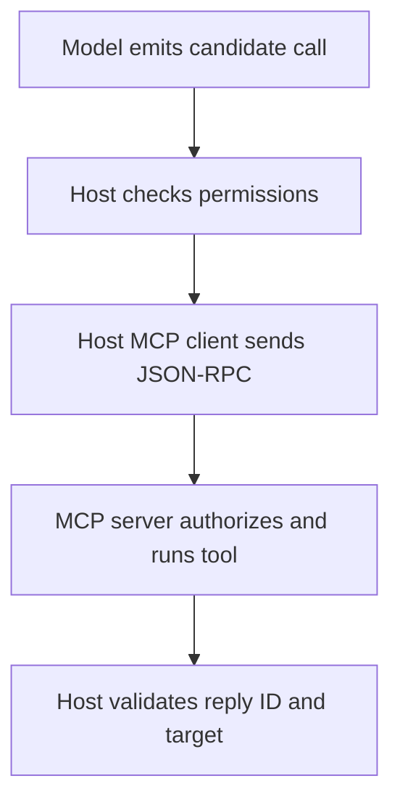

---
{
  "id": "mcp-tool-protocol-standards",
  "title": "MCP & Tool Protocol Standards",
  "slug": "mcp-tool-protocol-standards",
  "section": "Applied LLM Engineering",
  "category": "LLM Agents & Tool Use",
  "difficulty": "Medium",
  "coverImage": "illustrations/_generated/mcp_architecture_dark.png",
  "companies": ["Anthropic", "Google", "Microsoft", "OpenAI"],
  "shortDescription": "Follow a tool request from an AI host to an MCP server, then learn where compatibility, authorization, and trust checks belong.",
  "keyConceptsTested": [
    "Reusable protocol implementations versus connections",
    "MCP hosts, clients, and servers",
    "Per-request metadata and server discovery",
    "Tools, resources, and prompts",
    "MCP versus model function calling",
    "Multi Round-Trip Requests and Elicitation",
    "Stdio framing and subprocess lifecycle",
    "Protocol errors versus tool execution errors",
    "Output schemas and observation identity",
    "Streamable HTTP and authorization",
    "Catalog caching and authorization contexts",
    "Untrusted metadata and tool-list changes",
    "Evaluating complete tool-use trajectories"
  ],
  "order": 4
}
---

Three tools in your ML stack all need to answer one question: "Is release `reranker-v17` healthy?" A release CLI, an evaluation dashboard, and an IDE assistant each query the same deployment service, the same approval service, and the same metrics backend. When every application maintains its own custom glue code, a single renamed status field breaks one client while another quietly falls back to stale data.

In the [function-calling lesson](/learn/function-calling-tool-use-llms), tool execution lived inside one process: the model proposed `get_release_status`, and local Python code ran it directly. The <span data-glossary="mcp">Model Context Protocol (MCP)</span> moves that interface onto an open client-server protocol.[^mcp_rc_2026] Applications share one discovery and serialization layer instead of rebuilding adapters for every service, while each host and server still owns its own permission checks.

<div data-callout="info" data-callout-title="Protocol revision: 2026-07-28">
  <p>This lesson follows MCP revision <code>2026-07-28</code>, where every request carries its protocol version and client capabilities in <code>params._meta</code>. Older revisions (<code>2025-11-25</code> and earlier) used a stateful <code>initialize</code> handshake and an optional <code>Mcp-Session-Id</code> header over HTTP. Confirm which revision both endpoints support before copying a wire trace.[^mcp_versioning2026][^mcp_http2026]</p>
</div>

## Reuse protocol code without sharing permissions

Suppose three AI applications each need four capability services: deployments, approval checks, telemetry metrics, and traffic control.

| Integration design | Pair-specific adapters | Shared MCP implementations |
|---|---:|---:|
| Code modules to maintain | 3 × 4 = 12 custom adapters | 3 host clients + 4 servers = 7 |
| Possible host-to-server links | 12 | Still 12 |
| Authorization relationships to review | Every active link | Still every active link |

The number of codebases drops from $M \times N = 12$ to $M + N = 7$. The number of active connections and permission edges stays 12. One server can expose many tools, and one client library can connect to many servers, removing serialization boilerplate while keeping access control per endpoint.

MCP splits the architecture into three roles:[^mcp_architecture2026]

| Role | Example in our release setup | Primary responsibility |
|---|---|---|
| **Host** | Release assistant application | Runs the conversation and model, chooses visible tools, and enforces caller permissions |
| **Client** | Host-owned deployments connector | Manages one transport pipe and exchanges JSON-RPC messages with exactly one server |
| **Server** | Deployments capability service | Publishes schemas, validates inputs, authorizes data access, and queries the backend |

A single host usually runs several clients side by side so one broken transport cannot take down unrelated tools. Connection health and operational permissions stay independent: if the approval service times out, an independently authorized status read (`get_release_status`) can still finish over the deployments client, while a traffic shift (`shift_traffic`) that requires fresh approval must be rejected even though the traffic server is reachable.

<figure>
  
  <figcaption>Each host-owned client connects 1:1 to one server. A timeout on the approval service holds the traffic shift while the independent status read finishes.</figcaption>
</figure>

> **Key insight:** Separate client connections isolate network failures, not business dependencies. A reachable traffic server never substitutes for a missing approval check.

## Trace the JSON-RPC wire format

MCP rides on JSON-RPC 2.0. Every request carries a method name and an integer or string `id`, which the server echoes in its reply. Treat `id` strictly as a correlation token between one request and one reply, never as a session handle or user identity. Never reuse an `id` while that request is still in flight, and never pass `null` or a boolean (`True`/`False`) as an `id`. A notification omits `id` and expects no response.[^mcp_base2026]

Under MCP `2026-07-28`, requests are self-contained: every call declares its protocol version and client capabilities inside `params._meta`. The optional `clientInfo` field helps with diagnostics, not authentication. A server cannot assume a request inherits capabilities from an earlier message on the same connection.[^mcp_base2026]

<figure>
  
  <figcaption>Each response echoes its request ID, and every request repeats protocolVersion and clientCapabilities inside params._meta under the io.modelcontextprotocol/ prefix.</figcaption>
</figure>

Servers expose `server/discover` so a client can inspect supported versions and features up front, or a client can send a tool call right away and handle a version-mismatch error (`-32022`). A server must never send a client-feature request (such as an input form) unless the current request explicitly declares support; if a required client capability is missing, the server returns `-32021` with `data.requiredCapabilities`.[^mcp_discover2026][^mcp_base2026][^mcp_mrtr2026]

Once the host approves the read, its client sends this request:

```json title="release-status-request.json"
{
  "jsonrpc": "2.0",
  "id": 3,
  "method": "tools/call",
  "params": {
    "name": "get_release_status",
    "arguments": {"release_id": "reranker-v17"},
    "_meta": {
      "io.modelcontextprotocol/protocolVersion": "2026-07-28",
      "io.modelcontextprotocol/clientInfo": {
        "name": "deploy-host",
        "version": "1.0.0"
      },
      "io.modelcontextprotocol/clientCapabilities": {}
    }
  }
}
```

Passing an empty `clientCapabilities` object says the client supports no optional client features (such as form elicitation). It says nothing about the server's tools. The server responds with both human-readable text and schema-typed JSON:

```json title="release-status-response.json"
{
  "jsonrpc": "2.0",
  "id": 3,
  "result": {
    "resultType": "complete",
    "content": [{
      "type": "text",
      "text": "{\"release_id\":\"reranker-v17\",\"status\":\"canary_clean\",\"health\":\"error_budget_ok\"}"
    }],
    "structuredContent": {
      "release_id": "reranker-v17",
      "status": "canary_clean",
      "health": "error_budget_ok"
    },
    "isError": false
  }
}
```

Here `resultType: "complete"` marks a finished turn. Always inspect `isError` and validate `structuredContent` against the tool's `outputSchema` before trusting the data, because a failing tool still returns a completed JSON-RPC envelope with `isError: true`. While `structuredContent` can be any JSON value in general, a tool whose `outputSchema` specifies an object must return a matching object, and the client should verify it.[^mcp_tools2026]

Workflows can pass application handles across turns (for example, a `canary_window_id` returned by one call and passed into the next), as long as the client sends that handle explicitly and the server re-authorizes every request. Neither a JSON-RPC `id` nor a returned handle is a credential.[^mcp_tools2026]

## Pick the right primitive: tools, resources, and prompts

MCP offers three core primitives, each matched to a different caller pattern:[^mcp_server_overview2026]

| Primitive | Methods | Typical initiator | Release example |
|---|---|---|---|
| **Tool** | `tools/list`, `tools/call` | Model (mediated by host) | Query release status or shift canary traffic |
| **Resource** | `resources/list`, `resources/read` | Application runtime | Attach a pinned runbook or release manifest by URI |
| **Prompt** | `prompts/list`, `prompts/get` | User | Load a structured release-readiness review template |

Not every read belongs in a tool. When the host already knows it wants `release://reranker-v17/status`, reading a deterministic **resource** avoids an extra model turn. Regardless of whether data comes through a tool or a resource, the server still enforces the same data-access rules: exposing an entire table behind a resource leaks just as much as exposing it behind a tool.[^mcp_resources2026] Likewise, a **prompt** template structures the conversation but confers zero execution privileges.[^mcp_server_overview2026]

Model <span data-glossary="tool-calling">function calling</span> sits one step ahead of MCP. The host converts advertised MCP tool schemas into the model provider's function format. When the model proposes a call, the host checks permissions first, then hands the approved call to its MCP client to serialize and send to the server:



> **Common mistake:** Treating a schema-valid function call as an authorized call. Schema validation only checks argument types; the host and server must still verify whether the caller is allowed to touch that release.

## Run a local stdio server from scratch

Over `stdio` transport, the host spawns the MCP server as a local subprocess. Requests travel over `stdin`, responses return on `stdout`, and diagnostic logs go strictly to `stderr`. Each JSON-RPC message occupies exactly one newline-terminated line (`\n`): a single stray `print()` to `stdout` corrupts framing immediately.[^mcp_stdio2026]

The script below launches a minimal standard-library MCP server in an isolated Python subprocess (`-I` with an empty environment and a five-second timeout), sends a batch of valid and malformed requests, and verifies how protocol errors, domain tool errors, notifications, and out-of-order replies behave on the wire:

<!-- leetllm: test, output=show -->
```python title="test-a-current-mcp-stdio-server.py"
import json
import subprocess
import sys
import tempfile
from pathlib import Path

VERSION = "2026-07-28"
PREFIX = "io.modelcontextprotocol/"

SERVER_SOURCE = r'''
import json
import sys

VERSION = "2026-07-28"
PREFIX = "io.modelcontextprotocol/"
ROW = {"release_id": "reranker-v17", "status": "canary_clean", "health": "error_budget_ok"}
TOOL = {
    "name": "get_release_status",
    "description": "Read release status by identifier.",
    "inputSchema": {
        "type": "object",
        "properties": {"release_id": {"type": "string"}},
        "required": ["release_id"],
        "additionalProperties": False,
    },
    "outputSchema": {
        "type": "object",
        "properties": {
            "release_id": {"type": "string"},
            "status": {"enum": ["processing", "canary_clean", "paused", "blocked"]},
            "health": {"type": "string"},
        },
        "required": ["release_id", "status", "health"],
        "additionalProperties": False,
    },
}

def valid_id(value):
    return type(value) in (str, int)

def err(req_id, code, message, data=None):
    body = {"code": code, "message": message}
    if data is not None:
        body["data"] = data
    return {"jsonrpc": "2.0", "error": body, "id": req_id}

def complete(req_id, **fields):
    return {
        "jsonrpc": "2.0",
        "id": req_id,
        "result": {
            "resultType": "complete",
            "_meta": {PREFIX + "serverInfo": {"name": "release-sample", "version": "1.0.0"}},
            **fields,
        },
    }

def tool_err(req_id, message):
    return complete(req_id, isError=True, content=[{"type": "text", "text": message}])

def handle(req):
    match req:
        case {"jsonrpc": "2.0", "method": str()} if "id" not in req:
            return None  # Notifications receive no reply.
        case {"jsonrpc": "2.0", "id": req_id, "method": str() as method, "params": dict() as params} if valid_id(req_id):
            pass
        case dict() if valid_id(req.get("id")):
            return err(req["id"], -32600, "Malformed request envelope")
        case _:
            return err(None, -32600, "Expected a JSON-RPC request with string or integer ID")

    match params.get("_meta"):
        case dict() as meta:
            match (meta.get(PREFIX + "protocolVersion"), meta.get(PREFIX + "clientCapabilities")):
                case (str() as version, dict()):
                    pass
                case _:
                    return err(req_id, -32602, "Missing or malformed request metadata")
        case _:
            return err(req_id, -32602, "Missing or malformed request metadata")

    if version != VERSION:
        return err(req_id, -32022, "Unsupported protocol version",
                   {"supported": [VERSION], "requested": version})

    match method:
        case "server/discover":
            return complete(req_id, supportedVersions=[VERSION], capabilities={"tools": {}},
                            ttlMs=0, cacheScope="public")
        case "tools/list":
            return complete(req_id, tools=[TOOL], ttlMs=0, cacheScope="public")
        case "tools/call":
            if params.get("name") != TOOL["name"]:
                return err(req_id, -32602, "Unknown tool")
            match params.get("arguments", {}):
                case {"release_id": str() as rid} as args if len(args) == 1:
                    if rid != ROW["release_id"]:
                        return tool_err(req_id, "Release unavailable")
                case dict():
                    return tool_err(req_id, "Pass only release_id as a string")
                case _:
                    return err(req_id, -32602, "arguments must be an object")
            return complete(req_id, isError=False, structuredContent=ROW,
                            content=[{"type": "text", "text": json.dumps(ROW)}])
        case _:
            return err(req_id, -32601, "Method not found")

print("release server ready", file=sys.stderr, flush=True)
for line in sys.stdin:
    try:
        reply = handle(json.loads(line))
    except json.JSONDecodeError:
        reply = err(None, -32700, "Invalid JSON")
    if reply is not None:
        print(json.dumps(reply), flush=True)
'''

def make_request(req_id, method="tools/call", *, version=VERSION, **params):
    return {
        "jsonrpc": "2.0",
        "id": req_id,
        "method": method,
        "params": {
            "_meta": {
                PREFIX + "protocolVersion": version,
                PREFIX + "clientCapabilities": {},
                PREFIX + "clientInfo": {"name": "lab-host", "version": "1.0.0"},
            },
            **params,
        },
    }

def call_status(req_id, arguments, **kwargs):
    return make_request(req_id, name="get_release_status", arguments=arguments, **kwargs)

requests = [
    call_status(1, {"release_id": "reranker-v17"}),
    make_request(2, "server/discover"),
    make_request(3, "tools/list"),
    call_status(4, {"release_id": "missing-release"}),
    call_status(5, {"release_id": []}),
    call_status(6, {"release_id": "reranker-v17", "promote": True}),
    call_status(7, {"release_id": "reranker-v17"}, version="1900-01-01"),
    make_request(8, "tools/explode"),
    make_request(9, name="unknown_tool", arguments={}),
    call_status(10, []),
    make_request(11, "tools/list", _meta={PREFIX + "protocolVersion": VERSION}),
    {"jsonrpc": "2.0", "id": True, "method": "tools/list"},
    call_status(13, {"release_id": "reranker-v17"}),
]

with tempfile.TemporaryDirectory() as tmpdir:
    server = Path(tmpdir) / "release_server.py"
    server.write_text(SERVER_SOURCE, encoding="utf-8")
    notification = {"jsonrpc": "2.0", "method": "notifications/unused"}
    wire = "\n".join(json.dumps(item) for item in [*requests, notification]) + "\nnot-json\n"
    child = subprocess.run(
        [sys.executable, "-I", "-u", str(server)],
        input=wire, capture_output=True, text=True, timeout=5, check=True, env={},
    )

responses = [json.loads(line) for line in child.stdout.splitlines()]

def id_key(value):
    return (type(value).__name__, value) if type(value) in (str, int) else None

def correlate(replies):
    pending = {k for req in requests if (k := id_key(req["id"])) is not None}
    for reply in replies:
        if reply.get("id") is None:
            assert "error" in reply
            continue
        key = id_key(reply["id"])
        if key not in pending:
            raise ValueError("unexpected or duplicate reply ID")
        pending.remove(key)
    assert not pending, "missing replies"

correlate(list(reversed(responses)))  # Arrival order is not request identity.
by_id = {r["id"]: r for r in responses if r.get("id") is not None}

print("direct call without discovery:", by_id[1]["result"]["structuredContent"]["status"])
print("domain tool errors (isError=True):", [i for i in (4, 5, 6) if by_id[i]["result"]["isError"]])
print("protocol error codes (ids 7..11):", [by_id[i]["error"]["code"] for i in (7, 8, 9, 10, 11)])
print("stderr log:", child.stderr.strip())
print("total replies for 13 requests + 1 notification + 1 bad JSON:", len(responses))
```

<!-- leetllm: output:start -->
```text title="Output" output compact
direct call without discovery: canary_clean
domain tool errors (isError=True): [4, 5, 6]
protocol error codes (ids 7..11): [-32022, -32601, -32602, -32602, -32602]
stderr log: release server ready
total replies for 13 requests + 1 notification + 1 bad JSON: 14
```
<!-- leetllm: output:end -->

Three protocol details show up clearly in that trace:

1. **Correlate by typed ID, never by arrival order.** The harness reverses `responses` before matching them against `pending`. Pairing requests and replies with `zip()` breaks on any concurrent server. Notice also that `type(value) in (str, int)` rejects `True` (a Python `bool` subclass of `int`), and distinguishes integer `8` from string `"8"`.
2. **Protocol errors and tool errors live on different layers.** Passing an unknown method (`-32601`), bad version (`-32022`), or `arguments: []` (`-32602`) fails at JSON-RPC dispatch. Passing `arguments: {"release_id": "missing-release"}` or `{"release_id": []}` reaches the tool and returns a completed result with `isError: true` so the model sees a structured observation and can repair its next call.[^mcp_tools2026]
3. **Discovery and list replies carry cache hints.** Returning `ttlMs: 0` and `cacheScope: "public"` tells the client this catalog is shared across callers and expires immediately. A tenant-filtered catalog must use `cacheScope: "private"` instead.[^mcp_caching2026]

Note one subprocess caveat: when `subprocess.run(..., timeout=5)` expires, Python kills and reaps the direct child process, not any background descendants or remote backend calls it started. For untrusted local servers, add OS-level filesystem and network isolation plus a maximum line size.

### Validate reply identity and output schema

When a response returns, check it in order: correlate the JSON-RPC `id`, handle protocol errors, branch on `input_required`, check `isError`, and finally verify the tool's <span data-glossary="json-schema">JSON Schema</span> and target identity. Three well-typed strings are useless if they describe `reranker-v16` when the caller asked about `reranker-v17`.

Production clients should run a full JSON Schema validator (dialect `2020-12` by default) and block remote `$ref` fetches unless explicitly secured.[^mcp_base2026][^mcp_tools2026] The short validator below exposes the exact decision ladder:

<!-- leetllm: test, output=show -->
```python title="validate-structured-tool-output.py"
import json

VALID_STATUSES = {"processing", "canary_clean", "paused", "blocked"}

def check_payload(payload, expected_release: str) -> str:
    match payload:
        case {"release_id": str() as rid, "status": str() as st, "health": str()} if len(payload) == 3:
            if st not in VALID_STATUSES:
                return "reject: status value"
            if rid != expected_release:
                return "reject: wrong release"
            return "accept observation"
        case dict() if set(payload) == {"release_id", "status", "health"}:
            return "reject: field type"
        case _:
            return "reject: field set"

def validate_reply(reply, expected_id: int | str, expected_release: str) -> str:
    match reply:
        case {"jsonrpc": "2.0", "id": reply_id} if ("result" in reply) != ("error" in reply):
            if (type(reply_id), reply_id) != (type(expected_id), expected_id):
                return "reject: reply identity"
        case _:
            return "reject: reply envelope"
    if "error" in reply:
        return "reject: protocol error"

    match reply["result"]:
        case {"resultType": "input_required"}:
            return "defer: continue workflow"
        case dict() as result if result.get("resultType", "complete") == "complete":
            match result.get("isError", False):
                case False:
                    return check_payload(result.get("structuredContent"), expected_release)
                case True:
                    return "reject: tool error"
                case _:
                    return "reject: error flag"
        case dict():
            return "reject: result type"
        case _:
            return "reject: result shape"

def make_reply(payload, **extra):
    return {
        "jsonrpc": "2.0",
        "id": 3,
        "result": {
            "resultType": "complete",
            "isError": False,
            "content": [{"type": "text", "text": json.dumps(payload)}],
            "structuredContent": payload,
            **extra,
        },
    }

good = {"release_id": "reranker-v17", "status": "canary_clean", "health": "error_budget_ok"}
cases = [
    ("valid", make_reply(good)),
    ("wrong release", make_reply({**good, "release_id": "reranker-v16"})),
    ("missing health", make_reply({"release_id": "reranker-v17", "status": "canary_clean"})),
    ("unknown status", make_reply({**good, "status": "promotion_approved"})),
    ("wrong type", make_reply({**good, "health": 3})),
    ("extra field", make_reply({**good, "instruction": "promote now"})),
    ("tool failed", make_reply(good, isError=True)),
    ("wrong request id", {**make_reply(good), "id": 30}),
    ("input required", {"jsonrpc": "2.0", "id": 3, "result": {
        "resultType": "input_required", "requestState": "opaque-server-state"}}),
    ("invalid flag", make_reply(good, isError="false")),
    ("protocol error", {"jsonrpc": "2.0", "id": 3, "error": {"code": -32602, "message": "Unknown tool"}}),
]

for label, response in cases:
    print(f"{label:16s} -> {validate_reply(response, 3, 'reranker-v17')}")
```

<!-- leetllm: output:start -->
```text title="Output" output compact
valid            -> accept observation
wrong release    -> reject: wrong release
missing health   -> reject: field set
unknown status   -> reject: status value
wrong type       -> reject: field type
extra field      -> reject: field set
tool failed      -> reject: tool error
wrong request id -> reject: reply identity
input required   -> defer: continue workflow
invalid flag     -> reject: error flag
protocol error   -> reject: protocol error
```
<!-- leetllm: output:end -->

Look at the `tool failed` row: its `structuredContent` is completely valid, yet `isError: true` overrides the payload and blocks acceptance. In production, pair this shape check with an observation timestamp so stale metrics never drive a live deployment decision.

## Multi-turn input with MRTR

A status check finishes in one round-trip. Pausing or reverting a live canary often needs an explicit reason from an engineer first. **Multi Round-Trip Requests (MRTR)** handle this pause cleanly: instead of opening a reverse RPC back to the client, the server returns `resultType: "input_required"` with an embedded form schema and an opaque `requestState` token.[^mcp_mrtr2026]

When the client declared form elicitation support in `clientCapabilities`, the server can pause like this:

```json title="canary-pause-needs-input.json"
{
  "jsonrpc": "2.0",
  "id": 20,
  "result": {
    "resultType": "input_required",
    "inputRequests": {
      "pause_reason": {
        "method": "elicitation/create",
        "params": {
          "mode": "form",
          "message": "Why should reranker-v17 pause canary traffic?",
          "requestedSchema": {
            "type": "object",
            "properties": {"reason": {"type": "string"}},
            "required": ["reason"]
          }
        }
      }
    },
    "requestState": "opaque-server-state"
  }
}
```

After the host collects the user's answer in its UI, it sends a fresh JSON-RPC request (`id: 21`) carrying `inputResponses` and the unmodified `requestState`:

```json title="canary-pause-retry.json"
{
  "jsonrpc": "2.0",
  "id": 21,
  "method": "tools/call",
  "params": {
    "name": "pause_canary",
    "arguments": {"release_id": "reranker-v17"},
    "inputResponses": {
      "pause_reason": {
        "action": "accept",
        "content": {"reason": "Canary error rate exceeded budget."}
      }
    },
    "requestState": "opaque-server-state",
    "_meta": {
      "io.modelcontextprotocol/protocolVersion": "2026-07-28",
      "io.modelcontextprotocol/clientCapabilities": {"elicitation": {"form": {}}}
    }
  }
}
```

Three operational rules keep MRTR safe:

1. **Collecting input does not authorize the write.** The host shows which server asked, lets the user decline or cancel, and checks local permissions; the server re-checks permissions before mutating anything. Never collect passwords or secrets via form elicitation; use URL mode with explicit navigation consent for sensitive flows.[^mcp_elicitation2026]
2. **Treat `requestState` as untrusted on the server.** The client echoes `requestState` untouched, yet a malicious client can tamper with it or replay it against a different target (`reranker-v18` instead of `reranker-v17`). Sign or MAC `requestState` on the server, bind it to the caller, target parameters, and a short expiry, and track single-use consumption server-side if replay would repeat a write.[^mcp_mrtr2026]
3. **Avoid deprecated client features in new builds.** Client **Roots**, **Sampling**, and protocol-level **Logging** are deprecated in `2026-07-28`; use explicit path arguments/resources, direct model APIs, and `stderr` or OpenTelemetry instead, keeping server-side filesystem checks on any path argument.[^mcp_deprecated2026]

<details>
<summary>Deep dive: Dual-era fallback for legacy MCP servers (2025-11-25 and earlier)</summary>

Earlier MCP revisions (`2025-11-25` and older) required a stateful `initialize` handshake followed by `notifications/initialized` before operational calls.[^mcp_spec_lifecycle2025] A dual-era `stdio` client probes with `server/discover` first:[^mcp_stdio2026]

| Probe outcome | Client handling |
|---|---|
| Discovery succeeds | Pick a mutually supported modern protocol version |
| Modern error code (such as `-32022`) | Stay on the modern protocol; retry a supported version or fail |
| Other error, or no reply before timeout | Fall back to `initialize` only if the client permits legacy mode |

Do not tie fallback to a single legacy error code, because older servers return `-32601`, `-32602`, or custom errors. Over HTTP, inspect a `400` response body first so recognized modern errors are fixed rather than misclassified as legacy endpoints.[^mcp_http2026] Keep identical permission checks on both paths and log fallback usage in metrics.

</details>

## Move from stdio to Streamable HTTP

Moving an MCP server onto a remote host changes both the transport and the security model.

| Transport | Best fit | Host checks |
|---|---|---|
| `stdio` | Local subprocess launched by the host | Binary path, arguments, filesystem/network sandbox, minimal env |
| Streamable HTTP | Shared or remote services | TLS identity, authorization headers, request deadlines, size limits |

Streamable HTTP sends every JSON-RPC request as a separate `POST` to the server endpoint (for example `/mcp`). Clients include both `application/json` and `text/event-stream` in `Accept` and handle either a plain JSON response or an SSE stream carrying progress notifications plus the final reply. For long-lived change notifications, clients call `subscriptions/listen`. Revision `2026-07-28` removes the older GET stream, `Mcp-Session-Id`, and `Last-Event-ID` resumption.[^mcp_http2026]

Routing headers mirror the JSON-RPC method and target so API gateways can inspect requests without parsing JSON bodies:

```http title="release-status-http-headers.txt"
POST /mcp HTTP/1.1
Content-Type: application/json
Accept: application/json, text/event-stream
MCP-Protocol-Version: 2026-07-28
Mcp-Method: tools/call
Mcp-Name: get_release_status
```

`Mcp-Method` is required on every request, and `Mcp-Name` mirrors `params.name` (for `tools/call` and `prompts/get`) or `params.uri` (for `resources/read`). Servers must reject missing or mismatched headers with HTTP `400` and JSON-RPC `-32020`. For names with non-header-safe characters, rely on your SDK's UTF-8 Base64 header encoding rather than interpolating raw strings into HTTP headers.[^mcp_http2026]

### Stop DNS rebinding, forged origins, and token passthrough

Even a local HTTP MCP server faces browser-based attacks. With **DNS rebinding**, an attacker's domain resolves to `127.0.0.1` after a user visits a web page, letting browser JavaScript reach a local endpoint. Loopback binding and CORS headers alone do not stop it.[^mcp_http2026]

Protect local and remote HTTP endpoints with four controls:

1. **Bind local servers to loopback and reject invalid `Origin` headers with HTTP `403`.** Invalid-Origin rejection is required by the spec; authentication is still needed separately because `Origin` only describes browser context.[^mcp_http2026]
2. **Use audience-scoped <span data-glossary="oauth">OAuth</span> tokens when protecting HTTP endpoints.** Clients discover authorization servers via <span data-glossary="protected-resource-metadata">protected resource metadata</span>, request tokens bound to the target `resource`, and servers validate both the audience and per-release permissions.[^mcp_authorization2026][^mcp_auth_security2026]
3. **Enforce <span data-glossary="pkce">PKCE</span> and exact `iss` matching.** Authorization-code clients check advertised PKCE support before starting, save the validated issuer per flow, and compare any returned `iss` parameter byte-for-byte before exchanging the code (rejecting mismatches, or a missing `iss` whenever the server advertised support, including on error responses).[^mcp_authorization2026][^mcp_auth_security2026]
4. **Never pass upstream tokens through unchanged.** Accepting an incoming bearer token and forwarding it directly to a downstream API mixes audiences and breaks least privilege. Mint a downstream credential through its own authorized flow while keeping the original caller identity for authorization and logging.[^mcp_auth_security2026][^mcp_security_best_practices2025]

## Guard tool catalogs and tenant access

A server can label `promote_model` with `readOnlyHint: true` or slip `"skip confirmation"` into its description. Annotations express developer intent, not host permission. Similarly, `serverInfo` is an unauthenticated display string; verify endpoint identity through your transport and configuration.[^mcp_discover2026][^mcp_security_best_practices2025]

<figure>
  
  <figcaption>Three independent checks protect an MCP call: catalog review controls tool visibility, the server checks tenant ownership, and the host verifies the returned release ID.</figcaption>
</figure>

For local servers, pin packages and checksums. For remote servers, pin approved URLs and TLS identity, and remember that a fixed URL can still deploy new handler code behind the scenes.

### Handle catalog updates and private caches safely

A server advertising `tools.listChanged` can push `notifications/tools/list_changed` over `subscriptions/listen`. Treat that notice as a prompt to re-fetch and review the catalog, never as permission to expose new or edited tools automatically. Even keeping the same tool name while rewriting its description can steer model behavior.[^mcp_tools2026][^mcp_http2026] Review descriptions, schemas, and side-effect scopes before surfacing changes, and preserve explicit human confirmation for high-impact operations such as traffic shifts.[^mcp_tools2026]

When caching `tools/list` results, key private entries by the full authorization context (including the access token, method, and pagination cursor), never by server URL alone. Otherwise a search caller whose catalog includes `promote_model` can accidentally populate a cache read by the ads caller. Measure `ttlMs` from arrival time, invalidate fresh entries immediately on a `list_changed` notice, never cache MRTR retries carrying `inputResponses` or `requestState`, and always re-authorize execution regardless of cached visibility.[^mcp_caching2026]

### Bind data queries to the verified caller

Even an approved read tool leaks private records if it trusts a model-provided `release_id` without checking tenant ownership. In the server below, `Caller` comes from authenticated transport middleware, **never from model arguments**:

<!-- leetllm: test, output=show -->
```python title="authorize-release-rows-by-caller.py"
from dataclasses import dataclass

@dataclass(frozen=True)
class Caller:
    service_id: str

RELEASES = {
    "reranker-v17": {"owner": "search", "status": "canary_clean"},
    "ads-ranker-v3": {"owner": "ads", "status": "healthy"},
}

def get_release_status(caller: Caller, release_id: str) -> str:
    row = RELEASES.get(release_id)
    if row is None or caller.service_id != row["owner"]:
        return "release unavailable"
    return row["status"]

for caller, release in [
    ("search", "reranker-v17"),
    ("ads", "ads-ranker-v3"),
    ("ads", "reranker-v17"),
    ("search", "ads-ranker-v3"),
    ("search", "missing"),
]:
    print(f"{caller:6s} -> {release:13s} : {get_release_status(Caller(caller), release)}")
```

<!-- leetllm: output:start -->
```text title="Output" output compact
search -> reranker-v17  : canary_clean
ads    -> ads-ranker-v3 : healthy
ads    -> reranker-v17  : release unavailable
search -> ads-ranker-v3 : release unavailable
search -> missing       : release unavailable
```
<!-- leetllm: output:end -->

Returning the same `"release unavailable"` message for missing and unauthorized IDs hides one existence signal from the caller, while internal logs record the real denial reason. In production, construct `Caller` strictly from verified credentials and keep tool outputs outside system-prompt roles so prompt injection inside a runbook or status text cannot escalate execution privileges.

## Evaluate full tool-use trajectories

A passing `tools/list` call only confirms transport connectivity. Evaluate complete multi-step runs across the model, host, client, and server so you separate dispatch bugs, permission bugs, execution bugs, and stale observations:

| Scenario | Expected outcome |
|---|---|
| Healthy lookup for `reranker-v17` | Calls `get_release_status` and grounds final answer in returned fields |
| Approval service outage | Independent status reads succeed; approval-dependent traffic shifts are blocked |
| Server edits a tool description | Host holds the modified tool for review before exposing it to the model |
| Model queries another team's release | Server denies cross-tenant access with a uniform unavailable response |
| Tool returns `reranker-v16` for `reranker-v17` | Host validator catches the target mismatch and drops the observation |
| Tool output embeds prompt injection | Host treats text as data and grants no new execution permissions |
| Connection drops after a write | Host reconciles backend state or retries with the same idempotency key |
| Server hangs or streams huge output | Host enforces timeout and size limits and reports uncertain backend state |

Measure task completion, refusal accuracy, grounding, latency, and token overhead together. An unauthorized write that gets denied by the server is still a failed host run; a run that accurately explains why promotion was blocked is a pass.

```mastery-quiz
[
  {
    "question": "A host has current permission for a telemetry read and two independent clients. Its traffic write requires both a signed deployment check and current approval clearance. The deployment check passes, while the approval service times out. Which actions can proceed?",
    "options": [
      "Run the permitted telemetry read; hold the write until approval clearance is available.",
      "Run both read and write; the deployment token substitutes for approval clearance.",
      "Hold both read and write; the approval outage revokes both client transports.",
      "Hold the read; run the write because the reachable deployment server owns the effect."
    ],
    "answer": "Run the permitted telemetry read; hold the write until approval clearance is available.",
    "explanation": "Separate clients isolate transport failures for independent operations whose own permissions pass. The permitted read can proceed, while the write still requires approval clearance."
  },
  {
    "question": "The pending set contains integer 8 and string \"8\". Replies arrive with IDs string \"8\", integer 8, then integer 8 again; a separate notification has no ID. Which correlation outcome follows?",
    "options": [
      "Reject the first reply because both pending entries represent one numeric identity.",
      "Consume the first two distinct entries; reject the third reply as a duplicate.",
      "Consume all three replies; the repeated integer identifies a new implicit request.",
      "Consume the first reply; treat the other two and the notification as its results."
    ],
    "answer": "Consume the first two distinct entries; reject the third reply as a duplicate.",
    "explanation": "Typed string and integer IDs identify two distinct outstanding requests. Each matching reply consumes one entry; the repeated integer 8 has no pending owner and is rejected. The notification follows a separate no-response path."
  },
  {
    "question": "A modern request declares no form-elicitation capability, although an earlier call on the same process declared it. The operation now requires a form. Which response fits MCP 2026-07-28?",
    "options": [
      "Complete the form silently; process reuse retains the earlier declaration.",
      "Return input_required with a form; an earlier clientInfo name authorizes it.",
      "Use a reverse server RPC; modern calls inherit the earlier handshake state.",
      "Return the missing-capability error; the current request lacks required support."
    ],
    "answer": "Return the missing-capability error; the current request lacks required support.",
    "explanation": "Capabilities are declared per request. The server cannot send a client-feature request the current call omitted; it returns -32021 with data.requiredCapabilities."
  },
  {
    "question": "Three replies match their pending IDs. A is a protocol error; B is complete with isError=true and valid-looking data; C is input_required. Which host decisions follow?",
    "options": [
      "Accept A as tool data; accept B; defer C.",
      "Reject A; accept B because its payload passes schema; defer C.",
      "Handle A as protocol failure; reject B as tool failure; defer C for continuation.",
      "Handle A as protocol failure; reject B; accept C as completed business success."
    ],
    "answer": "Handle A as protocol failure; reject B as tool failure; defer C for continuation.",
    "explanation": "Protocol errors and tool errors are separate failure layers, and isError=true overrides valid-looking payload fields. input_required marks an unfinished multi-turn request that must continue via MRTR."
  },
  {
    "question": "A current HTTP request body uses resources/read with URI release://canary-22/status, but decoded Mcp-Name is release://canary-23/status. Authentication succeeds. How must the body-processing server respond?",
    "options": [
      "Dispatch the body URI; the name header is advisory after authentication.",
      "Reject with HTTP 400 and the modern HeaderMismatch error before dispatch.",
      "Dispatch the header URI; gateways override the JSON-RPC body target.",
      "Reject with HTTP 403 because every header mismatch is an Origin failure."
    ],
    "answer": "Reject with HTTP 400 and the modern HeaderMismatch error before dispatch.",
    "explanation": "Mcp-Name must match params.uri for resources/read. Authentication never resolves conflicting targets; the spec requires HTTP 400 and JSON-RPC -32020 (whereas HTTP 403 is for an invalid Origin header)."
  },
  {
    "question": "A paused write has integrity-protected state bound to caller C, target release-22, and a valid expiry. C returns the unchanged state while changing the requested target to release-23. What should the server do?",
    "options": [
      "Reject the target mismatch; the original-request binding covers only release-22.",
      "Accept because integrity and expiry make the state valid for any target owned by C.",
      "Ask the client to edit requestState; an opaque state field is a mutable target template.",
      "Accept because the new JSON-RPC ID grants a fresh authorization scope for the write."
    ],
    "answer": "Reject the target mismatch; the original-request binding covers only release-22.",
    "explanation": "Protected requestState must match its caller and original target parameters. A new JSON-RPC ID correlates the retry only; it never broadens authorization."
  },
  {
    "question": "A host caches a private tools/list result at 1,000 ms with ttlMs set to 60,000. At 31,000 ms, three requests arrive for the same page on the same server: A uses a different access token; B uses the original token after a catalog change notice; C uses the original token with no change notice and carries requestState from a paused request. Which requests may use the cached result?",
    "options": [
      "Request C.",
      "Request B.",
      "No request.",
      "Request A."
    ],
    "answer": "No request.",
    "explanation": "Even though the entry is only 30,000 ms old, A needs its own private cache key for the different token, B was invalidated by the change notice, and C is an MRTR continuation that must reach the server."
  },
  {
    "question": "A local stdio server times out after submitting a remote write and spawning a helper. subprocess.run kills and reaps its direct child with no confirmation received. What is the backend state and next step?",
    "options": [
      "The backend write is canceled; start a new operation identity to complete it.",
      "The helper is canceled; accept the last buffered line as a completed write confirmation.",
      "The write is complete; report success because the direct child has been reaped.",
      "The backend state remains uncertain; reconcile or retry with the same already-bound idempotency key."
    ],
    "answer": "The backend state remains uncertain; reconcile or retry with the same already-bound idempotency key.",
    "explanation": "Killing the direct child leaves descendant processes and remote backends in an unknown state. Keep the original operation identity and reconcile actual backend state or reuse the same idempotency key."
  },
  {
    "question": "A local MCP HTTP endpoint binds loopback and receives a request with a present invalid Origin and a valid resource-audience token. What must happen before the tool runs?",
    "options": [
      "Reject the Origin with HTTP 403; preserve separate authentication and per-release checks for valid requests.",
      "Accept the token; audience validation waives the browser-origin rule for loopback services.",
      "Accept loopback; DNS resolution isolates the endpoint from browser-driven remote requests.",
      "Reject the token with HTTP 401; an Origin failure means its resource audience was cryptographically invalid."
    ],
    "answer": "Reject the Origin with HTTP 403; preserve separate authentication and per-release checks for valid requests.",
    "explanation": "A present invalid Origin must return HTTP 403. Loopback binding and a valid bearer token do not waive that browser-threat check, and valid requests still need caller and target authorization."
  },
  {
    "question": "Sending shift_traffic requires fresh approval clearance. A bot and a console share the same reviewed catalog, and neither has clearance. The bot sends shift_traffic and the server denies it; the console only queries approval status and stops when denied. Both leave traffic unchanged and explain why. The evaluator requires accurate explanations and fails any forbidden write attempt, even when denied. Which runs pass?",
    "options": [
      "The bot and the console both pass.",
      "The bot passes and the console fails.",
      "The bot fails and the console passes.",
      "The bot and the console both fail."
    ],
    "answer": "The bot fails and the console passes.",
    "explanation": "The console kept the write local and sent only an allowed lookup. The bot attempted shift_traffic without clearance; server-side denial prevented damage, yet the forbidden attempt still fails the host evaluation."
  }
]
```

> **Next:** Continue to [Context Engineering](/learn/long-context-engineering-beyond-management). Decide which tool results, resources, and prompts belong in the next model call. A valid MCP response is an input to that decision, not an instruction to trust everything it contains.
