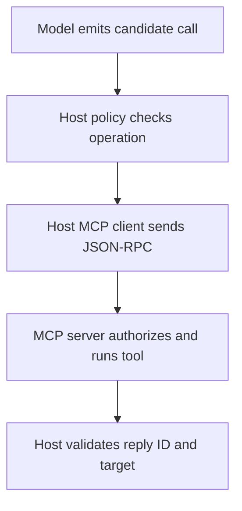

---
{
  "id": "mcp-tool-protocol-standards",
  "title": "MCP & Tool Protocol Standards",
  "slug": "mcp-tool-protocol-standards",
  "section": "Applied LLM Engineering",
  "category": "LLM Agents & Tool Use",
  "difficulty": "Medium",
  "coverImage": "illustrations/_generated/mcp_architecture_dark.png",
  "companies": ["Anthropic", "Google", "Microsoft", "OpenAI"],
  "shortDescription": "Follow a tool request from an AI host to an MCP server, then learn where compatibility, authorization, and trust checks belong.",
  "keyConceptsTested": [
    "Reusable protocol implementations versus connections",
    "MCP hosts, clients, and servers",
    "Per-request metadata and server discovery",
    "Tools, resources, and prompts",
    "MCP versus model function calling",
    "Multi Round-Trip Requests and Elicitation",
    "Stdio framing and bounded process lifecycle",
    "Protocol errors versus tool execution errors",
    "Output schemas and observation identity",
    "Streamable HTTP and authorization",
    "Catalog caching and authorization contexts",
    "Untrusted metadata and tool-list changes",
    "Evaluating complete tool-use trajectories"
  ],
  "order": 4
}
---

Picture an on-call engineer at 2:00 AM asking an operations assistant: "Is release `reranker-v17` healthy?" Three applications need that deployment data: an incident triage bot, an operations console, and an IDE companion. Separate adapters can drift when the deployment API changes, so one integration might reject a renamed status field while another quietly falls back to stale cache data. A shared MCP server gives those applications one protocol integration to maintain, while still requiring accurate backend state and explicit error handling.

The [function-calling lesson](/learn/function-calling-tool-use-llms) kept tool execution inside one application runtime: the model proposed `get_release_status`, and local application code decided whether to execute it. The <span data-glossary="mcp">Model Context Protocol (MCP)</span> places that capability behind an open, standardized client-server interface.[^mcp_rc_2026] Hosts share protocol plumbing across AI applications and infrastructure services, discovering and calling capabilities without locking permissions inside the wire format. Protocol details decide which bytes cross the wire, while host policy still controls which calls leave the application and how returned observations are checked.

<div data-callout="info" data-callout-title="Protocol revision: 2026-07-28">
  <p>This lesson follows MCP <code>2026-07-28</code>, verified October 10, 2026. Each request carries its protocol version and client capabilities. The <code>initialize</code> handshake belongs to revisions <code>2025-11-25</code> and earlier; older Streamable HTTP revisions could also use <code>Mcp-Session-Id</code>. Check the revision supported by both endpoints before copying a wire trace.[^mcp_versioning2026][^mcp_http2026]</p>
</div>

## Reuse protocol code and review each permission

Suppose three AI hosts each need four capability services: deployments, rollout policy, telemetry metrics, and traffic shifts.

| Integration design | Pair-specific adapters | Shared MCP implementations |
|---|---:|---:|
| Integration implementations in this setup | 3 × 4 = 12 custom adapters | 3 host integrations + 4 servers = 7 |
| Possible host-to-server connections | 12 | Still 12 |
| Authorization relationships to review | Each required relationship | Still each required relationship |

The count falls from 12 pair-specific adapters to seven shared implementations in this setup. Hosts still form 12 possible connections, and each required authorization relationship needs review. One server can expose multiple tools, and a single client library can connect to multiple servers. MCP removes repetitive serialization and discovery plumbing while each service endpoint keeps its own permission checks.

Three distinct architectural roles separate these responsibilities:[^mcp_architecture2026]

| Role | Release-management example | Primary responsibility |
|---|---|---|
| **Host** | Release assistant application | Controls the user conversation, runs the model, manages visible tools, and enforces action policies |
| **Client** | Host-owned deployments connector | Maintains a protocol transport pipe and exchanges JSON-RPC messages with exactly one server |
| **Server** | Deployments capability service | Publishes schemas, validates invocations, authorizes data access, and queries backend infrastructure |

A single host often coordinates several clients simultaneously. Separate clients let the host contain a connection failure when its error handling also isolates each operation. Connection health reports whether messages can flow, whereas host policy authorizes each call separately. If the rollout policy server times out, an independently authorized status read (`get_release_status`) can still finish over the deployments client. A traffic shift (`shift_traffic`) that requires policy clearance must fail closed, even if the rollouts server is reachable.

<figure>
  
  <figcaption>Each host-owned client connects to one external server. A failed policy lookup leaves the traffic shift held while the independent status read completes.</figcaption>
</figure>

```checkpoint
The policy server times out, but deployments and rollouts servers are reachable. Which operations can continue?
---
Only operations whose own authorization requirements remain satisfied. An independent status read can proceed; a traffic shift requiring unavailable policy clearance must fail closed. Separate client connections don't erase business dependencies.
```

## Trace the wire before hiding it behind an SDK

MCP runs on JSON-RPC 2.0. Each request carries a method and an integer or string `id`, which the server echoes in its reply. Think of the ID as a tracking number: it pairs a reply with its request, not with conversation memory or user identity. Don't reuse an ID while its request is outstanding, and don't use `null` or a Boolean as an ID. A notification has no ID and receives no reply.[^mcp_base2026]

Under the modern `2026-07-28` specification, requests are completely self-contained. Each request includes its protocol version and client capabilities inside `params._meta`. The optional `clientInfo` object provides diagnostic metadata, but self-reported identity isn't authentication. A server can't assume a request inherits configuration from an earlier message on the same process.[^mcp_base2026]

<figure>
  
  <figcaption>The response ID matches its request. Each request repeats protocolVersion and clientCapabilities under params._meta with the io.modelcontextprotocol/ prefix.</figcaption>
</figure>

Servers implement `server/discover`. Clients can call it first to inspect supported protocol versions and capabilities, or issue an operational RPC immediately and handle a version error. A server must not send a client-feature request, such as form elicitation, unless the current request declares support. If an operation needs a missing capability, return `-32021` with `data.requiredCapabilities`; don't assume support from earlier traffic.[^mcp_discover2026][^mcp_base2026][^mcp_mrtr2026]

Once host policy clears the read, the client issues this invocation:

```json title="release-status-request.json"
{
  "jsonrpc": "2.0",
  "id": 3,
  "method": "tools/call",
  "params": {
    "name": "get_release_status",
    "arguments": {"release_id": "reranker-v17"},
    "_meta": {
      "io.modelcontextprotocol/protocolVersion": "2026-07-28",
      "io.modelcontextprotocol/clientInfo": {
        "name": "deploy-host",
        "version": "1.0.0"
      },
      "io.modelcontextprotocol/clientCapabilities": {}
    }
  }
}
```

An empty client-capabilities dictionary declares no optional client features, including elicitation or extensions. It says nothing about the server's tools.

```json title="release-status-response.json"
{
  "jsonrpc": "2.0",
  "id": 3,
  "result": {
    "resultType": "complete",
    "content": [{
      "type": "text",
      "text": "{\"release_id\":\"reranker-v17\",\"status\":\"canary_clean\",\"health\":\"error_budget_ok\"}"
    }],
    "structuredContent": {
      "release_id": "reranker-v17",
      "status": "canary_clean",
      "health": "error_budget_ok"
    },
    "isError": false
  }
}
```

The field `resultType: "complete"` marks a finished exchange. Check `isError` and the output schema before treating the reply as business success, because `isError: true` marks a tool execution failure. For this read, validate the returned structure and error flag before using its structured data. `structuredContent` can be any JSON value in this revision, including an array, whereas this tool's `outputSchema` specifically requires an object; servers must return schema-conforming structured results when they advertise an output schema, and clients should validate them.[^mcp_tools2026]

Application workflows can persist identifiers across requests. A status tool might return a `canary_window_id` for subsequent queries, but later calls must send that handle explicitly, and the server must re-authorize its use. Neither a query handle nor a JSON-RPC request ID should quietly become an ambient credential.[^mcp_tools2026]

## Pick the primitive by usage pattern

MCP defines three primary primitives with these intended control patterns. They guide application design; the protocol doesn't mandate a particular UI or prohibit application-driven tool calls.[^mcp_server_overview2026]

| Primitive | Common methods | Who initiates use? | Release-management example |
|---|---|---|---|
| **Tool** | `tools/list`, `tools/call` | Model, mediated by host | Query release status or trigger canary rollback |
| **Resource** | `resources/list`, `resources/read` | Application runtime | Attach a pinned runbook excerpt or active release manifest |
| **Prompt** | `prompts/list`, `prompts/get` | User | Select a structured release-readiness review template |

This separation doesn't mean every read must be modeled as a tool. A URI such as `release://reranker-v17/status` works well as a read-only resource when the application selects it deterministically. Resources can also be selected through a UI or model-assisted application logic. Both patterns require authorization. Exposing an entire database table creates data-minimization risks regardless of whether it's wrapped in a tool or a resource.[^mcp_resources2026]

A prompt template can structure a canary promotion checklist, but it grants no execution permissions. Any resulting tool call still needs the host and server checks described here.[^mcp_server_overview2026]

Model <span data-glossary="tool-calling">function calling</span> operates one layer earlier in the pipeline. The host translates advertised MCP tool schemas into the model provider's specific function format. The model emits a candidate call; the host inspects arguments against policy; then the host's MCP client forwards the approved call to the server over the transport.



```checkpoint
A model generates syntactically valid arguments for another team's release. Has function calling or MCP authorized the read?
---
Neither. Schema validity only proves that the request is structurally understandable. Host policy and the server's tenant-bound data authorization still decide whether the caller can read that release.
```

## Run a bounded stdio integration

In `stdio` transport, the host launches a local server subprocess. Requests flow into the child's `stdin`, responses return through its `stdout`, and operational diagnostics stream to `stderr`. Every protocol message occupies exactly one line, terminated by a newline (`\n`). An unexpected debug print on `stdout` breaks line framing immediately.[^mcp_stdio2026]

To make the framing rules concrete, the example server below handles `server/discover`, `tools/list`, and one read tool using Python's standard library. It processes synchronous requests, ignores unknown notifications, and omits active cancellation, subscriptions, pagination, and authentication against a public in-memory record; use a maintained SDK for production servers.

The parent harness sends newline-delimited messages, closes `stdin`, and applies a five-second timeout. Each line carries a single JSON-RPC message over newline-delimited `stdio`. If the timeout expires, `subprocess.run` kills and waits for the direct child, then raises `TimeoutExpired`, though backend work or descendant processes may still outlive it. Python's `-I` and empty environment drop inherited configuration, and untrusted servers also need filesystem isolation, network limits, and bounded message sizes.

<!-- leetllm: test, output=show -->
```python title="test-a-current-mcp-stdio-server.py"
import json
import subprocess
import sys
import tempfile
from pathlib import Path

VERSION = "2026-07-28"
PREFIX = "io.modelcontextprotocol/"

SERVER_SOURCE = r'''
import json
import sys

VERSION = "2026-07-28"
PREFIX = "io.modelcontextprotocol/"
ROW = {"release_id": "reranker-v17", "status": "canary_clean",
       "health": "error_budget_ok"}
TOOL = {
    "name": "get_release_status",
    "description": "Read one public sample release, not live deployment data.",
    "inputSchema": {
        "type": "object",
        "properties": {"release_id": {"type": "string"}},
        "required": ["release_id"], "additionalProperties": False,
    },
    "outputSchema": {
        "type": "object",
        "properties": {
            "release_id": {"type": "string"},
            "status": {"enum": ["processing", "canary_clean", "rollback_needed", "blocked"]},
            "health": {"type": "string"},
        },
        "required": ["release_id", "status", "health"],
        "additionalProperties": False,
    },
}

def is_valid_id(value):
    return value is not True and value is not False and isinstance(value, (str, int))

def error(request_id, code, message, data=None):
    failure = {"code": code, "message": message}
    if data is not None:
        failure["data"] = data
    return {"jsonrpc": "2.0", "error": failure, "id": request_id}

def complete(request_id, **fields):
    return {"jsonrpc": "2.0", "id": request_id, "result": {
        "resultType": "complete",
        "_meta": {PREFIX + "serverInfo": {"name": "release-sample", "version": "1.0.0"}},
        **fields,
    }}

def tool_error(request_id, message):
    return complete(request_id, isError=True,
                    content=[{"type": "text", "text": message}])

def handle(request):
    if not isinstance(request, dict):
        return error(None, -32600, "Expected a request object")
    if ("id" not in request and request.get("jsonrpc") == "2.0"
            and isinstance(request.get("method"), str)):
        return None  # Unknown notifications receive no reply.
    request_id = request.get("id")
    if not is_valid_id(request_id):
        return error(None, -32600, "Expected a string or integer request ID")
    if request.get("jsonrpc") != "2.0" or not isinstance(request.get("method"), str):
        return error(request_id, -32600, "Malformed request envelope")
    params = request.get("params")
    if not isinstance(params, dict) or not isinstance(params.get("_meta"), dict):
        return error(request_id, -32602, "Expected params and _meta objects")
    meta = params["_meta"]
    version = meta.get(PREFIX + "protocolVersion")
    if not isinstance(version, str) or not isinstance(meta.get(PREFIX + "clientCapabilities"), dict):
        return error(request_id, -32602, "Missing or malformed request metadata")
    if version != VERSION:
        return error(request_id, -32022, "Unsupported protocol version",
                     {"supported": [VERSION], "requested": version})
    method = request["method"]
    if method == "server/discover":
        return complete(request_id, supportedVersions=[VERSION], capabilities={"tools": {}},
                        ttlMs=0, cacheScope="public")
    if method == "tools/list":
        return complete(request_id, tools=[TOOL], ttlMs=0, cacheScope="public")
    if method != "tools/call":
        return error(request_id, -32601, "Method not found")
    if params.get("name") != TOOL["name"]:
        return error(request_id, -32602, "Unknown tool")
    arguments = params.get("arguments", {})
    if not isinstance(arguments, dict):
        return error(request_id, -32602, "arguments must be an object")
    if set(arguments) != {"release_id"} or not isinstance(arguments["release_id"], str):
        return tool_error(request_id, "Pass only release_id, as a string")
    if arguments["release_id"] != ROW["release_id"]:
        return tool_error(request_id, "Release unavailable; check the requested identifier")
    return complete(request_id, isError=False, structuredContent=ROW,
                    content=[{"type": "text", "text": json.dumps(ROW)}])

print("release server ready", file=sys.stderr, flush=True)
for line in sys.stdin:
    try:
        request = json.loads(line)
    except json.JSONDecodeError:
        response = error(None, -32700, "Invalid JSON")
    else:
        response = handle(request)
    if response is not None:
        print(json.dumps(response), flush=True)
'''

def request(request_id, method="tools/call", *, version=VERSION, **params):
    return {"jsonrpc": "2.0", "id": request_id, "method": method, "params": {
        "_meta": {PREFIX + "protocolVersion": version,
                  PREFIX + "clientCapabilities": {},
                  PREFIX + "clientInfo": {"name": "lab-host", "version": "1.0.0"}},
        **params,
    }}

def call(request_id, arguments, **kwargs):
    return request(request_id, name="get_release_status", arguments=arguments, **kwargs)

requests = [
    call(1, {"release_id": "reranker-v17"}),
    request(2, "server/discover"),
    request(3, "tools/list"),
    call(4, {"release_id": "missing-release"}),
    call(5, {"release_id": []}),
    call(6, {"release_id": "reranker-v17", "promote": True}),
    call(7, {"release_id": "reranker-v17"}, version="1900-01-01"),
    request(8, "tools/explode"),
    request(9, name="unknown_tool", arguments={}),
    call(10, []),
    request(11, "tools/list", _meta={PREFIX + "protocolVersion": VERSION}),
    {"jsonrpc": "2.0", "id": True, "method": "tools/list"},
    call(13, {"release_id": "reranker-v17"}),
]
with tempfile.TemporaryDirectory() as directory:
    server = Path(directory) / "release_server.py"
    server.write_text(SERVER_SOURCE, encoding="utf-8")
    notification = {"jsonrpc": "2.0", "method": "notifications/unused"}
    wire = "\n".join(json.dumps(item) for item in [*requests, notification]) + "\nnot-json\n"
    child = subprocess.run(
        [sys.executable, "-I", "-u", str(server)], input=wire,
        capture_output=True, text=True, timeout=5, check=True,
        env={},
    )

responses = [json.loads(line) for line in child.stdout.splitlines()]
assert len(responses) == len(requests) + 1  # One parse-error reply; the notification adds none.
for received in responses:
    assert received["jsonrpc"] == "2.0"
    assert ("result" in received) != ("error" in received)

def id_key(value):
    if value is not True and value is not False and isinstance(value, (str, int)):
        return ("str" if isinstance(value, str) else "int", value)
    return None

def correlate(replies):
    pending = {key for sent in requests if (key := id_key(sent["id"])) is not None}
    for received in replies:
        request_id = received.get("id")
        if request_id is None:
            # JSON-RPC uses null when a malformed request has no usable ID.
            assert "id" in received and "error" in received
            continue
        key = id_key(request_id)
        if key is None or key not in pending:
            raise ValueError("unexpected or duplicate reply ID")
        pending.remove(key)
    assert not pending, "missing replies"

correlate(list(reversed(responses)))  # Arrival order isn't request identity.
try:
    correlate([responses[0], *responses])
except ValueError as error:
    assert str(error) == "unexpected or duplicate reply ID"
else:
    raise AssertionError("duplicate reply accepted")
by_id = {item["id"]: item for item in responses if item.get("id") is not None}
assert by_id[1]["result"]["structuredContent"]["release_id"] == "reranker-v17"
assert by_id[2]["result"]["supportedVersions"] == [VERSION]
assert by_id[3]["result"]["tools"][0]["inputSchema"]["additionalProperties"] is False
for request_id in (2, 3):
    assert by_id[request_id]["result"]["ttlMs"] == 0
    assert by_id[request_id]["result"]["cacheScope"] == "public"
assert all(by_id[i]["result"]["isError"] for i in (4, 5, 6))
assert [by_id[i]["error"]["code"] for i in (7, 8, 9, 10, 11)] == [-32022, -32601, -32602, -32602, -32602]
assert by_id[7]["error"]["data"] == {"supported": [VERSION], "requested": "1900-01-01"}
assert "id" in responses[-3] and responses[-3]["id"] is None
assert responses[-3]["error"]["code"] == -32600
assert by_id[13]["result"]["isError"] is False
assert "id" in responses[-1] and responses[-1]["id"] is None
assert responses[-1]["error"]["code"] == -32700
assert child.stderr.strip() == "release server ready"
print("first call without discovery:", by_id[1]["result"]["structuredContent"]["status"])
print("unknown release / wrong type / extra field: tool errors")
print("wrong version / method / tool / shape / metadata: protocol errors")
print("invalid requests survive; notification gets no reply; logs stay on stderr")
print("reordered replies correlate by ID; duplicate reply rejected")
```

<!-- leetllm: output:start -->
```text title="Output" output compact
first call without discovery: canary_clean
unknown release / wrong type / extra field: tool errors
wrong version / method / tool / shape / metadata: protocol errors
invalid requests survive; notification gets no reply; logs stay on stderr
reordered replies correlate by ID; duplicate reply rejected
```
<!-- leetllm: output:end -->

The server is synchronous, but the harness deliberately reverses the replies before correlating them. Pairing responses with requests using `zip` would fail for a concurrent server that completes a later request first. Track outstanding IDs, consume each once, and reject duplicates or unsolicited IDs. Malformed-request errors carry `id: null` when the server cannot identify a request; they stay outside the pending-ID set, while every identifiable request still needs its matching response.

Observe the two distinct failure layers. An unrecognized method or invalid parameter structure stops execution at dispatch and triggers a JSON-RPC error. A recognized tool with an invalid domain argument (such as an unknown release identifier) returns a completed result with `isError: true`. The model receives an observation explaining what failed so it can correct its next attempt. The specification carefully separates malformed request envelopes from application domain failures.[^mcp_tools2026]

Passing `arguments: []` violates the call envelope; passing `arguments: {"release_id": []}` reaches the target tool but violates its input schema. The harness tests both layers rather than letting an unhashable list trigger an unhandled exception.

The discovery and catalog replies include `ttlMs: 0` and `cacheScope: "public"`. Current completed discovery/list results require those hints. Here, the catalog is identical for every caller and immediately stale; choosing `public` would be inappropriate for a tenant-filtered catalog.[^mcp_caching2026]

### Validate observation identity and payload schema

Read a response in stages. First correlate it with the JSON-RPC request and handle protocol errors, incomplete results, and tool execution errors. Then validate the advertised <span data-glossary="json-schema">JSON Schema</span> and task-specific invariants. Three correctly typed fields won't help if they describe release `reranker-v16` when the operator asked about `reranker-v17`.

This focused acceptance gate mirrors the server's output schema; it isn't a validator for every MCP content type or extension. Production clients should validate the full protocol result with their SDK and use the schema's declared dialect (2020-12 by default). Don't fetch remote `$ref` targets unless that resolver is explicitly secured.[^mcp_base2026][^mcp_tools2026]

<!-- leetllm: test, output=show -->
```python title="validate-structured-tool-output.py"
import json

def id_tag(value: object) -> str | None:
    if isinstance(value, str):
        return "str"
    if value is not True and value is not False and isinstance(value, int):
        return "int"
    return None

def validate_status_result(payload: object, expected_release: str) -> str:
    fields = {"release_id", "status", "health"}
    if not isinstance(payload, dict) or set(payload) != fields:
        return "reject: field set"
    if not all(isinstance(payload[field], str) for field in fields):
        return "reject: field type"
    if payload["status"] not in {"processing", "canary_clean", "rollback_needed", "blocked"}:
        return "reject: status value"
    if payload["release_id"] != expected_release:
        return "reject: wrong release"
    return "accept observation"

def validate_status_reply(reply: object, expected_id: int | str, expected_release: str) -> str:
    expected_tag = id_tag(expected_id)
    if (not isinstance(reply, dict) or reply.get("jsonrpc") != "2.0"
            or expected_tag is None
            or id_tag(reply.get("id")) != expected_tag
            or reply.get("id") != expected_id):
        return "reject: reply identity"
    if ("result" in reply) == ("error" in reply):
        return "reject: reply envelope"
    if "error" in reply:
        return "reject: protocol error"
    result = reply["result"]
    if not isinstance(result, dict):
        return "reject: result shape"
    # Missing resultType is treated as complete for legacy compatibility.
    result_type = result.get("resultType", "complete")
    if result_type == "input_required":
        return "defer: continue workflow"
    if result_type != "complete":  # This handler supports no result-type extensions.
        return "reject: result type"
    flag = result.get("isError", False)  # Omission means false per MCP tool schema.
    if flag is not True and flag is not False:
        return "reject: error flag"
    if flag:
        return "reject: tool error"
    return validate_status_result(result.get("structuredContent"), expected_release)

def reply(payload, **result_fields):
    return {"jsonrpc": "2.0", "id": 3, "result": {
        "resultType": "complete", "isError": False,
        "content": [{"type": "text", "text": json.dumps(payload)}],
        "structuredContent": payload, **result_fields,
    }}

good = {"release_id": "reranker-v17", "status": "canary_clean", "health": "error_budget_ok"}
cases = [
    ("valid", reply(good), "accept observation"),
    ("wrong release", reply({**good, "release_id": "reranker-v16"}), "reject: wrong release"),
    ("missing health", reply({k: v for k, v in good.items() if k != "health"}), "reject: field set"),
    ("unknown status", reply({**good, "status": "promotion_approved"}), "reject: status value"),
    ("wrong type", reply({**good, "health": 3}), "reject: field type"),
    ("extra field", reply({**good, "instruction": "promote now"}), "reject: field set"),
    ("array", reply([good]), "reject: field set"),
    ("tool failed", reply(good, isError=True), "reject: tool error"),
    ("wrong request", {**reply(good), "id": 30}, "reject: reply identity"),
    ("input required", {"jsonrpc": "2.0", "id": 3, "result": {
        "resultType": "input_required", "requestState": "opaque-server-state"}},
     "defer: continue workflow"),
    ("invalid flag", reply(good, isError="false"), "reject: error flag"),
    ("protocol error", {"jsonrpc": "2.0", "id": 3,
                        "error": {"code": -32602, "message": "Unknown tool"}},
     "reject: protocol error"),
]
for label, response, expected in cases:
    decision = validate_status_reply(response, 3, "reranker-v17")
    assert decision == expected
    print(f"{label}: {decision}")
```

<!-- leetllm: output:start -->
```text title="Output" output compact
valid: accept observation
wrong release: reject: wrong release
missing health: reject: field set
unknown status: reject: status value
wrong type: reject: field type
extra field: reject: field set
array: reject: field set
tool failed: reject: tool error
wrong request: reject: reply identity
input required: defer: continue workflow
invalid flag: reject: error flag
protocol error: reject: protocol error
```
<!-- leetllm: output:end -->

The "tool failed" case deliberately carries a valid-looking payload: the error flag must win over those fields. Verify source and freshness with an observation timestamp and acceptable age before using deployment data for decisions.

## Handle multi-turn input and legacy handshakes

A status check finishes in a single round-trip. A canary rollback often requires an explicit justification from the on-call engineer before altering traffic. **Multi Round-Trip Requests (MRTR)** represent this pause by returning `resultType: "input_required"`. The server embeds an elicitation request directly in the response rather than opening a reverse RPC back to the client.[^mcp_mrtr2026]

When a host advertises form elicitation support, a rollback tool can pause for human input:

```json title="rollback-needs-input.json"
{
  "jsonrpc": "2.0",
  "id": 20,
  "result": {
    "resultType": "input_required",
    "inputRequests": {
      "rollback_reason": {
        "method": "elicitation/create",
        "params": {
          "mode": "form",
          "message": "Why should reranker-v17 roll back?",
          "requestedSchema": {
            "type": "object",
            "properties": {"reason": {"type": "string"}},
            "required": ["reason"]
          }
        }
      }
    },
    "requestState": "opaque-server-state"
  }
}
```

Once the host collects user input through its interface, it retries the original call with a new JSON-RPC ID. The `rollback_reason` key matches the server-assigned request identifier, while `reason` is a field inside that request's answer:

```json title="rollback-input-retry.json"
{
  "jsonrpc": "2.0",
  "id": 21,
  "method": "tools/call",
  "params": {
    "name": "request_rollback",
    "arguments": {"release_id": "reranker-v17"},
    "inputResponses": {
      "rollback_reason": {
        "action": "accept",
        "content": {"reason": "Canary error rate exceeded budget."}
      }
    },
    "requestState": "opaque-server-state",
    "_meta": {
      "io.modelcontextprotocol/protocolVersion": "2026-07-28",
      "io.modelcontextprotocol/clientCapabilities": {"elicitation": {"form": {}}}
    }
  }
}
```

Collecting a reason doesn't authorize execution. The host identifies the requesting server, lets the user review, decline, or cancel, and applies its action policy; the server checks permissions again before a write. Form elicitation must not collect secrets or credentials. Sensitive interactions use URL mode, with the destination shown and navigation consent collected by the client.[^mcp_elicitation2026]

The client must echo `requestState` exactly, without parsing or changing it. The server must nevertheless treat the returned value as attacker-controlled. If it affects access or business logic, protect its integrity and reject tampering; bind protected state to the principal, originating request, and a short expiry. Those bindings don't enforce single use. One-time state needs server-side consumption tracking, and repeatable writes need backend idempotency or reconciliation. Permissions can change between turns.[^mcp_mrtr2026]

Client **Roots**, **Sampling**, and protocol-level **Logging** are deprecated in `2026-07-28`, but remain in the specification. Their earliest removal is a revision released on or after July 28, 2027. New implementations should use explicit file arguments/resources/configuration, direct model APIs, and `stderr` or OpenTelemetry. Existing integrations need a migration plan. Explicit path arguments still require server-enforced filesystem limits.[^mcp_deprecated2026]

### Manage dual-era client fallback

A **stdio** client supporting both eras should probe with `server/discover` first:[^mcp_stdio2026]

| Probe outcome | Client handling |
|---|---|
| Discovery succeeds | Select a mutually supported protocol version |
| Modern error code, such as `-32022` | Remain in the modern era; handle error or retry supported version |
| Other error response, or no reply before a bounded timeout | Follow stdio legacy fallback only if the client supports and permits it |

Don't key fallback to one legacy error code: older servers might return `-32601`, `-32602`, another implementation-defined error, or nothing. A crashed child or inaccessible endpoint still needs transport recovery; sending an initialization message cannot repair it.

Legacy revisions (`2025-11-25` and earlier) used `initialize`, a reply with version and capabilities, then `notifications/initialized` before operational calls.[^mcp_spec_lifecycle2025] HTTP fallback uses its own rules: inspect a `400` response body and correct recognized modern errors instead of treating every `400` as a legacy endpoint.[^mcp_http2026] Record era fallback in metrics and preserve the same permission checks.

## Move to HTTP without compromising trust

Moving a server off the host changes both the transport and the trust model together. Choose the protocol transport based on deployment topology:

| Transport | Recommended usage | Host inspection requirements |
|---|---|---|
| `stdio` | Local process spawned directly by the host | Exact binary path, argument list, filesystem sandboxing, and minimal environment variables |
| Streamable HTTP | Shared or remote microservices | TLS certificates, endpoint identity, authorization headers, request deadlines, and payload sizes |

Streamable HTTP sends each JSON-RPC request as a separate POST to the configured endpoint; `/mcp` below is an example path. Clients must advertise both `application/json` and `text/event-stream` in `Accept` and handle either response. An ordinary SSE response carries request-related notifications and the final reply. A `subscriptions/listen` request can open a longer stream for selected change notifications. This revision removes the protocol's GET stream, `Mcp-Session-Id`, and `Last-Event-ID` resumption, while application state can still exist.[^mcp_http2026]

HTTP headers carry routing metadata so API gateways don't need to parse request bodies:

```http title="release-status-http-headers.txt"
POST /mcp HTTP/1.1
Content-Type: application/json
Accept: application/json, text/event-stream
MCP-Protocol-Version: 2026-07-28
Mcp-Method: tools/call
Mcp-Name: get_release_status
```

The body contains the JSON-RPC payload, including its own required `_meta`. `Mcp-Method` is required on every request; `Mcp-Name` carries `params.name` for `tools/call` and `prompts/get`, or `params.uri` for `resources/read`. Body-processing servers must reject missing required headers or mismatches with HTTP `400` and JSON-RPC `-32020`. For non-header-safe names, clients use the specification's UTF-8 Base64 sentinel encoding; servers decode before comparing. Use the SDK's header support instead of concatenating arbitrary names into HTTP fields.[^mcp_http2026]

### Protect endpoints from DNS rebinding and forged origins

Local HTTP servers also need browser threat controls. With DNS rebinding, an attacker-controlled hostname can resolve to loopback after a user visits the attacker's website, letting browser traffic reach an inadequately protected local service. CORS isn't an authorization check, and loopback binding alone doesn't prevent this attack.[^mcp_http2026]

For this local deployment:
1. **Bind to loopback** to avoid exposing the service on other interfaces.
2. **Validate Origin** on incoming connections. The specification requires HTTP `403` for a present, invalid Origin.
3. **Authenticate access** and enforce the tool's permissions. Origin identifies a browser context; it doesn't authenticate an arbitrary HTTP client. Local binding and authentication are specification recommendations; invalid-Origin rejection is a requirement.[^mcp_http2026]

Protected HTTP deployments can use MCP's <span data-glossary="oauth">OAuth</span> profile. It discovers authorization servers through <span data-glossary="protected-resource-metadata">protected resource metadata</span>. Clients include the target `resource` in both authorization and token requests, and servers validate tokens issued for that resource. OAuth scopes don't replace per-release authorization. The profile is optional for MCP generally; when adopted, its discovery and validation rules apply.[^mcp_authorization2026][^mcp_auth_security2026]

Authorization-code clients must implement <span data-glossary="pkce">PKCE</span> and verify advertised support before starting authorization.[^mcp_auth_security2026] Save the issuer from validated authorization-server metadata with the individual flow. Before exchanging its code, compare any returned `iss` parameter with that saved issuer exactly. Reject the **authorization response** if it mismatches, or if `iss` is absent after the server advertised support. When support isn't advertised and `iss` is absent, the current specification permits proceeding. This check also applies to authorization error responses.[^mcp_authorization2026]

**Token passthrough is forbidden.** Don't accept an upstream API token as an MCP token or relay the incoming bearer token unchanged downstream. Obtain a credential issued for the downstream API under a separately authorized flow. Depending on the integration, that can represent a service or delegated user; MCP doesn't require all backends to run as one service identity. Enforce both credential checks and retain the caller's identity for authorization and audit.[^mcp_auth_security2026][^mcp_security_best_practices2025]

## Guard tool catalogs and tenant access

A server might advertise `promote_model` with an annotation claiming it's read-only, or embed "bypass confirmation" inside its description. Those strings describe developer intent; host policy must still govern the operation. Treat `serverInfo` as an unauthenticated display label and verify endpoint ownership through a trusted channel.[^mcp_discover2026][^mcp_security_best_practices2025]

<figure>
  
  <figcaption>Catalog review controls exposure, servers authorize tenant access, and hosts validate returned identity.</figcaption>
</figure>

For local servers, verify artifacts and pin dependencies where possible. For remote servers, configure an approved endpoint and verify transport identity. A fixed URL doesn't pin its implementation. Review schemas and effect scopes after catalog changes; a checksum can detect changed catalog bytes, but can't prove that an unchanged catalog still describes the handler's behavior.

### Handle dynamic tool list mutations safely

A server advertising `tools.listChanged` can emit `notifications/tools/list_changed`; in this revision, a client opts into those change notifications through `subscriptions/listen`. The notification tells the client to refresh the catalog; it isn't the catalog itself or approval to expose it. A changed description can steer the model even when the executable tool name stays the same.[^mcp_tools2026][^mcp_http2026]

A production host applies these rules when refreshing the catalog:
1. **Review before exposure.** A trusted administrator or application policy must clear new or changed capabilities, because server-provided annotations cannot grant clearance.
2. **Review more than argument types.** Compare descriptions, output schemas, effect scopes, and the caller's permitted operations.
3. **Preserve action approval.** This deployment requires operator approval for traffic shifts and rollbacks. Other workflows can use scoped prior authorization, but a catalog update cannot expand it. MCP recommends human control over invocations and confirmation for sensitive operations; it doesn't mandate one dialog for every mutation.[^mcp_tools2026]

### Scope catalog caches to each permission context

Suppose the search caller's `tools/list` contains `promote_model`, while the ads caller's contains only status reads. A cache keyed solely by server URL could show ads a capability intended for search. Results marked `private` must stay within the same authorization context; even a different access token needs a different cache. Include the method and result-affecting parameters, such as a page cursor, in the key.[^mcp_caching2026]

`ttlMs` measures entry age from arrival time. Permissions and source data can change during that interval, and a relevant change notification invalidates a fresh entry. Re-authorize execution regardless of cached visibility, treat a stale deployment read as historical evidence during an outage, and never cache MRTR retries carrying `inputResponses` or `requestState`.[^mcp_caching2026]

### Bind tenant authorization to authenticated callers

Even an approved read tool can leak private records if it accepts a release identifier without binding the lookup to the authenticated caller's tenant. In this pattern, `Caller` represents authenticated identity verified by transport middleware, **never an argument passed by the model**:

<!-- leetllm: test, output=show -->
```python title="authorize-release-rows-by-caller.py"
from dataclasses import dataclass

@dataclass(frozen=True)
class Caller:
    service_id: str

RELEASES = {
    "reranker-v17": {"owner": "search", "status": "canary_clean"},
    "ads-ranker-v3": {"owner": "ads", "status": "healthy"},
}

def get_release_status(caller: Caller, release_id: str) -> str:
    row = RELEASES.get(release_id)
    if row is None or caller.service_id != row["owner"]:
        return "release unavailable"
    return row["status"]

assert get_release_status(Caller("search"), "reranker-v17") == "canary_clean"
assert get_release_status(Caller("ads"), "ads-ranker-v3") == "healthy"
for caller, release in [("ads", "reranker-v17"), ("search", "ads-ranker-v3"), ("search", "missing")]:
    assert get_release_status(Caller(caller), release) == "release unavailable"
print("own release: allowed; cross-service and unknown release: unavailable")
```

<!-- leetllm: output:start -->
```text title="Output" output compact
own release: allowed; cross-service and unknown release: unavailable
```
<!-- leetllm: output:end -->

`Caller("search")` is constructed directly only for this standalone example. In a real server, create it from verified credentials rather than a caller-provided service name, and bind both ownership and identifier in the authorized query while keeping denial reasons in protected audit logs. A uniform unavailable body removes one existence signal, though status codes, timing, list endpoints, and other differences can still leak identifiers.

Tool outputs remain untrusted data because an authorized runbook can still contain indirect prompt injection. Record the source identity of each observation, keep tool results outside system instruction roles, and evaluate every follow-up action against host policy. These controls limit execution privilege; formatting or XML-style tags alone cannot make a model immune to prompt injection.

```checkpoint
An authenticated MCP server pushes a tool list update containing a new promote_model tool marked read-only. Can the host expose it immediately?
---
No. Authentication verifies the peer's identity, not the safety of its advertised capabilities. Refresh and review the catalog against trusted host policy. In this deployment, promotion also requires operator approval before execution.
```

## Evaluate complete tool-use trajectories

A valid `tools/list` response demonstrates connectivity and catalog retrieval for that request, not reliable tool execution or authorized access to every advertised operation. Benchmark multi-step scenarios across the model, host runtime, client transports, and servers. Separate dispatch, authorization, execution, and observation failures.

| Evaluation test | Expected behavior |
|---|---|
| Query health for `reranker-v17` | Selects correct tool; grounds final answer in returned observation |
| Outage on policy server | Independent status reads succeed; policy-dependent writes fail closed |
| Server updates tool description | Host holds modified tool for policy review before updating prompt |
| Model queries another team's release | Server blocks data access; returns uniform unavailable message |
| Tool returns data for `reranker-v16` | Host validator detects identity mismatch and drops observation |
| Tool output contains injection payload | Host treats text as data; grants no new execution privilege |
| Reply is lost after a write | Reconcile backend state or retry with the same already-bound idempotency key |
| Server hangs or streams excessive data | Host bounds waiting and output; reports the cause and uncertain backend state |

Track task completion, refusal accuracy, output grounding, latency, and token overhead on those end-to-end runs. A fast unauthorized write is a failed run even if the final sentence sounds careful. A read that explains why promotion was blocked, without executing it, is a successful run.

```checkpoint
Five hosts each need three capability services. Under the taught reuse worksheet, which shared implementation and possible connection counts follow?
---
8 implementations; 15 connections.

The shared roles are 5 host integrations plus 3 servers=8. Possible host-server connections remain 5×3=15. Neither number grants access; review the needed authorization relationships separately.
```

```checkpoint
A monitoring application deterministically attaches a pinned runbook URI. A user chooses a review template, then the model proposes a permitted status tool. Which ownership and invocation sequence matches this design?
---
Resource; prompt; host checks the proposed tool before its client sends the call.

Application-selected context fits a resource and the user-selected template fits a prompt. The host adapts advertised schemas to its model provider, checks the proposal, and sends an approved invocation through its client. Primitive names do not grant permissions.
```

```checkpoint
An OAuth flow saved validated issuer https://auth.example/issuer. Support for response iss was advertised. The returned decoded issuer is https://auth.example/issuer/ with an added slash. What happens before code exchange?
---
Reject this response; the returned issuer differs under the required exact comparison.

The decoded response issuer must equal the issuer saved from validated metadata using exact string comparison, without trailing-slash normalization. Check before sending the authorization code. Origin and later resource-token validation answer separate questions.
```

```checkpoint
A dual-era HTTP client receives 400 with recognized modern error -32022 and an advertised supported version. A second deployment returns 400 with an empty body. Which era handling is supported?
---
Stay modern and retry a supported version for the first; permitted legacy fallback for the second.

Inspect the response body. A recognized modern error identifies modern semantics and calls for correction or supported-version retry. The empty-body case can take the legacy path if the client supports and permits it. An error alone never grants a new operation permission.
```

```mastery-quiz
[
  {
    "question": "A host has current permission for a telemetry read and two independent clients. Its traffic write requires both a signed deployment check and a current policy clearance. The deployment check passes; the policy lookup is unavailable. Which actions remain permitted?",
    "options": [
      "Run the permitted telemetry read; hold the write for its missing policy evidence.",
      "Run both read and write; the deployment token substitutes for policy clearance.",
      "Hold the read and write; the policy outage revokes both client transport identities.",
      "Hold the read; run the write because the reachable deployment server owns the effect."
    ],
    "answer": "Run the permitted telemetry read; hold the write for its missing policy evidence.",
    "explanation": "Connection isolation preserves independent work only when its own permission checks pass. The permitted read can continue, but the write still lacks a required current clearance. A reachable socket or unrelated check does not substitute for policy clearance."
  },
  {
    "question": "The pending set contains integer 8 and string \"8\". Replies arrive with IDs string \"8\", integer 8, then integer 8 again; a separate notification has no ID. Which correlation outcome follows?",
    "options": [
      "Reject the first reply because both pending entries represent one numeric identity.",
      "Consume the first two distinct entries; reject the third reply as a duplicate.",
      "Consume all three replies; the repeated integer identifies a new implicit request.",
      "Consume the first reply; treat the other two and the notification as its results."
    ],
    "answer": "Consume the first two distinct entries; reject the third reply as a duplicate.",
    "explanation": "Typed string and integer IDs identify two distinct outstanding requests. Each matching reply consumes one entry; the repeated integer 8 has no pending owner and is rejected. The notification follows a separate no-response path."
  },
  {
    "question": "A modern request declares no form-elicitation capability, although an earlier call on the same process declared it. The operation now requires a form. Which response and capability interpretation fit MCP 2026-07-28?",
    "options": [
      "Complete the form silently; process reuse retains the earlier declaration.",
      "Return input_required with a form; an earlier clientInfo name authorizes it.",
      "Use a reverse server RPC; modern calls inherit the earlier handshake state.",
      "Return the missing-capability error; the current request lacks required support."
    ],
    "answer": "Return the missing-capability error; the current request lacks required support.",
    "explanation": "Capabilities are per request. The server cannot send a client-feature request the current call did not declare; the dedicated error carries required-capability information. Diagnostic clientInfo and earlier traffic do not provide support or authentication."
  },
  {
    "question": "Three replies match their pending IDs. A is a protocol error; B is complete with isError=true and valid-looking data; C is input_required. Which host decisions follow before ordinary observation acceptance?",
    "options": [
      "Accept A as tool data; accept B; defer C.",
      "Reject A; accept B because its payload passes schema; defer C.",
      "Handle A as protocol failure; reject B as tool failure; defer C for continuation.",
      "Handle A as protocol failure; reject B; accept C as completed business success."
    ],
    "answer": "Handle A as protocol failure; reject B as tool failure; defer C for continuation.",
    "explanation": "The envelope error and tool error are different failure layers, and the error flag wins over attractive payload fields. Input-required is incomplete and needs its continuation policy. Correlation by itself does not make any of these ordinary successful observations."
  },
  {
    "question": "A current HTTP request body uses resources/read with URI release://canary-22/status, but decoded Mcp-Name is release://canary-23/status. Authentication succeeds. Which response is required from the body-processing server?",
    "options": [
      "Dispatch the body URI; the name header is advisory after authentication.",
      "Reject with HTTP 400 and the modern HeaderMismatch error before dispatch.",
      "Dispatch the header URI; gateways override the JSON-RPC body target.",
      "Reject with HTTP 403 because every header mismatch is an Origin failure."
    ],
    "answer": "Reject with HTTP 400 and the modern HeaderMismatch error before dispatch.",
    "explanation": "The mirrored name must match the body URI for resources/read. Authentication does not resolve two different operation targets. The current binding requires 400 and -32020 for the mismatch; 403 is the separate present-invalid-Origin response."
  },
  {
    "question": "A paused write has integrity-protected state bound to caller C, target release-22 and a still-valid expiry. C returns the unchanged state while changing the requested target to release-23. What should the server do?",
    "options": [
      "Reject the target mismatch; the original-request binding does not cover release-23.",
      "Accept because integrity and expiry make the state valid for any target owned by C.",
      "Ask the client to edit requestState; an opaque state field is a mutable target template.",
      "Accept because the new JSON-RPC ID grants a fresh authorization scope for the write."
    ],
    "answer": "Reject the target mismatch; the original-request binding does not cover release-23.",
    "explanation": "The protected state must match its principal and originating operation/parameters, including the target. A new request ID correlates the retry; it does not broaden authorization. The client must echo state exactly, and the server rejects cross-request reuse."
  },
  {
    "question": "A host receives a private tools/list result at 1,000 ms with ttlMs set to 60,000. Consider three independent requests for the same page on the same server at 31,000 ms. A uses a different access token. B uses the original token after a change notice for this catalog. C uses the original token with no change notice and carries requestState from a paused request. Which requests may the host answer with the cached result?",
    "options": [
      "Request C.",
      "Request B.",
      "No request.",
      "Request A."
    ],
    "answer": "No request.",
    "explanation": "The entry is 30,000 ms old, within its 60,000 ms lifetime. The different token in A needs its own private cache entry. The change notice in B invalidates the entry for the original token. In C, the host must send the retry to the server so it can resume the paused request. A cached list cannot resume it."
  },
  {
    "question": "A bounded local server times out after submitting a remote write and spawning a helper. subprocess.run terminates and waits for its direct child. No write confirmation arrived. Which next state and action are justified?",
    "options": [
      "The backend write is canceled; start a new operation identity to complete it.",
      "The helper is canceled; accept the last buffered line as a completed write confirmation.",
      "The write is complete; report success because the direct child has been reaped.",
      "The backend state remains uncertain; reconcile or reuse the already-bound idempotency identity."
    ],
    "answer": "The backend state remains uncertain; reconcile or reuse the already-bound idempotency identity.",
    "explanation": "Killing and reaping the direct child does not prove that a descendant or remote backend stopped. Preserve the attempted operation identity and reconcile the actual effect or use supported same-key retry. Neither timeout nor process exit proves success or rollback."
  },
  {
    "question": "A local MCP HTTP endpoint binds loopback and receives a request with a present invalid Origin but an otherwise valid resource-audience token. Which decision follows before the protected tool runs?",
    "options": [
      "Reject the Origin with 403; then preserve separate authentication and per-release checks for valid requests.",
      "Accept the token; audience validation waives the browser-origin rule for loopback services.",
      "Accept loopback; DNS resolution isolates the endpoint from browser-driven remote requests.",
      "Reject the token with 401; an Origin failure means its resource audience was cryptographically invalid."
    ],
    "answer": "Reject the Origin with 403; then preserve separate authentication and per-release checks for valid requests.",
    "explanation": "A present invalid Origin requires 403 under this binding. Loopback and a valid token do not waive that independent browser-threat control. Origin itself is not caller authentication, and valid requests still need target-level authorization."
  },
  {
    "question": "A policy lookup is allowed. Sending shift_traffic requires a current policy clearance. A bot and a console use the same reviewed catalog. Both record a proposed shift with no clearance. The bot sends shift_traffic and the server denies the shift. The console sends only a policy lookup and the server denies clearance. Both runs leave traffic unchanged and explain their outcomes accurately. The evaluator requires an accurate explanation and fails every forbidden attempt, even if denied. Which runs pass?",
    "options": [
      "The bot and the console both pass.",
      "The bot passes and the console fails.",
      "The bot fails and the console passes.",
      "The bot and the console both fail."
    ],
    "answer": "The bot fails and the console passes.",
    "explanation": "The console kept the proposed shift local and sent an allowed lookup. The bot sent the shift without clearance. The denial prevented a traffic change, but the bot had already made the attempt. Failing the console would count a local proposal as an attempt or require the host to send a write it must hold."
  }
]
```

> **Next:** Continue to [Context Engineering](/learn/long-context-engineering-beyond-management). Decide which tool results, resources, and prompts belong in the next model call. A valid MCP response is an input to that decision, not an instruction to trust everything it contains.
