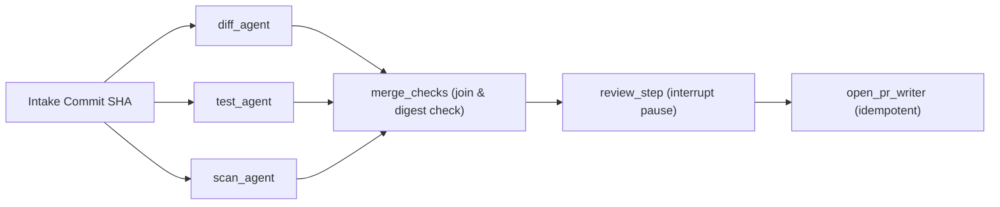

---
{
  "id": "multi-agent-dags-langgraph-orchestration",
  "slug": "multi-agent-dags-langgraph-orchestration",
  "title": "Multi-Agent Orchestration",
  "shortDescription": "Use multiple agents only when independent work earns their cost. Validate shared state at fan-in, pause for review, and isolate side effects behind a single idempotent writer.",
  "difficulty": "Hard",
  "category": "LLM Agents & Tool Use",
  "section": "Advanced Agents & Retrieval",
  "coverImage": "illustrations/_generated/linear_vs_dag_routing_dark.png",
  "companies": [
    "Google",
    "Microsoft",
    "Anthropic",
    "OpenAI",
    "Salesforce",
    "ServiceNow"
  ],
  "prerequisites": [
    "structured-output-constrained-generation",
    "agentic-architectures-react-plan-execute",
    "agent-failure-states-retry-fallback",
    "agent-memory-persistence-patterns",
    "long-context-engineering-beyond-management"
  ],
  "relatedQuestions": [
    "inference-mechanics-ttft-tps-kv-cache",
    "llm-deployment-gpu-serving-autoscaling",
    "llm-cost-engineering-token-economics",
    "agent-evaluation-benchmarks"
  ],
  "order": 9,
  "keyConceptsTested": [
    "DAGs vs. cyclic state machines",
    "LangGraph StateGraph and Pregel supersteps",
    "Typed shared state and append reducers",
    "Parallel fan-out and validated fan-in",
    "Single-writer idempotency and optimistic locking",
    "Checkpoints, interrupts, and node restart semantics",
    "Supervisor vs. peer handoff topologies",
    "AutoGen GraphFlow and Microsoft Agent Framework workflows",
    "OpenAI Agents SDK handoffs",
    "MCP capability servers vs. Google A2A tasks"
  ]
}
---

Splitting one agent loop into three specialized agents looks cleaner on a whiteboard than in production. Every extra agent introduces serialization overhead, cross-branch prompt repetition, and subtle synchronization bugs when branches finish out of order or disagree on shared state. Multi-agent architectures earn their complexity only when orthogonal subtasks genuinely benefit from isolated context windows or parallel execution along a shorter critical path.

Consider an automated pull-request verification workflow diagnosing a precision regression patch across a Python and CUDA codebase. One agent inspects changed AST symbols and diff scope (`diff_agent`), a second executes targeted test suites (`test_agent`), and a third scans dependencies and static rules (`scan_agent`), before a deterministic merge step combines their reports, pauses for human approval, and submits a single pull request update.

## Decide whether multiple agents earn their cost

Before adding orchestration edges, measure both **context isolation** and **critical-path latency**. Multi-agent systems routinely multiply token usage relative to single-turn chat loops, as Anthropic documented in its 2025 multi-agent research study reporting a 90.2% relative improvement on broad internal research evaluations alongside roughly 15x total token consumption [^anthropic_multiagent2025]. Meanwhile, Cognition's 2025 and 2026 engineering analyses highlight how naive multi-agent handoffs leak assumptions across subagents and cause conflicting writes unless coordination follows strict map-reduce and single-writer patterns [^cognition_dont_build2025] [^cognition_multiagents_working2026].

When independent checks such as AST diffing (2s), test execution (3s), and static scanning (1s) have no data dependencies, running them concurrently cuts wall-clock latency from the sum (`2 + 3 + 1 = 6s`) to the **critical path** (`max(2, 3, 1) = 3s`). Yet if the three workers still run as serialized sequential steps, splitting them across three separate agent contexts adds orchestration latency and token inflation while saving zero wall time. Worse, serial handoffs force each downstream worker to re-read or summarize earlier findings before it even starts inspecting the repository. True concurrency pays off only when the graph dispatches independent branches in parallel and defers merging until all required checks finish.

<!-- leetllm: test, output=show -->
```python title="critical_path_comparison.py"
branches = {"diff_agent": 2.0, "test_agent": 3.0, "scan_agent": 1.0}
serial_wall_s = sum(branches.values())
parallel_wall_s = max(branches.values())
total_worker_compute_s = sum(branches.values())

print(f"Serial wall time: {serial_wall_s:.1f}s")
print(f"Parallel critical path: {parallel_wall_s:.1f}s ({serial_wall_s / parallel_wall_s:.1f}x faster)")
print(f"Total worker compute across branches: {total_worker_compute_s:.1f}s (unchanged)")
```

<!-- leetllm: output:start -->
```text title="Output" output compact
Serial wall time: 6.0s
Parallel critical path: 3.0s (2.0x faster)
Total worker compute across branches: 6.0s (unchanged)
```
<!-- leetllm: output:end -->

Notice what stays constant under parallel fan-out: aggregate compute, API billings, and context-window tokens across workers remain `6s` plus coordination overhead. Splitting a single linear conversation into three independent sub-agents actually multiplies total prompt input tokens because each branch repeats the shared system instructions and task diff, which matches Anthropic's production finding that multi-agent research runs consume roughly 15x the tokens of single-agent chat [^anthropic_multiagent2025]. Multi-agent DAGs cut end-to-end delay only when slow external tool calls or independent evidence searches overlap in parallel, making the token budget worthwhile.

<figure>
  
  <figcaption>Parallel DAG execution trims wall-clock latency on a shared 0s to 6s timeline from the sum of branch durations (6.0s) to the critical-path maximum (3.0s) while aggregate worker compute stays 6.0s.</figcaption>
</figure>

## Model orchestration as a typed state graph

Unstructured chat transcripts work poorly for parallel workflows because two specialists appending free-form text can silently overwrite or misread each other's conclusions. **<span data-glossary="langgraph">LangGraph</span>** runs workflows on a Pregel-inspired **superstep** engine: in each step, the runtime schedules ready nodes, executes them in isolation against the snapshot at step start, applies typed channel updates via explicit **reducers**, and commits the resulting state before planning the next step [^langgraph_pregel2026] [^langgraph_graph_api2026]. Because every worker reads the same frozen state snapshot within a step, deterministic reducers turn concurrent branch outputs into predictable merged values instead of race conditions. Explicit edge topology then separates graph routing from individual LLM calls, keeping orchestration logic testable even when model outputs vary.



Defining shared state with explicit reducers enforces clean structural checks at fan-in. Scalar fields with no reducer reject simultaneous updates from two parallel nodes, preventing silent last-writer-wins races, while `Annotated[list[CheckResult], operator.add]` merges independent worker records cleanly into one list. Even better, copying payloads rather than sharing shallow views like `types.MappingProxyType` guarantees one branch cannot mutate nested lists read by another branch.

<figure>
  
  <figcaption>Typed append reducers collect concurrent specialist outputs while the fan-in validator blocks duplicate worker keys and stale commit hashes.</figcaption>
</figure>

<!-- leetllm: test, deps=langgraph==1.2.12, output=show, id=pr-dag -->
```python title="typed_state_fan_in.py"
import hashlib
import json
import operator
from copy import deepcopy
from types import MappingProxyType
from typing import Annotated, NotRequired, TypedDict

from langgraph.graph import END, START, StateGraph


class CheckResult(TypedDict):
    worker: str
    commit_sha: str
    passed: bool
    summary: str
    evidence_digest: str


class WorkflowState(TypedDict):
    repo: str
    commit_sha: str
    checks: Annotated[list[CheckResult], operator.add]
    proposal_digest: NotRequired[str]
    verdict: NotRequired[str]


LIVE_HEAD_SHA = "8f1a3b"
RAW_REPORTS = {
    "diff": {"worker": "diff", "commit_sha": "8f1a3b", "passed": True, "summary": "3 AST hunks in attention.py"},
    "test": {"worker": "test", "commit_sha": "8f1a3b", "passed": True, "summary": "14/14 pytest cases passed"},
    "scan": {"worker": "scan", "commit_sha": "8f1a3b", "passed": True, "summary": "0 static security warnings"},
}


def digest_payload(payload: dict[str, object]) -> str:
    encoded = json.dumps(payload, sort_keys=True, separators=(",", ":")).encode()
    return hashlib.sha256(encoded).hexdigest()[:16]


def run_worker(name: str, state: WorkflowState) -> dict[str, list[CheckResult]]:
    src = deepcopy(RAW_REPORTS[name])
    return {
        "checks": [{
            "worker": name,
            "commit_sha": src["commit_sha"],
            "passed": bool(src["passed"]),
            "summary": str(src["summary"]),
            "evidence_digest": digest_payload(src),
        }]
    }


def merge_checks(state: WorkflowState) -> dict[str, str]:
    checks = state["checks"]
    workers = [c["worker"] for c in checks]
    if len(checks) != 3 or set(workers) != {"diff", "test", "scan"}:
        return {"verdict": f"rejected: expected 3 unique workers, got {workers}"}
    if any(c["commit_sha"] != LIVE_HEAD_SHA for c in checks):
        return {"verdict": "rejected: stale commit digest detected"}
    if not all(c["passed"] for c in checks):
        return {"verdict": "rejected: failing worker check"}
    bundle = {"repo": state["repo"], "sha": LIVE_HEAD_SHA, "digests": sorted(c["evidence_digest"] for c in checks)}
    return {"proposal_digest": digest_payload(bundle), "verdict": "ready-for-review"}


builder = StateGraph(WorkflowState)
for name in ("diff", "test", "scan"):
    builder.add_node(name, lambda s, w=name: run_worker(w, s))
    builder.add_edge(START, name)
builder.add_node("merge", merge_checks)
builder.add_edge(["diff", "test", "scan"], "merge")
builder.add_edge("merge", END)

graph = builder.compile()
out = graph.invoke({"repo": "ml/kernels", "commit_sha": LIVE_HEAD_SHA, "checks": []})
print("Verdict:", out["verdict"], "| proposal digest:", out.get("proposal_digest"))

# Demonstrate shallow MappingProxyType vs deepcopy isolation on nested lists
nested = {"hunks": ["line-84"]}
proxy = MappingProxyType(nested)
proxy["hunks"].append("mutated-in-place")
print("Shallow proxy still shares nested list:", nested["hunks"])
```

<!-- leetllm: output:start -->
```text title="Output" output compact
Verdict: ready-for-review | proposal digest: 5aa68bd77a10b8fe
Shallow proxy still shares nested list: ['line-84', 'mutated-in-place']
```
<!-- leetllm: output:end -->

Every safeguard in `merge_checks` addresses a concrete concurrent failure mode. Counting unique worker names catches duplicate deliveries when a branch retries upstream, checking `commit_sha` against the live repository head blocks evidence captured before a developer pushed a new commit, and binding all branch digests into one `proposal_digest` ensures downstream review evaluates an immutable bundle. Notice also that `merge_checks` returns a deterministic dictionary update rather than trusting a summary LLM to reconcile conflicting branch booleans in prose. Separating typed state aggregation from natural-language synthesis stops an optimistic model from waving through a failing test result.

> **Key insight:** Merge concurrent branch results with deterministic code, not an LLM summary call. A deterministic reducer cannot misread `passed=False` as a minor warning.

## Handle unequal branch depths cleanly

Parallel workers rarely finish in the same superstep when one agent makes a fast static lookup while another navigates multi-hop tool calls. How you wire fan-in edges in a graph determines whether a downstream merge node executes prematurely on partial state, stalls forever, or waits cleanly until every active path completes [^langgraph2026UseGraphApi]. When branches have unequal step depths, an ordinary edge from a finished fast branch can wake the join node while the slower branch is still running intermediate tool calls. Understanding how superstep readiness interacts with deferred edges prevents subtle half-merged runs.

<figure>
  
  <figcaption>Separate incoming edges re-fire the join node per branch arrival, list-form edges wait for every named predecessor, and defer=True synchronizes once active branches finish.</figcaption>
</figure>

<!-- leetllm: test, deps=langgraph==1.2.12, output=show -->
```python title="unequal_depth_fan_in.py"
import operator
from typing import Annotated, TypedDict
from langgraph.graph import END, START, StateGraph


class JoinState(TypedDict):
    log: Annotated[list[str], operator.add]
    run_bench: bool


def build_join_graph(mode: str, run_bench: bool = True):
    b = StateGraph(JoinState)
    b.add_node("triage", lambda s: {"log": ["triage"]})
    b.add_node("lint", lambda s: {"log": ["lint"]})
    b.add_node("tests", lambda s: {"log": ["tests"]})
    b.add_node("bench", lambda s: {"log": ["bench"]})
    b.add_node("merge", lambda s: {"log": [f"merge({len(s['log'])})"]}, defer=(mode == "defer"))

    b.add_edge(START, "triage")
    b.add_edge("triage", "lint")
    b.add_conditional_edges(
        "triage",
        lambda s: ["tests", "bench"] if s["run_bench"] else ["tests"],
        {"tests": "tests", "bench": "bench"},
    )
    b.add_edge("tests", "tests_done")
    b.add_node("tests_done", lambda s: {"log": ["tests_done"]})

    if mode == "separate":
        b.add_edge("lint", "merge")
        b.add_edge("tests_done", "merge")
    elif mode == "list":
        b.add_edge(["lint", "tests_done", "bench"], "merge")
    else:
        b.add_edge("lint", "merge")
        b.add_edge("tests_done", "merge")
        b.add_edge("bench", "merge")
    b.add_edge("merge", END)
    return b.compile()


for mode, bench in [("separate", False), ("list", True), ("list", False), ("defer", False)]:
    res = build_join_graph(mode, bench).invoke({"log": [], "run_bench": bench})
    merges = [x for x in res["log"] if x.startswith("merge")]
    print(f"mode={mode:8s} bench={str(bench):5s} -> merges={merges} full_log={res['log']}")
```

<!-- leetllm: output:start -->
```text title="Output" output compact
mode=separate bench=False -> merges=['merge(3)', 'merge(5)'] full_log=['triage', 'lint', 'tests', 'merge(3)', 'tests_done', 'merge(5)']
mode=list     bench=True  -> merges=['merge(5)'] full_log=['triage', 'bench', 'lint', 'tests', 'tests_done', 'merge(5)']
mode=list     bench=False -> merges=[] full_log=['triage', 'lint', 'tests', 'tests_done']
mode=defer    bench=False -> merges=['merge(4)'] full_log=['triage', 'lint', 'tests', 'tests_done', 'merge(4)']
```
<!-- leetllm: output:end -->

Look closely at the three schedules in that trace. Separate `add_edge` statements trigger `merge` once after `lint` finishes in step 2 (`merge(3)`) and a second time after `tests_done` finishes in step 3 (`merge(5)`, since `full_log` already holds `merge(3)` and `tests_done`). A list-form join `add_edge(["lint", "tests_done", "bench"], "merge")` waits cleanly until all three complete, yet stays unexecuted forever if routing omits `bench`. Setting `defer=True` on `merge` instructs the runtime to wait until all active upstream paths drain before firing `merge` exactly once, even when optional branches skip cleanly.

## Pause for review and enforce single-writer idempotency

In long-running pipelines, pausing before irreversible actions such as opening or merging a pull request requires durable state backed by a checkpointer [^langgraph2026checkpointers] [^langgraph2026persistence]. LangGraph's `interrupt()` primitive suspends execution at a node, persists the checkpoint under a caller-chosen `thread_id`, and resumes later via `Command(resume=...)` [^langgraph2024]. Because execution can pause for minutes or hours while a human engineer inspects the proposed patch, durability ensures that an unrelated worker restart does not lose earlier analysis or force a costly rerun from scratch.

Crucially, resuming from `interrupt()` restarts the interrupted node from its top line rather than mid-function. Any side effects placed before `interrupt()` would execute twice (once before pausing and again on resume), so side effects belong cleanly in a dedicated downstream writer node protected by an **idempotency key** and an **optimistic head-version check**. Isolating the review pause from the mutation node also makes replay logs easy to trace because every approved action maps to a single commit attempt after human confirmation.

> **Common mistake:** Putting an external API call right above `interrupt()` in the same node. When the human approves and `Command(resume=...)` fires, LangGraph replays the node from line 1 and executes that side effect twice.

<figure>
  
  <figcaption>Calling interrupt() checkpoints graph state and pauses execution; resuming with Command(resume=...) replays the interrupted node from line one.</figcaption>
</figure>

<figure>
  
  <figcaption>Isolating external mutations inside a single downstream writer with an idempotency key and head-version check prevents duplicate writes across replays.</figcaption>
</figure>

<!-- leetllm: test, deps=langgraph==1.2.12, output=show -->
```python title="interrupt_and_idempotent_writer.py"
from typing import TypedDict
from langgraph.checkpoint.memory import InMemorySaver
from langgraph.graph import END, START, StateGraph
from langgraph.types import Command, interrupt


class ReviewState(TypedDict):
    digest: str
    expected_version: int
    idempotency_key: str
    outcome: str


entries: list[str] = []
COMMIT_LOG: dict[str, str] = {}
LIVE_BRANCH_VERSION = {"version": 3}


def review_step(state: ReviewState) -> Command:
    entries.append(state["digest"])
    decision = interrupt({"prompt": "Approve patch bundle?", "digest": state["digest"]})
    approved = decision.get("approved") is True and decision.get("digest") == state["digest"]
    return Command(goto="open_pr_writer" if approved else "cancelled")


def open_pr_writer(state: ReviewState) -> dict[str, str]:
    key = state["idempotency_key"]
    if key in COMMIT_LOG:
        return {"outcome": f"replayed cached {COMMIT_LOG[key]}"}
    if LIVE_BRANCH_VERSION["version"] != state["expected_version"]:
        return {"outcome": f"aborted: branch moved to v{LIVE_BRANCH_VERSION['version']}"}
    LIVE_BRANCH_VERSION["version"] += 1
    COMMIT_LOG[key] = f"PR-104@{state['digest']}"
    return {"outcome": f"created {COMMIT_LOG[key]}"}


builder = StateGraph(ReviewState)
builder.add_node("review_step", review_step)
builder.add_node("open_pr_writer", open_pr_writer)
builder.add_node("cancelled", lambda s: {"outcome": "cancelled"})
builder.add_edge(START, "review_step")
builder.add_edge("open_pr_writer", END)
builder.add_edge("cancelled", END)
graph = builder.compile(checkpointer=InMemorySaver())

cfg1 = {"configurable": {"thread_id": "ml-kernels:pr-104"}}
paused = graph.invoke({"digest": "c2ed39e2", "expected_version": 3, "idempotency_key": "pr-104", "outcome": "pending"}, cfg1)
print("Paused with interrupt payload:", paused["__interrupt__"][0].value)
res1 = graph.invoke(Command(resume={"approved": True, "digest": "c2ed39e2"}), cfg1)
print("Approved resume:", res1["outcome"])
print("Review node entries after 1 pause + resume:", len(entries))

# Replay with same idempotency_key returns existing PR cleanly; mismatch or stale version aborts
print("Duplicate key replay:", open_pr_writer({"digest": "c2ed39e2", "expected_version": 4, "idempotency_key": "pr-104", "outcome": ""})["outcome"])
print("New key with stale expected_version=3:", open_pr_writer({"digest": "c2ed39e2", "expected_version": 3, "idempotency_key": "pr-105", "outcome": ""})["outcome"])
```

<!-- leetllm: output:start -->
```text title="Output" output compact
Paused with interrupt payload: {'prompt': 'Approve patch bundle?', 'digest': 'c2ed39e2'}
Approved resume: created PR-104@c2ed39e2
Review node entries after 1 pause + resume: 2
Duplicate key replay: replayed cached PR-104@c2ed39e2
New key with stale expected_version=3: aborted: branch moved to v4
```
<!-- leetllm: output:end -->

Every part of this flow closes a separate reliability gap. Binding approval to `digest` ensures a reviewer never signs off on an outdated bundle after files change, persisting checkpoints in production backends such as Postgres (rather than in-memory `InMemorySaver`) enables survival across worker restarts, and protecting `open_pr_writer` with both `idempotency_key` and `expected_version` guarantees at-most-once mutation. In practice, separating human confirmation (`review_step`) from side effects (`open_pr_writer`) also simplifies testing because you can verify the pause-and-resume cycle without mocking external GitHub writes inside the review node.

## Choose topology and wire protocols

Not every coordination problem needs an explicit static graph. Choosing between a graph workflow, a **supervisor** (orchestrator-worker), and a **peer handoff** turns on who owns turn control and how tool permissions stay synchronized when work shifts across agents. Static DAGs shine when pipeline stages and merge dependencies are known up front, whereas dynamic investigations often shift control between specialists at runtime. Matching the coordination pattern to the workload avoids both rigid over-engineering and meandering, uncheckable agent loops.

| Dimension | Graph DAG (`StateGraph`) | Supervisor (`agent-as-tool`) | Peer handoff (`Agents SDK`) |
| --- | --- | --- | --- |
| **Control ownership** | Orchestration graph edges | Central manager LLM loop | Transfers turn control to target agent |
| **Parallelism** | Native superstep fan-out | Tool-call concurrency inside loop | Sequential unless paired with DAG |
| **Context isolation** | Typed state channels + copies | Structured task arguments + results | Filtered conversation history (`input_filter`) |
| **Tool privileges** | Bound per node by host | Bound per sub-tool by host | Rebuilt from target permissions (never transcript) |

<figure>
  
  <figcaption>Static DAGs fix parallel fan-out and fan-in edges up front, hub-and-spoke supervisors retain turn control over tool specialists, and peer handoff swarms transfer turn ownership while rebuilding tool permissions.</figcaption>
</figure>

Framework patterns have also converged around typed state and explicit control transfer. Microsoft placed **AutoGen** in maintenance mode and introduced **Microsoft Agent Framework Workflows**, replacing AutoGen's conversational broadcast and experimental `GraphFlow` prototypes with strongly typed event routing and executor nodes [^wu2023] [^autogen_maintenance2026] [^autogen_graphflow2026] [^microsoft_agentframework_migration2026]. Similarly, OpenAI deprecated its educational Swarm demo in favor of the **OpenAI Agents SDK**, where handoffs transfer control cleanly alongside `input_filter` context shaping and `on_handoff` argument validation (whereas `is_enabled` only controls tool visibility before parsed arguments exist) [^openai2024a] [^openai_agents_sdk] [^openai_agents_handoffs2026].

Finally, keep **orchestration topology** distinct from **wire protocols**. **Model Context Protocol (MCP)** connects an agent host to external tool and resource servers, including an optional **Tasks** extension for tracking long-running server jobs [^mcp_anthropic2024] [^mcp_rc_2026]. **Google Agent2Agent (A2A)** handles agent-to-agent delegation across independent runtimes, advertising capabilities via Agent Cards and exposing remote `Message` exchanges or tracked `Task` state machines (`submitted`, `working`, `input-required`, terminal) [^google_a2a_2025]. Use MCP when your agent host invokes a capability server directly; use A2A when delegating a stateful sub-investigation to an external agent service.

## Practical design rules to carry forward

- Justify parallel multi-agent branches by measuring **critical-path latency** and **context isolation**, recognizing that total worker token usage adds rather than drops.
- Keep parallel branches pure with typed state schemas, append reducers (`operator.add`), and deep-copied inputs so concurrent nodes never silently overwrite or mutate shared structures.
- Choose list-form joins (`add_edge([a, b], c)`) when all branches run deterministically, and use `defer=True` when conditional routing may skip optional paths.
- Never place external mutations before `interrupt()`, since resuming restarts the paused node from the top; route approved digests into a dedicated idempotent single writer.
- Rebuild tool permissions from host permission rules on every peer handoff or remote A2A delegation rather than inheriting privilege from transferred chat text.

```mastery-quiz
[
  {
    "question": "A pull-request triage workflow splits AST diffing (2s), unit tests (3s), and static scanning (1s) across three parallel LangGraph branches before a 0.5s deterministic merge. Compared to running all three serially inside one agent, what happens to end-to-end latency and total worker compute?",
    "options": [
      "End-to-end latency drops from 6.5s to 3.5s on the critical path, while aggregate worker compute stays 6.0s plus orchestration overhead.",
      "End-to-end latency and aggregate worker compute both drop from 6.5s to 3.5s because parallel runs share one KV cache.",
      "End-to-end latency stays 6.5s on the critical path because Pregel supersteps execute sibling fan-out nodes serially across barriers.",
      "Aggregate worker compute drops from 6.0s to 3.0s because the longest branch cancels shorter sibling branches upon completion."
    ],
    "answer": "End-to-end latency drops from 6.5s to 3.5s on the critical path, while aggregate worker compute stays 6.0s plus orchestration overhead.",
    "explanation": "Parallelizing independent branches overlaps their wall time so critical-path delay shrinks to max(2, 3, 1) + 0.5 = 3.5s, whereas aggregate worker compute and prompt tokens still sum across all three branches."
  },
  {
    "question": "In LangGraph, `triage` always routes to `lint`, conditionally routes to `bench` (skipped on doc-only edits), and fans into `tests -> tests_done`. How does `add_edge(['lint', 'tests_done', 'bench'], 'merge')` behave on a doc-only PR compared to `defer=True` on `merge`?",
    "options": [
      "The list-form join stalls indefinitely without running `merge` when `bench` skips, while `defer=True` triggers `merge` after active nodes finish.",
      "The list-form join drops `bench` from its barrier set dynamically once conditional routing omits `bench` from the superstep queue.",
      "Adding `defer=True` invokes `merge` three separate times: after `lint`, after `tests`, and once more after `tests_done` completes.",
      "Separate `add_edge` lines behave identically to a list-form barrier join across branches with different superstep depths."
    ],
    "answer": "The list-form join stalls indefinitely without running `merge` when `bench` skips, while `defer=True` triggers `merge` after active nodes finish.",
    "explanation": "A list-form join requires every named predecessor to complete in the run, whereas marking `merge` with `defer=True` waits until pending graph execution drains and triggers `merge` cleanly."
  },
  {
    "question": "A developer places `create_pr_draft()` on line 2 of a LangGraph review node and `interrupt()` on line 3. What happens when the host calls `Command(resume={'approved': True})`?",
    "options": [
      "Execution jumps straight to line 4 right after `interrupt()`, leaving the first `create_pr_draft()` side effect intact without repeating line 2.",
      "Execution restarts the review node from line 1, invoking `create_pr_draft()` a second time prior to reading the resume payload.",
      "The checkpointer deletes the incomplete superstep snapshot and raises `InvalidUpdateError` once a human resume payload arrives.",
      "The checkpointer replays line 2 from an internal HTTP response cache without invoking `create_pr_draft()` a second time."
    ],
    "answer": "Execution restarts the review node from line 1, invoking `create_pr_draft()` a second time prior to reading the resume payload.",
    "explanation": "Resuming from `interrupt()` re-executes the interrupted node from its beginning; external side effects must live in a downstream single-writer node protected by an idempotency key."
  },
  {
    "question": "A supervisor agent calls a test-runner specialist via OpenAI Agents SDK, and later hands off a live migration investigation to a database specialist whose `is_enabled` hook returned True. An adversarial user embedded `drop_table=True` in the handoff message. Where can the runtime validate parsed handoff arguments?",
    "options": [
      "Inside `on_handoff`, because `is_enabled` executes before structured arguments exist and tool input guardrails skip handoffs.",
      "Inside `is_enabled`, because the runtime parses structured handoff schemas ahead of evaluating dynamic tool visibility.",
      "Inside the supervisor's `input_filter`, because shared message filters inspect parsed handoff fields for destructive SQL flags.",
      "Inside an MCP `Message` prompt suffix injected before the receiving specialist begins decoding its first response token."
    ],
    "answer": "Inside `on_handoff`, because `is_enabled` executes before structured arguments exist and tool input guardrails skip handoffs.",
    "explanation": "OpenAI Agents SDK exposes `is_enabled` prior to argument generation; parsed handoff parameters are checked inside `on_handoff`, while target tool capabilities remain limited by host permission rules."
  },
  {
    "question": "Your coding host connects to an internal compiler and test-runner server, and also delegates a multi-hour dependency upgrade investigation to a separate vendor agent exposing Agent Cards and tracked tasks. Which protocol assignment fits?",
    "options": [
      "Use MCP for the internal compiler tool server and Google A2A for communicating with the remote vendor agent.",
      "Use Google A2A for the internal compiler tool server and MCP for the vendor agent due to stateless transport.",
      "Use MCP for both components because MCP JSON-RPC converts remote vendor agents into synchronous local functions.",
      "Use Google A2A for both components because multi-file build invocations need long-lived Agent Cards on localhost."
    ],
    "answer": "Use MCP for the internal compiler tool server and Google A2A for communicating with the remote vendor agent.",
    "explanation": "MCP standardizes host-to-tool-server connections (with optional Tasks for long-lived server operations), whereas A2A models peer agent discovery via Agent Cards and independent remote Task lifecycles."
  },
  {
    "question": "Why does wrapping nested state in `types.MappingProxyType` fail to isolate parallel LangGraph worker branches sharing a list of diagnostics?",
    "options": [
      "`MappingProxyType` freezes top-level key reassignment without blocking in-place mutations on inner lists unless cloned via `deepcopy`.",
      "`MappingProxyType` locks Python dicts across worker threads, causing `InvalidUpdateError` when two branches inspect metrics concurrently.",
      "`MappingProxyType` converts nested lists into fixed tuples at read time, dropping appended worker warnings silently.",
      "`MappingProxyType` applies recursive copy-on-write across nested objects, preventing `operator.add` reducers from merging lists."
    ],
    "answer": "`MappingProxyType` freezes top-level key reassignment without blocking in-place mutations on inner lists unless cloned via `deepcopy`.",
    "explanation": "MappingProxyType provides a shallow read-only view over one dictionary mapping; mutations on inner lists propagate unless state or payloads are deep-copied."
  }
]
```

> **Next:** Continue to [Evaluating AI Agents](/learn/agent-evaluation-benchmarks).
