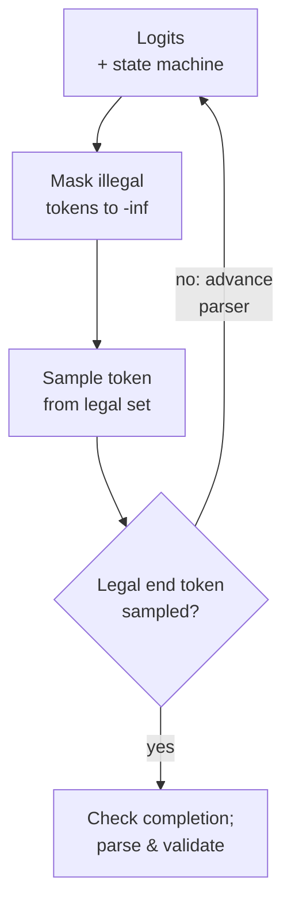
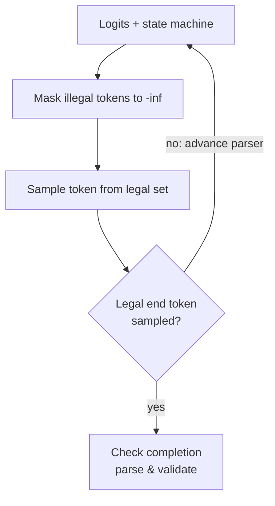

---
{
  "id": "structured-output-constrained-generation",
  "title": "Structured Output Generation",
  "slug": "structured-output-constrained-generation",
  "section": "Advanced Agents & Retrieval",
  "category": "LLM Agents & Tool Use",
  "difficulty": "Hard",
  "coverImage": "illustrations/_generated/probability_mask_dark.png",
  "companies": [
    "OpenAI",
    "Anthropic",
    "Google",
    "Microsoft",
    "Meta"
  ],
  "shortDescription": "An evaluation log needs a typed run id and status, yet prompting to return JSON can still yield chat. Constrain tokens during decoding, then verify claims against trusted records.",
  "prerequisites": [
    "function-calling-tool-use-llms",
    "decoding-strategies-greedy-beam-nucleus",
    "enterprise-rag-security-rbac-access-control"
  ],
  "order": 5,
  "keyConceptsTested": [
    "Structured Generation",
    "JSON Mode",
    "Grammar-Guided Decoding",
    "Finite State Machines",
    "Context-Free Grammars",
    "Tokenizer Alignment",
    "KV Cache Reuse",
    "Pydantic",
    "Token Masking",
    "XGrammar",
    "Refusal Handling",
    "Evidence validation and completion handling"
  ],
  "relatedQuestions": [
    "agentic-architectures-react-plan-execute",
    "guardrails-safety-filters-production",
    "function-calling-tool-use-llms",
    "prompt-injection-defense-strategies",
    "model-gateways-routing-fallbacks"
  ]
}
---

<!-- leetllm: edition:reference:start -->

An evaluation pipeline ingests hundreds of benchmark logs every minute. One trace reports: `"Evaluation eval-17 failed on math-500 after symbolic-verifier timed out."` Downstream dashboards need a typed JSON payload containing the evaluation identifier and an allowed status string. Even a valid record can trigger a lookup or human triage, though it does not by itself justify promoting or halting a checkpoint.

Prompting an unconstrained chat model with "Extract the fields and respond in JSON" often breaks that interface. A reply such as `Sure! Here is the data: { 'eval_id': 'eval-17' }` fails `json.loads` on its leading prose, and single quotes violate JSON syntax. Other replies wrap objects in Markdown fences, invent a status such as `"timed_out_hard"`, or omit `"eval_id"`.

Autoregressive models predict next <span data-glossary="token">tokens</span> rather than returning typed objects from a function signature. <span data-glossary="structured-output">Structured output generation</span> enforces structure during decoding: before sampling each step, the runtime masks continuations that fall outside a compiled grammar.[^willard2023] Even so, grammar compliance governs shape alone. Host code still decides whether a response completed cleanly, matches source logs, and obeys caller permissions.

<figure>
  
  <figcaption>Before masking, softmax turns the raw logits for <code>Sure</code> (1.4), <code>{</code> (0.8), <code>The</code> (0.2), and <code>[</code> (-0.4) into 49.6%, 27.2%, 14.9%, and 8.2%. Setting every continuation outside the schema's start state to negative infinity leaves <code>{</code> with 100% probability before sampling.</figcaption>
</figure>

This example isolates one decoding step over a four-token vocabulary where only `{` can begin a valid JSON object. A production tokenizer also contains whitespace tokens and multi-character tokens starting with `{` followed by quotes or field names, so the allowed subset is larger in practice. Logit masking removes conversational prose directly at the sampler rather than hoping a system prompt keeps the model inside JSON syntax.

## What constrained decoding adds beyond a JSON instruction

Prompting for JSON expresses a preference rather than enforcing a parser rule. Without decoding constraints, an unconstrained chat model regularly wraps output in Markdown fences, opens with conversational greetings, invents keys, or inserts trailing commas that break standard decoders. Notice how a naive prompt leaves all of those failure modes open:

```python title="why-please-return-json-is-not-enough.py"
prompt = """
Extract eval_id and status from this benchmark log:
"Evaluation eval-17 failed on math-500 after symbolic-verifier timed out."
Return JSON.
"""
```

Human readers understand that prompt immediately, yet unconstrained models break downstream parsers in recurring ways across production workloads, as summarized in the table below. Each failure mode disrupts deterministic automation differently unless syntax is constrained ahead of sampling.

| Failure mode | Example model response | Downstream breakdown |
|--------------|------------------------|----------------------|
| Conversational preamble | `Here is the extracted JSON: {"eval_id":"eval-17"}` | `json.loads` hits non-JSON characters at index 0 |
| Markdown fences | ````json\n{"eval_id":"eval-17"}\n```` | Parser rejects backticks; fence stripping adds brittle glue code |
| Schema drift | `{"eval_id":"eval-17","status":null}` | Parses cleanly, yet violates a required enum string check |
| Hallucinated keys | `{"benchmark_id":"eval-17","outcome":"crashed"}` | Keys diverge from storage columns or API schemas |
| Malformed syntax | `{"eval_id":"eval-17", "status":"failed",}` | Trailing commas violate RFC 8259 and break standard JSON decoders |

A standard parser treats every broken reply identically as an unusable string without distinguishing chat habits from malformed trailing commas or schema drift. Prompt wording alone expresses an instruction without controlling decoder token selection, whereas token masking deletes illegal continuations before any token is sampled. Reliable pipelines distinguish prompting for a format from compiling a structural constraint into generation, because each API tier enforces a different level of syntax:

| Interface tier | Structural guarantee | Typical implementation |
|----------------|----------------------|------------------------|
| Prompt-based ("respond in JSON") | None (best-effort formatting) | Standard chat endpoints |
| JSON mode | Targets JSON syntax; still inspect incomplete and refusal states | OpenAI `json_object` mode |
| Strict function calling | Constrains tool arguments to a supported schema | Provider tool APIs with strict mode enabled |
| Hosted structured outputs | Constrains response data to a provider-supported schema subset | OpenAI, Claude, Gemini structured outputs |
| Grammar-guided inference runtime | Enforces the grammar actually compiled by the backend | Outlines, SGLang, vLLM, llama.cpp |

Prompt instructions describe intent, whereas token masking drops invalid vocabulary entries before softmax. Post-hoc regex scrubbers and retries can fix cosmetic wrappers without proving that the recovered value satisfies your closed object schema. Even JSON mode only guarantees valid JSON syntax: `{"author": "alice"}` passes JSON mode while missing `eval_id` and `status`, and top-level arrays or scalars remain valid JSON unless your parser rejects them.[^openai2024StructuredOutputsLaunch]

Constrained decoding moves structural enforcement inside the decoder by masking continuations outside its compiled language.[^willard2023] Even so, inference engines only enforce the subset of <span data-glossary="json-schema">JSON Schema</span> they know how to compile. For example, `llama.cpp`'s schema converter can silently skip unsupported keywords without raising an error, letting grammar-valid output violate your local Pydantic rules.[^llamacpp_grammars_docs2026] Similarly, as of October 2026, Claude provides native JSON outputs via `output_config.format` and strict tool use while documenting edge cases such as refusals, token exhaustion, and capitalization shifts on enums, and Gemini calls for post-generation validation alongside its supported schema subset.[^anthropic2026StructuredOutputs][^geminiStructuredOutput2026] Check provider completion states first, then run both strict JSON parsing and full schema validation locally as shown below:

<!-- leetllm: test, id=parser, output=show, output_title="Syntax and schema are separate" -->
```python title="json-syntax-versus-schema.py"
import json
import math

REQUIRED = ("eval_id", "status")
STATUSES = {"queued", "passed", "failed", "unknown"}

def reject_constant(value):
    raise ValueError(f"nonfinite JSON number: {value}")

def finite_float(value):
    result = float(value)
    if not math.isfinite(result):
        raise ValueError("JSON number exceeds finite float range")
    return result

def unique_object(pairs):
    result = {}
    for key, value in pairs:
        if key in result:
            raise ValueError(f"duplicate JSON key: {key}")
        result[key] = value
    return result

def load_record(raw: str):
    return json.loads(
        raw,
        object_pairs_hook=unique_object,
        parse_constant=reject_constant,
        parse_float=finite_float,
    )

def validate_triage(payload: object) -> dict[str, str]:
    if not isinstance(payload, dict):
        raise TypeError("root must be an object")
    extra = sorted(set(payload) - set(REQUIRED))
    missing = [key for key in REQUIRED if key not in payload]
    if extra or missing:
        raise ValueError(f"shape mismatch extra={extra} missing={missing}")
    record: dict[str, str] = {}
    for key in REQUIRED:
        value = payload[key]
        if not isinstance(value, str) or not value.strip():
            raise TypeError(f"{key} must be a nonempty string")
        record[key] = value
    if record["status"] not in STATUSES:
        raise ValueError(f"unsupported status enum: {record['status']}")
    return record

syntax_valid_wrong_shape = load_record('{"foo": "bar"}')
schema_valid = load_record('{"eval_id": "eval-17", "status": "failed"}')

try:
    validate_triage(syntax_valid_wrong_shape)
except ValueError:
    print("JSON-only result: rejected by schema")

print("structured record:", validate_triage(schema_valid))

for raw in ['{"eval_id":"eval-17","eval_id":"eval-19"}', '{"status":NaN}']:
    try:
        load_record(raw)
    except ValueError as error:
        print("parser rejected:", error)
```

<!-- leetllm: output:start -->
```text title="Syntax and schema are separate" output compact
JSON-only result: rejected by schema
structured record: {'eval_id': 'eval-17', 'status': 'failed'}
parser rejected: duplicate JSON key: eval_id
parser rejected: nonfinite JSON number: NaN
```
<!-- leetllm: output:end -->

Python's standard `json.loads` silently overwrites duplicate keys (keeping the last value) and accepts non-standard constants such as `NaN` and `Infinity`.[^pythonJson2026] Accepting silent key overrides or nonfinite floats corrupts downstream records silently, so production decoders should reject both explicitly via custom parser hooks. Adding schema checks right after decoding closes the gap between syntactic JSON and application shape requirements.

```checkpoint
What can you assume after JSON mode, and what changes with structured outputs?
---
JSON mode targets syntactically valid JSON without guaranteeing your keys or enum values. Structured outputs enforce supported schema constraints during decoding. Check completion and refusal states alongside backend limitations, then validate locally; neither feature proves truthfulness or grants execution permission.
```

## How grammar-guided decoding works

With post-generation parsing alone, your code discovers a schema error only after the model has finished generating tokens. A constrained decoder tracks parser state continuously during decoding and zeroes out tokens that cannot extend a valid prefix. As shown in the loop below, state tracking, masking, sampling, and completion checks stay separated step by step:

<!-- leetllm: audience:website:start -->

<!-- leetllm: audience:website:end -->
<!-- leetllm: audience:book:start -->

<!-- leetllm: audience:book:end -->

The backend compiles a reusable grammar representation. At each step, it derives a token mask from the current parser state and applies it before sampling. After accepting a token, it advances that state. An accepting state permits termination; it doesn't always force it, because trailing whitespace or further content may still be legal. Token budgets can interrupt generation before a complete value exists.

### From schema to logit masking

The mathematical mechanism works by directly modifying the unnormalized logit vector before the <span data-glossary="softmax">softmax</span> operation.

1. **State representation**: Let $S_t$ represent the parser's state at decoding step $t$. For regular expressions and flat enums, $S_t$ is a state in a **Deterministic Finite Automaton (DFA)**. For arbitrarily recursive JSON structures, a stack-based parser also tracks unresolved open braces and brackets. Fixed-depth schemas can use finite-state representations instead.
2. **Legal token subset**: The engine determines the set of legal vocabulary token IDs:
   $$
   \mathcal{V}_{\text{valid}}(S_t) \subseteq \mathcal{V}
   $$
   Each ordinary token in this set must leave a prefix that can still reach a valid completion. Special end tokens need their own acceptance rule.
3. **Logit masking**: Let $z_t \in \mathbb{R}^{|\mathcal{V}|}$ denote the raw output logits from the transformer's language model head. We construct a mask vector $m_t \in \{0, -\infty\}^{|\mathcal{V}|}$:
   $$
   m_t(v) = \begin{cases} 0 & \text{if } v \in \mathcal{V}_{\text{valid}}(S_t) \\ -\infty & \text{if } v \notin \mathcal{V}_{\text{valid}}(S_t) \end{cases}
   $$
4. **Renormalized sampling**: The masked logits $z'_t = z_t + m_t$ pass through softmax:
   $$
   P(y_t = v \mid x_{<t}) = \frac{\exp(z'_t(v))}{\sum_{u \in \mathcal{V}} \exp(z'_t(u))} = \begin{cases} \frac{\exp(z_t(v))}{\sum_{u \in \mathcal{V}_{\text{valid}}(S_t)} \exp(z_t(u))} & \text{if } v \in \mathcal{V}_{\text{valid}}(S_t) \\ 0 & \text{otherwise} \end{cases}
   $$

Under this mask, illegal tokens receive probability zero. The formulation assumes temperature-one sampling and a nonempty legal set with finite logits. If no valid continuation exists in the vocabulary, the decoder should halt with an error rather than dropping the constraint to keep sampling.

<figure>
  
  <figcaption>Compiling a schema turns grammar rules into a state machine (<code>S0 -> S1 -> S2 -> S3</code>) and a valid-token bitmask <code>M[S_t, v]</code>. Each decoding step reads the binary row for its current state to mask the vocabulary before softmax.</figcaption>
</figure>

We can run this vectorized logit masking step directly in NumPy:

<!-- leetllm: test, deps=numpy, output=show -->
```python title="from-schema-to-logit-masking.py"
import numpy as np

tokens = ["Sure", "{", "The", "["]
logits = np.array([1.4, 0.8, 0.2, -0.4], dtype=float)

def softmax(vec: np.ndarray) -> np.ndarray:
    finite = np.isfinite(vec)
    if not np.any(finite):
        raise ValueError("no legal token with a finite logit")
    shifted = np.where(finite, vec - np.max(vec[finite]), -np.inf)
    exp_scores = np.where(finite, np.exp(shifted), 0.0)
    return exp_scores / np.sum(exp_scores)

legal_mask = np.array([False, True, False, False])
before_probs = softmax(logits)
masked_logits = np.where(legal_mask, logits, -np.inf)
after_probs = softmax(masked_logits)

chosen = tokens[int(np.argmax(after_probs))]
print("before softmax (%):", {t: round(float(p) * 100, 1) for t, p in zip(tokens, before_probs)})
print("masked logits:", {t: float(x) for t, x in zip(tokens, masked_logits)})
print("after softmax (%):", {t: round(float(p) * 100, 1) for t, p in zip(tokens, after_probs)})
print("chosen token:", chosen)
assert chosen == "{"
assert np.isclose(after_probs[1], 1.0)
```

<!-- leetllm: output:start -->
```text title="Output" output compact
before softmax (%): {'Sure': 49.6, '{': 27.2, 'The': 14.9, '[': 8.2}
masked logits: {'Sure': -inf, '{': 0.8, 'The': -inf, '[': -inf}
after softmax (%): {'Sure': 0.0, '{': 100.0, 'The': 0.0, '[': 0.0}
chosen token: {
```
<!-- leetllm: output:end -->

Even though `"Sure"` started with the largest logit (`1.4`, or `49.6%` probability), `np.where` assigns `-inf` to every illegal token and moves 100% of the renormalized probability mass onto `"{"`. That single masking step eliminates formatting errors during sampling without retraining weights or prompting repeatedly. If a token vocabulary has multiple whitespace or fused-key tokens opening with `{`, every legal prefix retains positive probability in proportion to its original score.

### The tokenizer alignment problem

Implementing constrained decoding efficiently requires reconciling a mismatch between levels of abstraction: grammars match character or byte transitions, whereas language models emit <span data-glossary="subword-tokenization">subword tokens</span>. A single vocabulary token can span multiple JSON delimiters (`","status":"failed"`), or split a UTF-8 codepoint mid-character. Consequently, a decoder cannot look at the opening character of a candidate token alone; it has to verify that walking all bytes of the token through the automaton yields a legal state without overshooting into an error transition.[^willard2023]

Consider an automaton in a state expecting the status enum value `"failed"`.
- Token `fa` is valid: it advances the state toward `"failed"`.
- Token `failed"` is valid: it completes the enum, consumes the closing quote, and moves to whatever delimiter the enclosing object permits next.
- Token `failed"!` is invalid: it completes the enum, but immediately appends an illegal exclamation mark. Even though its prefix is valid, accepting this token would drive the parser into an unrecoverable error state. The engine must mask this token out.

Evaluating tens of thousands of candidate tokens against a parser on every decode step would stall token throughput, so modern backends precompute and partition vocabulary checks ahead of generation:

- **Indexed finite-state decoding**: The approach in Willard and Louf's 2023 paper precomputes allowed token IDs for each reachable DFA state. Looking up that index avoids reparsing the whole vocabulary; constructing, storing, and applying masks still has costs.[^willard2023]
- **llguidance**: Uses an Earley context-free parser, a regex-based lexer, and a tokenizer trie to compute masks.[^llguidance2026]
- **XGrammar**: Partitions the vocabulary into context-independent tokens (whose validity depends only on the current grammar rule, precomputed as static bitmasks) and context-dependent tokens (which require dynamic stack evaluation). This drastically reduces per-step CPU work.[^xgrammar2024]

```checkpoint
Why is tokenizer alignment harder than checking characters?
---
Grammar rules define valid character or byte sequences, but language models generate subword tokens that contain multiple characters. The engine must verify that a candidate token's complete byte sequence represents a valid transition or prefix in the automaton without overshooting into an invalid state.
```

### Regular expressions vs. context-free grammars

Selecting the right grammar formalism depends on whether your schema relies on bounded flatness or recursive nesting. Finite-state machines (DFAs) handle regular expressions and fixed enums in constant working memory per decoding step, though the precompiled transition index can still grow large for wide schemas. Context-Free Grammars (CFGs) add a stack so the parser can match opening and closing delimiters across arbitrary nesting depth. Note that **unbounded list length does not require unbounded nesting**: an array of arbitrarily many flat objects like `\[(\{\}(,\{\})*)?\]` remains strictly regular, whereas nested trees of arbitrary depth require a stack-aware CFG.

```checkpoint
When is a regular expression sufficient, and when do you need a CFG?
---
Use a regular expression for a regular language, including an arbitrarily long list of fixed-depth items. Arbitrarily deep recursive nesting requires a stack-aware parser. Length and depth are different dimensions, and a grammar still doesn't check arbitrary semantic relationships.
```

### Run an incremental DFA constrained decoder

To see how whole-token validation and sequence termination work together, consider a miniature language accepting only `{"status":"passed"}` and `{"status":"failed"}`. We compile both strings into a character-level Deterministic Finite Automaton (DFA) transition table `DFA[state][char] -> next_state`, then step every candidate vocabulary token completely through `DFA` before allowing it in the bitmask.

<figure>
   &lt;eos&gt; accepts pass. Taking fa advances to a partial prefix where iled&quot;} -> &lt;eos&gt; accepts fail, while iled&quot;}! is masked out because it overshoots at !." />
  <figcaption>Both accepted strings share <code>{"status":"</code>. From <code>fa</code>, the token <code>iled"}</code> reaches the final brace cleanly, whereas <code>iled"}!</code> overshoots at <code>!</code> and is masked out as a whole token.</figcaption>
</figure>

Notice how stepping through the DFA rejects `iled"}!` even though its first six characters match, and how `<eos>` stays masked until the parser reaches an accepting state. In contrast to naive prefix checks that stop at character boundaries, full-token traversal guarantees every intermediate transition remains valid:

<!-- leetllm: test, id=finite-guide, output=show, output_title="Incremental DFA whole-token decoder" -->
```python title="finite-language-token-guide.py"
LANGUAGE = ('{"status":"passed"}', '{"status":"failed"}')
VOCAB = ('The', '{"status":"', 'fa', 'passed', 'iled"}', 'iled"}!', '"}', '<eos>')
SCORES = {
    'The': 9.0,
    '{"status":"': 1.0,
    'fa': 3.0,
    'passed': 2.0,
    'iled"}': 1.0,
    'iled"}!': 8.0,
    '"}': 1.0,
    '<eos>': 7.0,
}

def build_prefix_dfa(strings: tuple[str, ...]) -> tuple[dict[int, dict[str, int]], set[int]]:
    prefixes = {''}
    for s in strings:
        for i in range(1, len(s) + 1):
            prefixes.add(s[:i])
    state_id = {p: idx for idx, p in enumerate(sorted(prefixes, key=lambda x: (len(x), x)))}
    transitions: dict[int, dict[str, int]] = {idx: {} for idx in state_id.values()}
    for p, sid in state_id.items():
        for ch in {s[len(p)] for s in strings if s.startswith(p) and len(p) < len(s)}:
            transitions[sid][ch] = state_id[p + ch]
    accepting = {state_id[s] for s in strings}
    return transitions, accepting

DFA, ACCEPTING = build_prefix_dfa(LANGUAGE)

def advance_token(state: int, token: str) -> int | None:
    if token == '<eos>':
        return state if state in ACCEPTING else None
    if not token:
        return None
    cur = state
    for ch in token:
        if ch not in DFA[cur]:
            return None
        cur = DFA[cur][ch]
    return cur

def decode(max_steps: int = 8) -> tuple[str, list[str]]:
    state, prefix, trace = 0, '', []
    for _ in range(max_steps):
        legal = [tok for tok in VOCAB if advance_token(state, tok) is not None]
        if not legal:
            raise ValueError('grammar has no representable continuation')
        tok = max(legal, key=lambda item: SCORES[item])
        trace.append(tok)
        if tok == '<eos>':
            return prefix, trace
        state = advance_token(state, tok)
        assert state is not None
        prefix += tok
    raise ValueError('token budget ended before complete output')

record, trace = decode()
print('tokens:', trace)
print('record:', record)
fa_state = advance_token(0, '{"status":"')
fa_state = advance_token(fa_state, 'fa')
print('overshooting token next state:', advance_token(fa_state, 'iled"}!'))
assert record in LANGUAGE
assert advance_token(fa_state, '<eos>') is None
```

<!-- leetllm: output:start -->
```text title="Incremental DFA whole-token decoder" output compact
tokens: ['{"status":"', 'fa', 'iled"}', '<eos>']
record: {"status":"failed"}
overshooting token next state: None
```
<!-- leetllm: output:end -->

Every vocabulary token runs character-by-character against `DFA[state]`, so `iled"}!` fails at `!` even though its opening six characters match `'{"status":"failed"}'`, and `<eos>` remains blocked (`None`) at `fa_state` because `fa_state` is not in `ACCEPTING`. Rather than scanning thousands of vocabulary strings against Python regexes at runtime, engines compile this exact state transition table into compact per-state token bitmasks `M[S_t]` once per schema.

### Token boundaries and token healing

A subtler mismatch occurs whenever a prompt ends in the middle of a multi-character JSON token, such as `'{"status":"'`. If a subword tokenizer splits the prompt cleanly up to a token boundary that chops off a natural merge, the model assigns lower probability to fragmented single-character continuations. **Token healing** steps back across the last prompt token boundary and constrains the first decoded token to begin with the trimmed characters, restoring natural subword merges across the token boundary.[^willard2023][^llguidance2026]

<!-- leetllm: test, id=token-healing, output=show, output_title="Token boundary healing" -->
```python title="token-healing-boundary.py"
VOCAB = ['"', ':', '{', '":"', '":"passed', 'passed', '{"status', '"}']

def greedy_tokenize(text: str, vocab: list[str]) -> list[str]:
    tokens, pos = [], 0
    while pos < len(text):
        match = max((tok for tok in vocab if text.startswith(tok, pos)), key=len)
        tokens.append(match)
        pos += len(match)
    return tokens

prompt = '{"status":"'
naive_tokens = greedy_tokenize(prompt, VOCAB)
# Back up past the final prompt token ('":"') so the model can pick a healed merge.
trimmed_prefix = naive_tokens[:-1]
required_start = naive_tokens[-1]
healed_candidates = [tok for tok in VOCAB if tok.startswith(required_start)]

print("naive prompt tokens:", naive_tokens)
print("healed prefix:", trimmed_prefix, "required continuation start:", repr(required_start))
print("healed candidates:", healed_candidates)
assert "':\"passed'" != "" and '":"passed' in healed_candidates
```

<!-- leetllm: output:start -->
```text title="Token boundary healing" output compact
naive prompt tokens: ['{"status', '":"']
healed prefix: ['{"status'] required continuation start: '":"'
healed candidates: ['":"', '":"passed']
```
<!-- leetllm: output:end -->

Without healing, splitting cleanly before `'passed'` blocks the single merged token `'":"passed'`. Backing up across that last token boundary trims `'":"'` and restricts the next decoding step to tokens starting with `'":"'`, bringing `'":"passed'` back into the legal set without breaking subword merges. Production constrained decoders apply this token-boundary alignment automatically before advancing into the schema grammar.

## Libraries and serving stacks

Who compiles and applies the token mask depends on where inference runs. Local runtimes such as Outlines, `llama.cpp`, SGLang, and vLLM compile a grammar into state transitions and bitmasks directly inside your inference worker, whereas hosted APIs compile schemas server-side before returning raw text or parsed JSON. Across both deployment models, your host validator must inspect completion metadata and verify the finished payload before changing application state.

### Outlines

Outlines offers model adapters and a reusable `Generator` compiled from a Python schema or regular expression. In its v1 API, the generator returns **raw text**, even when initialized with a <span data-glossary="pydantic">Pydantic</span> class, so application code parses and validates that string explicitly.[^outlinesGenerator2026] Passing the compiled `Generator` across requests avoids recompiling grammars repeatedly on warm inference paths:

```python title="outlines.py"
from typing import Literal

import outlines
from outlines import Generator
from pydantic import BaseModel, ConfigDict
from transformers import AutoModelForCausalLM, AutoTokenizer

class EvalStatusUpdate(BaseModel):
    model_config = ConfigDict(extra="forbid", strict=True)
    eval_id: str
    status: Literal["queued", "passed", "failed", "unknown"]
    failing_task: str | None

model_name = "HuggingFaceTB/SmolLM2-135M-Instruct"
model = outlines.from_transformers(
    AutoModelForCausalLM.from_pretrained(model_name),
    AutoTokenizer.from_pretrained(model_name),
)

eval_generator = Generator(model, EvalStatusUpdate)
raw = eval_generator(
    "Extract eval_id, status (queued/passed/failed/unknown), and failing_task (null if absent): "
    "Evaluation eval-17 failed on math-500 after symbolic-verifier timed out.",
    max_new_tokens=120,
)
record = EvalStatusUpdate.model_validate_json(raw)
```

Reuse the compiled generator wherever its backend preserves compilation state across requests, and avoid assuming every backend relies exclusively on a static DFA. Outlines supports `outlines_core`, `llguidance`, and XGrammar backends with different model coverage and type support, so cold and warm latency should always be benchmarked separately.[^outlinesBackends2026] (The model-download snippet above illustrates the API shape and is skipped by the CPU test runner.)

### llama.cpp

In local or edge C++ deployments, `llama.cpp` compiles schemas into GBNF (GGML BNF) grammars to mask logits step by step.[^llamacpp2023][^llamacpp_grammars_docs2026] Unsupported JSON Schema keywords can be skipped quietly during GBNF conversion, so inspect the generated rules and always keep Pydantic validation in your host code. Because `llama.cpp` does not inject the schema into the system prompt for you, prompt text still needs to describe every required field and value format clearly.[^llamacpp_grammars_docs2026]

### Serving stacks: SGLang, vLLM, and XGrammar

High-concurrency serving engines integrate grammar masking directly inside continuous batch schedulers so multiple requests share prefill memory without blocking batch throughput. SGLang's original design introduced two core ideas:[^zheng2023a]
1. **RadixAttention**: Reuses the <span data-glossary="kv-cache">KV cache</span> across requests that share system prompts or schema prefixes, reducing <span data-glossary="ttft">Time To First Token (TTFT)</span>.
2. **Compressed finite state machines**: Merge paths with forced string continuations so the runtime can jump forward over known text, skipping some token-by-token decode steps. Retokenization keeps the appended text aligned with the model's tokenizer. The gain comes from skipping decode steps, with retokenization overhead.

Today's SGLang stack treats that early FSM jump-forward mechanism as historical background and configures XGrammar as its default grammar backend alongside Outlines and `llguidance` alternatives.[^sglang_structured_outputs_docs2026] Meanwhile, vLLM configures structured generation through a unified `structured_outputs` parameter block backed by XGrammar or Guidance/`llguidance`, having **removed** legacy fields such as `guided_json` and `guided_regex` in v0.12.0.[^vllmStructuredOutputs2026] Across both engines, XGrammar precomputes bitmasks for context-independent rules and checks stack transitions live while overlapping CPU mask builds with GPU forward passes for already-accepted prefixes; sampling simply waits until both finish.[^xgrammar2024]

```checkpoint
What latency work belongs to prefix caching versus grammar state?
---
Prefix caching can reuse prefill computation for a matching token prefix, subject to cache availability. Grammar-state optimizations reduce the cost of finding legal next tokens. Both can improve latency, but they optimize different work and their benefits depend on the serving workload.
```

## Function calling vs. structured outputs

The same JSON Schema shape appears in both tool definitions and structured extraction APIs, yet each implies a distinct host responsibility. A function call asks the application to run an action and feed results back to the model, whereas a structured output produces a terminal JSON payload consumed by application logic. In both cases, grammar enforcement guarantees schema syntax rather than authorization:

| Dimension | Function calling (tool use) | Structured outputs |
|-----------|-----------------------------|--------------------|
| **Core purpose** | Agent action selection and execution | Structured data extraction and transformation |
| **Control flow** | Commonly a model/tool loop; the host may also consume a call directly | Often a parser stage; can also occur inside an agent loop |
| **Return format** | Tool name and JSON argument object | Terminal JSON document conforming to schema |
| **Side effects** | The host decides whether and how to execute each call | The host decides what to do with the record; it may trigger an action |

### When to use function calling

Function calling fits interactive agents that inspect telemetry, trigger evaluations, or fetch live state before answering. Enabling strict mode forces generated tool arguments to follow your supported schema subset, though the host application remains solely responsible for validating permissions and deciding whether to run each requested call:

<!-- leetllm: test, output=show -->
```python title="when-to-use-function-calling.py"
tools = [
    {
        "type": "function",
        "name": "get_eval_status",
        "description": "Fetch current benchmark status for an evaluation run.",
        "strict": True,
        "parameters": {
            "type": "object",
            "properties": {
                "eval_id": {"type": "string"}
            },
            "required": ["eval_id"],
            "additionalProperties": False
        }
    }
]

tool_schema = tools[0]
example_routes = {
    "What happened in eval-17?": "get_eval_status",
    "Hi!": "text_response",
}
print("tool:", tool_schema["name"])
print("strict:", tool_schema["strict"])
print("routes:", example_routes)
```

<!-- leetllm: output:start -->
```text title="Output" output compact
tool: get_eval_status
strict: True
routes: {'What happened in eval-17?': 'get_eval_status', 'Hi!': 'text_response'}
```
<!-- leetllm: output:end -->

This snippet follows an OpenAI Responses-style tool schema. Enabling strict mode constrains supported argument shapes without granting permission to execute the call, so host code must still verify arguments and caller roles before touching any system. The routing dictionary shown above is a static illustration rather than observed model behavior.

### When to use structured outputs

Structured outputs fit data extraction, document classification, and deterministic pipeline stages where application code consumes the parsed record directly. In Pydantic, setting `extra="forbid"` forces the local validator to reject unexpected properties and emits `additionalProperties: false` into its schema, though that schema governs generation only if the inference backend enforces it. Because `failing_task: str | None` declares no default value, the attribute is **required yet nullable**:[^pydanticStrict2026]

<!-- leetllm: test, continue=parser, id=typed, deps=pydantic==2.12.5, output=show, output_title="A required nullable field" -->
```python title="typed-eval-record.py"
from typing import Literal
from pydantic import BaseModel, ConfigDict, ValidationError

class EvalStatusUpdate(BaseModel):
    model_config = ConfigDict(extra="forbid", strict=True)
    eval_id: str
    status: Literal["queued", "passed", "failed", "unknown"]
    failing_task: str | None

schema = EvalStatusUpdate.model_json_schema()
payload = {"eval_id": "eval-17", "status": "failed", "failing_task": None}
update = EvalStatusUpdate.model_validate(payload)

print("required:", schema["required"])
print("closed object:", schema["additionalProperties"] is False)
print("nullable task:", update.failing_task)

try:
    EvalStatusUpdate.model_validate({"eval_id": "eval-17", "status": "failed"})
except ValidationError:
    print("omitted task: rejected")
```

<!-- leetllm: output:start -->
```text title="A required nullable field" output compact
required: ['eval_id', 'status', 'failing_task']
closed object: True
nullable task: None
omitted task: rejected
```
<!-- leetllm: output:end -->

In OpenAI's strict mode, all fields in the schema must be marked as required, and `additionalProperties` must be set to `False`.[^openai_structured_outputs] Any logically optional attribute must be declared as required while permitting `null` in its type union. Because downstream validation depends on what the server actually enforced, it is equally important to keep your local Pydantic class as the source of truth: Claude's SDK helpers, for example, can strip unsupported numeric bounds from the wire schema, mention them in field descriptions, and validate the local model after decoding.[^anthropic2026StructuredOutputs] A description encourages compliance without enforcing a grammar constraint, as seen below when the wire schema drops `minimum` and permits `-1` while `RetrySuggestion` rejects `greater_than_equal`:

<!-- leetllm: test, continue=typed, id=wire, output=show, output_title="Wire constraints versus local constraints" -->
```python title="simplified-wire-schema.py"
from copy import deepcopy
from pydantic import Field, TypeAdapter

class RetrySuggestion(BaseModel):
    model_config = ConfigDict(extra="forbid", strict=True)
    retry_count: int = Field(ge=0)

original_schema = RetrySuggestion.model_json_schema()
wire_schema = deepcopy(original_schema)
wire_schema["properties"]["retry_count"].pop("minimum")
wire_schema["properties"]["retry_count"]["description"] = "Must be at least 0"
candidate = {"retry_count": -1}

wire_int = TypeAdapter(int).validate_python(candidate["retry_count"], strict=True)
print("local minimum:", original_schema["properties"]["retry_count"]["minimum"])
print("wire minimum present:", "minimum" in wire_schema["properties"]["retry_count"])
print("candidate fits wire integer shape:", wire_int == -1)
try:
    RetrySuggestion.model_validate(candidate)
except ValidationError as error:
    print("local rejection:", error.errors()[0]["type"])
```

<!-- leetllm: output:start -->
```text title="Wire constraints versus local constraints" output compact
local minimum: 0
wire minimum present: False
candidate fits wire integer shape: True
local rejection: greater_than_equal
```
<!-- leetllm: output:end -->

Always inspect the wire schema generated by your adapter and retain the original local validator, because provider support for keywords can vary by endpoint and model. Calling OpenAI's Structured Outputs API with a Pydantic model illustrates how clean client code looks when `text_format` handles server-side schema compilation:

```python title="when-to-use-structured-outputs.py"
import os
from openai import OpenAI

client = OpenAI()
response = client.responses.parse(
    model=os.environ["OPENAI_STRUCTURED_MODEL"],
    input="Evaluation eval-17 failed on math-500.",
    text_format=EvalStatusUpdate,
)
update = response.output_parsed
if response.status != "completed":
    raise RuntimeError(f"incomplete response: {response.incomplete_details}")
if any(part.type == "refusal" for item in response.output if item.type == "message"
       for part in item.content):
    raise RuntimeError("provider refusal")
if update is None:
    raise RuntimeError("no parsed record")
```

The SDK may also raise a parsing or validation exception; handle that separately from transport failures. Inspect the completion state, refusals, and parsed payload before running downstream logic, and buffer streaming deltas until completion before validating. The script below runs shape validation separately from suite access filtering and ground-truth comparison against the evaluation store:

<!-- leetllm: test, continue=wire, id=semantics, output=show, output_title="Shape, truth, and access" -->
```python title="separate-format-from-semantic-validation.py"
EVAL_DB = {"eval-17": {"suite": "nlp-eval", "status": "failed", "failing_task": "math-500"}}

def validate_update(payload: object) -> dict[str, str]:
    return validate_triage(payload)

def decide_update(allowed_suites: set[str], update: dict[str, str]) -> str:
    trusted = EVAL_DB.get(update["eval_id"])
    if trusted is None or trusted["suite"] not in allowed_suites:
        return "deny"  # Do not leak whether an unauthorized evaluation ID exists
    if update["status"] != trusted["status"]:
        return "review: contradicts eval log"
    return "show"

parsed = validate_update({"eval_id": "eval-17", "status": "failed"})
print("format gate:", parsed)
print("authorized and true:", decide_update({"nlp-eval"}, parsed))
print("other suite:", decide_update({"vision-eval"}, parsed))

false_claim = validate_update({"eval_id": "eval-17", "status": "passed"})
print("authorized but false:", decide_update({"nlp-eval"}, false_claim))
```

<!-- leetllm: output:start -->
```text title="Shape, truth, and access" output compact
format gate: {'eval_id': 'eval-17', 'status': 'failed'}
authorized and true: show
other suite: deny
authorized but false: review: contradicts eval log
```
<!-- leetllm: output:end -->

The model can emit a schema-valid JSON object claiming that `eval-17` passed, yet application logic catches the contradiction against the evaluation store. Schema validation checks shape; downstream services must still compare claims with trusted records.

## Systems trade-offs: latency, throughput, and schema design

Enforcing grammar constraints introduces real systems overhead. Understanding where this latency occurs lets you design schemas that maintain high serving throughput.

### Where latency originates

Systems costs fall into distinct phases across the request lifecycle:

| Bottleneck | Underlying cause | Serving impact | Mitigation |
|------------|------------------|----------------|------------|
| Schema compilation | Building a backend-specific grammar and tokenizer index | Cold requests can have higher TTFT; no universal millisecond range | Reuse compatible compiled artifacts; measure cold/warm distributions |
| Per-token grammar work | Advancing parser state, finding legal tokens, applying a mask | May increase TPOT or be hidden by GPU overlap | Measure the selected backend at realistic batch sizes |
| Input/schema processing | Field descriptions and provider-injected instructions | Can consume tokens and prefill time | Check actual token accounting and eligible prefix-cache hits |
| Grammar complexity | Nesting, ambiguity, unions, and optional fields interact | Cost and supported limits depend on the backend | Benchmark representative schemas; simplify only when it helps |

### The quality-compliance trade-off

Tam et al. (2024) observed lower reasoning accuracy under strict formatting templates compared with unconstrained answers on several reasoning benchmarks, while classification accuracy sometimes rose. Because that study measured prompt-based formatting and older JSON mode endpoints, always benchmark current schema-constrained models on your own reasoning tasks before committing a format rule.[^tam2024] Crucially, constraining the visible final output schema does not have to constrain private reasoning steps: hosted reasoning models can spend reasoning tokens unconstrained before emitting tokens under the schema.[^openai2026reasoning] Evaluating whether a leading evidence quote improves decision accuracy requires holding prompts and inputs constant, because key order alone offers no guarantee against unsupported conclusions:

<!-- leetllm: test, continue=semantics, id=evidence, output=show, output_title="Check the quote against the source" -->
```python title="validate-visible-evidence-before-decision.py"
import re

ALLOWED_DECISIONS = {"rerun_suite", "halt_release", "escalate", "unknown"}
SOURCE_LOG = "Evaluation eval-17 failed on math-500 after symbolic-verifier timed out."

def validate_decision(payload: object, source: str) -> dict[str, str]:
    if not isinstance(payload, dict):
        raise TypeError("root must be an object")
    required = ("evidence_quote", "eval_id", "decision")
    extra = sorted(set(payload) - set(required))
    missing = [key for key in required if key not in payload]
    if extra or missing:
        raise ValueError(f"shape mismatch extra={extra} missing={missing}")
    quote = payload["evidence_quote"]
    eval_id = payload["eval_id"]
    decision = payload["decision"]
    if not isinstance(quote, str) or not isinstance(eval_id, str):
        raise TypeError("evidence_quote and eval_id must be strings")
    if not isinstance(decision, str) or decision not in ALLOWED_DECISIONS:
        raise ValueError("unknown decision")
    if not quote.strip() or quote not in source:
        raise ValueError("quote is not an exact span of the source")
    if not eval_id.strip():
        raise ValueError("empty eval ID")
    if not re.search(r"(?<![\w-])" + re.escape(eval_id) + r"(?![\w-])", quote):
        raise ValueError("eval ID does not appear in evidence")
    return {"evidence_quote": quote, "eval_id": eval_id, "decision": decision}

decision = validate_decision(
    {
        "evidence_quote": "Evaluation eval-17 failed on math-500 after symbolic-verifier timed out.",
        "eval_id": "eval-17",
        "decision": "rerun_suite",
    },
    SOURCE_LOG,
)
print("decision:", decision["decision"])
print("quote occurs in source:", decision["evidence_quote"] in SOURCE_LOG)

try:
    validate_decision({**decision, "evidence_quote": "eval-17 needs an immediate release halt."}, SOURCE_LOG)
except ValueError as error:
    print("invented quote:", error)
```

<!-- leetllm: output:start -->
```text title="Check the quote against the source" output compact
decision: rerun_suite
quote occurs in source: True
invented quote: quote is not an exact span of the source
```
<!-- leetllm: output:end -->

This validator verifies that the quote matches an exact span of the source string, **not that the evidence justifies the proposed action**. Even keeping the exact same verified quote alongside `decision: "halt_release"` still passes the span check because the regex inspects substring identity rather than task soundness. Notice what happens when `halt_release` replaces `rerun_suite` below:

<!-- leetllm: test, continue=evidence, id=evidence-gap, output=show, output_title="A true quote can accompany a wrong action" -->
```python title="source-membership-is-not-action-justification.py"
unsupported = validate_decision({**decision, "decision": "halt_release"}, SOURCE_LOG)
print("quote validator accepted:", unsupported["decision"])
print("halt justification checked:", False)
assert unsupported["evidence_quote"] == decision["evidence_quote"]
```

<!-- leetllm: output:start -->
```text title="A true quote can accompany a wrong action" output compact
quote validator accepted: halt_release
halt justification checked: False
```
<!-- leetllm: output:end -->

The log records only that `math-500` failed after a verifier timeout. It shows neither a release candidate ready to block nor evidence that halting would help. An action gate requires live system state, task-relevant justification, and verified caller permissions before applying any state change.

```checkpoint
What does an exact evidence quote prove, and what does it leave unchecked?
---
It shows that the quoted text appears verbatim in the source string. You still have to verify whether the source itself is reliable, whether the quote supports the decision, and whether the caller holds permission for that action.
```

### Flatten nested structures

Flattening is an option when a backend doesn't support recursion or your measurements show a benefit. A compact recursive grammar doesn't automatically suffer state-space explosion. A flat `parent_id` representation also introduces cross-record constraints that syntax can't enforce:

<!-- leetllm: test, output=show -->
```python title="reconstruct-a-flat-tree-after-validation.py"
from dataclasses import dataclass

@dataclass(frozen=True)
class FlatNode:
    node_id: str
    parent_id: str | None
    label: str

nodes = [
    FlatNode(node_id="root", parent_id=None, label="eval_run"),
    FlatNode(node_id="n1", parent_id="root", label="failing_task"),
    FlatNode(node_id="n2", parent_id="root", label="trace_uri"),
]

def validate_tree(nodes: list[FlatNode], max_nodes=100):
    if not 1 <= len(nodes) <= max_nodes:
        raise ValueError("node count outside policy")
    by_id = {node.node_id: node for node in nodes}
    if len(by_id) != len(nodes) or any(not node.node_id.strip() for node in nodes):
        raise ValueError("node IDs must be unique and nonempty")
    roots = [node.node_id for node in nodes if node.parent_id is None]
    if len(roots) != 1:
        raise ValueError("expected one root")
    children = {node.node_id: [] for node in nodes}
    for node in nodes:
        if node.parent_id is not None:
            if node.parent_id not in by_id:
                raise ValueError("unknown parent")
            children[node.parent_id].append(node.node_id)
    pending, visited = [roots[0]], set()
    while pending:
        current = pending.pop()
        if current in visited:
            raise ValueError("cycle detected")
        visited.add(current)
        pending.extend(children[current])
    if len(visited) != len(nodes):
        raise ValueError("disconnected nodes or cycles present")
    return roots[0], children

root_id, children = validate_tree(nodes)
print("root ID:", root_id)
print("child IDs:", children[root_id])

cyclic = [nodes[0], FlatNode("a", "b", "task"), FlatNode("b", "a", "trace")]
try:
    validate_tree(cyclic)
except ValueError as error:
    print("invalid tree:", error)
```

<!-- leetllm: output:start -->
```text title="Output" output compact
root ID: root
child IDs: ['n1', 'n2']
invalid tree: disconnected nodes or cycles present
```
<!-- leetllm: output:end -->

A fixed-depth flat array avoids recursive JSON nesting so a DFA backend can compile the wire format cleanly. In exchange, host code must verify ID uniqueness, valid parent pointers, a single root, and reachability across every node. Flattening trades grammar recursion for post-processing logic rather than turning arbitrary graph connectedness into a regular property.

## Critical failure modes and resilient production cascades

Even when every token follows the compiled grammar, a response can still stall on harmless syntax, drift off task, or truncate early. Separating generation failures by cause lets production wrappers respond cleanly instead of masking structural bugs.

### An incomplete prefix can still be legal

A grammar restricts what can follow locally without proving that tokens are converging toward a finished answer. Optional indentation rules allow arbitrary repeating spaces (`\n    \n    `), and broad string fields allow verbose repetition until hitting `max_output_tokens`, even though JSON arrays cannot stack endless consecutive commas without values. Crucially, low probabilities on legal continuations never cause a grammatical dead end because softmax still renormalizes positive probability mass over the legal set; true dead ends occur only when an empty mask arises from tokenizer mismatches or backend limits. Monitor incomplete-output telemetry closely and retain strict token and wall-clock caps.

### The "no prompting needed" fallacy

Strict decoding constraints remove invalid syntax without clarifying domain intent or ambiguity handling. The mask filters continuations, while prompts still define field semantics, cite allowed evidence spans, and state when to return `"unknown"` or `null`. Because many APIs inject schema definitions automatically, redundant JSON schemas in prompts are unnecessary, yet task rules and edge-case policies still earn measurable gains when benchmarked cleanly.

### Version schemas in application code

Schemas change as services evolve, and mismatched definitions break consumers even when every payload parses as valid JSON. Application code must own and attach `schema_version` directly rather than asking the model to emit it, because a generated version string cannot prove which validator produced it:

<!-- leetllm: test, continue=evidence-gap, id=versioned, output=show, output_title="Application-owned schema version" -->
```python title="route-versioned-records.py"
def validate_eval_status_v2(payload: object) -> dict[str, str | None]:
    return EvalStatusUpdate.model_validate(payload).model_dump()

generated_payload = {"eval_id": "eval-17", "status": "failed", "failing_task": "math-500"}
validated = validate_eval_status_v2(generated_payload)
wire_record = {"schema_version": "2", "payload": validated}

print("version:", wire_record["schema_version"])
print("failing task:", wire_record["payload"]["failing_task"])
```

<!-- leetllm: output:start -->
```text title="Application-owned schema version" output compact
version: 2
failing task: math-500
```
<!-- leetllm: output:end -->

Application code must always own and inject the schema version rather than allowing a model to generate that identifier. A model's claim about which schema it targeted is untrusted input, whereas attaching `schema_version` in your validation layer keeps storage migrations predictable.

### The production fallback cascade

Rather than forcing every generation failure down a single retry loop, production wrappers route each outcome to the recovery mechanism that matches its cause, as mapped in the diagram below:

<figure>
  
  <figcaption>Each completion outcome follows its own recovery path. Only a length truncation (<code>max_tokens</code>) that stays within budget and latency limits qualifies for a single retry at 400 tokens; refusals stop retries, bad schemas require an adapter fix, and completed outputs still face schema and host checks.</figcaption>
</figure>

1. **Completed candidate:** Parse and validate it, then check source facts and caller permissions. Pydantic enforces only the type rules you define; it does not check caller roles or benchmark truth automatically.
2. **Token limit:** A bounded retry with the same schema and a higher token cap can recover a truncated answer when the budget and latency SLA permit. If the retry hits the cap again, return an explicit error. OpenAI Chat Completions uses `finish_reason: "length"`; Responses uses `status: "incomplete"` with `incomplete_details.reason: "max_output_tokens"`. Handle each API schema cleanly.[^openai_structured_outputs]
3. **Refusal or content-filter interruption:** Stop automatic retries and follow your safe refusal path. Do not relax validation or safety checks just to extract a payload.
4. **Unsupported/invalid schema:** Fix the request configuration. Repeating the same invalid schema will not compile it.
5. **Local validation failure:** Inspect whether the adapter dropped a rule or the prompt misled a value. A single repair turn with a sanitized diagnostic can help for value errors, provided secrets and permission internals are never sent back to the model.

For providers lacking constrained generation, treat prompt-only JSON as an untrusted candidate and compare any repaired payload against the raw response before accepting it, because heuristic JSON repairs can silently alter meaning. The simulator below exercises each completion branch locally across concrete output budgets (`120` and `400` tokens):

<!-- leetllm: test, continue=versioned, id=recovery, output=show, output_title="Retry only a length stop" -->
```python title="bounded-retry-preserves-schema.py"
FORMAT = {"type": "json_schema", "name": "eval_status", "strict": True, "schema": schema}

class StubResponseClient:
    def __init__(self, responses):
        self.responses = iter(responses)
        self.calls = []

    def create(self, **kwargs):
        self.calls.append(kwargs)
        return next(self.responses)

def generate_with_bounded_retry(client, input_text: str) -> EvalStatusUpdate:
    for attempt, budget in enumerate((120, 400)):
        response = client.create(input=input_text, text={"format": FORMAT}, max_output_tokens=budget)
        output = response.get("output", [])
        content = [part for item in output if item.get("type") == "message"
                   for part in item.get("content", [])]
        if any(part.get("type") == "refusal" for part in content):
            raise RuntimeError("policy refusal: request rejected by safety filter")
        status = response.get("status")
        if status == "incomplete":
            reason = (response.get("incomplete_details") or {}).get("reason")
            if reason == "max_output_tokens" and attempt == 0:
                continue
            raise RuntimeError(f"halted prematurely: {reason}")
        if status != "completed":
            raise RuntimeError(f"unexpected completion status: {status}")
        messages = [item for item in output if item.get("type") == "message"]
        if len(messages) != 1 or messages[0].get("status") != "completed":
            raise RuntimeError("expected one completed output message")
        if len(content) != 1 or content[0].get("type") != "output_text":
            raise RuntimeError("expected one structured text item")
        return EvalStatusUpdate.model_validate(load_record(content[0]["text"]))
    raise RuntimeError("retry budget exhausted")

incomplete = {"status": "incomplete", "output": [],
              "incomplete_details": {"reason": "max_output_tokens"}}
completed = {"status": "completed", "output": [{"type": "message", "status": "completed",
             "content": [{"type": "output_text", "text": json.dumps(generated_payload)}]}]}

client = StubResponseClient([incomplete, completed])
update = generate_with_bounded_retry(client, SOURCE_LOG)

print("retry preserved schema:", update.model_dump())
print("budgets:", [call["max_output_tokens"] for call in client.calls])
assert client.calls[0]["text"] == client.calls[1]["text"]

refused = {"status": "completed", "output": [{"type": "reasoning", "summary": []},
           {"type": "message", "status": "completed", "content": [{"type": "refusal", "refusal": "blocked"}]}]}
blocked_client = StubResponseClient([refused])

try:
    generate_with_bounded_retry(blocked_client, SOURCE_LOG)
except RuntimeError as error:
    print("refusal routed:", error)

assert len(blocked_client.calls) == 1

filtered = {"status": "incomplete", "output": [],
            "incomplete_details": {"reason": "content_filter"}}
for label, responses in (("content filter", [filtered]),
                         ("second length stop", [incomplete, incomplete])):
    stopped_client = StubResponseClient(responses)
    try:
        generate_with_bounded_retry(stopped_client, SOURCE_LOG)
    except RuntimeError as error:
        print(f"{label}: {error}; calls={len(stopped_client.calls)}")
    assert len(stopped_client.calls) == len(responses)
```

<!-- leetllm: output:start -->
```text title="Retry only a length stop" output compact
retry preserved schema: {'eval_id': 'eval-17', 'status': 'failed', 'failing_task': 'math-500'}
budgets: [120, 400]
refusal routed: policy refusal: request rejected by safety filter
content filter: halted prematurely: content_filter; calls=1
second length stop: halted prematurely: max_output_tokens; calls=2
```
<!-- leetllm: output:end -->

The retry wrapper re-requests once with 400 tokens only on an initial `max_output_tokens` truncation, keeping the schema fixed across attempts. Refusals, content-filter stops, and a second truncation end immediately without modifying validation rules. Always check remaining deadline and cost budgets before retrying, and never commit streamed partial chunks before validation completes.

### Enforce authorization using trusted application state

Schema-valid outputs can still emit fields shaped to look like security decisions, such as `{"is_admin": true, "authorized": true, "eval_id": "eval-17"}`. Although the payload satisfies your JSON Schema, trusting any boolean produced by the model as an authorization grant introduces a privilege escalation bug. Host services must ignore model-generated permission flags and derive access decisions strictly from verified session credentials and stored approvals:

<!-- leetllm: test, output=show -->
```python title="ignore-self-attested-approval.py"
from dataclasses import dataclass

@dataclass(frozen=True)
class ModelEvalProposal:
    eval_id: str
    action: str
    approved: bool  # Never treat model-generated flags as authorization grants

def approval_gate(proposal: ModelEvalProposal, stored_request: tuple[str, str] | None) -> str:
    if proposal.action != "rerun_suite":
        return "deny: action outside policy"
    if stored_request != (proposal.eval_id, proposal.action):
        return "deny: missing approval for this request"
    return "approval matched; continue host checks"

proposal = ModelEvalProposal("eval-17", "rerun_suite", approved=True)
print(approval_gate(proposal, stored_request=None))
print(approval_gate(proposal, stored_request=("eval-19", "rerun_suite")))
print(approval_gate(proposal, stored_request=("eval-17", "rerun_suite")))
print("model approved field was", proposal.approved, "and was ignored")
```

<!-- leetllm: output:start -->
```text title="Output" output compact
deny: missing approval for this request
deny: missing approval for this request
approval matched; continue host checks
model approved field was True and was ignored
```
<!-- leetllm: output:end -->

Model outputs are proposals rather than permission grants. Access rights must originate from verified session credentials, host role tables, and stored approvals instead of payload booleans. Even when a schema matches perfectly, host authorization checks run independently on authenticated state.

```checkpoint
Which verification gate catches self-attested privilege flags?
---
Host semantic and authorization gates catch false privilege flags. Schema validation confirms only that the field is a boolean. Host code must ignore model-asserted flags and verify caller identity, roles, and stored approvals against trusted application state.
```

## Practice: build a benchmark-digest parser

Apply these principles by implementing a parser for post-training evaluation summaries. Your service ingests a 500-word evaluation summary covering nightly runs across benchmark suites, extracts every mentioned suite, and classifies its operational state as `passed`, `degraded`, `failed`, or `unknown`. Follow these four requirements when wiring extraction and verification together:

### System requirements
1. Return a `mentions` array with one current-state entry per benchmark suite. Each item contains `suite` (string) and `status` (enum). Reconcile repeated mentions using timestamps and run order in the report rather than JSON array position.
2. Enforce the schema using structured outputs or grammar-guided decoding.
3. Represent a report with no suite mentions as an empty list `{"mentions": []}`, not `null` or an omitted key.
4. Implement a post-parsing verification gate that rejects duplicate suite summaries and cross-references suites against a known registry (`math-500`, `humaneval-plus`, `mmlu-pro`), flagging unrecognized suites for operator review.

### Sample input report
> "math-500 recovered to target score after prompt tuning. humaneval-plus remains degraded. gpqa-diamond has no recorded run today."

### Target JSON structure

```json title="expected-output-shape.json"
{
  "mentions": [
    {"suite": "math-500", "status": "passed"},
    {"suite": "humaneval-plus", "status": "degraded"},
    {"suite": "gpqa-diamond", "status": "unknown"}
  ]
}
```

### Reference validator

This validator verifies extracted JSON payloads locally without calling a live language model. Connect a constrained-generation call ahead of it, then exercise omitted mentions, out-of-enum status strings, uncataloged suites, and empty summaries to confirm every host check holds. Even a schema-valid payload can still miss a suite mention or misread its status in prose.

<details>
<summary>View implementation</summary>

<!-- leetllm: test, output=show -->
```python title="solution-sketch.py"
ALLOWED_STATUS = {"passed", "degraded", "failed", "unknown"}
KNOWN_SUITES = {"math-500", "humaneval-plus", "mmlu-pro"}

def validate_digest(payload: object) -> dict[str, list[dict[str, str]]]:
    if not isinstance(payload, dict) or set(payload) != {"mentions"}:
        raise ValueError("root must be an object with only mentions")
    mentions = payload["mentions"]
    if not isinstance(mentions, list):
        raise TypeError("mentions must be a list")
    checked: list[dict[str, str]] = []
    for item in mentions:
        if not isinstance(item, dict):
            raise TypeError("each mention must be an object")
        extra = sorted(set(item) - {"suite", "status"})
        missing = [key for key in ("suite", "status") if key not in item]
        if extra or missing:
            raise ValueError(f"mention shape extra={extra} missing={missing}")
        suite = item["suite"]
        status = item["status"]
        if (
            not isinstance(suite, str)
            or not suite.strip()
            or not isinstance(status, str)
            or status not in ALLOWED_STATUS
        ):
            raise TypeError("suite must be a string and status must be a known enum")
        checked.append({"suite": suite, "status": status})
    return {"mentions": checked}

def unknown_suites(digest: dict[str, list[dict[str, str]]]) -> list[str]:
    return [
        mention["suite"]
        for mention in digest["mentions"]
        if mention["suite"] not in KNOWN_SUITES
    ]

def check_suite_identity(digest: dict[str, list[dict[str, str]]]) -> None:
    seen = set()
    for mention in digest["mentions"]:
        suite = mention["suite"]
        if suite in seen:
            raise ValueError(f"duplicate suite summary: {suite}")
        seen.add(suite)

digest = validate_digest(
    {
        "mentions": [
            {"suite": "math-500", "status": "passed"},
            {"suite": "humaneval-plus", "status": "degraded"},
            {"suite": "gpqa-diamond", "status": "unknown"},
        ]
    }
)
empty = validate_digest({"mentions": []})
check_suite_identity(digest)

print("mentions:", len(digest["mentions"]))
print("unknown suites:", unknown_suites(digest))
print("empty mentions:", empty["mentions"])

conflicting = validate_digest({"mentions": [
    {"suite": "math-500", "status": "passed"},
    {"suite": "math-500", "status": "failed"},
]})
last_wins = {item["suite"]: item["status"] for item in conflicting["mentions"]}
print("tempting dict conversion:", last_wins)
try:
    check_suite_identity(conflicting)
except ValueError as error:
    print("identity gate:", error)
```

<!-- leetllm: output:start -->
```text title="Output" output compact
mentions: 3
unknown suites: ['gpqa-diamond']
empty mentions: []
tempting dict conversion: {'math-500': 'failed'}
identity gate: duplicate suite summary: math-500
```
<!-- leetllm: output:end -->

Both conflicting entries pass shape checks and name a cataloged suite, yet converting them directly into a dictionary silently keeps the final list entry even though array order proves nothing about recency. The identity check rejects that ambiguity until timestamps or run telemetry resolve it. Across the full validator, three design choices govern missing or ambiguous suites:
- An empty list `{"mentions": []}` distinguishes zero mentions from an errored or missing field.
- Registry filtering runs after schema parsing, flagging `gpqa-diamond` without failing the parser.
- Allowing `status: "unknown"` gives the model a safe representation for missing evidence such as "no recorded run today."

</details>

```checkpoint
Why does the benchmark-digest parser flag `gpqa-diamond` for review?
---
The suite name is absent from the registered benchmark catalog (`math-500`, `humaneval-plus`, `mmlu-pro`). Under this pipeline's conservative policy, unrecorded runs map to `unknown` until operators add the suite or verify telemetry.
```

## Where structured outputs fit in production systems

Structured output generation gives probabilistic models a reliable data interface whose effective guarantees depend on the provider, supported schema subset, compiled grammar, and completion status. Even with strict decoding enabled, every decoded payload remains an untrusted candidate until verified downstream alongside four distinct defensive layers:
- Grammar-guided decoding enforces **syntax and schema structure** during token selection.
- Pydantic models enforce **client-side type invariants and field constraints**.
- Application services enforce **scope isolation, role permissions, and ground-truth comparisons**.
- Resilient fallback cascades manage **truncation retries, safety refusals, and targeted repair**.

Before acting on any structured record, verify three independent checks: confirm generation completed cleanly under your intended schema, verify claims against trusted evaluation stores, and confirm caller policy permits the requested operation. Notice how each stage answers a failure mode that token masking alone cannot address.

```mastery-quiz
[
  {
    "question": "At temperature one, four next-token candidates have exponentiated weights 1, 4, 6 and 9. The grammar permits only the first and third. What is their masked distribution in the original candidate order?",
    "options": [
      "1/20, 0, 6/20, 0.",
      "1/7, 0, 6/7, 0.",
      "0, 4/13, 0, 9/13.",
      "1/4, 1/4, 1/4, 1/4."
    ],
    "answer": "1/7, 0, 6/7, 0.",
    "explanation": "Only weights 1 and 6 survive, giving denominator 7. Illegal candidates receive zero. Keeping the original sum 20 would leave probability missing; normalizing the rejected set reverses the mask."
  },
  {
    "question": "A grammar accepts exactly the balanced strings over the two characters `[` and `]`, with no limit on nesting depth. From the accepted prefix `[[`, try token A (`]]`) and token B (`]!]`) separately. Which tuple gives the legality of A, the legality of B, and whether the end-of-sequence token (EOS) is allowed at the original prefix?",
    "options": [
      "Legal; illegal; allowed.",
      "Illegal; illegal; blocked.",
      "Legal; legal; blocked.",
      "Legal; illegal; blocked."
    ],
    "answer": "Legal; illegal; blocked.",
    "explanation": "Token A closes both open brackets. A single token can close more than one bracket. Token B also starts with a legal closing bracket, but the grammar has no transition for `!`, so the decoder rejects the whole token. Neither trial changes the accepted prefix. At `[[`, two brackets are still open, so EOS is blocked."
  },
  {
    "question": "A completed extraction record requires exactly eval_id, status and nullable failing_task. Its source says eval-316 failed but names no task. Which candidate preserves both field presence and the evidence gap?",
    "options": [
      "{\"eval_id\":\"eval-316\",\"status\":\"failed\",\"failing_task\":null}",
      "{\"eval_id\":\"eval-316\",\"status\":\"failed\"}",
      "{\"eval_id\":\"eval-316\",\"status\":\"failed\",\"failing_task\":\"math-500\"}",
      "{\"eval_id\":\"eval-316\",\"status\":\"failed\",\"failing_task\":null,\"note\":\"unknown\"}"
    ],
    "answer": "{\"eval_id\":\"eval-316\",\"status\":\"failed\",\"failing_task\":null}",
    "explanation": "The required field remains present and null explicitly represents missing evidence. Omission violates required presence, math-500 invents a task name, and note violates the exact closed field set."
  },
  {
    "question": "The original JSON Schema for a job's `workers` field is `{\"type\":\"integer\",\"maximum\":6}`. Both adapters send `{\"type\":\"integer\",\"description\":\"Up to 6 workers\"}` to the backend. After generation, adapter A validates the field against the schema it sent. Adapter B validates it against the original schema. Which adapters accept a completed record with `workers` set to the number 8?",
    "options": [
      "Both adapters accept it.",
      "Only adapter B accepts it.",
      "Only adapter A accepts it.",
      "Neither adapter accepts it."
    ],
    "answer": "Only adapter A accepts it.",
    "explanation": "Eight is an integer, so it passes A's type check. A description can guide generation, but a JSON Schema validator does not enforce a numeric limit written there. B checks the original maximum and rejects 8 because it exceeds 6. Accepting both would drop B's bound. Rejecting both would enforce the description as a bound. Accepting B alone would swap the validators."
  },
  {
    "question": "A completed record names code-eval and eval-528 with status failed. The caller is permitted access only to code-eval; its evaluation database says eval-528 passed. What is the first failed host predicate and the resulting record outcome?",
    "options": [
      "Suite permission fails; deny before database lookup.",
      "Field presence fails; retry with a larger output budget.",
      "Status agreement fails; send the candidate to review.",
      "Completion fails; retain the record as a provisional stream."
    ],
    "answer": "Status agreement fails; send the candidate to review.",
    "explanation": "Completion, shape and suite scope pass. Claiming failed contradicts the trusted passed record, so status agreement fails and review is appropriate. No schema or token-budget change repairs that contradiction."
  },
  {
    "question": "A flat tree contains R(parent=None), U(parent=V), V(parent=U) and W(parent=R). IDs are unique, parent IDs exist and node count is within policy. Which result follows the taught root traversal check?",
    "options": [
      "Reject because traversal from R visits only R and W.",
      "Reject duplicate IDs after traversal reaches U twice.",
      "Accept R and W while silently deleting U and V.",
      "Accept all four because each parent ID resolves."
    ],
    "answer": "Reject because traversal from R visits only R and W.",
    "explanation": "The U/V cycle is disconnected from root R. Traversal reaches 2 of 4 nodes, so the full list fails connectedness. Existing parent IDs do not make one connected tree, and validation does not silently discard extra components."
  },
  {
    "question": "A measured token-step profile has GPU forward time 7 ms, CPU mask time 11 ms and sampling time 2 ms. Both stages use the same already accepted prefix and may overlap perfectly. What are serial and overlapped completion times?",
    "options": [
      "13 ms serial; 20 ms overlapped.",
      "20 ms serial; 9 ms overlapped.",
      "18 ms serial; 11 ms overlapped.",
      "20 ms serial; 13 ms overlapped."
    ],
    "answer": "20 ms serial; 13 ms overlapped.",
    "explanation": "Serial time is 7+11+2=20 ms. With overlap, sampling waits for max(7,11)=11 ms and finishes at 13 ms. The GPU finishing at 7 ms does not permit sampling before the mask arrives."
  },
  {
    "question": "Four requests have each finished their first call. Each has an 18-second deadline and a total budget of 10 cost units. The wrapper allows one same-schema retry after a token-limit stop. The retry needs 720 output tokens (model limit 800) and costs 4 units. The call takes 5 seconds, followed by 2 seconds for validation. A hit its token limit after 12 seconds and spent 5 units. B hit its token limit after 8 seconds and spent 8 units. C received a refusal after 7 seconds and spent 3 units. D hit its token limit after 10 seconds and spent 2 units. Which requests may retry?",
    "options": [
      "A and D.",
      "B only.",
      "D only.",
      "C and D."
    ],
    "answer": "D only.",
    "explanation": "The 720-token retry fits the model limit of 800. D would finish validation at 17 seconds and spend 6 units in total. A's call would end at 17 seconds, but validation would finish at 19, past the deadline. Choosing B alone reverses spent and remaining funds. B has 2 units left for a retry that costs 4, while D has 8 left. C has time and money left, but a refusal ends the request."
  },
  {
    "question": "The trusted retention log reads `eval-73 checkpoints are 34 days old. eval-730 checkpoints are 12 days old.` A record for `eval-73` proposes pruning its checkpoints and quotes `eval-730 checkpoints are 12 days old.` The citation must be an exact span containing the target's complete evaluation ID. Host policy permits pruning checkpoints at least 30 days old. Check two things separately. Does the citation pass for the target evaluation? Do the log and policy support pruning that evaluation's checkpoints?",
    "options": [
      "The citation passes. The target checkpoints qualify for pruning.",
      "The citation fails. The target checkpoints qualify for pruning.",
      "The citation passes. The target checkpoints are too new for pruning.",
      "The citation fails. The target checkpoints are too new for pruning."
    ],
    "answer": "The citation fails. The target checkpoints qualify for pruning.",
    "explanation": "The quoted words occur in the log, but the complete ID in that span is eval-730. Counting eval-73 as a match inside eval-730 would accept another run's citation. For the pruning decision, look up eval-73 itself. Its checkpoints are 34 days old, above the 30-day threshold. The 12-day age belongs to eval-730."
  },
  {
    "question": "A digest candidate has two summaries for cataloged math-500: degraded and passed. Its shape and enum checks pass. A separate report has no suite mentions. Which pair follows the taught identity and empty-report rules?",
    "options": [
      "Choose passed by last position; reject an empty mentions list.",
      "Reject duplicate summaries; accept mentions:[].",
      "Reject duplicate summaries; reject an empty mentions list.",
      "Choose degraded by first position; accept mentions:[]."
    ],
    "answer": "Reject duplicate summaries; accept mentions:[].",
    "explanation": "Array position provides no timing evidence, so duplicate suite summaries are rejected until timestamps or telemetry resolve them. Under this schema rule, no mentions maps cleanly to an empty list, separate from duplicated entries."
  }
]
```

> **Next:** Continue to [ReAct & Plan-and-Execute](/learn/agentic-architectures-react-plan-execute). A schema gives an agent loop reliable fields to inspect, including tool arguments that your runtime can validate before any side effect. The next chapter compares <span data-glossary="react">ReAct</span> for tightly coupled tool use with Plan-and-Execute for longer workflows, where typed schemas keep each step checkable.

<!-- leetllm: edition:reference:end -->

<!-- leetllm: edition:reader:start -->

An evaluation pipeline ingests hundreds of benchmark logs every minute. A model reads each trace and produces a JSON summary for downstream dashboards. Everything works cleanly on easy examples until an unconstrained chat model answers with leading prose, single quotes, and omitted fields:

```text title="model-reply.txt"
Sure! Here is the data: { 'eval_id': 'eval-17' }
```

The JSON parser stops at character zero on `Sure!`, single quotes violate RFC 8259, and `status` is absent altogether. A human engineer decodes that message effortlessly, yet automated pipelines break because an autoregressive model samples tokens one step at a time instead of returning a typed object from a function signature. Constrained decoding closes that gap during generation by masking disallowed token continuations before sampling, leaving factual verification and access control to your host checks afterward. Throughout this chapter, we trace a single evaluation record: `eval-17` belongs to suite `nlp-eval`, and the evaluation store records a failure on `math-500`.

## Valid, correct, and allowed are three different things

Three independent questions determine whether a structured reply can safely drive downstream code:
1. Can a strict JSON parser decode the text?
2. Does the parsed object satisfy every rule of your application schema?
3. Are the reported values true, and is this caller allowed to view or act on that evaluation?

A top-level JSON array parses cleanly while failing when code expects an object. An object like `{"author": "alice"}` is valid JSON while omitting both `eval_id` and `status`. Even a schema-valid payload can still report `"passed"` when the benchmark log recorded `"failed"`, so schema validation alone proves neither truth nor permissions. Different API tiers cover different links in this chain:

| What you use | What it actually gives you |
|---|---|
| Asking in the prompt ("respond in JSON") | Nothing enforced. The model usually complies until formatting drifts. |
| JSON mode | Targets valid JSON syntax without checking your fields. `{"author": "alice"}` passes.[^openai2024StructuredOutputsLaunch] |
| Strict tool calling | Constrains tool arguments to a supported schema subset. |
| Hosted structured outputs | Constrains the response to a provider-supported schema subset. |
| Grammar-guided decoding on your own server | Enforces the grammar your backend compiled. |

Hosted endpoints compile only the JSON Schema subset they support, and subtle provider exceptions remain important. As of November 2026, Anthropic documents edge cases for Claude including refusals, token exhaustion, and capitalization shifts on string enums.[^anthropic2026StructuredOutputs] Local converters such as `llama.cpp`'s GBNF builder can skip unsupported keywords silently, while SDK wrappers sometimes translate unsupported numeric bounds into field descriptions without enforcing them during decoding.[^llamacpp_grammars_docs2026][^anthropic2026StructuredOutputs] Always inspect the schema actually sent over the wire and run full local validation with Pydantic on the completed reply.

## Watch a mask change the next token

To see how syntax enforcement happens inside the model, look at one decoding step. At step $t$, the language model scores every token in its vocabulary with a raw logit before softmax normalizes those scores into sampling probabilities. Constrained decoding tracks the parser state, zeroes out invalid tokens by replacing their logits with $-\infty$, and renormalizes softmax exclusively over legal next tokens.[^willard2023]

<figure>
  
  <figcaption>Logit masking drops illegal tokens to 0% and concentrates all probability mass on legal continuations like <code>{</code>.</figcaption>
</figure>

Suppose four candidates `Sure`, `{`, `The`, and `[` start with logits `1.4`, `0.8`, `0.2`, and `-0.4` (`49.6%`, `27.2%`, `14.9%`, `8.2%`). Requiring a JSON object excludes all except `{`, moving 100% of sampling probability onto the opening brace in one vectorized step:

<!-- leetllm: test, id=reader-logit-mask, output=show -->
```python title="logit-mask.py"
from math import exp

tokens = ["Sure", "{", "The", "["]
logits = [1.4, 0.8, 0.2, -0.4]
weights = [exp(value - max(logits)) for value in logits]
probabilities = [weight / sum(weights) for weight in weights]
print("Before (%):", {tok: round(prob * 100, 1) for tok, prob in zip(tokens, probabilities)})

allowed = {"{"}
masked = [weight if token in allowed else 0.0 for token, weight in zip(tokens, weights)]
assert sum(masked) > 0
after = [weight / sum(masked) for weight in masked]
assert after == [0.0, 1.0, 0.0, 0.0]
print("After (%):", {tok: round(prob * 100, 1) for tok, prob in zip(tokens, after)})
```

<!-- leetllm: output:start -->
```text title="Output" output compact
Before (%): {'Sure': 49.6, '{': 27.2, 'The': 14.9, '[': 8.2}
After (%): {'Sure': 0.0, '{': 100.0, 'The': 0.0, '[': 0.0}
```
<!-- leetllm: output:end -->

Because every disallowed logit is forced to $-\infty$, conversational tokens such as `Sure` cannot be sampled regardless of how high their base scores climb. Notice the essential safety rule if the legal token set is ever empty: raise an explicit error instead of dropping the mask, because falling back to unconstrained logits silently throws away the structural guarantee. In real vocabularies, whitespace variants and merged tokens such as `{"eval_id"` remain allowed alongside `{` whenever they stay on a legal path.

Serving runtimes accelerate that step by compiling schemas or context-free grammars ahead of time into finite-state automata or stack parsers indexed by a per-state binary bitmask `M[S_t, v]`:

<figure>
   S1 -> S2 -> S3 and binary valid-token bitmask table over {, key:, pass&quot;}, fa, Sure, and &lt;eos&gt;." />
  <figcaption>Compiling a schema yields state machine transitions (<code>S0 -> S1 -> S2 -> S3</code>) and a bitmask table <code>M[S_t, v]</code> marking legal continuations with 1.</figcaption>
</figure>

## A token can cross several parser states

Grammars validate text character by character or byte by byte, whereas neural tokenizers assemble subword tokens that often cross punctuation boundaries (`","status":"failed"`) or split inside a UTF-8 codepoint. Before marking any candidate token legal, the engine must trace every character of that whole token through the grammar state machine from `S_t`.[^willard2023] Consider a miniature language accepting only two standalone JSON records, `{"status":"passed"}` and `{"status":"failed"}`:

```json title="permitted-records.json"
{"status":"passed"}
{"status":"failed"}
```

After accepting the shared prefix token `{"status":"`, both branches remain valid. Taking `fa` moves inside `"failed"`, where `iled"}` lands cleanly on the closing brace and unlocks `<eos>`. Even though `iled"}!` starts with those exact same six valid characters, its trailing `!` overshoots the language, so the engine masks `iled"}!` completely before sampling.

<figure>
 &lt;eos&gt; and fa then either iled&quot;} -> &lt;eos&gt; or masked iled&quot;}!." />
<figcaption>From <code>fa</code>, the token <code>iled"}</code> finishes the JSON object cleanly, whereas <code>iled"}!</code> overshoots at <code>!</code> and is masked completely.</figcaption>
</figure>

The miniature decoder below exercises this rule directly, gating `<eos>` until the prefix equals a complete sentence and unmasking only legal whole tokens even when illegal tokens score highest:

<!-- leetllm: test, id=reader-whole-token-decoder, output=show -->
```python title="whole-token-decoder.py"
RECORDS = ('{"status":"passed"}', '{"status":"failed"}')
EOS = "<eos>"

def legal(prefix, token):
    if token == EOS:
        return prefix in RECORDS
    extended = prefix + token
    return any(record.startswith(extended) for record in RECORDS)

def decode(steps):
    prefix = ""
    for candidates in steps:
        choices = [(score, token) for token, score in candidates
                   if legal(prefix, token)]
        if not choices:
            raise ValueError("no legal candidate")
        _, token = max(choices)
        if token == EOS:
            return prefix
        prefix += token
    raise ValueError("output budget ended before eos")

steps = [
    [('Hello', 9), ('{"status":"', 3)],
    [(EOS, 9), ('fa', 2)],
    [('iled"}!', 8), ('iled"}', 2)],
    [(EOS, 1)],
]
print("Accepted:", decode(steps))
assert not legal('{"status":"fa', 'iled"}!')
assert not legal('{"status":"fa', EOS)
for invalid in (steps[:-1], [[('wrong', 1)]]):
    try:
        decode(invalid)
    except ValueError as error:
        print("Stopped:", error)
    else:
        raise AssertionError("incomplete or invalid output accepted")
```

<!-- leetllm: output:start -->
```text title="Output" output compact
Accepted: {"status":"failed"}
Stopped: output budget ended before eos
Stopped: no legal candidate
```
<!-- leetllm: output:end -->

Three behaviors stand out cleanly in that output. High-scoring invalid tokens (`Hello`, early `<eos>`, and `iled"}!`) never enter the sequence, truncation before `<eos>` raises an error despite legal prefix tokens, and an empty candidate subset stops immediately. Note that plain regular expressions compile flat lists of objects cleanly into a DFA, whereas recursive nesting of arbitrary depth requires a context-free grammar with an open-delimiter stack. Engines such as Outlines precompute DFA bitmasks, while XGrammar splits static rule checks from stack-dependent brackets to stay fast at scale.[^willard2023][^xgrammar2024]

## Check what actually arrived

Grammar constraints only guide sampling while tokens are generated; your application must still inspect completion metadata before parsing JSON. Keep refusals as refusals and token-limit cutoffs as incomplete states rather than running heuristic string repairs over truncated output. When parsing completed JSON in Python, install strict hooks on `json.loads` to reject duplicate keys (which default parsing silently overwrites) and nonfinite constants such as `NaN`.[^pythonJson2026] After parsing, compare every field against caller permissions and trusted records:

<!-- leetllm: test, id=reader-eval-checks, output=show -->
```python title="eval-host-checks.py"
import json

def unique_object(pairs):
    result = {}
    for key, value in pairs:
        if key in result:
            raise ValueError("duplicate field")
        result[key] = value
    return result

def reject_constant(value):
    raise ValueError("non-standard JSON constant: " + value)

FIELDS = {"suite", "eval_id", "status"}

def inspect_record(text, *, completed, allowed_suite, eval_store):
    if completed is not True:
        return "incomplete"
    record = json.loads(text, object_pairs_hook=unique_object,
                        parse_constant=reject_constant)
    if not isinstance(record, dict) or set(record) != FIELDS:
        raise ValueError("unexpected record shape")
    if not all(isinstance(value, str) for value in record.values()):
        raise ValueError("fields must be strings")
    if record["status"] not in {"passed", "failed"}:
        raise ValueError("unknown status")
    if record["suite"] != allowed_suite:
        return "deny"
    expected = eval_store.get((record["suite"], record["eval_id"]))
    matches = expected == record["status"]
    return "show snapshot" if matches else "review"

eval_store = {("nlp-eval", "eval-17"): "failed"}
scope = {"allowed_suite": "nlp-eval", "eval_store": eval_store}
for suite, status in [("vision-eval", "failed"),
                      ("nlp-eval", "passed"),
                      ("nlp-eval", "failed")]:
    text = json.dumps({"suite": suite, "eval_id": "eval-17", "status": status})
    print(inspect_record(text, completed=True, **scope))
assert inspect_record("partial", completed=False, **scope) == "incomplete"
```

<!-- leetllm: output:start -->
```text title="Output" output compact
deny
review
show snapshot
```
<!-- leetllm: output:end -->

Every completed candidate passes the exact schema checks above, yet each hits a distinct gate. The first names an unauthorized suite (`vision-eval`) and stops before reading stored results, the second claims `passed` when logs record `failed` and routes to review, and only the third verifies end to end. Meanwhile, an incomplete payload stops before JSON decoding even starts.

## Design a schema that lets the model say "I don't know"

When an evaluation trace omits which task broke, requiring `failing_task` to be a nonempty string leaves a schema-constrained model no honest way to abstain. Leaving an explicit path for uncertainty via a nullable field and an `"unknown"` enum avoids forcing fabricated task names:

```json title="eval-record.schema.json"
{
  "type": "object",
  "additionalProperties": false,
  "required": ["eval_id", "status", "failing_task"],
  "properties": {
    "eval_id": {"type": "string"},
    "status": {
      "type": "string",
      "enum": ["passed", "failed", "unknown"]
    },
    "failing_task": {"type": ["string", "null"]}
  }
}
```

When the source omits a task name, the model can close the object cleanly with `null` rather than guessing `"math-500"`. Wrap this schema under `text.format` with `"strict": true` (all properties marked required and `additionalProperties: false`) in OpenAI's Responses API, or under `output_config.format` in Claude's Messages API as of November 2026.[^openai_structured_outputs][^anthropic2026StructuredOutputs] Follow four habits as schemas grow:

- **Separate required from nullable:** Required means the key must appear; `["string", "null"]` allows a missing value explicitly.
- **Keep identifiers and free-text notes separate:** Putting prose in a field does not verify that a cited run matches the log target.
- **Version schemas in host code:** Consumers must never trust a schema version tag generated by the model.
- **Never map unknowns silently:** Coercing unrecognized strings into an enum value hides bugs downstream.

## A boolean can't grant permission

Schema-valid objects can still include fields shaped to look like security decisions:

```json title="self-granted.json"
{"eval_id": "eval-17", "is_admin": true, "authorized": true}
```

Trusting `authorized: true` from model output hands permission decisions to untrusted text. Authorization must originate from verified session state, role records, and stored approvals in your host system. That same rule governs both *function calling* (tool arguments requesting actions) and *structured outputs* (records parsed by code): strict mode shapes JSON syntax and authorizes nothing.

## Legal isn't the same as finished

Grammar constraints verify that each next token fits valid syntax without checking whether generation is making task progress. Permissive whitespace rules or broad regex strings can legally spin until exhausting `max_output_tokens`, so prompts must still state task rules clearly while application wrappers classify stop reasons separately rather than blindly retrying every error:

<figure>

<figcaption>Route each stop condition separately: only an initial <code>max_tokens</code> cutoff with spare budget and SLA time earns a larger retry.</figcaption>
</figure>

| What happened | What to do |
|---|---|
| Response hit the token limit | Retry once with a higher token cap if latency and cost budgets allow |
| Backend rejected the schema | Repair the schema or SDK adapter in code; retrying identical input fails again |
| Model refused | Stop automatic retries and route to your safe refusal handler |
| Claim contradicts logs or policy | Block the action; schema formatting cannot repair missing permissions or false claims |

## Measure the costs at the right stage

Per-token masking overhead is small once a grammar is compiled: XGrammar reports under 40 microseconds per token on CPU while overlapping mask construction with GPU forward passes.[^xgrammar2024] First-request compilation adds cold-start latency, so cache compiled grammars and benchmark cold and warm calls separately instead of hiding startup spikes inside averages.[^openai_structured_outputs][^anthropic2026StructuredOutputs] Measure downstream accuracy alongside JSON validity as well, because tight formatting templates can hurt reasoning accuracy on complex tasks unless internal thinking stays unconstrained before formatting the final answer.[^tam2024][^openai2026reasoning]

## What you can build now

You can now trace every link of structured output reliability, from raw logit masking and compiled DFA bitmasks through whole-token traversal, completion inspection, local Pydantic verification, and host-side factual and scope checks. When something breaks in production, that chain tells you immediately whether to adjust token budgets, adapters, or semantic gates. Continue to [Agentic Architectures: ReAct & Plan-and-Execute](/learn/agentic-architectures-react-plan-execute) to compose validated tool calls and structured states inside bounded agent loops.

> **Next:** Continue to [Agentic Architectures: ReAct & Plan-and-Execute](/learn/agentic-architectures-react-plan-execute).

<!-- leetllm: edition:reader:end -->
