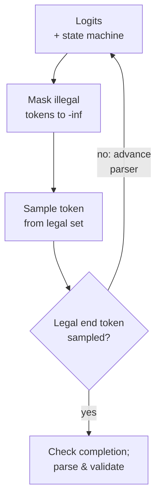
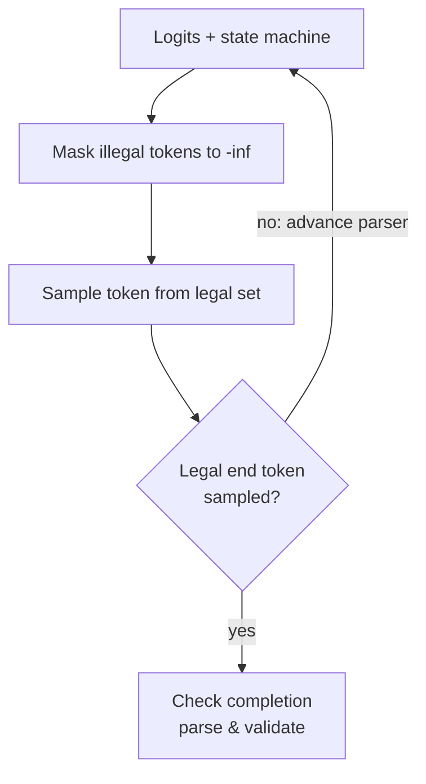

---
{
  "id": "structured-output-constrained-generation",
  "title": "Structured Output Generation",
  "slug": "structured-output-constrained-generation",
  "section": "Applied LLM Engineering & RAG",
  "category": "LLM Agents & Tool Use",
  "difficulty": "Medium",
  "coverImage": "illustrations/_generated/probability_mask_dark.png",
  "companies": [
    "OpenAI",
    "Anthropic",
    "Google",
    "Microsoft",
    "Meta"
  ],
  "shortDescription": "An evaluation log needs a typed run ID and status, yet prompting for JSON still produces chat. Mask illegal tokens during decoding, align subwords with grammars, and verify claims against trusted records.",
  "prerequisites": [
    "decoding-strategies-greedy-beam-nucleus"
  ],
  "order": 2,
  "keyConceptsTested": [
    "Structured Generation",
    "JSON Mode",
    "Grammar-Guided Decoding",
    "Finite State Machines",
    "Context-Free Grammars",
    "Tokenizer Alignment",
    "KV Cache Reuse",
    "Pydantic",
    "Token Masking",
    "XGrammar",
    "Refusal Handling",
    "Evidence validation and completion handling"
  ],
  "relatedQuestions": [
    "agentic-architectures-react-plan-execute",
    "prompt-injection-defense-strategies",
    "function-calling-tool-use-llms",
    "llm-cost-engineering-token-economics"
  ]
}
---

Ask a language model to extract `eval_id` and `status` from a benchmark log and return JSON. Nine times out of ten, it complies. On the tenth run, right as an overnight evaluation sweep finishes, it replies:

```text title="unconstrained-reply.txt"
Sure! Here is the data: { 'eval_id': 'eval-17' }
```

`json.loads` crashes at character zero on `Sure!`, single quotes violate RFC 8259, and `status` is missing altogether. Adding `"Respond ONLY with valid JSON, no preamble"` shifts the odds without changing the mechanism. An autoregressive model predicts next <span data-glossary="token">tokens</span> over its full vocabulary rather than returning a typed object, and conversational tokens like `Sure` often outscore `{`.

<span data-glossary="structured-output">Structured output generation</span> fixes this inside the sampler itself.[^willard2023] Before drawing each token, the runtime queries a compiled grammar for every vocabulary token that can legally extend the current prefix, sets all other logits to $-\infty$, and renormalizes softmax over the surviving candidates.

<figure>
  
  <figcaption>Before masking, softmax turns the raw logits for <code>Sure</code> (1.4), <code>{</code> (0.8), <code>The</code> (0.2), and <code>[</code> (-0.4) into 49.6%, 27.2%, 14.9%, and 8.2%. Setting every continuation outside the schema's start state to negative infinity leaves <code>{</code> with 100% probability before sampling.</figcaption>
</figure>

In that four-token slice, only `{` can open a JSON object, so masking hands it 100% of the probability mass before sampling starts. Real tokenizers also contain merged tokens such as `{"eval_id"`, which remain legal whenever they keep the prefix on a valid path. Fixing syntax crashes raises three harder questions: how does a character-level grammar stay aligned with multi-character subword tokens, why can a schema-valid object still fail local validation or contradict the source log, and how should production code handle truncation, refusals, and retries? We trace one evaluation log throughout: `"Evaluation eval-17 failed on math-500 after symbolic-verifier timed out."`

## Why prompting for JSON fails and what decoding constraints add

A prompt like `"Extract eval_id and status from this log. Return JSON."` expresses a preference while leaving every vocabulary token open. In production, unconstrained replies break parsers in five recurring ways: conversational preambles (`Here is the JSON: ...`), Markdown code fences (triple-backtick `json` wrappers), schema drift (`"status": null` violating a required enum), invented keys (`"benchmark_id"` instead of `"eval_id"`), and malformed syntax such as trailing commas or single quotes.

Different API tiers close different portions of that gap:

| Interface tier | Structural guarantee | Typical implementation |
|----------------|----------------------|------------------------|
| Prompt-based ("respond in JSON") | None (best-effort formatting) | Standard chat endpoints |
| JSON mode | Targets JSON syntax; still check incomplete and refusal states | OpenAI `json_object` mode |
| Strict function calling | Constrains tool arguments to a supported schema subset | Provider tool APIs with strict mode enabled |
| Hosted structured outputs | Constrains response text to a provider-supported schema subset | OpenAI, Claude, Gemini structured outputs |
| Grammar-guided inference runtime | Enforces the exact grammar compiled by the backend | Outlines, SGLang, vLLM, llama.cpp |

> **Key insight:** Constrained decoding guarantees only the subset of <span data-glossary="json-schema">JSON Schema</span> that the inference backend actually compiled. Always check the completion status first, decode JSON strictly, and validate against your local schema.

JSON mode enforces syntax alone: `{"author": "alice"}` is valid JSON while omitting both `eval_id` and `status`, and top-level arrays or scalars pass `json.loads` unless rejected.[^openai2024StructuredOutputsLaunch] Backends also differ in schema coverage: `llama.cpp`'s schema converter can silently skip unsupported keywords,[^llamacpp_grammars_docs2026] Claude's native JSON outputs (`output_config.format`) and strict tools can still return refusals or hit token limits, and Gemini pairs its schema subset with post-generation validation.[^anthropic2026StructuredOutputs][^geminiStructuredOutput2026] Python's `json.loads` adds two hazards of its own: silently overwriting duplicate keys (last value wins) and accepting non-standard `NaN` or `Infinity`.[^pythonJson2026] Strict parser hooks ahead of a strict <span data-glossary="pydantic">Pydantic</span> model close all of those gaps in one pass:

<!-- leetllm: test, id=parser, deps=pydantic, output=show, output_title="Syntax and schema are separate" -->
```python title="json-syntax-versus-schema.py"
# fold:start imports & Pydantic model
import json
import math
from typing import Literal
from pydantic import BaseModel, ConfigDict, Field, ValidationError

class TriageRecord(BaseModel):
    model_config = ConfigDict(extra="forbid", strict=True)
    eval_id: str = Field(min_length=1)
    status: Literal["queued", "passed", "failed", "unknown"]
# fold:end

def reject_constant(value: str):
    raise ValueError(f"nonfinite JSON number: {value}")

def finite_float(value: str) -> float:
    result = float(value)
    if not math.isfinite(result):
        raise ValueError("JSON number exceeds finite float range")
    return result

def unique_object(pairs: list[tuple[str, object]]) -> dict[str, object]:
    result: dict[str, object] = {}
    for key, value in pairs:
        if key in result:
            raise ValueError(f"duplicate JSON key: {key}")
        result[key] = value
    return result

def load_record(raw: str):
    return json.loads(
        raw,
        object_pairs_hook=unique_object,
        parse_constant=reject_constant,
        parse_float=finite_float,
    )

# fold:start test payloads & print harness
syntax_valid_wrong_shape = load_record('{"foo": "bar"}')
schema_valid = load_record('{"eval_id": "eval-17", "status": "failed"}')

try:
    TriageRecord.model_validate(syntax_valid_wrong_shape)
except ValidationError:
    print("JSON-only result: rejected by schema")

print("structured record:", TriageRecord.model_validate(schema_valid).model_dump())

for raw in ['{"eval_id":"eval-17","eval_id":"eval-19"}', '{"status":NaN}']:
    try:
        load_record(raw)
    except ValueError as error:
        print("parser rejected:", error)
# fold:end
```

<!-- leetllm: output:start -->
```text title="Syntax and schema are separate" output compact
JSON-only result: rejected by schema
structured record: {'eval_id': 'eval-17', 'status': 'failed'}
parser rejected: duplicate JSON key: eval_id
parser rejected: nonfinite JSON number: NaN
```
<!-- leetllm: output:end -->

`load_record` blocks duplicate keys and `NaN` at parse time before any dictionary reaches application code, and `TriageRecord` catches missing fields, extra keys, and invalid enum values right afterward.

```checkpoint
What can you assume after JSON mode, and what changes with structured outputs?
---
JSON mode targets syntactically valid JSON without guaranteeing your keys or enum values. Structured outputs enforce supported schema rules during decoding. Check completion and refusal states alongside backend limits, then validate locally; neither feature verifies truthfulness or grants execution permission.
```

## How grammar-guided decoding works

Post-generation parsing catches syntax errors only after the model spends tokens on a broken reply. A constrained decoder tracks parser state at every decode step and masks illegal tokens before sampling:

<!-- leetllm: audience:website:start -->

<!-- leetllm: audience:website:end -->
<!-- leetllm: audience:book:start -->

<!-- leetllm: audience:book:end -->

Reaching an accepting state allows `<eos>` without forcing it (trailing whitespace or optional fields may remain legal), and hitting `max_output_tokens` can still halt generation mid-object.

### From schema to logit masking

At decoding step $t$, the sampler transforms the raw logit vector $z_t \in \mathbb{R}^{|\mathcal{V}|}$ before <span data-glossary="softmax">softmax</span>:

1. **Parser state:** Track $S_t$ in a **Deterministic Finite Automaton (DFA)** for regular expressions and fixed-depth schemas, or a stack-based parser for arbitrarily recursive JSON.
2. **Legal token subset:** Identify $\mathcal{V}_{\text{valid}}(S_t) \subseteq \mathcal{V}$, keeping only tokens that leave a completable prefix (and allowing `<eos>` only when $S_t$ is accepting).
3. **Logit mask and renormalization:** Set $m_t(v) = 0$ if $v \in \mathcal{V}_{\text{valid}}(S_t)$ and $-\infty$ otherwise, then apply softmax to $z'_t = z_t + m_t$ (at temperature 1):
   $$
   P(y_t = v \mid x_{<t}) = \frac{\exp(z'_t(v))}{\sum_{u \in \mathcal{V}} \exp(z'_t(u))} = \begin{cases} \frac{\exp(z_t(v))}{\sum_{u \in \mathcal{V}_{\text{valid}}(S_t)} \exp(z_t(u))} & \text{if } v \in \mathcal{V}_{\text{valid}}(S_t) \\ 0 & \text{otherwise} \end{cases}
   $$

If $\mathcal{V}_{\text{valid}}(S_t)$ is ever empty (due to a tokenizer mismatch or unsatisfiable rule), the decoder must halt with an error rather than dropping the mask.

<figure>
  
  <figcaption>Compiling a schema turns grammar rules into a state machine (<code>S0 -> S1 -> S2 -> S3</code>) and a valid-token bitmask <code>M[S_t, v]</code>. Each decoding step reads the binary row for its current state to mask the vocabulary before softmax.</figcaption>
</figure>

Here is that vectorized masking step in NumPy on our opening four tokens:

<!-- leetllm: test, deps=numpy, output=show -->
```python title="from-schema-to-logit-masking.py"
import numpy as np

def softmax(vec: np.ndarray) -> np.ndarray:
    finite = np.isfinite(vec)
    if not np.any(finite):
        raise ValueError("no legal token with a finite logit")
    shifted = np.where(finite, vec - np.max(vec[finite]), -np.inf)
    exp_scores = np.where(finite, np.exp(shifted), 0.0)
    return exp_scores / np.sum(exp_scores)

tokens = ["Sure", "{", "The", "["]
logits = np.array([1.4, 0.8, 0.2, -0.4], dtype=float)
legal_mask = np.array([False, True, False, False])

before_probs = softmax(logits)
masked_logits = np.where(legal_mask, logits, -np.inf)
after_probs = softmax(masked_logits)

# fold:start print & assert harness
chosen = tokens[int(np.argmax(after_probs))]
print("before softmax (%):", {t: round(float(p) * 100, 1) for t, p in zip(tokens, before_probs)})
print("masked logits:", {t: float(x) for t, x in zip(tokens, masked_logits)})
print("after softmax (%):", {t: round(float(p) * 100, 1) for t, p in zip(tokens, after_probs)})
print("chosen token:", chosen)
assert chosen == "{"
assert np.isclose(after_probs[1], 1.0)
# fold:end
```

<!-- leetllm: output:start -->
```text title="Output" output compact
before softmax (%): {'Sure': 49.6, '{': 27.2, 'The': 14.9, '[': 8.2}
masked logits: {'Sure': -inf, '{': 0.8, 'The': -inf, '[': -inf}
after softmax (%): {'Sure': 0.0, '{': 100.0, 'The': 0.0, '[': 0.0}
chosen token: {
```
<!-- leetllm: output:end -->

`"Sure"` drops from 49.6% to 0.0%, and whenever multiple tokens remain legal, softmax preserves their relative odds intact across the valid subset.

### The tokenizer alignment problem

Masking logits is cheap; computing `legal_mask` quickly across a real vocabulary is the hard part. Grammars match characters or bytes, whereas models emit <span data-glossary="subword-tokenization">subword tokens</span> that span multiple JSON delimiters (`","status":"failed"`) or split a UTF-8 codepoint mid-character. Checking only the first character fails: the decoder must walk every byte of a candidate token through the automaton from $S_t$ and reject the whole token if any byte overshoots.[^willard2023]

After `{"status":"`, expecting `"failed"`:
- `fa` is legal (advances two characters inside `"failed"`).
- `iled"}` is legal after `fa` (completes the string and closes the object).
- `iled"}!` is illegal: its first six characters match, yet `!` overshoots into an error state.

Walking 128,000 vocabulary strings per decode step would crush throughput, so modern engines precompute and partition vocabulary lookups:
- **Indexed finite-state decoding** (Willard and Louf, 2023) precomputes the allowed token IDs per reachable DFA state into a lookup table.[^willard2023]
- **llguidance** pairs an Earley context-free parser, a regex lexer, and a tokenizer trie to compute masks incrementally.[^llguidance2026]
- **XGrammar** splits the vocabulary into context-independent tokens (precomputed bitmasks per active rule) and context-dependent tokens (checked dynamically against the parser stack).[^xgrammar2024]

### Regular expressions vs. context-free grammars

Which formalism you need depends on **nesting depth**, not output length. A DFA handles regular expressions, enums, and fixed-depth JSON objects (including arbitrarily long arrays of flat objects like `\[(\{\}(,\{\})*)?\]`) in constant working memory. Only arbitrarily deep recursive nesting requires a stack-aware **Context-Free Grammar (CFG)** to balance open delimiters.

> **Common mistake:** Assuming a variable-length JSON array needs a CFG. Length and nesting depth are separate dimensions; an unbounded list of flat records is strictly regular and compiles to a DFA.

### Build an incremental DFA token decoder

The figure and script below compile a tiny language accepting only `{"status":"passed"}` and `{"status":"failed"}` into a character-level DFA and trace every candidate token completely through it.

<figure>
   &lt;eos&gt; accepts pass. Taking fa advances to a partial prefix where iled&quot;} -> &lt;eos&gt; accepts fail, while iled&quot;}! is masked out because it overshoots at !." />
  <figcaption>Both accepted strings share <code>{"status":"</code>. From <code>fa</code>, the token <code>iled"}</code> reaches the final brace cleanly, whereas <code>iled"}!</code> overshoots at <code>!</code> and is masked out as a whole token.</figcaption>
</figure>

<!-- leetllm: test, id=finite-guide, output=show, output_title="Incremental DFA whole-token decoder" -->
```python title="finite-language-token-guide.py"
# fold:start vocabulary, scores & prefix DFA builder
LANGUAGE = ('{"status":"passed"}', '{"status":"failed"}')
VOCAB = ('The', '{"status":"', 'fa', 'passed', 'iled"}', 'iled"}!', '"}', '<eos>')
SCORES = {
    'The': 9.0, '{"status":"': 1.0, 'fa': 3.0, 'passed': 2.0,
    'iled"}': 1.0, 'iled"}!': 8.0, '"}': 1.0, '<eos>': 7.0,
}

def build_prefix_dfa(strings: tuple[str, ...]) -> tuple[dict[int, dict[str, int]], set[int]]:
    prefixes = {''}
    for s in strings:
        for i in range(1, len(s) + 1):
            prefixes.add(s[:i])
    state_id = {p: idx for idx, p in enumerate(sorted(prefixes, key=lambda x: (len(x), x)))}
    transitions: dict[int, dict[str, int]] = {idx: {} for idx in state_id.values()}
    for p, sid in state_id.items():
        for ch in {s[len(p)] for s in strings if s.startswith(p) and len(p) < len(s)}:
            transitions[sid][ch] = state_id[p + ch]
    return transitions, {state_id[s] for s in strings}

DFA, ACCEPTING = build_prefix_dfa(LANGUAGE)
# fold:end

def advance_token(state: int, token: str) -> int | None:
    if token == '<eos>':
        return state if state in ACCEPTING else None
    if not token:
        return None
    cur = state
    for ch in token:
        if ch not in DFA[cur]:
            return None
        cur = DFA[cur][ch]
    return cur

def decode(max_steps: int = 8) -> tuple[str, list[str]]:
    state, prefix, trace = 0, '', []
    for _ in range(max_steps):
        legal = [tok for tok in VOCAB if advance_token(state, tok) is not None]
        if not legal:
            raise ValueError('grammar has no representable continuation')
        tok = max(legal, key=lambda item: SCORES[item])
        trace.append(tok)
        if tok == '<eos>':
            return prefix, trace
        state = advance_token(state, tok)
        assert state is not None
        prefix += tok
    raise ValueError('token budget ended before complete output')

# fold:start trace execution & assertions
record, trace = decode()
print('tokens:', trace)
print('record:', record)
fa_state = advance_token(advance_token(0, '{"status":"'), 'fa')
print('overshooting token next state:', advance_token(fa_state, 'iled"}!'))
assert record in LANGUAGE
assert advance_token(fa_state, '<eos>') is None
# fold:end
```

<!-- leetllm: output:start -->
```text title="Incremental DFA whole-token decoder" output compact
tokens: ['{"status":"', 'fa', 'iled"}', '<eos>']
record: {"status":"failed"}
overshooting token next state: None
```
<!-- leetllm: output:end -->

Even though `iled"}!` scores `8.0` versus `1.0` for `iled"}`, `advance_token` rejects it at `!`, and `<eos>` (`7.0`) stays masked at `fa_state` until the object closes.

### Token boundaries and token healing

When a prompt ends right on a quote or colon (`'{"status":"'`), greedy tokenization cuts across a merged token like `'":"passed'` that the model strongly prefers. **Token healing** backs up one prompt token and restricts the first generated token to start with the trimmed text, restoring the natural merge without changing the prompt string:[^willard2023][^llguidance2026]

<!-- leetllm: test, id=token-healing, output=show, output_title="Token boundary healing" -->
```python title="token-healing-boundary.py"
# fold:start vocabulary & greedy tokenizer
VOCAB = ['"', ':', '{', '":"', '":"passed', 'passed', '{"status', '"}']

def greedy_tokenize(text: str, vocab: list[str]) -> list[str]:
    tokens, pos = [], 0
    while pos < len(text):
        match = max((tok for tok in vocab if text.startswith(tok, pos)), key=len)
        tokens.append(match)
        pos += len(match)
    return tokens
# fold:end

prompt = '{"status":"'
naive_tokens = greedy_tokenize(prompt, VOCAB)
trimmed_prefix, required_start = naive_tokens[:-1], naive_tokens[-1]
healed_candidates = [tok for tok in VOCAB if tok.startswith(required_start)]

# fold:start print & assert harness
print("naive prompt tokens:", naive_tokens)
print("healed prefix:", trimmed_prefix, "required continuation start:", repr(required_start))
print("healed candidates:", healed_candidates)
assert '":"passed' in healed_candidates
# fold:end
```

<!-- leetllm: output:start -->
```text title="Token boundary healing" output compact
naive prompt tokens: ['{"status', '":"']
healed prefix: ['{"status'] required continuation start: '":"'
healed candidates: ['":"', '":"passed']
```
<!-- leetllm: output:end -->

## Libraries and serving stacks

Local runtimes (Outlines, `llama.cpp`, SGLang, vLLM) compile grammars and apply masks inside your inference worker; hosted APIs compile schemas server-side. In **Outlines**, reuse a compiled `Generator` across requests to amortize compilation, and still validate its raw string output locally:[^outlinesGenerator2026]

```python title="outlines.py"
from typing import Literal
import outlines
from outlines import Generator
from pydantic import BaseModel, ConfigDict
from transformers import AutoModelForCausalLM, AutoTokenizer

class EvalStatusUpdate(BaseModel):
    model_config = ConfigDict(extra="forbid", strict=True)
    eval_id: str
    status: Literal["queued", "passed", "failed", "unknown"]
    failing_task: str | None

model_name = "HuggingFaceTB/SmolLM2-135M-Instruct"
model = outlines.from_transformers(
    AutoModelForCausalLM.from_pretrained(model_name),
    AutoTokenizer.from_pretrained(model_name),
)
eval_generator = Generator(model, EvalStatusUpdate)
raw = eval_generator("Extract eval_id, status, and failing_task: Evaluation eval-17 failed on math-500.", max_new_tokens=120)
record = EvalStatusUpdate.model_validate_json(raw)
```

High-concurrency serving engines keep mask generation from stalling continuous batches. SGLang introduced **RadixAttention** to reuse the <span data-glossary="kv-cache">KV cache</span> across shared system prompts and schema prefixes (cutting <span data-glossary="ttft">Time To First Token</span>) alongside compressed FSM jump-forward across constant substrings.[^zheng2023a] Today both SGLang and vLLM default to **XGrammar** or **llguidance**, overlapping CPU bitmask computation (under 40 microseconds per token in XGrammar) with the GPU forward pass over the already-accepted prefix.[^xgrammar2024][^sglang_structured_outputs_docs2026][^vllmStructuredOutputs2026] Serial step time is $t_{\text{gpu}} + t_{\text{cpu}} + t_{\text{sample}}$; with overlap, sampling waits only for $\max(t_{\text{gpu}}, t_{\text{cpu}}) + t_{\text{sample}}$.

<details>
<summary>Deep dive: Serving backend APIs and schema-compiler quirks</summary>

- **Outlines backends:** Supports `outlines_core`, `llguidance`, and XGrammar with different coverage; benchmark cold compilation and warm per-token latency separately.[^outlinesBackends2026]
- **llama.cpp (GBNF):** Converts JSON Schema into GBNF grammars.[^llamacpp2023][^llamacpp_grammars_docs2026] Unsupported keywords can be dropped quietly, and `llama.cpp` does not inject the schema into your prompt automatically, so describe required fields in the prompt and keep local Pydantic validation.[^llamacpp_grammars_docs2026]
- **SGLang and vLLM:** SGLang defaults to XGrammar alongside Outlines and `llguidance`.[^sglang_structured_outputs_docs2026] vLLM configures constrained decoding through `structured_outputs` backed by XGrammar or `llguidance`, replacing legacy per-format flags (`guided_json`, `guided_regex`).[^vllmStructuredOutputs2026]

</details>

```checkpoint
What latency work belongs to prefix caching versus grammar state?
---
Prefix caching reuses prefill computation for a matching token prefix, reducing Time To First Token when cache entries hit. Grammar-state optimizations cut the per-step cost of finding legal next tokens. They optimize different stages of serving latency.
```

## Function calling vs. structured outputs

Both tool definitions and structured extraction APIs use JSON Schema, yet they serve different host roles:

| Dimension | Function calling (tool use) | Structured outputs |
|-----------|-----------------------------|--------------------|
| **Core purpose** | Agent action selection and execution | Structured data extraction and transformation |
| **Control flow** | Model proposes a tool; host runs it and feeds back the observation | Terminal JSON record consumed directly by application code |
| **Return format** | Tool name plus JSON argument object | JSON document matching the response schema |
| **Side effects** | Host validates permissions before executing the tool | Host decides how to store or act on the parsed record |

### Function calling for tool arguments

Use function calling when an agent needs live state before answering. Setting `"strict": True` enforces the argument schema on the wire (`GetEvalStatusArgs.model_json_schema()` with `ConfigDict(extra="forbid", strict=True)`), and local Pydantic validation rejects extra keys like `force_rerun: true` before host code checks caller permissions:

<!-- leetllm: test, deps=pydantic, output=show -->
```python title="strict-tool-arguments.py"
from pydantic import BaseModel, ConfigDict, ValidationError

class GetEvalStatusArgs(BaseModel):
    model_config = ConfigDict(extra="forbid", strict=True)
    eval_id: str

tool_definition = {
    "type": "function", "name": "get_eval_status", "strict": True,
    "description": "Fetch current benchmark status for an evaluation run.",
    "parameters": GetEvalStatusArgs.model_json_schema(),
}

# fold:start validation demo
valid_call = GetEvalStatusArgs.model_validate_json('{"eval_id": "eval-17"}')
print("tool:", tool_definition["name"], "strict:", tool_definition["strict"])
print("validated args:", valid_call.model_dump())

try:
    GetEvalStatusArgs.model_validate_json('{"eval_id": "eval-17", "force_rerun": true}')
except ValidationError as error:
    print("extra arg rejected:", error.errors()[0]["type"])
# fold:end
```

<!-- leetllm: output:start -->
```text title="Output" output compact
tool: get_eval_status strict: True
validated args: {'eval_id': 'eval-17'}
extra arg rejected: extra_forbidden
```
<!-- leetllm: output:end -->

### Structured outputs for typed records

Use structured outputs for extraction and classification pipelines. OpenAI's strict mode requires every property in `required` and `"additionalProperties": false`, so optional fields become **required nullable unions** (`failing_task: str | None` with no default).[^openai_structured_outputs][^pydanticStrict2026] That lets the model report missing evidence as `null` without omitting the key or inventing a task name:

<!-- leetllm: test, continue=parser, id=typed, output=show, output_title="A required nullable field" -->
```python title="typed-eval-record.py"
class EvalStatusUpdate(BaseModel):
    model_config = ConfigDict(extra="forbid", strict=True)
    eval_id: str
    status: Literal["queued", "passed", "failed", "unknown"]
    failing_task: str | None

schema = EvalStatusUpdate.model_json_schema()
update = EvalStatusUpdate.model_validate({"eval_id": "eval-17", "status": "failed", "failing_task": None})

# fold:start print & omission check
print("required:", schema["required"])
print("closed object:", schema["additionalProperties"] is False)
print("nullable task:", update.failing_task)

try:
    EvalStatusUpdate.model_validate({"eval_id": "eval-17", "status": "failed"})
except ValidationError:
    print("omitted task: rejected")
# fold:end
```

<!-- leetllm: output:start -->
```text title="A required nullable field" output compact
required: ['eval_id', 'status', 'failing_task']
closed object: True
nullable task: None
omitted task: rejected
```
<!-- leetllm: output:end -->

Always validate against your **original** Pydantic class locally rather than the wire schema sent to the provider. Some SDK adapters strip unsupported numeric bounds (`minimum`, `maximum`) from the wire schema and append them to `description` prose.[^anthropic2026StructuredOutputs] A description nudges generation without masking illegal values, so `-1` passes the wire check and is caught only by your local model:

<!-- leetllm: test, continue=typed, id=wire, output=show, output_title="Wire constraints versus local constraints" -->
```python title="wire-schema-drift.py"
# fold:start imports & schema setup
from copy import deepcopy
from pydantic import TypeAdapter

class RetrySuggestion(BaseModel):
    model_config = ConfigDict(extra="forbid", strict=True)
    retry_count: int = Field(ge=0)

original_schema = RetrySuggestion.model_json_schema()
wire_schema = deepcopy(original_schema)
# fold:end
wire_schema["properties"]["retry_count"].pop("minimum")
wire_schema["properties"]["retry_count"]["description"] = "Must be at least 0"
candidate = {"retry_count": -1}

wire_int = TypeAdapter(int).validate_python(candidate["retry_count"], strict=True)
# fold:start print & local rejection check
print("local minimum:", original_schema["properties"]["retry_count"]["minimum"])
print("wire minimum present:", "minimum" in wire_schema["properties"]["retry_count"])
print("candidate fits wire integer shape:", wire_int == -1)
try:
    RetrySuggestion.model_validate(candidate)
except ValidationError as error:
    print("local rejection:", error.errors()[0]["type"])
# fold:end
```

<!-- leetllm: output:start -->
```text title="Wire constraints versus local constraints" output compact
local minimum: 0
wire minimum present: False
candidate fits wire integer shape: True
local rejection: greater_than_equal
```
<!-- leetllm: output:end -->

When calling hosted APIs such as OpenAI's `client.responses.parse(..., text_format=EvalStatusUpdate)`, check `response.status == "completed"`, inspect every message part for `part.type == "refusal"`, and confirm `response.output_parsed is not None` (buffering streaming deltas until completion before validating).

Passing schema validation still verifies shape alone. Host code must separately verify caller access and compare claims against trusted records:

<!-- leetllm: test, continue=wire, id=semantics, output=show, output_title="Shape, truth, and access" -->
```python title="separate-format-from-semantic-validation.py"
EVAL_DB = {"eval-17": {"suite": "nlp-eval", "status": "failed", "failing_task": "math-500"}}

def decide_update(allowed_suites: set[str], update: TriageRecord) -> str:
    trusted = EVAL_DB.get(update.eval_id)
    if trusted is None or trusted["suite"] not in allowed_suites:
        return "deny"  # Avoid revealing whether an unauthorized eval_id exists
    if update.status != trusted["status"]:
        return "review: contradicts eval log"
    return "show"

# fold:start test cases & prints
parsed = TriageRecord.model_validate({"eval_id": "eval-17", "status": "failed"})
print("format check:", parsed.model_dump())
print("authorized and true:", decide_update({"nlp-eval"}, parsed))
print("other suite:", decide_update({"vision-eval"}, parsed))

false_claim = TriageRecord.model_validate({"eval_id": "eval-17", "status": "passed"})
print("authorized but false:", decide_update({"nlp-eval"}, false_claim))
# fold:end
```

<!-- leetllm: output:start -->
```text title="Shape, truth, and access" output compact
format check: {'eval_id': 'eval-17', 'status': 'failed'}
authorized and true: show
other suite: deny
authorized but false: review: contradicts eval log
```
<!-- leetllm: output:end -->

`false_claim` satisfies `TriageRecord` cleanly, yet `decide_update` catches that `eval-17` actually failed in `EVAL_DB` and routes the contradiction for review.

## Systems trade-offs: latency, reasoning quality, and schema design

Grammar constraints add measurable compilation and decoding work. Knowing which stage pays each cost keeps schemas fast and accurate:

### Where latency comes from

| Bottleneck | Underlying cause | Serving impact | Mitigation |
|------------|------------------|----------------|------------|
| Schema compilation | Building a grammar and tokenizer index | Higher cold-start TTFT | Reuse compiled artifacts; measure cold and warm distributions separately |
| Per-token grammar work | Advancing parser state and applying the mask | Adds to TPOT unless overlapped with GPU | Benchmark on your backend at realistic batch sizes |
| Schema prompt overhead | Field descriptions and injected schema text | Extra prefill tokens | Measure prompt token counts and prefix-cache hit rates |
| Grammar complexity | Deep nesting, wide unions, optional branches | Larger state tables or dropped keywords | Profile representative schemas; flatten where needed |

### Reasoning accuracy and evidence spans

Tam et al. (2024) found that strict formatting templates lowered reasoning accuracy on several benchmarks compared with free-form answers, while classification sometimes improved.[^tam2024] Benchmark your own tasks on current models, and note that reasoning models decouple thinking from formatting: internal reasoning runs unconstrained, and the schema mask activates only for the final answer.[^openai2026reasoning]

For non-reasoning models, placing an `evidence_quote` field before `decision` encourages grounding. Verify that the quote appears verbatim in the source and matches the complete `eval_id` with word boundaries `(?<![\w-])` (so `eval-170` never satisfies a citation for `eval-17`). Notice also what quote verification leaves unchecked: a true quote can still accompany an unjustified decision like `halt_release`.

<!-- leetllm: test, continue=semantics, id=evidence, output=show, output_title="Check the quote against the source" -->
```python title="validate-visible-evidence-before-decision.py"
# fold:start imports & EvalDecision schema
import re

SOURCE_LOG = "Evaluation eval-17 failed on math-500 after symbolic-verifier timed out."

class EvalDecision(BaseModel):
    model_config = ConfigDict(extra="forbid", strict=True)
    evidence_quote: str = Field(min_length=1)
    eval_id: str = Field(min_length=1)
    decision: Literal["rerun_suite", "halt_release", "needs_review", "unknown"]
# fold:end

def verify_evidence_span(payload: dict[str, str], source: str) -> EvalDecision:
    record = EvalDecision.model_validate(payload)
    if record.evidence_quote not in source:
        raise ValueError("quote is not an exact span of the source")
    pattern = r"(?<![\w-])" + re.escape(record.eval_id) + r"(?![\w-])"
    if not re.search(pattern, record.evidence_quote):
        raise ValueError("eval ID does not appear in evidence")
    return record

# fold:start valid, invented-quote & wrong-action tests
decision = verify_evidence_span(
    {"evidence_quote": SOURCE_LOG, "eval_id": "eval-17", "decision": "rerun_suite"},
    SOURCE_LOG,
)
print("decision:", decision.decision, "| quote in source:", decision.evidence_quote in SOURCE_LOG)

try:
    verify_evidence_span({**decision.model_dump(), "evidence_quote": "eval-17 needs a release halt."}, SOURCE_LOG)
except ValueError as error:
    print("invented quote:", error)

# A verbatim quote still does not verify that halt_release is justified by rules.
unsupported = verify_evidence_span({**decision.model_dump(), "decision": "halt_release"}, SOURCE_LOG)
print("true quote with wrong action accepted by quote check:", unsupported.decision)
# fold:end
```

<!-- leetllm: output:start -->
```text title="Check the quote against the source" output compact
decision: rerun_suite | quote in source: True
invented quote: quote is not an exact span of the source
true quote with wrong action accepted by quote check: halt_release
```
<!-- leetllm: output:end -->

### Flattening recursive structures

When a backend rejects recursive schemas (or stack overhead matters), represent a tree as a flat array of nodes with `parent_id` links. A flat array is a regular language that any DFA compiles cleanly, shifting structural validation (unique IDs, single root, valid parents, and connectedness via root traversal) into host code:

<!-- leetllm: test, output=show -->
```python title="reconstruct-a-flat-tree-after-validation.py"
# fold:start FlatNode dataclass & sample nodes
from dataclasses import dataclass

@dataclass(frozen=True)
class FlatNode:
    node_id: str
    parent_id: str | None
    label: str

nodes = [
    FlatNode("root", None, "eval_run"),
    FlatNode("n1", "root", "failing_task"),
    FlatNode("n2", "root", "trace_uri"),
]
# fold:end

def validate_tree(nodes: list[FlatNode], max_nodes: int = 100):
    if not 1 <= len(nodes) <= max_nodes:
        raise ValueError("node count outside allowed range")
    by_id = {n.node_id: n for n in nodes}
    if len(by_id) != len(nodes) or any(not n.node_id.strip() for n in nodes):
        raise ValueError("node IDs must be unique and nonempty")
    roots = [n.node_id for n in nodes if n.parent_id is None]
    if len(roots) != 1:
        raise ValueError("expected one root")
    children = {n.node_id: [] for n in nodes}
    for n in nodes:
        if n.parent_id is not None:
            if n.parent_id not in by_id:
                raise ValueError("unknown parent")
            children[n.parent_id].append(n.node_id)
    pending, visited = [roots[0]], set()
    while pending:
        current = pending.pop()
        if current in visited:
            raise ValueError("cycle detected")
        visited.add(current)
        pending.extend(children[current])
    if len(visited) != len(nodes):
        raise ValueError("disconnected nodes or cycles present")
    return roots[0], children

# fold:start valid & disconnected-cycle test harness
root_id, children = validate_tree(nodes)
print("root ID:", root_id, "| child IDs:", children[root_id])

cyclic = [nodes[0], FlatNode("a", "b", "task"), FlatNode("b", "a", "trace")]
try:
    validate_tree(cyclic)
except ValueError as error:
    print("invalid tree:", error)
# fold:end
```

<!-- leetllm: output:start -->
```text title="Output" output compact
root ID: root | child IDs: ['n1', 'n2']
invalid tree: disconnected nodes or cycles present
```
<!-- leetllm: output:end -->

Every parent pointer in `cyclic` resolves to an existing ID, yet traversing from `root` visits only 1 of 3 nodes and catches the disconnected `a <-> b` cycle immediately.

## Failure modes and production recovery

Even when every emitted token obeys the compiled grammar, generation can stall on legal whitespace, truncate before closing the object, hit a refusal, or emit a bogus permission boolean.

### Legal prefixes that never finish

A grammar constrains local syntax without measuring progress toward completion: optional whitespace rules allow repeated newlines until `max_output_tokens` runs out. Low logits on legal tokens never cause a dead end by themselves because softmax renormalizes positive mass over whatever legal set remains; true dead ends occur only when the legal set is empty. Enforce strict token and wall-clock caps, and keep clear field semantics in the prompt (skip pasting duplicate JSON Schema text when the API already injects it).

### Version schemas in application code

Attach `schema_version` in your validation layer (`{"schema_version": "2", "payload": EvalStatusUpdate.model_validate(raw).model_dump()}`) rather than asking the model to emit it. A model-generated version string is untrusted text and cannot tell downstream storage which validator actually ran.

### Route each stop condition to its own recovery path

Inspect the stop reason instead of blindly retrying with a looser prompt:

<figure>
  
  <figcaption>Each completion outcome follows its own recovery path. Only a length truncation (<code>max_tokens</code>) that stays within budget and latency limits qualifies for a single retry at 400 tokens; refusals stop retries, bad schemas require an adapter fix, and completed outputs still face schema and host checks.</figcaption>
</figure>

1. **Completed candidate:** Decode strictly, validate with local Pydantic, and verify source facts and caller permissions.
2. **Token limit:** Retry once with the exact same schema and a larger token cap only if the retry fits the model limit, remaining deadline (including local validation time), and remaining cost budget. (Chat Completions signals `finish_reason: "length"`; Responses signals `status: "incomplete"` with `incomplete_details.reason: "max_output_tokens"`.)[^openai_structured_outputs]
3. **Refusal or content-filter stop:** Halt automatic retries immediately and return a safe refusal.
4. **Unsupported or invalid schema:** Fix the schema or SDK adapter in code; retrying identical input fails identically.
5. **Local validation failure:** Check whether a wire adapter dropped a rule or the prompt misled a value; if retrying once with an error message, strip secrets and internal permissions from the feedback.

<!-- leetllm: test, continue=evidence, id=recovery, output=show, output_title="Retry only a length stop" -->
```python title="retry-on-truncation.py"
# fold:start format config & stub response client
FORMAT = {"type": "json_schema", "name": "eval_status", "strict": True, "schema": schema}

class StubResponseClient:
    def __init__(self, responses):
        self.responses = iter(responses)
        self.calls = []

    def create(self, **kwargs):
        self.calls.append(kwargs)
        return next(self.responses)
# fold:end

def extract_with_single_retry(client, input_text: str) -> EvalStatusUpdate:
    for attempt, budget in enumerate((120, 400)):
        response = client.create(input=input_text, text={"format": FORMAT}, max_output_tokens=budget)
        output = response.get("output", [])
        content = [p for item in output if item.get("type") == "message" for p in item.get("content", [])]
        if any(p.get("type") == "refusal" for p in content):
            raise RuntimeError("safety refusal: request blocked by model")
        status = response.get("status")
        if status == "incomplete":
            reason = (response.get("incomplete_details") or {}).get("reason")
            if reason == "max_output_tokens" and attempt == 0:
                continue
            raise RuntimeError(f"halted prematurely: {reason}")
        if status != "completed":
            raise RuntimeError(f"unexpected completion status: {status}")
        messages = [item for item in output if item.get("type") == "message"]
        if len(messages) != 1 or messages[0].get("status") != "completed":
            raise RuntimeError("expected one completed output message")
        if len(content) != 1 or content[0].get("type") != "output_text":
            raise RuntimeError("expected one structured text item")
        return EvalStatusUpdate.model_validate(load_record(content[0]["text"]))
    raise RuntimeError("retry budget exhausted")

# fold:start stop-branch test scenarios & assertions
generated_payload = {"eval_id": "eval-17", "status": "failed", "failing_task": "math-500"}
incomplete = {"status": "incomplete", "output": [], "incomplete_details": {"reason": "max_output_tokens"}}
completed = {"status": "completed", "output": [{"type": "message", "status": "completed",
             "content": [{"type": "output_text", "text": json.dumps(generated_payload)}]}]}

client = StubResponseClient([incomplete, completed])
update = extract_with_single_retry(client, SOURCE_LOG)
print("retry preserved schema:", update.model_dump())
print("budgets:", [call["max_output_tokens"] for call in client.calls])
assert client.calls[0]["text"] == client.calls[1]["text"]

refused = {"status": "completed", "output": [{"type": "reasoning", "summary": []},
           {"type": "message", "status": "completed", "content": [{"type": "refusal", "refusal": "blocked"}]}]}
filtered = {"status": "incomplete", "output": [], "incomplete_details": {"reason": "content_filter"}}
for label, responses in (("refusal routed", [refused]), ("content filter", [filtered]),
                         ("second length stop", [incomplete, incomplete])):
    stopped = StubResponseClient(responses)
    try:
        extract_with_single_retry(stopped, SOURCE_LOG)
    except RuntimeError as error:
        print(f"{label}: {error}; calls={len(stopped.calls)}")
    assert len(stopped.calls) == len(responses)
# fold:end
```

<!-- leetllm: output:start -->
```text title="Retry only a length stop" output compact
retry preserved schema: {'eval_id': 'eval-17', 'status': 'failed', 'failing_task': 'math-500'}
budgets: [120, 400]
refusal routed: safety refusal: request blocked by model; calls=1
content filter: halted prematurely: content_filter; calls=1
second length stop: halted prematurely: max_output_tokens; calls=2
```
<!-- leetllm: output:end -->

### Never trust permission booleans emitted by a model

A schema-valid payload like `{"eval_id": "eval-17", "action": "rerun_suite", "approved": true}` tells you only that `approved` is a boolean. Reading model-generated flags as authorization grants creates an instant privilege-escalation bug. Ignore self-attested booleans and check verified session credentials and stored approvals in host state:

<!-- leetllm: test, output=show -->
```python title="ignore-self-attested-approval.py"
# fold:start proposal dataclass
from dataclasses import dataclass

@dataclass(frozen=True)
class ModelEvalProposal:
    eval_id: str
    action: str
    approved: bool  # Untrusted model output; never read for authorization
# fold:end

def check_approval(proposal: ModelEvalProposal, stored_request: tuple[str, str] | None) -> str:
    if proposal.action != "rerun_suite":
        return "deny: unsupported action"
    if stored_request != (proposal.eval_id, proposal.action):
        return "deny: missing approval for this request"
    return "approval matched; continue host checks"

# fold:start test calls & prints
proposal = ModelEvalProposal("eval-17", "rerun_suite", approved=True)
print(check_approval(proposal, stored_request=None))
print(check_approval(proposal, stored_request=("eval-19", "rerun_suite")))
print(check_approval(proposal, stored_request=("eval-17", "rerun_suite")))
# fold:end
```

<!-- leetllm: output:start -->
```text title="Output" output compact
deny: missing approval for this request
deny: missing approval for this request
approval matched; continue host checks
```
<!-- leetllm: output:end -->

## Practice: build a benchmark-digest validator

Combine these layers on a nightly evaluation report:

> "math-500 recovered to target score after prompt tuning. humaneval-plus remains degraded. gpqa-diamond has no recorded run today."

Requirements:
1. Return `{"mentions": [{"suite": "...", "status": "passed|degraded|failed|unknown"}, ...]}` under strict structured outputs.
2. Represent zero suite mentions as `{"mentions": []}`, never `null` or a missing key.
3. Reject duplicate suite entries in host code (array position carries no timestamp, so a last-wins dict comprehension silently masks conflicting statuses) and flag suites outside the registered catalog (`math-500`, `humaneval-plus`, `mmlu-pro`) for review.

<!-- leetllm: test, deps=pydantic, output=show -->
```python title="benchmark-digest-validator.py"
# fold:start imports & Pydantic schema models
from typing import Literal
from pydantic import BaseModel, ConfigDict, Field

KNOWN_SUITES = {"math-500", "humaneval-plus", "mmlu-pro"}

class SuiteMention(BaseModel):
    model_config = ConfigDict(extra="forbid", strict=True)
    suite: str = Field(min_length=1)
    status: Literal["passed", "degraded", "failed", "unknown"]

class BenchmarkDigest(BaseModel):
    model_config = ConfigDict(extra="forbid", strict=True)
    mentions: list[SuiteMention]
# fold:end

def unknown_suites(digest: BenchmarkDigest) -> list[str]:
    return [m.suite for m in digest.mentions if m.suite not in KNOWN_SUITES]

def check_unique_suites(digest: BenchmarkDigest) -> None:
    seen: set[str] = set()
    for mention in digest.mentions:
        if mention.suite in seen:
            raise ValueError(f"duplicate suite summary: {mention.suite}")
        seen.add(mention.suite)

# fold:start test payloads & print harness
digest = BenchmarkDigest.model_validate({
    "mentions": [
        {"suite": "math-500", "status": "passed"},
        {"suite": "humaneval-plus", "status": "degraded"},
        {"suite": "gpqa-diamond", "status": "unknown"},
    ]
})
empty = BenchmarkDigest.model_validate({"mentions": []})
check_unique_suites(digest)

print("mentions:", len(digest.mentions), "| unknown suites:", unknown_suites(digest))
print("empty mentions:", empty.mentions)

conflicting = BenchmarkDigest.model_validate({
    "mentions": [
        {"suite": "math-500", "status": "passed"},
        {"suite": "math-500", "status": "failed"},
    ]
})
print("tempting dict conversion:", {m.suite: m.status for m in conflicting.mentions})
try:
    check_unique_suites(conflicting)
except ValueError as error:
    print("identity check:", error)
# fold:end
```

<!-- leetllm: output:start -->
```text title="Output" output compact
mentions: 3 | unknown suites: ['gpqa-diamond']
empty mentions: []
tempting dict conversion: {'math-500': 'failed'}
identity check: duplicate suite summary: math-500
```
<!-- leetllm: output:end -->

`{"mentions": []}` distinguishes an empty report from a failed extraction, unknown suites like `gpqa-diamond` surface cleanly without crashing the parser, and `check_unique_suites` catches conflicting entries before a dictionary comprehension silently hides them.

## Summary: four layers of structured reliability

1. **Grammar-guided decoding** masks illegal tokens before softmax to enforce syntax and supported schema rules at token generation time.
2. **Strict JSON parsing and local Pydantic models** catch duplicate keys, nonfinite numbers, and numeric bounds stripped by wire adapters.
3. **Host verification** compares extracted claims against trusted stores and derives access decisions exclusively from authenticated application state.
4. **Stop-reason recovery** retries a single token-limit cutoff when budgets allow while halting on refusals and fixing bad schemas in code.

```mastery-quiz
[
  {
    "question": "At temperature one, four next-token candidates have exponentiated weights 1, 4, 6 and 9. The grammar permits only the first and third. What is their masked distribution in the original candidate order?",
    "options": [
      "1/20, 0, 6/20, 0.",
      "1/7, 0, 6/7, 0.",
      "0, 4/13, 0, 9/13.",
      "1/4, 1/4, 1/4, 1/4."
    ],
    "answer": "1/7, 0, 6/7, 0.",
    "explanation": "Only weights 1 and 6 survive, giving denominator 7. Illegal candidates receive zero. Keeping the original sum 20 would leave probability missing; normalizing the rejected set reverses the mask."
  },
  {
    "question": "A grammar accepts exactly the balanced strings over the two characters `[` and `]`, with no limit on nesting depth. From the accepted prefix `[[`, try token A (`]]`) and token B (`]!]`) separately. Which tuple gives the legality of A, the legality of B, and whether the end-of-sequence token (EOS) is allowed at the original prefix?",
    "options": [
      "Legal; illegal; allowed.",
      "Illegal; illegal; blocked.",
      "Legal; legal; blocked.",
      "Legal; illegal; blocked."
    ],
    "answer": "Legal; illegal; blocked.",
    "explanation": "Token A closes both open brackets. A single token can close more than one bracket. Token B also starts with a legal closing bracket, but the grammar has no transition for `!`, so the decoder rejects the whole token. Neither trial changes the accepted prefix. At `[[`, two brackets are still open, so EOS is blocked."
  },
  {
    "question": "A completed extraction record requires exactly eval_id, status and nullable failing_task. Its source says eval-316 failed but names no task. Which candidate preserves both field presence and the evidence gap?",
    "options": [
      "{\"eval_id\":\"eval-316\",\"status\":\"failed\",\"failing_task\":null}",
      "{\"eval_id\":\"eval-316\",\"status\":\"failed\"}",
      "{\"eval_id\":\"eval-316\",\"status\":\"failed\",\"failing_task\":\"math-500\"}",
      "{\"eval_id\":\"eval-316\",\"status\":\"failed\",\"failing_task\":null,\"note\":\"unknown\"}"
    ],
    "answer": "{\"eval_id\":\"eval-316\",\"status\":\"failed\",\"failing_task\":null}",
    "explanation": "The required field remains present and null explicitly represents missing evidence. Omission violates required presence, math-500 invents a task name, and note violates the exact closed field set."
  },
  {
    "question": "The original JSON Schema for a job's `workers` field is `{\"type\":\"integer\",\"maximum\":6}`. Both adapters send `{\"type\":\"integer\",\"description\":\"Up to 6 workers\"}` to the backend. After generation, adapter A validates the field against the schema it sent. Adapter B validates it against the original schema. Which adapters accept a completed record with `workers` set to the number 8?",
    "options": [
      "Both adapters accept it.",
      "Only adapter B accepts it.",
      "Only adapter A accepts it.",
      "Neither adapter accepts it."
    ],
    "answer": "Only adapter A accepts it.",
    "explanation": "Eight is an integer, so it passes A's type check. A description can guide generation, but a JSON Schema validator does not enforce a numeric limit written there. B checks the original maximum and rejects 8 because it exceeds 6. Accepting both would drop B's bound. Rejecting both would enforce the description as a bound. Accepting B alone would swap the validators."
  },
  {
    "question": "A completed record names code-eval and eval-528 with status failed. The caller is permitted access only to code-eval; its evaluation database says eval-528 passed. What is the first failed host predicate and the resulting record outcome?",
    "options": [
      "Suite permission fails; deny before database lookup.",
      "Field presence fails; retry with a larger output budget.",
      "Status agreement fails; send the candidate to review.",
      "Completion fails; retain the record as a provisional stream."
    ],
    "answer": "Status agreement fails; send the candidate to review.",
    "explanation": "Completion, shape and suite scope pass. Claiming failed contradicts the trusted passed record, so status agreement fails and review is appropriate. No schema or token-budget change repairs that contradiction."
  },
  {
    "question": "A flat tree contains R(parent=None), U(parent=V), V(parent=U) and W(parent=R). IDs are unique, parent IDs exist and node count is within the allowed limit. Which result follows the taught root traversal check?",
    "options": [
      "Reject because traversal from R visits only R and W.",
      "Reject duplicate IDs after traversal reaches U twice.",
      "Accept R and W while silently deleting U and V.",
      "Accept all four because each parent ID resolves."
    ],
    "answer": "Reject because traversal from R visits only R and W.",
    "explanation": "The U/V cycle is disconnected from root R. Traversal reaches 2 of 4 nodes, so the full list fails connectedness. Existing parent IDs do not make one connected tree, and validation does not silently discard extra components."
  },
  {
    "question": "A measured token-step profile has GPU forward time 7 ms, CPU mask time 11 ms and sampling time 2 ms. Both stages use the same already accepted prefix and may overlap perfectly. What are serial and overlapped completion times?",
    "options": [
      "13 ms serial; 20 ms overlapped.",
      "20 ms serial; 9 ms overlapped.",
      "18 ms serial; 11 ms overlapped.",
      "20 ms serial; 13 ms overlapped."
    ],
    "answer": "20 ms serial; 13 ms overlapped.",
    "explanation": "Serial time is 7+11+2=20 ms. With overlap, sampling waits for max(7,11)=11 ms and finishes at 13 ms. The GPU finishing at 7 ms does not permit sampling before the mask arrives."
  },
  {
    "question": "Four requests have each finished their first call. Each has an 18-second deadline and a total budget of 10 cost units. The wrapper allows one same-schema retry after a token-limit stop. The retry needs 720 output tokens (model limit 800) and costs 4 units. The call takes 5 seconds, followed by 2 seconds for validation. A hit its token limit after 12 seconds and spent 5 units. B hit its token limit after 8 seconds and spent 8 units. C received a refusal after 7 seconds and spent 3 units. D hit its token limit after 10 seconds and spent 2 units. Which requests may retry?",
    "options": [
      "A and D.",
      "B only.",
      "D only.",
      "C and D."
    ],
    "answer": "D only.",
    "explanation": "The 720-token retry fits the model limit of 800. D would finish validation at 17 seconds and spend 6 units in total. A's call would end at 17 seconds, but validation would finish at 19, past the deadline. Choosing B alone reverses spent and remaining funds. B has 2 units left for a retry that costs 4, while D has 8 left. C has time and money left, but a refusal ends the request."
  },
  {
    "question": "The trusted retention log reads `eval-73 checkpoints are 34 days old. eval-730 checkpoints are 12 days old.` A record for `eval-73` proposes pruning its checkpoints and quotes `eval-730 checkpoints are 12 days old.` The citation must be an exact span containing the target's complete evaluation ID. The retention rule permits pruning checkpoints at least 30 days old. Check two things separately. Does the citation pass for the target evaluation? Do the log and rule support pruning that evaluation's checkpoints?",
    "options": [
      "The citation passes. The target checkpoints qualify for pruning.",
      "The citation fails. The target checkpoints qualify for pruning.",
      "The citation passes. The target checkpoints are too new for pruning.",
      "The citation fails. The target checkpoints are too new for pruning."
    ],
    "answer": "The citation fails. The target checkpoints qualify for pruning.",
    "explanation": "The quoted words occur in the log, but the complete ID in that span is eval-730. Counting eval-73 as a match inside eval-730 would accept another run's citation. For the pruning decision, look up eval-73 itself. Its checkpoints are 34 days old, above the 30-day threshold. The 12-day age belongs to eval-730."
  },
  {
    "question": "A digest candidate has two summaries for cataloged math-500: degraded and passed. Its shape and enum checks pass. A separate report has no suite mentions. Which pair follows the taught identity and empty-report rules?",
    "options": [
      "Choose passed by last position; reject an empty mentions list.",
      "Reject duplicate summaries; accept mentions:[].",
      "Reject duplicate summaries; reject an empty mentions list.",
      "Choose degraded by first position; accept mentions:[]."
    ],
    "answer": "Reject duplicate summaries; accept mentions:[].",
    "explanation": "Array position provides no timing evidence, so duplicate suite summaries are rejected until timestamps or telemetry resolve them. Under this schema rule, no mentions maps cleanly to an empty list, separate from duplicated entries."
  }
]
```

> **Next:** Continue to [Function Calling & Tool Use](/learn/function-calling-tool-use-llms).
