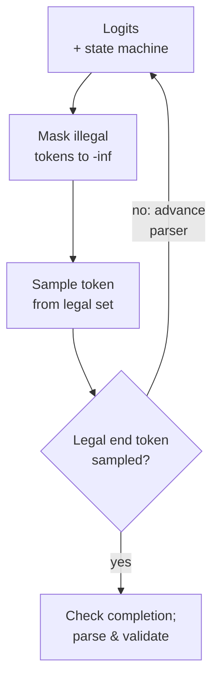
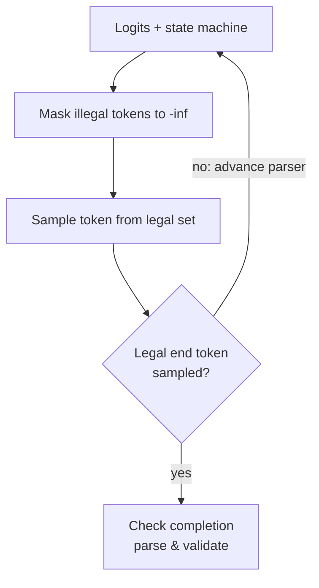

---
{
  "id": "structured-output-constrained-generation",
  "title": "Structured Output Generation",
  "slug": "structured-output-constrained-generation",
  "section": "Applied LLM Engineering & RAG",
  "category": "LLM Agents & Tool Use",
  "difficulty": "Medium",
  "coverImage": "illustrations/_generated/probability_mask_dark.png",
  "companies": [
    "OpenAI",
    "Anthropic",
    "Google",
    "Microsoft",
    "Meta"
  ],
  "shortDescription": "An evaluation log needs a typed run ID and status, yet prompting for JSON still produces chat. Mask illegal tokens during decoding, align subwords with grammars, and verify claims against trusted records.",
  "prerequisites": [
    "decoding-strategies-greedy-beam-nucleus"
  ],
  "order": 2,
  "keyConceptsTested": [
    "Structured Generation",
    "JSON Mode",
    "Grammar-Guided Decoding",
    "Finite State Machines",
    "Context-Free Grammars",
    "Tokenizer Alignment",
    "KV Cache Reuse",
    "Pydantic",
    "Token Masking",
    "XGrammar",
    "Refusal Handling",
    "Evidence validation and completion handling"
  ],
  "relatedQuestions": [
    "agentic-architectures-react-plan-execute",
    "prompt-injection-defense-strategies",
    "function-calling-tool-use-llms",
    "llm-cost-engineering-token-economics"
  ]
}
---

<!-- leetllm: edition:reference:start -->

Ask a language model to extract `eval_id` and `status` from a benchmark log and return JSON. Nine times out of ten, it complies. On the tenth run, right as an overnight evaluation sweep finishes, it replies:

```text title="unconstrained-reply.txt"
Sure! Here is the data: { 'eval_id': 'eval-17' }
```

`json.loads` crashes at character zero on `Sure!`, single quotes violate RFC 8259, and `status` is missing altogether. Adding `"Respond ONLY with valid JSON, no preamble"` shifts the odds without changing the mechanism. An autoregressive model predicts next <span data-glossary="token">tokens</span> over its full vocabulary rather than returning a typed object from a function signature, and conversational tokens like `Sure` often outscore `{`.

<span data-glossary="structured-output">Structured output generation</span> fixes this at the sampler itself.[^willard2023] Before drawing each token, the runtime checks a compiled grammar to find every vocabulary token that can legally extend the current prefix, sets all other logits to $-\infty$, and renormalizes softmax over the surviving candidates.

<figure>
  
  <figcaption>Before masking, softmax turns the raw logits for <code>Sure</code> (1.4), <code>{</code> (0.8), <code>The</code> (0.2), and <code>[</code> (-0.4) into 49.6%, 27.2%, 14.9%, and 8.2%. Setting every continuation outside the schema's start state to negative infinity leaves <code>{</code> with 100% probability before sampling.</figcaption>
</figure>

In this four-token slice of a vocabulary, only `{` can open a JSON object, so masking hands it 100% of the probability mass before sampling even begins. Real tokenizers also include whitespace variants and merged tokens such as `{"eval_id"`, all of which stay legal whenever they keep the prefix on a valid path. Eliminating syntax crashes immediately raises three deeper engineering questions: how does a character-level grammar stay aligned with multi-character subword tokens, why can a schema-valid object still fail local validation or contradict the source log, and how should production code handle truncation, refusals, and retries? Throughout this lesson, we trace a single evaluation log: `"Evaluation eval-17 failed on math-500 after symbolic-verifier timed out."`

## Why prompting for JSON fails and what decoding constraints add

A natural-language prompt expresses a preference, while an unconstrained decoder remains free to sample any token in its vocabulary. In practice, asking `"Return JSON"` works on routine cases and then fails at unpredictable moments in downstream pipelines:

```python title="prompt-only-extraction.py"
prompt = """
Extract eval_id and status from this benchmark log:
"Evaluation eval-17 failed on math-500 after symbolic-verifier timed out."
Return JSON.
"""
```

In production workloads, unconstrained replies break parsers in five recurring ways, and different API tiers close different portions of that gap:

| Failure mode | Example model response | Downstream breakdown |
|--------------|------------------------|----------------------|
| Conversational preamble | `Here is the extracted JSON: {"eval_id":"eval-17"}` | `json.loads` hits non-JSON characters at index 0 |
| Markdown fences | ````json\n{"eval_id":"eval-17"}\n```` | Parser rejects backticks; regex stripping adds brittle glue code |
| Schema drift | `{"eval_id":"eval-17","status":null}` | Parses cleanly, yet violates a required enum string check |
| Hallucinated keys | `{"benchmark_id":"eval-17","outcome":"crashed"}` | Keys diverge from storage columns or API fields |
| Malformed syntax | `{"eval_id":"eval-17", "status":"failed",}` | Trailing commas violate RFC 8259 and break standard JSON decoders |

Different API tiers close different portions of this gap:

| Interface tier | Structural guarantee | Typical implementation |
|----------------|----------------------|------------------------|
| Prompt-based ("respond in JSON") | None (best-effort formatting) | Standard chat endpoints |
| JSON mode | Targets JSON syntax; still check incomplete and refusal states | OpenAI `json_object` mode |
| Strict function calling | Constrains tool arguments to a supported schema subset | Provider tool APIs with strict mode enabled |
| Hosted structured outputs | Constrains response text to a provider-supported schema subset | OpenAI, Claude, Gemini structured outputs |
| Grammar-guided inference runtime | Enforces the exact grammar compiled by the backend | Outlines, SGLang, vLLM, llama.cpp |

> **Key insight:** Constrained decoding guarantees only the subset of <span data-glossary="json-schema">JSON Schema</span> that the inference backend actually compiled. Always inspect the completion status first, decode JSON strictly, and validate against your local schema.

Even JSON mode enforces syntax alone: `{"author": "alice"}` is valid JSON while omitting both `eval_id` and `status`, and top-level arrays or scalars pass `json.loads` unless your validator rejects them.[^openai2024StructuredOutputsLaunch] Backends also differ in which schema keywords they compile. For example, `llama.cpp`'s schema converter can silently skip unsupported JSON Schema keywords during compilation.[^llamacpp_grammars_docs2026] Hosted providers likewise document edge cases: Claude's native JSON outputs (`output_config.format`) and strict tool use can still return refusals, hit token limits, or shift enum capitalization, while Gemini recommends pairing its supported schema subset with post-generation validation.[^anthropic2026StructuredOutputs][^geminiStructuredOutput2026] Python's built-in `json.loads` adds two local hazards of its own by silently overwriting duplicate keys (keeping the last value) and accepting non-standard constants such as `NaN` and `Infinity`.[^pythonJson2026] Installing strict parser hooks ahead of a strict <span data-glossary="pydantic">Pydantic</span> model closes all of those gaps in one pass:

<!-- leetllm: test, id=parser, deps=pydantic, output=show, output_title="Syntax and schema are separate" -->
```python title="json-syntax-versus-schema.py"
import json
import math
from typing import Literal
from pydantic import BaseModel, ConfigDict, Field, ValidationError

class TriageRecord(BaseModel):
    model_config = ConfigDict(extra="forbid", strict=True)
    eval_id: str = Field(min_length=1)
    status: Literal["queued", "passed", "failed", "unknown"]

def reject_constant(value: str):
    raise ValueError(f"nonfinite JSON number: {value}")

def finite_float(value: str) -> float:
    result = float(value)
    if not math.isfinite(result):
        raise ValueError("JSON number exceeds finite float range")
    return result

def unique_object(pairs: list[tuple[str, object]]) -> dict[str, object]:
    result: dict[str, object] = {}
    for key, value in pairs:
        if key in result:
            raise ValueError(f"duplicate JSON key: {key}")
        result[key] = value
    return result

def load_record(raw: str):
    return json.loads(
        raw,
        object_pairs_hook=unique_object,
        parse_constant=reject_constant,
        parse_float=finite_float,
    )

syntax_valid_wrong_shape = load_record('{"foo": "bar"}')
schema_valid = load_record('{"eval_id": "eval-17", "status": "failed"}')

try:
    TriageRecord.model_validate(syntax_valid_wrong_shape)
except ValidationError:
    print("JSON-only result: rejected by schema")

print("structured record:", TriageRecord.model_validate(schema_valid).model_dump())

for raw in ['{"eval_id":"eval-17","eval_id":"eval-19"}', '{"status":NaN}']:
    try:
        load_record(raw)
    except ValueError as error:
        print("parser rejected:", error)
```

<!-- leetllm: output:start -->
```text title="Syntax and schema are separate" output compact
JSON-only result: rejected by schema
structured record: {'eval_id': 'eval-17', 'status': 'failed'}
parser rejected: duplicate JSON key: eval_id
parser rejected: nonfinite JSON number: NaN
```
<!-- leetllm: output:end -->

Every line in that output marks a distinct layer of defense. `load_record` catches duplicate keys and `NaN` at parse time before any object reaches application code, while `TriageRecord` catches missing fields, extra keys, and out-of-enum values immediately afterward. Together they draw a crisp line between valid JSON syntax and valid application data.

```checkpoint
What can you assume after JSON mode, and what changes with structured outputs?
---
JSON mode targets syntactically valid JSON without guaranteeing your keys or enum values. Structured outputs enforce supported schema rules during decoding. Check completion and refusal states alongside backend limits, then validate locally; neither feature verifies truthfulness or grants execution permission.
```

## How grammar-guided decoding works

Post-generation parsing catches syntax errors only after the model has spent tokens generating a broken reply. A constrained decoder tracks parser state continuously during generation and zeros out illegal tokens before every sample:

<!-- leetllm: audience:website:start -->

<!-- leetllm: audience:website:end -->
<!-- leetllm: audience:book:start -->

<!-- leetllm: audience:book:end -->

At each decoding step, the runtime inspects the current parser state, applies the corresponding token mask before sampling, and advances the parser with the sampled token. Reaching an accepting state permits `<eos>` without necessarily forcing it (trailing whitespace or additional optional content may still be legal), and hitting `max_output_tokens` can interrupt generation before any complete value exists.

### From schema to logit masking

The core operation modifies the raw logit vector directly before <span data-glossary="softmax">softmax</span>:

1. **Parser state:** Let $S_t$ denote the parser state at step $t$. For regular expressions and fixed-depth schemas, $S_t$ is a state in a **Deterministic Finite Automaton (DFA)**. For arbitrarily recursive JSON, a stack-based parser tracks unresolved open braces and brackets alongside the current rule.
2. **Legal token subset:** From $S_t$, the engine finds the valid vocabulary token IDs:
   $$
   \mathcal{V}_{\text{valid}}(S_t) \subseteq \mathcal{V}
   $$
   Every ordinary token in this set must leave a prefix that can still reach a valid completion, while `<eos>` is allowed only when $S_t$ is an accepting state.
3. **Logit masking:** Given raw logits $z_t \in \mathbb{R}^{|\mathcal{V}|}$, construct a mask $m_t \in \{0, -\infty\}^{|\mathcal{V}|}$:
   $$
   m_t(v) = \begin{cases} 0 & \text{if } v \in \mathcal{V}_{\text{valid}}(S_t) \\ -\infty & \text{if } v \notin \mathcal{V}_{\text{valid}}(S_t) \end{cases}
   $$
4. **Renormalized sampling:** Add the mask and apply softmax ($z'_t = z_t + m_t$):
   $$
   P(y_t = v \mid x_{<t}) = \frac{\exp(z'_t(v))}{\sum_{u \in \mathcal{V}} \exp(z'_t(u))} = \begin{cases} \frac{\exp(z_t(v))}{\sum_{u \in \mathcal{V}_{\text{valid}}(S_t)} \exp(z_t(u))} & \text{if } v \in \mathcal{V}_{\text{valid}}(S_t) \\ 0 & \text{otherwise} \end{cases}
   $$

This formula assumes temperature-one sampling and a nonempty legal set with finite logits. If $\mathcal{V}_{\text{valid}}(S_t)$ is ever empty (for instance, due to a tokenizer mismatch or an unsatisfiable rule), the decoder must halt with an error rather than dropping the mask.

<figure>
  
  <figcaption>Compiling a schema turns grammar rules into a state machine (<code>S0 -> S1 -> S2 -> S3</code>) and a valid-token bitmask <code>M[S_t, v]</code>. Each decoding step reads the binary row for its current state to mask the vocabulary before softmax.</figcaption>
</figure>

Here is that exact vectorized masking step in NumPy over our opening four-token example:

<!-- leetllm: test, deps=numpy, output=show -->
```python title="from-schema-to-logit-masking.py"
import numpy as np

tokens = ["Sure", "{", "The", "["]
logits = np.array([1.4, 0.8, 0.2, -0.4], dtype=float)

def softmax(vec: np.ndarray) -> np.ndarray:
    finite = np.isfinite(vec)
    if not np.any(finite):
        raise ValueError("no legal token with a finite logit")
    shifted = np.where(finite, vec - np.max(vec[finite]), -np.inf)
    exp_scores = np.where(finite, np.exp(shifted), 0.0)
    return exp_scores / np.sum(exp_scores)

legal_mask = np.array([False, True, False, False])
before_probs = softmax(logits)
masked_logits = np.where(legal_mask, logits, -np.inf)
after_probs = softmax(masked_logits)

chosen = tokens[int(np.argmax(after_probs))]
print("before softmax (%):", {t: round(float(p) * 100, 1) for t, p in zip(tokens, before_probs)})
print("masked logits:", {t: float(x) for t, x in zip(tokens, masked_logits)})
print("after softmax (%):", {t: round(float(p) * 100, 1) for t, p in zip(tokens, after_probs)})
print("chosen token:", chosen)
assert chosen == "{"
assert np.isclose(after_probs[1], 1.0)
```

<!-- leetllm: output:start -->
```text title="Output" output compact
before softmax (%): {'Sure': 49.6, '{': 27.2, 'The': 14.9, '[': 8.2}
masked logits: {'Sure': -inf, '{': 0.8, 'The': -inf, '[': -inf}
after softmax (%): {'Sure': 0.0, '{': 100.0, 'The': 0.0, '[': 0.0}
chosen token: {
```
<!-- leetllm: output:end -->

Although `"Sure"` began at 49.6%, `np.where` drives every disallowed logit to `-inf` and shifts 100% of the surviving probability onto `"{"` without touching model weights. Whenever multiple tokens remain legal at a step, softmax preserves their relative odds intact across the valid subset. That gives us the mathematical rule for one step; the harder problem is computing `legal_mask` quickly across a real subword vocabulary.

### The tokenizer alignment problem

Masking logits is mathematically tiny; computing `legal_mask` fast is the real engineering problem. Grammars match characters or bytes, whereas language models emit <span data-glossary="subword-tokenization">subword tokens</span> that routinely span several JSON delimiters (`","status":"failed"`) or split a UTF-8 codepoint mid-character. Checking only the first character of a candidate token is wrong: the decoder must walk every byte of the token through the automaton from $S_t$ and reject any token that overshoots into an error state.[^willard2023]

Suppose the parser has consumed `{"status":"` and expects `"failed"`:
- `fa` is legal: it advances two characters inside `"failed"`.
- `iled"}` is legal after `fa`: it finishes the string, closes the quote and brace, and lands on an accepting state.
- `iled"}!` is illegal: its first six characters match, yet its trailing `!` overshoots the grammar and corrupts the output.

Walking 128,000 vocabulary strings through a parser at every decode step would crush throughput, so serving engines precompute and partition vocabulary lookups ahead of generation:

- **Indexed finite-state decoding:** Willard and Louf (2023) precompute the allowed token IDs for each reachable DFA state into a lookup table, turning per-step masking into an indexed read (with upfront index compilation and memory costs).[^willard2023]
- **llguidance:** Combines an Earley context-free parser, a regex lexer, and a tokenizer trie to compute masks incrementally.[^llguidance2026]
- **XGrammar:** Partitions the vocabulary into context-independent tokens (validity depends only on the active rule, stored in precomputed bitmasks) and context-dependent tokens (checked dynamically against the parser stack), slashing per-step CPU work.[^xgrammar2024]

```checkpoint
Why is tokenizer alignment harder than checking characters?
---
Grammar rules define valid character or byte sequences, while language models generate multi-character subword tokens. The decoder must trace a candidate token's complete byte sequence through the automaton without overshooting into an invalid state.
```

### Regular expressions vs. context-free grammars

Which grammar formalism you need hinges on nesting depth rather than output length. A DFA handles regular expressions, fixed enums, and flat JSON objects in constant per-step working memory, though its precompiled transition table can grow large for wide schemas. A **Context-Free Grammar (CFG)** adds a stack so the parser can balance opening and closing delimiters across arbitrary nesting depth.

> **Common mistake:** Assuming that a variable-length JSON array requires a CFG. An array of arbitrarily many flat objects (`\[(\{\}(,\{\})*)?\]`) is strictly regular and compiles to a DFA. Only arbitrarily deep recursive nesting requires a stack.

```checkpoint
When is a regular expression sufficient, and when do you need a CFG?
---
Use a regular expression for any regular language, including an arbitrarily long array of fixed-depth objects. Arbitrarily deep recursive nesting requires a stack-aware CFG. Length and depth are separate dimensions, and neither formalism checks domain semantics.
```

### Build an incremental DFA token decoder

To see whole-token alignment and `<eos>` handling working together, let us compile a tiny language accepting only `{"status":"passed"}` and `{"status":"failed"}` into a character-level DFA and run every candidate token completely through it. Notice in the decision tree below how both accepted strings share the prefix `{"status":"`, how `iled"}` lands cleanly on an accepting state, and how `iled"}!` is rejected as a whole token because of its trailing `!`.

<figure>
   &lt;eos&gt; accepts pass. Taking fa advances to a partial prefix where iled&quot;} -> &lt;eos&gt; accepts fail, while iled&quot;}! is masked out because it overshoots at !." />
  <figcaption>Both accepted strings share <code>{"status":"</code>. From <code>fa</code>, the token <code>iled"}</code> reaches the final brace cleanly, whereas <code>iled"}!</code> overshoots at <code>!</code> and is masked out as a whole token.</figcaption>
</figure>

The implementation below compiles those transitions and runs greedy decoding over a small score table, blocking `The`, premature `<eos>`, and overshooting `iled"}!` at every step:

<!-- leetllm: test, id=finite-guide, output=show, output_title="Incremental DFA whole-token decoder" -->
```python title="finite-language-token-guide.py"
LANGUAGE = ('{"status":"passed"}', '{"status":"failed"}')
VOCAB = ('The', '{"status":"', 'fa', 'passed', 'iled"}', 'iled"}!', '"}', '<eos>')
SCORES = {
    'The': 9.0,
    '{"status":"': 1.0,
    'fa': 3.0,
    'passed': 2.0,
    'iled"}': 1.0,
    'iled"}!': 8.0,
    '"}': 1.0,
    '<eos>': 7.0,
}

def build_prefix_dfa(strings: tuple[str, ...]) -> tuple[dict[int, dict[str, int]], set[int]]:
    prefixes = {''}
    for s in strings:
        for i in range(1, len(s) + 1):
            prefixes.add(s[:i])
    state_id = {p: idx for idx, p in enumerate(sorted(prefixes, key=lambda x: (len(x), x)))}
    transitions: dict[int, dict[str, int]] = {idx: {} for idx in state_id.values()}
    for p, sid in state_id.items():
        for ch in {s[len(p)] for s in strings if s.startswith(p) and len(p) < len(s)}:
            transitions[sid][ch] = state_id[p + ch]
    accepting = {state_id[s] for s in strings}
    return transitions, accepting

DFA, ACCEPTING = build_prefix_dfa(LANGUAGE)

def advance_token(state: int, token: str) -> int | None:
    if token == '<eos>':
        return state if state in ACCEPTING else None
    if not token:
        return None
    cur = state
    for ch in token:
        if ch not in DFA[cur]:
            return None
        cur = DFA[cur][ch]
    return cur

def decode(max_steps: int = 8) -> tuple[str, list[str]]:
    state, prefix, trace = 0, '', []
    for _ in range(max_steps):
        legal = [tok for tok in VOCAB if advance_token(state, tok) is not None]
        if not legal:
            raise ValueError('grammar has no representable continuation')
        tok = max(legal, key=lambda item: SCORES[item])
        trace.append(tok)
        if tok == '<eos>':
            return prefix, trace
        state = advance_token(state, tok)
        assert state is not None
        prefix += tok
    raise ValueError('token budget ended before complete output')

record, trace = decode()
print('tokens:', trace)
print('record:', record)
fa_state = advance_token(0, '{"status":"')
fa_state = advance_token(fa_state, 'fa')
print('overshooting token next state:', advance_token(fa_state, 'iled"}!'))
assert record in LANGUAGE
assert advance_token(fa_state, '<eos>') is None
```

<!-- leetllm: output:start -->
```text title="Incremental DFA whole-token decoder" output compact
tokens: ['{"status":"', 'fa', 'iled"}', '<eos>']
record: {"status":"failed"}
overshooting token next state: None
```
<!-- leetllm: output:end -->

Even though `iled"}!` scores `8.0` versus `1.0` for `iled"}`, `advance_token` rejects it at `!` and returns `None`. Likewise, `<eos>` scores `7.0` yet stays masked at `fa_state` because `fa_state` is not in `ACCEPTING`. Production engines compile this exact state machine into per-state bitmasks `M[S_t]` once per schema so decode steps avoid Python loops altogether.

### Token boundaries and token healing

A subtler alignment problem appears whenever a prompt ends right in the middle of a common multi-character token, such as `'{"status":"'`. If the tokenizer splits the prompt cleanly at the quote boundary, it cuts across a merged token like `'":"passed'` that the model strongly prefers. **Token healing** steps back across that last prompt token and restricts the first generated token to start with the trimmed characters, letting the model pick the natural merge again.[^willard2023][^llguidance2026]

<!-- leetllm: test, id=token-healing, output=show, output_title="Token boundary healing" -->
```python title="token-healing-boundary.py"
VOCAB = ['"', ':', '{', '":"', '":"passed', 'passed', '{"status', '"}']

def greedy_tokenize(text: str, vocab: list[str]) -> list[str]:
    tokens, pos = [], 0
    while pos < len(text):
        match = max((tok for tok in vocab if text.startswith(tok, pos)), key=len)
        tokens.append(match)
        pos += len(match)
    return tokens

prompt = '{"status":"'
naive_tokens = greedy_tokenize(prompt, VOCAB)
trimmed_prefix = naive_tokens[:-1]
required_start = naive_tokens[-1]
healed_candidates = [tok for tok in VOCAB if tok.startswith(required_start)]

print("naive prompt tokens:", naive_tokens)
print("healed prefix:", trimmed_prefix, "required continuation start:", repr(required_start))
print("healed candidates:", healed_candidates)
assert '":"passed' in healed_candidates
```

<!-- leetllm: output:start -->
```text title="Token boundary healing" output compact
naive prompt tokens: ['{"status', '":"']
healed prefix: ['{"status'] required continuation start: '":"'
healed candidates: ['":"', '":"passed']
```
<!-- leetllm: output:end -->

Trimming `'":"'` from the prompt and constraining the next token to begin with `'":"'` restores `'":"passed'` to the legal set without altering the underlying prompt text. Without healing, the model is forced onto a lower-probability split across the boundary; with healing, the constrained decoder preserves the tokenizer's natural merges automatically before advancing into the schema grammar.

## Libraries and serving stacks

Local runtimes (Outlines, `llama.cpp`, SGLang, and vLLM) compile grammars and apply masks directly inside your inference worker, whereas hosted APIs compile schemas server-side and return text or parsed JSON. In **Outlines**, a compiled `Generator` can be reused across requests so the grammar is not recompiled on every call. In its v1 API, `Generator` returns **raw text** even when initialized with a Pydantic class, so host code parses and validates that string explicitly:[^outlinesGenerator2026]

```python title="outlines.py"
from typing import Literal

import outlines
from outlines import Generator
from pydantic import BaseModel, ConfigDict
from transformers import AutoModelForCausalLM, AutoTokenizer

class EvalStatusUpdate(BaseModel):
    model_config = ConfigDict(extra="forbid", strict=True)
    eval_id: str
    status: Literal["queued", "passed", "failed", "unknown"]
    failing_task: str | None

model_name = "HuggingFaceTB/SmolLM2-135M-Instruct"
model = outlines.from_transformers(
    AutoModelForCausalLM.from_pretrained(model_name),
    AutoTokenizer.from_pretrained(model_name),
)

eval_generator = Generator(model, EvalStatusUpdate)
raw = eval_generator(
    "Extract eval_id, status (queued/passed/failed/unknown), and failing_task (null if absent): "
    "Evaluation eval-17 failed on math-500 after symbolic-verifier timed out.",
    max_new_tokens=120,
)
record = EvalStatusUpdate.model_validate_json(raw)
```

High-concurrency serving engines integrate grammar masking inside continuous batching so one request's mask computation never stalls the batch. SGLang's original design introduced two complementary ideas: **RadixAttention** to reuse the <span data-glossary="kv-cache">KV cache</span> across shared system prompts and schema prefixes (cutting <span data-glossary="ttft">Time To First Token</span>), and compressed FSMs that jump forward across forced constant substrings.[^zheng2023a] Modern serving stacks (both SGLang and vLLM) default to **XGrammar** or **llguidance**, overlapping CPU bitmask generation with GPU forward passes for the already-accepted prefix so sampling waits only for `max(t_gpu, t_cpu)` instead of their sum.[^xgrammar2024][^sglang_structured_outputs_docs2026][^vllmStructuredOutputs2026]

<details>
<summary>Deep dive: Serving backend APIs and schema-compiler quirks</summary>

- **Outlines backends:** Outlines supports `outlines_core`, `llguidance`, and XGrammar backends with different model coverage and type support. Benchmark cold compilation and warm per-token latency separately on your chosen backend.[^outlinesBackends2026]
- **llama.cpp (GBNF):** Local C++ deployments convert JSON Schema into GBNF grammars.[^llamacpp2023][^llamacpp_grammars_docs2026] Unsupported keywords can be dropped quietly during conversion, and `llama.cpp` does not inject the schema into your prompt automatically, so describe required fields in the prompt and keep local Pydantic validation in place.[^llamacpp_grammars_docs2026]
- **SGLang and vLLM configuration:** SGLang exposes XGrammar as its default grammar backend alongside Outlines and `llguidance`, treating early FSM jump-forward as historical background.[^sglang_structured_outputs_docs2026] vLLM configures constrained decoding through a unified `structured_outputs` parameter block backed by XGrammar or Guidance/`llguidance`, replacing legacy per-format flags such as `guided_json` and `guided_regex`.[^vllmStructuredOutputs2026]

</details>

```checkpoint
What latency work belongs to prefix caching versus grammar state?
---
Prefix caching reuses prefill computation for a matching token prefix, reducing Time To First Token when cache entries hit. Grammar-state optimizations cut the per-step cost of finding legal next tokens. They optimize different stages of serving latency.
```

## Function calling vs. structured outputs

Both tool definitions and structured extraction APIs use JSON Schema, yet they represent different host responsibilities:

| Dimension | Function calling (tool use) | Structured outputs |
|-----------|-----------------------------|--------------------|
| **Core purpose** | Agent action selection and execution | Structured data extraction and transformation |
| **Control flow** | Model requests a tool; host runs it and feeds the observation back | Terminal JSON record consumed directly by application code |
| **Return format** | Tool name plus JSON argument object | JSON document matching the response schema |
| **Side effects** | Host validates permissions and decides whether to run the tool | Host decides how to store or act on the parsed record |

### Function calling for tool arguments

Use function calling when an agent needs to inspect live state, query a database, or run an evaluation before answering. Strict mode enforces the argument schema on the wire, and local Pydantic validation verifies that exact call shape before your host decides whether to execute the tool:

<!-- leetllm: test, deps=pydantic, output=show -->
```python title="strict-tool-arguments.py"
from pydantic import BaseModel, ConfigDict, ValidationError

class GetEvalStatusArgs(BaseModel):
    model_config = ConfigDict(extra="forbid", strict=True)
    eval_id: str

tool_definition = {
    "type": "function",
    "name": "get_eval_status",
    "description": "Fetch current benchmark status for an evaluation run.",
    "strict": True,
    "parameters": GetEvalStatusArgs.model_json_schema(),
}

valid_call = GetEvalStatusArgs.model_validate_json('{"eval_id": "eval-17"}')
print("tool:", tool_definition["name"], "strict:", tool_definition["strict"])
print("validated args:", valid_call.model_dump())

try:
    GetEvalStatusArgs.model_validate_json('{"eval_id": "eval-17", "force_rerun": true}')
except ValidationError as error:
    print("extra arg rejected:", error.errors()[0]["type"])
```

<!-- leetllm: output:start -->
```text title="Output" output compact
tool: get_eval_status strict: True
validated args: {'eval_id': 'eval-17'}
extra arg rejected: extra_forbidden
```
<!-- leetllm: output:end -->

Even with `strict: True` on the tool definition, the model is only proposing an invocation. Your host code still verifies caller permissions and argument safety before touching any external system.

### Structured outputs for typed records

Use structured outputs for extraction, classification, and pipeline stages that consume a typed record directly. In Pydantic, `extra="forbid"` rejects unexpected keys locally and emits `"additionalProperties": false` in the JSON Schema. Declaring `failing_task: str | None` with no default makes the field **required yet nullable**, giving the model an honest way to report missing information without fabricating a task name:[^pydanticStrict2026]

<!-- leetllm: test, continue=parser, id=typed, output=show, output_title="A required nullable field" -->
```python title="typed-eval-record.py"
class EvalStatusUpdate(BaseModel):
    model_config = ConfigDict(extra="forbid", strict=True)
    eval_id: str
    status: Literal["queued", "passed", "failed", "unknown"]
    failing_task: str | None

schema = EvalStatusUpdate.model_json_schema()
payload = {"eval_id": "eval-17", "status": "failed", "failing_task": None}
update = EvalStatusUpdate.model_validate(payload)

print("required:", schema["required"])
print("closed object:", schema["additionalProperties"] is False)
print("nullable task:", update.failing_task)

try:
    EvalStatusUpdate.model_validate({"eval_id": "eval-17", "status": "failed"})
except ValidationError:
    print("omitted task: rejected")
```

<!-- leetllm: output:start -->
```text title="A required nullable field" output compact
required: ['eval_id', 'status', 'failing_task']
closed object: True
nullable task: None
omitted task: rejected
```
<!-- leetllm: output:end -->

OpenAI's strict mode requires every property to appear in `required` and `additionalProperties` to be `false`, so optional fields are always modeled as required unions with `null`.[^openai_structured_outputs] Even when an SDK compiles your schema for you, keep your original Pydantic class as the local validator. Some SDK adapters strip unsupported numeric constraints (such as `minimum` or `maximum`) from the wire schema and append them as prose in `description`.[^anthropic2026StructuredOutputs] A description nudges the model without masking illegal tokens, so `-1` can arrive over the wire and only fail when checked locally:

<!-- leetllm: test, continue=typed, id=wire, output=show, output_title="Wire constraints versus local constraints" -->
```python title="wire-schema-drift.py"
from copy import deepcopy
from pydantic import TypeAdapter

class RetrySuggestion(BaseModel):
    model_config = ConfigDict(extra="forbid", strict=True)
    retry_count: int = Field(ge=0)

original_schema = RetrySuggestion.model_json_schema()
wire_schema = deepcopy(original_schema)
wire_schema["properties"]["retry_count"].pop("minimum")
wire_schema["properties"]["retry_count"]["description"] = "Must be at least 0"
candidate = {"retry_count": -1}

wire_int = TypeAdapter(int).validate_python(candidate["retry_count"], strict=True)
print("local minimum:", original_schema["properties"]["retry_count"]["minimum"])
print("wire minimum present:", "minimum" in wire_schema["properties"]["retry_count"])
print("candidate fits wire integer shape:", wire_int == -1)
try:
    RetrySuggestion.model_validate(candidate)
except ValidationError as error:
    print("local rejection:", error.errors()[0]["type"])
```

<!-- leetllm: output:start -->
```text title="Wire constraints versus local constraints" output compact
local minimum: 0
wire minimum present: False
candidate fits wire integer shape: True
local rejection: greater_than_equal
```
<!-- leetllm: output:end -->

When calling a hosted Responses API directly, inspect `response.status`, check for refusals, and confirm `response.output_parsed` exists before touching downstream code (and buffer streaming deltas until completion before validating):

```python title="hosted-structured-client.py"
import os
from openai import OpenAI

client = OpenAI()
response = client.responses.parse(
    model=os.environ["OPENAI_STRUCTURED_MODEL"],
    input="Evaluation eval-17 failed on math-500.",
    text_format=EvalStatusUpdate,
)
update = response.output_parsed
if response.status != "completed":
    raise RuntimeError(f"incomplete response: {response.incomplete_details}")
if any(part.type == "refusal" for item in response.output if item.type == "message"
       for part in item.content):
    raise RuntimeError("provider refusal")
if update is None:
    raise RuntimeError("no parsed record")
```

Passing schema validation still tells you only that the JSON has the right shape. Your host application must separately verify caller access and compare claims against trusted records:

<!-- leetllm: test, continue=wire, id=semantics, output=show, output_title="Shape, truth, and access" -->
```python title="separate-format-from-semantic-validation.py"
EVAL_DB = {"eval-17": {"suite": "nlp-eval", "status": "failed", "failing_task": "math-500"}}

def decide_update(allowed_suites: set[str], update: TriageRecord) -> str:
    trusted = EVAL_DB.get(update.eval_id)
    if trusted is None or trusted["suite"] not in allowed_suites:
        return "deny"  # Avoid revealing whether an unauthorized eval_id exists
    if update.status != trusted["status"]:
        return "review: contradicts eval log"
    return "show"

parsed = TriageRecord.model_validate({"eval_id": "eval-17", "status": "failed"})
print("format check:", parsed.model_dump())
print("authorized and true:", decide_update({"nlp-eval"}, parsed))
print("other suite:", decide_update({"vision-eval"}, parsed))

false_claim = TriageRecord.model_validate({"eval_id": "eval-17", "status": "passed"})
print("authorized but false:", decide_update({"nlp-eval"}, false_claim))
```

<!-- leetllm: output:start -->
```text title="Shape, truth, and access" output compact
format check: {'eval_id': 'eval-17', 'status': 'failed'}
authorized and true: show
other suite: deny
authorized but false: review: contradicts eval log
```
<!-- leetllm: output:end -->

`false_claim` satisfies `TriageRecord` cleanly, yet `decide_update` catches that `eval-17` actually failed in `EVAL_DB` and routes the contradiction for review. Keeping format checks, access checks, and source comparisons as separate functions makes each failure mode observable and easy to test.

## Systems trade-offs: latency, reasoning quality, and schema design

Grammar constraints add measurable systems work across both compilation and decoding. Knowing which stage pays each cost lets you design schemas that preserve serving throughput and model accuracy without sacrificing validation:

### Where latency comes from

| Bottleneck | Underlying cause | Serving impact | Mitigation |
|------------|------------------|----------------|------------|
| Schema compilation | Building a backend-specific grammar and tokenizer index | Higher cold-start TTFT | Reuse compiled artifacts; measure cold and warm distributions separately |
| Per-token grammar work | Advancing parser state, looking up legal tokens, applying the mask | May add to TPOT or hide behind GPU overlap | Benchmark on your backend at realistic batch sizes |
| Schema prompt overhead | Field descriptions and provider-injected schema instructions | Extra prefill tokens | Measure prompt token counts and prefix-cache hit rates |
| Grammar complexity | Deep nesting, wide unions, and optional branches | Larger state tables or unsupported keywords | Profile representative schemas; simplify where measurements show gains |

### Reasoning accuracy and evidence spans

Tam et al. (2024) found that strict formatting templates lowered reasoning accuracy on several reasoning benchmarks relative to free-form answers, while classification accuracy sometimes improved.[^tam2024] Because that study tested prompt-based templates and earlier JSON modes, benchmark your own reasoning tasks on current models before locking down a schema. For complex tasks, reasoning models decouple thinking from formatting: internal reasoning tokens run unconstrained, and the schema mask activates only for the final answer.[^openai2026reasoning]

A common pattern for non-reasoning models is placing an `evidence_quote` field before the `decision` field so the model copies the relevant log line first. Notice what verifying that quote actually checks:

<!-- leetllm: test, continue=semantics, id=evidence, output=show, output_title="Check the quote against the source" -->
```python title="validate-visible-evidence-before-decision.py"
import re

SOURCE_LOG = "Evaluation eval-17 failed on math-500 after symbolic-verifier timed out."

class EvalDecision(BaseModel):
    model_config = ConfigDict(extra="forbid", strict=True)
    evidence_quote: str = Field(min_length=1)
    eval_id: str = Field(min_length=1)
    decision: Literal["rerun_suite", "halt_release", "needs_review", "unknown"]

def verify_evidence_span(payload: dict[str, str], source: str) -> EvalDecision:
    record = EvalDecision.model_validate(payload)
    if record.evidence_quote not in source:
        raise ValueError("quote is not an exact span of the source")
    pattern = r"(?<![\w-])" + re.escape(record.eval_id) + r"(?![\w-])"
    if not re.search(pattern, record.evidence_quote):
        raise ValueError("eval ID does not appear in evidence")
    return record

decision = verify_evidence_span(
    {
        "evidence_quote": SOURCE_LOG,
        "eval_id": "eval-17",
        "decision": "rerun_suite",
    },
    SOURCE_LOG,
)
print("decision:", decision.decision)
print("quote occurs in source:", decision.evidence_quote in SOURCE_LOG)

try:
    verify_evidence_span(
        {**decision.model_dump(), "evidence_quote": "eval-17 needs an immediate release halt."},
        SOURCE_LOG,
    )
except ValueError as error:
    print("invented quote:", error)
```

<!-- leetllm: output:start -->
```text title="Check the quote against the source" output compact
decision: rerun_suite
quote occurs in source: True
invented quote: quote is not an exact span of the source
```
<!-- leetllm: output:end -->

Notice the word-boundary regex `(?<![\w-])` around `eval_id`: without it, a quote mentioning `eval-170` would falsely match `eval-17`. Even with exact span verification, checking that a quote appeared verbatim in the log still leaves the *decision* itself unchecked:

<!-- leetllm: test, continue=evidence, id=evidence-gap, output=show, output_title="A true quote can accompany a wrong action" -->
```python title="source-membership-is-not-action-justification.py"
unsupported = verify_evidence_span(
    {**decision.model_dump(), "decision": "halt_release"},
    SOURCE_LOG,
)
print("quote validator accepted:", unsupported.decision)
print("halt justification checked:", False)
assert unsupported.evidence_quote == decision.evidence_quote
```

<!-- leetllm: output:start -->
```text title="A true quote can accompany a wrong action" output compact
quote validator accepted: halt_release
halt justification checked: False
```
<!-- leetllm: output:end -->

The log says only that `math-500` timed out; deciding whether to halt a release requires release criteria, live state, and caller permissions in host code.

```checkpoint
What does an exact evidence quote prove, and what does it leave unchecked?
---
It confirms that the quoted text appears verbatim in the source string and names the target ID. You still must verify whether the source itself is trustworthy, whether the quote supports the proposed decision, and whether the caller is allowed to trigger that action.
```

### Flattening recursive structures

When a backend rejects recursive JSON schemas (or profiling shows stack overhead), you can represent a tree as a flat array of nodes with `parent_id` references. A flat array is a regular language that any DFA backend compiles cleanly, though it shifts structural checks (unique IDs, single root, valid parents, and no disconnected cycles) to post-processing:

<!-- leetllm: test, output=show -->
```python title="reconstruct-a-flat-tree-after-validation.py"
from dataclasses import dataclass

@dataclass(frozen=True)
class FlatNode:
    node_id: str
    parent_id: str | None
    label: str

nodes = [
    FlatNode(node_id="root", parent_id=None, label="eval_run"),
    FlatNode(node_id="n1", parent_id="root", label="failing_task"),
    FlatNode(node_id="n2", parent_id="root", label="trace_uri"),
]

def validate_tree(nodes: list[FlatNode], max_nodes: int = 100):
    if not 1 <= len(nodes) <= max_nodes:
        raise ValueError("node count outside allowed range")
    by_id = {node.node_id: node for node in nodes}
    if len(by_id) != len(nodes) or any(not node.node_id.strip() for node in nodes):
        raise ValueError("node IDs must be unique and nonempty")
    roots = [node.node_id for node in nodes if node.parent_id is None]
    if len(roots) != 1:
        raise ValueError("expected one root")
    children = {node.node_id: [] for node in nodes}
    for node in nodes:
        if node.parent_id is not None:
            if node.parent_id not in by_id:
                raise ValueError("unknown parent")
            children[node.parent_id].append(node.node_id)
    pending, visited = [roots[0]], set()
    while pending:
        current = pending.pop()
        if current in visited:
            raise ValueError("cycle detected")
        visited.add(current)
        pending.extend(children[current])
    if len(visited) != len(nodes):
        raise ValueError("disconnected nodes or cycles present")
    return roots[0], children

root_id, children = validate_tree(nodes)
print("root ID:", root_id)
print("child IDs:", children[root_id])

cyclic = [nodes[0], FlatNode("a", "b", "task"), FlatNode("b", "a", "trace")]
try:
    validate_tree(cyclic)
except ValueError as error:
    print("invalid tree:", error)
```

<!-- leetllm: output:start -->
```text title="Output" output compact
root ID: root
child IDs: ['n1', 'n2']
invalid tree: disconnected nodes or cycles present
```
<!-- leetllm: output:end -->

Every parent pointer in `cyclic` resolves to an existing ID, yet traversing from `root` visits only 1 of the 3 nodes and immediately exposes the disconnected `a <-> b` cycle.

## Failure modes and production recovery

Even when every emitted token obeys the compiled grammar, generation can stall on legal whitespace, truncate before closing the JSON object, hit a refusal, or assert a permission flag it has no right to grant. Handling each of those failure modes explicitly turns a brittle wrapper into a predictable service.

### Legal prefixes that never finish

A grammar constrains local syntax without measuring progress toward a complete answer. Optional whitespace rules allow repeated newlines (`\n    \n    `), and wide string fields allow repetitive filler until `max_output_tokens` runs out. Low logits on legal tokens never create a dead end on their own because softmax renormalizes positive mass over whatever legal tokens exist; true dead ends happen only when the legal set is empty. Keep strict token and wall-clock caps on every call and track incomplete-output rates. Equally important, **a grammar never replaces clear task instructions**: the mask removes syntax errors while your prompt still defines field semantics, ambiguity rules, and when to return `"unknown"` or `null` (skip pasting duplicate JSON Schema text into prompts when the API already injects it).

### Version schemas in application code

As data structures evolve, attach `schema_version` in your validation layer rather than asking the model to emit it. A generated version field is untrusted text and cannot tell storage consumers which validator actually ran, whereas wrapping the validated object in host code keeps storage migrations explicit and reproducible:

<!-- leetllm: test, continue=evidence-gap, id=versioned, output=show, output_title="Application-owned schema version" -->
```python title="route-versioned-records.py"
def validate_eval_status_v2(payload: object) -> dict[str, str | None]:
    return EvalStatusUpdate.model_validate(payload).model_dump()

generated_payload = {"eval_id": "eval-17", "status": "failed", "failing_task": "math-500"}
validated = validate_eval_status_v2(generated_payload)
wire_record = {"schema_version": "2", "payload": validated}

print("version:", wire_record["schema_version"])
print("failing task:", wire_record["payload"]["failing_task"])
```

<!-- leetllm: output:start -->
```text title="Application-owned schema version" output compact
version: 2
failing task: math-500
```
<!-- leetllm: output:end -->

### Route each stop condition to its own recovery path

Treating every failure as "retry with a looser prompt" hides adapter bugs and wastes tokens on refusals. Instead, inspect the stop reason and branch cleanly:

<figure>
  
  <figcaption>Each completion outcome follows its own recovery path. Only a length truncation (<code>max_tokens</code>) that stays within budget and latency limits qualifies for a single retry at 400 tokens; refusals stop retries, bad schemas require an adapter fix, and completed outputs still face schema and host checks.</figcaption>
</figure>

1. **Completed candidate:** Decode strictly, validate against the local Pydantic model, then verify source facts and caller permissions.
2. **Token limit:** Retry once with the same schema and a larger token cap when your latency deadline and cost budget allow. If the retry truncates again, return an explicit error. (OpenAI Chat Completions signals `finish_reason: "length"`; Responses signals `status: "incomplete"` with `incomplete_details.reason: "max_output_tokens"`.)[^openai_structured_outputs]
3. **Refusal or content-filter stop:** Halt automatic retries and route to your safe refusal handler. Never weaken validation or safety checks to force a payload through.
4. **Unsupported or invalid schema:** Fix the schema or SDK adapter in code; retrying identical input fails identically.
5. **Local validation failure:** Check whether the wire adapter dropped a rule or the prompt misled a value. A single repair turn with a sanitized error message can fix value errors, provided secrets and internal permission details stay out of the prompt.

For endpoints without constrained decoding, treat prompt-only JSON as untrusted text and compare any heuristically repaired string against the raw output before accepting it. Here is a complete recovery wrapper exercising all four stop branches across 120-token and 400-token budgets:

<!-- leetllm: test, continue=versioned, id=recovery, output=show, output_title="Retry only a length stop" -->
```python title="retry-on-truncation.py"
FORMAT = {"type": "json_schema", "name": "eval_status", "strict": True, "schema": schema}

class StubResponseClient:
    def __init__(self, responses):
        self.responses = iter(responses)
        self.calls = []

    def create(self, **kwargs):
        self.calls.append(kwargs)
        return next(self.responses)

def extract_with_single_retry(client, input_text: str) -> EvalStatusUpdate:
    for attempt, budget in enumerate((120, 400)):
        response = client.create(input=input_text, text={"format": FORMAT}, max_output_tokens=budget)
        output = response.get("output", [])
        content = [
            part for item in output if item.get("type") == "message"
            for part in item.get("content", [])
        ]
        if any(part.get("type") == "refusal" for part in content):
            raise RuntimeError("safety refusal: request blocked by model")
        status = response.get("status")
        if status == "incomplete":
            reason = (response.get("incomplete_details") or {}).get("reason")
            if reason == "max_output_tokens" and attempt == 0:
                continue
            raise RuntimeError(f"halted prematurely: {reason}")
        if status != "completed":
            raise RuntimeError(f"unexpected completion status: {status}")
        messages = [item for item in output if item.get("type") == "message"]
        if len(messages) != 1 or messages[0].get("status") != "completed":
            raise RuntimeError("expected one completed output message")
        if len(content) != 1 or content[0].get("type") != "output_text":
            raise RuntimeError("expected one structured text item")
        return EvalStatusUpdate.model_validate(load_record(content[0]["text"]))
    raise RuntimeError("retry budget exhausted")

incomplete = {"status": "incomplete", "output": [],
              "incomplete_details": {"reason": "max_output_tokens"}}
completed = {"status": "completed", "output": [{"type": "message", "status": "completed",
             "content": [{"type": "output_text", "text": json.dumps(generated_payload)}]}]}

client = StubResponseClient([incomplete, completed])
update = extract_with_single_retry(client, SOURCE_LOG)

print("retry preserved schema:", update.model_dump())
print("budgets:", [call["max_output_tokens"] for call in client.calls])
assert client.calls[0]["text"] == client.calls[1]["text"]

refused = {"status": "completed", "output": [{"type": "reasoning", "summary": []},
           {"type": "message", "status": "completed", "content": [{"type": "refusal", "refusal": "blocked"}]}]}
blocked_client = StubResponseClient([refused])

try:
    extract_with_single_retry(blocked_client, SOURCE_LOG)
except RuntimeError as error:
    print("refusal routed:", error)
assert len(blocked_client.calls) == 1

filtered = {"status": "incomplete", "output": [],
            "incomplete_details": {"reason": "content_filter"}}
for label, responses in (("content filter", [filtered]),
                         ("second length stop", [incomplete, incomplete])):
    stopped_client = StubResponseClient(responses)
    try:
        extract_with_single_retry(stopped_client, SOURCE_LOG)
    except RuntimeError as error:
        print(f"{label}: {error}; calls={len(stopped_client.calls)}")
    assert len(stopped_client.calls) == len(responses)
```

<!-- leetllm: output:start -->
```text title="Retry only a length stop" output compact
retry preserved schema: {'eval_id': 'eval-17', 'status': 'failed', 'failing_task': 'math-500'}
budgets: [120, 400]
refusal routed: safety refusal: request blocked by model
content filter: halted prematurely: content_filter; calls=1
second length stop: halted prematurely: max_output_tokens; calls=2
```
<!-- leetllm: output:end -->

Only the initial `max_output_tokens` cutoff triggers a second request (at 400 tokens, with the exact same `FORMAT`), while refusals, content filters, and a second length stop all terminate immediately. Before retrying in production, also confirm your remaining request deadline and cost budget have room for both the larger generation and downstream validation.

### Never trust permission booleans emitted by a model

A schema-valid object can carry fields shaped like security decisions, such as `{"is_admin": true, "authorized": true, "eval_id": "eval-17"}`. Reading any model-generated boolean as an authorization grant creates an immediate authorization bypass bug. Derive every access decision from verified session credentials, role tables, and stored approvals in your host system:

<!-- leetllm: test, output=show -->
```python title="ignore-self-attested-approval.py"
from dataclasses import dataclass

@dataclass(frozen=True)
class ModelEvalProposal:
    eval_id: str
    action: str
    approved: bool  # Untrusted model output; never read for authorization

def check_approval(proposal: ModelEvalProposal, stored_request: tuple[str, str] | None) -> str:
    if proposal.action != "rerun_suite":
        return "deny: unsupported action"
    if stored_request != (proposal.eval_id, proposal.action):
        return "deny: missing approval for this request"
    return "approval matched; continue host checks"

proposal = ModelEvalProposal("eval-17", "rerun_suite", approved=True)
print(check_approval(proposal, stored_request=None))
print(check_approval(proposal, stored_request=("eval-19", "rerun_suite")))
print(check_approval(proposal, stored_request=("eval-17", "rerun_suite")))
print("model approved field was", proposal.approved, "and was ignored")
```

<!-- leetllm: output:start -->
```text title="Output" output compact
deny: missing approval for this request
deny: missing approval for this request
approval matched; continue host checks
model approved field was True and was ignored
```
<!-- leetllm: output:end -->

```checkpoint
Which check catches self-attested privilege flags?
---
Host semantic and authorization checks catch false privilege flags. Schema validation confirms only that the field is a boolean. Host code must ignore model-asserted flags and verify caller identity, roles, and stored approvals against trusted application state.
```

## Practice: build a benchmark-digest validator

Put these layers together on a nightly evaluation summary. Suppose a service extracts every benchmark suite mentioned in a 500-word report and classifies its current state as `passed`, `degraded`, `failed`, or `unknown`:

> "math-500 recovered to target score after prompt tuning. humaneval-plus remains degraded. gpqa-diamond has no recorded run today."

Design requirements:
1. Return `{"mentions": [...]}` with one entry per suite (`suite` string and `status` enum). Reconcile repeated mentions using timestamps and run order rather than array position.
2. Enforce the JSON shape with structured outputs or grammar-guided decoding.
3. Represent a report with zero suite mentions as `{"mentions": []}`, not `null` or a missing key.
4. Run post-parse checks that reject duplicate suite entries and flag suites outside the known catalog (`math-500`, `humaneval-plus`, `mmlu-pro`) for review.

Expected extraction shape:

```json title="expected-output-shape.json"
{
  "mentions": [
    {"suite": "math-500", "status": "passed"},
    {"suite": "humaneval-plus", "status": "degraded"},
    {"suite": "gpqa-diamond", "status": "unknown"}
  ]
}
```

With Pydantic handling strict schema checks (`extra="forbid"`, `strict=True`), the host validator stays compact and puts all of its code into the domain checks that a grammar cannot express:

<!-- leetllm: test, deps=pydantic, output=show -->
```python title="benchmark-digest-validator.py"
# fold:start imports & Pydantic schema models
from typing import Literal
from pydantic import BaseModel, ConfigDict, Field

KNOWN_SUITES = {"math-500", "humaneval-plus", "mmlu-pro"}

class SuiteMention(BaseModel):
    model_config = ConfigDict(extra="forbid", strict=True)
    suite: str = Field(min_length=1)
    status: Literal["passed", "degraded", "failed", "unknown"]

class BenchmarkDigest(BaseModel):
    model_config = ConfigDict(extra="forbid", strict=True)
    mentions: list[SuiteMention]
# fold:end

def unknown_suites(digest: BenchmarkDigest) -> list[str]:
    return [m.suite for m in digest.mentions if m.suite not in KNOWN_SUITES]

def check_unique_suites(digest: BenchmarkDigest) -> None:
    seen: set[str] = set()
    for mention in digest.mentions:
        if mention.suite in seen:
            raise ValueError(f"duplicate suite summary: {mention.suite}")
        seen.add(mention.suite)

# fold:start test payloads & print harness
digest = BenchmarkDigest.model_validate(
    {
        "mentions": [
            {"suite": "math-500", "status": "passed"},
            {"suite": "humaneval-plus", "status": "degraded"},
            {"suite": "gpqa-diamond", "status": "unknown"},
        ]
    }
)
empty = BenchmarkDigest.model_validate({"mentions": []})
check_unique_suites(digest)

print("mentions:", len(digest.mentions))
print("unknown suites:", unknown_suites(digest))
print("empty mentions:", empty.mentions)

conflicting = BenchmarkDigest.model_validate(
    {
        "mentions": [
            {"suite": "math-500", "status": "passed"},
            {"suite": "math-500", "status": "failed"},
        ]
    }
)
last_wins = {m.suite: m.status for m in conflicting.mentions}
print("tempting dict conversion:", last_wins)
try:
    check_unique_suites(conflicting)
except ValueError as error:
    print("identity check:", error)
# fold:end
```

<!-- leetllm: output:start -->
```text title="Output" output compact
mentions: 3
unknown suites: ['gpqa-diamond']
empty mentions: []
tempting dict conversion: {'math-500': 'failed'}
identity check: duplicate suite summary: math-500
```
<!-- leetllm: output:end -->

Three design choices make this pipeline resilient:
- `{"mentions": []}` distinguishes zero suite mentions from a missing field or failed extraction.
- Unknown suites like `gpqa-diamond` are flagged after parsing rather than crashing the schema validator, while `status: "unknown"` lets the model record `"no recorded run today"` honestly.
- `check_unique_suites` catches conflicting entries for `math-500` instead of letting a dictionary comprehension silently keep the last element, since array order carries no timestamp.

```checkpoint
Why does the benchmark-digest validator flag `gpqa-diamond` for review?
---
The suite name is absent from the registered catalog (`math-500`, `humaneval-plus`, `mmlu-pro`). Mapping unrecorded runs to `unknown` and flagging unregistered suites lets operators add the suite or verify telemetry without crashing the parser.
```

## Summary: four layers of structured reliability

Structured output generation gives probabilistic models a reliable data interface when four layers work together:
1. **Grammar-guided decoding** masks illegal tokens before softmax to enforce syntax and supported schema rules.
2. **Strict JSON parsing and local Pydantic models** catch duplicate keys, nonfinite numbers, and constraints stripped by wire adapters.
3. **Host verification** compares extracted claims against trusted stores and derives access decisions exclusively from authenticated application state.
4. **Stop-reason recovery** retries a single token-limit cutoff when budgets allow while halting cleanly on refusals and fixing bad schemas in code.

```mastery-quiz
[
  {
    "question": "At temperature one, four next-token candidates have exponentiated weights 1, 4, 6 and 9. The grammar permits only the first and third. What is their masked distribution in the original candidate order?",
    "options": [
      "1/20, 0, 6/20, 0.",
      "1/7, 0, 6/7, 0.",
      "0, 4/13, 0, 9/13.",
      "1/4, 1/4, 1/4, 1/4."
    ],
    "answer": "1/7, 0, 6/7, 0.",
    "explanation": "Only weights 1 and 6 survive, giving denominator 7. Illegal candidates receive zero. Keeping the original sum 20 would leave probability missing; normalizing the rejected set reverses the mask."
  },
  {
    "question": "A grammar accepts exactly the balanced strings over the two characters `[` and `]`, with no limit on nesting depth. From the accepted prefix `[[`, try token A (`]]`) and token B (`]!]`) separately. Which tuple gives the legality of A, the legality of B, and whether the end-of-sequence token (EOS) is allowed at the original prefix?",
    "options": [
      "Legal; illegal; allowed.",
      "Illegal; illegal; blocked.",
      "Legal; legal; blocked.",
      "Legal; illegal; blocked."
    ],
    "answer": "Legal; illegal; blocked.",
    "explanation": "Token A closes both open brackets. A single token can close more than one bracket. Token B also starts with a legal closing bracket, but the grammar has no transition for `!`, so the decoder rejects the whole token. Neither trial changes the accepted prefix. At `[[`, two brackets are still open, so EOS is blocked."
  },
  {
    "question": "A completed extraction record requires exactly eval_id, status and nullable failing_task. Its source says eval-316 failed but names no task. Which candidate preserves both field presence and the evidence gap?",
    "options": [
      "{\"eval_id\":\"eval-316\",\"status\":\"failed\",\"failing_task\":null}",
      "{\"eval_id\":\"eval-316\",\"status\":\"failed\"}",
      "{\"eval_id\":\"eval-316\",\"status\":\"failed\",\"failing_task\":\"math-500\"}",
      "{\"eval_id\":\"eval-316\",\"status\":\"failed\",\"failing_task\":null,\"note\":\"unknown\"}"
    ],
    "answer": "{\"eval_id\":\"eval-316\",\"status\":\"failed\",\"failing_task\":null}",
    "explanation": "The required field remains present and null explicitly represents missing evidence. Omission violates required presence, math-500 invents a task name, and note violates the exact closed field set."
  },
  {
    "question": "The original JSON Schema for a job's `workers` field is `{\"type\":\"integer\",\"maximum\":6}`. Both adapters send `{\"type\":\"integer\",\"description\":\"Up to 6 workers\"}` to the backend. After generation, adapter A validates the field against the schema it sent. Adapter B validates it against the original schema. Which adapters accept a completed record with `workers` set to the number 8?",
    "options": [
      "Both adapters accept it.",
      "Only adapter B accepts it.",
      "Only adapter A accepts it.",
      "Neither adapter accepts it."
    ],
    "answer": "Only adapter A accepts it.",
    "explanation": "Eight is an integer, so it passes A's type check. A description can guide generation, but a JSON Schema validator does not enforce a numeric limit written there. B checks the original maximum and rejects 8 because it exceeds 6. Accepting both would drop B's bound. Rejecting both would enforce the description as a bound. Accepting B alone would swap the validators."
  },
  {
    "question": "A completed record names code-eval and eval-528 with status failed. The caller is permitted access only to code-eval; its evaluation database says eval-528 passed. What is the first failed host predicate and the resulting record outcome?",
    "options": [
      "Suite permission fails; deny before database lookup.",
      "Field presence fails; retry with a larger output budget.",
      "Status agreement fails; send the candidate to review.",
      "Completion fails; retain the record as a provisional stream."
    ],
    "answer": "Status agreement fails; send the candidate to review.",
    "explanation": "Completion, shape and suite scope pass. Claiming failed contradicts the trusted passed record, so status agreement fails and review is appropriate. No schema or token-budget change repairs that contradiction."
  },
  {
    "question": "A flat tree contains R(parent=None), U(parent=V), V(parent=U) and W(parent=R). IDs are unique, parent IDs exist and node count is within the allowed limit. Which result follows the taught root traversal check?",
    "options": [
      "Reject because traversal from R visits only R and W.",
      "Reject duplicate IDs after traversal reaches U twice.",
      "Accept R and W while silently deleting U and V.",
      "Accept all four because each parent ID resolves."
    ],
    "answer": "Reject because traversal from R visits only R and W.",
    "explanation": "The U/V cycle is disconnected from root R. Traversal reaches 2 of 4 nodes, so the full list fails connectedness. Existing parent IDs do not make one connected tree, and validation does not silently discard extra components."
  },
  {
    "question": "A measured token-step profile has GPU forward time 7 ms, CPU mask time 11 ms and sampling time 2 ms. Both stages use the same already accepted prefix and may overlap perfectly. What are serial and overlapped completion times?",
    "options": [
      "13 ms serial; 20 ms overlapped.",
      "20 ms serial; 9 ms overlapped.",
      "18 ms serial; 11 ms overlapped.",
      "20 ms serial; 13 ms overlapped."
    ],
    "answer": "20 ms serial; 13 ms overlapped.",
    "explanation": "Serial time is 7+11+2=20 ms. With overlap, sampling waits for max(7,11)=11 ms and finishes at 13 ms. The GPU finishing at 7 ms does not permit sampling before the mask arrives."
  },
  {
    "question": "Four requests have each finished their first call. Each has an 18-second deadline and a total budget of 10 cost units. The wrapper allows one same-schema retry after a token-limit stop. The retry needs 720 output tokens (model limit 800) and costs 4 units. The call takes 5 seconds, followed by 2 seconds for validation. A hit its token limit after 12 seconds and spent 5 units. B hit its token limit after 8 seconds and spent 8 units. C received a refusal after 7 seconds and spent 3 units. D hit its token limit after 10 seconds and spent 2 units. Which requests may retry?",
    "options": [
      "A and D.",
      "B only.",
      "D only.",
      "C and D."
    ],
    "answer": "D only.",
    "explanation": "The 720-token retry fits the model limit of 800. D would finish validation at 17 seconds and spend 6 units in total. A's call would end at 17 seconds, but validation would finish at 19, past the deadline. Choosing B alone reverses spent and remaining funds. B has 2 units left for a retry that costs 4, while D has 8 left. C has time and money left, but a refusal ends the request."
  },
  {
    "question": "The trusted retention log reads `eval-73 checkpoints are 34 days old. eval-730 checkpoints are 12 days old.` A record for `eval-73` proposes pruning its checkpoints and quotes `eval-730 checkpoints are 12 days old.` The citation must be an exact span containing the target's complete evaluation ID. The retention rule permits pruning checkpoints at least 30 days old. Check two things separately. Does the citation pass for the target evaluation? Do the log and rule support pruning that evaluation's checkpoints?",
    "options": [
      "The citation passes. The target checkpoints qualify for pruning.",
      "The citation fails. The target checkpoints qualify for pruning.",
      "The citation passes. The target checkpoints are too new for pruning.",
      "The citation fails. The target checkpoints are too new for pruning."
    ],
    "answer": "The citation fails. The target checkpoints qualify for pruning.",
    "explanation": "The quoted words occur in the log, but the complete ID in that span is eval-730. Counting eval-73 as a match inside eval-730 would accept another run's citation. For the pruning decision, look up eval-73 itself. Its checkpoints are 34 days old, above the 30-day threshold. The 12-day age belongs to eval-730."
  },
  {
    "question": "A digest candidate has two summaries for cataloged math-500: degraded and passed. Its shape and enum checks pass. A separate report has no suite mentions. Which pair follows the taught identity and empty-report rules?",
    "options": [
      "Choose passed by last position; reject an empty mentions list.",
      "Reject duplicate summaries; accept mentions:[].",
      "Reject duplicate summaries; reject an empty mentions list.",
      "Choose degraded by first position; accept mentions:[]."
    ],
    "answer": "Reject duplicate summaries; accept mentions:[].",
    "explanation": "Array position provides no timing evidence, so duplicate suite summaries are rejected until timestamps or telemetry resolve them. Under this schema rule, no mentions maps cleanly to an empty list, separate from duplicated entries."
  }
]
```

> **Next:** Continue to [Function Calling & Tool Use](/learn/function-calling-tool-use-llms).

<!-- leetllm: edition:reference:end -->

<!-- leetllm: edition:reader:start -->

Ask an unconstrained chat model to read a benchmark log and return a JSON summary. Nine times out of ten, it complies. On the tenth run, right when your overnight evaluation sweep finishes, it replies:

```text title="model-reply.txt"
Sure! Here is the data: { 'eval_id': 'eval-17' }
```

`json.loads` crashes at character zero on `Sure!`, single quotes violate RFC 8259, and `status` vanished altogether. A human engineer reads that line effortlessly, yet automated pipelines break because an autoregressive model samples tokens from a probability distribution over its entire vocabulary instead of returning a typed object from a function signature.

Constrained decoding solves this at the sampler itself: before drawing each token, the runtime masks every continuation that violates a compiled grammar so illegal syntax receives probability zero. That closes the syntax gap cleanly while leaving factual verification and access control to your host code afterward. Throughout this chapter, we follow one evaluation record: `eval-17` belongs to suite `nlp-eval`, and the evaluation store records a failure on `math-500`.

## Valid, correct, and allowed are three different things

Three separate questions determine whether a structured reply can safely drive downstream code:

1. Can a strict JSON parser decode the text?
2. Does the parsed object satisfy every rule of your application schema?
3. Are the reported values true, and is this caller allowed to view or act on that evaluation?

A top-level JSON array parses cleanly while failing code that expects an object. An object like `{"author": "alice"}` is valid JSON while omitting both `eval_id` and `status`. Even a schema-valid payload can still report `"passed"` when the benchmark log recorded `"failed"`, so schema compliance checks shape rather than truth or permissions. Different API tiers enforce different links in this chain:

| What you use | What it actually gives you |
|---|---|
| Asking in the prompt ("respond in JSON") | Nothing enforced. The model usually complies until formatting drifts. |
| JSON mode | Targets valid JSON syntax without checking your fields. `{"author": "alice"}` passes.[^openai2024StructuredOutputsLaunch] |
| Strict tool calling | Constrains tool arguments to a supported schema subset. |
| Hosted structured outputs | Constrains the response to a provider-supported schema subset. |
| Grammar-guided decoding on your own server | Enforces the exact grammar your backend compiled. |

> **Key insight:** Every backend enforces only the subset of JSON Schema it knows how to compile. Inspect the schema sent over the wire and always run full local validation with Pydantic on the completed reply.

Subtle provider and converter quirks make that local check essential. Anthropic documents edge cases for Claude including refusals, token exhaustion, and capitalization shifts on string enums.[^anthropic2026StructuredOutputs] Local converters such as `llama.cpp`'s GBNF builder can skip unsupported keywords quietly, while SDK wrappers sometimes move unsupported numeric bounds into field descriptions without enforcing them during decoding.[^llamacpp_grammars_docs2026][^anthropic2026StructuredOutputs]

## Watch a mask change the next token

To see how syntax enforcement works inside the model, zoom in on a single decoding step. At step $t$, the language model outputs a raw logit $z_t(v)$ for every token $v$ in its vocabulary $\mathcal{V}$. Constrained decoding tracks the parser state $S_t$, finds the subset of legal continuations $\mathcal{V}_{\text{valid}}(S_t)$, sets every illegal token's logit to $-\infty$, and renormalizes softmax over the survivors:[^willard2023]

$$
P(y_t = v \mid x_{<t}) = \begin{cases} \frac{\exp(z_t(v))}{\sum_{u \in \mathcal{V}_{\text{valid}}(S_t)} \exp(z_t(u))} & \text{if } v \in \mathcal{V}_{\text{valid}}(S_t) \\ 0 & \text{otherwise} \end{cases}
$$

<figure>
  
  <figcaption>Logit masking drops illegal tokens to 0% and concentrates all probability mass on legal continuations like <code>{</code>.</figcaption>
</figure>

Suppose four candidates `Sure`, `{`, `The`, and `[` begin with logits `1.4`, `0.8`, `0.2`, and `-0.4` (`49.6%`, `27.2%`, `14.9%`, `8.2%`). Requiring a JSON object excludes every candidate except `{`, handing 100% of the sampling probability to the opening brace in one step:

<!-- leetllm: test, id=reader-logit-mask, output=show -->
```python title="logit-mask.py"
from math import exp

tokens = ["Sure", "{", "The", "["]
logits = [1.4, 0.8, 0.2, -0.4]
weights = [exp(value - max(logits)) for value in logits]
probabilities = [weight / sum(weights) for weight in weights]
print("Before (%):", {tok: round(prob * 100, 1) for tok, prob in zip(tokens, probabilities)})

allowed = {"{"}
masked = [weight if token in allowed else 0.0 for token, weight in zip(tokens, weights)]
assert sum(masked) > 0
after = [weight / sum(masked) for weight in masked]
assert after == [0.0, 1.0, 0.0, 0.0]
print("After (%):", {tok: round(prob * 100, 1) for tok, prob in zip(tokens, after)})
```

<!-- leetllm: output:start -->
```text title="Output" output compact
Before (%): {'Sure': 49.6, '{': 27.2, 'The': 14.9, '[': 8.2}
After (%): {'Sure': 0.0, '{': 100.0, 'The': 0.0, '[': 0.0}
```
<!-- leetllm: output:end -->

Conversational tokens like `Sure` drop to exactly 0% regardless of how high their raw logit climbs. Notice the safety rule encoded by `assert sum(masked) > 0`: if the legal set is ever empty, raise an explicit error instead of dropping the mask, because falling back to unconstrained logits silently abandons the structural constraint. In full tokenizers, whitespace variants and merged tokens such as `{"eval_id"` remain allowed alongside `{` whenever they stay on a legal path.

Serving engines make this lookup fast by compiling schemas or context-free grammars ahead of time into finite-state machines or stack parsers indexed by a per-state binary bitmask `M[S_t, v]`:

<figure>
   S1 -> S2 -> S3 and binary valid-token bitmask table over {, key:, pass&quot;}, fa, Sure, and &lt;eos&gt;." />
  <figcaption>Compiling a schema yields state machine transitions (<code>S0 -> S1 -> S2 -> S3</code>) and a bitmask table <code>M[S_t, v]</code> marking legal continuations with 1.</figcaption>
</figure>

## A token can cross several parser states

Masking logits is simple; keeping character-level grammars aligned with multi-character subword tokens is the subtle engineering challenge. Neural tokenizers routinely merge punctuation and words into one token (`","status":"failed"`) or split a UTF-8 codepoint mid-character. Before marking any candidate token legal, the engine must trace every character of that whole token through the parser from $S_t$.[^willard2023]

Consider a miniature language accepting only two JSON records:

```json title="permitted-records.json"
{"status":"passed"}
{"status":"failed"}
```

After the shared prefix token `{"status":"`, both branches remain open. Choosing `fa` advances into `"failed"`, where `iled"}` lands cleanly on the closing brace and unlocks `<eos>`. Even though `iled"}!` begins with those exact same six valid characters, its trailing `!` overshoots the language, so the decoder masks `iled"}!` completely before sampling.

<figure>
   &lt;eos&gt; and fa then either iled&quot;} -> &lt;eos&gt; or masked iled&quot;}!." />
  <figcaption>From <code>fa</code>, the token <code>iled"}</code> finishes the JSON object cleanly, whereas <code>iled"}!</code> overshoots at <code>!</code> and is masked completely.</figcaption>
</figure>

The miniature decoder below exercises this rule directly, blocking `<eos>` until the prefix equals a complete record and unmasking only legal whole tokens even when illegal tokens score highest:

<!-- leetllm: test, id=reader-whole-token-decoder, output=show -->
```python title="whole-token-decoder.py"
RECORDS = ('{"status":"passed"}', '{"status":"failed"}')
EOS = "<eos>"

def legal(prefix, token):
    if token == EOS:
        return prefix in RECORDS
    extended = prefix + token
    return any(record.startswith(extended) for record in RECORDS)

def decode(steps):
    prefix = ""
    for candidates in steps:
        choices = [(score, token) for token, score in candidates
                   if legal(prefix, token)]
        if not choices:
            raise ValueError("no legal candidate")
        _, token = max(choices)
        if token == EOS:
            return prefix
        prefix += token
    raise ValueError("output budget ended before eos")

steps = [
    [('Hello', 9), ('{"status":"', 3)],
    [(EOS, 9), ('fa', 2)],
    [('iled"}!', 8), ('iled"}', 2)],
    [(EOS, 1)],
]
print("Accepted:", decode(steps))
assert not legal('{"status":"fa', 'iled"}!')
assert not legal('{"status":"fa', EOS)
for invalid in (steps[:-1], [[('wrong', 1)]]):
    try:
        decode(invalid)
    except ValueError as error:
        print("Stopped:", error)
    else:
        raise AssertionError("incomplete or invalid output accepted")
```

<!-- leetllm: output:start -->
```text title="Output" output compact
Accepted: {"status":"failed"}
Stopped: output budget ended before eos
Stopped: no legal candidate
```
<!-- leetllm: output:end -->

Three behaviors stand out in that trace. High-scoring invalid tokens (`Hello`, early `<eos>`, and `iled"}!`) never enter the output, truncation before `<eos>` raises an error even though every generated prefix was valid, and an empty legal set halts immediately.

Two practical details complete the alignment picture:
- **DFA vs. CFG:** Flat schemas and arbitrarily long lists of fixed-depth objects compile cleanly into a **Deterministic Finite Automaton (DFA)**, whereas arbitrarily deep recursive nesting requires a **Context-Free Grammar (CFG)** with a stack. Engines such as Outlines precompute DFA bitmasks, while XGrammar splits static rule checks from stack-dependent brackets to stay fast at scale.[^willard2023][^xgrammar2024]
- **Token healing:** When a prompt ends right at a punctuation split like `'{"status":"'`, naive tokenization cuts across a natural merged token such as `'":"passed'`. Token healing steps back across that last prompt token and restricts the first generated token to start with `'":"'`, restoring natural subword merges without changing the prompt text.[^willard2023]

## Check what actually arrived

Grammar constraints guide sampling while tokens are generated, yet your application still has to inspect completion metadata before parsing JSON. Keep refusals as refusals and token-limit cutoffs as incomplete states rather than running heuristic string repairs over truncated text. When decoding completed JSON in Python, install strict hooks on `json.loads` to reject duplicate keys (which default parsing silently overwrites) and nonfinite constants such as `NaN`.[^pythonJson2026] Then validate the parsed object with a strict Pydantic model before comparing claims against caller permissions and trusted records:

<!-- leetllm: test, id=reader-eval-checks, deps=pydantic, output=show -->
```python title="eval-host-checks.py"
import json
from typing import Literal
from pydantic import BaseModel, ConfigDict

class EvalRecord(BaseModel):
    model_config = ConfigDict(extra="forbid", strict=True)
    suite: str
    eval_id: str
    status: Literal["passed", "failed"]

def unique_object(pairs):
    result = {}
    for key, value in pairs:
        if key in result:
            raise ValueError("duplicate field")
        result[key] = value
    return result

def reject_constant(value):
    raise ValueError("non-standard JSON constant: " + value)

def inspect_record(text, *, completed, allowed_suite, eval_store):
    if completed is not True:
        return "incomplete"
    raw = json.loads(
        text,
        object_pairs_hook=unique_object,
        parse_constant=reject_constant,
    )
    record = EvalRecord.model_validate(raw)
    if record.suite != allowed_suite:
        return "deny"
    expected = eval_store.get((record.suite, record.eval_id))
    return "show snapshot" if expected == record.status else "review"

eval_store = {("nlp-eval", "eval-17"): "failed"}
scope = {"allowed_suite": "nlp-eval", "eval_store": eval_store}
for suite, status in [("vision-eval", "failed"),
                      ("nlp-eval", "passed"),
                      ("nlp-eval", "failed")]:
    text = json.dumps({"suite": suite, "eval_id": "eval-17", "status": status})
    print(inspect_record(text, completed=True, **scope))
assert inspect_record("partial", completed=False, **scope) == "incomplete"
```

<!-- leetllm: output:start -->
```text title="Output" output compact
deny
review
show snapshot
```
<!-- leetllm: output:end -->

Every completed candidate above passes strict JSON decoding and `EvalRecord` validation, yet each triggers a different host decision. The first names an unauthorized suite (`vision-eval`) and stops before reading stored results, the second claims `passed` when logs record `failed` and routes to review, and only the third verifies end to end. An incomplete reply stops before JSON decoding even starts.

## Design a schema that lets the model say "I don't know"

Suppose a benchmark log reports that `eval-17` failed without naming which task broke. If your schema requires `failing_task` to be a nonempty string, the grammar leaves a constrained model no honest way to abstain and nudges it to invent a task name. Giving uncertainty an explicit representation via a nullable field and an `"unknown"` enum prevents forced fabrication:

```json title="eval-record.schema.json"
{
  "type": "object",
  "additionalProperties": false,
  "required": ["eval_id", "status", "failing_task"],
  "properties": {
    "eval_id": {"type": "string"},
    "status": {
      "type": "string",
      "enum": ["passed", "failed", "unknown"]
    },
    "failing_task": {"type": ["string", "null"]}
  }
}
```

When the source omits a task name, the model can close the object cleanly with `null` instead of guessing `"math-500"`. Wrap this schema under `text.format` with `"strict": true` (every property listed in `required` and `additionalProperties: false`) in OpenAI's Responses API, or under `output_config.format` in Claude's Messages API.[^openai_structured_outputs][^anthropic2026StructuredOutputs]

Four habits keep schemas clean as applications grow:
- **Separate required from nullable:** `required` means the key must appear; `["string", "null"]` represents missing evidence explicitly.
- **Keep identifiers and free-text notes separate:** Verifying that a quoted log line appears verbatim in the source still requires checking that the quote mentions the exact target ID (without matching `eval-17` inside `eval-170`) and supports the proposed action.
- **Version schemas in host code:** Attach `schema_version` in your validation layer rather than trusting a version tag generated by the model.
- **Never coerce unknowns silently:** Mapping unrecognized strings into a default enum hides extraction bugs downstream.

## A boolean can't grant permission

Schema-valid payloads can carry fields shaped like security decisions:

```json title="self-granted.json"
{"eval_id": "eval-17", "is_admin": true, "authorized": true}
```

> **Common mistake:** Reading `authorized: true` from model output as a permission grant. Strict mode ensures the value is a JSON boolean, nothing more. Authorization must come exclusively from verified session state, role records, and stored approvals in your host system.

That same rule applies to both **function calling** (tool arguments proposing an action) and **structured outputs** (records consumed by application code): grammar enforcement shapes syntax and authorizes nothing.

## Legal isn't the same as finished

Grammar constraints verify that each next token fits valid syntax without checking whether generation is converging on a finished answer. Permissive whitespace rules or broad string fields can legally spin until exhausting `max_output_tokens`, so prompts must still state task rules clearly while application wrappers route each stop reason to its matching recovery path:

<figure>
  
  <figcaption>Route each stop condition separately: only an initial <code>max_tokens</code> cutoff with spare budget and SLA time earns a larger retry.</figcaption>
</figure>

| What happened | What to do |
|---|---|
| Response hit the token limit | Retry once with the same schema and a higher token cap if latency and cost budgets allow |
| Backend rejected the schema | Fix the schema or SDK adapter in code; retrying identical input fails again |
| Model refused | Stop automatic retries and route to your safe refusal handler |
| Claim contradicts logs or permissions | Block the action; schema formatting cannot repair missing permissions or false claims |

## Measure the costs at the right stage

Once a grammar is compiled, per-token masking overhead is tiny: XGrammar reports under 40 microseconds per token on CPU while overlapping mask construction with GPU forward passes.[^xgrammar2024] First-request compilation adds cold-start latency, so cache compiled grammars and benchmark cold and warm calls separately instead of burying startup spikes inside an average.[^openai_structured_outputs][^anthropic2026StructuredOutputs] Measure task accuracy alongside JSON validity as well, because tight formatting templates can hurt reasoning accuracy on multi-step problems unless internal thinking stays unconstrained before the schema masks the final answer.[^tam2024][^openai2026reasoning]

## What you can build now

You can now trace every link of structured output reliability, from raw logit masking and compiled DFA bitmasks through whole-token traversal, token healing, strict JSON decoding, local Pydantic validation, and host-side factual and permission checks. When a structured pipeline breaks in production, that chain tells you immediately whether to adjust token budgets, fix an adapter, or tighten a semantic check. Continue to [Agentic Architectures: ReAct & Plan-and-Execute](/learn/agentic-architectures-react-plan-execute) to compose validated tool calls and structured states inside step-limited agent loops.

> **Next:** Continue to [Function Calling & Tool Use](/learn/function-calling-tool-use-llms).

<!-- leetllm: edition:reader:end -->
