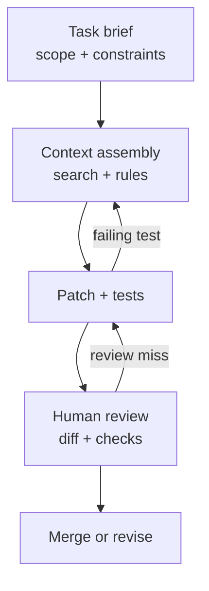

---
{
  "id": "blog-ai-coding-assistants-2026-comparison",
  "title": "AI Coding Assistants in 2026",
  "slug": "ai-coding-assistants-2026-comparison",
  "author": {
    "name": "LeetLLM Team"
  },
  "publishedAt": "2026-03-16",
  "updatedAt": "2026-11-23",
  "verifiedAt": "2026-11-23",
  "refreshAfter": "2026-12-23",
  "excerpt": "Follow one security-sensitive code change through four assistants. Compare their handoffs, review evidence, costs, and team controls.",
  "tags": [
    "AI Engineering",
    "Tools",
    "Deep Dive",
    "Developer Experience"
  ],
  "coverImage": "social_banner.png",
  "featured": false,
  "draft": false,
  "private": false
}
---

An authorization patch can pass its tests and still grant access after an admin permission expires. That failure is easy to miss when a timestamp uses the wrong unit.

The backend still has to verify a <span data-glossary="json-web-token">JSON Web Token (JWT)</span>, load the user's role in the requested workspace, and reject expired permissions. If an assistant helps, decide first how much of that loop it may own and what evidence must come back before merge. Tracking one concrete authorization fix makes those tradeoffs explicit, though controlled head-to-head runs are still needed to compare vendor performance.

Start with the kind of handoff you want:

- **Autocomplete or next edit:** You drive the change. The tool predicts the next local edit.
- **Live agent:** You stay in an interactive loop. The tool searches, edits, and runs permitted commands while you can steer.
- **Delegated agent:** You hand off a self-contained task and review the result later. Execution might be local or remote; delegation alone says nothing about its security isolation.

One product can offer all three. [Code Completion System](/learn/design-code-completion-system) explains why inline completion and task agents need different latency, context, and evaluation designs.

<figure>
  
  <figcaption>The columns show when the human intervenes. Context access depends on the product; choose the handoff separately from the execution environment.</figcaption>
</figure>

As of November 23, 2026, Cursor, Codex, GitHub Copilot, and Claude Code each cover more than one surface.[^cursor2026pricing][^openai2026codexapp][^openai2026codexplans][^github2026copilotplans][^github2026copilotcloudagent][^anthropic2026claudecodeoverview][^anthropic2026claudeplans] Their labels won't tell you where you can steer, what runs remotely, or which evidence returns with the patch. Model menus, usage meters, and plan names change quickly. For this authorization patch, what do you hand off, and what has to come back before anyone merges it?

## Run one task through the agent loop

A weak prompt says, "add admin settings auth." A useful brief gives the agent a focused change and a way to prove it:

- Reuse the JWT middleware pattern in `app/middleware/`
- Read `db/schema.ts` before adding queries
- Require active admin membership in the workspace named by the route
- Reject missing or expired admin permission, including the exact expiry millisecond
- Leave token verification, password hashing, dependencies, and other routes unchanged
- Add tests for a valid <span data-glossary="token">token</span>, an expired token, missing membership, wrong-workspace membership, and expired permission

The brief names scope, constraints, security rules, and expected evidence. It also gives the agent a reason to reuse the auth system you already have instead of inventing a second one.

### Assemble the smallest useful context

Before it edits, ask which files can answer this task. The agent shouldn't dump the whole repository into context. Search for the smallest working set:

- `db/schema.ts` for membership state and timestamp representation
- `app/routes/admin-settings.ts` for the workspace identifier and response shape
- `app/middleware/` for existing token verification and auth conventions
- `package.json` for test commands and installed libraries
- `tests/` for test helpers and runner conventions
- `AGENTS.md`, `CLAUDE.md`, or other project rules

Claude Code reads `CLAUDE.md` across terminal, IDE, desktop, and web surfaces.[^anthropic2026claudecodeoverview] Cursor documents project, team, user, and `AGENTS.md` rules for its Agent. Those rules govern Agent rather than Cursor Tab.[^cursor2026rules] Instruction files keep constraints visible, but relevant source and tests still beat a stale rule. Switching from an agent to autocomplete can also change which instructions apply.

Select context by the question it answers. A large context window cannot compensate for omitting the schema that defines the timestamp unit.

### Patch, test, and consume the failure

Once that working set exists, the agent can propose a small plan: reuse the JWT helper, query workspace membership, check `admin_expires_at`, wire the route, and add failure-mode tests.

Suppose the first run fails:

```text title="tests/admin-settings-auth.test.ts"
FAIL tests/admin-settings-auth.test.ts
  Admin Settings Auth
    ✓ accepts valid JWT and valid workspace permission
    ✗ rejects request when admin permission is expired
      Expected 403, received 200
```

For this example, the database stores expiry in milliseconds. A broken check compares it with current time in seconds: `expiresAtMs > nowMs / 1000`. An already-expired timestamp near 1.8 trillion still exceeds a current timestamp near 1.8 billion, so the request is allowed. The correct comparison uses milliseconds on both sides and rejects equality.

Check two failure cases first: expiry equals the fixed clock, and an unexpired membership belongs to another workspace. Both cases must deny access, and fixing only the timestamp units leaves the workspace mismatch unguarded.

Save this standalone example as `authorization-check.mjs` and run `node authorization-check.mjs`. The `subject` field stands for the verified identity passed down from middleware rather than decoding a JWT directly, and `admin` models a database row. The two deliberately incomplete checks show why testing expiry alone misses the workspace constraint.

```javascript title="Authorization failure and repair (Node.js)"
const nowMs = 1_800_000_000_000;
const request = { subject: "u1", workspaceId: "B" };
const admin = {
  userId: "u1", workspaceId: "B", role: "admin", active: true,
  expiresAtMs: nowMs + 1,
};
const active = (expiry) => Number.isFinite(expiry) && expiry > nowMs;
const wrongUnits = (expiry) => expiry > nowMs / 1000;
const expiryOnly = (_request, membership) =>
  active(membership.expiresAtMs) ? 200 : 403;

console.log(`broken units: expired permission returns ${wrongUnits(nowMs - 1) ? 200 : 403}`);
console.log(`expiry-only patch: wrong workspace returns ${expiryOnly(request, { ...admin, workspaceId: "A" })}`);

function authorize(req, membership) {
  if (!req.subject) return 401;
  const permitted = membership &&
    membership.userId === req.subject &&
    membership.workspaceId === req.workspaceId &&
    membership.role === "admin" && membership.active === true &&
    active(membership.expiresAtMs);
  return permitted ? 200 : 403;
}

const cases = [
  ["valid", request, admin, 200],
  ["expired", request, { ...admin, expiresAtMs: nowMs - 1 }, 403],
  ["exact expiry", request, { ...admin, expiresAtMs: nowMs }, 403],
  ["missing expiry", request, { ...admin, expiresAtMs: null }, 403],
  ["wrong workspace", request, { ...admin, workspaceId: "A" }, 403],
  ["wrong user", request, { ...admin, userId: "u2" }, 403],
  ["non-admin", request, { ...admin, role: "member" }, 403],
  ["inactive", request, { ...admin, active: false }, 403],
  ["unverified identity", { ...request, subject: null }, admin, 401],
  ["missing membership", request, null, 403],
];
for (const [name, req, membership, expected] of cases) {
  const received = authorize(req, membership);
  if (received !== expected) {
    throw new Error(`${name}: expected ${expected}, received ${received}`);
  }
}
console.log(`fixed authorization: ${cases.length} checks passed`);
```

The verified local output exposes both failures alongside the repaired check:

```text title="Authorization check output"
broken units: expired permission returns 200
expiry-only patch: wrong workspace returns 200
fixed authorization: 10 checks passed
```

In the repository, filter the membership query by both the verified user and the requested workspace. The agent must also rerun request-level tests through the real route and JWT middleware. This local example cannot catch a query that returns the wrong row, a forged token accepted by middleware, or a route that bypasses `authorize`. Save exact commands, exit codes, and skipped checks rather than accepting a summary that says only "tests passed."

### Keep security judgment with the human reviewer

Now inspect the green diff against the brief. It can still remove signature verification, weaken an assertion, or query admin membership without filtering by the requested workspace. A user who administers workspace A must not gain access to workspace B. Check that query and its negative test yourself. Reject unrelated dependency or password-hashing changes; this task doesn't authorize them.

> **Reviewer ownership:** Passing tests don't prove compliance with team standards. You still own security posture, dependency choices, permission grants, architecture, and release judgment.



The brief, the chosen files, the patch, the test output, and the diff are now fixed. Where does each product let you interrupt that loop, and what evidence is waiting if you review the result later?

## Compare surfaces, not logos

The same product can feel different in your editor, a remote agent, and a pull request. Compare the handoff in the mode you actually plan to use.

| Product | Live or local work | Delegated work | Review surface | Useful first pilot |
|---|---|---|---|---|
| **Cursor** | Editor agent, inline edits, rules, and CLI | Cloud agents, including multi-repository environments | Editor diff or pull request | Feature change that needs frequent file-level steering[^cursor2026pricing][^cursor2026rules][^cursor2026cloudagents] |
| **Codex** | Desktop, CLI, and IDE extension | Cloud tasks; desktop scheduled tasks can use local worktrees | Local diff, worktree, branch, or pull request | Two scoped tasks that can run independently[^openai2026codexapp][^openai2026codexplans] |
| **GitHub Copilot** | IDE completion, agent mode, CLI, and desktop app | GitHub cloud sessions in a cloud sandbox, GitHub Actions, or a custom remote environment | Local diff or GitHub branch and pull request | Issue-to-PR task with CI and review already in GitHub[^github2026copilotcodesuggestions][^github2026copilotplans][^github2026copilotcloudagent][^github2026copilotsetup] |
| **Claude Code** | Terminal, IDE, and desktop | Web sessions and cloud scheduled tasks | Diff, command trace, branch, or pull request | Debugging task that crosses code, shell, logs, and tools[^anthropic2026claudecodeoverview] |

Surface details change the result. Since October 28, 2026, GitHub's newer Copilot in the cloud experience is available on paid plans, subject to organization rules. Its cloud sandboxes can span repositories in one organization. GitHub Actions sessions remain limited to one repository and 59 minutes. Both environments retain the documented one-branch and one-pull-request-per-task constraints.[^github2026copilotcloudagent] Cursor cloud agents also support multi-repository environments.[^cursor2026cloudagents] If authorization touches separate frontend and backend repositories, check the actual environment and returned branches before delegating.

Codex worktrees create separate working directories on the computer or remote development environment holding the project.[^openai2026codexapp] A worktree separates edits while sharing operating-system permissions, network access, and secrets with its environment.

> **Key insight:** Compare when you can steer and what evidence returns after a handoff.

Use those choices to select a workflow. Steer when feedback is cheap, delegate when work can be scoped clearly, use a pull request when team visibility matters, and choose terminal access when inspection and tool composition matter. Run the same task across each workflow before choosing a broader rollout. A handoff you prefer still has a meter. What does this same patch cost once context, retries, and model choice are included?

## Read price alongside task cost

A plan might advertise a usage multiplier while another counts credits or API tokens. Those meters answer different questions. Context size, model choice, tool calls, local versus cloud execution, and retries can also change the cost of the same task.

| Product | Individual monthly list prices | Team list prices and cadence | Meter to watch |
|---|---|---|---|
| **Cursor** | Free; Plus \$8; Premium \$30; Super \$100; Ultra \$200 | Teams seats at \$30, \$100, or \$200/user/month | Weekly Cursor-model pool shared with Grok; eligible third-party models use prepaid credit from the first request[^cursor2026modelspricing] |
| **Codex** | ChatGPT Free; Go \$8; Plus \$20; Pro \$100, \$200, or \$500 | Business Standard \$20/user/month annually or \$25 monthly; Premium \$100 annually or \$125 monthly | ChatGPT Work and Codex share plan usage. Model, speed, and plan affect consumption; optional ChatGPT credits or separate API-key billing[^openai2026codexplans] |
| **GitHub Copilot** | Free; Pro \$10; Pro+ \$39; Max \$100 | Business \$19/seat/month; Enterprise \$39/seat/month | GitHub AI Credits; additional usage at \$0.01/credit. Track billable CI separately[^github2026copilotplans][^github2026copilotindividualbilling][^github2026actionsbilling] |
| **Claude Code** | Pro \$20; Max \$100; Ultra \$200 | Team Standard \$20/user/month annually or \$25 monthly; Premium \$100 annually or \$125 monthly | Shared Claude usage; five-hour and weekly limits depend on plan and account verification; optional usage credits or separate API billing[^anthropic2026claudeplans][^anthropic2026claudecodecosts] |

These are USD list prices checked on November 23, 2026, before tax, negotiated terms, or temporary promotions. The individual column uses monthly billing, without annual discounts. For example, Claude Pro is also sold for \$200 upfront per year, displayed as about \$17/month. Availability and checkout prices can depend on region and organization type.[^anthropic2026claudeplans] Codex Free and Go currently list desktop access at Standard speed, subject to rollout. Check cloud, CLI, and IDE eligibility separately from that desktop listing.[^openai2026codexplans]

GitHub's plans page links Business and Enterprise subscription paths. Enterprise requires GitHub Enterprise Cloud. Verify organization eligibility and checkout before budgeting a rollout.[^github2026copilotplans] Existing Pro and Pro+ annual subscribers who remained on legacy billing after June 1, 2026 still use premium requests. Confirm which meter your account uses.[^github2026copilotlegacybilling] Codex API-key access has separate billing and cloud-feature entitlements.[^openai2026codexplans]

Two concrete calculations show why the meter matters:

- **Copilot Pro:** Its current 1,000 base credits plus 500 flex credits total 1,500 included AI Credits. At \$0.01 per credit, 1,750 credits of metered usage would require \$2.50 beyond the allowance if additional usage is enabled. Flex is variable, and credits reset on the first of each calendar month without rollover. Paid-plan completions and next-edit suggestions do not consume these credits.[^github2026copilotindividualbilling][^github2026copilotplans]
- **Cursor Teams:** Eligible third-party requests add \$0.25 per million tokens, including input, output, and cached tokens. A request with 100,000 input and 5,000 output tokens adds \$0.02625 from that rate alone. It also applies to eligible Balance or Intelligence routes and bring-your-own-key requests. Cursor models, Cost mode, and models whose cache-read price stays below \$0.10 per million tokens across every tier are exempt. Individual plans don't pay this surcharge.[^cursor2026modelspricing]

Cursor's Pro, Pro+, Start, and Teams Standard/Premium plans continue for existing customers under separate legacy billing. Check the account's plan before applying the current table. Claude Ultra removes the five-hour limit for verified accounts while retaining a weekly limit.[^cursor2026modelspricing][^anthropic2026claudeplans]

Treat a plan multiplier as a capacity signal. Run the same repository tasks for one billing cycle, record usage after each task, and compare cost per accepted change. Record the exact model and mode too. Vendors offer multiple models or routing profiles, and a cheaper or faster choice can change both quality and consumption. Review code access, training use, and retention rules alongside cost per accepted change.

## Privacy and permissions belong in the purchase decision

The price table tells you what a plan costs. To decide whether it fits your team, you also need to know what code it can see and how it handles your data.

| Product | Data-handling checkpoint |
|---|---|
| **Cursor** | Enable Privacy Mode if code and prompts must not be used for training. Team plans add admin privacy controls.[^cursor2026pricing] |
| **Codex** | ChatGPT Business, Enterprise, and Edu data aren't used for training by default. The API also excludes training by default unless you opt in; check the individual account's data controls separately.[^openai2026businessdata][^openai2026datacontrols] |
| **GitHub Copilot** | Business and Enterprise data isn't used for training. Starting April 24, 2026, Free, Pro, Pro+, and Max interactions may be used unless the user opts out.[^github2026copilotpolicies] |
| **Claude Code** | Team and Enterprise work data isn't used for model training by default. Consumer plans use opt-out controls.[^anthropic2026claudeplans] |

"Not used for training" addresses training use. Check retention, subprocessors, regional requirements, and whether the selected surface matches the data terms you purchased. Separately inspect repository read scope, command execution, network access, <span data-glossary="secrets-management">secrets</span>, branch protection, and the ability to push or open a pull request. [Code Generation & Sandboxing](/learn/code-generation-agents-sandboxing) covers isolation, allowlists, and execution limits.

> **Rollout tip:** Use a disposable checkout for edits and a separately configured <span data-glossary="sandbox">sandbox</span> for untrusted execution. Don't mount production credentials. Grant only the commands, network destinations, and write actions the task needs.

Those controls decide whether a plan may touch the repository. They do not decide which assistant produces a patch your reviewers will accept.

## Pilot with repository evidence

Give each candidate a fresh checkout of the same starting commit, the same brief, allowed tools, checks, and time budget. Preinstall equivalent dependencies so setup differences don't dominate.

Repeat tasks, vary candidate order, and give equal human guidance. Log each intervention so you can tell whether the tool or the help changed the result.

Check that setup actually succeeded. For a GitHub Actions session, Copilot's `copilot-setup-steps` job stops its remaining setup steps after a nonzero exit code, but the agent still begins work with the partially prepared environment.[^github2026copilotsetup] If a private dependency failed to install, a later "module not found" error measures an environment problem before it measures coding ability. Verify dependencies and baseline tests before starting a controlled model comparison. In an end-to-end workflow pilot, keep that failure and its time and cost in the result.

Choose the question before the model. A **product-default comparison** tests each product as sold, including its model routing. A **matched-model comparison** holds model and reasoning settings fixed where supported, so differences more closely reflect tools and context assembly. They answer different questions. Record product version, plan, model identifier or Auto routing, mode, and date. Don't label an Auto-routed run as a test of one named model.

The **harness** is the machinery around the model: repository search, tools, context selection, command permissions, retries, and the environment that runs tests. Even with the same model, different harnesses can expose different evidence or skip a check. Keep the evaluator outside the agent's editable workspace. After each handoff, apply the patch to a clean checkout and rerun the evaluator's checks. Otherwise, an assistant can turn a red test green by deleting its assertion or leaving it skipped.

For the authorization task, keep the stated cases visible during development. Then grade the final patch with independently written cases that still follow the brief: a workspace-B request with workspace-A admin membership, expiry equal to the injected clock, and an expired token rejected through the real middleware. Don't introduce undisclosed product requirements. These cases test whether the patch satisfies the specification rather than merely passing the tests it saw. Record infrastructure failures and timeouts separately, and include their cost in the product-default comparison.

| Task | Evidence to save | Failure worth noticing |
|---|---|---|
| Small bug fix | Final diff and targeted test output | Unrelated churn |
| Multi-file refactor | Plan, changed API surface, and full affected checks | Missed dependency or duplicated abstraction |
| Failing test repair | Original error and retry trail | Guessing without reading the failure |
| Security-sensitive change | Permission log, negative tests, and reviewer notes | Constraint silently weakened |
| Documentation update | Source links and rendered output | Fluent but stale claim |

Score the accepted outcome, diff size, review time, tests actually run, risky-command approvals, constraint preservation, task duration, and measured cost. [Evaluating AI Agents](/learn/agent-evaluation-benchmarks) shows how to grade outcome, process, safety, cost, and repeatability as one episode.

### Count failures in the cost calculation

Define an accepted change before the run: required checks pass, no scope violation remains, and a reviewer accepts the patch. Include the cost of retries and rejected attempts in the numerator, but only accepted changes in the denominator. With zero accepted changes, cost per accepted change is undefined, not zero.

For a small ten-attempt comparison, setup A spends \$20 on ten attempts and produces five accepted changes: **\$4.00 per accepted change**. Setup B spends \$30 on the same ten attempts and produces eight: **\$3.75 per accepted change**. Setup A is cheaper per attempt, while B is cheaper per accepted result.

<figure>
  
  <figcaption>Both charts start at zero and use the same dollar scale. In this ten-attempt comparison, A spends USD 20 for five accepted changes and B spends USD 30 for eight. Changing the denominator reverses which setup looks cheaper.</figcaption>
</figure>

This dependency-free Python helper computes both cost per attempt and cost per accepted change using decimal arithmetic, returning `None` when no changes are accepted:

<!-- leetllm: test, output=show -->
```python title="cost_per_accepted_change.py"
from decimal import Decimal


def summarize_pilot(spent_usd: str, attempts: int, accepted: int):
    spent = Decimal(spent_usd)
    per_attempt = spent / attempts
    per_accepted = spent / accepted if accepted > 0 else None
    return per_attempt, per_accepted


for label, spent, attempts, accepted in [
    ("Setup A", "20", 10, 5),
    ("Setup B", "30", 10, 8),
    ("Setup C (no accepted)", "15", 4, 0),
]:
    per_attempt, per_accepted = summarize_pilot(spent, attempts, accepted)
    accepted_str = f"${per_accepted:.2f}" if per_accepted is not None else "undefined"
    print(f"{label}: ${per_attempt:.2f}/attempt, {accepted_str}/accepted")
```

<!-- leetllm: output:start -->
```text title="Output" output compact
Setup A: $2.00/attempt, $4.00/accepted
Setup B: $3.00/attempt, $3.75/accepted
Setup C (no accepted): $3.75/attempt, undefined/accepted
```
<!-- leetllm: output:end -->

For subscription plans, distinguish **incremental cash spend** from an **allocated plan cost**. Allocate included usage to tasks using a declared method; the invoice reports plan charges rather than per-task use. Keep estimated API-equivalent costs separate from actual charges. Report reviewer minutes and wall-clock time alongside dollars, or use an explicit hourly rate if combining labor with tool cost. Anthropic's cost documentation makes the same distinction between subscription limits and dollar-metered usage.[^anthropic2026claudecodecosts]

<span data-glossary="swe-bench">SWE-bench</span>, introduced in 2023 and published at ICLR 2024, turned real GitHub issues into repository-level test tasks.[^jimenez2024] A score measures the configured system on that benchmark. Your team's review time and cost need separate measurement. Record the benchmark variant, <span data-glossary="agent-scaffold">scaffold</span>, model, tool access, and evaluation date. Compare scores only across compatible setups.

The decision gets easier when you can point to work your team has actually reviewed. Save the prompt, starting commit, expected checks, final diff, usage, and review notes. Rerun the same tasks after major model, product, or pricing changes, then compare the new evidence with the old.

Hold one security-sensitive change fixed, then compare assistants by handoff, returned evidence, cost per accepted change, and the permissions you actually granted. [AI Coding Workflow with Agents](/learn/code-generation-agents-sandboxing) turns that comparison into a repeatable workflow for your repository.
