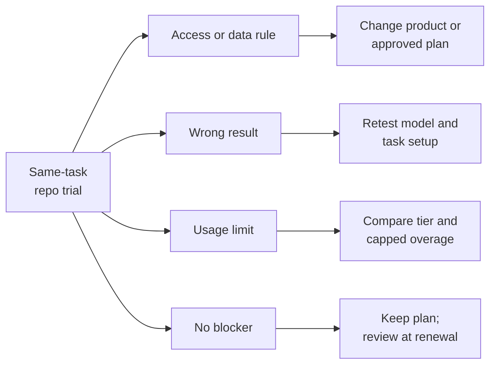

---
{
  "id": "blog-best-ai-coding-plans-2026",
  "title": "AI Coding Plans: Prices and Limits",
  "slug": "best-ai-coding-plans-2026",
  "author": { "name": "LeetLLM Team" },
  "publishedAt": "2026-06-06",
  "updatedAt": "2026-11-15",
  "verifiedAt": "2026-11-15",
  "refreshAfter": "2026-12-15",
  "excerpt": "The advertised seat price is only the start. See how usage limits, annual commitments, extra charges, and review time change what your team pays per accepted change.",
  "tags": ["AI Coding", "Developer Tools", "Cost Optimization", "Codex", "Claude Code", "Cursor", "GitHub Copilot", "Comparison"],
  "coverImage": "social_banner.png",
  "featured": false,
  "draft": false,
  "private": false
}
---

Your team approves five coding-assistant seats at \$40 each. The planned bill is \$200. A month later, usage charges add \$80, and reviewers have spent eight hours correcting and checking the output. The subscription was only one part of the purchase.

These sample figures show how plan fees and usage charges contribute to accepted work. A controlled trial measures vendor-specific results for the buying question: **what will it cost to deliver work your team accepts, under a plan your team is allowed to use?** A low seat price, a large credit balance, and a capable model answer different parts of that question.

Public prices and limits below were checked on **November 15, 2026**. Start with an existing approved entitlement or a free tier that exposes the features you need, then buy the smallest paid tier that passes a scoped trial. [AI Coding Assistants in 2026](/blog/ai-coding-assistants-2026-comparison) covers product capabilities and review workflows. Once the product fits, compare the bill, the limits, and the commitment required to renew.

## Compare the same billing period

All dollar amounts below are vendor-listed **USD before applicable taxes**. Exclude promotions, negotiated discounts, currency conversion, and app-store differences. Monthly prices mean a month-to-month subscription unless stated otherwise. An annual monthly equivalent divides the yearly price by twelve; cancellation and refund terms depend on the plan terms. Check payment timing, renewal, refund terms, and seat-reduction rules at checkout.

### Individual subscriptions

| Plan | Month-to-month price | Annual option shown here | Capacity detail to inspect |
|---|---:|---|---|
| Cursor Plus / Premium / Super / Ultra | \$8 / \$30 / \$100 / \$200 | \$80 / \$300 / \$1,000 / \$2,000 upfront per year | Weekly Cursor-model usage shared with Grok; third-party models cost extra on Premium and above[^cursor2026modelspricing] |
| Claude Pro | \$20 | \$200 upfront, equivalent to \$16.67/month | Shared Claude usage; short-window and weekly limits[^anthropic2026claudeplans][^anthropic2026claudecodecosts] |
| Claude Max / Ultra | \$100 / \$200 | Annual price omitted | Max has 5x Pro usage; Ultra has 10x weekly Pro usage and no five-hour limit for verified accounts[^anthropic2026claudeplans] |
| ChatGPT Go / Plus / Pro with Codex | \$8 / \$20 / \$100, \$200, or \$500 | Annual price omitted | Shared Work/Codex usage. Go access depends on desktop rollout. Pro currently has no five-hour limit; weekly limits may still apply[^openai2026codexplans][^openai2026workcodexusage] |
| Copilot Pro / Pro+ / Max | \$10 / \$39 / \$100 | Annual price omitted | Monthly base credits plus a separate flex allotment[^github2026copilotplans] |
| Devin Pro / Max | \$20 / \$200 | Annual price omitted | Daily and weekly allowance; optional extra usage[^devin2026pricing] |

Annual prices are omitted where the offers could not be compared on the same basis. Check vendor checkout to confirm whether an annual offer exists. Free options can test installation, permissions, and the review loop; a sustained workload is needed to assess paid-tier capacity. If your employer already grants a seat, test it before adding a personal subscription for the same job.

### Team subscriptions

| Plan | Month-to-month base | Annual monthly equivalent | Seat or purchase constraint |
|---|---:|---:|---|
| Cursor Teams Premium / Super / Ultra | \$30 / \$100 / \$200 per user | Not quoted here | Seat types can be mixed; separate shared prepaid balance covers additional usage[^cursor2026modelspricing] |
| Claude Team Standard / Premium | \$25 / \$125 per seat | \$20 / \$100 per seat | Team plan is for 2 to 150 people; seat types can be mixed[^anthropic2026claudeplans] |
| ChatGPT Business with Codex | \$25 per user | \$20 per user | At least two users[^openai2026codexplans] |
| Copilot Business / Enterprise | \$19 / \$39 per granted seat | Not quoted here | Verify current signup eligibility; Enterprise targets GitHub Enterprise Cloud[^github2026copilotplans] |
| Devin Teams | \$80 workspace + \$40 per full developer seat | Not quoted here | Each full user receives a quota and Devin Desktop access[^devin2026pricing] |
| Gemini Code Assist Standard / Enterprise, existing subscriptions | Check existing agreement | Check existing agreement | New purchases ended October 9, 2026; plan the documented migration[^google2026codeassistsunset] |

At five full developer seats, Devin Teams totals \$280 per month: $80\text{ USD} + 5 \times 40\text{ USD} = 280\text{ USD}$. At two users, ChatGPT Business is $2 \times 25\text{ USD} = 50\text{ USD}$ month-to-month or $2 \times 12 \times 20\text{ USD} = 480\text{ USD}$ for a year at the annual rate. These calculations cover base-license fees; use a task pilot to compare total cost and quality.[^devin2026pricing][^openai2026codexplans]

> **Purchase check:** GitHub's current plans page links Business and Enterprise subscription paths. Enterprise requires GitHub Enterprise Cloud. Confirm organization eligibility and checkout terms before setting a rollout date.[^github2026copilotplans]

For a team, a higher fee may buy controls your employer requires while leaving the usage allowance unchanged. Before testing, write down the needs that make a plan eligible: single sign-on, seat administration, model restrictions, retention, data-training opt-out, and audit access. A personal subscription may lack your employer's required controls. [Human-in-the-Loop Agent Architecture](/learn/agent-failure-states-retry-fallback) explains why human approval still matters after procurement approves the tool. Eligibility and commitment are separate decisions. If the workflow is still unproven, does a year paid up front cost less than the months you will actually use?

## Annual savings depend on how long you stay

Claude Pro makes that commitment question concrete: \$20 monthly versus \$200 prepaid for a year. Anthropic displays the annual equivalent rounded to \$17/month. $\frac{200\text{ USD}}{12} \approx 16.67\text{ USD}$ to the nearest cent.[^anthropic2026claudeplans]

If you need six months and can stop monthly renewals after month six, monthly billing costs $6 \times 20\text{ USD} = 120\text{ USD}$. The prepaid annual purchase still costs \$200. Ten monthly payments equal the annual price: $10 \times 20\text{ USD} = 200\text{ USD}$. The eleventh makes annual cheaper. Twelve monthly payments cost $12 \times 20\text{ USD} = 240\text{ USD}$, so the maximum first-year saving in this simplified comparison is $240\text{ USD} - 200\text{ USD} = 40\text{ USD}$, or $\frac{40\text{ USD}}{240\text{ USD}} \approx 16.7\%$. Assume unchanged prices, no refund, no promotion, and identical usage entitlements.

<figure>
  
  <figcaption>The annual option saves money only if enough monthly payments would otherwise occur. This comparison covers base fees; evaluate model quality and usage charges separately.</figcaption>
</figure>

Run a short month-to-month pilot before making a year-long commitment when the workflow is unproven. A discount doesn't compensate for an unsuitable plan, unused seats, or a model access change that breaks the intended workflow. The base fee also stops being the whole bill once included usage runs out. Which limit stops the next task, and what does overflow cost?

## Read the allowance and the overflow path separately

A subscription buys access plus a usage <span data-glossary="quota">quota</span>. That allowance might be measured in model-weighted credits, requests, or an opaque usage bar. A single agent task can make many model calls, so estimate task-level capacity from the calls it consumes. A plan can also enforce several windows at once; check both the five-hour and weekly capacities.

For example, imagine a credit-based plan showing **1,500 short-window credits left and 600 weekly credits left**. A further 800-credit workload exceeds included usage even though the short-window meter looks healthy. Before either window resets, and ignoring other limits, the effective remaining allowance is $\min(1{,}500, 600) = 600$ credits. A 500-credit workload leaves $1{,}500 - 500 = 1{,}000$ short-window credits and $600 - 500 = 100$ weekly credits. This example checks allowance arithmetic. Estimate full agent cost from actual usage and the vendor's task-reservation behavior.

<figure>
  
  <figcaption>Overlapping limits apply together. The next short-window reset may leave the weekly limit unchanged.</figcaption>
</figure>

Check what happens at the limit: waiting, stopping, purchasing credits, or automatic overflow billing. Set spending controls before a long run, verify which account and authentication mode are active, and treat a dashboard's estimated usage as distinct from the invoice. Paid API access can still have <span data-glossary="rate-limit">rate limits</span>.

### Cursor: distinguish the weekly pool from prepaid usage

Current plans share a weekly Cursor-model pool across Grok and Cursor. Third-party models use separately purchased credit from the first request on Premium and above; Plus excludes them. Teams have a shared prepaid balance and a team spending cap. Inspect the pool, credit balance, and cap independently.[^cursor2026modelspricing]

Eligible Teams and Enterprise requests add a Cursor Token Rate of \$0.25 per million input, cached, and output tokens. Cursor models, Cost mode, and third-party models with cache-read prices strictly below \$0.10 per million across every tier are exempt. Individual plans don't pay this rate. Eligible regional data residency adds a separate 10% model-price uplift.[^cursor2026modelspricing]

Pro, Pro+, Start, and Teams Standard/Premium continue for existing customers under legacy monthly-pool and on-demand rules. Match the account's actual plan to its billing documentation. Current Teams seat tiers don't combine their included usage into one seat; Enterprise offers pooled usage.[^cursor2026modelspricing]

### Claude Code: authentication changes the bill

Claude subscriptions share included capacity across supported Claude surfaces. Model, context, and parallel activity affect how quickly it runs out. `/usage` reports plan usage. Optional usage credits cover work beyond the allowance, while API-key usage uses separate token-based <span data-glossary="metered-billing">metered billing</span>.[^anthropic2026claudecodecosts] Verify the active billing route after login.

Don't treat every Claude Enterprise offer as a larger prepaid Team plan. The current pricing page advertises a \$20/seat/month Enterprise base, **billed annually, plus usage at API rates**, with a 20-seat minimum. A procurement comparison needs the consumption terms as well as the seat price.[^anthropic2026claudeplans]

### Codex: shared limits and a different API entitlement

ChatGPT plans include Codex as part of the plan entitlement. Local and cloud work share an allowance, and ChatGPT Work draws from the same usage budget. Weekly limits may apply. The published five-hour estimates apply to Plus and Standard Business. Pro currently has no five-hour limit.[^openai2026workcodexusage] Credits can extend eligible subscription usage. Free and Go currently list GPT-6 Luna at Standard speed in the desktop app, subject to rollout. Check the current plan matrix before expecting the Plus surfaces or models on Go.[^openai2026codexplans]

API-key authentication supports the CLI, SDK, and IDE extension with separate token billing. Cloud integrations such as GitHub code review and Slack follow separate plan entitlements, so treat API capacity and subscription features as distinct parts of the product.[^openai2026codexplans]

### Copilot: read base and flex credits

The current individual allowance table lists 1,500 total monthly AI credits for Pro (1,000 base + 500 flex), 7,000 for Pro+ (3,900 + 3,100), and 20,000 for Max (10,000 + 10,000). Business and Enterprise list 1,900 and 3,900 per user. These credits are vendor billing units; use a task pilot to count reviewed changes.[^github2026copilotplans]

Flex credits are variable, used after base credits, and reset with the calendar month without rolling over. One AI credit is \$0.01. For example, 1,750 credits of eligible usage on Pro with a 1,500-credit allotment leaves 250 additional credits, or \$2.50, if additional usage is enabled. If flex changes, that estimate changes. Paid-plan completions and next-edit suggestions don't consume these credits.[^github2026copilotindividualbilling]

Use the billing rules for the actual account and renewal period. Existing annual Pro and Pro+ subscriptions can still use legacy premium-request billing after the June 1, 2026 transition. That exception doesn't turn current credit allowances into premium-request counts. Organizational seats also don't inherit individual flex allowances.[^github2026copilotlegacybilling][^github2026copilotplans]

### Devin and Gemini Code Assist: different buying terms

Devin paid plans refresh an allowance daily and weekly. Extra usage is purchased at API pricing. The public page specifies an allowance but gives no task-completion rate. Each full developer seat includes its own quota and Devin Desktop access, so count the people who need those entitlements.[^devin2026pricing]

Gemini Code Assist Standard and Enterprise **closed to new purchases on October 9, 2026**. Existing agreements remain supported. License additions and annual auto-renewals end January 31, 2027. Monthly auto-renewals end December 31, 2027. Google directs business users toward Antigravity through Gemini Enterprise, so price a migration rather than planning a new Code Assist purchase.[^google2026codeassistsunset]

The earlier consumer Code Assist IDE/CLI path stopped serving requests on June 18, 2026 and directs users to Antigravity. Google AI consumer subscriptions and business licenses have separate terms.[^google2026codeassistfaq] For remaining Code Assist users in VS Code and IntelliJ, Gemini 3.1 Pro requires the administrator-configured Preview release channel, while Gemini 3.5 Flash is generally available. VS Code's agent mode selects the model automatically, so a chat selector alone cannot identify the model used in agent mode.[^google2026codeassistmodels] A coding-product plan still bundles an editor, controls, and a usage allowance. Sometimes the editor is already chosen and only model capacity is missing.

## Model-only plans need a separate comparison

Suppose your editor is already set, but you need another source of model capacity. A model plan may fit, though it won't provide the same editor, review surface, or organization controls as a coding product. Compare the whole combination, including any separate tool fee. Verify the exact model ID, endpoint, key type, allowed use, and overflow behavior.

| Model plan | Published monthly price | Meter | Key constraint |
|---|---:|---|---|
| MiniMax M Plan Go / Explore / Build | Documented regular prices \$22 / \$55 / \$132; confirm current checkout | Shared usage bar. Non-video models have five-hour and weekly windows | M Plan API key differs from a standard API key. Purchased Credits cover eligible overflow by default[^minimax2026mplan][^minimax2026mplanpricing][^minimax2026faq] |
| Z.AI GLM Coding Plan Lite | Starts at \$18 | 2,000 credits per five hours and 10,000 per week | Credits vary with model, token type, tools, and peak period[^zai2026overview] |
| QwenCloud Token Plan Individual (Personal) Lite / Essential / Standard / Pro | Regular list prices \$6 / \$10 / \$18 / \$43; new-user promos excluded | 20,000 / 45,000 / 80,000 / 200,000 monthly Credits | Dedicated plan key and compatible endpoint; interactive programming or agent tools, not scripts or application backends[^qwencloud2026tokenpersonal][^qwencloud2026codingfaq] |
| Fireworks Fire Pass | No price published in setup docs | No per-token charge for included routes while active | Experimental and closed to new subscriptions; existing users and promotional recipients retain access[^fireworks2026firepass] |

Fire Pass is restricted to personal, non-production agentic coding. Its dedicated key covers only the enabled routes. A standard Fireworks key for other models uses separate billing, so a working request doesn't prove the pass covered it.[^fireworks2026firepass]

MiniMax's older Token Plan is closed to new purchases. Existing subscribers can retain their original price and benefits with auto-renewal, but disabling Token Plan auto-renewal cannot be undone. An upgrade to M Plan cannot return to Token Plan. Read those terms before treating cancellation or migration as a reversible experiment.[^minimax2026tokenmigration]

M Plan includes M3.1 Flash for text. Its retired Preview name now routes to M3.1 Flash. Usage windows start at first use and reset independently. Purchased Credits remain valid for one year, and eligible overflow uses them before stopping. A standard pay-as-you-go key charges the account balance separately. Use current M Plan documentation for model coverage and entitlements; the older Token Plan price page describes a different offering.[^minimax2026mplan][^minimax2026faq]

Z.AI currently supports GLM-5.3 and GLM-5.3-Flash, with older model names remapped. A familiar name in a configuration file may no longer identify the model you tested.[^zai2026overview]

Compare these plans by actual usage categories rather than headline “millions of tokens.” Cached input, uncached input, output, and tool calls can consume different amounts. The Z.AI row uses the published credit allowances. Off-peak model discounts change how much work fits in an allowance while the credit balance stays fixed.[^zai2026overview]

QwenCloud's old Coding Plan documentation now redirects to Token Plan. Its current allowance uses monthly Credits adjusted upward on November 9, 2026; older documentation described weekly and monthly request counts. Included quota doesn't roll over. When it runs out, service pauses unless a Credit Pack provides capacity. A general key or base URL can route calls into separate pay-as-you-go billing. Compare the configured key and URL with the plan console, then confirm a small test call appears in plan usage.[^qwencloud2026tokenplan][^qwencloud2026codingfaq]

The Individual overview lists Credit Packs at \$15/pack/month with 20,000 Credits each, requiring an active subscription. Its upgrade rule prorates both the price and the additional current-cycle quota. An upgrade near the end of the cycle therefore doesn't immediately grant the new tier's whole monthly balance. Limited-time new-user prices are excluded above. Interactive tool use also doesn't permit a scheduled overnight batch or an application backend.[^qwencloud2026tokenpersonal][^qwencloud2026codingfaq]

### Convert a trace into credits before projecting capacity

Suppose a Z.AI agent trace consumes 100,000 input tokens, 5,000 output tokens, and ten Web Search MCP calls. At the current peak-period rates, GLM-5.3 charges input at 6.9, cached input at 1.7, and output at 24 per 10,000 tokens. Search adds 1.2 credits per call. With no cache hits, the trace costs $81 + 12 = 93$ credits.[^zai2026overview]

If 80,000 of those input tokens are actually billed as cached, the same token counts cost:

$$
\begin{aligned}
C_{\mathrm{input}} &= \frac{20{,}000 \times 6.9}{10{,}000} \\
&\quad + \frac{80{,}000 \times 1.7}{10{,}000} = 27.4 \\
C_{\mathrm{output}} &= \frac{5{,}000 \times 24}{10{,}000} = 12 \\
C_{\mathrm{tools}} &= 10 \times 1.2 = 12 \\
C_{\mathrm{total}} &= 27.4 + 12 + 12 = 51.4 \text{ credits}
\end{aligned}
$$

Fifty such traces before any short-window credits refresh consume 2,570 credits, exceeding Lite's 2,000-credit short window despite fitting its weekly balance. GLM-5.3-Flash uses different weights, so don't copy this estimate across models:

<!-- leetllm: test, output=show -->
```python title="weighted_plan_credits.py"
from decimal import Decimal as D


def credits(uncached, cached, output, weights, searches):
    model = sum(D(tokens) * D(weight) for tokens, weight in
                zip((uncached, cached, output), weights)) / D(10_000)
    return model + D(searches) * D("1.2")


glm = ("6.9", "1.7", "24")
flash = ("2.3", "0.56", "8")
print(f"GLM-5.3, no cache hits: {credits(100_000, 0, 5_000, glm, 10)}")
warm = credits(20_000, 80_000, 5_000, glm, 10)
print(f"GLM-5.3, 80% cached input: {warm}")
print(f"GLM-5.3-Flash, 80% cached input: {credits(20_000, 80_000, 5_000, flash, 10)}")
print(f"50 cached GLM-5.3 traces: {50 * warm}")
```

<!-- leetllm: output:start -->
```text title="Output" output compact
GLM-5.3, no cache hits: 93.0
GLM-5.3, 80% cached input: 51.4
GLM-5.3-Flash, 80% cached input: 25.08
50 cached GLM-5.3 traces: 2570.0
```
<!-- leetllm: output:end -->

Use disjoint uncached and cached counts from the billing trace. Don't count cached tokens twice or assume the provider achieved a cache hit. Z.AI's current off-peak rate halves model credits. The documented tool rate remains 1.2 per search, so the cached GLM-5.3 example becomes $39.4 / 2 + 12 = 31.7$, not 51.4 / 2. Peak hours are weekdays 14:00 to 18:00 UTC+8. These calculations estimate this trace's quota consumption, not accepted work, dollars, latency, or quality.[^zai2026overview]

## Calculate the budget from accepted work

Return to the five-seat example. Suppose monthly usage beyond included capacity costs \$80, and review plus correction takes eight hours at an assumed loaded labor rate of \$75/hour. If 40 changes are accepted, the direct vendor bill is \$280, or \$7 per accepted change. Including \$600 of review labor makes the planning cost \$880, or \$22 per accepted change.

This budgeting calculation walks through the cost stack; a pilot on representative tasks is required to compare provider performance. Include time spent on failed attempts in the labor total. Divide by accepted changes, not all generated patches. Keep task classes separate so a pile of tiny edits doesn't hide expensive migration failures. Compare against the team's existing workflow before claiming savings.

The denominator can reverse an apparent bargain. Suppose the same \$280 vendor bill generates 60 patches, but reviewers accept only 20 and spend 12 hours on review and correction. At \$75/hour, cost is $\frac{280\text{ USD} + 900\text{ USD}}{20} = 59\text{ USD}$ per accepted change. Dividing by all 60 patches would report \$19.67 and count 40 rejected patches as delivered work. A green visible test is insufficient if the patch deleted the assertion or violated an untested permission rule. Keep acceptance checks outside the editable agent workspace and rerun them against the final diff.

<figure>
  
  <figcaption>The seat fee is one component. Add review labor to the economic comparison and keep it separate from the vendor invoice.</figcaption>
</figure>

The local helper below takes seat fees, already-calculated extra usage, review hours, an hourly rate, and the accepted change count to compute the vendor bill, the bill plus labor, and the cost per accepted change:

<!-- leetllm: test, output=show -->
```python title="coding_plan_budget.py"
from decimal import Decimal


def monthly_budget(seats, seat_price, workspace_fee, usage_cost,
                   review_hours, hourly_rate, accepted):
    if seats < 0 or accepted < 0:
        raise ValueError("Seats and accepted changes must be nonnegative")
    price, workspace, usage, hours, rate = (
        Decimal(str(x))
        for x in (seat_price, workspace_fee, usage_cost, review_hours, hourly_rate)
    )
    if any(x < 0 for x in (price, workspace, usage, hours, rate)):
        raise ValueError("Costs, hours, and rates must be nonnegative")
    vendor = seats * price + workspace + usage
    total = vendor + hours * rate
    per_change = total / accepted if accepted else None
    return vendor, total, per_change


vendor, total, per_change = monthly_budget(5, 40, 0, 80, 8, 75, 40)
print(f"Vendor bill: ${vendor:.2f}")
print(f"Including review: ${total:.2f}")
print(f"Per accepted change: ${per_change:.2f}")
```

<!-- leetllm: output:start -->
```text title="Output" output compact
Vendor bill: $280.00
Including review: $880.00
Per accepted change: $22.00
```
<!-- leetllm: output:end -->

The helper uses monthly fees and already-calculated dollar usage. It excludes taxes, raw vendor-credit conversion, proration, refunds, prepaid-credit cash timing, infrastructure, and seat minimums; check those separately. With zero accepted changes it returns `None` because cost per accepted change is undefined. Annual-fee allocation can support monthly planning while the payment date and commitment terms remain unchanged. Choose a plan by combining the worksheet's cost estimate with task outcomes and failure requirements.

## Run a trial that tells you what to buy next

Run the trial on work your team already knows how to accept or reject: a bug with a reproducible test, a multi-file feature, a refactor, a dependency update, and a security-sensitive review. Define acceptance criteria up front. Use the same starting commit and comparable permissions, and record the tool version, plan, model, authentication mode, allowance state, and extra spend. Repeat uncertain results and estimate reliability across trials.

Track assignment-to-accepted-diff time, human correction time, interrupted sessions, tests actually run, unsafe edits, and the invoice. Report accepted task counts and review time directly; use a separately defined and validated metric for quality. If two plans expose different models, report a product-plan comparison instead of attributing the difference to the tool alone.

Use the bottleneck observed in the same-task trial to choose the next change:



> **Upgrade rule:** A repeatable capacity limit can justify more allowance. A wrong answer needs a quality investigation. A missing approval or data control needs a compliant product. Raising the tier doesn't necessarily solve the other two.

For an occasional burst, compare the permitted extra-usage cost with the incremental tier fee, while checking whether that tier changes models or features. For example, Cursor Premium to Super adds \$70/month at current prices. A \$65 burst makes Premium's fee plus extra usage \$95, below Super's \$100 base. A \$90 burst makes it \$120, but the upgrade saves money only if Super's larger Cursor-model allowance absorbs enough of that workload. Third-party model spend remains separate. Don't assume all overflow disappears merely because the tier costs more.[^cursor2026modelspricing]

For sustained use, repeat the comparison over representative weeks, including the busiest period. Stop an unsuccessful pilot, remove unused seats, and cancel unwanted renewals under the provider's terms. Check retained-plan restrictions before canceling, especially MiniMax Token Plan's irreversible auto-renewal switch.

Choose one primary tool that fits the team's review process. Add a second subscription only when it solves a gap your trial exposed and the extra cost still makes sense. This keeps seats tied to actual work and limits overlap. [AI Coding Workflow with Agents](/learn/ai-coding-workflow-with-agents) shows how to turn that access into focused tasks, executed checks, and reviewable diffs.
