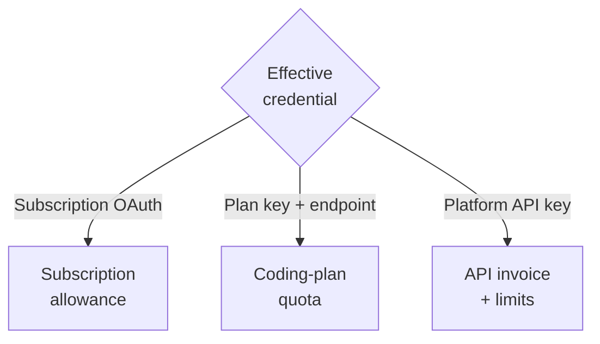

---
{
  "id": "blog-best-ai-plan-openclaw-2026",
  "title": "Best AI Plans for OpenClaw in 2026",
  "slug": "best-ai-plan-openclaw-2026",
  "author": { "name": "LeetLLM Team" },
  "publishedAt": "2026-04-04",
  "updatedAt": "2026-11-15",
  "verifiedAt": "2026-11-15",
  "refreshAfter": "2026-12-15",
  "excerpt": "Two jobs can use the same prompt and still need different OpenClaw plans. Check workload rules, credentials, quota, and what a full task may cost.",
  "tags": ["OpenClaw", "AI Coding Plans", "Cost Optimization", "Agentic AI", "API Pricing", "Qwen Cloud", "Comparison"],
  "coverImage": "social_banner.png",
  "featured": false,
  "draft": false,
  "private": false
}
---

A Slack request to "summarize last night's CI failures" and a scheduled job that does the same thing every morning can use identical prompts but fall under different subscription rules. OpenClaw's self-hosted Gateway connects model calls to messaging, files, browser actions, and scheduled work.[^openclaw2026readme][^openclaw2026failover] That integration capability doesn't make every connected plan suitable for every workflow.

Choose in this order: **permitted workload, credential and endpoint, capacity, then measured task quality and cost**. A model name alone answers none of the first three questions. This guide compares published plans and outlines the tests needed to assess task quality and cost.

## Check the workload before the price

QwenCloud Token Plan Personal Edition is for personal, interactive programming and agent-tool use. Its terms exclude automation scripts, application backends, and unattended batch calls. The OpenClaw listing identifies a supported tool; confirm each enabled feature against the plan terms.[^qwencloud2026tokenpersonal] MiniMax similarly describes M Plan as individual, interactive developer use and recommends pay-as-you-go for production.[^minimax2026faq]

An interactive coding session, unattended cron job, multi-user service, and production application are separate cases. For scheduled CI housekeeping, start with a service whose current terms and account settings support that workload. Don't select an interactive-only subscription merely because it has spare quota. When documentation leaves the intended use unclear, resolve that with the provider before buying or enabling automation.

The table is a **November 15, 2026 snapshot**, in USD with monthly billing, before tax, promotions, regional differences, or negotiated terms. It covers five paths among the OpenClaw-compatible providers.

| Billing product | Published price | Capacity meter | Purchase decision |
|---|---|---|---|
| ChatGPT Plus with Codex | \$20/month | Shared subscription usage, separate from Platform API billing | Test existing eligible subscription access before adding another purchase.[^openai2026codexplans] |
| MiniMax M Plan Go | Documented \$22/month regular price; confirm checkout | Shared resource quota with five-hour and seven-day windows | Consider for individual interactive MiniMax work. Exclude the first-month offer when budgeting renewals.[^minimax2026mplanpricing][^minimax2026faq] |
| QwenCloud Token Plan Individual (Personal) Lite | \$6/month regular list price | 20,000 Credits per subscription month; no weekly quota | Consider if its exact Personal Edition model allowlist and interactive-only scope fit.[^qwencloud2026tokenpersonal] |
| Z.AI GLM Coding Plan Lite | \$18/month | 2,000 credits per five-hour window; 10,000 weekly | Test GLM quality and queue tolerance. OpenClaw receives best-effort scheduling.[^zai2026overview][^zai2026openclaw] |
| Direct OpenAI API | Usage-based; no required monthly subscription | Tokens and separately priced services | Consider for an explicitly budgeted API workload. ChatGPT fees don't cover it.[^openai2026pricing] |

MiniMax has closed new Token Plan purchases. Existing subscribers can keep their original price and benefits while auto-renewal stays on. Turning renewal off cannot be undone for Token Plan, and an upgrade to M Plan cannot be reversed.[^minimax2026tokenmigration]

QwenCloud Personal Lite has the lowest regular subscription entry price **in this table**. Its limited-time checkout price is excluded here. Compare cost per completed task after accounting for credentials, retries, queueing, and review time. An existing subscription may have no additional seat charge, while operational costs can outweigh a small monthly-price difference. Which login or key will this job actually use?

## Keep credentials and invoices separate

OpenClaw documents ChatGPT/Codex <span data-glossary="oauth">OAuth</span> sign-in and Platform API-key authentication under the same `openai/*` model namespace. For example, `openai/gpt-5.6-sol` can use either path when account access and configuration permit. The credential type selects the billing path; the model prefix selects the model.[^openclaw2026openaiauth][^openclaw2026openairuntimes]

For new OpenClaw setups, follow the current account-specific default, `openai/gpt-6-astra` when available. The `openai/gpt-5.6-sol` examples below use an explicitly selected comparison model that must appear in your account catalog.[^openclaw2026openaisetup]

OpenAI now lists OpenClaw among Sign in with ChatGPT (SIWC) integrations. The login permission identifies your account. A separate, optional permission lets an eligible Plus or Pro plan fund app inference. Identity-only sign-in provides account identity; inference requires the separate permission. Authorized app usage shares your existing Codex allowance, and the app's usage limit caps its share of that allowance.[^openai2026signinapps][^openclaw2026openaiauth]

A successful SIWC chat covers chat access. In OpenClaw, memory embeddings and text-to-speech require a separate compatible credential, and SIWC currently omits `image_generate`. If an API credential funds those capabilities, include its charges even when the chat itself uses a subscription. Locally configured tools have their own service permissions and credentials.[^openclaw2026openaiauth]

OpenClaw's documented subscription integration covers a specific authentication path. Check current provider terms and workspace rules for account sharing, resale, automation, and organizational guidelines. Never copy a browser session token into an unofficial proxy to make a different billing product appear entitled.



The credential that makes the request determines which allowance or invoice applies. Some subscriptions also sell extra credits. Apply OpenAI's ChatGPT credits to the ChatGPT/Codex meter; Platform API usage bills separately.[^openai2026codexplans] MiniMax's M Plan API key uses M Plan quota and eligible purchased Credits. A standard API key uses pay-as-you-go billing. Purchased Credits expire after one year and cover eligible overflow automatically after included usage runs out.[^minimax2026faq]

QwenCloud Personal Edition requires both its dedicated `sk-sp-...` key and the matching Token Plan endpoint. For OpenAI-compatible clients, the documented Base URL is `https://token-plan.maas.qwencloudapi.com/compatible-mode/v1`. A general key or different billing endpoint can explain unexpected pay-as-you-go charges. Treat an unsupported model on the plan route as a configuration failure. Keep the request on an approved route instead of retrying silently on a paid API route.[^qwencloud2026tokenpersonalsetup][^qwencloud2026tokenpersonalfaq] The same principle applies to backups: adding a paid API credential may change the invoice even when the selected model stays unchanged. With the credential fixed, price one real task on that meter. Count every request, tool call, and retry charge.

## Calculate one request, then count the whole task

What looks like one work item can involve several model requests, tool calls, retries, and a final verification pass. QwenCloud Personal Credits consumption depends on model, token usage, thinking mode, and tool calls, so one task has no fixed conversion to Credits.[^qwencloud2026tokenpersonal]

Use this **single-request usage profile**:

- 20,000 uncached input tokens
- 10,000 cache-read input tokens
- 4,000 billed output tokens

The input total is 30,000. Cached input is a subset of total input in many usage reports, so count it once. Here the categories are already separated. Identical text can tokenize differently across models, so equal token counts isolate the billing meters rather than identical task performance. Billed output can include reasoning tokens that aren't shown to the user.

### Direct API dollars

The current standard, short-context GPT-5.6 Sol rates are \$4 per million uncached input tokens, \$0.40 per million cached input tokens, and \$20 per million output tokens.[^openai2026pricing] That makes this request:

$$
C = \frac{20{,}000(4) + 10{,}000(0.40) + 4{,}000(20)}{1{,}000{,}000}
= 0.164\text{ USD}
$$

This calculation excludes separately charged cache writes, hosted tools, regional uplift, and faster service tiers. The pricing table lists cache writes separately. Prompts above 272K input tokens use higher rates for the full request. Sol's promotional pricing is documented as available until November 30, 2026. Recheck before making a longer-term budget.[^openai2026pricing][^openai2026gpt56sol]

A task making ten requests with this same usage would cost \$1.64 in model charges. A hundred such tasks would cost \$164, not \$16.40. Real agent requests usually vary as context and output grow, so sum their actual usage logs rather than multiplying the first call blindly.

### Subscription credits

Z.AI's GLM-5.3 standard credit multipliers are 6.9 for uncached input, 1.7 for cache reads, and 24 for output, divided by 10,000 tokens. The same token counts consume **25.1 Z.AI credits**. Convert those credits using Z.AI's allowance and price rules; they use a different unit from dollars and OpenAI tokens.[^zai2026overview]

| Category | Tokens | GPT-5.6 Sol: USD | GLM-5.3: credits |
| --- | ---: | ---: | ---: |
| Uncached input | 20,000 | 0.080 | 13.8 |
| Cache-read input | 10,000 | 0.004 | 1.7 |
| Billed output | 4,000 | 0.080 | 9.6 |
| **Request total** | **30K input + 4K output** | **0.164** | **25.1** |

Output is only 4,000 tokens but costs as much as 20,000 uncached input tokens in this API example. Compare each total within its own billing unit; dollars and credits have different scales.

With an untouched 2,000-credit window, at most **79 complete requests** of this shape fit at the standard rate: 80 would require 2,008 credits. Other use and tool charges reduce that number. A task containing ten requests uses ten of those request units. Z.AI discounts model credits by half outside its weekday 14:00 to 18:00 Singapore-time peak period. Queue time still depends on the provider's current load and scheduling rules.[^zai2026overview][^zai2026openclaw]

This offline calculator checks request cost, ten-request task cost, and whole requests within a 2,000-credit balance from the separated token counts and dated rates above. No credentials or provider calls are needed:

<!-- leetllm: test, output=show, output_title="Request and task accounting output" -->
```python title="request_and_task_accounting.py"
from math import floor

tokens = {"uncached": 20_000, "cached": 10_000, "output": 4_000}
usd = (
    tokens["uncached"] * 4
    + tokens["cached"] * 0.40
    + tokens["output"] * 20
) / 1_000_000
credits = (
    tokens["uncached"] * 6.9
    + tokens["cached"] * 1.7
    + tokens["output"] * 24
) / 10_000
requests_per_task = 10

print(f"usdPerRequest: {usd:.3f}")
print(f"usdPerTask: {usd * requests_per_task:.2f}")
print(f"creditsPerRequest: {credits:.1f}")
print(f"wholeRequestsInWindow: {floor(2000 / credits)}")
```

<!-- leetllm: output:start -->
```text title="Request and task accounting output" output compact
usdPerRequest: 0.164
usdPerTask: 1.64
creditsPerRequest: 25.1
wholeRequestsInWindow: 79
```
<!-- leetllm: output:end -->

The floor counts complete requests, so a small remaining balance doesn't fund an eightieth request. Change `requests_per_task` to inspect task cost without changing either per-request meter.

Now consider a three-request task whose tool results enlarge the next prompt. Keep cache reads at 10,000 tokens, but let uncached input grow from 20,000 to 40,000 to 60,000 and billed output from 4,000 to 8,000 to 8,000. Multiplying the first request by three misses that growth because each turn carries more prior context. This second offline calculation uses the same API rates and sums all three requests:

<!-- leetllm: test, output=show, output_title="Growing-context task cost output" -->
```python title="growing_context_task_costs.py"
requests = [
    {"uncached": 20_000, "cached": 10_000, "output": 4_000},
    {"uncached": 40_000, "cached": 10_000, "output": 8_000},
    {"uncached": 60_000, "cached": 10_000, "output": 8_000},
]
costs = [
    (r["uncached"] * 4 + r["cached"] * 0.40 + r["output"] * 20) / 1_000_000
    for r in requests
]
total = sum(costs)
first_request_estimate = costs[0] * len(requests)

print(f"actualTaskUsd: {total:.3f}")
print(f"firstRequestEstimateUsd: {first_request_estimate:.3f}")
print(f"uncountedUsd: {total - first_request_estimate:.3f}")
```

<!-- leetllm: output:start -->
```text title="Growing-context task cost output" output compact
actualTaskUsd: 0.892
firstRequestEstimateUsd: 0.492
uncountedUsd: 0.400
```
<!-- leetllm: output:end -->

The output prints `0.892`, `0.492`, and `0.400` dollars respectively. A nominal \$0.75 task budget would already be exceeded by the final request. Before that request starts, the first two requests have spent \$0.488, leaving \$0.262. Its input alone costs \$0.244, leaving only \$0.018 for output: 900 tokens at this rate. That cap may not be enough to finish the task. Stop or approve a larger budget before dispatch, rather than reporting incomplete work as success. These numbers retain the example's exclusions for tools and cache writes. An after-the-fact dashboard can only report the overrun.

MiniMax's console reports a shared resource bar rather than a stable token-to-task conversion. Do not derive one from this example.[^minimax2026faq] [LLM Cost Engineering](/learn/llm-cost-engineering-token-economics) explains how cache hits, reasoning output, and retries change the full cost. Those estimates still assume the configured route belongs to the plan you priced. Does it?

## Check the exact plan and model route

The model picker can show options that your selected subscription doesn't cover. Pin an exact supported model and record its endpoint, auth profile, plugin version, and OpenClaw version.

| Path | Documented route or setup detail | Verification check |
|---|---|---|
| OpenAI subscription or API | Explicitly selected `openai/gpt-5.6-sol` when available in the account catalog | The credential type and effective runtime determine which path the `openai` prefix selects.[^openclaw2026openaiauth][^openclaw2026openairuntimes] |
| MiniMax subscription | OpenClaw documents `minimax-portal/MiniMax-M3.1-Flash` for OAuth and `minimax/MiniMax-M3.1-Flash` for API-key setups | Verify the M Plan API key or OAuth account actually has M Plan access. A standard API key selects pay-as-you-go.[^openclaw2026minimax][^minimax2026faq] |
| QwenCloud Token Plan Personal | Its dedicated Base URL accepts exact allowlisted IDs such as `qwen3.7-plus` | Follow the Personal Edition setup guide. OpenClaw's `qwen-api-key` path targets legacy Coding Plan; its `qwen-token-plan` onboarding documents Team Edition endpoints.[^qwencloud2026tokenpersonalsetup][^qwencloud2026tokenpersonal][^openclaw2026qwen] |
| Z.AI Coding Plan | External `@openclaw/zai-provider` plugin; `zai/glm-5.3` | Use the `zai-coding-global` endpoint documented for Global Coding Plan onboarding.[^openclaw2026zai] |

QwenCloud Personal's current allowlist includes selected Qwen, GLM, and DeepSeek text models alongside multimodal models. Don't copy Kimi or MiniMax IDs from the historical Coding Plan or Team Edition list into a Personal configuration. OpenClaw's published Team Edition setup and QwenCloud's Personal quickstart document different Base URLs. Confirm the guide matches the edition bought before changing the key. No live Personal integration was tested for this article.[^qwencloud2026tokenpersonal][^qwencloud2026tokenpersonalsetup][^openclaw2026qwen]

The current QwenCloud OpenClaw Personal sample uses its Anthropic-compatible `/apps/anthropic` URL with `api: "anthropic-messages"`. The Personal quickstart also publishes a separate OpenAI-compatible URL. Keep the configured protocol and Base URL paired. Its sample disables Gateway authentication, so don't apply that setting to a shared or remotely exposed Gateway.[^qwencloud2026openclaw][^qwencloud2026tokenpersonalsetup]

Z.AI currently lists GLM-5.3 and GLM-5.3-Flash. Older 5.2/5.1 requests route to 5.3, while 4.7 routes to Flash. An old configured name therefore may not identify the model that actually answers.[^zai2026overview]

M Plan's included text model is M3.1 Flash. Its retired Preview ID now routes to Flash. OpenClaw still documents M3 as its MiniMax default, so check the selected model against the plan before routing requests. OpenClaw's stable Flash catalog has token prices; its legacy Preview entry retains zero local estimates. Those legacy zeroes describe missing historical pricing, not free service.[^minimax2026faq][^openclaw2026minimax]

Use the linked provider guide for the path you intend to configure. After configuring one path, inspect it before making a live request:

```bash title="Inspect the configured path without a live inference probe"
openclaw models status --json
openclaw models list
openclaw config get agents.defaults.model --json
```

`models status` inspects configured defaults and credential/runtime readiness. Check `/model status` in the affected chat to inspect its override and route. Older chats may retain an API route after the default changes to a subscription route.[^openclaw2026modelscli]

`openclaw models auth list` and other offline auth operations require exclusive ownership of local state. Stop the Gateway through its service owner and wait for it to release state before using them. For a running installation, use the Gateway's Models UI instead. A CLI configured with a remote Gateway URL still operates on local auth state for these subcommands.[^openclaw2026modelscli]

Validation scope: the commands were checked against current documentation. No configured Gateway was run. Confirm execution readiness with a scoped test request. `models status --probe` makes real requests, may consume quota, and has additional state-directory requirements. Read the CLI's probe instructions before running it against an installation.[^openclaw2026modelscli] Test the configured route on a real task, then diagnose the limit it reaches.

## Respond to the failure you actually received

Quota exhaustion, temporary rate limiting, queue delay, and budget exhaustion need different responses. An hourly concurrency error isn't necessarily the same as an exhausted monthly allowance.

| Observed state | Check first | Response |
| --- | --- | --- |
| Short-window quota empty | Short window and weekly allowance | Wait for the binding constraint |
| Qwen Personal Credits empty | Monthly balance and purchased packs | Wait for reset or buy capacity |
| Temporary throttling | Provider hint and task deadline | Capped backoff with attempt limit |
| Invalid key or endpoint | Billing product and credential pairing | Repair the key and endpoint |
| Task budget exhausted | Spend across all attempts | Stop or obtain budget approval |

Classify the failure before retrying or changing credentials. Repeating a request cannot repair an invalid key or replenish an exhausted monthly quota.

QwenCloud Personal removed its weekly quota on September 22, 2026. Monthly Credits reset per subscription month, unused quota doesn't roll over, and purchased Credit Packs can be consumed after the base quota. Once both are exhausted, service pauses without automatic provider-side pay-as-you-go fallback.[^qwencloud2026tokenpersonal][^qwencloud2026tokenpersonalfaq] Your OpenClaw configuration can still select a different paid credential or provider.

MiniMax M Plan's five-hour and seven-day windows start on first use, reset independently at their ends, and start again on the next use. Each window resets at a fixed end; usage does not replenish continuously as older requests leave the window. A five-hour reset can leave the weekly constraint exhausted. Purchased Credits may already be covering overflow, so check that balance too.[^minimax2026faq] Z.AI explicitly assigns OpenClaw secondary, best-effort scheduling under load.[^zai2026openclaw] Subscriptions and direct API keys remain subject to concurrency limits and provider availability.

OpenClaw can rotate auth profiles within a provider before advancing to configured fallback models. A user-selected session model that differs from the configured primary is strict; selecting the configured primary retains its fallback chain. A preferred auth profile can still rotate among eligible same-provider profiles. **Pin a model to constrain model selection, then enforce spend with a separate budget.** Rate-limit recovery can prefer a successful fallback across later turns for a ten-minute idle window, capped at thirty minutes, while preserving the selected model. Group and channel conversations suppress visible fallback notices while retaining events.[^openclaw2026failover]

Cron is a concrete exception to the intuition that an explicit model choice is strict. A job's `payload.model` or `--model` selects its primary, but configured fallback models remain eligible unless the job specifies `payload.fallbacks`. Thus a job aimed at a subscription can reach a paid API backup after a failure. Setting `payload.fallbacks: []` disables that job's model fallback chain. It does not disable same-provider credential rotation or make an interactive-only plan suitable for cron. Inspect all eligible auth profiles as well as the model chain before treating a job as subscription-only.[^openclaw2026failover] A retry that changes credentials can also change the bill. Should that backup run at all?

## Make paid fallback an explicit decision

Before adding a backup, verify its workload eligibility, data-handling rules, model coverage, and budget. A metered model isn't automatically stronger, and a difficult task doesn't by itself authorize more spending or broader tool access.

<figure>
  
  <figcaption>Configure these checks explicitly; OpenClaw does not install them automatically. Verify eligibility and budget for every backup as well as the primary.</figcaption>
</figure>

Use a task budget that includes all attempts, and stop when the budget or deadline is exhausted. Dashboards report estimates and alerts; enforce a hard cap through provider or application controls. Suppose a pull-request tool submits its write, then times out before returning the PR URL. The write outcome remains unknown until reconciliation. A fallback that repeats the create operation can open a duplicate. Look up the PR by its repository and branch before retrying, and record the confirmed result for the next attempt. [Agent Failure & Recovery](/learn/agent-failure-states-retry-fallback) covers that distinction.

Pilot a few representative tasks on the same starting state. Record requests per task, billed token categories, quota before and after, queue time, retries, final outcome, and reviewer time. Include rejected attempts when calculating cost per accepted result. For a subscription, state whether you're reporting incremental cash spend or an allocated share of the monthly fee. Use these results to justify another plan, then compare them with a vendor's advertised agent count. First check that the Gateway shares tools, files, and credentials only within the intended operator scope.

## Secure the Gateway before leaving it running

OpenClaw's security model supports one trust zone per Gateway: one operator or mutually trusting teammates. Give untrusted tenants separate Gateways and separate OS user accounts or hosts. Tool-enabled users share tool permissions; inspect the effective sandbox, execution host, approvals, channel allowlists, and plugin permissions because self-hosting alone provides no process isolation.[^openclaw2026security]

Run `openclaw security audit` after configuration or exposure changes. Restrict host mounts and secrets, keep untrusted channels away from privileged tools, and isolate separate users with separate OS user accounts or hosts. Hosted inference sends selected prompts and tool results to the provider; check retention and processing location separately from training exclusions.[^openclaw2026security][^openai2026datacontrols]

If you're setting this up now, start with **one credential that's eligible for your workload**. Reuse an existing subscription when its allowed use and measured capacity fit. Consider MiniMax for interactive MiniMax work, QwenCloud when the chosen edition's exact allowlist fits, or Z.AI when GLM results and best-effort scheduling meet your needs. Use an API product deliberately for suitable metered workloads. Let a named, measured failure earn any backup. Reject a plan for workload, credential, or quota before you compare quality, and name the failure that would justify a second bill.
