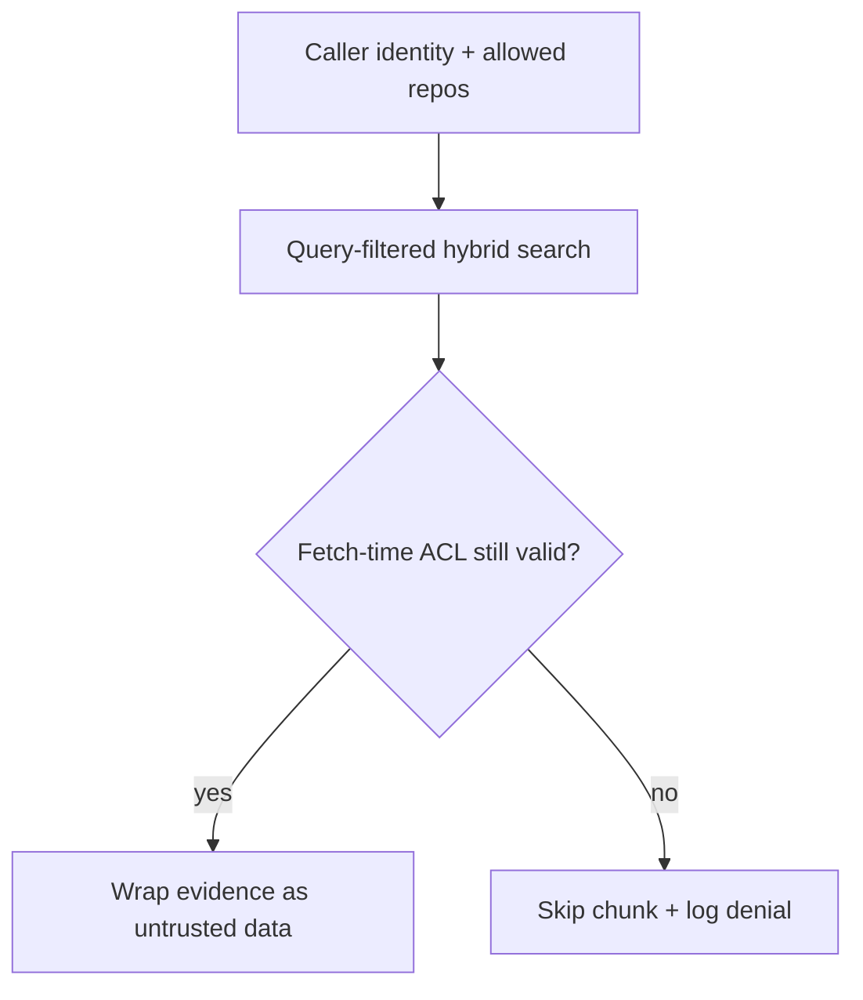

---
{
  "id": "blog-context-engineering-beyond-prompt-engineering",
  "title": "Context Engineering: Beyond Prompting",
  "slug": "context-engineering-beyond-prompt-engineering",
  "author": {
    "name": "LeetLLM Team"
  },
  "publishedAt": "2026-03-16",
  "updatedAt": "2026-11-15",
  "verifiedAt": "2026-11-15",
  "refreshAfter": "2027-01-08",
  "excerpt": "Prompting shapes a single instruction; context engineering designs the prefix cache, retrieved code and documentation, compacted session state, ordering, and security isolation across every turn.",
  "tags": [
    "AI Engineering",
    "Context Engineering",
    "Agents"
  ],
  "coverImage": "illustrations/_generated/prompt_vs_context_dark.png",
  "featured": false,
  "draft": false,
  "private": true
}
---

A coding agent asked to migrate an inference worker from blocking HTTP calls to async streaming inspects only the worker file you opened and rewrites the handler cleanly, yet breaks batching throughput in production because the queue configuration and downstream connection pool live in two other modules. Writing "think carefully about concurrency" in the system prompt cannot surface files the model never received. Prompt engineering tunes instruction wording for one call; <span data-glossary="context-engineering">context engineering</span> designs the entire token working set across retrieval, tool schemas, session memory, ordering, and safety isolation so the model reasons from complete, current evidence.[^anthropic2025effectivecontext]

Anthropic frames context engineering around four continuous operations on a finite <span data-glossary="context-window">context window</span>: writing state outside the active prompt, selecting relevant evidence just in time, compressing completed steps without erasing critical constraints, and isolating untrusted inputs or sub-tasks into clean windows.[^anthropic2025effectivecontext] Every design decision ultimately reduces to two competing pressures: giving the model every fact required for the next step while pruning distraction so attention stays focused and prefix caches stay warm. Rather than hand-crafting brittle instruction phrasing once, the engineer operates a pipeline that constructs the model's working memory before every inference call.

<figure>
  
  <figcaption>Separate the immutable cacheable prefix from per-turn working context. System rules and tool definitions sit at byte zero for prefix reuse, while retrieval, compacted state, and active queries fill the remaining token budget.</figcaption>
</figure>

## Prefix layout turns packet order into latency and spend

In a multi-turn coding or RAG session, most bytes sent to the model repeat across consecutive requests because system rules, output formatting instructions, and JSON tool definitions rarely change mid-conversation. Modern serving stacks and APIs cache the KV tensors of matching token prefixes so later turns skip recomputing prefill attention over those early tokens.[^openai2026promptcaching] However, prefix caching operates on exact leading token matches. Inserting a live timestamp, shuffling tool schema order, or prepending dynamic retrieved snippets above the system prompt breaks the cache prefix at that byte and forces full recomputation from scratch, so structuring every inference packet from lowest-volatility tokens to highest-volatility tokens preserves hit rate across multi-turn traces:

| Layer position | Contents | Volatility | Operational role |
|---|---|---|---|
| Bytes 0 to $P$ | System prompt, rubric, and sorted tool schemas | Static across turns | Maximizes KV prefix-cache hit rate and cuts prefill latency |
| Early dynamic zone | Highest-relevance retrieved files or docs with source IDs | Changes by task | Places primary grounding evidence in high-attention primacy tokens |
| Middle session zone | Compacted prior turns, resolved diffs, and tool summaries | Appended per step | Tracks active paths, failing tests, and constraints without raw stack dumps |
| End recency zone | Active user turn and final formatting instructions | Per turn | Keeps the immediate question and output constraints at the recency edge |

Keep explicit slack reserved for generation tokens (`max_tokens` plus hidden reasoning tokens if enabled) so long retrieved snippets never truncate output mid-response. Pairing byte-zero stability with output headroom also eliminates mid-JSON cutoffs during tool invocations. Without explicit output reservation, a sudden surge in retrieved snippets quietly squeezes the completion window before schema validation even runs.

## Select evidence just in time instead of dumping repositories

Long context windows do not remove the need for selective retrieval. A naive agent that dumps 200,000 tokens of repository logs on every turn pays 25 times the input cost of an 8,000-token working set (for example, \$0.40 versus \$0.016 per turn at an uncached rate of \$2 per million input tokens), slows time-to-first-token via quadratic prefill attention, and injects irrelevant files that compete for attention weights.[^hong2025contextrot] Worse still, irrelevant stack traces and boilerplate modules dilute attention over the handful of lines that actually govern the bug fix. Even if a provider absorbs the raw token count without timing out, feeding unfiltered build logs into active history shifts prefix boundaries on every edit and prevents cross-turn cache reuse.

Just-in-time retrieval stores lightweight pointers such as file paths, line ranges, and query terms in working state, pulling full source text only when needed.[^anthropic2025effectivecontext] Combining lexical matching (BM25 or ripgrep over exact symbol names such as `kv_block_allocator`) with dense semantic search raises initial recall across both exact identifiers and conceptual docs. A second-stage <span data-glossary="reranker">reranker</span> then filters out near-misses before admitting chunks into the active <span data-glossary="token-budget">token budget</span>. Keeping pointers in state rather than full file bodies lets each step refetch the latest revision right before generating an edit.

## Compress transcripts without dropping file paths or open failures

Even selective agents accumulate bloat after ten rounds of stack traces, compiler output, and search hits. Compaction summarizes completed tool traces into structured notes stored outside the raw log, reclaiming tokens for active reasoning. Aggressive free-form summarization breaks agents when it silently drops file paths, exact error strings, version identifiers, or pending constraints, causing the model to re-run identical failing edits.[^anthropic2025effectivecontext] Testing every compaction template against three retention checks catches silent state loss before deployment:

1. **Preserve concrete anchors:** retain file paths, commit revisions, symbol names, and failing assertion lines verbatim.
2. **Supersede stale conclusions explicitly:** when a patch modifies `worker.py` at revision `r2`, mark earlier `r1` diagnosis notes inactive instead of keeping contradictory findings in active history.
3. **Separate measured observations from open targets:** record latency targets (`< 200 ms p95`) as requirements rather than achieved benchmark numbers until measured.

The script below implements a compact context-packet assembler with prefix preservation, budget fitting, token-cost estimation, and deterministic compaction retention. It tracks prefix share relative to total input size, compacts resolved versus unresolved prior turns differently, and interleaves selected evidence chunks toward both window edges:

<!-- leetllm: test output=show output_title="Context budget, prefix hit, and compaction check" -->
```python title="context_packet_builder.py"
def build_context_packet(
    prefix_blocks: list[tuple[str, int]],
    candidates: list[dict],
    prior_turns: list[dict],
    max_window: int = 16384,
    output_reserve: int = 2048,
) -> dict:
    """Assemble an edge-ordered prompt while protecting cached prefix and output slack."""
    budget = max_window - output_reserve
    prefix_tokens = sum(tok for _, tok in prefix_blocks)
    remaining = budget - prefix_tokens

    # Compact closed turns to crisp state anchors instead of retaining full logs.
    compacted = []
    for turn in prior_turns:
        if turn["resolved"]:
            compacted.append(f"[done {turn['file']}] {turn['decision']}")
        else:
            compacted.append(f"[open {turn['file']}] {turn['error']}")
    compacted_tokens = sum(len(note.split()) * 2 for note in compacted)
    remaining -= compacted_tokens

    # Greedily select highest-relevance evidence under remaining token budget.
    ranked = sorted(candidates, key=lambda c: c["score"], reverse=True)
    selected = []
    used_evidence = 0
    for chunk in ranked:
        if chunk["tokens"] <= remaining:
            selected.append(chunk)
            used_evidence += chunk["tokens"]
            remaining -= chunk["tokens"]

    # Place strongest evidence at start and end of evidence block to reduce middle dip.
    edge_ordered = selected[::2] + list(reversed(selected[1::2]))
    total_input = prefix_tokens + compacted_tokens + used_evidence
    return {
        "prefix_tokens": prefix_tokens,
        "prefix_cache_ratio": prefix_tokens / total_input,
        "selected_ids": [c["id"] for c in edge_ordered],
        "compacted_notes": compacted,
        "total_input_tokens": total_input,
        "slack_tokens": remaining,
    }


prefix = [("system_rules", 650), ("tool_schemas", 1550)]
candidates = [
    {"id": "worker.py:async_loop", "score": 0.94, "tokens": 2400},
    {"id": "pool_config.yaml", "score": 0.89, "tokens": 900},
    {"id": "batcher.py:flush", "score": 0.86, "tokens": 2100},
    {"id": "legacy_docs.md", "score": 0.31, "tokens": 7500},
    {"id": "test_worker.py", "score": 0.82, "tokens": 1800},
]
turns = [
    {"file": "metrics.py", "resolved": True, "decision": "Fixed counter label", "error": ""},
    {"file": "worker.py", "resolved": False, "decision": "", "error": "Timeout after 5s on 64-req batch"},
]

packet = build_context_packet(prefix, candidates, turns)
assert "legacy_docs.md" not in packet["selected_ids"]
assert any("[open worker.py]" in n for n in packet["compacted_notes"])
assert packet["total_input_tokens"] + 2048 <= 16384
print(f"Input tokens: {packet['total_input_tokens']} / 14336 usable ({packet['slack_tokens']} slack)")
print(f"Cacheable prefix share: {packet['prefix_cache_ratio']:.1%}")
print("Edge-ordered chunks:", packet["selected_ids"])
print("Compacted state:", packet["compacted_notes"])
```

<!-- leetllm: output:start -->
```text title="Context budget, prefix hit, and compaction check" output compact
Input tokens: 9426 / 14336 usable (4910 slack)
Cacheable prefix share: 23.3%
Edge-ordered chunks: ['worker.py:async_loop', 'batcher.py:flush', 'test_worker.py', 'pool_config.yaml']
Compacted state: ['[done metrics.py] Fixed counter label', '[open worker.py] Timeout after 5s on 64-req batch']
```
<!-- leetllm: output:end -->

Notice two mechanisms working together in the output. Dropping `legacy_docs.md` saves 7,500 tokens of distracting noise while preserving 4,910 tokens of unused headroom inside the usable budget. Interleaving the remaining chunks then places the highest-scoring file (`worker.py:async_loop`, 0.94) and second-highest dependency (`pool_config.yaml`, 0.89) near opposite window edges instead of burying critical configuration mid-window.

## Why placement creates U-shaped recall sensitivity

Even when retrieved evidence fits cleanly inside the token limit, models do not weight every token position identically. In multi-document question-answering and key-value retrieval experiments, Liu and colleagues (*Lost in the Middle*, TACL 2024) varied the position of the ground-truth document across 10, 20, and 30 retrieved passages.[^liu2023lost] Across tested models, task accuracy followed a distinct U-shaped profile: high when relevant evidence sat near the very beginning (primacy) or very end (recency) of the prompt, and significantly lower when buried near the midpoint.

<figure>
  
  <figcaption>The qualitative U-shaped pattern across long multi-document prompts: models retrieve facts reliably from primacy and recency positions while accuracy drops sharply in the middle band. Measure exact position sensitivity on your own model and prompt length.</figcaption>
</figure>

Chroma's context-rot study across 18 models reached a complementary finding: accuracy degrades unevenly as input length increases even on single-hop reasoning tasks when distracting text surrounds the answer.[^hong2025contextrot] Because exact degradation slopes depend on model architecture, RoPE scaling, and task structure, benchmark placement explicitly on your target prompt length. Hold total document count and wording fixed while rotating the decisive snippet from position 1 to midpoint to end, then measure distraction sensitivity separately by adding unrelated files.

## Isolate permissions and untrusted inputs outside the prompt

Context assembly also enforces security and multi-tenant privacy. Never filter document access only right before serializing the prompt string; if an unauthorized file enters vector ranking, its snippets or IDs can leak into trace logs, reranker caches, or side-channel metadata. Apply identity and repository permissions as query-time filters inside the search index, and re-verify permissions when reading source files because access can be revoked between indexing and inference.



Even authorized documents, web pages, and issue comments can contain <span data-glossary="prompt-injection">indirect prompt injection</span> strings instructing the agent to run unauthorized shell commands or exfiltrate secrets.[^greshake2023] Delimit retrieved excerpts clearly as untrusted evidence inside system framing, yet never rely on XML tags or markdown fences as your sole defense. Enforce tool authorization in application code: require explicit user confirmation or strict read-only tool scopes regardless of what retrieved text commands.

## Evaluate context precision, faithfulness, and behavior separately

Final answer accuracy alone hides where a context pipeline failed, because strong generator priors can mask stale retrieval on common questions. The RAGAS framework separates retrieval quality (context precision and context recall), generator grounding (faithfulness to retrieved chunks), and end-answer relevance.[^es2023] Adding two systems checks on top of those metrics isolates whether improvements come from better evidence packing or merely lucky wording:

| Evaluation slice | Question it answers | Required baseline check |
|---|---|---|
| Retrieval recall & precision | Did the required files enter the selected packet without drowning in distractors? | Log retrieved IDs and rank order against labeled gold files |
| Abstention on missing facts | When critical context is withheld, does the model ask or abstain rather than guess? | Evaluate paired queries with key evidence stripped out |
| Injection resistance | Do hostile instructions inside retrieved files trigger forbidden tool calls? | Assert deterministic zero execution of unauthorized tools |
| Prefix cache & latency impact | Did edge reordering preserve byte-zero stability across multi-turn traces? | Track cached input token share alongside end-to-end latency |

Hold the model and prompt wording fixed while testing one context change at a time across paired positive, missing-evidence, and distractor-heavy examples. Reducing token count is only an improvement when faithfulness and task success stay intact, and adding a caching rule only pays off when actual p95 latency drops across replay traces. Once your evaluation suite tracks those four slices together, continue with [Context Management for Long-Running Agents](/learn/long-context-engineering-beyond-management) to apply state compaction across multi-step tool loops, and [Designing a Production RAG Pipeline](/learn/design-production-rag-pipeline) to build permissioned hybrid search and abstention checks end to end.
