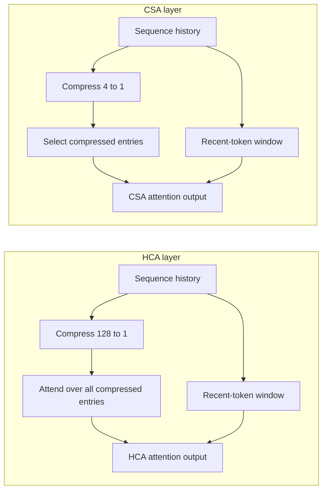

---
{
  "id": "blog-deepseek-v4-us-ai-labs",
  "title": "DeepSeek V4: Facts, Claims, and Fit",
  "slug": "deepseek-v4-us-ai-labs",
  "author": { "name": "LeetLLM Team" },
  "publishedAt": "2026-04-27",
  "updatedAt": "2026-11-23",
  "verifiedAt": "2026-11-23",
  "refreshAfter": "2026-12-23",
  "excerpt": "Read DeepSeek V4's checkpoints and benchmark conditions, then account for the V4.1 Flash API replacement before comparing deployment costs.",
  "tags": ["DeepSeek", "Open Models", "AI Infrastructure", "Agentic Coding", "Industry"],
  "featured": false,
  "draft": false,
  "coverImage": "social_banner.png"
}
---

Your evaluation log says `deepseek-v4-pro`. The architecture report says 1.6 trillion parameters. Hugging Face displays 1.7 trillion. An older run used the same API name for a different release. None of those facts necessarily contradicts the others. They describe different parts of the system you tested.

DeepSeek V4 is a useful case study in reading a model release without turning its strongest number into a deployment recommendation. The checkpoints, long-context architecture, and hosted prices are concrete. Whether they improve your coding assistant depends on what survives a comparison with the same tasks, tools, and budgets.

**Scope and date:** V4 Flash 0731 and Pro 0813 checkpoints, with hosted-service changes checked on November 23, 2026. Since October 17, `deepseek-flash` and the legacy `deepseek-v4-flash` name serve V4.1 Flash 1017. On November 13, DeepSeek also opened its application APIs (web search, URL reading, file input, safety checks, and standalone Search/Fetch, OCR, ASR, and TTS endpoints). The architecture and benchmark sections below describe the older V4 checkpoints; the billing example uses today's hosted models.[^deepseek2026v4flash0731release]

## One API name, several releases

V4 Preview arrived on April 24. Flash received new post-training on July 31, while Pro reached general availability on August 13. The hosted names stayed the same through those upgrades.[^deepseek2026v4release][^deepseek2026v4flash0731release][^deepseek2026v4pro0813release]

| Release | What changed | Artifact to distinguish |
|---|---|---|
| April 24: V4 Preview | Pro and Flash introduced | Original preview checkpoints and report |
| July 31: Flash 0731 | Flash post-training updated; Pro API unchanged at that point | `DeepSeek-V4-Flash-0731` |
| August 13: Pro 0813 | Pro GA rolled out to app, web, and API | `DeepSeek-V4-Pro-0813` |
| September 10: V4.1 Flash | V4 Flash and Flash Vision Exp APIs retired; their names temporarily route to V4.1 Flash | `deepseek-flash` is the recommended hosted ID |
| October 17: V4.1 Flash 1017 | Hosted Flash updated again; calling method and prices unchanged | `DeepSeek-V4.1-Flash-1017` is the documented backend |
| November 13: Application APIs | Built-in web search, URL reading, file input, and safety checks enabled on `deepseek-flash`; standalone Search/Fetch, OCR, ASR, and TTS endpoints opened | Application tool flags and standalone endpoints |

The current pricing page maps `deepseek-flash` to V4.1 Flash 1017 and `deepseek-v4-pro` to Pro 0813. It accepts `deepseek-v4-flash` and `deepseek-v4-flash-vision-exp` as compatibility names for Flash 1017, billed at the Flash rate.[^deepseek2026pricing] Under this mapping, a run with the legacy Flash string measures Flash 1017. Use dated results or response metadata to identify any earlier Flash 0731 run. Record the documented mapping and evaluation date.

DeepSeek initially planned to end V4 Pro API service on September 14, but its September 10 changelog says Pro will continue with unchanged billing until further notice.[^deepseek2026v4flash0731release] Check the service lifecycle before planning a migration around an older announcement.

For an open checkpoint, record the repository revision, file hashes, tokenizer/encoding implementation, and serving configuration. You can freeze those artifacts, unlike a mutable hosted alias, but they still don't reproduce the hosted service's entire runtime. Freezing the checkpoint doesn't settle the parameter count. Why does the report say 1.6 trillion parameters when the Hub lists 1.7 trillion?

## Why the parameter counts differ

The report describes two <span data-glossary="mixture-of-experts">mixture-of-experts</span> models: Flash has 284B total parameters with 13B active per token; Pro has 1.6T total with 49B active.[^deepseek2026v4paper] An MoE activates only some expert networks for each token. Active parameters help explain compute, while the full weight pool still requires storage and a residency or offloading plan. Neither count alone predicts latency. [Mixture of Experts Architecture](/learn/mixture-of-experts-architecture) explains the routing and communication costs.

The newer checkpoint packages also include **DSpark**, a <span data-glossary="speculative-decoding">speculative-decoding</span> module. It proposes tokens for the target model to verify. DeepSeek's DSpark card describes an attached draft path, and the dated Flash and Pro cards identify that module in their packages.[^deepseek2026dspark][^deepseek2026v4flash0731][^deepseek2026v4pro0813]

| Model | Published target architecture | Hub package listing, November 23 |
|---|---|---|
| Flash 0731 | 284B total / 13B active | 304B parameters; package includes DSpark |
| Pro 0813 | 1.6T total / 49B active | 1.7T parameters; package includes DSpark |

The July changelog explicitly says Flash 0731 retains the preview architecture and size. The Pro 0813 card likewise says it retains the preview Pro structure with DSpark attached.[^deepseek2026v4flash0731release][^deepseek2026v4pro0813] The Hub badges count a different artifact than the target-architecture figures. Don't subtract rounded badges to infer an exact draft-module size, or interpret the larger badge as evidence that the target became wider.

This distinction also affects measurement. Speculation adds draft work and verification overhead. Its speedup depends on acceptance and the serving workload. [Speculative Decoding](/learn/speculative-decoding) explains how accepted drafts can make a larger packaged checkpoint generate faster. Measure speed on the target serving workload. How does a million-token window avoid storing every past key and value?

## What makes the long-context design different

The preview models support a reported one-million-token <span data-glossary="context-window">context window</span>. Their attention layers combine two ways to reduce the number of <span data-glossary="kv-cache">key-value cache</span> entries used for long-range context:

- **Compressed Sparse Attention (CSA):** compress the sequence, then select a subset of compressed entries for each query.
- **Heavily Compressed Attention (HCA):** compress more aggressively, then attend densely over that smaller representation.

The report uses a fourfold sequence compression rate for CSA and 128-fold for HCA, with an additional sliding-window path for recent local detail. After the first two layers, CSA and HCA layer types alternate through the stack. Flash starts with two pure sliding-window layers; Pro starts with two HCA layers.[^deepseek2026v4paper] These compression rates describe V4. V4.1 Flash uses a separate open-weight Causal Encoder-Decoder architecture (CSA2 with FP4 KV caching), so verify V4.1 separately even when a legacy API name still works.[^deepseek2026v41flash]

The diagram separates the two layer types. Each has its own compressed long-range path and a recent-token path; later layers alternate the long-range mechanism.



DeepSeek's estimated costs at 1M context are plotted below. FLOPs are single-token inference work expressed in equivalent FP8 operations; KV cache is accumulated cache size. Measure request latency with a serving benchmark.[^deepseek2026v4paper]

<figure>
  
  <figcaption>Vendor architecture estimates at 1M context. Each panel uses its own V3.2 quantity as the 100% baseline; serving performance needs an independent benchmark.</figcaption>
</figure>

The baseline is DeepSeek-V3.2, which already uses sparse attention. The reductions combine compression, sparsity, precision choices, and different model configurations, so interpret them as joint architecture estimates.

A small cache says little about whether a model can retrieve a buried identifier or reconcile two distant specification clauses. Test those cases at your actual input lengths. Measure <span data-glossary="prefill">prefill</span>, decode, memory, and end-to-end latency separately. [KV Cache and PagedAttention](/learn/kv-cache-paged-attention-llm-serving) separates cache capacity from allocation and scheduling. Evaluate model quality using the model card's harness, sampling settings, and date before making a choice.

## Read benchmark rows with their conditions attached

The Pro 0813 card reports these selected results. DeepSeek published the measurements; we haven't independently reproduced them.[^deepseek2026v4pro0813]

| Benchmark | Pro preview | Flash 0731 | Pro 0813 |
|---|---:|---:|---:|
| Terminal-Bench 2.1 | 72.1 | 82.7 | 87.9 |
| NL2Repo | 38.5 | 54.2 | 61.5 |
| DeepSWE | 12.8 | 54.4 | 62.7 |
| Toolathlon-Verified | 55.9 | 70.3 | 74.1 |

The public code-agent evaluation notes specify DeepSeek Harness minimal mode, `max` reasoning effort, `temperature=1.0`, and `top_p=0.95`. The cards also include two internal DSBench datasets, which outside readers can't fully inspect.[^deepseek2026v4flash0731][^deepseek2026v4pro0813]

One subtle reproducibility problem: DeepSeek's **hosted thinking-mode API ignores caller-provided `temperature`**. Its current `top_p` behavior also differs by model:[^deepseek2026thinking]

- **Flash:** thinking mode accepts 0.95 to 1.0, clamping lower values to 0.95. Non-thinking mode fixes it at 1.0.
- **Pro:** thinking mode ignores your value. It uses 0.95 with tool calling enabled and 1.0 otherwise. Setting `tool_choice` to `none` disables tool calling even when `tools` is present. Non-thinking mode uses the caller's value.

Reproduce a benchmark by pinning its checkpoint, harness, and sampling implementation. Record the endpoint's effective settings alongside the JSON your client sends.

Under the vendor's reported setup, Pro 0813 scores above Flash 0731 on these four rows. Comparing cost per successful task, latency, or rank across providers requires comparable tasks, harnesses, retry limits, and acceptance criteria. These dated checkpoint results provide none of those measurements. Consult current billing documentation for hosted model prices and route names.

## Turn the rate card into a workload bill

Before you treat a higher score as a reason to pick a lane, price the hosted models those names point to now. As of November 23, `deepseek-flash` (V4.1 Flash 1017) and `deepseek-v4-pro` (Pro 0813) advertise 1M context, maximum output of 384K tokens, thinking and non-thinking modes, tool calls, JSON output, Responses API support, and an Anthropic-compatible interface. Flash supports vision and server-side application tools (web search, URL reading, file input, and safety checks). Pro doesn't.[^deepseek2026pricing][^deepseek2026v4flash0731release]

Those limits share one budget. The Chat Completions reference limits input plus generated tokens to the model's context length. Its 393,216-token output ceiling shares that context window. Reserve room for reasoning and the final answer before packing documents. A 1M-token input cannot also request 384K generated tokens.[^deepseek2026chatcompletion]

Peak/off-peak pricing took effect at 16:00 UTC on August 16.[^deepseek2026v4pro0813release] Peak hours are 01:00 to 04:00 and 06:00 to 10:00 UTC, Monday through Friday, excluding Chinese public holidays. Every other hour is off-peak. The rates below are USD per million tokens, checked November 23.[^deepseek2026pricing]

| Model | Billing period | Cache-hit input | Cache-miss input | Output |
|---|---|---:|---:|---:|
| V4.1 Flash | Off-peak | \$0.003 | \$0.15 | \$0.60 |
| V4.1 Flash | Peak | \$0.006 | \$0.30 | \$1.20 |
| Pro | Off-peak | \$0.022 | \$0.66 | \$1.98 |
| Pro | Peak | \$0.044 | \$1.32 | \$3.96 |

For a **batch of requests totaling** 2M input tokens and 0.5M output tokens, cold-cache off-peak charges are \$0.60 for V4.1 Flash and \$2.31 for Pro. It assumes every token uses the indicated billing period and excludes tools, retries not already counted, and human review. These prices compare today's hosted lanes; the benchmark table covers two V4 checkpoints.

The calculator uses token counts and avoids guessing a request-level cache-hit rate. A 70% input-token hit share means 1.4M cached input tokens and 0.6M uncached ones. Split a mixed peak/off-peak workload into separate usage buckets before summing. The September 23 example below still matches the November 23 rate card.

<!-- leetllm: test, output=show, output_title="Aggregate token charges at the September 23 rate card" -->
```python title="calculate_workload_cost.py"
from dataclasses import dataclass
from decimal import Decimal


@dataclass(frozen=True)
class HostedModelRate:
    name: str
    cache_hit_per_m: Decimal
    cache_miss_per_m: Decimal
    output_per_m: Decimal

    def workload_cost(
        self,
        cache_hit_tokens: int,
        cache_miss_tokens: int,
        output_tokens: int,
    ) -> Decimal:
        counts = (cache_hit_tokens, cache_miss_tokens, output_tokens)
        if any(count < 0 for count in counts):
            raise ValueError("token counts must be nonnegative integers")
        return (
            cache_hit_tokens * self.cache_hit_per_m
            + cache_miss_tokens * self.cache_miss_per_m
            + output_tokens * self.output_per_m
        ) / Decimal(1_000_000)


# Strings preserve the published decimal rates exactly.
rates = [
    HostedModelRate("v4.1-flash-offpeak", Decimal("0.003"), Decimal("0.15"), Decimal("0.60")),
    HostedModelRate("v4.1-flash-peak", Decimal("0.006"), Decimal("0.30"), Decimal("1.20")),
    HostedModelRate("pro-offpeak", Decimal("0.022"), Decimal("0.66"), Decimal("1.98")),
    HostedModelRate("pro-peak", Decimal("0.044"), Decimal("1.32"), Decimal("3.96")),
]
for rate in rates:
    cold = rate.workload_cost(0, 2_000_000, 500_000)
    warm = rate.workload_cost(1_400_000, 600_000, 500_000)
    print(f"{rate.name}: cold=${cold:.4f}, warm(70% input hit)=${warm:.4f}")
```

<!-- leetllm: output:start -->
```text title="Aggregate token charges at the September 23 rate card" output compact
v4.1-flash-offpeak: cold=$0.6000, warm(70% input hit)=$0.3942
v4.1-flash-peak: cold=$1.2000, warm(70% input hit)=$0.7884
pro-offpeak: cold=$2.3100, warm(70% input hit)=$1.4168
pro-peak: cold=$4.6200, warm(70% input hit)=$2.8336
```
<!-- leetllm: output:end -->

These calculations apply the stated token buckets. Check provider usage after each run to observe invoice rounding and cache behavior. A lower token bill can still accompany more failed tasks or more review work. The bill also assumes the endpoint ran the settings you sent. Thinking mode, tool state, and concurrency limits can change the call while the rate card stays the same.

## Compatibility doesn't remove operational differences

The current docs enable thinking by default at `high` effort. `minimal` and `low` map to `low`; `medium`, `high`, and `xhigh` map to `high`; `max` and `ultra` map to `max`.[^deepseek2026thinking] Include the effective effort in your experiment record and latency budget.

For Chat Completions requests carrying `tools`, preserve the assistant's `reasoning_content` across subsequent turns, including turns without a tool call. The guide says omitting it causes HTTP 400. Without `tools`, prior reasoning content is ignored.[^deepseek2026thinking] A compatible request format doesn't eliminate this conversation-state requirement.

Account-level concurrency limits are 2,500 for Flash and 500 for Pro, with expansion available by request. A request counts until its response completes, and excess concurrency returns HTTP 429. Multiple API keys under one account don't create independent quotas.[^deepseek2026ratelimit] These limits bound in-flight requests. They leave token throughput unspecified, and a long reasoning request occupies a slot much longer than a short classification.

DeepSeek also documents `user_id` for content-safety, KV-cache, and scheduling isolation. Regular accounts still pool all user IDs under the account quota. Expanded accounts additionally enforce a per-user limit.[^deepseek2026ratelimit] Derive that opaque ID from the authenticated tenant on your server. Letting a client choose another tenant's ID would defeat your intended isolation, and the provider field doesn't replace your application's authorization checks.

The April release note scheduled `deepseek-chat` and `deepseek-reasoner` for retirement after July 24 at 15:59 UTC.[^deepseek2026v4release] Use `deepseek-flash` or `deepseek-v4-pro` for new hosted configuration. We haven't made authenticated calls to test the retired aliases or measured live availability here.

Self-hosting changes different responsibilities. Both dated checkpoint cards specify MIT licensing and provide vLLM/SGLang recipes that load the target and DSpark from the same checkpoint.[^deepseek2026v4flash0731][^deepseek2026v4pro0813] They also use custom message encoding. A serving migration must validate that encoding and output parsing alongside checkpoint loading.

Record the checkpoint revision, runtime version, <span data-glossary="quantization">quantization</span>, DSpark setting, GPU topology, and tested context length. Measure hosted equivalence and cluster capacity separately. Decide which data a provider may receive before sending evaluation traffic. Self-hosting still needs its own access, logging, and retention controls. Use a small pilot with acceptance evidence to learn which of your tasks the model finishes.

## A pilot that can change your decision

Use tasks whose success you can inspect. For a repository assistant, a small starting pack might contain these cases:

| Task | Acceptance evidence | Failure to watch |
|---|---|---|
| Locate a configuration owner | Correct file and symbol at a frozen commit | Plausible but nonexistent path |
| Fix a parser edge case | Held-out regression and existing tests pass | Patch special-cases the visible test |
| Explain conflicting rules | Both source IDs and the applicable version | Newer rule omitted from a long context |
| Handle a failed tool call | Capped recovery without duplicate writes | Retry loop or repeated side effect |

Use this starter evaluation pack to build a representative benchmark from real failures. Compare Flash, Pro, and the incumbent with equivalent permissions and acceptance tests, recording every attempt's tokens, tool costs, latency, and outcome. Give each model its supported prompt and message encoding format while keeping the task and resource budget comparable.

Keep enough identity in each result to notice a service change. For example, these two runs have the same requested model string but belong in separate evaluation groups:

| Recorded field | July hosted run | October hosted run |
|---|---|---|
| Requested ID | `deepseek-v4-flash` | `deepseek-v4-flash` |
| Provider-documented release at run time | Flash 0731 | V4.1 Flash |
| Artifact mode | Mutable hosted service | Mutable hosted service |
| Evidence to retain | Dated mapping, task and harness revisions, usage | Dated mapping, task and harness revisions, usage |

Use the provider's dated changelog to identify the release mapping; a requested string alone cannot identify a hosted version.[^deepseek2026v4flash0731release] Keep outcomes separate because the hosted release can change during the experiment. If the response omits an immutable backend version, record that limit. For self-hosted runs, add checkpoint hashes and serving configuration when comparing with hosted behavior.

If Flash succeeds on source lookup but fails the parser case, you've learned something more useful than "cheap models handle easy tasks." You have a candidate task-specific routing rule and a failure set for the next experiment. Confirm it on held-out cases before a scoped canary, and keep a rollback route that respects the same data rules.

[LLM Cost Engineering](/learn/llm-cost-engineering-token-economics) develops the usage ledger. [Model Gateways, Routing, and Fallbacks](/learn/llm-cost-engineering-token-economics) covers enforcing those routing rules.

DeepSeek's releases give teams specific alternatives to measure. They do not show that US labs are being displaced, or that one provider is the right destination for every high-risk task. A deployment decision needs the dated artifact, effective runtime settings, and accepted work per dollar. The launch narrative cannot provide those final measurements.
