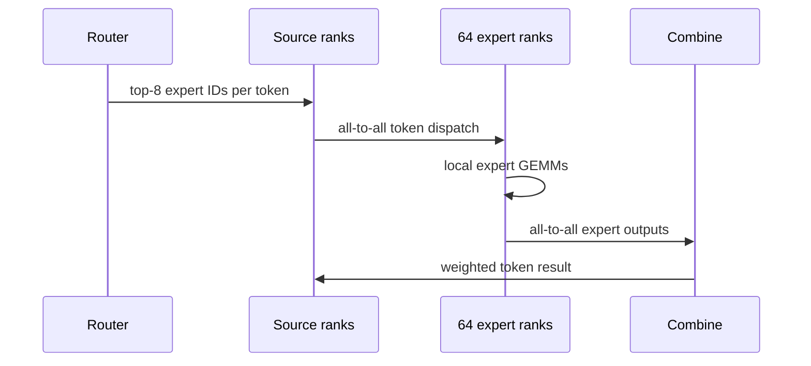
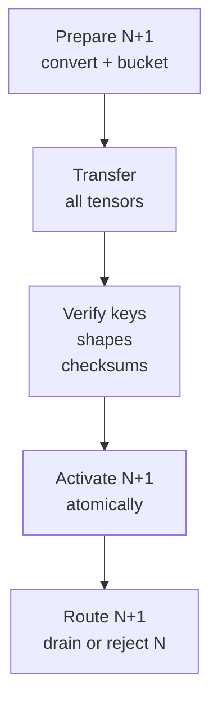
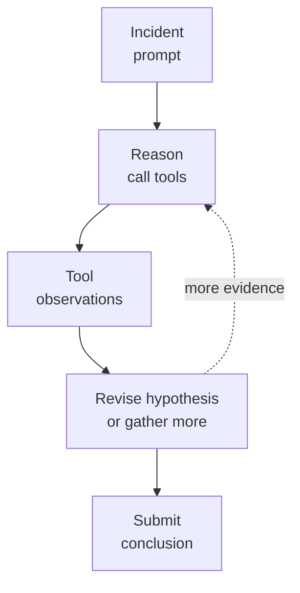
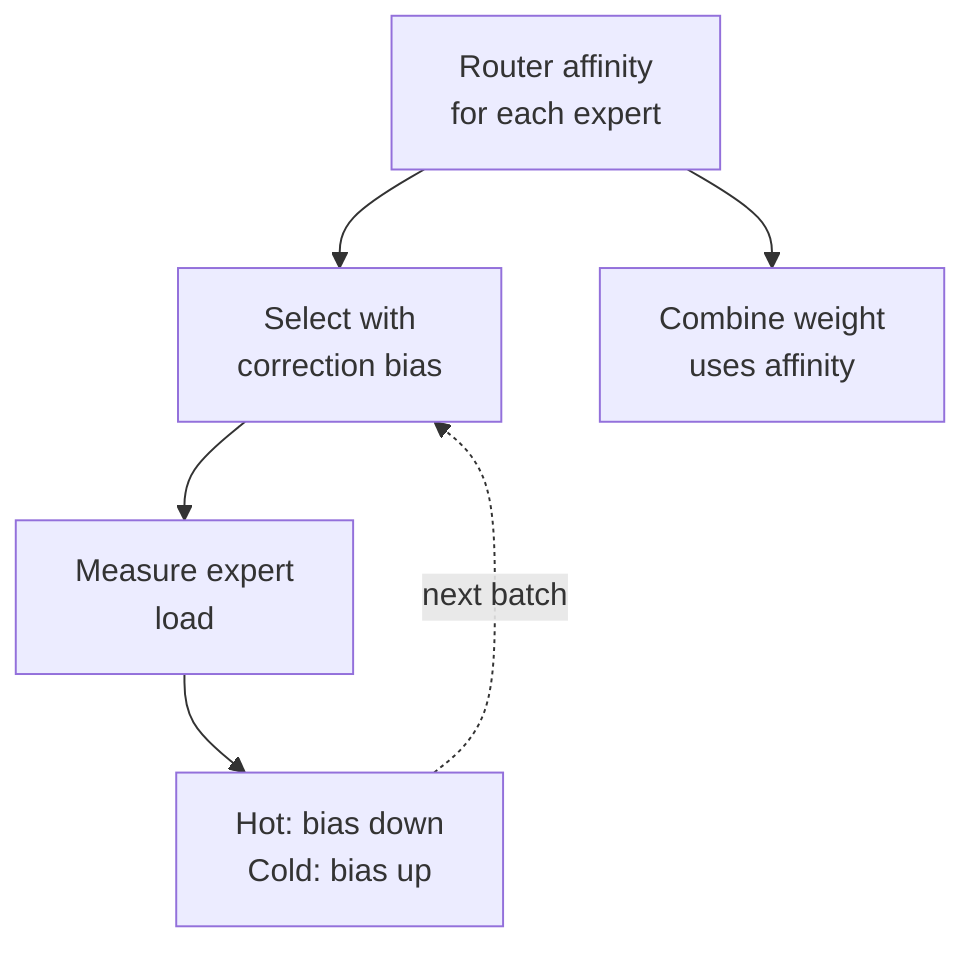
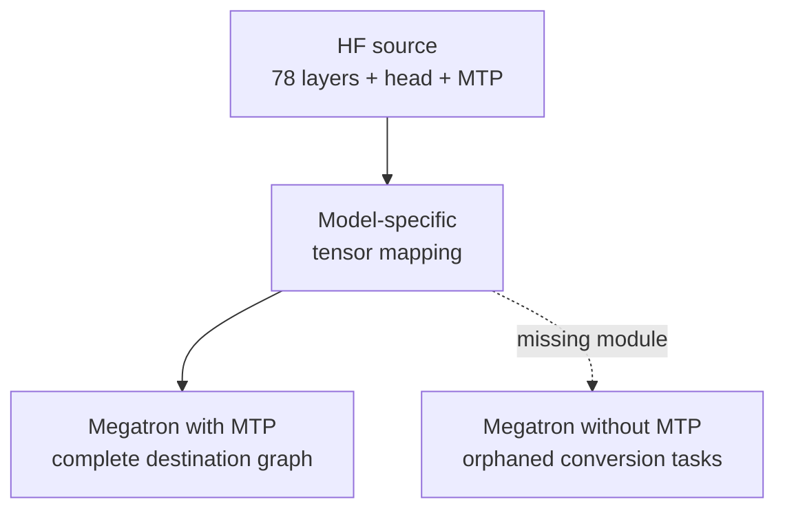
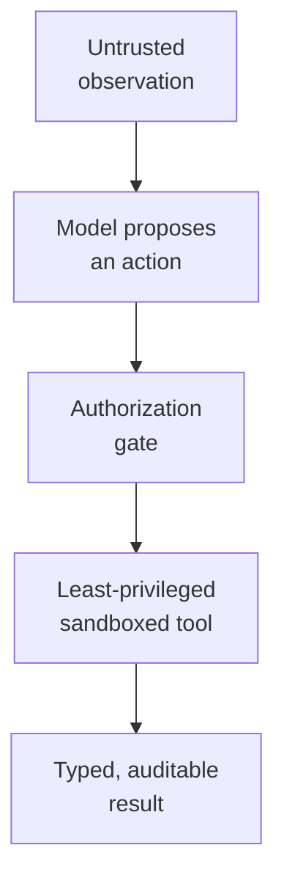

---
{
  "id": "blog-glm-53-training-masterclass-3c1efdc30f7c0d3341d5",
  "title": "GLM-5.3 Training Masterclass",
  "slug": "glm-53-training-masterclass-3c1efdc30f7c0d3341d5",
  "aliases": ["glm-52-training-masterclass-3c1efdc30f7c0d3341d5"],
  "author": {
    "name": "LeetLLM Team"
  },
  "publishedAt": "2026-08-08",
  "updatedAt": "2026-11-15",
  "verifiedAt": "2026-11-15",
  "refreshAfter": "2026-12-15",
  "excerpt": "Follow one serving-latency investigation through GLM-5.3 post-training: what changed since 5.2, BF16 and FP8 artifacts, chat templates, GRPO, and the SkyRL/vLLM/Megatron training loop.",
  "tags": [
    "AI Infrastructure",
    "Architecture",
    "MoE",
    "Training",
    "vLLM",
    "System Design"
  ],
  "featured": false,
  "draft": false,
  "private": true
}
---
An API p99 alert crosses 800 ms. Of eight investigation attempts, one traces the cause to database network throttling, and the others reach weaker conclusions. Before that best answer becomes training data, we have to ask whether its policy action survived tokenization, serving, reward scoring, replay, and the learner. This chapter follows one policy token, $t^*$, from a tool call to a gradient and back into a refreshed rollout engine, asking at every handoff what record crosses and what evidence shows it arrived unchanged.

The model makes this unforgiving. <span data-glossary="glm-53">GLM-5.3</span>'s released <span data-glossary="bf16">Brain Floating Point 16 (BF16)</span> checkpoint stores about 753B parameters, with roughly 40B active per token.[^zai2026glm53bf16][^glm52026] Five systems can look healthy while the run is wrong: the environment, the <span data-glossary="rl-rollout">rollout servers</span>, the reward service, the RL controller, and the Megatron learner, with the checkpoint bridge as a sixth handoff. A <span data-glossary="chat-template">chat-template</span> mismatch, stale weights, or a trainable prompt mask can poison the update without a red dashboard. We trace a **candidate GLM-5.3 configuration** whose SkyRL, vLLM, and Megatron settings were written for GLM-5.2, so "this run" needs migration checks before launch and contains no GLM-5.3 GPU training, conversion, or weight-refresh results. Z.AI's published post-training stack differs from it.[^zai2026glm52hfblog][^slime2025repo] You should be comfortable with a [PyTorch training loop](/learn/pytorch-training-loops), the [causal Transformer](/learn/transformer-architecture-end-to-end), and [conditional probability](/learn/probability-for-machine-learning). The marked Python examples run on CPU, while the distributed launch exercises need their stated NVIDIA hardware.

<span id="contents"></span>

## Table of contents · route map

Architecture numbers come from released configuration, weight indexes, and technical reports; run-specific numbers come from the flattened settings that ship with this job. A config value is only what the job requested, and startup logs, comparison results, or a profiler trace show what actually ran.

The chapter moves through five stages. **Record** captures what policy saw, said, and chose (IDs, template hash, masks, trajectory ID). **Update** decides which actions earned credit through group rewards, advantages, and masked loss. **Run** confirms learner and serving execute one graph, with fixed-token parity and versioned refresh. **Improve** checks that reward moves for the intended reason, and **Recover** keeps phase metrics and a rollback checkpoint for drift.

Read [Part I](/blog/glm-53-training-masterclass-3c1efdc30f7c0d3341d5#part-i), [trajectory processing](/blog/glm-53-training-masterclass-3c1efdc30f7c0d3341d5#trajectory-processing), [GRPO](/blog/glm-53-training-masterclass-3c1efdc30f7c0d3341d5#grpo), and [run lifecycle](/blog/glm-53-training-masterclass-3c1efdc30f7c0d3341d5#run-lifecycle) in order. Use [Parts II-IV](/blog/glm-53-training-masterclass-3c1efdc30f7c0d3341d5#part-ii) for kernel depth and [Part VII](/blog/glm-53-training-masterclass-3c1efdc30f7c0d3341d5#part-vii) for stack disagreements.

<span id="part-i"></span>

## Part I · Foundations

When does an investigation become a trustworthy training example? One policy token has to reach a gradient, and its record has to show which evidence that gradient may use, before the GPU details begin.

<span id="training-boundary"></span>

## What "training GLM-5.3" means here

The candidate job requests **full-parameter <span data-glossary="reinforcement-learning">reinforcement-learning</span> post-training** from `zai-org/GLM-5.3-BF16` rather than training a small adapter. The checkpoint already has language and tool-use skills plus a <span data-glossary="multi-token-prediction">multi-token prediction (MTP)</span> module. The update should make useful incident investigations more likely than weaker same-task attempts. Z.AI attributes GLM-5.3's gains to post-training on the same base model as GLM-5.2.[^zai2026glm53] The architecture lessons below therefore carry over, while the released policies and prompt formats do not.

### What changed from GLM-5.2?

| Area | GLM-5.2 to GLM-5.3 | Consequence |
|---|---|---|
| Decoder geometry | Same architecture values in the compared BF16 configs; Transformers version 5.12.0 to 5.15.0 | Reuse dimension arithmetic, rerun conversion and numerical checks |
| Weight packaging | Unsuffixed 5.3 repository is FP8; BF16 is now `GLM-5.3-BF16` | Use BF16 for learner intake; quantized serving is a separate artifact |
| Conversation format | New `low` <span data-glossary="reasoning-effort">reasoning effort</span>, always-on thinking, changed reasoning retention and tool-result ordering | Pin tokenizer vocabulary, template, and its arguments |
| Long context | Configured position limit remains 1,048,576 | Keep the 100,000-token budget until longer trajectories are validated |
| License | Custom GLM-5.3 terms replace MIT | Review the terms before training or commercial use |

The comparison uses GLM-5.2 revision `cf457fa734ab149ffef225f80893eb38c6ff5cdc` and GLM-5.3-BF16 revision `304b8051cfb2b260b61ce0cbe330e02a98e73639`. Their indexes contain the same 59,585 tensor keys. That confirms names and configuration but **not equal weight values**, since the payloads were not compared.[^zai2026glm52migrationartifact][^zai2026glm53config][^zai2026glm53weights][^zai2026glm53fp8config][^zai2026glm53license] This chapter targets **GLM-5.3, not GLM-5.3-Flash**. Flash uses the distinct `glm5_next` multimodal architecture rather than this `glm_moe_dsa` text model.[^zai2026glm53flash][^zai2026glm53config] Shared geometry does not justify resuming a GLM-5.2 optimizer or comparing a 5.3 learner against cached 5.2 behavior probabilities, so start a new experiment lineage.

### What full-parameter post-training updates

Full-parameter does not mean every stored number receives a gradient on every step. Unselected experts may receive no task gradient, the DSA indexer can be frozen (the GLM-5 family report freezes it by default during RL), and MTP must be explicitly built and trained, so record trainable groups, frozen modules, and unused checkpoint tensors.[^glm52026] This differs from pretraining and supervised fine-tuning, which imitate target tokens, and from serving, which updates nothing: RL raises rewarded actions relative to weaker same-task actions.

The starting artifact is a Hugging Face-style checkpoint with configuration, tokenizer, chat template, and weight shards. <span data-glossary="megatron-bridge">Megatron Bridge</span> or a custom provider turns it into the learner's distributed form, <span data-glossary="vllm">vLLM</span> loads a serving form, and <span data-glossary="skyrl">SkyRL</span> moves rollouts and updates between them. These are three physical representations of one logical policy, so conversion has to keep every tensor, tokenizer rule, and execution-relevant configuration field, not merely produce a loadable folder.

<div data-callout="info" data-callout-title="This job's stack vs Z.AI's published post-training stack">
  <p>This job uses SkyRL + vLLM + Megatron for GRPO. Z.AI describes slime-based post-training and parallel <span data-glossary="on-policy-distillation">on-policy distillation (OPD)</span>, with SGLang in the slime ecosystem. Its GLM-5.2 long-horizon recipe uses a critic-based PPO objective for individual <span data-glossary="context-compaction">compacted rollouts</span>, while this article groups eight siblings for GRPO.[^slime2025repo][^zai2026glm52hfblog] Compare objectives and grouping from source code, and preserve tokens, masks, versions, reward identity, and checkpoint coverage. See [Deep Dive - slime](/learn) for its source-level loop.[^slime2025blog]</p>
</div>

This run uses <span data-glossary="grpo">Group Relative Policy Optimization (GRPO)</span>, which compares several trajectories for the same task before deciding which sampled actions to reinforce. One investigation stays in view throughout. Trajectory A, one of eight stochastic rollouts for the latency alert, queries trace data, receives a tool observation, rules out unrelated components, and isolates database network throttling. One policy-generated token $t^*$ inside its trace-query tool call stays visible from vLLM sampling through sparse attention, MoE routing, reward scoring, GRPO loss, replay, and the Megatron update. Two selectors act on $t^*$ later: <span data-glossary="deepseek-sparse-attention">DeepSeek Sparse Attention (DSA)</span> chooses which earlier positions it can read, and <span data-glossary="mixture-of-experts">mixture-of-experts (MoE)</span> routing chooses its top-eight expert feed-forward networks.

<span id="token-to-gradient"></span>

## From one token to one gradient

The tokenizer turns text into integer <span data-glossary="token">token</span> IDs. An embedding lookup makes each ID a 6,144-dimensional vector, and layers mix it with context.[^vaswani2017][^zai2026glm53config] A linear projection then scores the vocabulary, and <span data-glossary="softmax">softmax</span> turns the <span data-glossary="logits">logits</span> into probabilities. Generation samples an ID and feeds it back. **Inference** produces tokens without an optimizer step, while **training** adds a loss, <span data-glossary="backpropagation">backpropagation</span>, and an <span data-glossary="optimizer">optimizer</span> update.

We sample $t^*$ during inference and replay it during training. In a causal language model, the logits at input position $t-1$ score the target token at position $t$, so logprobs, masks, and routing records must be aligned with those two positions kept distinct. Tool observations come from the environment, so their target tokens carry loss mask zero. That removes their direct prediction loss, not every gradient path through them, because later policy-token losses still depend on how the model encoded a tool result.

<figure>
  
  <figcaption>The green path adds a sampled token to context. The orange path updates parameters from a recorded target. Neither path scores a token using the hidden state that already contains that target.</figcaption>
</figure>

A **parameter** is one learned number. A <span data-glossary="gradient">gradient</span> says which tiny parameter movements would change the loss, and <span data-glossary="optimizer-state">optimizer state</span> such as Adam's moving averages turns those local suggestions into an update.[^kingma2015] In RL the model samples a full investigation, and the environment and judges assign a <span data-glossary="reward-function">reward</span>. GRPO turns that reward, relative to seven sibling investigations, into an <span data-glossary="advantage">advantage</span> that weights the update. A <span data-glossary="loss-mask">loss mask</span> keeps environment observations as context without making them actions to imitate, so the remaining policy tokens receive <span data-glossary="policy-gradient">policy-gradient</span> credit. Clipping and shared parameters mean one optimizer step need not move every action probability in the intended direction or improve an unseen state.[^shao2024]

<details>
<summary>Exercise 1 · Build a tiny policy-gradient learner in PyTorch</summary>

This is group-normalized REINFORCE, the small mathematical ancestor of GRPO. It shows sampled actions, rewards, log probabilities, advantages, gradients, and one optimizer update on CPU. Full GRPO later adds old-policy ratios, clipping, token masks, and rollout metadata.

<!-- leetllm: test deps=torch output=folded output_title="One policy update" -->
```python title="tiny-policy-gradient.py"
import torch
from torch import nn
from torch.distributions import Categorical

torch.manual_seed(7)

group_size = 128
policy = nn.Linear(1, 2)
with torch.no_grad():
    policy.weight.zero_()
    policy.bias.zero_()

optimizer = torch.optim.Adam(policy.parameters(), lr=0.1)
states = torch.ones(group_size, 1)

with torch.no_grad():
    probability_before = policy(torch.ones(1, 1)).softmax(-1)

distribution = Categorical(logits=policy(states))
actions = distribution.sample()
rewards = (actions == 0).float()
log_probabilities = distribution.log_prob(actions)

reward_std = rewards.std(unbiased=False)
assert reward_std > 0, "This sampled group has no reward contrast."
advantages = (rewards - rewards.mean()) / reward_std.clamp_min(1e-8)
loss = -(log_probabilities * advantages).mean()

optimizer.zero_grad(set_to_none=True)
loss.backward()
gradient_norm = torch.nn.utils.clip_grad_norm_(policy.parameters(), 1.0)
optimizer.step()

with torch.no_grad():
    probability_after = policy(torch.ones(1, 1)).softmax(-1)

# Normalize near-zero display values without changing the training tensors.
advantage_mean_for_display = advantages.mean().item()
if abs(advantage_mean_for_display) < 5e-7:
    advantage_mean_for_display = 0.0

print(f"loss={loss.item():.6f}")
print(f"gradient_norm={gradient_norm.item():.6f}")
print(f"advantage_mean={advantage_mean_for_display:.6f}")
print(f"advantage_std={advantages.std(unbiased=False).item():.6f}")
print(f"P(action 0): {probability_before[0, 0]:.4f} -> {probability_after[0, 0]:.4f}")

assert log_probabilities.requires_grad
assert probability_after[0, 0] > probability_before[0, 0]
```

<!-- leetllm: output:start -->
<details>
<summary>One policy update</summary>

```text output compact bare
loss=-0.000000
gradient_norm=0.995595
advantage_mean=0.000000
advantage_std=1.000000
P(action 0): 0.5000 -> 0.5987
```

</details>
<!-- leetllm: output:end -->

Normalized advantages have mean zero and population standard deviation one, and the rewarded action becomes more probable. Four edits break the run. Detaching `log_probabilities` leaves `backward()` with no graph. Identical rewards divide by zero variance, so filter such groups. A reversed loss sign makes the wrong action more likely, and a too-large learning rate pushes the probability to an extreme. Sampling is nondifferentiable, so the score-function estimator differentiates the log probability of the sampled action instead, which is the bridge from generation to a policy gradient.[^pytorchDistributions2026]

</details>

<span id="five-system-map"></span>

## Five systems in the training loop

Trajectory A makes the handoffs concrete:

1. **Task environment:** presents an incident, exposes logs, metrics, and trace tools, and records observations.
2. **Generator:** seven <span data-glossary="vllm">vLLM</span> engines sample eight investigations per task from an 8-bit floating-point (<span data-glossary="fp8">FP8</span>) policy.
3. **Reward service:** judges root-cause depth, grounding, exhaustiveness, tool errors, and submission behavior.
4. **RL controller:** <span data-glossary="skyrl">SkyRL</span> groups trajectories, computes GRPO advantages, manages staleness, and synchronizes weights.
5. **Learner:** <span data-glossary="nvidia-megatron">Megatron</span> recomputes policy-token likelihoods in <span data-glossary="bf16">bfloat16 (BF16)</span> across 64 <span data-glossary="gpu">GPUs</span> and updates its configured trainable parameter groups.

Decode wants concurrent trajectories and KV-cache room, while training wants gradients, optimizer state, activations, and exact sampled-token likelihoods, and SkyRL carries the handoff between them.[^skyrl2026overview][^skyrl2026inference]

### Library stack: who owns each decision

Each layer owns one kind of decision, and an investigation should start with the owner of the failing artifact. The GLM-5.3 checkpoint plus custom integration defines layers, tensor names, MLA, DSA, MoE, and MTP, while <span data-glossary="pytorch">PyTorch</span> supplies tensors and autograd. Megatron Core runs the TP/CP/PP/EP groups, backward pass, optimizer, and checkpoints, and a Hugging Face or <span data-glossary="megatron-bridge">Megatron Bridge</span> path maps portable tensors to distributed shards and back. <span data-glossary="nccl">NVIDIA Collective Communications Library (NCCL)</span> carries <span data-glossary="all-reduce">all-reduce</span>, <span data-glossary="all-gather">all-gather</span>, <span data-glossary="reduce-scatter">reduce-scatter</span>, <span data-glossary="all-to-all">all-to-all</span>, and weight transfer, and custom GLM kernels with <span data-glossary="tilelang">TileLang</span> handle CP-aware sparse DSA training. On the serving side, vLLM schedules prefill and decode, KV blocks, and the prefix cache, with <span data-glossary="flashinfer">FlashInfer</span> sparse MLA kernels (Blackwell) and <span data-glossary="triton-language">Triton</span> expert <span data-glossary="gemm">GEMMs</span> that must preserve DSA behavior and may be pinned to specific versions. SkyRL builds groups, rewards, advantages, and async queues, <span data-glossary="ray">Ray</span> / <span data-glossary="kuberay">KubeRay</span> place processes without revealing NVLink topology, and <span data-glossary="mlflow">MLflow</span> tracks parameters, metrics, artifacts, and <span data-glossary="run-lineage">run lineage</span>.

SkyRL's documented Megatron backend exposes multidimensional training configuration. Its generator returns token IDs and loss masks from multi-turn environments.[^skyrl2026megatron][^skyrl2026gymgenerator] <span data-glossary="nvidia-nemo">NVIDIA NeMo</span> is an adjacent ecosystem, not a required runtime here. This run uses SkyRL as controller and Megatron Core as learner, so keep NeMo, Megatron Core, Megatron Bridge, NeMo RL, and NeMo Guardrails separate when assigning ownership.[^nvidia2026nemolibraries]

### Map the same record onto slime and SGLang

The same training data schema appears under different stack names. slime/SGLang carries a `Sample` through a Data Buffer with IDs, response length, masks, reward/status, rollout ID, and logprobs, so compare fields before frameworks.[^slime2025repo][^slime2025blog][^slime2026agents][^zai2026glm52hfblog]

| Field in this run | slime/SGLang counterpart |
|---|---|
| `token_ids`, chat segments | `Sample.tokens`, `response_length` (never re-tokenize tool turns) |
| `loss_mask` | `Sample.loss_mask` (context only; train policy spans) |
| Eight siblings, reward, status | Data Buffer group of `Sample` records |
| vLLM logprobs | SGLang `/generate` with `return_logprob=True` (declare raw or processed mode) |
| Weight refresh and version | slime weight-sync path and actor version (activate complete version first) |
| Async queue and staleness | slime timing mode plus Data Buffer backlog (measure age and rejection/abort) |

If an adapter rebuilds fields from text, rerun the parity suite. Likewise, "SkyRL is slow" is not a diagnosis. Time may sit in vLLM prefill or decode, Ray queueing, a tool backend, a remote reward judge, NCCL weight sync, or a checkpoint barrier. Name the owning layer and phase before changing configuration.

<span id="trajectory-processing"></span>

## Trajectory processing: Turning an investigation into a training record

Post-training can fail with every GPU busy when its data is wrong. Processing turns an investigation into one ledger. The generator, reward service, controller, and learner must all trust that ledger.

### Chat template is part of the model

The checkpoint tokenizer and template define role markers, tool wrappers, and special IDs. Rollout and learner must hash one revision. If token IDs for the same conversation differ at a tool edge, likelihood comparison is compromised. A one-token shift can then look like an MoE, DSA, or GRPO failure when formatting is at fault. The portable prompt for this task is a message list:

```text title="incident-messages.txt"
system: You are an SRE investigator. Use tools; submit one root cause.
user: Alert: API p99 latency > 800ms on serving-gateway. Start with traces.
```

SkyRL's default path templates the prompt, appends sampled IDs, and separately templates observation IDs, preserving <span data-glossary="ti-to">token-in/token-out (TI/TO)</span>. Its custom path re-tokenizes history, can strip thinking spans, and explicitly does **not** preserve TI/TO.[^skyrl2026gymgenerator] Choose one mode before launch and never mix modes inside a run. Save the tokenizer revision, template hash, and one token-level example.

In the default multi-turn path the prompt is tokenized once, generated IDs are appended unchanged, and observation IDs get mask 0, so generated IDs must equal learner response IDs. A single-assistant-message path appends generated IDs and observations inside one assistant span, so delimiters, masks, and stops must survive every tool turn. The custom full-history path re-tokenizes after each turn, so final IDs and assistant mask must match learner inputs exactly.

### Exercise: replay the same messages through both templates

The compared releases have byte-identical `tokenizer.json` and `tokenizer_config.json` but different `chat_template.jinja` files, so plain-text tokenization can match while the model sees a different conversation. In GLM-5.3, `clear_thinking` defaults to false, so earlier assistant reasoning stays in history; passing true clears reasoning before the latest user turn while the current tool-use turn remains.[^zai2026glm52migrationartifact][^zai2026glm52template][^zai2026glm53template] The script checks whether `FIRST_TRACE` survives and whether CPU or trace results come first. It downloads pinned tokenizer files only, not model weights, and needs `transformers==5.16.1`, `jinja2==3.1.6`, and Hugging Face access on first run.

<!-- leetllm: test deps=transformers==5.16.1,jinja2==3.1.6 output=folded output_title="GLM template migration" -->
```python title="glm-template-migration.py"
from transformers import AutoTokenizer

old = AutoTokenizer.from_pretrained(
    "zai-org/GLM-5.2", revision="cf457fa734ab149ffef225f80893eb38c6ff5cdc"
)
new = AutoTokenizer.from_pretrained(
    "zai-org/GLM-5.3-BF16", revision="304b8051cfb2b260b61ce0cbe330e02a98e73639"
)
messages = [
    {"role": "user", "content": "API p99 crossed 800 ms."},
    {"role": "assistant", "reasoning_content": "FIRST_TRACE", "content": "Check the DB path."},
    {"role": "user", "content": "Compare traces and CPU."},
    {"role": "assistant", "content": "", "tool_calls": [
        {"id": "trace", "type": "function", "function": {"name": "query_traces", "arguments": {}}},
        {"id": "cpu", "type": "function", "function": {"name": "query_cpu", "arguments": {}}},
    ]},
    {"role": "tool", "tool_call_id": "cpu", "content": "CPU_RESULT"},
    {"role": "tool", "tool_call_id": "trace", "content": "TRACE_RESULT"},
]

def render(tokenizer, **options):
    return tokenizer.apply_chat_template(
        messages, tokenize=False, add_generation_prompt=True, **options
    )

before, after = render(old), render(new)
assert old.encode("query_traces") == new.encode("query_traces")
assert before != after
assert "FIRST_TRACE" not in before and "FIRST_TRACE" in after
assert "FIRST_TRACE" not in render(new, clear_thinking=True)
assert before.index("CPU_RESULT") < before.index("TRACE_RESULT")
assert after.index("TRACE_RESULT") < after.index("CPU_RESULT")
assert "Reasoning Effort: Max" in before and "Reasoning Effort: Max" in after
assert "Reasoning Effort: Low" in render(new, reasoning_effort="low")
assert render(old, enable_thinking=False).endswith("<think></think>")
assert render(new, enable_thinking=False).endswith("<think>")
print("Plain-text IDs match; conversation serialization differs.")
print("5.3 retains prior reasoning unless clear_thinking=True.")
print("5.3 orders these tool results by call ID, not arrival.")
print("Max remains default; low is available; thinking stays on.")
```

<!-- leetllm: output:start -->
<details>
<summary>GLM template migration</summary>

```text output compact bare
Plain-text IDs match; conversation serialization differs.
5.3 retains prior reasoning unless clear_thinking=True.
5.3 orders these tool results by call ID, not arrival.
Max remains default; low is available; thinking stays on.
```

</details>
<!-- leetllm: output:end -->

The assertions show why a vocabulary hash is not enough. Record the template hash and explicit `reasoning_effort` and `clear_thinking` values. For ordinary chat Z.AI recommends `clear_thinking=true`, but for RL choose the history mode deliberately and never re-template old trajectories under new defaults.[^zai2026glm53] The new template orders adjacent tool results by the preceding assistant's call order when IDs are valid and unique, and falls back to arrival order otherwise. Your adapter must still validate ID integrity, result completeness, and tool authorization.[^zai2026glm53template]

Local templating and the hosted API also differ. This template ignores `enable_thinking=False`, while the GLM-5.3 API rejects `thinking.type="disabled"`. Use `low`, `high`, or `max`, and note that `low` still reasons. A hosted low-effort request carries these fields, plus your messages and tools:[^zai2026glm53migration]

```json title="glm-53-api-fields.json"
{
  "model": "glm-5.3",
  "thinking": {"type": "enabled"},
  "reasoning_effort": "low"
}
```

When tool arguments stream in fragments, assemble the complete call before parsing, validation, and execution. A valid JSON prefix is not yet an authorized action.[^zai2026glm53migration]

### One trajectory is a typed ledger

SkyRL's generator and slime's `Sample` carry the same token-based target under different field names.[^skyrl2026gymgenerator][^slime2026agents] Normalize both into a ledger like this one, where the field names describe the idea rather than either framework's exact schema:

```jsonc title="incident-trajectory-a.jsonc"
{
  "task_id": "latency-alert",
  "trajectory_id": "A",
  "policy_version": 130,
  "token_ids": [/* prompt + reasoning + tool call + obs + conclusion */],
  "loss_mask": [/* 0 on prompt/obs, 1 on policy spans */],
  "rollout_logprobs": [/* aligned to policy tokens */],
  "tool_spans": [{"name": "query_traces", "t_star_index": 1847}],
  "reward": {
    "rca": 0.95, "grounding": 0.90, "exhaustiveness": 0.80,
    "tool_error_rate": 0.0, "failed_submissions": 0.0,
    "scalar": 0.92
  },
  "stop_reason": "submitted"
}
```

The components give $0.70\times0.95 + 0.15\times0.90 + 0.15\times0.80 = 0.92$, with both mechanics penalties zero. The RCA component is already the judge's final depth score, including any internal plausibility adjustment, so do not subtract it again during aggregation. The scalar belongs to trajectory A, not to any token: $t^*$ sits inside `query_traces` with mask 1, returned trace rows change later decisions but stay mask 0, and reward joins by `trajectory_id`.

### Loss mask before packing

The system and user prompt, tool observations, and template tokens get mask 0 because the policy did not choose them. Model reasoning, tool calls containing $t^*$, and the final root-cause answer get mask 1. Before packing, check the one-position causal shift on a tiny ledger. Position 1 predicts the tool-call token at position 2, and position 4 predicts the final token at position 5, while the observation positions stay visible but outside the targets. The integers only mark positions; real runs use IDs and logits from the pinned tokenizer and learner.

<!-- leetllm: test output=folded output_title="Causal target alignment" -->
```python title="causal-mask-alignment.py"
tokens = [10, 11, 20, 30, 31, 21]
roles = ["prompt", "prompt", "call", "observation", "observation", "final"]
mask = [0, 0, 1, 0, 0, 1]

# logits[j] predicts tokens[j + 1], so shift the target mask too.
targets = tokens[1:]
target_mask = mask[1:]
scored = [(j, targets[j]) for j, keep in enumerate(target_mask) if keep]
assert scored == [(1, 20), (4, 21)]
assert all(roles[j + 1] in {"call", "final"} for j, _ in scored)
assert sum(target_mask) == 2
print("prediction positions and target IDs:", scored)

# The unshifted mask selects an observation and drops the final action.
wrong = [(j, targets[j]) for j, keep in enumerate(mask[:-1]) if keep]
assert wrong != scored
assert wrong == [(2, 30)]
```

<!-- leetllm: output:start -->
<details>
<summary>Causal target alignment</summary>

```text output compact bare
prediction positions and target IDs: [(1, 20), (4, 21)]
```

</details>
<!-- leetllm: output:end -->

A zero loss at an observation target does not require detaching its hidden states, because attention from a later policy action can carry gradients through that context, so target ownership and graph connectivity must be validated separately. Packing concatenates variable-length trajectories into longer containers to cut padding waste, and it must preserve episode edges, position IDs, loss masks, and any router-replay or DSA metadata. It never merges rewards across trajectories and never lets attention cross an episode edge unless a bug deletes the mask.

### Handoff checks: can the learner trust this record?

Inspect one decoded record before scaling. No throughput result waives these checks, and misjoined records only corrupt data faster.

| Check | Assertion | Failure means |
|---|---|---|
| Length | `len(token_ids) == len(loss_mask)`; logprobs align with trainable positions | Truncation or join corruption |
| Ownership | Prompt, template, and observation tokens are 0; sampled policy spans are 1 | Gradient credits environment text or drops actions |
| Lineage | Learner consumes the stored token IDs directly | Learner trains different actions than the rollout policy took |
| Group | Eight siblings share a task key and keep unique trajectory IDs | GRPO baseline mixes tasks or double-counts samples |
| Version | Each sample records rollout and learner-consumption versions | Staleness stays unlimited and opaque |
| Packing | Position, attention, and loss edges reset at episode starts | One trajectory inherits another's context or reward |

### Batch join for one GRPO update

This job builds 32 groups × 8 samples before filtering. Rewards become within-group advantages, and packed microbatches retain trajectory and advantage ownership. The record is now something the learner can trust, and what remains is where the work lands: which device, rank, layer, and kernel actually run it.

```checkpoint
Trajectory A scores 0.92 and includes 2,000 observation tokens. Does mask zero mean those observations cannot affect any parameter gradient?
---
No. Their direct next-token losses are masked, but later policy actions can attend to their representations and backpropagate through them. Masking prevents imitation of environment outputs; it doesn't remove them from the differentiable context used to choose actions.
```


<span id="part-ii"></span>

## Part II · Execution stack

Megatron now has to place the training record's work on real hardware. One Python operation becomes a Tensor Core tile, and the path runs through a physical device, a logical rank, a learned layer, and a matrix kernel.

<span id="gpu-rank-layer"></span>

## GPU, rank, layer, and GEMM

Distributed-training discussions blur four objects because one process often sits on one GPU. The <span data-glossary="gpu">GPU</span> is the physical accelerator and owns HBM and kernel execution. A <span data-glossary="distributed-rank">distributed rank</span> is one process identity that selects a device and makes collective calls, and a <span data-glossary="process-group">process group</span> is a subset of ranks (say, eight in one TP group) that communicate together. A <span data-glossary="transformer-layer">Transformer layer</span> is a learned block of the model graph (layer 17 of 78), and a <span data-glossary="gemm">GEMM</span> is the matrix kernel that does most projection and expert arithmetic. A single rank can join tensor-, context-, and expert-parallel groups with different peers in each, so when rank 12 is slow, the first question is whether its kernel, its peer collective, or its layer wait is responsible.[^pytorch2026distributed]

<figure>
  
  <figcaption>One rank selects one local GPU in this job. It launches kernels against tensors in HBM, then exchanges tensor shards with peer ranks through process-group collectives. Rank, device, model layer, and kernel remain separate objects.</figcaption>
</figure>

### What happens inside a GPU

Weights and activations reside in <span data-glossary="hbm">HBM</span>. Streaming multiprocessors schedule thousands of threads, and <span data-glossary="tensor-core">Tensor Cores</span> execute matrix multiply-accumulate tiles that libraries assemble into <span data-glossary="gemm">general matrix multiplication (GEMM)</span> kernels.[^nvidia2026gb200nvl72] Most Transformer projections reduce to one product. With $T$ tokens, hidden width $H$, and output width $O$, activations $A$ ($T \times H$) times weights $B$ ($H \times O$) give $C$ ($T \times O$):

$$
C = AB.
$$

Peak FLOPs are only a ceiling: tiny token batches, skinny tensor-parallel shards, poor alignment, or uneven expert traffic can leave the engine idle. In an MoE layer, local experts receive different token counts, so **grouped GEMM** bundles those independent multiplications into one launch, cutting launch overhead without changing the arithmetic.

### A layer is a stage in the model

A token crosses layer 0, then layer 1, and so on in order, and each layer reads the residual stream, applies its own learned transformation, and emits the same hidden width. GLM-5.3 has 78 layers: the first three use dense feed-forward blocks and the remaining 75 use MoE blocks.[^zai2026glm53config]

<figure>
  
  <figcaption>Model depth is sequential even when execution is distributed. Every base-decoder token crosses three dense and 75 MoE layers. Inside one sparse layer, attention updates context and routed experts update each token representation.</figcaption>
</figure>

`PP=1` doesn't mean one layer. It means no pipeline partition divides the layer stack, so all 64 learner ranks jointly execute all 78 layers and shard tensors, context, and experts per operation. With `PP>1`, different process groups would own different layer ranges.

### Rank arithmetic from one node outward

Each learner node exposes four GPUs and starts four worker processes (local ranks 0 through 3). Across 16 nodes the world size is 64, and the launcher decides the ordering, so this is one common mapping rather than a Megatron property. Node 0 holds global ranks 0 through 3 and node 15 holds 60 through 63.

```text title="rank-numbering.txt"
node 0: local ranks 0 1 2 3  → global ranks  0  1  2  3
node 1: local ranks 0 1 2 3  → global ranks  4  5  6  7
...
node 15: local ranks 0 1 2 3 → global ranks 60 61 62 63
```

Global rank is a process's stable identity in the job. Local rank picks a device on the host, and group rank is its index inside one process group. Rank 9 can sit in a TP, a CP, and an EP group at once, and those memberships change its communication partners without creating new processes. With `PP=1` it cooperates on every layer rather than owning "layer 9."

<span id="execution-ladder"></span>

## How a Python operation reaches a Blackwell Tensor Core

<div data-callout="info" data-callout-title="Optional deep dive for the kernel track">
  <p>You don't need this section to process trajectories or run GRPO. Read it when a profiler, FP8 scale, or collective hang is the open question.</p>
</div>

"The model runs on CUDA" skips several layers. PyTorch owns tensors, autograd, the allocator, and the distributed API. Megatron Core adds sharded modules, parallel groups, schedules, and distributed checkpoints. <span data-glossary="transformer-engine">Transformer Engine</span> supplies Transformer primitives and low-precision recipes, <span data-glossary="apex">NVIDIA APEX</span> adds optional fused normalization and optimizers, and the <span data-glossary="cuda">CUDA</span> runtime handles streams, events, graphs, and launches. <span data-glossary="cublas">cuBLAS</span> and <span data-glossary="cublaslt">cuBLASLt</span> choose dense GEMM algorithms, and <span data-glossary="nccl">NCCL</span> runs topology-aware collectives. A call such as `torch.matmul(A, B)` may land in cuBLAS, while custom attention may use CUDA/<span data-glossary="cutlass">CUTLASS</span> or Triton, and Transformer Engine can pick a fused path combining linear algebra, bias, activation, and quantization. An installed package only lists possible implementations, and a profiler trace shows which kernels ran.

### CUDA defines the execution model

CUDA host code places kernels and copies into streams. Work inside one stream stays ordered, while separate streams can overlap. Because the CPU returns as soon as work is queued, a wall-clock timer can measure dispatch rather than execution, so use CUDA events or profiler synchronization for kernel time.[^cudaProgrammingGuide2026] A thread block is scheduled together on one streaming multiprocessor with shared on-chip memory, and a warp is 32 threads sharing one instruction stream. A <span data-glossary="cuda-graph">CUDA Graph</span> replays a captured launch sequence with less CPU overhead when shapes and addresses match, and this run configures capture sizes from 1 through 128 sequences. That pays off for repeated decode shapes, but it won't rescue a bad GEMM shape or make dynamic control flow static, and frequent misses mean eager fallbacks eat the gain.

### cuBLAS and cuBLASLt turn shapes into GEMMs

<span data-glossary="cublas">cuBLAS</span> provides GPU BLAS routines, and cuBLASLt adds flexible layouts, low-precision scaling, algorithm selection, workspaces, and fused epilogues.[^nvidia2026cublas] For

$$
\begin{aligned}
P &= \operatorname{op}(A)\operatorname{op}(B),\\
C &= \alpha P+\beta C,
\end{aligned}
$$

speed depends on $m,n,k$, dtype, transposition, alignment, batch, workspace, and epilogue, so two operations with equal FLOP counts can behave very differently. TP8 narrows local matrices and MoE routing gives every expert its own token dimension, so inspect those concrete shapes before blaming the GPU in general. In a profiler, ask whether the kernel is Tensor Core eligible, whether the arithmetic is large enough to amortize launch and communication, and whether it is compute-bound or waiting on HBM.

### Transformer Engine and APEX overlap, but aren't synonyms

Transformer Engine is NVIDIA's library for optimized Transformer layers and low-precision recipes. An FP8 tensor carries values plus a scale derived from observed range, and Transformer Engine tracks recent absolute maxima (`amax`), updates the scaling state, picks E4M3- or E5M2-style formats, and keeps sensitive reductions wider.[^nvidiaTransformerEngine2026] APEX is an older PyTorch extension collection that, depending on the build, supplies fused Adam, fused LayerNorm/RMSNorm, and multi-tensor operations. A Python-only APEX install omits the key CUDA extensions, so `import apex` is weak evidence of use, and the same goes for importing Transformer Engine.[^nvidia2026apex] Check loaded extensions, profiler kernel names, and amax telemetry, and benchmark one effective backend at a time, since enabling two implementations of one path doesn't make them cooperate. The learner here is BF16 while rollout uses FP8 weights and KV, so learner precision, serving quantization, KV-cache precision, and optimizer precision are four separate choices.

<span id="part-iii"></span>

## Part III · GLM-5.3 internals

Storage can reach hundreds of billions of parameters while one token activates a small fraction. GLM-5.3 makes that split concrete with MLA, DSA, MoE, and one MTP block, and we follow $t^*$ through it. The model has three sparse mechanisms to keep apart: compressed attention state, selected context positions, and selected experts.

<span id="model-shape"></span>

## What GLM-5.3 contains

GLM-5.3 is a decoder-only Transformer with <span data-glossary="multi-head-latent-attention">Multi-head Latent Attention (MLA)</span>, <span data-glossary="deepseek-sparse-attention">DeepSeek Sparse Attention (DSA)</span>, <span data-glossary="mixture-of-experts">Mixture-of-Experts (MoE)</span> <span data-glossary="feed-forward-network">feed-forward</span> blocks, and one <span data-glossary="multi-token-prediction">multi-token prediction (MTP)</span> module, aimed at long-context agent workloads.[^glm52026][^zai2026glm53config] Official material gives two size numbers that answer different questions:

| Claim | Number | What it measures |
|---|---|---|
| GLM-5 technical report | **744B total / 40B active** | Family-level architecture counts[^glm52026] |
| Released BF16 artifact | **~753.33B stored parameters** | Hugging Face safetensors metadata for `zai-org/GLM-5.3-BF16` sums to `753,329,940,480` parameters[^zai2026glm53bf16] |

The sources don't reconcile the two. Untied embeddings plus output head are only `154,880 × 6,144 × 2 ≈ 1.90B` weights, so adding them to 744B still leaves billions unaccounted for. Use the ~753.33B inventory for tensor shapes, HBM, and conversion math, and treat 40B only as the family's published active-parameter claim, not a measured FLOP count.

| Architecture field | Released GLM-5.3 value |
|---|---:|
| Hidden layers | 78 (3 dense FFN + 75 MoE) |
| Hidden size | 6,144 |
| Dense FFN width | 12,288 |
| Routed experts per MoE layer / selected per token | 256 / 8 |
| Shared experts per MoE layer | 1 (always active) |
| Expert FFN width | 2,048 |
| Attention heads | 64 |
| Query latent rank / KV latent rank | 2,048 / 512 |
| Q/K head dimensions | 192 non-RoPE + 64 <span data-glossary="rope">RoPE</span> = 256 |
| Value head dimension | 256 |
| DSA selected positions | 2,048 |
| DSA indexer | 32 heads × 128 dimensions |
| IndexShare schedule | Layers 0, 1, 2 compute; then one fresh selection every four layers |
| Vocabulary size | 154,880 |
| Configured position limit | 1,048,576 |
| MTP modules | 1 decoder-style sparse block after the 78 main layers |

These values come from the released configuration; the report's Q/K table lists only the 192-dimensional non-positional part.[^zai2026glm53config][^glm52026]

### RoPE gives attention a coordinate system

Without coordinates, attention can't tell whether two words are neighbors or pages apart. Rotary Position Embedding supplies them by rotating pairs of dimensions according to position, so a query at $m$ and key at $n$ meet through the relative offset $m-n$. It adds no learned position vector to the residual stream and normally leaves values alone.[^su2021] GLM-5.3 splits each 256-dimensional query/key head into 192 content dimensions and 64 rotary dimensions. With $\tilde q_m=R_mq_m^R$ and $\tilde k_n=R_nk_n^R$ the rotated rotary slices and $C$ the content slice, a simplified score is:

$$
\begin{aligned}
q_m^\top k_n &= (q_m^{C})^\top k_n^{C}\\
&\quad+\tilde q_m^\top\tilde k_n.
\end{aligned}
$$

RoPE barely registers in a FLOP profile, yet every attention score assumes one positional convention, so trainer and rollout must agree on pair layout, base frequency and scaling, global position IDs under CP and packing, prompt/decode offsets, KV-cache positions, and any conversion-time weight permutation. Mismatches fail silently: short prompts look plausible and quality slips only past a length threshold, or a cache hit gives a fluent but different continuation. Don't improvise `rope_theta` or `rope_scaling` in job overrides. Those fields are unset here, so the checkpoint decides: `config.json` sets `rope_parameters.rope_theta` to 8,000,000 and `rope_parameters.rope_type` to `default`, and `rope_interleave`, `indexer_rope_interleave`, `indexer_types`, and `mlp_layer_types` should be preserved.[^zai2026glm53config] A context-extension flag can make the runtime accept more tokens without teaching the model reliable behavior there, so test cached decode against full-prefix recomputation at short, medium, and long positions, and repeat after conversion or CP changes.

The checkpoint also holds one extra module. It stores the main decoder in layers 0 through 77 and the MTP module in layer 78, with its own norms, projection, attention/DSA indexer, router, 256 routed experts, and shared expert, reusing the main embedding and output head.[^zai2026glm53weights] A generic runtime may load the base model and ignore layer 78, so confirm with a runtime probe that it executes.

### Why most parameters live in experts

One <span data-glossary="swiglu">SwiGLU</span> expert has three matrices (gate, up, down), each `6,144 × 2,048 = 12,582,912` weights ignoring biases, so `37,748,736` per expert. Across 256 routed experts and 75 MoE layers that is about `724.8B` routed parameters, and 75 shared experts add about `2.83B`, giving a main-decoder expert subtotal near `727.6B`. The stored MTP block adds another 256-expert bank plus a shared expert, roughly `9.70B` more, and attention, embeddings, output head, routers, and indexers bring the Hub total to about 753B.

A token activates only eight of 256 routed experts plus the shared expert, roughly `9 × 37.75M = 339.7M` parameters per MoE layer, or about 25.5B across 75 layers. That covers expert parameters only; the family's 40B active count also includes attention, dense layers, and other modules. An embedding lookup reads rows rather than the whole table, so estimate FLOPs from the actual operations rather than from active-parameter counts.[^glm52026] The [Mixture of Experts Architecture](/learn/mixture-of-experts-architecture) lesson derives the stored-versus-active split on a smaller router.

> **Capacity rule:** About 753B describes the stored BF16 checkpoint. Roughly 40B is the family's active-parameter count, not measured FLOPs. The <span data-glossary="moe-router">MoE router</span> picks the active expert path, so size disks and HBM from the Hub tensor total.

<span id="one-token-path"></span>

## One token through GLM-5.3

Return to policy token $t^*$ from the trace-query action and follow it through one sparse layer:

1. Token ID becomes a 6,144-dimensional hidden vector.
2. MLA projects the query through a 2,048-dimensional latent and compresses KV state through a 512-dimensional latent.
3. A fresh DSA indexer scores available causal positions and selects up to 2,048, or an IndexShare layer reuses the earlier shortlist.
4. Attention reads the selected positions and returns a 6,144-dimensional update.
5. The MoE router scores 256 experts and selects eight, the token is dispatched to the ranks owning them, and the shared expert also runs.
6. Expert outputs are combined, the residual path continues, and the next layer begins.

<figure>
  
  <figcaption>Read top to bottom. A fresh indexer selects up to 2,048 causal positions in 21 layers; the other 57 IndexShare layers reuse a shortlist. Attention consumes that selection before the router chooses eight of 256 experts plus the shared path.</figcaption>
</figure>

### MLA, DSA, and IndexShare solve different costs

Ordinary multi-head attention stores key/value vectors for every past token, head, and layer. MLA replaces much of that with lower-rank latents that an optimized backend can keep compressed in the KV cache.[^deepseekv2_2024] The word "can" matters: a generic eager path may expand per-head K/V again, while an optimized vLLM MLA path keeps the compact form, so inspect allocator layout before claiming the memory win.[^huggingface2026glmdsa] MLA therefore shrinks bytes stored per past position, but it does nothing about how many positions each query must compare against.

DSA attacks a different bill, the work of attending. It is what removes the cost of comparing a query against every past position. Its indexer builds a content-dependent shortlist of 2,048 positions, about 2.05 percent of this run's 100,000-token cap and 0.20 percent of the model maximum.[^glm52026] <span data-glossary="indexshare">IndexShare</span> avoids rebuilding that shortlist at every layer. Layers 0, 1, and 2 compute fresh indexes; after that, layers 6, 10, 14, and every fourth layer through 74 refresh them while the layers between reuse the result, giving 21 full-indexer and 57 shared-indexer main layers.[^zai2026glm53config] The GLM-5.2 announcement reports a 2.9× per-token FLOP reduction at 1M context from this reuse, so measure the GLM-5.3 speedup separately on this fleet.[^zai2026glm52blog]

### Deterministic DSA top-K is a correctness invariant

The configuration requests deterministic DSA top-K through a PyTorch path. The GLM-5 report associates inconsistent selected positions with RL degradation and entropy collapse, and reports better reproducibility with `torch.topk` in its tested stack.[^glm52026] That result is specific to that stack, since PyTorch leaves the ordering of tied top-k indices unstable.[^pytorchTopk2026] Pin the implementation and compare selected logical positions on ties, padding, and precision edges in both engines. Keep deterministic selection until a faster replacement gives identical indices under ties, precision changes, <span data-glossary="context-parallelism">context parallelism</span>, and replay.

<span id="attention-kernel-map"></span>

## Attention architecture versus attention kernel

The architecture specifies operations and dependencies, and a kernel implements them on hardware. In this run the DSA indexer runs a trainer custom path while rollout determinism is forced to PyTorch mode. Sparse attention gathers selected latent KV, applies softmax, and takes a weighted value sum, using FlashInfer sparse MLA on rollout and a custom TileLang/CUDA path on the learner. A dense fallback (FlashAttention, <span data-glossary="scaled-dot-product-attention">scaled dot-product attention (SDPA)</span>, or Transformer Engine) matters only where the integration selects it. <span data-glossary="flashattention">FlashAttention</span> doesn't make attention sparse: it computes exact dense attention without materializing the full score matrix in HBM, whereas <span data-glossary="deepseek-sparse-attention">DSA</span> changes the key positions before attention. <span data-glossary="flashmla">FlashMLA</span> and <span data-glossary="flashinfer">FlashInfer</span> implement MLA-specific layouts, including sparse variants on supported hardware.[^deepseek2026flashmla][^flashinfer2026repo]

### Shape ledger for one sparse call

Shapes are the common language between model math and device code, so write them down before worrying about the kernel name:

```text title="sparse-mla-shapes.txt"
Tq       local query tokens after batching / CP
Hq       query heads
K        selected positions, here up to 2,048
Dqk      query/key head width
Dv       value head width

query    [Tq, Hq, Dqk]
indexes  [Tq, K] or backend-specific headed form
latentKV [context, latent-width]
output   [Tq, Hq, Dv]
```

Backend adapters may store KV in paged, ragged, compressed, or quantized layouts without changing the model's mathematics. A comparison test should rebuild the reference math for a small input and compare selected indexes (including order and invalid padding), attention probabilities, output within a BF16/FP8-aware tolerance, and learner gradients, with empty, short, packed, and maximum top-K contexts covered. Different tensor layouts should agree after mapping back to logical positions.

### Why MTP changes kernel workload

Ordinary decode has one query token per sequence, while MTP verification sends several query positions together. The sparse MLA backend must accept that query length and avoid recomputing DSA retrieval when IndexShare allows reuse, since a draft module that saves target forwards but multiplies indexer work can lose end to end.[^vllm2026glm52production] Measure indexer and top-K time, sparse attention time, MTP acceptance by draft position, and target forward passes per accepted token. These numbers show whether the draft path wins end to end, which acceptance rate alone cannot.

```checkpoint
FlashInfer sparse attention output matches reference within tolerance, but selected indexes differ. Can you call that a pass?
---
No. Different selected positions can coincidentally produce close output on one prompt, then diverge elsewhere. Compare logical position membership under the same weights, masks, and inputs. A consistent permutation of keys and values preserves attention mathematically when each pair retains its alignment; page encoding, gather order, and numerical reductions must also satisfy the backend's ordering rule.
```

<span id="kernel-families"></span>

## Kernel families: what belongs in this GLM path

The architecture fixes what $t^*$ must compute; kernel libraries decide how it runs. A <span data-glossary="fused-kernel">fused kernel</span> keeps intermediates in registers or shared memory rather than round-tripping through HBM, which removes launches and memory traffic but narrows the shapes, dtypes, masks, and backward modes it supports. FlashAttention preserves dense attention math while cutting HBM traffic through tiling and online softmax.[^dao2022] FlashMLA specializes MLA layouts and exposes sparse indexes to supported kernels, and in this run the rollout uses FlashInfer instead.[^deepseek2026flashmla] The trainer uses a custom <span data-glossary="tilelang">TileLang</span> sparse DSA path, and <span data-glossary="triton-language">Triton</span> is the forced MoE inference backend in the configured setup. <span data-glossary="grouped-gemm">Grouped GEMM</span> runs several expert matrices as one problem, though uneven token counts still leave experts imbalanced. A <span data-glossary="fast-hadamard-transform">Fast Hadamard Transform</span> costs $O(d\log d)$ and can spread outliers before low-bit quantization, but its use in GLM-5.3 BF16/FP8 paths remains unverified.[^dao2026fasthadamard] <span data-glossary="mamba">Mamba</span> is the contrasting design for long sequences, with selective state-space recurrence instead of attention over explicit KV history, whereas GLM keeps random access to selected earlier positions.[^gu2023]

Installation doesn't decide dispatch, and an installed package may never enter the critical path. The configured rollout selects `FLASHINFER_MLA_SPARSE` and the trainer names a custom TileLang path, so even with `flash-attn`, FlashMLA, and FlashInfer all installed, confirm the effective backend with a profiler trace.

<span id="gb200-hardware"></span>

## Hardware view: GB200 and NVL72

<span data-glossary="gb200">GB200</span> <span data-glossary="nvl72">NVL72</span> connects 72 Blackwell GPUs inside a single <span data-glossary="nvlink">NVLink</span> domain with 1.8 TB/s bidirectional bandwidth per GPU. That matters for MoE layers, whose routed path exchanges token activations across expert ranks; the first three dense FFN layers do no expert dispatch.[^nvidia2026gb200nvl72][^zai2026glm53config] The configuration requests:

| Role | Nodes × GPUs | Total GPUs | Logical shape |
|---|---:|---:|---|
| Learner | 16 × 4 | 64 | One Megatron model replica |
| Rollout | 14 × 4 | 56 | Seven independent 8-GPU vLLM engines |
| Total | 30 × 4 | 120 | Separate training and generation fleets |

<figure>
  
  <figcaption>Configured node count comes first. Megatron uses 64 learner GPUs as one model replica, while seven vLLM engines each request eight rollout GPUs. The diagram shows the simplest packed grouping; Ray placement, rank numbering, and fabric layout need confirmation from launcher logs.</figcaption>
</figure>

One GB200 Superchip combines a Grace CPU with two Blackwell GPUs. <span data-glossary="nvlink-c2c">NVLink-C2C</span> provides the coherent CPU-GPU path (up to 900 GB/s bidirectional per Superchip) and carries optimizer state and offload transfers, which here means 80 percent optimizer offload. Fifth-generation NVLink and <span data-glossary="nvswitch">NVSwitch</span> form a separate GPU fabric at 1.8 TB/s per GPU and 130 TB/s aggregate across NVL72, carrying TP, CP, EP, and weight-sync traffic.[^nvidia2026gb200nvltuning] HBM feeds weights, activations, and KV to the Tensor Cores, and the node and rack network carries everything outside the NVLink domain, which is catastrophic if EP64 unintentionally crosses it. HBM capacity varies by product, so read `nvidia-smi` for the installed SKU rather than trusting a marketing number.

Sixty-four learner GPUs form a clean subset of the 72-GPU domain, and NVIDIA notes that a 64-of-72 layout can simplify parallel-group factorization.[^nvidia2026megatronperformance] Scheduler labels describe allocation, not cable topology, so confirm physical placement with fabric inventory and collective measurements:

```bash title="topology-intake.sh"
nvidia-smi -L
nvidia-smi topo -m
nvidia-smi nvlink --status
dcgmi discovery -l
```

Run NCCL tests at the exact rank counts and message sizes before loading the model: tiny-message latency, large-message bandwidth, and all-to-all behavior answer different questions, and comparing each rank with the mean keeps a straggler from hiding in the aggregate. Physical links decide which traffic can move cheaply, and Megatron turns that fabric into named process groups, where TP, CP, EP, and DP become executable rather than shorthand on a configuration line.

> **Topology warning:** `SKYRL_SKIP_P2P_ACCESS_CHECK=1` suppresses a safety check. Measure fabric reachability directly; node-group names don't show it.


<span id="part-iv"></span>

## Part IV · Distributed learner

The checkpoint now names every tensor, and training must place them on 64 ranks without changing their meaning. When $t^*$ enters a dense projection and then an MoE layer, the same ranks need different groups. This part covers the Megatron Core mesh (TP8 × CP8 dense, EP64 experts), the memory bill, and conversion checks.

<span id="megatron-mesh"></span>

## Megatron: same 64 ranks, several coordinate systems

The learner configuration is:

```text title="learner-parallelism.txt"
TP  = 8   tensor parallel
CP  = 8   context parallel
PP  = 1   pipeline parallel
EP  = 64  expert parallel
ETP = 1   expert tensor parallel
DP  = 1   data parallel replicas
```

[Distributed Training: FSDP & ZeRO](/learn/distributed-training-fsdp-deepspeed-zero) covers data-parallel memory partitioning, and [Model Parallelism for LLM Inference](/learn/model-parallelism-for-llm-inference) covers serving-side sharding. This run is the other axis: one replica folded across TP, CP, and EP. For attention and dense blocks, with world size $W=64$:

$$
\begin{aligned}
\text{TP}\times\text{CP}\times\text{PP}
 &= 8\times8\times1\\
 &= 64\text{ ranks},\\
\text{DP} &= \frac{W}{64}\\
 &= \frac{64}{64} = 1.
\end{aligned}
$$

`DP=1` means one independent data replica, but CP still shards sequence activations and synchronizes replicated non-expert weights, so Megatron uses the combined DP-with-CP group for gradient synchronization and distributed-optimizer ownership, while expert parameters use their own expert-DP group.[^megatronCoreParallelism2026][^megatron2026parallelstate][^megatron2026optimizerGroupsPinned] At source commit `8971d19dda0f2bda87783353dde93a5134422a96` (August 11, 2026), with one distributed-optimizer instance and rematerialization factors at one, this gives a **non-expert optimizer group size of eight** (`DP × CP = 1 × 8`) and an **expert optimizer group size of one** (`world / (ETP × EP × PP) = 64 / (1 × 64 × 1)`). Check the private fork's commit and group memberships before estimating savings.[^megatron2026parallelstate][^megatron2026optimizerGroupsPinned]

For MoE blocks, the same ranks regroup into one EP=64 expert group: Megatron changes the seating chart without multiplying hardware.[^megatronCoreParallelism2026][^megatron2026moe]

<figure>
  
  <figcaption>Rank positions don't move. Attention and dense layers use TP8 by CP8 overlays; MoE replaces that logical lens with EP64. Regrouping doesn't create more hardware.</figcaption>
</figure>

### TP=8, CP=8, EP=64

<span data-glossary="tensor-parallelism">Tensor parallelism</span> cuts projection and MLP matrices into eight pieces, reducing weight and arithmetic per rank at the price of collectives inside every layer. With hidden size 6,144, TP8 leaves narrow local GEMMs, and fast NVLink makes that trade plausible.[^megatronCoreParallelism2026] Context parallelism splits a 100,000-token pack into roughly 12,500 local positions per CP rank before padding. DSA can't pick the best positions from one shard alone, so the custom GLM path all-gathers across CP for DSA and pads to kernel-friendly multiples. Unlike <span data-glossary="sequence-parallelism">sequence parallelism</span>, which partitions selected activations around tensor-parallel regions, CP divides work through attention itself.

With 256 routed experts and EP64, each rank owns four routed experts per MoE layer. All-to-all dispatch sends token hidden states to the ranks hosting their assigned experts, runs local expert GEMMs, and gathers outputs back to their original positions.



All-to-all can dominate when routing is imbalanced, messages are small, or EP crosses slow links. <span data-glossary="expert-tensor-parallelism">Expert tensor parallelism (ETP)</span> stays at one, keeping each 37.75M-parameter expert local after dispatch, and NVIDIA recommends ETP1 when an expert fits plus <span data-glossary="grouped-gemm">grouped GEMM</span> when several experts share a GPU.[^nvidia2026megatronperformance] Grouped GEMM speeds up the four local experts but neither reduces all-to-all bytes nor fixes router imbalance. <span data-glossary="pipeline-parallelism">Pipeline</span> and <span data-glossary="data-parallelism">data parallelism</span> both stay at one, so `micro_train_batch_size_per_gpu=1` does not mean 64 examples: all 64 GPUs collaborate on one physical <span data-glossary="microbatch">microbatch</span>.

### Communication

Each knob has its own collective: TP8 uses all-reduce or reduce-scatter/all-gather pairs many times per layer, CP8 uses all-gather or ring exchange in attention, EP64 uses all-to-all dispatch and combine in every MoE layer, and the DP-with-CP group synchronizes replicated-weight gradients in backward. Rollout refresh adds a bucketed transfer plus load and quantize from the learner to seven serving replicas.

For a ring collective over $N$ ranks with payload $M$, per-rank traffic scales roughly as $2(N-1)M/N$ for all-reduce and $(N-1)M/N$ for reduce-scatter or all-gather. Topology-aware algorithms change the route and overlap but can't remove the need to move the data, and NCCL tests should compare bus bandwidth and algorithm bandwidth consistently.[^nccl2026collectives]

### Batch vocabulary in this run

"Batch size" appears at several layers, so name the layer before changing a number:

| Setting | Value | Meaning |
|---|---:|---|
| Task groups per update | 32 | distinct incident prompts entering GRPO update |
| Samples per prompt | 8 | stochastic trajectories compared within each group |
| Nominal trajectories | 256 | 32 groups × 8 rollouts before filtering |
| Policy mini-batch | 32 groups | learner consumes full logical group batch in one update epoch |
| Physical microbatch | 1 | one packed training unit enters 64-rank model at a time |
| Data-parallel replicas | 1 | no multiplication by number of learner GPUs |

<span data-glossary="sample-packing">Sample packing</span> concatenates variable-length trajectories into longer token containers, cutting padding waste, provided attention never crosses episode edges. <span data-glossary="gradient-accumulation">Gradient accumulation</span> is separate: it sums gradients from successive microbatches before one optimizer update.

<span id="memory-budget"></span>

## Memory accounting: why model fits but training is still hard

A raw BF16 copy of the ~753.33B-parameter checkpoint is about 1.507 TB (decimal units). Expert parallelism spreads the routed banks across 64 ranks, while shared experts are not divided by EP64. For a rough estimate, include the MTP bank and assume TP8 sharding for the rest.

**Routed expert weights across 76 banks, including MTP:**

$$
\begin{gathered}
\frac{734.439\text{B}}{64}\times2\text{ bytes}\\
\approx22.95\text{ GB per rank}.
\end{gathered}
$$

**Remaining payload, including shared experts, roughly TP-sharded:**

$$
\begin{gathered}
\frac{753.330\text{B}-734.439\text{B}}{8}\times2\text{ bytes}\\
\approx4.72\text{ GB per rank}.
\end{gathered}
$$

**Rough weight-only shard:** $22.95+4.72\approx27.67\text{ GB per learner GPU}$. Padding, scales, and checkpoint layout move the real allocator number, and a learner that omits MTP changes the estimate with it.

Weights are only the entry fee: Adam-style training also needs gradients, optimizer moments, activations, dispatch buffers, and GEMM workspaces. The configuration makes three aggressive trades:

| Mechanism | Memory saved | Cost or caveat |
|---|---|---|
| Full <span data-glossary="activation-checkpointing">activation recomputation</span> | Discards most forward intermediates | Recomputes them during backward, roughly 30 percent extra computation per NVIDIA guidance[^nvidia2026megatronperformance] |
| <span data-glossary="distributed-optimizer">Distributed precision-aware optimizer</span> | Partitions non-expert optimizer state over DP-with-CP peers | Non-expert group size 8, expert group size 1 |
| 80% <span data-glossary="optimizer-offload">optimizer CPU offload</span> | Moves most optimizer state into Grace CPU memory | Trades <span data-glossary="hbm">HBM</span> capacity for CPU-GPU transfers and optimizer latency |

Conventional BF16 parameters plus FP32 main gradients keep six bytes per local parameter, and an FP32 master plus two Adam moments add twelve bytes divided by that group's optimizer size `d`. This `6 + 12/d` ledger does not describe every precision-aware recipe.[^megatron2026distopt] The CPU example below uses made-up parameter counts to show why `DP=1` or `DP×CP=8` can't be applied to every tensor:

<!-- leetllm: test output=show -->
```python title="dense_expert_optimizer_ledger.py"
world, tp, cp, pp, ep, etp = 64, 8, 8, 1, 64, 1
assert world % (tp * cp * pp) == 0
assert world % (etp * ep * pp) == 0
dense_dp = world // (tp * cp * pp)
expert_dp = world // (etp * ep * pp)
groups = {"non_expert": dense_dp * cp, "routed_expert": expert_dp}
assigned_parameters = {"non_expert": 800, "routed_expert": 640}

total_bytes = 0
for name, count in assigned_parameters.items():
    d = groups[name]
    assert count % d == 0  # Equal, unpadded shards for this arithmetic example.
    model_grad_bytes = count * 6
    optimizer_bytes = (count // d) * 12
    local_bytes = model_grad_bytes + optimizer_bytes
    total_bytes += local_bytes
    print(name, "group", d, "model+grad", model_grad_bytes,
          "optimizer", optimizer_bytes, "total", local_bytes)
print("combined bytes", total_bytes)
```

<!-- leetllm: output:start -->
```text title="Output" output compact
non_expert group 8 model+grad 4800 optimizer 1200 total 6000
routed_expert group 1 model+grad 3840 optimizer 7680 total 11520
combined bytes 17520
```
<!-- leetllm: output:end -->

The non-expert ledger falls to 7.5 bytes per parameter while routed experts stay at 18 before offload. Offload moves optimizer bytes to CPU but doesn't turn a size-one expert group into eight shards or remove replicated GPU buffers, so log dense and expert state residency separately and compare with allocator peaks.

<span id="artifact-lifecycle"></span>

## Artifact lifecycle: from safetensors to distributed checkpoint

A model is more than one file: a reproducible GLM-5.3 artifact needs config, tokenizer files and chat template, `generation_config.json` when used, sharded `.safetensors` files with `model.safetensors.index.json`, the custom integration revision, and checksums with a lineage manifest.

<span data-glossary="safetensors">Safetensors</span> stores tensor names, dtypes, shapes, and byte offsets in a JSON header followed by contiguous bytes. It avoids the code execution inherent in pickle loading and supports lazy access, but it doesn't describe model code or partitioning.[^huggingface2026safetensors] A shard can hold unrelated tensors, so an MTP conversion bug can damage more than the missing module.

Three checkpoint forms serve different purposes. A Hugging Face safetensors checkpoint is for portable intake, vLLM load, and offline evaluation, but holds no optimizer or runtime state. A Megatron distributed checkpoint holds the sharded model, optimizer, scheduler, and <span data-glossary="random-number-generator">random-number generator (RNG)</span> state for fast save and resume at a chosen topology, and isn't directly servable. RL run state adds global step, policy version, sampler cursor, queue rules, and reward/config revision on top of the learner checkpoint, and restoring weights alone can repeat or skip data or mislabel staleness.

Megatron Bridge maps Hugging Face names and shapes into Megatron modules and sharding rules. It must understand tied weights, TP axis, PP layer ownership, EP expert ownership, MTP modules, the DSA indexer, shared experts, padding, and dtypes, which is far more than renaming keys.[^nvidia2026autobridgemtp]

### Intake manifest

Hash the files and revisions that define the artifact:

```yaml title="checkpoint-manifest.yaml"
model:
  repository: zai-org/GLM-5.3-BF16
  revision: 304b8051cfb2b260b61ce0cbe330e02a98e73639
  config_sha256: <hash>
  safetensors_index_sha256: <hash>
  shard_count: <count>
  tensor_count: <count>
  total_tensor_bytes: <bytes>
  expected_mtp_layers: 1
tokenizer:
  revision: 304b8051cfb2b260b61ce0cbe330e02a98e73639
  tokenizer_sha256: <hash>
  chat_template_sha256: <hash>
  reasoning_effort: max
  clear_thinking: false
integration:
  model_provider_sha: <git-sha>
  conversion_code_sha: <git-sha>
```

The pinned BF16 artifact has `753,329,921,024` BF16 parameters and `19,456` FP32 parameters, with `1,506,659,919,872` tensor bytes in its index.[^zai2026glm53bf16][^zai2026glm53weights] The default `zai-org/GLM-5.3` artifact at revision `187fb9fff6319062325ff825627ef6db084d9bc6` is blockwise FP8 with dynamic activation quantization and selected modules left wider, yet its config still says `dtype: bfloat16`, so inspect `quantization_config`, per-tensor dtypes, scales, and exclusions instead.[^zai2026glm53fp8config] Dequantizing doesn't recover the original BF16 values, so the learner starts from BF16 and the quantized serving artifact must be checked against the updated policy within measured tolerances.

Reject intake when the key set differs from the manifest, shapes or dtypes disagree with config, a shard is missing or its hash changes, tokenizer or template revision differs between generation and learner, MTP, DSA, router, shared-expert, or output-head tensors are silently ignored, or tied-weight behavior changes during export.

### Serving baseline and conversion checks

The GLM-5.3 vLLM recipe checked on 2026-10-10 installs vLLM 0.28.0 and Transformers 5.15.0 or newer, with `glm47` for both the tool and reasoning parsers. Its page badge says vLLM 0.29.0+, so pin a tested build. The recipe includes FP8 KV and five speculative draft tokens but doesn't cover the private SkyRL/Megatron integration.[^vllm2026glm53recipe] Test a short prompt, a parallel tool turn, a long fixed-token replay, and one BF16-to-FP8 refresh; a cold load doesn't show that refreshed weights, logprobs, or routed-expert metadata are right, and MTP stays off until ordinary decode passes.

Conversion is checked by running a fixed prompt suite (ordinary text, tool calls, a long prompt, empty and short edges, special tokens) through the source and round-tripped artifact. Tensor names, module counts, config fields, and ties must match, shapes and dtypes must be preserved (exact equality where reversible, declared tolerance where cast), tokenizer IDs and special tokens must be identical, forward logits, DSA indexes, and MoE top experts must agree, MTP tensors must be present with draft logits verified separately, and vLLM must load the export and produce the expected tokens.

Key and shape coverage can't be sampled even for a huge checkpoint: hash every tensor while streaming, and compare numerics on all transformed tensors if the pipeline claims a lossless BF16 round trip. Training records join task, environment, alert metadata, ground truth, tool catalog, and reward inputs, so version the dataset, row and skipped-row counts, prompt templates, tool schemas, maximum turns, reward prompts and weights, split membership, and sampler seed. Before GPU generation, render 20 records per source and dry-run tools and reward on CPU, checking for ground-truth leakage, stable tool names, valid time windows, and loss-mask ownership.

<span id="reproducible-environment"></span>

## Reproducible environment before first model load

In a compiled GPU stack, versions are runtime inputs: the container, driver, CUDA, PyTorch, Transformer Engine, APEX, FlashAttention, FlashInfer, TileLang, Triton, Megatron, Bridge, vLLM, SkyRL, NCCL, and custom GLM code can each change kernels or tensor meaning, so matching Python packages still permit lower-level disagreement. Record an immutable manifest per run, collected from the exact container on every node:

```yaml title="software-bill-of-materials.yaml"
container_image: registry/image@sha256:...
source_revisions: {skyrl, megatron_lm, megatron_bridge, vllm, glm_integration: <git-sha>}
compiled_stack: {nvidia_driver, cuda_runtime, cuda_toolkit, pytorch, transformer_engine, apex, nccl, flashinfer, flash_attention: <version-or-sha>}
hardware: {gpu_name, compute_capability, topology_hash: <sha256-of-nvidia-smi-topo-output>}
artifacts: {source_checkpoint_manifest, tokenizer_manifest: <sha256>, dataset_revision: <immutable-id>}
```

Use `nvidia-smi --query-gpu=index,name,uuid,driver_version,memory.total --format=csv`, `nvidia-smi topo -m`, `nvcc --version`, and version prints from `torch`, `transformer_engine`, `vllm`, and `torch.cuda.nccl`. Then run three ascending smoke tiers. The device tier runs a representative BF16 and FP8 GEMM and checks for finite output. The fabric tier runs NCCL all-reduce, all-gather, reduce-scatter, and all-to-all on the exact rank shapes, comparing bus bandwidth within a node, across nodes, and across the 64-rank domain. The model tier runs a short deterministic forward in Hugging Face, Megatron, and vLLM and compares tokenizer IDs, logits, DSA indexes, expert IDs, and stop behavior. Test topology before blaming model code for a hang, and key any kernel cache on source revision, toolkit version, GPU architecture, and build flags. Two nodes with the same `pip freeze` can run different kernels because compiled extensions may come from different source SHAs or cached binaries, so a full run never starts from a mutable `latest` image, an unpinned model revision, or an unchecked topology.

<span id="launch-gates"></span>

## Launch gates for each increase in scale

Each gate answers one question: does the artifact describe the graph, can kernels execute, can nodes move shards, can an engine serve, can the learner update? Only then can the RL slice measure policy improvement.

| Gate | Scope | Must show |
|---|---|---|
| 0. Artifact | CPU + storage | manifests, hashes, matching tokenizer/template, conversion coverage |
| 1. Kernel | one GPU | BF16/FP8 GEMMs, attention, expert, optimizer kernels return finite values |
| 2. Node | four GPUs | NVLink visibility, NCCL bandwidth, small sharded test |
| 3. Engine | eight GPUs | vLLM load, deterministic decode, KV growth, sparse indexes, expert IDs, no preemption |
| 4. Learner | 64 GPUs | one forward/backward/optimizer step, expected process groups, finite norms, checkpoint save/resume |
| 5. RL slice | few tasks | generation, tools, reward, loss masks, GRPO advantages, one weight refresh |
| 6. Soak | representative concurrency | stable memory, queues, rewards, no leak or deadlock |
| 7. Full run | planned duration | alerting, rollback, recovery drill |

For the learner gate, save before and after one update the token IDs, position IDs, attention mask, policy-token loss mask, DSA indexes, routed expert IDs, per-component reward and group advantage, rollout and learner logprobs, loss numerator and denominator, gradient norm before and after clipping, learning rate and skipped-step flag, sampled parameter-delta norms, and the checkpoint key/shape manifest. On a controlled tiny example, one update should move parameters toward positive advantage, and a finite loss over the wrong tokens is not a pass.

For resume, crash after a saved checkpoint and restart in new processes. The global step, optimizer moments, scheduler, and RNG must restore, the policy version must stay monotonic, the dataset cursor must neither duplicate nor skip data, stale in-flight trajectories must be kept or rejected by the version rule, vLLM must receive the exact resumed weights including MTP and quantization metadata, and the first post-resume reward, ratio, norm, and throughput must match the pre-crash envelope. `max_ckpts_to_keep=1` leaves no fallback if the newest checkpoint is corrupt, so keep one verified recovery point outside active retention.

<details>
<summary>Exercise 2 · SkyRL + vLLM single-node RL smoke</summary>

This runs on a disposable four-GPU node with the official GSM8K quickstart and Qwen 1.5B. It validates SkyRL orchestration, not GLM-5.3 training; the production BF16 artifact (revision `304b8051cfb2b260b61ce0cbe330e02a98e73639`, checked 2026-09-02) is roughly 753B parameters and stays in the intake manifest.[^zai2026glm53bf16][^skyrl2026repo][^skyrl2026overview] The pins below were recorded on 2026-08-29, and source inspection on 2026-09-02 confirmed the launcher's flags. The container digest and CUDA execution remain unvalidated on the CPU review host, so run on target hardware and stop if any pin differs.[^skyrl2026repo][^skyrl2026overview]

```bash title="skyrl-single-node-smoke.sh"
set -euo pipefail

readonly SKYRL_IMAGE='novaskyai/skyrl-train-ray-2.57.0-py3.12-cu13.0@sha256:609b7df001fa41a657d1d6a3607cb78af9290208d2f3397e4c7ce7182ec1d622'
readonly SKYRL_COMMIT='f5bc3b78dfddfb352870d5d7430cd226e5785838' # skyrl-v0.3.0
readonly MODEL_ID='Qwen/Qwen2.5-1.5B-Instruct'
readonly MODEL_REVISION='989aa7980e4cf806f80c7fef2b1adb7bc71aa306'

docker pull "$SKYRL_IMAGE"
docker run -it --runtime=nvidia --gpus all --shm-size=8g --name skyrl-smoke \
  -v /tmp/skyrl-smoke-manifest:/workspace/manifest "$SKYRL_IMAGE" /bin/bash

# Inside the container: pin source and model, then start Ray.
git -C /workspace/SkyRL fetch --depth 1 origin "$SKYRL_COMMIT"
git -C /workspace/SkyRL checkout --detach "$SKYRL_COMMIT"
python -c "from huggingface_hub import snapshot_download as d; d(repo_id='$MODEL_ID', revision='$MODEL_REVISION', local_dir='/workspace/models/qwen-1.5b')"
ray start --head && ray status

LOGGER=console NUM_GPUS=4 DATA_DIR=/workspace/data/gsm8k \
  bash examples/train/gsm8k/run_gsm8k.sh \
  trainer.policy.model.path=/workspace/models/qwen-1.5b \
  trainer.epochs=1 \
  trainer.train_batch_size=32 \
  trainer.policy_mini_batch_size=8 \
  trainer.micro_train_batch_size_per_gpu=1 \
  trainer.micro_forward_batch_size_per_gpu=1 \
  trainer.eval_batch_size=32 \
  trainer.eval_before_train=false \
  2>&1 | tee /workspace/manifest/train.log
```

The small microbatches keep this reduced batch from inheriting the upstream recipe's 64-example settings. One epoch can contain many updates, so supervise the first completed update and refreshed generation, save the evidence, and stop cleanly. Core placement must satisfy:

$$
N_{\text{engines}}\times\text{TP}=N_{\text{policy GPUs}}.
$$

On four GPUs the smoke uses four vLLM engines with TP1, colocated FSDP policy, GRPO, NCCL weight sync, and the console logger. It passes when Ray sees four GPUs, four engines start, rewards flow, logs show an optimizer update, NCCL refresh completes, and checkpoints write; generation success alone isn't RL success.[^skyrl2026inference] A `numa_parse_nodestring` symbol failure calls for the matched image or `libnuma`, a vLLM OOM for a smaller model or fewer engines, and an NCCL refresh hang for one engine first with `NCCL_DEBUG=INFO`.

</details>

<details>
<summary>Exercise 3 · Megatron Core two-GPU one-step</summary>

With a matched Megatron Core environment and two GPUs, run the official minimal loop before any GLM-specific provider:

```bash title="megatron-two-gpu-smoke.sh"
torchrun --nproc_per_node=2 examples/run_simple_mcore_train_loop.py
```

Expect two ranks with one local GPU each, a finite forward/backward/update, and a clean exit with no NCCL hang.[^megatronCoreQuickstart2026] If it fails, rerun with `CUDA_VISIBLE_DEVICES=0 torchrun --nproc_per_node=1`, then with `NCCL_DEBUG=INFO NCCL_DEBUG_SUBSYS=INIT,COLL,NET`: `invalid device ordinal` means rank/device mapping, a port collision means launcher state, and extension errors mean a PyTorch/CUDA/ABI mismatch. Success confirms only MCore and NCCL plumbing, not GLM MLA/DSA, the FP8 Transformer Engine path, TP8/CP8/EP64 groups, or router replay.

</details>

Abort a scale-up on NaN/Inf, a missing tensor, inconsistent group size, DSA or router parity failure, unexplained ratio shift, optimizer-step skip, unexpected cross-rack collective, or a checkpoint that can't resume. One-step and resume tests come before throughput tuning, because throughput work can speed up an incorrect computation. The learner can now update and resume from trusted artifacts. It still needs a steady supply of policy trajectories, which turns attention from backward memory and optimizer state to serving throughput, KV cache, and request scheduling.


<span id="part-v"></span>

## Part V · Rollout factory

Trusted artifacts don't generate investigations. Seven 8-GPU vLLM engines sample them, tools run, and reward turns trajectory A into learner input. This is where serving latency becomes learning throughput.

<span id="vllm-fleet"></span>

## Generation fleet: seven smaller copies of the policy

The rollout side runs seven independent serving copies for throughput, each holding the full policy:

| Scope | GPUs | TP | EP | DP | PP |
|---|---:|---:|---:|---:|---:|
| One engine | 8 GB200 | 8 | 8 | 1 | 1 |
| Seven-engine fleet | $7\times8=56$ rollout GPUs | n/a | n/a | n/a | n/a |

FP8 weight <span data-glossary="quantization">quantization</span> makes the eight-GPU layout plausible: $753.33\text{B}\times1\,\text{byte}/8\approx94.2\,\text{GB}$ per GPU, assuming every weight takes one byte and shards evenly. Real residency is higher because some weights stay BF16 or FP32 and scales, replicated tensors, and runtime buffers add more. The trainer's `model_dtype=bfloat16` and vLLM's `quantization=fp8` are separate settings, so both are active in the same run.

### Prefill, decode, and KV cache

A 100K-token history passes through two phases. **<span data-glossary="prefill">Prefill</span>** processes prompt tokens in parallel to build the initial key/value entries, and **<span data-glossary="decode-phase">decode</span>** then generates one token at a time from cached context. Without a <span data-glossary="kv-cache">KV cache</span>, every new token would replay the whole conversation through every layer, so the cache is a memory bill paid to avoid a compute bill. [Inference: TTFT, TPS & KV Cache](/learn/inference-mechanics-ttft-tps-kv-cache) covers the trade in depth.

<span data-glossary="ttft">TTFT</span> is time to first token and <span data-glossary="tpot">TPOT</span> is time per output token after the first. Prefill is limited mostly by compute and decode by memory bandwidth, and larger prefill chunks can lower TTFT while worsening TPOT by monopolizing the scheduler, so report both.

### vLLM components in this run

| Component | Setting |
|---|---|
| Scheduler | vLLM V1-style engine with <span data-glossary="continuous-batching">continuous batching</span> across prefill and decode |
| Attention backend | `FLASHINFER_MLA_SPARSE` (sparse MLA kernels for GLM attention) |
| MoE backend | forced Triton |
| Weight / KV precision | FP8 / FP8 E4M3 |
| <span data-glossary="prefix-cache">Prefix caching</span> | enabled |
| Chunked prefill | enabled |
| Token budget | 8,192 batched tokens |
| Sequence concurrency | up to 128 per engine |
| <span data-glossary="speculative-decoding">Speculative decoding</span> | disabled (MTP unused in rollout) |

Prefix caching pays off for 27-turn agents because turn N+1 contains most of turn N. The 8,192-token budget controls scheduler work per iteration and doesn't cap context length: a long prefill is processed in pieces interleaved with decode.[^vllm2026prefix][^vllm2026optimization] vLLM hashes chains of full KV blocks, while SGLang's RadixAttention indexes token sequences in a <span data-glossary="radix-tree">radix tree</span>, a compressed prefix tree whose edges can hold several tokens. Both reuse only exact token prefixes, so a radix tree isn't active merely because prefix caching is enabled in vLLM.[^sglang2024]

<span id="serving-control-plane"></span>

## Serving control plane: engines, router, and weight versions

Seven engines don't choose destinations themselves. A <span data-glossary="vllm-router">vLLM Router</span> or SkyRL layer tracks workers and picks one by round robin, hashing, load, cache awareness, health checks, retries, or prefill/decode routing.[^vllm2026router] This request router chooses replicas once per request or turn, unlike the vLLM scheduler (next batch, every engine step) or the model's MoE router (experts, every layer and token), so keep them separate in logs. Cache-aware or consistent-hash placement keeps a conversation near its prefix blocks, but one long investigation can camp on an engine, so plot cache hit rate and load skew together.

### Request lifecycle

A rollout worker tags each request with task, conversation, policy version, deadline, and priority. The router picks a healthy engine whose loaded policy matches that version, and the engine runs prefill then decode. The generator keeps sampled token IDs, processed logprobs, stop reason, tool call, routed experts, and <span data-glossary="sampling-support">sampling support</span>, all token-aligned for the trainer. Tools append observations until the conversation concludes, and the completed trajectory enters the reward queue with immutable version and token metadata.

A request must not continue across a weight refresh by default, because a trajectory containing turns from two policy versions has no single well-defined rollout probability denominator.

### Prefill/decode disaggregation

<span data-glossary="prefill-decode-disaggregation">Prefill/decode disaggregation</span> gives compute-heavy prefill and serial, bandwidth-bound decode separate pools with KV state transferred between them, and each pool can use its own TP/DP/EP shape.[^vllm2026glm52production] The price is KV transfer bytes and latency, two pools to balance, and policy-version consistency across workers. Use it when traces show prefill interfering with decode and judge it by trajectories per hour and tail turn latency, not isolated kernel throughput.

### Weight synchronization deploys each learner update

The learner updates BF16 Megatron shards, but rollout engines need serving-form FP8 tensors. A refresh gathers and reshapes, converts dtype, moves scales and buckets, calls the engine API, synchronizes CUDA, and invalidates caches, producing one complete named policy version. It needs transaction semantics, like a database migration: prepare the new state off to the side, verify it, then flip one visible version marker.



Never expose a half-updated engine. Flip the version only after base, expert, router, DSA indexer, shared-expert, LM-head, and MTP tensors have all loaded; omitting MTP lets speculative decoding pair a stale drafter with a new target. A mixed version is worse than a pause because the policy denominator loses its meaning.

### Sampler creates behaviors GRPO can compare

The carried-forward training rollout sampler requests:

```text title="rollout-sampling.txt"
temperature = 1.0
top_p       = 0.95
top_k       = 200
samples     = 8 per prompt
max turns   = 27
max length  = 100,000 tokens
```

For GLM-5.3, also set `reasoning_effort=max` and `clear_thinking=false` explicitly. The API advertises 1M context and 128K maximum output, but this job keeps a 100,000-token cap and a 27-turn budget, which need separate validation.[^zai2026glm53guide] Temperature 1.0 and top-p 0.95 match the published defaults, while top-k 200 and eight siblings are this job's own choices.[^zai2026glm53migration]

<span data-glossary="temperature">Temperature</span> rescales the logits, <span data-glossary="top-k">top-k</span> keeps the 200 highest scores, and <span data-glossary="top-p">top-p</span> keeps the smallest prefix whose cumulative mass reaches 95 percent. Applying the filters in a different order can change the result, so record the backend's exact order and renormalization.[^vllm2026logprobsmode] Because vLLM samples from the resulting distribution, trajectory A reaches the trace-query action containing $t^*$ while its siblings check CPU first, stop at database timeouts, or emit an invalid submission. That variation is training data, as long as every path stays valid and reward can rank it: too little diversity leaves almost no comparison signal, and too much gives eight incoherent failures.

```checkpoint
Why can increasing `max_num_batched_tokens` help prompt throughput but hurt interactive decode?
---
Larger scheduler budgets let vLLM process more prefill tokens per iteration. Longer prefill chunks can delay decode work sharing the same engine. Prompt throughput and individual TTFT may improve, while TPOT for active sequences worsens. TTFT measures latency; throughput counts work per unit time.
```

<span id="agent-environment"></span>

## The agent environment around GPU decode

One trajectory is a conversation: the policy proposes, the tool world answers, and each answer changes the state for the next action.



Only policy-generated tokens should receive policy loss, since tool-output tokens are observations. SkyRL's multi-turn generator carries output token IDs and loss masks so the trainer can tell actions from environment text.[^skyrl2026gymgenerator]

The environment permits up to eight independent tool calls in parallel, but the shared local simulation controller caps concurrent data queries at 48. With 48 generation workers and hundreds of active environments, the tool backend can bottleneck throughput while GPUs look idle, so inspect per-trajectory phase timers before touching vLLM kernels:

$$
\begin{aligned}
T_{\text{end-to-end}} ={}& T_{\text{queue}} + T_{\text{prefill}}\\
&+ T_{\text{decode}} + T_{\text{tool}}\\
&+ T_{\text{reward}} + T_{\text{weight-sync}}.
\end{aligned}
$$

<span id="reward"></span>

## Reward: turn a full investigation into one scalar

The training reward's largest term is root-cause analysis (RCA) depth. Trajectory A should outscore siblings that stop at a symptom, cite unsupported values, skip evidence, misuse tools, or fail to submit:

$$
\begin{aligned}
R ={}& 0.70\,\mathrm{RCA}_{\text{depth}}\\
&+ 0.15\,\text{grounding}\\
&+ 0.15\,\text{exhaustiveness}\\
&- 1.00\,\text{tool-error-rate}\\
&- 0.10\,\text{failed-submissions}.
\end{aligned}
$$

### RCA depth: 70 percent

A <span data-glossary="root-cause-analysis">root-cause analysis (RCA)</span> judge parses ground truth into the monitor symptom, the immediate failure mechanism, deeper causal findings, and the terminal root cause. Immediate cause and deeper findings are scored separately, compatible extras get a small plausibility penalty, and physically contradictory claims a larger one. This pushes the model past "database slow" toward a chain such as "network throttling caused connection timeouts that made database calls appear slow."

### Grounding: 15 percent

The grounding pipeline extracts factual assertions from the conclusion and checks them against successful tool outputs. A lucky guess can be correct yet ungrounded, while accurate numbers, timestamps, metric names, and trace evidence earn credit.

### Exhaustiveness: 15 percent

The exhaustiveness pipeline builds a ground-truth-controlled checklist of relevant telemetry categories and asks whether the trajectory fetched real data for each. Inventory calls don't count, and ten log searches can't stand in for a metric, trace, dependency signal, or change event.

### Mechanics penalties

The tool-error penalty scales with error rate, so blind tool spam hurts, and each failed submission costs 0.1. Submission also requires at least five reasoning steps and a confidence of at least 80, which can add filler queries on simple tasks or reward a policy that learns to output 80 regardless of grounding.

<div data-callout="warning" data-callout-title="Reward defines the behavior">
  <p>The optimizer follows the distinctions that the reward can see. If the reward favors long checklists over correct causal evidence, the model can earn more reward while becoming a worse incident investigator.</p>
</div>

### Reward service can be a throughput bottleneck

Reward calculation calls several <span data-glossary="model-judge">model judges</span>: one extracts the ground-truth chain, another compares the RCA, and others score grounding assertions and the exhaustiveness checklist. API limits, queueing, and judge latency can starve the learner, so track reward queue age, p50/p95 judge latency, and judge agreement against a human audit set.

Reward compresses trajectory A into a scalar, but a scalar can't update model weights by itself. The post-training objective decides which other trajectories form its baseline and how that comparison becomes a gradient.


<span id="part-vi"></span>

## Part VI · Learning mathematics

GRPO must turn a scalar reward into token-level credit. It picks a baseline from the other seven trajectories and decides which of trajectory A's tokens receive credit. Along the way it must monitor MoE expert usage, so you can tell whether a measured gain is real.

<span id="algorithm-map"></span>

## Post-training algorithm map: choose objective from evidence

"RL or not" is too coarse. The useful question is what evidence you have: **demonstrations** (a known target response), **preferences** (one output beats another), **scalar rewards** (a <span data-glossary="reward-verifier">task verifier</span>, environment, reward model, or judge can score behavior), or **fresh interaction** (the policy must visit states created by its own tool calls, failures, and retries). <span data-glossary="rlhf">RLHF</span>, <span data-glossary="rlaif">RLAIF</span>, and <span data-glossary="rlvr">RLVR</span> say where feedback comes from; PPO, RLOO, GRPO, DAPO, and GSPO say how the policy is optimized; DPO, IPO, ORPO, and KTO turn preference labels into offline objectives. The alert gives one scalar reward and eight siblings on one task, which is the GRPO row below. [RLHF & DPO Alignment](/learn/rlhf-dpo-aligning-language-models) builds PPO and DPO from preference data, so this run stays in the grouped-rollout lane.

| Method | Signal and objective (data regime) | Choose it when | Main danger |
|---|---|---|---|
| <span data-glossary="supervised-fine-tuning">SFT</span> | maximize target-token likelihood (fixed demonstrations) | cold start, tool syntax, known successful traces | imitation ceiling, covariate shift |
| <span data-glossary="rejection-sampling">Rejection sampling fine-tuning</span> | sample, score, keep winners, then SFT (generated then frozen) | verifier is cheap | selection bias, scorer hacking, mode collapse |
| <span data-glossary="reward-model">Reward model</span> | fit scalar score to preference pairs (fixed) | quality is subjective and score is reused online | extrapolation and reward hacking |
| <span data-glossary="ppo">PPO</span> | clipped ratios plus critic/value estimates (fresh or mildly stale) | intermediate rewards justify critic cost | critic bias, KL tuning, instability |
| <span data-glossary="rloo">RLOO</span> | REINFORCE with leave-one-out group baseline (fresh grouped) | sequence reward, no critic wanted | high variance, coarse credit |
| <span data-glossary="grpo">GRPO</span> | group-normalized reward with clipped policy ratios (fresh grouped) | same task yields ranked, verifiable outcomes | zero-variance groups, long-token ratio noise |
| <span data-glossary="dapo">DAPO</span> | GRPO with decoupled clipping, dynamic sampling, token reduction, overlong handling (online) | long reasoning suffers zero-gradient groups or entropy collapse | copied defaults hide truncation or weighting bugs |
| <span data-glossary="gspo">GSPO</span> | length-normalized sequence ratio and sequence clipping (online or delayed) | sequence-level reward, unstable MoE token ratios | less granular token credit |
| <span data-glossary="dpo">DPO</span> | preference likelihood relative to frozen reference (fixed pairs) | strong pairs exist, online rollout is costly | offline distribution shift, reference sensitivity |
| <span data-glossary="ipo">IPO</span> | squared pairwise log-ratio target (fixed pairs) | DPO overfits near-deterministic labels | target-temperature convention, pair coverage |
| <span data-glossary="orpo">ORPO</span> | SFT loss plus odds-ratio preference term (fixed pairs) | one-stage training without a reference model | preference weight overwhelms the imitation anchor |
| <span data-glossary="kto">KTO</span> | utility over desirable and undesirable examples (fixed binary labels) | feedback is unpaired or class-asymmetric | label imbalance, reference-point sensitivity |

SFT is the simplest row of the table: it minimizes the mean negative log likelihood of the demonstrated next tokens. Each token contributes the log of the probability $p_t$ that the current policy gives the target $y_t$, given input $x$ and previous targets $y_{<t}$. Averaging over the $T$ target tokens gives the loss:

$$
\begin{aligned}
L_{\mathrm{SFT}} &= -\frac{1}{T}\sum_t \log p_t,\\
p_t &= \pi_\theta(y_t\mid x,y_{<t}).
\end{aligned}
$$

Rejection sampling reaches a little farther: it generates several attempts, keeps the accepted trajectories, then applies SFT. The update stays simple, but the discarded failures never push back with a negative gradient. Reward modeling commonly fits the Bradley-Terry preference likelihood, where $\Delta r$ is the preferred-minus-rejected score gap:

$$
\begin{aligned}
\Delta r &= r_\phi(x,y_w)-r_\phi(x,y_l),\\
L_{\mathrm{RM}} &= -\log \sigma(\Delta r).
\end{aligned}
$$

PPO optimizes sampled behavior against reward while a learned critic estimates advantage.[^ouyang2022][^schulman2017] RLOO drops the critic by comparing each completion with the mean reward of the others, and GRPO uses group statistics with PPO-style ratios. DAPO changes details that matter for long responses: asymmetric clipping, dynamic replacement of uninformative groups, token-level reduction, and explicit overlong treatment.[^rloo2024][^shao2024][^yu2025dapo] GSPO moves importance correction from tokens to the length-normalized sequence likelihood ratio, which matches sequence-level reward and was proposed partly to stabilize large-scale MoE RL, at the cost of coarser token credit.[^gspo2025] DPO derives a direct preference objective from KL-regularized reward maximization, IPO swaps the logistic form for a squared log-ratio target, ORPO adds an odds-ratio term to SFT, and KTO accepts unpaired desirable or undesirable labels instead of <span data-glossary="preference-data">preference pairs</span>.[^rafailov2023][^azar2023][^hong2024][^ethayarajh2024]

### Offline, online, on-policy, and off-policy are separate axes

| Axis | Meaning | Typical methods |
|---|---|---|
| Offline data | Dataset is fixed during optimization | SFT, DPO, IPO, ORPO, KTO |
| Online data | Policy/environment generates new data during training | PPO, RLOO, GRPO, DAPO, GSPO |
| <span data-glossary="on-policy">On-policy</span> | Behavior policy is current or close enough for the declared approximation | freshly synchronized PPO/GRPO family |
| <span data-glossary="off-policy">Off-policy</span> | Data came from an older or different behavior policy | replay, async stale rollouts, logged production trajectories |

Online training turns off-policy when an asynchronous learner outruns its generators. GRPO fits this run well: one incident supports eight comparable investigations, a ~753B-scale critic would be expensive, and the environment plus judges already produce trajectory rewards. It becomes a poor fit when every sibling receives the same score, when trustworthy turn-level values exist, or when async drift makes token ratios too stale to carry meaning.

### Hybrid recipes

Hybrid recipes work best when each phase has one job, rather than stacking every objective and hoping they average out. Static preference pairs can teach that "trajectory A is better than B," but they cannot place the policy inside recovery states created by its own malformed tool call or wrong hypothesis, and online RL earns its complexity when escaping those states is part of the job.

```text title="hybrid-post-training-recipes.txt"
Tool agent:
base -> tool-schema SFT
     -> rejection SFT on valid successful trajectories
     -> online GRPO/RLOO/GSPO for recovery and strategy discovery
     -> DPO/KTO for style or safety preferences
     -> held-out environment promotion

Verifiable reasoning:
base -> optional cold-start SFT
     -> GRPO/DAPO
     -> rejection SFT on verified winners
     -> second online or preference stage

General assistant:
base -> SFT -> DPO/IPO/ORPO/KTO -> targeted online RL only where interaction matters
```

To rehearse the lifecycle on a small causal LM before touching GLM-5.3, mask prompt and padding labels with `-100` so only answer tokens contribute to SFT. Then sample eight completions per prompt with vLLM, and recompute log probabilities in the learner because vLLM returns detached results. Keep trainer and rollout weights conceptually separate even when they share a host. A successful `generate()` call shows that inference works, but says nothing about reward flow, gradient ownership, or checkpoint reload.[^transformersCausalLM2026][^vllmOfflineInference2026]

```python title="vllm-eight-rollouts.py"
from vllm import LLM, SamplingParams

llm = LLM(model=checkpoint_dir, tensor_parallel_size=1)
sampling = SamplingParams(n=8, temperature=0.8, top_p=0.95, max_tokens=32)
requests = llm.generate(prompts, sampling)
completions = [output.text for request in requests for output in request.outputs]
```

<span id="grpo"></span>

## GRPO: compare model against itself on same task

The generator samples trajectories A through H from the same prompt and assigns rewards `r_1 ... r_8`. A reward value alone cannot tell you its sign, so trajectory A moves up only relative to its siblings. With `grpo_norm_by_std=true`, let $s_r=\operatorname{std}(r_1,\ldots,r_8)+\epsilon$. The group mean and advantage are:

$$
\begin{aligned}
\bar r &= \frac{1}{8}\sum_{j=1}^{8}r_j,\\
A_i &= \frac{r_i-\bar r}{s_r}.
\end{aligned}
$$

A positive advantage gives an upward likelihood incentive to the sampled actions, a negative one gives a downward incentive, and the active clipping branch plus gradients from other actions decide the actual update. The baseline is the sibling group, which removes the need for a separate learned value critic.[^shao2024] Trajectory A is the running trace that found and grounded network delay:

| Trajectory | Behavior | Reward | Relative update |
|---|---|---:|---|
| A | exact root cause, direct evidence, alternatives ruled out | 0.92 | strong positive |
| B | exact root cause, weaker exhaustiveness | 0.80 | positive |
| C | right cause, weak grounding | 0.66 | positive |
| D | reaches immediate cause only | 0.49 | near group middle |
| E | systematic investigation, wrong terminal cause | 0.31 | negative |
| F | narrow guess | 0.18 | negative |
| G | tool errors and vague answer | 0.02 | strong negative |
| H | invalid submission | -0.10 | strongest negative |

The trainer reruns policy-generated tokens under the current BF16 model and compares current log probabilities with the rollout log probabilities. It then applies the custom `simple_glm5` clipped policy loss. Its exact masking and reduction semantics are branch-specific, and configuration fields alone do not resolve them, so read the implementation.

### Log probabilities and policy ratios

Rollout records the log probability vLLM assigned to each sampled policy token, and the learner computes the same token's log probability under the current Megatron policy. Let $\ell_t^c$ and $\ell_t^r$ be those current and rollout values for token $a_t$ at state $s_t$. Their difference, exponentiated, gives the <span data-glossary="policy-ratio">policy ratio</span>:

$$
\begin{aligned}
\Delta\ell_t &= \ell_t^c-\ell_t^r,\\
\rho_t &= \exp(\Delta\ell_t).
\end{aligned}
$$

Ratio 1 means agreement, 1.2 means the current policy gives the sampled action 20 percent more probability, and 0.7 means 30 percent less. <span data-glossary="ppo">PPO</span>-style clipping limits the effect of ratios that moved too far from the rollout policy.[^schulman2017] This run uses asymmetric clip fields and the custom `simple_glm5` loss, so the branch implementation decides whether clipping is token-level or sequence-level, how advantages broadcast, how packed trajectories reduce, and which tokens replay routing metadata.

| Signal | Healthy interpretation | Warning |
|---|---|---|
| Ratio near 1 | learner remains close to rollout policy | no issue by itself |
| Heavy high-ratio tail | sampled actions became much more likely | stale data or oversized update |
| Heavy low-ratio tail | sampled actions became much less likely | off-policy drift or unstable step |
| High <span data-glossary="policy-clipping">clipped-token fraction</span> | objective often hits trust-region guard | learning rate, staleness, or reward scale too aggressive |
| Ratio mismatch on replayed tokens | execution paths disagree | tokenization, router, DSA, or precision mismatch |

### Credit assignment stays coarse

Outcome reward belongs to the whole trajectory. If a 10,000-token investigation contains one brilliant decision and six pointless detours, every optimized policy token still inherits the same trajectory advantage after masking. Rich component rewards help rank investigations but cannot point to the turn that made one succeed. Positive long trajectories also reinforce useful and useless tokens together, so watch policy-token length, turns, tool calls, repeated queries, and reward per generated token.

```checkpoint
Two trajectories have rewards 0.9 and 0.8. Can you infer which one receives positive advantage without seeing other six rewards?
---
No. GRPO advantage is group-relative. A reward of 0.8 can be positive in weak group or negative in strong group. Same-task reward distribution sets baseline and standard deviation.
```

<details>
<summary>Exercise 5 · Calculate one eight-rollout GRPO and Adam update</summary>

Follow the numbers from reward to parameter delta, using a symmetric clip range `[0.8, 1.2]`, population standard deviation, no KL term, and one valid policy token per rollout. The custom `simple_glm5` implementation has its own exact objective, while this one shows the core mechanics. Each rollout has one old and one new log probability, and the clip width is $\epsilon=0.2$.

```text title="worked-grpo-input.txt"
rewards     = [ 0.92,  0.80,  0.66,  0.49,  0.31,  0.18,  0.02, -0.10]
old_logprob = [-1.00, -1.00, -1.00, -1.00, -1.00, -1.00, -1.00, -1.00]
new_logprob = [-0.80, -0.95, -1.10, -1.05, -1.20, -1.00, -0.90, -1.30]
epsilon     = 0.20
```

Standardize the rewards into advantages, turn each log-probability change into a ratio, and take the pessimistic of the clipped and unclipped terms. Here $\ell_i^{\mathrm{new}}$ and $\ell_i^{\mathrm{old}}$ are the indexed values in `new_logprob` and `old_logprob`, and the loss is the negated mean of the selected terms:

$$
\begin{aligned}
\bar r &= \frac{1}{8}\sum_{j=1}^{8}r_j,\\
s_{\mathrm{pop}} &= \operatorname{std}_{\mathrm{pop}}(r_1,\ldots,r_8),\\
A_i &= \frac{r_i-\bar r}{s_{\mathrm{pop}}},\\
\Delta\ell_i &= \ell_i^{\mathrm{new}}-\ell_i^{\mathrm{old}},\\
\rho_i &= \exp(\Delta\ell_i),\\
\tilde{\rho}_i &= \operatorname{clamp}(\rho_i,0.8,1.2),\\
\text{term}_i &= \min(\rho_i A_i,\tilde{\rho}_i A_i),\\
L &= -\frac{1}{8}\sum_{i=1}^{8}\text{term}_i.
\end{aligned}
$$

```text
reward mean       = 0.4100000
population std    = 0.3457239
advantage mean    ≈ 0
advantage std     ≈ 1
clip fraction     = 2 / 8 = 0.25
surrogate mean    = 0.0626995
policy loss       = -0.0626995
```

| i | Reward | Advantage | Ratio | Clipped ratio | Selected term |
|---:|---:|---:|---:|---:|---:|
| 1 | .92 | 1.4752 | 1.2214 | 1.2000 | 1.7702 |
| 2 | .80 | 1.1281 | 1.0513 | 1.0513 | 1.1859 |
| 3 | .66 | .7231 | .9048 | .9048 | .6543 |
| 4 | .49 | .2314 | .9512 | .9512 | .2201 |
| 5 | .31 | -.2892 | .8187 | .8187 | -.2368 |
| 6 | .18 | -.6653 | 1.0000 | 1.0000 | -.6653 |
| 7 | .02 | -1.1281 | 1.1052 | 1.1052 | -1.2467 |
| 8 | -.10 | -1.4752 | .7408 | .8000 | -1.1801 |

Clipping direction follows the sign of the advantage. A positive advantage cannot benefit from an excessive probability increase, and a negative advantage cannot benefit from an excessive decrease, so row 8 selects the clipped, more negative term. A ratio outside the range is not automatically zero-gradient; the `min` branch decides which surrogate is active.

Now restore sequence structure. Prompt, tool-output, and padding tokens (loss mask 0) contribute to neither numerator nor denominator, so log both counts: a finite loss over the wrong denominator is still wrong training. The reduction rule also changes the objective:

| Reduction | Computation | Hidden preference |
|---|---|---|
| Token mean | sum all valid token terms / all valid tokens | longer trajectories weigh more |
| Sequence mean | mean token term inside each trajectory, then mean trajectories | each trajectory weighs equally |
| Token sum, sequence normalization | branch-specific hybrid | depends on exact normalization and packing |

With gradient accumulation, divide by the **global intended denominator**, or accumulate numerator and token count before the final normalization. Averaging local means is wrong when microbatches hold different valid-token counts. The following CPU check reproduces the table and verifies the two flat clipping branches (rows 1 and 8). The eight logprobs are independent test values; a real model produces them from eight separate trajectory states.

<!-- leetllm: test deps=torch output=folded output_title="Worked GRPO arithmetic" -->
```python title="worked-grpo.py"
import torch

rewards = torch.tensor([.92, .80, .66, .49, .31, .18, .02, -.10], dtype=torch.float64)
old = torch.full((8,), -1.0, dtype=torch.float64)
current = torch.tensor([-.80, -.95, -1.10, -1.05, -1.20, -1., -.90, -1.30],
                       dtype=torch.float64, requires_grad=True)
advantage = (rewards - rewards.mean()) / rewards.std(correction=0)
ratio = (current - old).exp()
terms = torch.minimum(ratio * advantage, ratio.clamp(.8, 1.2) * advantage)
loss = -terms.mean()
loss.backward()
assert torch.isclose(loss, torch.tensor(-.0626995, dtype=torch.float64), atol=1e-7)
assert current.grad[[0, 7]].eq(0).all()
assert current.grad[1:4].lt(0).all()  # Gradient descent raises these logprobs.
assert current.grad[4:7].gt(0).all()  # Gradient descent lowers these logprobs.
print(f"mean={rewards.mean():.7f} std={rewards.std(correction=0):.7f}")
print(f"loss={loss:.7f} outside_clip={((ratio < .8) | (ratio > 1.2)).sum().item()}/8")
```

<!-- leetllm: output:start -->
<details>
<summary>Worked GRPO arithmetic</summary>

```text output compact bare
mean=0.4100000 std=0.3457239
loss=-0.0626995 outside_clip=2/8
```

</details>
<!-- leetllm: output:end -->

The optimizer turns that gradient into a parameter step. As a separate illustration, take one scalar parameter $w$ with gradient $g_1=0.041166$ (chosen for the example, not derived from the logprobs above), Adam $\beta_1=0.9$, $\beta_2=0.999$, learning rate $10^{-3}$, and no weight decay. On the first step the bias-corrected moments equal the gradient and its square:

$$
\begin{aligned}
m_1 &= 0.1\times0.041166,\\
v_1 &= 0.001\times0.041166^2,\\
\hat m_1 &= 0.041166,\\
\hat v_1 &= 0.041166^2,\\
\Delta w &= -0.001\times\frac{\hat m_1}{\sqrt{\hat v_1}+\epsilon}\\
&\approx -0.001,\\
w_1 &= w_0+\Delta w\\
&\approx w_0-0.001.
\end{aligned}
$$

The first Adam step approaches the learning rate whatever the raw gradient is, because bias-corrected first and second moments scale together. A real model adds vector geometry, clipping, mixed precision, scheduler state, distributed reduction, and earlier optimizer history, so the step is rarely this clean. The knobs below shift the outcome most.

| Knob | Direct effect | What can go wrong |
|---|---|---|
| Learning rate | scales optimizer step | high ratios, clipping, norm spikes, forgetting |
| Reward scale | cancels under exact within-group std normalization, but not through every penalty/epsilon/zero-variance path | assumed invariance hides implementation details |
| Update epochs | reuses same rollouts more | data becomes more off-policy each epoch |
| Batch/group size | changes gradient variance and baseline quality | more compute, fewer updates, or diluted rare behavior |

These numbers also make a good regression batch. Four implementation bugs are worth replaying against it: a reversed ratio `exp(old-new)` (old equal to new must give ratio 1, and a +0.2 logprob change must give `exp(+0.2)`), a `max` surrogate (rows 1 and 8 must match the hand-computed terms), observation tokens in the mask (tool-output positions need mask 0 and zero per-token loss), and per-microbatch local means or optimizer steps (repartitioning the same examples into unequal microbatches must leave loss and gradient unchanged, with one optimizer step per global update).

</details>

GRPO decides how much a trajectory's selected actions should move the policy, and the update has to respect the masks and denominators above. In an MoE model, the router also decides which parameter subset received those actions, so learning quality and systems balance are coupled from the first update.


<span id="moe-learning-dynamics"></span>

## MoE learning dynamics: specialization without collapse

Suppose expert 91 receives most trace-query tokens while expert 42 receives almost none. Whether that is specialization, a placement problem, or collapse depends on route counts, gradients, domains, and held-out quality read together. The router decides which expert gets the main-task gradient, so a favored expert learns faster and becomes more attractive while an unselected one learns nothing from that batch. The same flywheel yields healthy specialization or collapse.[^shazeer2017]

GLM-5.3's public configuration shows sigmoid router scores, 256 routed experts, top-8 selection, one always-active shared expert, FP32 router computation, and `noaux_tc` routing.[^zai2026glm53config] It does not show training-time capacity, token-drop rule, bias-update speed, router z-loss, or balance-loss coefficients, so the runtime integration remains the source of truth. Low usage alone does not make an expert dead, since a rare expert may serve a narrow domain, and uniform counts do not show useful specialization either: load balance keeps the system operable, and model quality tells you whether the specialization is worth keeping.

### Measure load, confidence, learning, and impact together

For $T$ tokens, top-$K$ routing, and $E$ experts, let $\lambda$ be the expected assignments per expert:

$$
\lambda=\frac{T K}{E}.
$$

| Metric | Definition | Question answered |
|---|---|---|
| Route fraction $q_i$ | assignments to expert $i$ divided by $TK$ | Which experts are hot or unused? |
| Load CV | standard deviation of counts divided by mean | How skewed is the layer? |
| Max violation | worst count excess relative to expected count | Which expert drives capacity or straggler risk? |
| Device load p95/p50 | route or byte load by EP rank | Does placement create an all-to-all tail? |
| Selected-weight entropy | entropy of normalized selected sigmoid weights | Is the router confident inside the top-k? |
| Top-k margin | score at rank $K$ minus rank $K+1$ | How sensitive is the route to numerical noise? |
| Relative update | $\lVert\Delta\theta_i\rVert/(\lVert\theta_i\rVert+\epsilon)$ | Which expert parameters move? |
| Zero-gradient age | steps since the expert last got a routed gradient | Is the expert starved? |
| Expert ablation delta | quality change when the expert is masked | Is it useful or redundant? |

Sigmoid scores do not form a probability distribution over all 256 experts, so the entropy is computed over normalized **selected** gate weights only, and a low value can mean confident specialization or collapse. Raw gradient norm also follows token count: the shared expert sees every token, so compare norm per routed token, relative update, and output contribution before calling the shared path dominant. Shared-expert isolation was introduced to capture common knowledge while routed experts specialize.[^deepseekmoe2024]

### Auxiliary loss and auxiliary-loss-free balancing

Classical balancing penalizes uneven importance or load. Too little pressure lets a few experts become crowded tollbooths while others sit empty, and too much flattens the specialization MoE was meant to learn.[^fedus2022][^lepikhin2021] An auxiliary-loss-free controller instead shifts future selection with an expert-specific correction bias, while the original affinity still sets the mixture weight:



The update happens outside backpropagation, so it adds no direct balancing gradient to the language-model objective. That does not mean every auxiliary term is zero: DeepSeek-V3 reports bias-based global balancing alongside a small sequence-wise auxiliary loss.[^wang2024auxfree][^deepseekv3_2024] The correction bias is checkpoint state, so a missing, stale, or wrong-sign bias can make the router rebalance abruptly even when the model tensors load.

### Capacity and token dropping

Static token-choice dispatch may set per-expert capacity to $\lambda$ times a capacity factor, rounded up:

$$
\text{capacity}=\left\lceil\lambda\times\text{capacity factor}\right\rceil.
$$

An overflowed **route assignment** may be dropped while the token continues through the residual path, the shared expert, or another selected expert, so track both dropped assignments and tokens losing at least one route. Larger capacity reduces drops but adds padding, memory, and communication, while dropless block-sparse dispatch avoids dropping with different kernel tradeoffs. The public GLM-5.3 HF reference does not reveal the optimized trainer's dispatch mode, so observe the effective runtime.[^megatron2026moe]

Combined signatures separate the failure modes. Rising load CV, growing dead-expert age, and the same experts hot across domains mean collapse. Uniform counts with falling quality and weak ablation effects mean over-balancing or redundancy, oscillating bias values mean the controller step is too large, and a drop rate that rises before a loss spike means capacity overflow. A good global balance with a bad per-device tail points to placement imbalance. When loss diverges, restore a known-good checkpoint, verify counts and gradients, change one mechanism, and replay fixed seeds.

Worked example: four experts with top-2 routing over 12 tokens yield counts `[12, 8, 4, 0]`, so the 24 assignments give an ideal count of $24/4=6$, route fractions `[0.50, 0.333, 0.167, 0]`, and max violation $(12-6)/6=1.0$. At capacity factor 1.0 the capacity is 6 and 8 assignments overflow, while at 1.25 it is $\lceil 7.5\rceil=8$ and 4 overflow. Expert A is hot and D is starved for this batch, but call D dead only after a sustained window and domain probes. The shared expert's raw gradient (4.5 over 12 tokens against 4.0 for A) is not comparable to routed ones because it sees every token.

Healthy routing keeps the parameter path available, but it cannot create a useful update when all eight attempts earn the same score. The group needs enough outcome variation to show which actions deserve more credit.

<span id="task-curriculum"></span>

## Productive task mixtures

Assume eight attempts are independent conditional on one fixed task and policy, each with binary success probability `p`. For a task solved half the time, all-success and all-failure groups each occur with probability `0.5^8`, leaving about 99.2 percent with contrast. In general:

$$
P(\text{contrast}) = 1-p^8-(1-p)^8.
$$

| Single-rollout success rate | Groups with binary contrast |
|---:|---:|
| 5% or 95% | 33.7% |
| 10% or 90% | 57.0% |
| 20% | 83.2% |
| 25% or 75% | 90.0% |
| 50% | 99.2% |

For a heterogeneous task set, average the per-task contrast probabilities rather than plugging in the average success rate. Shared randomness, mutable tool state, or correlated failures also break independence. Continuous reward widens the useful middle, since eight failed RCAs can still differ in causal depth, grounding, and exhaustiveness. Each 32-task update asks for `32 × 8 = 256 trajectories`, and productive groups often contain two to six meaningfully better outcomes, so batches full of 0/8 impossible and 8/8 trivial tasks mostly burn rollout time to rediscover that everyone tied.

### Current config wastes zero-variance groups

Here `zero_variance_filter=false` and <span data-glossary="dynamic-sampling">dynamic sampling</span> is disabled. When all eight rewards match, normalized advantages collapse to zero, and with KL and entropy losses also off, the group adds almost no policy signal after consuming generation, judging, and learner compute. Log reward standard deviation per group, the 0/8 through 8/8 success histogram, component reward variance, and task family and difficulty, then use curriculum or dynamic replacement to cut zero-signal groups. Filter on continuous reward spread as well as binary correctness, since a group with eight wrong conclusions can still teach when rewards distinguish causal depth and evidence quality.

### What task combinations should teach

Vary three axes independently: diagnostic depth (direct CPU saturation to a multi-hop dependency cascade), evidence difficulty (one explicit error log to correlated traces, metrics, logs, and events), and navigation difficulty (the alert names the failing service to a hidden downstream component). Pair the same symptom with different root causes (database latency from CPU, network, lock contention, or traffic) and the same root cause with different symptoms (5xx, queue lag, timeout, or p95 latency), and include normal-signal evidence, ambiguous tools, and irrelevant anomalies. If every network incident names the database in the alert, the model can look brilliant by guessing, so vary services, monitors, root causes, times, tool-result order, and distractors together.

### Reward and evaluation objectives differ

The training reward weights RCA depth at 70 percent, grounding at 15 percent, and exhaustiveness at 15 percent. Evaluation uses 40 percent thoroughness, 40 percent correctness, 10 percent grounding, and 10 percent exhaustiveness, with a deep-judge weight of zero. The mismatch is fine if both rank trajectories similarly, so measure that:

```text
corr(training_reward, eval_total)
corr(RCA_depth, eval_correctness)
corr(RCA_depth, eval_thoroughness)
corr(grounding_reward, eval_grounding)
corr(exhaustiveness_reward, eval_exhaustiveness)
```

If training reward rises while correctness stays flat, the model is learning the judge's preferences rather than the task, so have people audit trajectories at low, middle, and high reward.

```checkpoint
All eight rollouts solve the task and receive the same high reward. Is the group good training data?
---
It shows the current policy can solve the task, but it gives almost no group-relative advantage because the rewards have zero variance. Keep the task for evaluation or occasional regression coverage, and spend most RL rollout budget on groups with meaningful quality contrast.
```

<span id="data-evaluation-science"></span>

## Data and evaluation science: show the gain is real

<span data-glossary="evaluation-science">Evaluation science</span> asks whether the evidence is strong enough to make a decision. A numerically correct loop can still learn benchmark leakage, a judge's quirks, duplicated templates, or one memorized environment, because the dataset and evaluator shape what the system learns as well as measure it.

### Separate the model upgrade from your RL gain

Z.AI reports Terminal Bench 3.0 moving from 4.6 for GLM-5.2 to 28.3 for GLM-5.3, and DeepSWE v1.1 from 46.2 to 66.9. Terminal Bench uses Claude Code 2.1.207, max effort, 400K context, 128K output, three rollouts per task, up to 600 turns and ten hours, and DeepSWE uses mini-swe-agent with a six-hour budget. The headline 50 percent coding improvement comes from Z.AI's private Code Bench, so estimate SRE impact locally.[^zai2026glm53] Run three arms on the same frozen held-out incident set: released GLM-5.2 (the previous starting policy), released GLM-5.3 before our updates (the gain from changing the starting policy), and our GLM-5.3 RL candidate (the additional gain from this job). Keep task snapshots, tool schemas, judge, sampling, precision, context handling, and budgets fixed, compare first at a fixed token and tool budget, then sweep quality against cost. A stronger starting policy may also give eight equally successful siblings on yesterday's curriculum, so measure solve rate and within-group variance before allocating rollout budget.

### Apply the published verifier practices

The GLM-5.3 overview emphasizes post-training in executable professional environments, with task-solvability checks, separately built verifiers, oracle and no-op checks, and solver traces used to expose reward shortcuts, and it says the compaction-based strategies from GLM-5.2 continue.[^zai2026glm53guide] It gives no complete optimizer, cluster, or GRPO recipe. For our latency incident, turn that into four checks before accepting a generated task:

1. A reviewed oracle investigation can recover the hidden database-network cause from the allowed tools.
2. A no-op environment cannot earn repair credit, and merely repeating the alert cannot earn a grounded RCA score.
3. A plausible explanation with fabricated trace rows fails the grounding check, even if its final label is correct.
4. Neither the policy nor tool output can read hidden labels, verifier code, or evaluator credentials.

Use executable checks where the environment has measurable state, such as whether a repair removes the injected fault, and calibrated human or LLM assessment for explanation quality. Passing one binary verifier does not make the whole investigation correct, so inspect solver traces for shortcuts before scaling task generation.

### Deduplicate before splitting, then test contamination again

Assign an immutable example ID from the canonical task content before filtering, keep raw and normalized hashes, and run five checks: exact duplicates, normalized duplicates after removing whitespace, timestamps, and IDs, near-duplicates with shingles, MinHash, or embeddings, structured collisions on causal template, alert shape, service graph, and expected answer, and model-assisted review only for ambiguous clusters. Deduplicate **before** the random split, then scan again after transformations, synthetic generation, and joins, because a rewritten surface form can still carry the same causal template across the split.[^broder1997][^gebru2021] For this SRE domain, isolate across four group keys:

| Split key | Leakage prevented | Example |
|---|---|---|
| Task family | same skill repeated with cosmetic changes | all network-throttling variants |
| Causal template | same multi-hop mechanism with renamed services | queueing → pool exhaustion → traffic surge |
| Environment | same telemetry archive or simulator world | one incident snapshot appearing twice |
| Service/component | memorized service-specific shortcuts | `todo-db` only in training |

Use random within-family data for fast iteration, template-held-out data for causal generalization, environment-held-out data for navigation transfer, service-held-out data for naming robustness, and a hard hidden set for final promotion that is never used to select checkpoints repeatedly.

### Calibrate judges against humans

Treat an LLM judge as a measurement instrument with bias, variance, and version drift. Build a stratified human calibration set across task families, reward quantiles, trajectory lengths, malformed submissions, high-disagreement cases, and suspected reward hacks, then report human-human and judge-human agreement by criterion and slice, a confusion matrix for pass/fail gates, mean absolute error and signed bias, repeated-judge variance, and sensitivity to position, verbosity, and formatting. LLM-as-judge studies show position, verbosity, and same-model preference biases, so high aggregate agreement does not remove the need for slice audits.[^zheng2023] Freeze the judge model, prompt, rubric, parser, sampling, and retry settings, because changing any one of them creates a new evaluator version.

### Confidence intervals and significance

Use the task as the resampling unit when comparing models on the same held-out set. A paired bootstrap keeps task difficulty aligned:

```text title="paired-bootstrap.txt"
for b in 1..B:
    sample task IDs with replacement
    delta_b = metric(candidate on sample) - metric(baseline on sample)

CI = percentile(delta, [2.5, 97.5])
```

Cluster at the task or environment level when several rollouts share a prompt or world, since treating eight siblings as eight tasks gives an interval that is too narrow. Report the point estimate, 95 percent interval, number of independent units, seeds, and any correction for multiple primary claims.[^efron1979]

For sampled capability, report task-level pass@k beside mean reward. If a task has $n$ sampled attempts and $c$ pass, with $1\le k\le n$, let $q_k$ be the fraction of size-$k$ subsets containing no success. Then

$$
\begin{aligned}
q_k &= \frac{\binom{n-c}{k}}{\binom{n}{k}},\\
\widehat{\operatorname{pass@}k} &= 1-q_k.
\end{aligned}
$$

Use zero for the numerator when $n-c<k$. This value describes the observed pool; reading it as an unbiased estimate of fresh pass@k needs identically distributed independent samples, which shared randomness, changing tool state, or changing policy versions can break.[^chen2021] A "+0.7 point" estimate does not support promotion if its interval crosses zero or the safety regression exceeds tolerance.

### Retention, reward-hacking, and promotion gates

Run every candidate through three suites: target capability (RCA depth, tool validity, evidence grounding), retention (instruction following, coding, long context, tool schema, safety), and adversarial reward (verbose wrong RCA, fabricated metrics, checklist spam, judge-directed prompt injection, malformed tool output, hidden-label access). Red-team both the policy and the reward by mutating tool observations with instructions, duplicating evidence in several formats, inserting plausible false numbers, and testing access to evaluator files or labels. AgentDojo offers useful prompt-injection patterns, but local tools and permissions require a local adversarial set.[^agentdojo2024]

Promote only if the primary held-out gain meets the minimum effect, the confidence interval satisfies the decision rule, no critical safety or retention regression appears, judge calibration and the contamination scan pass, cost and goodput stay inside budget, and checkpoint rollback restores. Predeclare metrics, minimum effect, tolerances, training budget, and stopping rule. Stop for success when gain plateaus and the best checkpoint passes every check, and stop for failure when reward improves without held-out gain, entropy or ratio health degrades, safety regresses, or judge integrity is uncertain.

<details>
<summary>Evaluation drill · Decide whether +1.2 reward points deserves promotion</summary>

The candidate shows +1.2 mean training reward, +0.5 held-out RCA score with a 95 percent paired interval of `[-0.2, 1.1]`, a 1.8-point loss on tool-schema retention, stronger judge preference for verbosity, and 14 near-duplicate causal templates across training and validation. Reject promotion: the held-out interval includes no gain, the retention regression likely breaches tolerance, the judge is miscalibrated on verbosity, and split isolation is compromised. Freeze the candidate, rebuild the split by causal cluster, recalibrate the judge against a blinded human sample, rerun the paired evaluation, and compare with the last trusted checkpoint.

</details>

The objective, the task mixture, and the evaluation can all be sound while a valid ledger is still sampled under an older policy. What should the learner do with actions the current weights did not choose?


<span id="part-vii"></span>

## Part VII · Correctness under change

Async training lets rollout and learner drift apart. Expert-ID replay, MTP, and token/logit checks reveal that drift before evaluation does.

<span id="async-training"></span>

## Fully asynchronous training

When the learner finishes policy 132, a worker may still return actions sampled under policy 130. The run enables <span data-glossary="asynchronous-rl">fully asynchronous RL</span>: 48 generation workers overlap generation with learner updates, targeting two policy steps of staleness, so the learner never waits for a whole cohort. Weight refresh still pauses generation, synchronizes weights, and resumes it.[^skyrl2026async]

<figure>
  
  <figcaption>Generation overlaps learner updates, while weight refresh pauses generation. Version tags expose the lag-zero-through-two target and any older group that exceeds it. Pair aggregate capacity control with a tested per-group age limit to enforce this target.</figcaption>
</figure>

The figure gives each group one version, but real in-flight refresh can put one trajectory under several policy versions, so behavior logprobs and versions must be stored per token or generation segment. SkyRL also documents optional reuse of stale in-flight KV state, separate from version-salted prefix-cache isolation; use cache clearing plus fixed-version replay for the strict baseline.[^skyrl2026async] The target <span data-glossary="rollout-staleness">rollout staleness</span> is two steps, with 48 workers and a mini-batch of 32 groups. SkyRL's constraint $B \le W \le B(S+1)$ becomes $32 \le 48 \le 96$, so the worker count fits aggregate capacity, though the limit is aggregate rather than per trajectory and a long rollout can still exceed it.[^skyrl2026asyncsource]

The run sets both `use_tis=false` and `off_policy_correction.tis_ratio_type=None`, so explicit token or sequence TIS is off. Public SkyRL offers rollout importance sampling plus token and sequence masking for stale data, and its fully async example uses `policy_loss_type="rollout_is"`. The `simple_glm5` config does not exist in the pinned public tree, so the custom fork must document its own denominator, clipping, and stale-rollout behavior.[^skyrl2026offpolicy][^skyrl2026asyncsource] Monitor the version gap per trajectory, importance-ratio distribution, clipped-token fraction, reward versus staleness, entropy, KL, and train-vs-rollout logprob deltas before any optimizer movement. If ratios drift or clipping saturates, reduce staleness, refresh weights more often, or lower the learning rate. A two-step limit is only a configuration value until ratio data from a synchronous `S=0` baseline shows it is safe, because step count alone does not limit policy distance: learning rate, reward scale, clipping, and gradient magnitude set the movement per step.

<span id="replay"></span>

## R3: Rollout Routing Replay keeps the MoE path fixed

<span data-glossary="router-replay">Rollout Routing Replay (R3)</span> fixes one sharp mismatch in MoE RL. vLLM serves FP8-quantized weights while the learner reruns the trajectory in BF16 Megatron, so two nearly tied router scores can swap order even when both engines behave correctly:[^ma2025r3][^nvidia2026r3]

```text
expert 42 score = 0.814327
expert 91 score = 0.814326
```

If they swap, the learner executes a different 37.75M-parameter expert from the rollout, the likelihood ratio spans two computation paths, and a tiny score change becomes a large downstream difference. Top-K is discrete, which is why this matters more than small GEMM rounding error. For layer $l$ and model token $t$, let $u^{(l,t)}$ be the rollout router-score vector. Rollout records its top-$k$ set:

$$
I_{\mathrm{roll}}^{(l,t)}=\operatorname{TopK}\!\left(u^{(l,t)},k\right).
$$

The record stores $I_{\mathrm{roll}}^{(l,t^*)}$ beside token $t^*$, its trajectory ID, policy version, and layer, because one shifted tool-observation edge can attach valid routes to the wrong policy token. The learner reuses $I_{\mathrm{roll}}^{(l,t)}$ for expert dispatch in log-probability recomputation and training, while still recomputing router scores and combine weights on the selected experts. Router parameters therefore keep receiving gradients: R3 freezes the selection mask, not router or expert learning.[^nvidia2026r3][^nvidia2026nemorlr3] Two switches open both ends of the handoff:

```yaml title="r3-config.yaml"
generator:
  inference_engine:
    enable_return_routed_experts: true
trainer:
  policy:
    megatron_config:
      moe_enable_routing_replay: true
```

Metadata must line up by model-token position, MoE layer, and top-k slot, including across tool observations that carry zero loss but change every later state. Packing, CP splitting, padding, truncation, and overlong filtering must transform it exactly as they transform token tensors. A fixed no-update trajectory serves as the comparison check:

| Check | Expected result |
|---|---|
| Replay-eligible token/layer coverage | 100% |
| Missing, out-of-range, or duplicate expert IDs | 0 |
| Pack then unpack round trip | token IDs, masks, and expert IDs recover exactly |
| Learner dispatch after replay | exact rollout expert IDs |
| Rollout-vs-learner log-probability delta | small and capped after routing matches |
| Router gradient norm | finite and nonzero on trained router parameters |

SkyRL ships R3 support, but its release notes document topology and version limits, so verify the installed SkyRL, vLLM, and custom GLM branches.[^skyrl2026r3] This run requests routed experts with vLLM's `ray` executor. Fourteen four-GPU nodes can be packed into seven eight-GPU engines, but that arithmetic does not show scheduler placement or a single-node engine. Pinned public SkyRL rejects R3 with Ray because it can hang (it tells users to use `mp`) and limits R3 to vLLM engines within one node, so a cross-node engine needs a custom branch plus a multi-node fixed-rollout test.[^skyrl2026offpolicy][^skyrl2026r3][^skyrl2026r3validation] DSA selection creates the same discontinuity over context positions: router replay preserves the expert top-K, deterministic DSA top-K preserves the attention selection, and together they keep the learner on the rollout's discrete path. R3 leaves stale weights, tokenizer drift, loss-mask bugs, and FP8/BF16 differences inside selected experts untouched. Its value is removing one discrete branch so the remaining no-update logprob delta can be diagnosed.

<span id="mtp"></span>

## MTP: three concepts that are easy to mix up

MTP appears in three conversations that sound alike, each with its own switch:

1. **Checkpoint architecture:** the released GLM-5.3 configuration includes one multi-token prediction module.[^zai2026glm53config]
2. **Training objective:** the learner may train the MTP module with an auxiliary loss.
3. **Speculative inference:** vLLM can use the MTP module to draft future tokens and verify them with the target model.

The current rollout has `speculative_config=None` and the trainer shows `mtp_num_layers=None`, so MTP tensors in the checkpoint are storage only. Original MTP work trains auxiliary modules to predict future tokens from the shared trunk.[^gloeckle2024mtp] GLM-5.3 stores one decoder-style module that SkyRL can invoke autoregressively for several speculative depths, so stored module count does not set draft depth, and acceptance often falls with depth.[^skyrl2026specdecode]

### Why MTP complicates Hugging Face conversion

The Hugging Face and Megatron checkpoints must describe the same parameter graph. If the destination leaves MTP out, the converter is translating between two different model definitions, not skipping a harmless key.



NVIDIA AutoBridge documents the danger: if source sharding expects MTP but the built Megatron graph omits it, a conversion task may never complete, and a shard holding missing MTP tensors plus unrelated real parameters can be dropped together. Stripping MTP keys when the destination includes MTP silently discards real weights.[^nvidia2026autobridgemtp] Generic Megatron Bridge docs call HF conversion model-specific and document fine-tuning sequence packing as unsupported with MTP, and SkyRL calls fully async multi-turn MTP training experimental.[^nvidia2026megatronmtp][^skyrl2026specdecode]

### Validate MTP in a separate run

This run already combines sample packing, CP8, fully async multi-turn RL, custom sparse DSA, routing replay, and BF16-to-FP8 weight sync, so adding MTP creates too many simultaneous failure surfaces. Validate it in its own lane:

1. Load the released HF checkpoint and record its key set, shapes, dtypes, and hashes.
2. Convert to Megatron with no training, export back to HF, and confirm MTP config and exact tensor coverage.
3. Compare base logits and MTP outputs on fixed prompts, then load the export in vLLM and run deterministic decode.
4. Enable speculation at depth one, then three, and verify token distribution, logprobs, routed experts, DSA indices, stop handling, and loss masks.
5. Run one optimizer step and repeat the conversion checks.
6. Measure acceptance length and end-to-end trajectories per hour.

> **MTP gate:** no key loss, close logits, valid vLLM load, correct RL metadata, stable one-step training, and positive end-to-end speedup. Acceptance rate alone is not enough.

<span id="parity-suite"></span>

## Parity suite: show one policy across two engines

Rollout and learner need not agree bit for bit, but they need enough measured agreement that a policy ratio reflects a change in policy rather than in implementation. Build the comparison in layers and stop at the first failure. Freeze the alert investigation as a saved case (serialized conversation, token IDs, masks, $t^*$ position, DSA indexes, expert IDs, rollout logprobs, engine manifests); each layer reuses it and adds one stronger claim.

**P0, artifact and tokenizer.** Require exact equality for graph-affecting config fields, logical tensor keys and shapes (with an explicit map for the intentional BF16-to-FP8 conversion and scales), tokenizer files, special token IDs, chat template, serialized conversation, prompt token IDs, assistant/tool handoffs, stop strings, <span data-glossary="end-of-sequence-token">end-of-sequence (EOS) token</span> insertion, maximum length, and loss mask. One missing newline before a tool result changes every later token state, so compare token arrays directly; rendered text hides exactly that. If R0 ratios diverge only after the first tool response, inspect this layer first, since weight staleness cannot explain a split that starts consistently at one semantic position under one version.

**P1, deterministic base forward.** Use the same portable checkpoint, BF16, fixed short prompts, no sampling, MTP off, and one batch. Capture embedding output, MLA projections, DSA scores and indexes, attention output, router scores and selected experts, combined expert output, layer residual, and final norm and logits. Report maximum and mean absolute error, relative error, cosine similarity, top-logit agreement, and the first divergent layer, with tolerance calibrated from a known-good same-policy run, because one global final-logit threshold hides where divergence begins.

**P2, discrete replay.** On a short fixed-token input, compare DSA selection at the same weights against a reference before comparing attention outputs. The GLM-5 report estimates that replaying 2,048 positions for each production token is impractical and uses a reproducible selection path instead.[^glm52026] Verify route coverage for every position and layer replay needs (including prefill and observation context), packed-sequence and CP index offsets, top-K tie handling, the always-active shared expert, a hard failure or counted fallback on missing metadata, and expert ownership against the EP group. Replay must preserve gradients through selected expert combine weights; the integer DSA indexes have none. Each accepted policy-loss token needs aligned lineage: its logprob comes from the preceding input position and its hidden state depends on prompt and observation routes, so capturing only rows with target mask one is insufficient.

**P3, rollout likelihood.** With the same weights and a fixed sampled sequence, compute

$$
\begin{aligned}
\ell_t^{M} &= \log \pi_{\text{Megatron}}(a_t\mid s_t),\\
\ell_t^{V} &= \log \pi_{\text{vLLM}}(a_t\mid s_t),\\
\delta_t &= \ell_t^{M}-\ell_t^{V}.
\end{aligned}
$$

For processed-logprob replay, keep the rollout's actual support at each position and normalize learner logits over those saved IDs with the same temperature. Recomputing top-k/top-p from changed learner logits can exclude a recorded action, so log deltas by position and token role and verify every sampled token lies in its saved support.[^vllm2026samplingmask] The R0 test uses no optimizer step and a version gap of zero, so its policy ratios should cluster near one; off-policy corrections cannot repair a failed R0.

**P4, backward and optimizer.** On a tiny deterministic batch, compare two identical learner starts on loss numerator and denominator, mask counts, per-module gradient norms, clip decisions, skipped or nonfinite steps, update norms, and checkpoint hashes, then save, restart, and confirm the resumed second step matches the uninterrupted one. **P5, MTP lane.** Stored layer 78 may be ignored by the base runtime, so verify the graph, draft logits, DSA index and KV reuse, accepted-prefix semantics, stop handling, and routed experts at depth one, then three, comparing reward against speculation off. A generic Hugging Face implementation can document MTP as unsupported even when tensors are stored.[^huggingface2026glmdsa] **P6, weight refresh.** Capture output at policy N, apply one known update, synchronize, and capture N+1: every engine must report N+1, output must change where expected, no engine may return N after the activation barrier, prefix/KV state from N must not be reused under N+1, and a failed engine must leave the routing pool.

<details>
<summary>Exercise 6 · HF → Megatron → HF conversion and parity suite</summary>

Use a small supported model, a disposable output directory, and pinned HF and Bridge/Megatron revisions. Current public Megatron Bridge GLM docs do not by themselves show local GLM-5.3 support, so mark it verified only after this suite passes.[^nvidia2026bridgeCheckpointing] The conceptual flow below needs API names adapted to the pinned release:

```python title="megatron-bridge-roundtrip.py"
bridge = AutoBridge.from_hf_pretrained(hf_directory)
provider = bridge.to_megatron_provider()
provider.tensor_model_parallel_size = 1
provider.pipeline_model_parallel_size = 1
provider.context_parallel_size = 1
provider.expert_model_parallel_size = 1
provider.finalize()

model = provider.provide_distributed_model(wrap_with_ddp=False)
bridge.import_ckpt(model, hf_directory)
bridge.export_hf_weights(model, roundtrip_directory)
```

```python title="roundtrip-parity.py"
assert tokenizer_source.apply_chat_template(messages, tokenize=True) == \
       tokenizer_roundtrip.apply_chat_template(messages, tokenize=True)

torch.testing.assert_close(
    logits_source.float(),
    logits_roundtrip.float(),
    rtol=1e-4,
    atol=1e-4,
)
assert set(source_keys) == set(roundtrip_keys)
```

Also compare every tensor key, shape, dtype, and hash (including MTP, DSA/indexer, router, shared-expert, and tied/output tensors), greedy output, DSA positions, and top-8 expert IDs. Calibrate the `1e-4` tolerance per model and dtype. A zero exit code only shows the process finished, and `pretrained_checkpoint` initializes weights while a full distributed resume also needs optimizer, RNG, scheduler, and native checkpoint state, so never accept a partial load across the two.

</details>

<details>
<summary>Exercise 7 · Break tokenizer, loss mask, router replay, and DSA parity</summary>

Take one multi-turn input and inject exactly one defect per run:

```text
P  = system + user prompt
A1 = assistant tool call
O1 = tool observation
A2 = assistant reasoning + final

input_ids = P + A1 + O1 + A2
loss_mask = 0 +  1 +  0 +  1
```

| Fault | Injection | Evidence that must fail | Correct recovery |
|---|---|---|---|
| Tokenizer | decode/re-tokenize `A1`, duplicate EOS, or use a different chat template | token IDs, segment offsets, response edge | retain exact IDs and one tokenizer/template hash |
| Loss mask | mark `O1` trainable or shift mask by one | observation mask sum, loss numerator/denominator | rebuild mask from typed segments, reject trajectory |
| Router replay | swap/drop/duplicate one top-8 ID or shift after tool turn | policy version, token/layer coverage, ordered expert IDs | hard failure; never silently reroute a missing record |
| DSA parity | change tie order, CP global offset, causal mask, page encoding, or IndexShare frequency | logical positions before encoding, causal bounds, rank union | compare deterministic reference and backend at first bad layer |

Router records carry trajectory ID, policy version, input position, layer, and expert IDs; validate count, uniqueness, range, and full coverage. The DSA test compares **logical token positions before page/block encoding**, since close attention outputs can hide different top-k selection. Tokenizer and loss masks define which actions the policy owns, while router and DSA selections define the computation path for those actions; record all four as lineage.[^skyrl2026gymgenerator]

</details>

The parity suite defines what must stay equal across engines and lifecycle transitions. Operations keeps those equalities through launch, weight refresh, checkpoint, and recovery instead of rediscovering them after an incident.


<span id="part-viii"></span>

## Part VIII · Full-time operation

Once those equalities hold, operating the run is a feedback loop. Launch a small slice, inspect the first records, change one bottleneck, and keep a verified way back. A ratio spike, a failed resume, and a surprise bill should all trace to the same latency-alert record.

<span id="shift-checklist"></span>

## One-page shift checklist: follow the evidence loop

Each moment hands its output to the next, so use this table to pick the next piece of evidence to look at.

| Moment | Do this | Done when |
|---|---|---|
| Pre-flight | Freeze config, SHAs, tokenizer and template hashes, placement, rollback thresholds | Judges and tools scored a worked example without GPUs |
| Launch | Telemetry, tools, rewards, learner, vLLM, weight version 0, tiny concurrency | One full trajectory record and one learner batch inspect clean |
| First 10 updates | Scan data mix, TTFT/TPOT, reward components, advantages, norms, replay coverage, version gap | No zero-policy-token batches, no silent NaNs, staleness inside budget |
| Steady state | Change one bottleneck at a time, with a rollback | A/B keeps the parity suite passing |
| Stop / resume | Stop accepting tasks, barrier on a known step, save RL run state and not weights alone | Cursors, versions, and queues resume without duplicate tasks |
| Which runbook? | Queue empty: rollout/tools. Reward age rising: judges. Ratio blow-up: staleness/LR. Mismatch: parity. OOM: memory | Owner layer named before any flag flip |

With fifteen minutes before a handoff, verify the last checkpoint upload, the maximum policy-version gap, the reward queue age, and whether alerting prompt groups still show non-zero reward variance.

<span id="run-lifecycle"></span>

## Run lifecycle: launch, nudge, recover

Treat a run as a state machine: `Ready` leaves manifests, `Warm` leaves kernel and deterministic-decode evidence, `Train` leaves trajectory, reward, ratio, and update records, and `Save` leaves a checkpoint manifest. `Resume` must reproduce the no-update comparison before it accepts work.

### Launch and the first updates

Before launch, freeze the run config, source SHAs, container digest, topology, manifests, placement plan, and rollback thresholds, and validate remote judges, the tool backend, storage, and tracking. A stalled CPU service can idle 120 GPUs as effectively as a CUDA hang, with a less dramatic trace. Then start services in dependency order: telemetry, tool backends, reward actors (scored on a known worked example), learner ranks, the model and its <span data-glossary="checkpoint-manifest">checkpoint manifest</span>, vLLM engines with a deterministic prompt, the weight-update group at version zero, and finally rollouts at small concurrency. "Process exists" and "service is ready" are different states, so make readiness explicit.

Inspect one complete trajectory record and one learner batch before ramping, and keep inspecting through the first ten updates: data mix, TTFT/TPOT, reward components, advantages, ratio quantiles, clipped fractions, policy-token count, pre/post-clip norms, replay coverage, DSA parity, nonfinite count, version gap, and upload completion. Catching a batch of zero policy tokens here is far cheaper than discovering it hours later from average reward.

### Change one bottleneck at a time

A safe change targets one bottleneck and preserves tokens, masks, routes, and versions, so each run gives interpretable evidence. Record the hypothesis, exact artifact revisions, sample count, comparison result, throughput, latency, memory, quality metrics, and a rollback decision.

| Symptom | Safe first experiment | Don't change first |
|---|---|---|
| rollout queue empty, learner waiting | raise generation concurrency | GRPO clipping |
| reward queue grows | add judge capacity or cache | TP/EP topology |
| finished trajectories wait for learner | profile learner phases, packing, sequence length | sampler temperature |
| decode TPOT poor, GPU underfilled | TP/DP/EP A/B, batch size, graph hits | DSA determinism |
| learner OOM | measure allocations; adjust recompute, offload, packing | silently lowering max length |
| ratios widen with staleness | refresh faster, lower max staleness or LR | reward weights |
| reward rises, eval falls | audit judge and task mix | performance kernel |

### Checkpoint, stop, and recover

Stop in this order: stop accepting new tasks, drain or deliberately discard in-flight trajectories, finish or abort the learner step at a known step edge, save the distributed checkpoint and RL run state, verify the async upload and manifest remotely, record the last accepted policy version and data cursor, and shut down. During recovery, use a `latest` symlink only to locate a candidate. Resolve the exact checkpoint, validate every shard, restore it in an isolated smoke job, run a deterministic forward pass and one no-update batch, and only then let it rejoin the rollout fleet.

Stop immediately on NaN/Inf in loss, gradient, update, logits, router, or indexer; an MTP, base, expert, or DSA tensor missing after sync; repeated collective hangs; failed version-zero parity; a reward service returning a default constant for substantial traffic; a loss mask that includes tool observations or excludes policy actions; a checkpoint upload that would overwrite the only known-good recovery point; or an eval regression past the rollback threshold declared in advance.

<details>
<summary>Exercise 8 · Crash, resume, and reject stale rollouts</summary>

Run this on a disposable SkyRL fully async smoke job with an isolated checkpoint path and a pinned revision, never on a full training run. Start the checked-in async example with staleness two:

```bash title="skyrl-async-smoke.sh"
MAX_STALENESS_STEPS=2 bash examples/train/fully_async/fully_async_run_gsm8k.sh \
  trainer.epochs=1
```

Set the environment variable before the launcher derives its worker count. In the pinned script the default mini-batch is 256 groups and workers are computed as `B * (S + 1)`, so `S=2` gives 768 workers. Overriding only the final Hydra staleness argument would leave the default `S=4` worker count of 1,280, above the new 768-worker limit.[^skyrl2026asyncsource][^skyrl2026asynclauncher] Capture the exact trainer PID from the isolated launcher, and only after the checkpoint completion marker and manifest appear, crash it:

```bash title="crash-injection.sh"
kill -TERM "$TRAINER_PID"
```

On resume, require model, optimizer moments, scheduler, RNG, sampler and dataloader cursor, global step, policy version, queue semantics, and inference weight version, since reloading weights alone isn't recovery. Public SkyRL controls aggregate capacity, so a hard age limit needs an explicit acceptance rule with a tested edge case:

<!-- leetllm: test -->
```python title="staleness-check.py"
MAX_STALENESS = 2

def accept_rollout(rollout_policy_version: int, learner_version: int) -> bool:
    for version in (rollout_policy_version, learner_version):
        if version < 0:
            raise ValueError("Policy versions must be non-negative integers.")
    age = learner_version - rollout_policy_version
    return 0 <= age <= MAX_STALENESS

assert accept_rollout(130, 130)
assert accept_rollout(130, 132)
assert not accept_rollout(130, 133)
assert not accept_rollout(133, 132)
```

A healthy resume shows a monotonic step and policy version, matching optimizer, scheduler, and RNG digests, no duplicate or skipped sample IDs, every vLLM engine reporting the resumed version, and ratio, reward, norm, and throughput back in their usual range. Zeroed moments or a reset step mean an incomplete learner restore, so reject that checkpoint. An accepted age-three rollout means the staleness rule failed, so reject it explicitly instead of relabeling its version. One engine left at an old version means the refresh was not a fleet transaction: remove it from routing, synchronize, clear incompatible cache, and verify. Treat checkpoint, queue, policy version, and inference activation as one recovery transaction, and resume only after a fixed rollout reproduces the same token IDs, masks, experts, DSA positions, and no-update logprobs.[^skyrl2026async]

</details>

<span id="dashboard"></span>

## Dashboard for learning and system health

Organize charts by question: does model behavior improve, is the GRPO signal usable, do rollout age and versions stay capped, and where do wall time and capacity go. Learning quality is reward by component, root-cause accuracy, tool error rate, and reward/eval/human <span data-glossary="correlation">correlation</span>. GRPO health is the zero-variance group fraction, advantage distribution, policy-ratio quantiles by version gap and token role, clipped-token fractions, entropy for model, sampler, and router as separate slopes, named KL endpoints with direction and estimator, and pre/post-clip gradient and update norms. Async health is the staleness histogram, rejections by policy version and reason, queue depths and ages, weight-sync duration, and the active checkpoint per engine.

Systems charts follow the same split. The trainer needs phase timings with and without periodic work, peak HBM and Grace memory, and expert dispatch versus GEMM time. The generator needs TTFT, TPOT, prefix and KV cache utilization, DSA indexer time, and time waiting on tools and reward. Hardware needs SM and Tensor Core activity, HBM fragmentation and OOM count, throttling, ECC and XID events, NVLink error counters, and NCCL latency and bus bandwidth by operation, group, payload bucket, and rank. The control plane needs queue depth and oldest age, usable versus filtered, timed-out, invalid, and duplicate trajectory counts, judge latency and fallback reward rate, checkpoint upload and reload results, exact policy, checkpoint, tokenizer, and template version per trajectory, and time to healthy resume. Add missing-data alarms so a dead metric can't masquerade as a healthy zero.

<span data-glossary="goodput">Goodput</span> counts work the training loop can use. Let $N_{\mathrm{accepted}}$ count trajectories that pass validity, staleness, metadata, and reward checks, and let $H_{\mathrm{wall}}$ be elapsed wall-clock hours. Goodput $G$ is:

$$
G=\frac{N_{\mathrm{accepted}}}{H_{\mathrm{wall}}}.
$$

Generation tokens/s can rise while goodput falls if outputs time out, miss required metadata, receive constant rewards, or exceed staleness, so track goodput beside trajectories/hour and optimizer updates/hour. Every chart also needs a written definition:

```yaml title="metric-definition.yaml"
name: policy_ratio_current_over_rollout_p99
unit: ratio
population: policy-owned tokens only
aggregation: p99 over one optimizer update
labels: [task_family, policy_version_gap, token_role]
empty_behavior: no-sample, never zero
producer_version: <git-sha>
```

Alert on missing and invalid data as well as metric values, since flat zero KL, zero tool errors, or constant reward may mean a clean run or dead instrumentation. Once signals have explicit populations and denominators, a spike can be traced instead of interpreted by label alone. Policy diagnostics supplies that reading order.


<span id="rl-diagnostics"></span>

## Diagnosing the policy model: logprobs, mismatch, entropy, and norms

Average reward only tells you what the judge preferred. It can rise while the update becomes unstable, stale, repetitive, badly masked, or too small to move the weights, so the metric tree has to run from a task group down to the parameter delta. When a chart jumps, save the bad batch before touching the run: resolved config, checkpoint and policy versions, serialized messages, token IDs, masks, rollout logprobs, sampling support, DSA indexes, expert IDs, rewards, advantages, optimizer state, and the first nonfinite tensor. Then diagnose in a fixed order: token ownership and alignment, distribution and support, execution path, numerics, and only last the optimizer update. A lower learning rate merely trains a shifted sequence more gently, importance weighting cannot invent missing sampling support, and clipping cannot make two different expert or DSA paths equivalent. The full checklist is detailed in the large mismatch triage procedure below.

### Start from the objective ledger

For trajectory $i$ and policy token $t$, let $\ell_{i,t}^{\theta}$ and $\ell_{i,t}^{\mathrm{rollout}}$ be the current learner and rollout log probabilities of the sampled action:

$$
\begin{aligned}
A_i &= \frac{r_i-\bar r_g}{s_g+\epsilon},\\
\Delta\ell_{i,t} &= \ell_{i,t}^{\theta}-\ell_{i,t}^{\mathrm{rollout}},\\
\rho_{i,t} &= \exp(\Delta\ell_{i,t}).
\end{aligned}
$$

With $\tilde{\rho}_{i,t}$ the ratio clipped between $1-\epsilon_{\mathrm{low}}$ and $1+\epsilon_{\mathrm{high}}$, a stock PPO-style surrogate is

$$
L_{i,t}^{\text{clip}}=-\min(\rho_{i,t}A_i,\tilde{\rho}_{i,t}A_i),
$$

reduced over the policy tokens selected by the loss mask. The run itself uses a custom policy loss with asymmetric `eps_clip_low=0.5` and `eps_clip_high=4.0` and `seq_mean_token_sum_norm` reduction, so read the code for the exact bounds, sign branches, and packed-sample weights, and whether logged ratios are processed or raw, before reproducing `simple_glm5`.

| Term | Config in run | What to verify |
|---|---|---|
| Group baseline | GRPO, 8 samples/prompt | grouping key, no cross-task mixing |
| Std normalization | enabled; batch advantage normalization disabled | epsilon, zero-variance behavior |
| KL in reward, KL loss, entropy loss, TIS | disabled | still logged as diagnostics |
| Max gradient norm | 1.0 | norm computed after unscale, before optimizer |
| Learning rate | $10^{-6}$ | scheduler step, warmup, resumed state |

### Name the number that looks large

"Logprobs exploded" often means people are looking at different quantities. A logit is any real number and not a probability. A logprob $\log p_a$ lies in $(-\infty,0]$, and a large absolute value means a rare token. The token log-ratio $\delta_t=\log\pi_\theta-\log\pi_\mu$ is any real number, while the ratio $\rho_t=e^{\delta_t}\in(0,\infty)$ far from 1 means large mismatch. Entropy $-\sum_a p_a\log p_a$ lies in $[0,\log\lvert V\rvert]$. One tiny positive logprob is numerical dust, but a stream of them means the field is a logit, an unnormalized score, or a sign-flipped loss. Very negative values are valid for rare tokens, whereas `NaN`, `+Inf`, or `-Inf` on an accepted token should stop the run.

### Debug invalid logprobs token by token

Start at the first bad policy-owned token, because a sequence average buries the evidence. Check ownership (the token is a model action with loss mask 1, so prompt, tool output, padding, and rejected speculative tokens stay out), then alignment (exact token and prefix IDs around chat template, tool response, EOS, truncation, packed edges, and Unicode bytes). Next check the distribution: raw logits and the processed sampling distribution must never be compared with each other. Then check support (the sampled token survived the same top-k/top-p/min-p and grammar filters used for the denominator) and execution (at the same weights, RoPE positions, DSA indexes, expert IDs, masks, and cache state). Last come numerics: compare FP32 log-softmax of captured logits before blaming FP8/BF16, and locate the first diverging layer.

This run asks vLLM for `processed_logprobs`, meaning values after logits processors including temperature and top-k/top-p. A same-policy replay should reproduce that distribution, while a raw-learner against processed-rollout ratio generally is not a valid estimator even at version gap zero.[^vllm2026logprobsmode][^skyrl2026offpolicy] Top-k/top-p also give excluded actions zero behavior probability, so if the target assigns them mass, importance ratios on observed actions cannot recover it. Restrict the target to the saved support, use a behavior distribution that covers the target, or accept a biased surrogate.[^vllm2026samplingmask] vLLM's sampling-mask feature provides per-position support IDs, requires Model Runner V2, disables its FlashInfer sampler, supports speculative decoding by returning target support per emitted token, and rejects adaptive verification, diffusion models, and custom engine-level logits processors. Before using it in the MTP lane, confirm in the pinned runtime that each accepted token has its own target support, rejected drafts never enter the loss ledger, and masks survive the SkyRL handoff.[^vllm2026samplingmask]

Stay in log space. With $\ell_t^\theta$ and $\ell_t^\mu$ the trainer and behavior log probabilities of the sampled token:

$$
\begin{aligned}
\delta_t &= \ell_t^\theta-\ell_t^\mu,\\
\log\rho_{1:T} &= \sum_{t=1}^{T}\delta_t.
\end{aligned}
$$

A product of ratios over a 100K-token trajectory underflows or overflows and is dominated by length, so report token-delta <span data-glossary="quantile">quantiles</span>, the signed sequence sum, and the fraction outside the clip region. The shape of the failure names a first suspect. Every token wrong from the first one means a weight, tokenizer, or distribution mismatch. A first mismatch at a tool edge means chat serialization or a loss-mask shift, a smooth growth with position means precision, RoPE, or cache drift, and isolated spikes at expert or DSA top-K ties mean missing R3 metadata or sparse-index disagreement. Only stale versions shifting, or one engine only, means expected off-policy drift, a partial weight refresh, or a stale cache.

### KL has two reference points

<span data-glossary="kl-divergence">KL divergence</span> can mean policy-to-reference drift, how far behavior has moved from a fixed reference model, or current-to-rollout mismatch, the gap between the learner now and the behavior policy that sampled the trajectory. Never chart both as `kl`; put direction and endpoints in the name:

```text title="metric-names.txt"
kl_current_to_reference
kl_reference_to_current
sampled_kl_current_vs_rollout
policy_ratio_current_over_rollout
```

For next-token distributions at state $s$, with $p_a=\pi_\theta(a\mid s)$ and $q_a=\pi_{\mathrm{ref}}(a\mid s)$:

$$
D_{\mathrm{KL}}(p\Vert q)=\sum_a p_a\log\frac{p_a}{q_a}.
$$

Full-vocabulary KL is expensive for long trajectories, while sampled estimators use chosen actions and carry different bias and variance. The config says `kl_estimator_type=k3`, but KL reward and loss are disabled, so treat any logged K3 value as a diagnostic and verify the estimator before comparing it with full KL.[^schulman2020approximatingkl] No KL value is universally healthy: measure the floor on an unchanged policy. An exact zero on every token means a disabled metric, a stale reference, or a dead logger, which you test by perturbing one known logit, and a sampled K3 negative beyond tolerance means a sign or estimator bug. Reference KL rising while rollout mismatch stays normal means the model is learning away from reference, whereas rollout mismatch rising at version gap 0 means an execution or semantic mismatch.

### Entropy measures choice spread

<span data-glossary="policy-entropy">Policy entropy</span> at state $s$, with $p_a=\pi(a\mid s)$, is

$$
H(\pi(\cdot\mid s))=-\sum_a p_a\log p_a.
$$

Lower entropy means probability mass has gathered around fewer choices, which may be learning or collapse. In a healthy run it drifts down as good actions become easier to choose, while a cliff signals an oversized update, reward exploit, logprob mismatch, or overly narrow sampler, and rising entropy beside falling reward looks like destabilization. Keep three entropies apart: model token entropy (full softmax before sampling processors), sampler entropy (renormalized support after temperature and filters), and router entropy (how widely MoE sends tokens). They can move in opposite directions, since lowering rollout temperature reduces sampler entropy without touching weights and router collapse can overload four experts while token entropy looks ordinary. Mean `-logprob(chosen_token)` measures sampled surprisal, not exact full-vocabulary entropy, so name the estimator, distribution, mask, and weighting.[^huggingface2026grpotrainer][^vllm2026logprobsmode][^vllm2026samplingmask]

In an entropy collapse, entropy falls faster than a known-good baseline, tool paths repeat, one answer template dominates, and solve-rate gains stall. Rule out a raw-to-processed logging switch with R0 parity, then slice by task family, token role, and policy version, since easy tasks can become deterministic while hard ones still need exploration. Look for zero-variance groups and an exploitable judge. With eight samples and population standard deviation, a standardized advantage is capped in magnitude by $\sqrt{7}$, so a tiny standard deviation alone cannot blow it up, but small reward differences can become order-one advantages and amplify judge noise. Recover from the last known-good checkpoint, quarantine suspect trajectories, restore the match, and replay a fixed batch with a lower change budget, changing one lever at a time. An entropy bonus added to a comparison bug spreads the wrong distribution more evenly and fixes nothing. In an entropy explosion, a sudden global jump points to numerical failure, wrong loss sign, corrupt optimizer restore, partial weight refresh, or a denominator bug, whereas a gradual rise confined to a hard task family may be useful exploration.

### Gradient norm, clipped norm, and update norm

<span data-glossary="gradient-clipping">Global gradient norm</span> before clipping says how steep the local slope is, not how far parameters move under Adam. With $\Delta\theta_j=\theta_j^{\text{after}}-\theta_j^{\text{before}}$, track

$$
\begin{aligned}
\lVert g\rVert_2 &= \sqrt{\sum_j g_j^2},\\
\lVert \Delta\theta\rVert_2 &= \sqrt{\sum_j (\Delta\theta_j)^2},
\end{aligned}
$$

and the relative update

$$
u_{\mathrm{rel}} = \frac{\lVert \Delta\theta\rVert_2}{\lVert \theta\rVert_2 + \epsilon}.
$$

Adam rescales by moments, so the same gradient norm can give different update norms, and global clipping can hide large pre-clip gradients without preventing a bad Adam step. In distributed runs, reduce squared norms over unique parameter ownership so replicated parameters are not double counted and EP/TP shards are not missed. Track these per module family (embedding/head, attention, DSA indexer, router, shared experts, routed experts, MTP), because the router and indexer hold far fewer parameters than the expert bank and a global norm can hide their instability. They also have different gradient paths: MoE combine weights carry router gradients after discrete expert selection, but a DSA indexer whose scores feed only integer top-k indices has no ordinary gradient through them. With its auxiliary loss coefficient at zero, zero indexer gradients may be intentional, as in the frozen-indexer RL recipe of the GLM-5 report, so inspect the graph and frozen-parameter manifest before calling a missing gradient a bug.[^glm52026]

| Pattern | Suspect | Check |
|---|---|---|
| pre-clip norm spikes, post-clip pinned at 1.0 | outlier batch, bad advantage, denominator | per-group contributions, first nonfinite |
| pre-clip normal, update norm spikes | Adam moments, scheduler, resume state | optimizer shard match, scheduler step |
| gradients nonzero, parameter delta zero | skipped step, overflow, frozen group | step-skipped flag, before/after tensor hash |

Use the pre-unscale norm for mixed-precision debugging and the post-unscale norm for the optimizer decision. A chart pinned at 1.0 shows only that the clipper is active.

### Policy mismatch has four causes

<span data-glossary="policy-mismatch">Policy mismatch</span> comes from version drift (rollout from policy N, learner at N+2), numeric drift (FP8 vLLM versus BF16 Megatron), discrete path drift (different DSA indexes or MoE experts), and semantic drift (tokenizer, chat template, stop handling, or loss mask). Ratios should sit near 1 when the same checkpoint, token IDs, sampling transform, experts, and DSA indexes are replayed, so first measure **R0 parity** without an optimizer step. If R0 is already broad, fix execution agreement before tuning learning rate or staleness. Live async traffic moves every variable at once, so reduce a failure through four levels of increasing realism and let the first broken level own the investigation: <span data-glossary="same-policy-replay">same-policy replay</span> (same weights, fixed tokens, version gap 0), live-sampler replay, one-step drift (learner one update ahead), and async drift (multiple versions, live queues). Then segment ratios by version gap (0/1/2), token role, position, expert replay success, DSA parity, and engine, summarizing with the median, p1/p5/p95/p99, and the fraction outside the clip region. Use summed log ratios or geometric means, never raw sequence products.

<span id="large-mismatch-triage"></span>

#### Large mismatch triage

1. **Contain:** pause intake of affected policy versions, preserve learner, generator, and judge artifacts, and stop retries from cloning bad trajectories.
2. **Scope:** find the first policy version, engine, task family, token role, position, expert, and DSA layer where the tail changed.
3. **Confirm R0:** reload the exact rollout checkpoint into isolated vLLM and Megatron workers and score the same tokens with no optimizer step.
4. **Confirm alignment and support:** byte-for-byte messages, token IDs, masks, stop/EOS, truncation, raw versus processed logprobs, sampling filters, and accepted-token support.
5. **Confirm path and version:** RoPE positions, cache state, deterministic DSA indexes, R3 expert IDs, MTP accepted and rejected tokens, per-engine weight manifest, refresh barrier, and real staleness gap.
6. **Only then inspect the update:** advantages, clipping branch, reduction denominator, gradients, optimizer moments, scheduler, parameter delta.

Resume only when the root cause is reproduced and fixed, the same-weight envelope returns with zero support violations, tokens and masks match exactly, every engine is on the intended manifest, one controlled optimizer step is finite, and held-out behavior has not regressed. Then quarantine rollouts created between the first bad refresh and the end of the investigation. Restarting because the dashboard looks calm discards evidence and can feed corrupted data back into the same learner, so leave the next engineer a packet with the resolved config, component versions, one complete eight-rollout group with raw reward components, the first divergent token, discrete-path records, gradient and skip state, and the engine staleness timeline. Set alert thresholds from controlled baselines and known-good envelopes instead of folklore such as "KL must stay below 0.1."

<details>
<summary>Exercise · Diagnose three policy traces</summary>

**Trace A:** version gap 0, reward unchanged, ratio p99 jumps only after tool response, expert replay agrees, entropy falls. **Trace B:** R0 passes, version-gap-2 ratios widen, clip-high fraction rises, relative update grows, old trajectories are still accepted. **Trace C:** token ratios stay near 1, pre-clip gradient is normal, parameter update jumps 20× right after resume, entropy rises across every task family. For each, name the owner and the first artifact to inspect.

<details>
<summary>Diagnosis reveal</summary>

A is semantic alignment, so inspect serialized bytes, token IDs, and edge masks, and reject the affected trajectories. B is async intake and update budget, so inspect the version timeline and staleness slices and stop stale intake. C is optimizer restore, so inspect Adam moments, scheduler step, and offload shard hashes. Lowering the learning rate for A, disabling parity checks for B, or adding an entropy penalty for C would change the symptom without repairing the source.

</details>
</details>

```checkpoint
Reward increases, entropy falls, and gradient norm stays under 1 because of clipping. Is the run healthy?
---
Unknown. Clipping hides pre-clip magnitude; entropy can collapse; reward can be hacked. Check pre-clip norm, update norm, KL, ratios, zero-variance groups, eval, and audited trajectories.
```

<span id="mismatch-investigation"></span>

## Reading a trainer-versus-rollout mismatch investigation

A serious incident note says what changed, which observations belong to the learned policy and which to serving, and what <span data-glossary="falsification-test">falsification test</span> could challenge the leading explanation. Such investigations become manageable once you separate two stories that often arrive together: a slow change in model behavior, and a sharp outlier introduced by one branch, resume, or runtime setting. Build a comparable history first, find where the latest run leaves it, confirm what actually ran, and only then isolate one variable.

### Comparability comes before trend

Two runs can share a display name while differing in checkpoint ancestry, code, dataset, tokenizer, topology, precision, sampling, or retry history, and several process attempts may be one logical lineage joined across resumes. Record the checkpoint manifest with optimizer, scheduler, and data cursor, the commit and container digests with the resolved config, the dataset and reward and judge versions, placement and kernel backends, and the attempt ID, global step, and checkpoint parent. Align lineages by global update or policy version rather than wall time, and keep retry duplicates visible until they are shown to be identical state, since concatenating retries double-counts evidence. A same-checkpoint handoff is especially useful: if old and new branches begin close and split only after later refreshes or updates, checkpoint corruption becomes less likely and post-start lifecycle differences (placement, queues, sampling, data) move up the list.

Keep metrics in their own lanes. Model behavior metrics (token entropy, sampler support, completion diversity) show a distribution sharpening but not whether held-out behavior improves. Trainer/rollout parity metrics (logprob delta, <span data-glossary="distribution-dispersion">ratio dispersion</span>, tails, support violations) show two stacks disagree but not whether the optimizer caused it. Learning-signal metrics (reward variance, zero-advantage groups, <span data-glossary="effective-gradient-token-fraction">effective gradient-bearing fraction</span>) show usable comparative signal but not whether reward matches desired behavior, and a healthy global routing mean can still hide one hot expert. A metric name does not say what was measured: a field called `replay_support_size` might count candidates kept after sampling processors or candidates serialized for replay, so read the producer code and write down the population, mask, distribution, and aggregation first. The [dashboard metric definition](/blog/glm-53-training-masterclass-3c1efdc30f7c0d3341d5#dashboard) exists for this reason.

### Read entropy, support, mismatch, and clipping together

Suppose entropy and a well-defined sampler-support metric drift down while distinct completions and tool paths also shrink. That is credible evidence of <span data-glossary="policy-narrowing">policy narrowing</span>, which may be productive specialization or collapse; held-out quality and task-family slices decide which. Reward can stay noisy or improve during early narrowing, so it is a lagging witness. For one sampled token, with trainer and rollout log probabilities $\ell_t^T$ and $\ell_t^R$:

$$
\begin{aligned}
\delta_t &= \ell_t^T-\ell_t^R,\\
\rho_t &= e^{\delta_t}.
\end{aligned}
$$

A mean ratio near one does not show a match, because positive and negative deviations cancel while variance, tail quantiles, and clipped fractions grow. A low-side tail means the trainer assigns less probability than rollout to those sampled tokens, and a high-side tail means more. Whether either tail contributes gradient depends on advantage sign and the exact custom-loss branch, so pair tail counts with the **effective gradient-bearing token fraction**, reporting low and high tails separately with signed log-ratio quantiles and slices by policy age, token role, position, engine, DSA parity, and expert replay status.[^schulman2017]

```checkpoint
Mean trainer-over-rollout ratio stays near one while its spread and low-side clipped fraction rise. Are the policies still matched?
---
No. Mean can hide widening tails. Low-side growth says learner assigns lower probability to a growing subset of rollout tokens. Inspect signed log-ratio quantiles, affected token slices, and effective gradient-bearing fraction before deciding how much training signal was lost.
```

### Separate drift from failures, and correlation from cause

Slow entropy decline across many updates looks like a training-budget process, whereas isolated tool-error spikes with recovery look like bad rollout batches, serialization, or a control-path fault. Use <span data-glossary="change-point-detection">change-point analysis</span>: mark the first sustained movement in each signal, overlay checkpoint saves, weight refreshes, resumes, and judge changes, and replay trajectories around each. If narrowing begins before tool failures, those failures cannot be the original trigger, though they may worsen data quality later. Strong co-movement among step, entropy, mismatch, and clipping makes a coherent story but not a causal one, because global step is a shared clock that makes any two drifting metrics correlate. A <span data-glossary="pearson-correlation">Pearson correlation</span> orders clues, but retries, shared trends, and mixed lineages can dominate it, so inspect the scatter and phrase findings narrowly: entropy decreased while mismatch dispersion increased, an association that needs a controlled intervention to assign cause. Label hypotheses **leading**, **secondary**, or **open** rather than assigning probabilities, and list the evidence that would raise or lower each.

### Runtime evidence outranks an absent override

Missing explicit CUDA-graph capture sizes does not mean CUDA Graphs are off. Modern vLLM separates graph runtime mode from compilation and dispatches among captured modes using runtime descriptors and configured or default capture keys.[^vllm2026cudagraphs] Keep three questions apart: whether graph execution is enabled, which shapes are captured, and what happens to captured graphs after weight refresh. Configuration shows what the launcher requested, startup logs show what the engine selected, capture logs show graphs were built, a profiler shows replay on affected batches, and matching logprobs after refresh show the captured path stayed correct. So "graphs were disabled because the size list disappeared" is wrong, whereas "graph execution remained active, capture sizes fell back to defaults, and post-refresh recapture changed" may be true depending on version and logs.

### Turn the leading explanation into a falsifiable experiment

When one branch changes graph recapture and capture-size rules together, there are two variables and a possible interaction, so comparing "old run" with "new run" is not an A/B. Use the same checkpoint and paired inputs and cross the two factors:

| Capture-size rule | Recapture after refresh off | Recapture after refresh on |
|---|---|---|
| Explicit fixed set | baseline lifecycle | isolates recapture with known shapes |
| Engine defaults | isolates default-rule change | tests combined interaction |

Hold checkpoint, token IDs, masks, sampling support, DSA indexes, R3 routes, placement, precision, engine build, seeds, and refresh sequence fixed, and run R0 replay after refresh before any paired training windows. Declare the falsifier in advance: if recapture-off reproduces the same divergence under otherwise identical conditions, recapture is not the primary explanation, and if recapture-on repeatedly diverges while the paired control stays inside the known-good envelope, split graph mode, captured shapes, pool invalidation, and FP8 weight update one at a time. A good test makes the favorite story lose cleanly when it is wrong.

### Guard before visible evaluation fails

Reward and scheduled evaluation react only after the distribution has already bent, so add early-warning checks on slopes and tails: rolling entropy and sampler support by task family, ratio tails and support violations, zero-advantage fraction, policy age and engine weight manifest, per-layer expert load, and tool-error bursts kept separate from smooth metrics. Keep checkpoints around the knee of the curve as well as the latest state, since a pre-knee checkpoint preserves more diversity and needs a smaller corrective update. To isolate precision and position effects, hold the learner at fixed reference precision, score the same tokenized trajectories across generator weight and KV precision combinations with DSA and expert routes forced, and plot signed logprob delta against context position.

### Claims the evidence does not yet support

| Observation | Tempting claim | Safer conclusion |
|---|---|---|
| mean ratio stays near one | no mismatch | center is stable; tails may still widen |
| clipping fraction is small | mismatch cannot affect learning | measure which tokens and advantages were removed |
| global router entropy is high | no expert-routing issue | localized layer or expert skew remains open |
| same-checkpoint starts are close | checkpoint must be clean | corruption is less likely, not eliminated |

```checkpoint
A report lists a unique configuration change and several strongly correlated metrics. What turns its leading hypothesis into evidence of causation?
---
A repeated, same-checkpoint, same-input, one-factor intervention with predeclared success and falsification criteria. Resolved configuration and logs must show the intended runtime difference, while the comparison checks, rollout quality, and evaluation gates stay fixed.
```

Correctness investigation comes before speed work. Once the comparison checks and model health stay inside known envelopes, wall-time evidence can decide which performance family deserves the first experiment.


<span id="performance-review"></span>

## Honest performance review

A single step-time total hides which subsystem owns each delay. Before changing topology, separate periodic stalls from steady-state learner time, rollout compute, environment wait, reward wait, and weight sync.

### Likely trainer killers

The first suspect is periodic I/O. The BF16 model payload is about 1.5 TB before optimizer state and metadata. Distributed checkpoint save is synchronous while upload is asynchronous, and HF export also runs every five steps, a cadence almost designed to draw a sawtooth across the step-time chart. Keep frequent recoverable checkpoints only if the failure rate requires them, and export HF at milestones and the end. Blocking evaluation every tenth step (batch 256, remote judge) adds a second periodic cost, so profile it separately from the checkpoint stall.

Next come compute and memory trades. Full activation recomputation of every layer can add roughly 30 percent training compute,[^nvidia2026megatronperformance] so capture peak HBM and test selective recomputation while preserving CP8. An optimizer offload fraction of 0.8 is aggressive even with Grace close to the GPUs; sweep 0.8, 0.5, 0.25, and 0 as HBM permits, watching D2H and H2D overlap. For MoE, flattened settings alone don't show that grouped GEMM or the GB200-appropriate HybridEP/flex dispatcher is active in this branch, so inspect the effective configuration and measure token imbalance, all-to-all bytes, and dispatch, expert, and combine time.[^nvidia2026megatronperformance]

Weight refresh and hidden work finish the list. Treat the full-model refresh across seven FP8 rollout replicas as its own phase, timing conversion, bucketing, NCCL transfer, FP8 loading, engine pause, and resume, and verify that the custom generator path uses the native or bucketed synchronization in the installed SkyRL revision.[^skyrl2026inference][^skyrl2026repo] Token trajectories logged every step are expensive for long multi-turn contexts, and `empty_cuda_cache=true` is tolerable at phase edges but costly in the hot path. The sparse DSA auxiliary loss runs with a zero coefficient, so confirm the implementation skips its computation, and since KL is disabled the reference model shouldn't be instantiated at all.

### Likely generation killers

Every decode token crosses TP collectives through 78 layers, so benchmark one engine at TP8/DP1, TP2/DP4, and TP1/DP8 with EP8, as memory and branch support allow. An earlier vLLM GLM-5.2 study found TP1/DP8/EP decode effective on B300 with NVFP4, and measured lower TPOT with Model Runner V2, but its release, hardware, and workload differ from this GB200 FP8 candidate, so use it to choose an experiment and let local measurements choose the setting.[^vllm2026glm52production] Note that `VLLM_USE_RAY_V2_EXECUTOR_BACKEND=1` selects the Ray executor backend while `VLLM_USE_V2_MODEL_RUNNER=1` selects a different feature, so check the startup logs and installed vLLM SHA.

The candidate leaves MTP unused. After the conversion and parity check, test speculative depths one and three; the public GLM-5.3 vLLM recipe uses five speculative tokens, which is a serving experiment, not five stored MTP modules.[^vllm2026glm53recipe] Measure mean accepted tokens, rejection rate, verification cost, DSA indexer cache hits, TPOT, and trajectories per hour.[^skyrl2026specdecode][^vllm2026glm52production]

Backend and scheduler choices deserve sweeps with tokens, batch, context, and hardware held fixed. Compare the default EP8 all-to-all against the FlashInfer NVLink one-sided and two-sided backends, and the forced Triton MoE backend against auto, checking numerical agreement and routed expert IDs first. Prefill for long agent histories shares engines with decode, so chunking improves fairness but leaves contention, while prefill/decode disaggregation gives each its own pool and token budget.[^vllm2026glm52production] Sweep the 8,192 batched-token budget over 8,192, 16,384, and 32,768, since larger budgets often improve prefill throughput but can hurt inter-token latency.[^vllm2026optimization] If a vLLM GPU sits idle while trajectories wait on the 48-query simulation limit or remote judges, kernel tuning won't improve end-to-end throughput.

```checkpoint
Step chart has 70-second spike every fifth update and flat steady-state compute between spikes. Should first experiment change TP layout?
---
No. Cadence matches checkpoint and HF export interval. Separate periodic I/O and conversion from steady-state learner profile before changing topology. TP change can't remove scheduled storage stall.
```

<span id="profiling-plan"></span>

## Profiling plan that avoids confounded conclusions

Run short, fixed experiments with representative short, median, and long trajectories, and change one family at a time. Start with instrumentation only: memory snapshots, a narrow profiler window over three to five steady-state steps, and wall timers for queue wait, prefill, decode, tool wait, reward wait, learner forward, recompute and backward, expert dispatch, compute and combine, optimizer transfers, checkpoint staging, HF export, weight conversion and transfer, engine reload, and evaluation.

Layer the tools from cheap to precise. Application timers reveal phase ownership with negligible overhead. <span data-glossary="nsight-systems">Nsight Systems</span> correlates CPU gaps, kernels, NCCL collectives, and transfers in a narrow window. <span data-glossary="nsight-compute">Nsight Compute</span> inspects one dominant kernel for Tensor Core use, occupancy, and memory pressure. The PyTorch memory snapshot explains allocator state near OOM, and <span data-glossary="nvidia-dcgm">NVIDIA DCGM</span> supplies power, clocks, ECC/XID events, and link health. Pick one representative rank and kernel instead of profiling all 64 ranks, and keep one unprofiled control.

Then work in order: trim periodic overhead (export and log frequency, checkpoint versus export cadence, blocking evaluation), trade learner memory (selective recomputation, offload 0.8, 0.5, 0.25, grouped GEMM and dispatcher, and only then TP4/PP2 or CP changes), tune the rollout engine (vLLM commit, all-to-all backend, TP/DP layout, token budget, P/D disaggregation, MTP after the parity check), and last improve learning efficiency by replacing zero-variance groups and rebalancing saturated task families. Record each A/B run with a hypothesis, the baseline and changed configuration (for example TP8/DP1/EP8 against TP2/DP4/EP8 on the same prompt and output length histogram), the variables held constant (sampling seed, quantization and KV dtype, tool and reward load, context buckets), correctness checks (checkpoint loads on every rank, token and logprob agreement within tolerance, routed-expert and DSA replay coverage unchanged), success metrics (trajectories per hour, TPOT by context bucket, p95 HBM below the safety limit), and rollback conditions (any comparison regression, OOM, or lower trajectories per hour).

Warm kernels and caches before measuring, then report the median and tail rather than the luckiest iteration.

<div data-callout="success" data-callout-title="Acceptance rule">
  <p>A configuration change is ready only when it improves the target metric, passes correctness checks, and doesn't move the bottleneck into an unmeasured queue.</p>
</div>

<span id="failure-runbooks"></span>

## Failure runbooks

Start with phase ownership and same-weight parity. Before changing NCCL flags, shrinking the batch, or disabling a comparison guard, preserve logs, resolved configuration, checkpoint pointer, policy versions, and representative trajectory IDs. Never change timeout, batch size, parallelism, recompute, and offload together, and never accept rollouts from an uncertain policy window after a partial refresh, reward failure, or resume.

### Footguns specific to this configuration

None of these settings shows a bug on its own; each opens a failure mode worth testing in the effective runtime.

| Setting | Footgun | Evidence to collect |
|---|---|---|
| `max_ckpts_to_keep=1` | newest incomplete or corrupt save can erase rollback margin | deletion only after completion marker, checksum, isolated restore |
| `SKYRL_SKIP_P2P_ACCESS_CHECK=1` | bad rank placement survives startup and poisons EP/TP communication | topology map plus `nccl-tests` results |
| processed rollout logprobs | learner may compare raw probabilities against a post-filter distribution | logged distribution mode and same-support R0 replay |
| fully async, staleness 2, TIS disabled, custom loss | stale data may be accepted without rollout anchoring | loss audit and ratio by actual policy gap |
| zero-variance filter disabled | 0/8 and 8/8 groups burn compute with little GRPO signal | group reward std and useful-group goodput |
| 100K limits, overlong filtering disabled | one long trajectory can dominate memory and queue age | length tails and token-weight contribution |

### Runbooks

**NCCL hang at startup.** Identify the last entered collective and its process group on every rank, since a missing rank often matters more than a slow one, and compare world size, rendezvous endpoint, interface selection, and group construction across nodes. Capture `nvidia-smi topo -m` and an NCCL topology dump, then reproduce with `nccl-tests` at the matching rank count within a node, across one node pair, and across the full domain.[^nccltests2026] Use `NCCL_DEBUG=INFO` with `NCCL_DEBUG_SUBSYS=INIT,GRAPH,COLL` only for the reproduction. If ranks disagree about collective order or tensor size, fix the application schedule; if the standalone collective fails, fix fabric, placement, or environment. A longer timeout only hides a repeatable fabric failure.[^nccl2026troubleshooting]

**CUDA OOM or allocator collapse.** Record the failing allocation, rank, phase, and routed token counts, reproduce with the same batch and routing seed, and use a memory snapshot to separate persistent tensors from peak temporaries. If the OOM follows one EP rank, expert imbalance may be the cause even though the global model size is unchanged. Reduce one pressure source at a time, and use `empty_cache()` only at intentional phase edges, since it doesn't free live tensors and can add synchronization.

**Slow learner step.** Remove checkpoint, export, evaluation, and weight-sync windows, then compare the phase waterfall per rank, since a mean hides the straggler that gates all ranks. Fast GEMMs beside a long all-to-all mean kernel replacement is the wrong first move, while a large CPU gap before kernels points to launch, data, or graph capture.

**Slow generation or idle engines.** Split each request into queue, prefill, decode, tool wait, reward wait, and refresh pause. Engines with no runnable sequences point to task, tool, or reward queues; prefill that blocks decode calls for a token-budget sweep or P/D experiment; repeated TP/NCCL gaps call for a fixed-workload TP/DP sweep; a dominant expert all-to-all calls for a backend and placement A/B with identical routing; and a long refresh pause calls for bucket timing and a version barrier. Tokens per second alone is an insufficient target, because a faster sampler that increases invalid tool calls or stale trajectories can reduce training goodput.

**Reward flatlines, spikes, or loses trust.** Decompose raw reward components, inspect judge success, latency, retry, and fallback rates, and replay a fixed trajectory set through the same judge version against held-out human labels. Quarantine groups produced during a broken reward window, and version the judge prompt, model, aggregation formula, ground-truth parser, and checklist extraction as training dependencies.

**KL, entropy, ratio, or norm anomaly.** Start with the [RL diagnostics field guide](/blog/glm-53-training-masterclass-3c1efdc30f7c0d3341d5#rl-diagnostics). First check R0 parity: same checkpoint, same token IDs, no optimizer step, with ratios centered near one. Next verify alignment of prompt edge, loss mask, stop handling, packing, and sampling support, then expert routes and DSA positions on small same-weight test inputs, then segment by policy gap and refresh completion. Only after all of that inspect learning rate, reward scale, and gradient norms. Sudden entropy collapse with a same-version comparison failure is an execution bug until shown otherwise, and gradient clipping can't repair wrong log probabilities.

**Checkpoint, export, or resume failure.** Freeze the source checkpoint, validate manifest, shard count, checksums, and completion marker, and compare source and destination key sets, dtypes, shapes, tied weights, MTP module, and router and indexer tensors. Restore into an isolated job, run a deterministic forward, a no-update batch, and one optimizer update, then export, load the serving model, and repeat the P0-P6 parity suite. A full resume restores the dataset cursor, consumed trajectory IDs, policy version, scheduler, optimizer moments, RNG state, and reward version, and matching model weights alone fails to reproduce an RL run.

**MTP makes generation slower.** Measure draft and verification time, accepted length by draft position, DSA indexer cache hits, and extra KV memory. Common causes are a missing or stale draft module after conversion, a sampling or tokenizer mismatch, DSA retrieval repeated for every draft position, and short turns. Roll back to base decode if goodput doesn't improve, since MTP is an optimization lane, never a prerequisite for policy correctness.

<span id="production-boundary"></span>

## Security, data rights, and economics

A successful update can still be unsafe, unlicensed, impossible to reproduce, or too expensive to justify. <span data-glossary="ai-governance">AI governance</span> turns permissions, lineage, and cost into training checks instead of cleanup work.

### Review the GLM-5.3 license before adopting the artifact

GLM-5.3 uses custom license terms, while GLM-5.2 uses MIT.[^zai2026glm52migrationartifact] The GLM-5.3 license permits modification, fine-tuning, and distribution subject to its conditions, and requires a Z.AI security review before commercial use when the licensee or its affiliates operate Model as a Service and their combined revenue exceeds US\$10 billion over any consecutive twelve months.[^zai2026glm53license] Have legal and security owners review the exact pinned license, intended service, and affiliate scope, and record the decision in the intake manifest.

### Tool observations are untrusted data

Logs, issue reports, traces, web pages, tool errors, retrieved files, and other agents can all carry prompt injection. Cleaning the initial user prompt isn't enough when a later observation can dress itself as an instruction, and no universal detector turns that open channel into a trusted one.[^owasp2025][^nist2024genai]



Treat model output as a proposal, never as a permission. Strict argument schemas, path and domain allowlists, per-call authorization, rate and spend budgets, deny-by-default egress, and explicit approval for destructive or external actions should decide what happens. Give each tool a versioned manifest of methods, argument schema, scope, credential audience and TTL, egress, and budgets, and prefer `read_record(id)` over `run_shell(command)`. The model should never receive a bearer token, private key, cookie, or database password; after authorization, a broker can issue a short-lived, audience-bound credential. Sandbox untrusted tools and judges with a non-root user, a read-only base image, an ephemeral workspace, no host mounts or metadata endpoint, restricted seccomp and capabilities, resource quotas, and no outbound network by default.[^kubernetesPodSecurity2026]

### Secrets, PII, and trajectory retention

A trajectory carries far more than the visible conversation: tool arguments and results, headers, URLs, generated files, judge requests, and checkpoint metadata all travel with it, so classify before anything reaches model context, replace sensitive values with opaque handles resolved only inside a trusted adapter, and train on a sanitized derivative with a deletion index back to each source. Redaction after transmission doesn't undo the exposure, so if a secret entered the model context, a log, or an external judge request, rotate it first and then investigate.

### Dataset lineage and licensing

<span data-glossary="data-governance">Data governance</span> starts before the first row enters training and continues through derived trajectories, caches, checkpoints, and deletion. Freeze an immutable manifest before the run recording each source (URI, owner, retrieval time, content hash), dataset (version, declared and concluded license, terms snapshot, consent basis, allowed use), transformation (commit, config hash, input and output hashes), and lineage (actor, timestamp, approvals). W3C PROV models entities, activities, agents, and derivations, the SPDX Dataset profile carries machine-readable license metadata, and a datasheet explains intended use, composition, and limits for human reviewers.[^w3cProv2013][^spdxDataset2025][^gebru2021] Detecting a license doesn't mean the data is approved for use, so also preserve attribution obligations, the origin of model- or tool-generated data, train/eval isolation, and contamination results.

### The judge is a security and data edge

A candidate can target the judge through conclusion text, modify mutable score files, exploit verbosity or position bias, seek hidden labels, or leak secrets through a reward request. Give the candidate no write path to evaluator code, tests, labels, the score database, or the reward endpoint, use an executable verifier wherever truth is deterministic, and send the judge only the structured fields it needs. Record the candidate hash, evaluator image, rubric, prompt, parser, and judge model version with each result, and freeze reward acceptance when evaluator integrity is uncertain.

### Compute and reward economics

<span data-glossary="training-cost">Training cost</span> separates allocated time from active, useful, and wasted work. Let $G_{\mathrm{total}}$ be allocated GPU-hours. For job $j$, $G_j$ is its GPU allocation and $h_j$ its wall-clock hours:

$$
G_{\mathrm{total}}=\sum_j G_j h_j.
$$

The effective owned-hardware rate adds amortized capex, power and cooling, facility, software, and operations, divided by useful GPU-hours. Also track accepted trajectories per GPU-hour, failed and retried percentage, checkpoint pause percentage, and environment and reward idle time.

Judge and reward costs need a price-version ledger. Let $A$ be the billed attempts and $B$ the disjoint billing categories. For attempt $a$, $T_{a,b}$ is tokens billed in category $b$, $p_{a,b}$ is its per-token price, and $f_a$ is a fixed fee:

$$
\begin{aligned}
C_{\text{reward}} &= \sum_{a\in A} C_a,\\
C_a &= \sum_{b\in B}T_{a,b}p_{a,b}+f_a.
\end{aligned}
$$

Use mutually exclusive categories and rates in currency per token, or divide million-token rates by one million. Cached input is often already included in total input, and reasoning tokens may be included in output, so adding every reported counter double-counts usage. Count each charged retry once, and record model version, region, rates, effective dates, and the provider invoice. OpenTelemetry GenAI conventions provide usage fields; pin the deployed convention version and billing formula.[^otelgenai2026]

Let $S$ be checkpoint size in bytes, $R$ the number of retained checkpoints, $M$ the replica count, and $\tau$ the target save time in seconds. The formulas give total retained storage and the write bandwidth needed for one checkpoint copy:

$$
\begin{aligned}
S_{\text{storage}} &= S R M,\\
B_{\text{write}} &= \frac{S}{\tau}.
\end{aligned}
$$

Writing all $M$ copies within the same window requires aggregate bandwidth of $M S/\tau$ bytes per second, plus optimizer state, RNG, manifests, temporary shards, restore reads, and cross-region transfer. Never delete the only known-good checkpoint before validating a newer one.

Two unit metrics tie spend to learning. For the same set of attempts, let $C$ be total incremental cost, $N$ accepted trajectories, $c$ average incremental cost per attempt, and $a$ the accepted fraction. Let $\Delta Q=Q_{\text{after}}-Q_{\text{before}}$ be the evaluation-score change. The per-trajectory and per-point costs are $C_{\mathrm{accepted}}$ and $C_{\mathrm{point}}$:

$$
\begin{aligned}
C_{\mathrm{accepted}} &= \frac{C}{N},\\
&= \frac{c}{a}.
\end{aligned}
$$

$$
C_{\mathrm{point}}=\frac{C}{\Delta Q}.
$$

When independent evaluation gain is zero or negative, report cost and gain separately, with a confidence interval for gain plus the safety and retention results. If the interval includes zero, a cost-per-point ratio can blow up, so keep the quantities separate.

<span id="operator-capstone"></span>

## Operator capstone

Finish by handing the incident to another engineer. Six artifacts make the chain inspectable from model math to distributed execution, RL behavior, evaluation, security, and measured optimization.

| Artifact | Required contents | Pass condition |
|---|---|---|
| Architecture sheet | Pinned GLM-5.3 BF16 intake, template migration result, 78-layer map, MLA/DSA shapes, 256-to-8 expert routing, parameter arithmetic | Every number reproducible; BF16 intake distinct from FP8 serving |
| Rank-group map | All 64 rank coordinates for dense and expert paths, plus collective at each handoff | No axis multiplied twice; assumptions labeled measured or unknown |
| RL trace | One task with eight rollouts, component rewards, advantages, loss masks, policy versions, routed experts, DSA selections | Every optimized token has action ownership and execution metadata |
| Bottleneck report | End-to-end waterfall, profiler window, HBM snapshot, one controlled A/B, rollback condition | Recommendation follows evidence and preserves parity |
| Evaluation dossier | Released 5.2 and 5.3 baselines, our 5.3 RL candidate, split manifest, judge calibration, paired intervals, retention and adversarial suites | Model upgrade separated from our RL gain under predeclared thresholds |
| Production envelope | Tool permissions, sandbox, lineage and license manifest, incident drill, unit costs | Team can deny unsafe action, trace artifact, restore run, and defend spend |

<div data-callout="warning" data-callout-title="Pass criterion">
  <p>Pass when you can reject a tempting change, name the evidence that would reverse your decision, and improve wall-clock time without weakening learning correctness.</p>
</div>

```checkpoint
You may change only one family first. Profile shows checkpoint/export 22%, reward wait 18%, learner recompute 16%, optimizer offload 10%, and steady-state MoE communication 7% of wall time. What comes first?
---
Investigate checkpoint/export first because it is the largest measured component, but distinguish blocking time from work already overlapped with another phase. Test a less frequent redundant export or isolated asynchronous path while preserving a verified recovery checkpoint and resume check. Do not delete recovery protection just to lower 22%. Reprofile after the change; reward concurrency is another candidate, while recompute and offload require HBM-aware experiments.
```

## Putting the system together

For the GLM-5.3 move, begin with the pinned BF16 artifact, explicit template choices, license review, and an unmodified 5.3 evaluation baseline. Matching geometry lets you reuse the arithmetic, not skip the runtime checks.

The alert is one typed record passing through five owners. The chat template fixes the IDs, rollout records actions and observations, reward ranks the eight attempts, GRPO turns that ranking into masked credit, Megatron updates the policy, and a versioned refresh returns it to vLLM. On the next p99 alert, walk that route: if the IDs or masks fail, stop before reward; if there is no reward contrast, stop before GRPO; if R0 fails, stop before learning-rate tuning; if held-out quality fails, stop before throughput. Every later measurement depends on the handoff before it.

The remaining question is how each owner implements that handoff in source. The code-level next stops are [Deep Dive - vLLM](/learn/deep-dive-vllm), [Deep Dive - SkyRL](/learn/rlvr-verifiable-rewards-training), [Deep Dive - Megatron](/learn/deep-dive-megatron), and [Deep Dive - slime](/learn).

[Back to table of contents](/blog/glm-53-training-masterclass-3c1efdc30f7c0d3341d5#contents)
