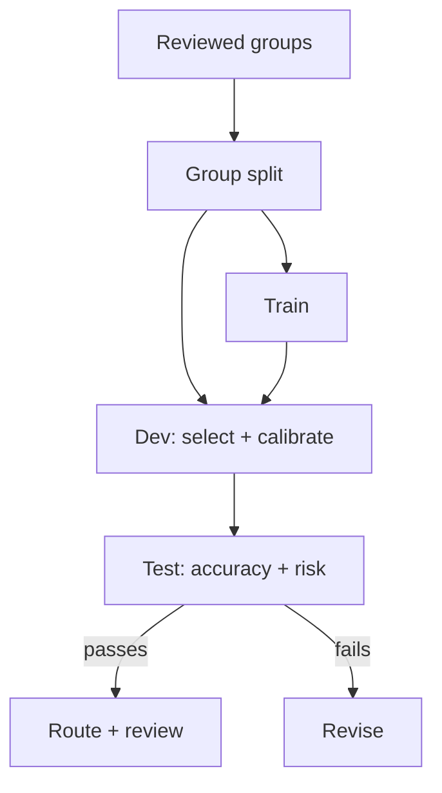

---
{
  "id": "blog-how-decision-models-like-jev-work",
  "title": "How Decision Models Like Jev Work: AI Without the Paragraph",
  "slug": "how-decision-models-like-jev-work",
  "author": { "name": "LeetLLM Team" },
  "publishedAt": "2026-09-24",
  "updatedAt": "2026-11-15",
  "verifiedAt": "2026-11-15",
  "refreshAfter": "2026-12-15",
  "excerpt": "A model that picks from allowed actions can skip the essay. See what Jev actually discloses, how open Kev and SemIf score choices, and why calibration decides whether the result belongs in production.",
  "tags": ["Decision Models", "Jev", "Kev", "Inference", "Fine-Tuning"],
  "featured": false,
  "draft": false,
  "coverImage": "social_banner.png"
}
---

Your incident bot has read `docker pull failed: 401 Unauthorized from registry`. The tests never ran. You need to route the failure to the registry owner. The bot replies with three paragraphs about Docker, credentials, networking, and possible next steps. Somewhere in paragraph two, it says what your program needed all along: **registry authentication**.

That's a strange way to get one branch condition.

A decision model accepts the incident as **state**, receives an explicit question and legal answers, and returns a choice or scores for those answers. TypeSafe's Jev brought this idea into view with an API for typed decisions: choices, rubric scores, and 0-to-1 truth scores (`Noul`). TypeSafe says Jev produces the decisions in parallel and trains for calibrated probabilities. It has not published enough of Jev's internals to reconstruct the model. The open implementations below explain that kind of interface rather than copying Jev.[^typesafe2026jev][^typesafe2026primitives]

## A sentence and a decision are different products

Suppose the application allows three routes for the same log: `test_regression`, `registry_auth`, and `needs_review`. A chat model can be prompted to write a JSON object with one of those values. Grammar-guided decoding can enforce the syntax. The model still generates tokens until the object is complete, and legal syntax alone doesn't show that the chosen route is right.

A direct decision readout scores those three named alternatives and returns the winner and distribution without drafting an explanation. The narrower interface still requires compute to compare candidates and process the question.

<figure>
  
  <figcaption>The figure compares saved output work after both paths read the log. Measure latency with the same prompt, model size, batching, and runtime for each path.</figcaption>
</figure>

> **Useful mental model:** A decision model acts as a learned branch condition over a fixed answer set. Application code still defines the allowed answers and controls every downstream side effect.

Separating selection from execution simplifies integration. Your code validates the returned label against an enum, routes credential rotation through its own access checks, and verifies accuracy on held-out cases. Treat the incident log as untrusted input, including any line instructing the model to ignore the caller's question. Schema validation only guarantees a legal output shape; public Jev materials describe no external way to inspect how a given score was produced.

## Jev is the headline, but its internals aren't public

TypeSafe describes Jev as a System One model with a new architecture, a parallel sampler, and Reinforcement Learning for Calibrated Decisions (RLCD). Its launch reports strong speed and price results on TypeSafe's workflow evaluations and also discusses where its examples and reference answers may favor the system. Reproducing those results requires an open recipe and a controlled benchmark against alternatives.[^typesafe2026jev]

The practical engineering question is what implementations we can inspect and measure today. Three public projects expose different ways to turn language understanding into a fixed choice, sharing an interface pattern while relying on distinct model architectures.

| Route | Actual readout | Training for the decision task | What remains to check |
|---|---|---|---|
| **Kev** | Learned pointer head compares option-marker states to a decision-marker state | Smaller models: frozen Qwen3.5 plus LoRA; current 27B: full-weight Qwen3.8 fine-tune | Checkpoint-specific accuracy, calibration, option order, and domain transfer |
| **SemIf** | Reads fixed answer-letter logits from a frozen Qwen language model | None in its baseline | Whether letter-logit preferences work for your prompt and task |
| **Tev1-style fine-tune** | Generates one answer letter, then client maps it to JSON | Supervised LoRA on labeled answer-letter completions | Format failures, decision quality, and confidence calibration |

Kev is the clearest open example of a purpose-trained readout. Its Qwen backbone processes state, question, and options with special markers. The learned head compares each option's representation with a final decision representation, then a softmax produces a distribution over the choices. The 0.8B, 4B, and 9B models train adapters and heads over frozen Qwen3.5 bases. Kev-27B v2, released September 30, fine-tunes all backbone weights of the post-trained Qwen3.8-27B release and blends them with its earlier adapter-trained version. Its base's post-training data isn't disclosed. The checkpoints also differ in training method and base model, so the release set cannot isolate parameter count. The maintainers say no Jev outputs were used for training.[^palmer2026kev][^palmer2026kev27v2]

SemIf asks how far you can get *without* that training. It presents the state and alternatives to a frozen model, reads the next-position logits for fixed answer letters, and normalizes those candidate scores. There's no need to sample a letter just to inspect its logit. SemIf explicitly says its method isn't Jev's undisclosed architecture.[^lee2026semif]

Together's Tev1 recipe takes another path: supervised fine-tuning makes Qwen3.5 complete one answer letter, and application code turns the letter into a structured response. This short language-model completion differs from Jev's private RLCD procedure. The public repository records 37,840 unique training examples and proposes a one-epoch starting recipe. It calls for verification of the historical job's exact settings and uploaded-file identity. Use the recipe as a reproducible starting point; verify the hosted checkpoint's training history separately.[^together2026tev1][^together2026tev1run] Kev and SemIf return a score normalized over the options you offered. Interpret that conditional share with the option set in view. What happens to the share when one option disappears?

## The invisible denominator under every score

Return to the three incident routes and suppose the model assigns logits `2.0` to `test_regression`, `1.0` to `registry_auth`, and `0.0` to `needs_review`. Softmax converts them to `0.665`, `0.245`, and `0.090` (rounding to three decimals), even though the registry error arrived before any test ran.

That `0.245` is a normalized share of the three *offered* scores. It changes when `needs_review` is removed, even if the registry logit stays fixed. Option descriptions and ordering can also change the model's scores. Use calibrated labels or another evaluation to estimate whether the incident truly belongs to registry authentication. SemIf's method documentation calls out this conditional-score limit.[^lee2026semif]

<figure>
  
  <figcaption>The registry score rises from 0.245 to 0.269 simply because one alternative disappeared. A normalized choice score needs a stable option set and held-out calibration before it drives an automated routing threshold.</figcaption>
</figure>

The training loss for a labeled record is direct: if the reviewed answer is `registry_auth`, minimize the negative log probability of that option. Kev's smaller models update the adapter and pointer head; the current 27B also updates its backbone. A letter-completion trainer applies its loss to the answer letter. Different parameters move, but both require examples whose labels mean what the product needs.[^palmer2026kev][^together2026tev1]

The data is often harder than the optimizer. Split by incident ID rather than by individual log line, or near-duplicate failures leak into the test set. Add records where none of the named teams fits. Rotate option order. Hold out a new source system. Compare the model with a simple rule for obvious signatures such as `401 Unauthorized`. The model earns its place on cases where semantic interpretation improves the workflow, not on a benchmark engineered around its favorite prompt.

Keep the final test set sealed while fitting the model and any calibration temperature. This is the short path from labeled incidents to a release decision:



That path is one labeled decision. Many incidents need several decisions from the same log. Can those questions share the state without mixing their scores?

## When one input needs three answers

The incident collector may ask: which team owns this, is customer impact reported, and how urgent is the evidence? Those questions can share the same state. A useful runtime can fan them out, score each legal answer set, and return a typed bundle. TypeSafe says Jev samples its questions in parallel; don't assume every open implementation uses the same scheduling. Kev's current hybrid Qwen paths evaluate questions in separate rows while reusing cached state. Their recurrent layers don't obey an attention mask, so masking alone wouldn't isolate packed questions.[^typesafe2026jev][^palmer2026kev]

<figure>
  
  <figcaption>Three distinct decision queries read one shared incident state into separate answer sets, leaving final action selection in application code rather than model weights.</figcaption>
</figure>

That routing threshold is where probabilities become product behavior. A route can automate only when its error rate at the selected threshold meets your error budget on held-out cases. Fit a calibration temperature on a separate development set, inspect a reliability plot, then measure selective risk at the exact operating point. Temperature scaling can improve reliability on some neural networks without changing the top choice. Audit label quality and evaluate transfer on incidents from each source.[^guo2017]

Even the field named `confidence` needs inspection. Kev uses TypeSafe's reference adapter formula for a Choice with $K > 1$ options: $(p_{\max} - 1/K)/(1 - 1/K)$. It measures how far the maximum option probability sits above uniform, scaling uniform to zero and a certain choice to one. Read it alongside winning probability and measured accuracy.[^typesafe2026confidence][^palmer2026kev]

Consider a routing threshold that accepts a winning probability of at least `0.75`. Applying that same `0.75` cutoff directly to the scaled `confidence` metric flips the outcome, as this verification script shows for both softmax renormalization and confidence scaling:

<!-- leetllm: test output=show -->
```python title="choice-confidence-threshold.py"
import math


def softmax(logits):
    shifted = [x - max(logits) for x in logits]
    exps = [math.exp(x) for x in shifted]
    total = sum(exps)
    return [e / total for e in exps]


def choice_confidence(probabilities):
    if len(probabilities) == 1:
        return 1.0
    uniform = 1 / len(probabilities)
    return (max(probabilities) - uniform) / (1 - uniform)


p_three = softmax([2.0, 1.0, 0.0])
p_two = softmax([2.0, 1.0])
print(f"3-option registry share: {p_three[1]:.3f}")
print(f"2-option registry share: {p_two[1]:.3f}")

probabilities = [0.8, 0.1, 0.1]
winning_probability = max(probabilities)
confidence = choice_confidence(probabilities)
print(f"Winning probability: {winning_probability:.2f}")
print(f"Choice confidence: {confidence:.2f}")
print("Probability threshold (>=0.75):", winning_probability >= 0.75)
print("Confidence threshold (>=0.75):", confidence >= 0.75)
```

<!-- leetllm: output:start -->
```text title="Output" output compact
3-option registry share: 0.245
2-option registry share: 0.269
Winning probability: 0.80
Choice confidence: 0.70
Probability threshold (>=0.75): True
Confidence threshold (>=0.75): False
```
<!-- leetllm: output:end -->

The same distribution clears a `0.75` cutoff on raw probability yet misses it on `choice_confidence`, dropping from `0.80` to `0.70` across three options. Fit and verify the threshold against your target error budget on held-out examples scored with that exact field and option set.

> **Typed outputs can still choose the wrong value.** A typed enum prevents unexpected *shapes*. Evaluate which legal values the model selects, and keep `needs_review` plus an application-owned approval path for consequential actions.

One more trap matters for frozen-letter baselines. The first-token probability for `A`, `B`, or `C` can differ from what an instruction-tuned model says after writing a full answer. Wang and colleagues found substantial mismatch in their tested tasks and models.[^wang2024firsttoken] Score the exact readout you plan to deploy. Compare that score with a chat transcript as a separate measurement, then test the shipped readout on your incidents against a rule and a short generated baseline.

## Try the branch, then measure the workflow

For a first experiment, label a few hundred real incidents with the intended route and a `needs_review` option. Freeze incident groups into development and final test splits. Measure a deterministic rule, a short generated-label baseline, and an open decision readout on the same examples. Record accuracy, option-order flips, Brier score, coverage at your acceptable error rate, and end-to-end latency. Revisit the labels behind every confident error before fine-tuning.

You can explore the typed interface in the [Kevala browser playground](https://bvolpato.github.io/kevala/#/playground). Check its selected model before interpreting a result: the current playground loads Laya, so a run there doesn't evaluate Kev or SemIf. For the complete training objective, worked loss, and release checklist, continue with the [decision-model curriculum lesson](/learn/decision-models-jev-kev).

The practical advantage of a decision model is not just emitting `registry_auth` faster than three paragraphs of prose. It is that software can ask for a discrete choice over fixed alternatives, inspect calibrated probabilities, and decide locally when to automate or defer to an engineer.
