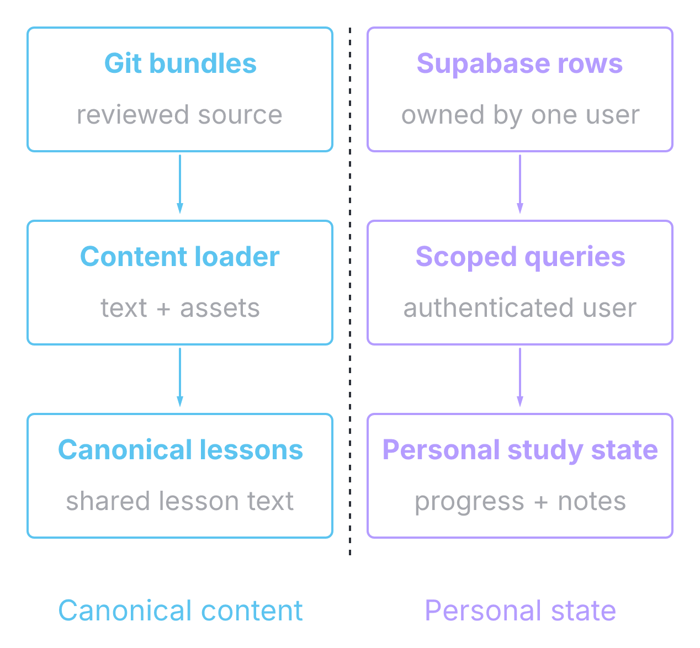
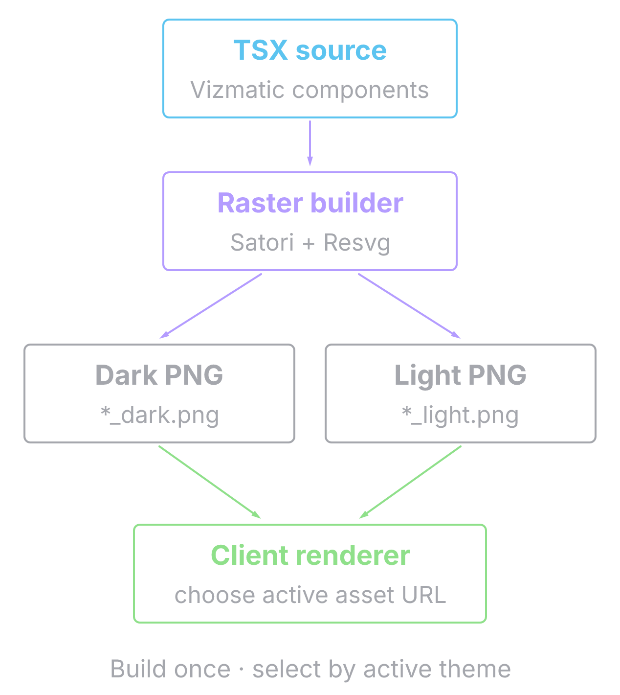
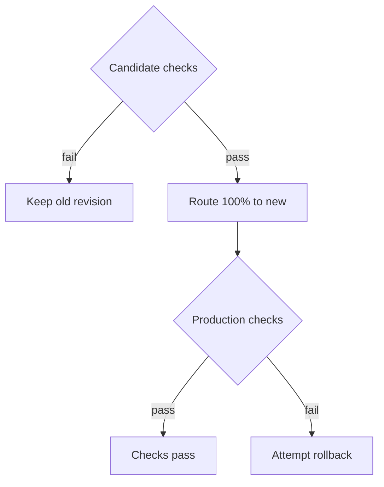

---
{
  "id": "blog-how-we-built-leetllm",
  "title": "How We Built LeetLLM",
  "slug": "how-we-built-leetllm",
  "author": { "name": "LeetLLM Team" },
  "publishedAt": "2026-06-21",
  "updatedAt": "2026-11-23",
  "verifiedAt": "2026-11-23",
  "refreshAfter": "2026-12-23",
  "excerpt": "Inside LeetLLM's Git-backed curriculum: reviewable article bundles, generated figures, user-owned state, and the checks between a source edit and a deployed page.",
  "tags": ["LeetLLM", "Content Engineering", "AI Engineering", "Production", "Education"],
  "coverImage": "illustrations/_generated/content_pipeline_dark.png",
  "featured": true,
  "draft": false
}
---

Correct a sentence in a lesson and the work can look finished. But the diagram may still describe the old explanation. Its caption may contradict both versions. A reader may receive an older page from the cache, pointing to an older image.

LeetLLM's architecture has to keep those pieces connected. The canonical curriculum lives in Git, figures are built from source, and deployment packages the pages with their assets. User progress and other account data take a separate path through Supabase. This post describes the implementation checked against the repository on November 23, 2026. Production behavior needs its own live verification.

The local curriculum loader returns 199 visible lessons across 15 phases. Blog posts, glossary entries, and coding practice are separate collections. The engineering problem is making each lesson easy to correct while keeping its examples, navigation, and rendered output in sync.

## A directory per lesson

A lesson needs more than a body field. It has citations, diagrams, runnable examples, and metadata that affect how readers find it. We keep those dependencies close enough to review together.

This post uses the same <span data-glossary="article-bundle">article bundle</span> structure as the curriculum:

```text title="This post's bundle"
how-we-built-leetllm/
├── content.md                 # JSON frontmatter and published text
├── _research.md               # raw editorial background, not rendered
├── social_banner.png          # share image
├── illustrations/
│   ├── content_pipeline.tsx
│   ├── illustration_system.tsx
│   └── _generated/            # theme variants and alt.json
└── diagrams/
    └── _generated/            # PNGs built from Markdown Mermaid fences
```

`loadContentBundle()` reads the JSON <span data-glossary="frontmatter">frontmatter</span> and body from `content.md`. It still supports older bundles with a separate `metadata.json`. The lesson and blog loaders then derive reading time, resolve citation keys through the shared `references.json` registry, and turn local image references into serving URLs.

That makes a correction a source change. If an arrow points the wrong way, edit the TSX or Mermaid definition and regenerate the PNG. If a paper doesn't support a sentence, change the claim or its citation. The bundle groups those edits into one reviewable unit; review each change for accuracy.

Curriculum order has a different owner. `ROADMAP_SECTION_SEQUENCE` and `SECTION_ROADMAP_SLUG_ORDER` in `questions.ts` define the path through the lessons. Folder names don't decide what comes next. The loader checks that the visible content and the roadmap agree, so moving a lesson is also a navigation change.

Files in Git let the explanation, its visual source, and its place in the curriculum appear in the same diff. Publishing a correction requires a build and release because Git owns the canonical content. The shared page holds the lesson; Supabase holds each reader's bookmarks and notes. Which source owns that state?

## Public content and account state have different owners

Two readers can see the same canonical lesson and have different bookmarks, notes, and progress. Keep those personal fields in user-scoped storage rather than the shared article artifact.

<figure>
  
  <figcaption>Canonical content and personal study state meet in the application and keep separate sources of truth. This diagram omits publicly readable comments, which have a separate access policy.</figcaption>
</figure>

| Data | Owner in the implementation | Access rule |
|---|---|---|
| Canonical lessons, blog posts, citations, visual source | Repository bundles and shared content files | Published material is readable without an account |
| Progress, plans, bookmarks, notes, quiz attempts | Supabase Postgres | User-scoped policies compare the row owner with the authenticated user |
| Personalization profiles and generated lesson variants | Supabase Postgres | Per-user state; Git remains the canonical shared source |
| Comments and votes | Supabase Postgres | Public reads; ordinary writes are tied to the signed-in owner |

<span data-glossary="row-level-security">Row-level security</span> expresses these database policies. Inspect each policy before describing its access: our comments schema explicitly allows public reads. A service-role client bypasses row-level policies and holds broader permissions than an ordinary signed-in client, so server-side code still needs the appropriate identity and scope.[^supabase_row_level_security]

The app layer is Next.js and React with TypeScript, Tailwind CSS, and shared UI components. The repository currently pins Next.js 16.4.6 and React 19.3.1. Supabase handles authentication and persisted user data. A standalone Next.js container runs on Cloud Run, with Cloudflare in front of the public site, and untrusted coding practice runs in a separate zero-secret Cloud Run sandbox service. Measure throughput and hosting cost separately from these implementation details.

Search deliberately stays close to the canonical source. `learn-search.ts` builds an in-process index from `getQuestions()`, scoring normalized titles, descriptions, metadata, and body text. It removes fenced code and display math before scoring the body. There is no embedding model or separate search service in that path, and `/api/search/learn` returns `Cache-Control: no-store`.

That is enough machinery for lexical matching. The endpoint searches lessons and excludes the blog. Because the index scores normalized words rather than semantic similarity, conceptual synonyms can be missed. Add a new search backend when observed failures show that this approach falls short.

## Research notes are allowed to be wrong

Each bundle's `_research.md` is background for the editor. It can contain an earlier draft, suggested coverage, and model-generated source suggestions. It isn't rendered, and it isn't treated as verified evidence. Current repository guidelines require reviewing one complete bundle at a time and preserving raw research unless a refresh is explicitly requested.

This post offers a clear example. An earlier version of its raw research packet described a strict JSON article-spec system and implied that validation prevents broken pages from reaching readers. Neither sentence became reliable just because it appeared in the briefing. The September review corrected those notes against the implementation: JSON frontmatter, specific validators, and human review. Those are narrower, checkable claims.

Reviewing first-party architecture also needs different evidence from reviewing an external paper. Verify “comments are private” in the SQL policy and “a failed cache purge rolls back the release” in the deployment function and its callers. First-party implementation claims need evidence from the implementation.

For teaching material, the same discipline goes beyond fact checking. “Retrieval improves accuracy” needs a workload, a source set, and an evaluation that can detect stale or irrelevant evidence. [RAG Evaluation](/learn/design-production-rag-pipeline) develops those distinctions. A reviewer judges whether the example helps the reader understand them; counts of headings, citations, and illustrations track coverage. A figure can drift in a more mechanical way too. The sentence changes, and a copied PNG still shows the old arrow. Which source generates the light and dark pages?

## One figure source, two theme variants

A theme-aware illustration shouldn't require maintaining two separate drawings. Our TSX figures use Vizmatic components, rendered through Satori and Resvg into light and dark PNGs. Mermaid fences take a separate Puppeteer-based rendering path and also produce both themes.

<figure>
  
  <figcaption>The builder creates both assets. The loader attaches both URLs, and the client renderer selects the active one. Theme selection doesn't require rerendering the illustration on the server.</figcaption>
</figure>

The distinction between building and selecting is small but important. `resolveIllustrations()` emits one image element with dark and light source attributes. The Markdown renderer uses the resolved client theme to choose the displayed source. The loader doesn't know the reader's active theme; its initial fallback is dark.

The illustration cache tracks source hashes and shared rendering inputs. A changed figure rebuilds. Changed framework inputs can invalidate the whole set. Missing expected outputs also trigger rebuilding. Unchanged source alone isn't sufficient to reuse a missing PNG.

Cache keys introduce another layer after rendering. `contentImageUrl()` adds a version query derived from the image bytes. If a figure's pixels change, its serving URL changes even though the local filename stays the same. That helps a fresh page request the new asset. It doesn't update old cached HTML that still contains the previous reference.

That query identifies an image URL; the serving route validates its format and reads the current file at that path. It stores no previous PNG. A cache hit for an old URL may return old bytes, while a miss after a new revision may return new bytes under that URL. The byte-derived query separates fresh page requests. Reproducing a page's historical images requires versioned storage or the corresponding retained PNG.

To rebuild the figures in this post from the repository root, the actual scoped command is:

```bash title="Rebuild this post's figures"
pnpm --dir web illustrations:build:article blog/how-we-built-leetllm --force
```

A successful render proves the source could become an image. We still inspect both outputs for clipping, misleading arrows, unreadable labels, and diagrams that merely repeat the paragraph beside them. Alt text and captions remain necessary because a raster image doesn't expose its relationships as semantic HTML.

## A green check needs a precise meaning

Our validators are useful when their names describe the evidence they produce. Reference validation verifies that a citation key exists in the registry. It can't verify that the cited paper supports the conclusion. Python-example validation executes marked code and compares printed output. It can't turn a local mock into evidence about a live model.

| Check | A defect it can catch | Review still required |
|---|---|---|
| Metadata and curriculum loading | Invalid frontmatter or a roadmap/content mismatch | Whether the title and placement suit the reader |
| Reference validation | A citation key missing from the shared registry | Whether the source supports the nearby claim |
| Marked Python examples | Code that fails or displayed output that no longer matches | Whether the example models the intended behavior |
| Illustration checks and builds | Missing outputs, bad references, or layout warnings | Whether the figure teaches anything accurately |
| Vitest and Next.js build | Tested behavior or content assembly that breaks | Whether the rendered page is coherent and usable |

We run narrower checks while editing and broader checks before release. A full deploy invokes metadata, reading-time, citation, structure, curriculum-handoff, mastery-quiz, and marked-Python checks; practice-solution validation; and Vitest. It builds illustrations, runs visual and cover checks, and renders diagrams before building the application container.

Those checks don't all apply equally to every page. A blog post doesn't carry a mastery quiz, whereas curriculum lessons follow tighter prerequisite and handoff rules.

To make the split between structural validation and editorial review concrete, the script below models three checks our release pipeline runs on an article bundle: required frontmatter keys, known citation keys, and SHA-256 digest agreement between an image file and the packaged container manifest.

<!-- leetllm: test, output=show -->
```python title="bundle-integrity-check.py"
import hashlib
import re

REQUIRED_FRONTMATTER = {"id", "slug", "title", "publishedAt", "updatedAt"}
KNOWN_REFS = {"cloudrun_traffic_migration", "supabase_row_level_security"}
IMG_RE = re.compile(r' str:
    return hashlib.sha256(data).hexdigest()[:12]


def check_bundle(
    frontmatter: dict[str, str],
    markdown: str,
    disk_assets: dict[str, bytes],
    manifest: dict[str, str],
) -> list[str]:
    errors: list[str] = []
    missing_keys = sorted(REQUIRED_FRONTMATTER - frontmatter.keys())
    if missing_keys:
        errors.append(f"missing frontmatter: {', '.join(missing_keys)}")

    for key in sorted(set(REF_RE.findall(markdown))):
        if key not in KNOWN_REFS:
            errors.append(f"unknown citation: {key}")

    for asset_path in IMG_RE.findall(markdown):
        if asset_path not in manifest:
            errors.append(f"missing manifest entry: {asset_path}")
        elif asset_path not in disk_assets:
            errors.append(f"missing disk asset: {asset_path}")
        elif sha256_bytes(disk_assets[asset_path]) != manifest[asset_path]:
            errors.append(f"stale image digest: {asset_path}")
    return errors


png_v1 = b"PNG_BYTES_TWO_LANE_PIPELINE"
digest_v1 = sha256_bytes(png_v1)
base_fm = {
    "id": "blog-how-we-built-leetllm",
    "slug": "how-we-built-leetllm",
    "title": "How We Built LeetLLM",
    "publishedAt": "2026-06-21",
    "updatedAt": "2026-11-07",
}

clean_md = ' [^cloudrun_traffic_migration]'
missing_ref_md = ' [^' + 'unregistered_key]'
stale_caption_md = (
    ' [^cloudrun_traffic_migration]'
)

for name, md in [
    ("synced", clean_md),
    ("missing_ref", missing_ref_md),
    ("stale_caption_old_png", stale_caption_md),
]:
    issues = check_bundle(
        base_fm,
        md,
        {"illustrations/_generated/content_pipeline_dark.png": png_v1},
        {"illustrations/_generated/content_pipeline_dark.png": digest_v1},
    )
    verdict = "PASS" if not issues else "; ".join(issues)
    print(f"{name:22s} -> {verdict}")
```

<!-- leetllm: output:start -->
```text title="Output" output compact
synced                 -> PASS
missing_ref            -> unknown citation: unregistered_key
stale_caption_old_png  -> PASS
```
<!-- leetllm: output:end -->

<!-- leetllm: output -->
```text
synced                 -> PASS
missing_ref            -> unknown citation: unregistered_key
stale_caption_old_png  -> PASS
```

Notice that `stale_caption_old_png` passes every automated check because the old PNG matches the checkout manifest; rebuilding figures from source and inspecting the rendered images catches that drift.

## The container must include article assets

Next.js standalone output is only part of the runtime artifact. Our Dockerfile also copies a selected set of content files: Markdown, metadata, references, illustration source, generated images, and local assets. Content-serving routes and personalized visual rendering still need those files after the build. Raw research packets aren't part of that selected runtime-content set.

That packaging detail is easy to miss in a file-backed site. A build can succeed locally because the whole checkout is present, then fail in a smaller production image because a route expects a file that wasn't copied. Validate the production container as its own artifact; it runs with a smaller file set than the development checkout.

The Docker build compares the selected runtime content with the source and writes a manifest of file sizes and SHA-256 hashes. Before deploying, the release script resolves the pushed image to an immutable digest and runs `runtime-image:validate` against that exact image. The check requires the manifest to match the deploy checkout and verifies that the image has no missing, extra, or changed content files. It runs with no network and a read-only container filesystem. This proves a packaging match for that source snapshot. Editorial review assesses whether the lesson's explanation is correct.

Consider changing a figure's caption while keeping an old generated PNG. The runtime manifest will faithfully include that caption and those old pixels. The image check can pass because both match the checkout. Rebuild from the visual source and inspect the page to check whether the caption and drawing explain the same thing. Packaging and editorial checks catch different failures.

The release script deploys a Cloud Run revision with `--no-traffic` and a temporary tag. The tag provides a candidate URL for checks without moving the service's ordinary traffic. Cloud Run explicitly supports this separation between deploying a revision and assigning it traffic.[^cloudrun_traffic_migration]

At that point, the traffic decision has two stages:



Candidate checks cover public content routes and authenticated Leety integration. If they fail, the script leaves ordinary traffic on the previous revision. If they pass, it routes 100% to the new revision, attempts a Cloudflare purge, and repeats checks through the public URL. Failed production checks trigger an attempt to restore the previous revision, followed by another purge attempt if rollback succeeds.

Rollback can fail, and the script reports that failure. Cache purge is best-effort: missing purge credentials skip it, and an API response without a success result produces a warning. A transport failure can still abort the shell script. Check cleanup outcomes separately after the smoke tests pass.

## HTML caching is a separate release concern

The source configuration sets public learn, blog, and practice routes to this policy:

```http title="Configured public-page cache policy"
Cache-Control: public, s-maxage=14400, stale-while-revalidate=3600, max-age=0
```

The intended shared-cache freshness interval is four hours; `max-age=0` asks browsers to revalidate stored responses immediately. Verify edge behavior by inspecting route rendering, final response headers, and Cloudflare configuration. Cloudflare's current Origin Cache Control documentation says `s-maxage` prevents stale serving without revalidation. An extra stale-delivery hour therefore depends on the actual edge behavior under this configuration.[^cloudflare_origin_cache_control]

Public Learn HTML and React Server Component navigation requests take a short path through `proxy.ts`. For `GET` and `HEAD` on `/learn` and a single lesson path, the proxy returns before Supabase session handling, even when the browser carries auth cookies. These pages contain shared lesson content; the client auth provider resolves account state and refreshes the session separately. Reading a lesson therefore doesn't wait for a remote authentication round trip.

Other requests carrying Supabase auth cookies still run session handling and receive `private, no-store, must-revalidate`. Account APIs retain their own authentication checks. These rules live directly in route and proxy code. Checking the signed-in sidebar, final response headers, and deployed revision remains necessary when changing authentication or caching behavior.

Moving Cloud Run traffic and refreshing cached HTML are separate operations. A new origin revision doesn't by itself remove an old edge response. Image versioning helps the new HTML address new pixels, while purge and response checks address which HTML readers receive.

There is also a faster release mode. `./deploy.sh --fast` skips pre-deploy content checks, practice validation, Vitest, illustration quality validation, and cover checks. It still installs missing dependencies, runs both the hash-cached illustration and Mermaid diagram builders (rendering only changed or missing assets), builds the container, verifies the exact image's content manifest, and executes candidate and production checks. Treat a fast deploy as packaging and runtime evidence; run the full content review separately.

## What we'd keep even in a smaller site

The stack could change without changing the useful design decisions: keep a lesson's dependencies reviewable, distinguish canonical content from user-owned state, derive assets from source, and give each validator a narrow assertion it can actually prove.

People still need to read the result. Valid source can mislead. A figure needs to teach accurately, and a release needs supported prose. Our tooling makes problems easier to locate; reviewers still decide and correct them.
