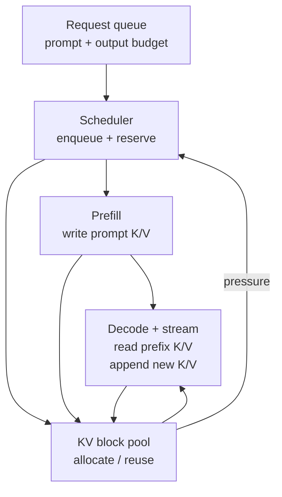

---
{
  "id": "blog-llm-inference-engine-comparison-2026",
  "title": "LLM Inference Engines Compared: vLLM, SGLang, Ollama & llama.cpp",
  "slug": "llm-inference-engine-comparison-2026",
  "author": {
    "name": "LeetLLM Team"
  },
  "publishedAt": "2026-04-01",
  "updatedAt": "2026-11-23",
  "verifiedAt": "2026-11-23",
  "refreshAfter": "2026-12-23",
  "excerpt": "Compare vLLM, SGLang, TensorRT-LLM, Ollama, and llama.cpp by model support, latency, throughput, and cost. Choose a runtime for local or production use.",
  "tags": [
    "Inference",
    "vLLM",
    "SGLang",
    "TensorRT-LLM",
    "Ollama",
    "llama.cpp",
    "Production AI",
    "Benchmarks"
  ],
  "coverImage": "social_banner.png",
  "featured": false,
  "draft": false
}
---

Fifty engineers open an internal assistant at once. The first ten get fast answers, and the rest wait even though the <span data-glossary="gpu">GPU</span> dashboard shows 60% utilization.

You have two plausible fixes: buy a larger GPU or change the serving runtime, the software that schedules model work. The dashboard doesn't tell you which one addresses the wait. Requests can pile up when work is scheduled in the wrong order, memory is reserved poorly, or prompts vary in length.

## Start with the deployment surface

First separate a packaged local product from a library embedded in your application and a shared GPU server. Then check whether each candidate supports your exact model. Those filters remove incompatible choices before any speed comparison.

> **Selection rule:** Deployment surface narrows the field. Exact checkpoint support decides what can run. Your latency <span data-glossary="slo">service-level objective (SLO)</span>, throughput, and operating cost decide what should run.

Ollama packages model download, lifecycle, a local daemon, command-line interface (CLI), and application programming interfaces (APIs) into one local product. One supported execution backend is <span data-glossary="llama-cpp">llama.cpp</span>. Ollama also provides an MLX (Apple's machine-learning framework) path on Apple Silicon. The March 2026 announcement introduced it as a preview; check the installed release and model rather than assuming every Ollama model uses the same backend.[^ollamagithub2026][^ollama2026mlx]

<span data-glossary="llama-cpp">llama.cpp</span> is the lower-level runtime and library. It reads GGUF model files (a format for model tensors and metadata), builds across CPU and GPU backends, and includes `llama-server`, an OpenAI-compatible HTTP server.[^llamacpp2023] Ollama packages the local workflow. llama.cpp gives an application more control over embedding the runtime, builds, and runtime flags. Here, embedding means incorporating a library, not generating an embedding vector. [Local LLM Deployment](/learn/local-llm-deployment-hardware-quantization) covers hardware and memory sizing; [Run Gemma 4 Locally with Ollama](/blog/run-gemma4-local-ollama) works through local model tags.

The server-oriented engines expose more cluster scheduling, parallelism, and model-serving controls. That extra control only helps when the deployment needs it, so choose this branch because you have shared traffic to serve, not because the product name sounds more serious.

Their release state changes quickly. Pin a version before comparing behavior.

| Project | Stable release checked on November 23, 2026 | Code license | Main deployment surfaces | Hardware scope to verify |
|---|---|---|---|---|
| vLLM | `v0.34.0`[^vllm2024] | Apache-2.0[^vllm2026license] | Python offline API, OpenAI-compatible server, distributed serving | Native NVIDIA, AMD, Intel GPU, and CPU paths plus hardware plugins such as TPU and Gaudi[^vllm2026rocm][^vllm2026tpu][^vllm2026gaudi] |
| SGLang | `v0.5.23`[^sglang2026release0523] | Apache-2.0[^sglang2026license] | <span data-glossary="sglang">SGLang</span> language frontend, Python engine, OpenAI-compatible server, distributed serving | Official docs list NVIDIA, AMD, Intel Xeon, Google TPU, Ascend NPU, and Moore Threads MUSA; feature parity varies[^sglang2026docs] |
| TensorRT-LLM | `v1.3.0`[^nvidia2026tensorrtllm] | Apache-2.0 codebase; bundled components can differ[^nvidia2026tensorrtllm] | Python `LLM`, `trtllm-serve`, benchmarking and distributed NVIDIA serving | NVIDIA GPUs; check model-by-feature and GPU-generation support <span data-glossary="matrix">matrix</span> |
| Ollama | `v0.40.17`[^ollamagithub2026] | MIT[^ollamagithub2026] | Local daemon, CLI, REST API, OpenAI-compatible endpoints[^ollama2026openai] | macOS, Windows, Linux, NVIDIA/AMD GPUs, and Apple paths; exact backend depends on platform |
| llama.cpp | `v1.0.0`[^llamacpp2023] | MIT[^llamacpp2023] | C/C++ library, CLI, local OpenAI-compatible server | CPU plus Metal, <span data-glossary="cuda">CUDA</span>, HIP, Vulkan, SYCL, and other compiled backends |

Runtime licenses cover the engine software. Review checkpoint, tokenizer, dataset, and remote model-code terms separately.

Use these stable tags to inspect the documented behavior. Prereleases such as TensorRT-LLM `v1.4.0rc4` and Ollama `v0.40.18-rc0`, along with `llama.cpp` `b`-numbered development builds, stay outside this stable comparison. Prereleases, nightlies, and unversioned documentation can describe different behavior. Benchmark the target workload before upgrading, and record the deployed tag and container digest alongside the project name. In fast-moving releases, defaults can change across minor tags: vLLM `v0.34.0` removed Model Runner V1, enabled extensible KV caching by default, and changed the default block size from 16 to 64, while `llama.cpp` `v1.0.0` formalized SemVer stability and removed deprecated C APIs.[^vllm2024][^llamacpp2023]

Release numbers still don't prove compatibility. Validate the exact checkpoint, <span data-glossary="quantization">quantization</span>, attention backend, tool parser, structured-output path, and parallel layout. "Supports the architecture" can still mean your chosen feature combination is untested.

Compatibility still doesn't explain why those fifty requests wait while the GPU looks only partly busy. What does the runtime decide for a single request?

## What an inference engine controls

Follow one request through the runtime. First, **prefill** processes all prompt tokens and writes the request's key-value (KV) state, the attention data reused at each output step. Then ordinary autoregressive **decode** reads that state to produce the next token. Speculative decoding can draft and verify several positions in one target-model pass, so a runtime step need not deliver exactly one token.

That split gives us two useful clocks. Client-observed time to first token (TTFT) includes network transit, queueing, scheduling, prefill, and delivery of the first output token. Time per output token (TPOT) averages the remaining decode duration over the remaining output tokens. For 101 output tokens whose first and last arrivals are 5 seconds apart, TPOT is 5/100 = 0.05 seconds, or 50 ms. Its reciprocal is 20 tokens/s for that request after the first token. Aggregate output <span data-glossary="tokens-per-second">tokens per second</span> also depends on concurrent requests and batching.

An average can hide pauses. Inter-token latency measures the gaps between successive streamed tokens. If the client receives chunks rather than token-level events, record that limitation. A smooth-looking average TPOT doesn't prove that every token arrived smoothly.

The [Inference: TTFT, TPS & KV Cache](/learn/inference-mechanics-ttft-tps-kv-cache) lesson derives those metrics and the cache-size formula. For this comparison, remember that a runtime controls four coupled resources:

1. Queueing and scheduling: which prefills and decodes enter each step.
2. KV memory: which request owns each block and when blocks can be reused.
3. Kernels and parallelism: how model work maps to target hardware.
4. API and operations: model loading, streaming, metrics, failure recovery, and <span data-glossary="rollout">rollout</span> artifacts.



Now return to the 60% dashboard. Low utilization can come from a host-side scheduler gap, a long prefill blocking decode, insufficient queued work, collective communication, or blocked memory reservations. GPU utilization alone can't distinguish them.

Use a request trace to choose an engine. The name on the server matters less than which part of this path is holding the queue.

## Count work that meets the latency target

Suppose the assistant's target is TTFT at most 500 ms and average TPOT at most 50 ms. Treat these as example requirements and set production limits from the product's latency budget. Compare two 10-second example runs on the same hardware and request mix, each with ten offered requests. Every completed response contains 100 output tokens; failed requests emit none in this simplified model.

| Result over 10 seconds | Configuration A | Configuration B |
|---|---:|---:|
| Completed requests | 8 | 10 |
| Completed within both latency targets | 6 | 4 |
| Failed requests | 2 | 0 |
| Output throughput | 80 tokens/s | 100 tokens/s |
| SLO-compliant output throughput | 60 tokens/s | 40 tokens/s |
| SLO-compliant request throughput | 0.6 requests/s | 0.4 requests/s |

B produces more tokens, but A completes more requests within the target. **Goodput** counts work that satisfies a declared success threshold. Here that threshold requires completion and both latency limits; an actual deployment must also check answer quality and endpoint correctness. Neither result automatically justifies release: A's 20% failure rate may violate a separate reliability gate.

<figure>
  
  <figcaption>The raw-throughput winner can lose on goodput. Green tokens meet TTFT ≤ 500 ms and TPOT ≤ 50 ms; gray tokens miss at least one limit. Each ten-second scenario offers ten requests: A fails two and B fails none. These counts explain the metric; they aren't measurements of vLLM, SGLang, TensorRT-LLM, or Ollama.</figcaption>
</figure>

The short calculation below reconstructs the table from per-request records. Each tuple contains completion status, a nonnegative integer output-token count, TTFT in milliseconds, and average TPOT in milliseconds. Missing timing fields on failures never qualify as success. All ten offered requests remain in the accounting.

<!-- leetllm: test, output=show -->
```python title="serving_goodput.py"
def summarize(rows, seconds, ttft_limit=500, tpot_limit=50):
    if seconds <= 0:
        raise ValueError("Measurement duration must be positive")
    completed = good = tokens = good_tokens = 0
    for ok, output_tokens, ttft_ms, tpot_ms in rows:
        if output_tokens < 0:
            raise ValueError("Output-token count must be nonnegative")
        tokens += output_tokens  # Includes partial output from failed requests.
        completed += int(ok)
        timing_valid = all(
            value is not None and value >= 0
            for value in (ttft_ms, tpot_ms)
        )
        if ok and timing_valid and ttft_ms <= ttft_limit and tpot_ms <= tpot_limit:
            good += 1
            good_tokens += output_tokens
    return {
        "offered": len(rows), "completed": completed,
        "failed": len(rows) - completed, "good": good,
        "output_tps": tokens / seconds,
        "good_output_tps": good_tokens / seconds,
        "good_rps": good / seconds,
    }


runs = {
    "A": [(True, 100, 400, 40)] * 6
         + [(True, 100, 700, 40)] * 2
         + [(False, 0, None, None)] * 2,
    "B": [(True, 100, 400, 40)] * 4
         + [(True, 100, 400, 70)] * 6,
}
for name, rows in runs.items():
    result = summarize(rows, seconds=10)
    print(f"{name}: completed={result['completed']}/10, good={result['good']}/10, "
          f"output={result['output_tps']:.0f} tok/s, "
          f"good_output={result['good_output_tps']:.0f} tok/s, "
          f"good_requests={result['good_rps']:.1f} req/s")
```

<!-- leetllm: output:start -->
```text title="Output" output compact
A: completed=8/10, good=6/10, output=80 tok/s, good_output=60 tok/s, good_requests=0.6 req/s
B: completed=10/10, good=4/10, output=100 tok/s, good_output=40 tok/s, good_requests=0.4 req/s
```
<!-- leetllm: output:end -->

For a real run, choose a measurement-window rule before collecting data. If requests cross window edges, don't divide whole-request token counts by an interval that contains only part of their execution. Use token timestamps within a steady-state window, or a complete cohort with its full elapsed duration. Report offered, completed, failed, and cancelled requests alongside the throughput numbers.

> **Benchmark fairness:** Same model name isn't enough. Match model revision, precision, tokenizer, prompt template, output limits, hardware, workload, and correctness checks before attributing a difference to the runtime.

Those fifty engineers may also share a long runbook prefix. Unique prompts, repeated prefixes, and memory pressure exercise different parts of the serving path. Before comparing cache hit rates, separate two mechanisms: packing request memory and reusing work across requests.

## Why block allocation changes capacity

Return to the shared runbook. If many requests repeat the same long prefix, the runtime needs enough KV memory to keep them active at once. vLLM's original <span data-glossary="pagedattention">PagedAttention</span> work made that allocation problem a first-class serving concern. Instead of reserving one maximum-length contiguous region per request, the runtime assigns fixed-size physical blocks as tokens arrive and keeps a logical block table.[^kwon2023pagedattention]

Use the same 18-block pool on both sides. A fixed scheme reserves six blocks for each request. Requests A, B, and C currently need three, four, and two blocks: nine used, nine reserved but empty, and no unreserved capacity. On-demand allocation gives them only their nine live blocks. It can then serve D and E using three and two blocks, leaving four blocks free.

The diagram compares two allocation strategies. Paged allocation can improve utilization even when requests share no prefix. Prefix caching is a separate optimization that reuses already computed KV blocks across matching requests. Real allocators also face partially filled tails, metadata, eviction, and future growth. Four free blocks may still leave five growing requests competing for capacity and trigger preemption. [KV Cache & PagedAttention](/learn/kv-cache-paged-attention-llm-serving) derives those capacity constraints.

<figure>
  
  <figcaption>Both grids use the same 18-unit memory budget. Fixed six-unit reservations trap nine units, so D and E must wait. On-demand blocks hold five concurrent requests and retain four free units. Further growth can still require preemption.</figcaption>
</figure>

With the memory problem visible, the engine comparison has a sharper question: which runtime gives this workload the scheduling, caching, and hardware behavior it needs?

## What each runtime optimizes

### vLLM

Start the shared-server shortlist with vLLM when you need broad model coverage, familiar APIs, several accelerator paths, and a large operational ecosystem.[^vllm2024]

Its design combines paged KV memory, <span data-glossary="continuous-batching">continuous batching</span>, chunked prefill, parallel execution, and automatic prefix caching (APC). APC reuses matching prompt KV state to skip prefill work. The engine still decodes each new answer.[^vllm2026prefix] Both vLLM and SGLang support shared-prefix reuse.

A fair comparison therefore measures both engines with prefix caching enabled, compatible cache isolation, and cache-aware routing. [Prefix Caching and Prompt Caching](/learn/kv-cache-paged-attention-llm-serving) covers the hit-rate mechanics. Use [Deep Dive - vLLM](/learn/deep-dive-vllm) when scheduler, block-pool, or preemption behavior is part of the decision.

### SGLang

SGLang combines a server runtime with a programming frontend for multi-call language-model programs. Its founding work introduced <span data-glossary="radixattention">RadixAttention</span>, a radix-tree design that reuses exact token prefixes across requests.[^sglang2024]

That mechanism can help chat, retrieval-augmented generation (RAG), few-shot prompts, and agent loops that repeat large prefixes. Its benefit depends on stable templates, identifiers, replica routing, and shared branches. Changes in those conditions can erase reuse.

SGLang also offers broad hardware paths, structured generation, <span data-glossary="speculative-decoding">speculative decoding</span>, and distributed serving. "Prefix specialist" is now too narrow a label.[^sglang2026docs] [Deep Dive - SGLang](/learn/deep-dive-sglang) traces those mechanisms through its runtime.

### TensorRT-LLM

TensorRT-LLM is an NVIDIA-focused serving stack with optimized attention, quantization, CUDA graphs (reusable GPU execution plans), parallelism, <span data-glossary="kv-cache">KV-cache</span> reuse, speculative decoding, and disaggregated-serving paths that place prefill and decode on separate workers.[^nvidia2026tensorrtllm][^nvidia2026tensorrtllmifb]

Choose TensorRT-LLM by the exact support-matrix fit for your model and hardware. Starting with stable `v1.3.0`, NVIDIA removed the TensorRT engine backend (`trtllm-build`) and legacy C++ Executor APIs: PyTorch is now the only backend and loads supported Hugging Face checkpoints directly.[^nvidia2026trtbackendremoval] Check release notes before migrating a legacy compiled-engine recipe from `v1.2.x` to `v1.3.0`.

Pin one line, check its exact model and feature matrix, then benchmark it against vLLM and SGLang on the same NVIDIA system. Benchmark each architecture, quantization, and GPU generation separately.

### Ollama and llama.cpp

Ollama packages a managed local daemon, model tags, REST APIs, and OpenAI-compatible local endpoints.[^ollama2026openai] It can import GGUF artifacts, but model conversion and quantization quality remain separate decisions.[^ollama2026import]

Ollama also offers cloud models. A cloud model selected through the local daemon still executes remotely, so check the chosen tag before treating a local endpoint as local execution or local data residency.[^ollama2026cloud]

Choose llama.cpp directly when you need an embedded C/C++ library, a custom build, explicit backend control, or its lightweight HTTP server. Choose Ollama when model lifecycle and local integration matter more than exposing every runtime knob.

Both remain options for a small service. Measure concurrency, memory behavior, access controls, cancellation handling, and endpoint compatibility under that service's load.

## Exact checkpoints still need a recipe

Architecture support needs a matching vendor launch recipe for the checkpoint you actually downloaded.

GLM-5.2 documents a 1M-token context and lists official SGLang (`v0.5.13.post1+`) and vLLM (`v0.23.0+`) recipes on its model card.[^zai2026glm52] Use those recipes as the first compatibility tests.

DeepSeek-V4-Flash-0731 ships a DSpark speculative module in the same checkpoint. Its published recipes name vLLM `method: dspark` and SGLang `--speculative-algorithm DSPARK` explicitly.[^deepseek2026v4flash0731] The V4 technical report frames that family around million-token context.[^deepseek2026v4paper]

Generic Transformers support or an older DeepSeek run cannot confirm that sparse attention, speculative heads, quantization, and tokenizer behavior work together. Start from the vendor recipe, pin the runtime and checkpoint, then verify load, tool calls, long context, and throughput on the GPUs you'll actually use. For a community GGUF, size the downloaded artifact, offloaded weights, KV cache, and runtime workspace before assessing laptop fit.

> **Recipe gate:** Pin the vendor command, then verify load and correctness on your GPUs.

## Keep adjacent layers separate

Text Generation Inference (TGI) is in maintenance mode. Hugging Face directs new work toward engines including vLLM, SGLang, llama.cpp, and MLX.[^huggingface2026tgi] Evaluate TGI as a migration path, with its maintenance status included in the decision.

NVIDIA Dynamo sits above an engine. It can coordinate TensorRT-LLM, vLLM, or SGLang across workers and supports patterns such as disaggregated prefill and decode.[^nvidia2026dynamo] Comparing Dynamo with one single-node engine mixes orchestration and execution layers, so put it in a separate architecture decision.

## Run a bake-off that can reverse the decision

Once the candidate set is small, write down the workload specification up front. Freezing that scope keeps a benchmark from quietly changing the question.

First record:

- exact model revision, tokenizer, <span data-glossary="chat-template">chat template</span>, quantization, and allowed remote code;
- target GPU or accelerator, driver, container, engine version, and parallel topology;
- prompt and output length distributions, not one average;
- concurrency, arrival bursts, shared-prefix fraction, tool or schema usage, and cancellation rate;
- latency SLOs for p50 and tail TTFT, TPOT or <span data-glossary="itl">inter-token latency</span>, and end-to-end completion;
- quality, correctness, memory headroom, deployment time, <span data-glossary="rollback">rollback</span> time, and staff effort.

Run at least three traffic shapes: mostly unique prompts, repeated prefixes, and the real production mix. Unique prompts isolate general serving efficiency. Shared prefixes test cache reuse. The production mix tells you whether either result matters to users.

Distinguish a fixed-concurrency test, where a new request follows a completion, from an arrival-rate test, where requests arrive on a schedule. Fixed concurrency reduces offered traffic when a server slows; it can hide queue growth under a real burst. Sweep offered load, show tail latency and failures at each point, and report repeated runs rather than selecting the best run.

Warm each engine the same way and hold model semantics constant. Test cold starts and cold caches separately from warmed operation. Report output <span data-glossary="token">tokens</span> per second separately from total tokens per second, and pair aggregate throughput with SLO-compliant throughput. Keep failed and cancelled requests in the offered count, and report preemptions as a separate operational signal. Compare cost per successful request only after the candidates pass the same quality and reliability gates.


> **Reversal test:** Write down what result would make you keep the incumbent ahead of the benchmark. A migration without a reversal threshold is a preference disguised as measurement.

## Which engine to start with

| Need | Start here | What must be proved before committing |
|---|---|---|
| Packaged local model workflow | Ollama | Artifact quality, memory fit, endpoint behavior, latency, and rollback |
| Embeddable or highly portable local runtime | llama.cpp | Backend build, GGUF quality, context capacity, and target-device speed |
| Shared GPU service with broad model churn | vLLM and SGLang bake-off | Exact model-feature compatibility, SLO-compliant throughput, and operational fit |
| Prefix-heavy chat, <span data-glossary="rag">RAG</span>, or agent traffic | SGLang and vLLM with caching enabled | Cache hit rate, routing locality, TTFT, memory, and correctness under real templates |
| Stable NVIDIA deployment | Add TensorRT-LLM | Version-line support matrix, same-workload performance, failure recovery, and upgrade path |
| No meaningful measured gap | Keep incumbent | Confirm capacity headroom and document next review trigger |

The table turns the earlier trade-offs into a starting rule. It doesn't replace the bake-off: every row still asks you to prove compatibility, SLO behavior, and operational fit.

Separate a local package from a shared server. Reject a comparison that reports only raw tokens per second, and name which part of the request path a runtime still has to prove. The engine is only one control surface. [Scaling LLM Inference](/learn/continuous-batching-request-scheduling) connects that choice to batching, KV-cache sizing, quantization, disaggregation, and the throughput-latency-cost operating point.
