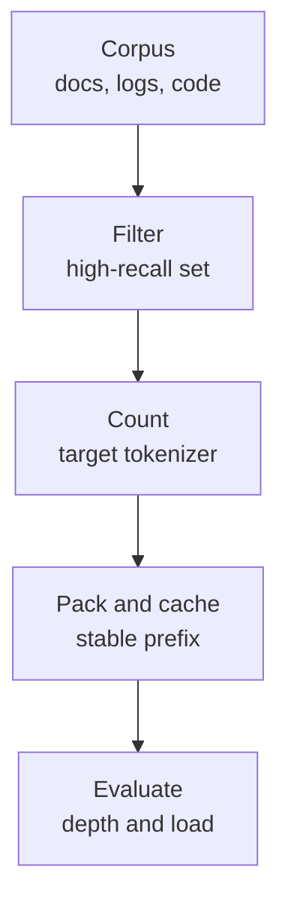

---
{
  "id": "blog-million-token-context-windows",
  "title": "Million-Token Context Windows",
  "slug": "million-token-context-windows",
  "author": {
    "name": "LeetLLM Team"
  },
  "publishedAt": "2026-03-14",
  "updatedAt": "2026-11-15",
  "verifiedAt": "2026-11-15",
  "refreshAfter": "2026-12-15",
  "excerpt": "Million-token windows can hold an entire codebase or document set; retrieval reliability still depends on the task and model. Measure effective context, watch length-based prices, and choose between full context and RAG.",
  "tags": [
    "Context Windows",
    "Long Context",
    "Benchmarks",
    "Infrastructure",
    "Deep Dive"
  ],
  "coverImage": "illustrations/_generated/context_workflow_shift_dark.png",
  "featured": false
}
---

A coding agent is asked why p99 time to first token doubled after an inference server upgrade. Keyword search over a 400,000-token repository returns `server.py`, where the request timer starts, and `metrics.py`, where the latency histogram is reported, so the assistant suggests checking histogram bucket boundaries. The cause sits in `batch_scheduler.py`, a file that shares no vocabulary with the question: a new `max_wait_ms` setting holds every request until the batch fills. A bigger context window can keep that missing hop beside its callers, but only if you put it there, and the interesting question is which relationships survive when you assemble the prompt and what each extra token costs you.

## The hop that keyword retrieval misses

Follow one request through the server. `server.py` stamps the arrival time, `batch_scheduler.py` parks the request until `max_batch_size` is reached or `max_wait_ms` expires, `engine.py` runs prefill and decode, and `metrics.py` reports the elapsed time. Each file reads correctly on its own. The delay only appears when you read the scheduler's wait loop next to the timer that `server.py` started, because the histogram faithfully reports a latency that the scheduler created.

<figure>
  
  <figcaption>Search for "time to first token" lands on the two ends of the path. The scheduler in the middle adds the delay and shares no vocabulary with the question, so only a dependency slice that follows the request through every stage exposes it.</figcaption>
</figure>

Four files do not need a million tokens. The same hunt becomes harder when the path crosses a serving framework, generated protocol stubs, deployment configuration, and a test suite that together fill hundreds of thousands of tokens. Long context lets you keep the whole slice in view without summarizing each file first, while iterative search can also find the missing hop by following imports and call sites. Choose the method that gathers sufficient evidence for the task, since search and long context each help in different cases.

Keeping a large slice in view has a computational price that grows faster than the prompt does. Before the model emits its first token, it must run attention over every pair of prompt positions. For a dense decoder with $L$ layers and model width $d$, the causal attention scores and value mixing cost about $2 L d T^2$ floating-point operations for a prompt of $T$ tokens, while all the linear projections together cost about $2 N T$, where $N$ is the parameter count. The first term grows with $T^2$ and the second only with $T$, so a crossover exists. The script below finds it for an 8-billion-parameter model with 32 layers and width 4,096 on one accelerator that sustains $4 \times 10^{14}$ BF16 operations per second:

<!-- leetllm: test, output=show, output_title="Prefill FLOPs split into linear and attention terms" -->
```python title="prefill_cost.py"
PARAMS = 8e9
LAYERS = 32
D_MODEL = 4096
GPU_FLOPS = 4e14  # sustained BF16 throughput of one accelerator


def prefill_flops(tokens: int) -> tuple[float, float]:
    linear = 2 * PARAMS * tokens
    attention = 2 * LAYERS * D_MODEL * tokens**2  # causal QK^T and AV
    return linear, attention


print(f"{'Prompt':>9} | {'Linear':>10} | {'Attention':>10} | {'Attn share':>10} | {'Prefill':>8}")
print("-" * 58)
for tokens in (8_000, 128_000, 400_000, 1_000_000):
    linear, attention = prefill_flops(tokens)
    seconds = (linear + attention) / GPU_FLOPS
    print(
        f"{tokens:>9,d} | {linear / 1e15:>7.2f} PF | {attention / 1e15:>7.2f} PF "
        f"| {attention / (linear + attention):>9.1%} | {seconds:>6.1f} s"
    )

linear_8k, attn_8k = prefill_flops(8_000)
linear_1m, attn_1m = prefill_flops(1_000_000)
assert attn_1m / attn_8k == (1_000_000 / 8_000) ** 2
print(f"1M vs 8K: tokens x125, attention FLOPs x{attn_1m / attn_8k:,.0f}")
```

<!-- leetllm: output:start -->
```text title="Prefill FLOPs split into linear and attention terms" output compact
   Prompt |     Linear |  Attention | Attn share |  Prefill
----------------------------------------------------------
    8,000 |    0.13 PF |    0.02 PF |     11.6% |    0.4 s
  128,000 |    2.05 PF |    4.29 PF |     67.7% |   15.9 s
  400,000 |    6.40 PF |   41.94 PF |     86.8% |  120.9 s
1,000,000 |   16.00 PF |  262.14 PF |     94.2% |  695.4 s
1M vs 8K: tokens x125, attention FLOPs x15,625
```
<!-- leetllm: output:end -->

At 8,000 tokens the linear layers dominate and prefill finishes in under half a second. Past roughly 100,000 tokens attention takes over, so the 400,000-token repository costs about 121 seconds of one accelerator's time, and a single million-token prompt costs about 695 seconds. These are idealized peak-throughput figures: tensor parallelism across eight accelerators divides the wall-clock time roughly by eight, and fused kernels narrow the gap between sustained and peak throughput, yet the $T^2$ scaling stays. Prompt tokens multiplied by 125 multiplied attention work by 15,625, which is why the choice between loading a corpus and retrieving a slice of it is an infrastructure decision as well as a quality decision. Both choices come back after the next section, which looks at what a million-token limit includes and where the price changes.

## What a million-token window buys

Start with token count. A token is model-specific, and its word or page equivalent varies by content and tokenizer. That count is also the unit on the price card. On some routes the rate changes once the prompt crosses a threshold, while other routes keep one rate.

Code, tables, logs, output from <span data-glossary="ocr">optical character recognition (OCR)</span>, and different languages tokenize differently. Count the real corpus with the target model's tokenizer before choosing a route. [BPE, WordPiece, and SentencePiece](/learn/tokenization-bpe-wordpiece-sentencepiece) explains why counts move across models.

Even a model migration can move that boundary. Anthropic reports that the newer tokenizer used by Sonnet 5 produces about 30% more tokens than the tokenizer in Sonnet 4.6 and earlier models, depending on the content. The same corpus can consume more of a 1M-<span data-glossary="token-budget">token budget</span> and change request cost under the new tokenizer.[^anthropic2026pricing]

Budget the complete request. Source files share space with instructions, tool definitions, prior messages, and tool results. A shared context window also needs room for generated tokens, including reasoning tokens where the API counts them. A maximum output length isn't extra space beyond that window.[^openai2026reasoning]

For example, a 1,050,000-token window with 128,000 tokens reserved for output leaves 922,000 for input. If instructions and history already use 22,000, the corpus budget is 900,000. Treat this as a planning budget; confirm the provider's documented input limit before sending a request near the edge of the window.

The selected routes below were checked on October 15, 2026. They show why you must read both capacity and billing rules. Dollar pairs are standard USD input/output prices per million tokens on the direct provider API, excluding cache discounts and other fees. This dated sample illustrates several available routes; check each provider's current catalog for newer models.

| Provider route | Documented capacity | Operational constraint |
|---|---|---|
| Claude Sonnet 5 (`claude-sonnet-5`) | 1M context; 128K maximum output on the regular Messages API[^anthropic2026sonnet5] | Active legacy model. 1M is billed at the same per-token rate as a short prompt (\$2 / \$10). Recount with the new tokenizer; use <span data-glossary="prefix-cache">prompt caching</span> for stable prefixes.[^anthropic2026pricing][^anthropic2026promptcaching] |
| GPT-5.6 Sol (`gpt-5.6-sol`) | 1,050,000 context; 128K maximum output. Reserving the full output budget leaves 922K for input.[^openai2026gpt56sol] | Standard \$4 / \$20; above 272K input, **\$8 / \$30 for the full request**. Cache writes are 1.25x uncached input. These promotional rates are guaranteed at least through November 21, 2026.[^openai2026gpt56sol][^openai2026promptcaching] |
| Gemini 3.1 Pro Preview (`gemini-3.1-pro-preview`) | 1,048,576 input; 65,536 output[^google2026gemini31promodel] | Still preview. Prompts above 200K: \$4 / \$18 versus \$2 / \$12. Cache hits and storage are billed separately.[^google2026geminipricing][^google2026contextcaching] |
| Grok 4.7 (`grok-4.7`) | 500K context[^xai2026models] | Standard \$2 / \$6; at or above 200K input, \$4 / \$12 for the whole request. Cached input also doubles from \$0.50 to \$1. Measure cache-hit rates with the exact prefixes in your workload.[^xai2026pricing][^xai2026promptcaching] |

Google also lists Gemini 3.1 Flash-Lite with a 1,048,576-token input limit and standard text input/output prices of \$0.25 / \$1.50, without Pro's 200K price switch.[^google2026gemini31flashlitemodel][^google2026geminipricing] xAI lists 1M for Grok 4.3 despite Grok 4.7's 500K limit.[^xai2026pricing] Newer and larger-context aren't synonyms.

Read these rows as acceptance and billing rules. They say when a request is accepted and which price band applies. They don't say where retrieval or reasoning stays accurate.

> **Key insight:** A request can fit within the context limit and still fail its task. Capacity and accuracy need separate checks.

For a concrete threshold check, suppose GPT-5.6 Sol produces 1,000 billable output tokens with caching disabled. At exactly 272,000 input tokens, the cost is $0.272 \times 4 + 0.001 \times 20 =$ \$1.108. At 272,001, it becomes $0.272001 \times 8 + 0.001 \times 30 =$ \$2.206008. One extra input token almost doubles this request's bill because the whole request changes bands. This applies the dated rates above; use a provider usage receipt for the measured API charge.[^openai2026gpt56sol]

> **Production tip:** Recount before and after packing tool results or history. Crossing a price threshold can matter more than the number of newly added tokens.

## Where capacity becomes unreliable

Fitting is only the first test. A prompt can be accepted and still fail because the model misses evidence, prefill takes too long, or repeated turns repay the same input.

### Evidence can fit and still be missed

Lost in the Middle, published in TACL in 2024, evaluated multi-document question answering and key-value retrieval. Models in those experiments often used evidence near the beginning or end better than evidence in the middle.[^liu2023lost] The position effect varies by task and model; measure it on your workload.

Separate two measurements:

- **Advertised context:** maximum token count accepted by the route.
- **Effective context:** the range of lengths, evidence positions, and distractor loads where your task meets its quality target.

Suppose `batch_scheduler.py` lands in the middle of a 400K dump. The file fits, but the model can still miss it. Test several file orders rather than turning a historical position effect into a universal instruction to put everything at the edges. File names and boundaries should remain explicit in every version.

### Prefill latency grows

Before the model generates its first answer token, it processes the whole prompt. That pass is called <span data-glossary="prefill">prefill</span>.

Standard full attention compares token pairs, so its compute grows quadratically with sequence length.[^vaswani2017] <span data-glossary="flashattention">FlashAttention</span> reduces memory traffic for exact attention, but it doesn't remove that pair count.[^dao2022]

Cold prefill can dominate the wait for a long prompt, but the user's time to first visible token also includes queueing and any hidden reasoning before the answer. Measure that complete delay under realistic load; responsive chat depends on the full request path, including attention-kernel speed.

### Repeated input compounds cost

Retries and follow-up turns can resend the same large working set after the first request.

Prompt caching can reduce repeated prefix processing, but provider rules differ and hits depend on prompt stability.[^anthropic2026promptcaching][^openai2026promptcaching][^google2026contextcaching][^xai2026promptcaching]

More input can also change answer quality. This failure mode is often called <span data-glossary="context-rot">context rot</span> or retrieval decay.

Chroma's July 2025 technical report tested 18 models across controlled tasks and found nonuniform degradation as input length increased.[^hong2025contextrot] Treat the historical report as risk evidence; evaluate the 2026 routes above on your own tasks.

## Evaluate effective context

Now replace the route maximum with a measured boundary. Ask: at what length, evidence position, and distractor load does the actual task stop clearing its quality target?

The single-needle form of Needle in a Haystack inserts one fact at different prompt depths and checks exact recovery.[^kamradt2023niah] It measures a retrieval floor; multi-document synthesis needs a separate evaluation. The current repository also includes multi-fact recall and UUID-chain tasks, so record which task and scorer you ran. Use multi-document tasks to test whether the model joins evidence across documents.

RULER, introduced in 2024, adds retrieval, multi-hop tracing, aggregation, and question answering across long inputs.[^hsieh2024] Those tasks expose failures that a single hidden fact can't.

Build a workload sweep around the failure you care about. For the latency regression, the unit isn't "can the model recite a buried string." It's "can it join the request timer, the scheduler wait loop, and the metrics report when two of those files are far apart and a pile of unrelated services is in the way?"

| Test | Vary | Failure it catches |
|---|---|---|
| Single-fact retrieval | Total length and needle depth | Position-sensitive recall |
| Multi-evidence answer | Evidence count, order, and distance | Missed joins and contradictions |
| Distractor stress | Relevant-to-irrelevant ratio | Context dilution |
| End-to-end task | Route, cache state, and concurrency | Quality, <span data-glossary="ttft">TTFT</span>, and cost regression |

For the latency example, score three things separately: did the response name the delayed stage, identify the `max_wait_ms` setting that causes it, and propose a measurement that actually exercises that path? A response that only says "check the histogram buckets" hasn't completed the diagnosis.

Add a missing-evidence control: omit `batch_scheduler.py` entirely. The server and metrics files alone cannot explain where the delay arises. A grounded answer should request that missing code or mark the diagnosis as a hypothesis. Also include a control where `max_wait_ms` is already zero and latency still regressed. Otherwise, an assistant that always guesses "the scheduler holds requests too long" could pass every example without reading the evidence.

Keep the bug and expected answer fixed while adding unrelated files. Sweep evidence positions and repeat each configuration across cases and runs. Record success counts as well as rates, latency percentiles, and cost. Measure effective context across repeated cases, positions, and runs.

## What the technique stack changes

Evaluation gives you a failure boundary. To understand what moves that boundary, separate model-position methods from attention kernels, key/value memory, and sequence distribution.

Long-context systems combine methods that solve different problems:

| Layer | Examples | Actual job |
|---|---|---|
| Position and training | <span data-glossary="rope">Rotary position embeddings (RoPE)</span>, position interpolation, YaRN, LongRoPE, <span data-glossary="alibi">attention with linear biases (ALiBi)</span> | Train or adapt a model to use farther token positions[^su2021][^chen2023b][^peng2023][^ding2024longrope][^press2022] |
| Attention kernel | FlashAttention | Reduce reads and writes between accelerator memory levels while computing exact attention[^dao2022] |
| Key/value memory and serving | <span data-glossary="grouped-query-attention">Grouped-query attention (GQA)</span>, <span data-glossary="multi-query-attention">multi-query attention (MQA)</span>, <span data-glossary="pagedattention">PagedAttention</span> | Share key/value heads or reduce allocator fragmentation; these are separate levers[^ainslie2023][^shazeer2019][^kwon2023pagedattention] |
| Sequence distribution | Ring Attention | Distribute long sequences across devices when you own the training or serving stack[^liu2024ring] |

These techniques act at different layers. RoPE supplies positional information. Methods such as position interpolation, YaRN, and LongRoPE adapt how those positions are represented when extending a trained model; the serving system still stores attention state. PagedAttention reduces allocation waste and supports sharing cached blocks, while each stored key and value retains its dimensions.[^kwon2023pagedattention]

The <span data-glossary="kv-cache">key/value (KV) cache</span> makes the serving cost concrete. During autoregressive generation, each new token reuses keys and values for previous tokens instead of recomputing them. Those <span data-glossary="vector">vectors</span> stay live for the sequence, so token count, KV-head count, and precision show up directly in memory:

$$
\text{KV bytes} \approx 2 \times L \times T \times H_{kv} \times d \times b
$$

Here, $L$ is layer count, $T$ is cached tokens, $H_{kv}$ is KV-head count, $d$ is head dimension, and $b$ is bytes per value. The leading 2 counts keys and values.

One token in a 32-layer decoder with eight KV heads, head dimension 128, and two-byte values needs $2 \times 32 \times 8 \times 128 \times 2 = 131{,}072$ bytes of cached keys and values. Multiply by one million tokens and you get **131.1 GB**, or about **122.1 GiB**, for one sequence.

This estimate assumes every layer keeps full-history keys and values with the same dimensions and precision. Sliding-window layers, compressed attention state, and shared prefixes need architecture-specific accounting. The estimate covers KV storage; add model weights, temporary activations, and allocator overhead to budget total GPU memory.

The script below turns that estimate into a small comparison. It varies sequence length and KV-head count, then prints both decimal gigabytes and binary gibibytes. The last row uses 32 KV heads, as in a 32-head multi-head attention (MHA) layer, instead of GQA's eight shared KV heads:

<!-- leetllm: test, output=show, output_title="KV cache memory across sequence lengths" -->
```python title="kv_cache_sizing.py"
def estimate_kv_cache(
    layers: int,
    seq_len: int,
    kv_heads: int,
    head_dim: int,
    bytes_per_elem: int = 2,
) -> dict[str, float | int]:
    total_bytes = 2 * layers * seq_len * kv_heads * head_dim * bytes_per_elem
    return {
        "bytes": total_bytes,
        "gb": total_bytes / 1e9,
        "gib": total_bytes / (1024**3),
    }


scenarios = [
    ("128K GQA (8 heads)", 32, 128_000, 8, 128),
    ("500K GQA (8 heads)", 32, 500_000, 8, 128),
    ("1M GQA (8 heads)", 32, 1_000_000, 8, 128),
    ("1M MHA (32 heads)", 32, 1_000_000, 32, 128),
]

print(f"{'Scenario':<22} | {'Tokens':>10} | {'KV Heads':>8} | {'GB (10^9)':>10} | {'GiB (2^30)':>10}")
print("-" * 70)
for name, layers, seq_len, kv_heads, head_dim in scenarios:
    res = estimate_kv_cache(layers, seq_len, kv_heads, head_dim)
    gb_str = f"{res['gb']:.1f} GB"
    gib_str = f"{res['gib']:.1f} GiB"
    print(f"{name:<22} | {seq_len:>10,d} | {kv_heads:>8d} | {gb_str:>10} | {gib_str:>10}")
```

<!-- leetllm: output:start -->
```text title="KV cache memory across sequence lengths" output compact
Scenario               |     Tokens | KV Heads |  GB (10^9) | GiB (2^30)
----------------------------------------------------------------------
128K GQA (8 heads)     |    128,000 |        8 |    16.8 GB |   15.6 GiB
500K GQA (8 heads)     |    500,000 |        8 |    65.5 GB |   61.0 GiB
1M GQA (8 heads)       |  1,000,000 |        8 |   131.1 GB |  122.1 GiB
1M MHA (32 heads)      |  1,000,000 |       32 |   524.3 GB |  488.3 GiB
```
<!-- leetllm: output:end -->

```checkpoint
A one-million-token prompt fits the model's context. Does that prove one-million tokens of KV cache fit for a live sequence?
---
No. Cache size also scales with layers, KV heads, head dimension, bytes per value, and active sequences. Apply the estimate with serving headroom, then measure whether it fits and how long prefill takes on the target hardware.
```

<figure>
  
  <figcaption>With the same full-history decoder, moving from 128K to 1M tokens multiplies stored KV bytes by about 7.8. Using 32 instead of eight KV heads at 1M multiplies them by four again. Bar heights share a zero baseline and exclude weights and allocator overhead.</figcaption>
</figure>

## When to load the corpus and when to retrieve

The cache estimate answers a hardware question. It doesn't answer whether you should load the whole corpus. Long context and <span data-glossary="rag">retrieval-augmented generation (RAG)</span>, which retrieves evidence before generating an answer, solve different parts of that decision.

| Strategy | Use it when | Main risk |
|---|---|---|
| Full context | Corpus fits the window and cross-document relationships drive the answer | <span data-glossary="prefill">Prefill</span> latency, repeated-token cost, and missed evidence |
| Retrieval first | Corpus is large and most artifacts are irrelevant to each request | Retriever can omit evidence needed for a join |
| Hybrid | Retrieval can narrow the corpus without breaking relationships | More evaluation and pipeline complexity |

A hybrid path can retrieve likely files, expand their dependencies, and keep the resulting slice together. For the latency regression, following the call from the request timer to the scheduler is more useful than increasing the number of keyword matches. [Production RAG Pipelines](/learn/design-production-rag-pipeline) covers retrieval and <span data-glossary="reranker">reranking</span>. [Long Context Window Management](/learn/long-context-window-management) covers placement and compaction.

Retrieve a high-recall set, count it with the target tokenizer, pack a stable prefix, then score the real task:



For repeated reviews of the same source revision, put stable files early in the prompt and the changing question after them. When a file changes, invalidate the affected content. A high cache-hit rate on an old revision would make the wrong review cheaper.

OpenAI's GPT-5.6 family supports implicit caching plus explicit breakpoints and bills writes at 1.25 times uncached input. For those tokens, the write rate replaces the ordinary input rate, so each token receives one applicable rate. Put an explicit breakpoint after reusable source content in each request when the changing question would otherwise move the cached endpoint. A matching prefix needs an eligible lookup boundary as well as unchanged text. Routing is automatic on GPT-5.6 and later; an optional cache key separates accounting rather than improving routing.[^openai2026promptcaching]

Google exposes context caching, xAI caches matching prefixes automatically, and Anthropic supports explicit breakpoints or request-level automatic caching. Google's Interactions API supports implicit caching only. Use `generateContent` when you need a managed explicit cache. For Sonnet 5, Anthropic's 5-minute writes cost 1.25x base input and cache hits cost 0.1x. Those multipliers are model-specific. Newer Claude routes can have lower read rates.[^google2026contextcaching][^xai2026promptcaching][^anthropic2026promptcaching][^anthropic2026pricing]

For ten reviews sharing a 900K prefix on GPT-5.6 Sol's long-context rate, ten uncached prefix reads cost $10 \times 0.9 \times 8 =$ \$72. One write plus nine full cache hits costs $0.9 \times (10 + 9 \times 0.8) =$ \$15.48. This comparison covers only the shared prefix. It assumes every later request hits the entire prefix before expiry and excludes changing input, output, and tool fees. If you write that prefix once and never reuse it, its \$9 write costs more than an uncached \$7.20 read.[^openai2026pricing]

[Prefix Caching and Prompt Caching](/learn/prefix-caching-prompt-caching) covers the serving-side reuse mechanics. Cache savings don't enlarge the context window or remove the stored attention state of the active sequence.

> **Common mistake:** Reusing one giant cold prompt on every turn. Cache a stable prefix when reuse is real. Retrieve or compact when evidence changes.

For the latency regression, success is a correct explanation backed by a before-and-after p99 measurement. Whether that takes three carefully retrieved files or a much larger dependency slice is something you can measure. Choose the smallest evidence set that reliably supports the diagnosis, then test how it behaves under traffic. [Scaling LLM Inference](/learn/continuous-batching-request-scheduling) follows that final step into batching and KV-cache pressure.
