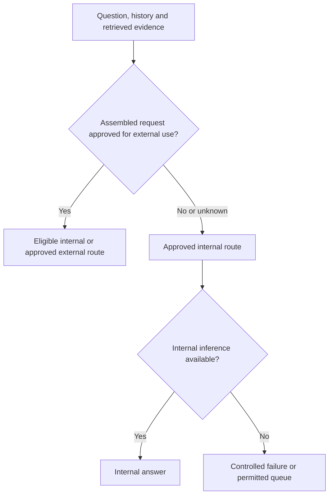

---
{
  "id": "blog-open-source-vs-closed-source-llms-2026",
  "title": "Open-Weight vs Closed API LLMs",
  "slug": "open-source-vs-closed-source-llms-2026",
  "author": {"name": "LeetLLM Team"},
  "publishedAt": "2026-03-16",
  "updatedAt": "2026-11-15",
  "verifiedAt": "2026-11-15",
  "refreshAfter": "2026-12-15",
  "excerpt": "Separate model rights from deployment control, evaluate the complete data path, and compare cost per accepted answer across hosted and self-hosted deployments.",
  "tags": ["LLMs", "AI Engineering", "Deep Dive", "Enterprise", "Open Models"],
  "coverImage": "social_banner.png",
  "featured": false,
  "draft": false
}
---

“Can we use an open model so the data stays private?” sounds like one decision. It contains two. Downloadable weights determine what you can run yourself. The deployment determines who receives the prompts, where logs go, and who can inspect them.

Suppose a support assistant handles public product questions and restricted incident records. Calling a third-party endpoint that serves an open-weight model still sends data to that third party. Running the same checkpoint inside an approved environment changes the data path, even though the model and its license stay the same.

A comparison of open and closed models becomes useful once those choices are separated. Start with the rights you need and the environments you may use. Then test the candidate deployments for quality, reliability, and cost.

> **Deployment scope:** Downloadable weights provide a deployment option. Your data rules and the actual request path determine whether that option is eligible.

<figure>
  
  <figcaption>Evaluate the operator, data path, and checkpoint. An external service receives your request even when it serves weights you could download yourself.</figcaption>
</figure>

## What does “open” actually give you?

**Open-weight** means the model parameters are available to download. The label alone doesn't tell you whether commercial use, modification, redistribution, or a particular application is permitted. Read the terms covering the exact checkpoint and its accompanying code.

Here, **open-source AI** follows the Open Source Initiative's Open Source AI Definition 1.0. A qualifying release grants freedoms to use, study, modify, and share, and provides parameters, complete training and inference code, and detailed training-data information under appropriate open terms.[^osi2024]

The data requirement is more precise than “publish the entire raw corpus.” It includes descriptions of unshareable data and listings of obtainable data, detailed enough for a skilled person to build a substantially equivalent system. Conversely, a short description such as “trained on web text and code” doesn't satisfy that requirement.[^osi2024]

**Source-available** describes inspectable artifacts whose terms restrict freedoms expected of open source. A release can be both source-available and open-weight. **Closed-weight API access** gives you a service interface without the parameters; it doesn't imply that every part of the provider's SDK or surrounding software is closed source.

Keep three questions separate in your evaluation notes:

| Question | Evidence to inspect |
|---|---|
| What can we access? | Weights, architecture, inference code, training code, data information |
| What may we do with it? | Exact licenses, use restrictions, attribution, redistribution and derivative terms |
| Who operates our deployment? | Hosting agreement, infrastructure account, network and storage isolation, access controls |

MIT terms on a checkpoint do not imply that its training code and data information are available. Calling it “open-weight under MIT” states the permission and access claims without claiming a reproducible training system. A family name still doesn't say what you may ship. What has to be true of the exact license before you build on that download?

## Read a license before building around it

The following releases were checked on **November 15, 2026** across distinct deployment models. This dated sample leaves the broader catalog and newer releases for separate review. A family name or download button alone gives too little deployment detail.

| Release | Published access and terms | What to verify for your use |
|---|---|---|
| Qwen3.6-35B-A3B | The official model card lists downloadable weights under Apache-2.0.[^qwen3635b2026] | Pin this checkpoint, its license files, and the code used to serve it; don't assume every Qwen release has identical terms |
| GLM-5.2 | The official model card lists downloadable weights under MIT and describes serving options.[^zai2026glm52] | Check the released artifacts and runtime dependencies separately from claims about the openness of the entire training process |
| Llama 4 | Downloadable materials use the custom Llama 4 Community License.[^meta2025llama4license] | Review use restrictions, attribution, naming, redistribution, and the additional commercial clause |
| GPT-5.6 Sol API | OpenAI documents hosted model access and service pricing.[^openai2026gpt56sol] | Review service terms and data controls; API access doesn't provide a checkpoint you can deploy independently |

Llama 4's license, effective April 5, 2025, shows why the distinction matters. It adds acceptable-use restrictions, requires attribution and “Built with Llama” display in specified distribution situations, and imposes naming duties for certain distributed models built using its materials or outputs. Its additional commercial clause applies when the licensee or affiliates exceeded 700 million monthly active users in the month preceding the release date.[^meta2025llama4license]

That license has different terms from MIT or Apache-2.0. Have the exact text reviewed against your planned product and distribution. Hosting a service, shipping a desktop app, and redistributing a fine-tuned checkpoint can create different obligations.

Save the license text and artifact revision with the deployment record. Read the files and check terms on adapters, datasets, and dependencies alongside the model card's license badge.

## Deployment changes the privacy question

The support assistant could run downloadable weights on company-operated infrastructure, call an external provider serving those weights, or call an external provider serving a closed-weight model. Both external options require scrutiny of the provider's data handling; their different weight-access terms don't settle that review.

A provider may offer regional processing, private connectivity, or a dedicated deployment. Those controls have different meanings. A private network connection controls the path; provider access and retention depend on separate terms and controls. When company rules require company-operated infrastructure, evaluate that requirement against the actual hosting environment.

OpenAI states that API data isn't used for model training unless you opt in. Its documentation also distinguishes abuse-monitoring logs from application state, with different retention controls by endpoint and feature.[^openai2026datacontrols] That answers one question. It doesn't confirm zero retention, a particular processing region, or whether a given endpoint and feature meet your organization's requirements. Verify those controls separately against the current service terms.

Self-hosting also needs a data-flow review. Prompts can escape through application traces, remote telemetry, crash reports, backups, or support tools. Record where requests, retrieved documents, outputs, and logs travel, along with who has access and how deletion works.

For the example assistant, assume restricted incident records may use only company-operated inference. Public material may use approved external services. That makes self-hosted candidates eligible for both classes and external candidates eligible only for public material. Apply those tier rules to this scenario; check each organization's data rules and provider terms for a real workload.

## Evaluate the full serving stack

A checkpoint plus its precision, runtime, prompt, tools, and decoding settings is the candidate you actually deploy. A <span data-glossary="quantization">quantized</span> checkpoint may behave differently from the full-precision release. A hosted model's managed tool implementation may differ from your own. Test that complete configuration.

Use a versioned task pack with answerable questions, missing evidence, conflicting rules, malformed inputs, and tool failures. Include rare but consequential cases instead of letting common easy questions dominate the score. Define what counts as an accepted answer before comparing systems: factual support, schema validity, permitted tool use, and whatever else the product requires.

Measure latency and quality together at the expected request mix and concurrency. Test retrieval from long inputs and serving capacity under load. Include <span data-glossary="kv-cache">KV cache</span>, runtime buffers, warm capacity, and headroom for failures. [Local LLM Deployment](/learn/local-llm-deployment-hardware-quantization) explains memory sizing; [GPU Serving & Autoscaling](/learn/llm-deployment-gpu-serving-autoscaling) covers load and queue behavior.

Open weights give you a route to checkpoint pinning and weight-level adaptation, subject to license and hardware support. They also make you responsible for validating the adapted or quantized version. Hosted services can offer managed features without transferring weights. Check feature support and versioning rules for the selected model. Task-specific evaluations measure quality for either ownership model.

Use [LLM Benchmarks & Limitations](/learn/llm-evaluation-benchmarks-limitations) to design comparisons. Public benchmark results can help select candidates; evaluate them on your data and operating conditions. Then compare quality with the full cost, including the work behind rejected answers.

## Compare the same costs on both sides

Suppose the public workload produces **50,000 requests per day**, each with **400 billable uncached input tokens** and **300 billable output tokens**. Count every billable token in those categories, including tokens omitted from the user-visible text. Assume one attempt per request and a 30-day month.

On November 15, 2026, GPT-5.6 Sol's current promotional rates are \$4 per million input tokens and \$20 per million output tokens, available through November 30, 2026. The page lists higher rates for prompts above 272K input tokens, which this example doesn't use.[^openai2026gpt56sol] This named release provides a dated arithmetic example. Choose a model for routine support work through task evaluation and workload fit. The generation-only calculation is:

- 20 million input tokens per day at \$4 per million: **\$80/day**.
- 15 million output tokens per day at \$20 per million: **\$300/day**.
- Thirty days at \$380/day: **\$11,400**.

This short-input example assumes no cache reads or writes and no batch discounts. A production calculator should use returned usage, the exact rate card, reasoning-token accounting, retries, and tool charges where applicable.

Now give both deployments an application budget and an operations budget. The amounts below, except the cited API rates, are **modeled assumptions for a monthly cost comparison**. Size a real GPU fleet from the selected model, workload, and measured capacity.

| Monthly category | Hosted API | Self-hosted |
|---|---:|---:|
| Model execution | \$11,400 in API charges | 4 GPUs × \$2.50/hour × 720 hours = \$7,200 |
| Application infrastructure and retrieval | \$2,000 | \$2,000 |
| Additional model storage and network | Included in this example's API charge | \$600 |
| Allocated operations labor | \$1,000 | \$4,000 |
| **Modeled total** | **\$14,400** | **\$13,800** |

Both sides use 30 days, or 720 hours. The totals exclude taxes, paid support, human review, migration, and additional resilience capacity. Add those categories when they differ; don't call this a complete production budget.

The self-hosted total is lower, but it may produce fewer acceptable answers. Assume the same grading rules accept 96% of hosted outputs and 90% of self-hosted outputs. These example rates anchor the comparison; measure acceptance on the target task pack.

<!-- leetllm: test, output=show, output_title="Modeled cost comparison" -->
```python title="workload_cost_model.py"
def cost_per_accepted(total: float, requests: int, acceptance: float) -> float:
    if total < 0:
        raise ValueError("total must be nonnegative")
    if requests <= 0:
        raise ValueError("requests must be positive")
    if not 0 < acceptance <= 1:
        raise ValueError("acceptance must be in (0, 1]")
    return total / (requests * acceptance)


days = 30
requests = 50_000 * days
hosted_generation = requests * (400 * 4 + 300 * 20) / 1_000_000
hosted_total = hosted_generation + 2_000 + 1_000
self_hosted_total = 4 * 2.50 * (24 * days) + 2_000 + 600 + 4_000
hosted_acceptance = 0.96
self_hosted_acceptance = 0.90
hosted_unit = cost_per_accepted(hosted_total, requests, hosted_acceptance)
self_hosted_unit = cost_per_accepted(self_hosted_total, requests, self_hosted_acceptance)
# Equal cost per accepted answer, with workload and monthly budgets fixed.
break_even_acceptance = self_hosted_total / (requests * hosted_unit)

print(f"Hosted: ${hosted_total:,.0f}/month; ${hosted_unit * 1_000:.2f}/1,000 accepted")
print(f"Self-hosted: ${self_hosted_total:,.0f}/month; ${self_hosted_unit * 1_000:.2f}/1,000 accepted")
print(f"Self-hosted break-even acceptance: {break_even_acceptance:.0%}")
```

<!-- leetllm: output:start -->
```text title="Modeled cost comparison" output compact
Hosted: $14,400/month; $10.00/1,000 accepted
Self-hosted: $13,800/month; $10.22/1,000 accepted
Self-hosted break-even acceptance: 92%
```
<!-- leetllm: output:end -->

At 90% acceptance, the smaller monthly bill buys fewer accepted answers and has the higher unit cost. Holding both budgets fixed, the self-hosted configuration reaches equal unit cost at 92% acceptance. Treat this as sensitivity analysis; estimate achievable acceptance and tuning cost from measured runs.

```checkpoint
The self-hosted configuration improves to 94% acceptance, but operations labor rises by \$600 per month. Does it now beat the hosted cost per accepted answer?
---
No. Its monthly total becomes \$14,400 and it produces 1,410,000 accepted answers, or about \$10.21 per 1,000 accepted. Hosted remains \$10.00. Improving acceptance doesn't lower unit cost if the budget changes too.
```

<figure>
  
  <figcaption>Only the assumed self-hosted acceptance rate changes. The crossing is conditional on unchanged workload, budgets, capacity, and grading rules.</figcaption>
</figure>

The daily total hides capacity needs. At 50,000 requests per day, the mean arrival rate is about 0.58 requests/s. A brief burst of 50 arrivals in ten seconds is 5 requests/s, about 8.6 times that mean. If each request occupies serving capacity for ten seconds on average, those rates imply roughly six versus fifty active requests under steady conditions. Queueing can make the burst worse. Load-test the four-GPU budget with the actual arrival pattern, context lengths, and latency target alongside the daily token total.

Before using either estimate, verify that the deployment can serve the offered traffic at the required latency and reliability. An assumed fleet price proves nothing about capacity. Also apply minimum quality requirements separately: a low cost per accepted answer doesn't excuse a forbidden action or an unacceptable rejection rate. If rejected requests trigger retries, fallbacks, or human work, include their costs and count successful user tasks without double-counting attempts.

Cost and quality still don't decide where a restricted record may go. If the preferred route is down, which destinations remain eligible?

## Keep fallback inside approved data tiers

The support assistant could use company-operated inference for restricted records and an approved API for public documentation. It could also use the company-operated deployment for both if that proves simpler. Add multiple routes when data rules or workload measurements justify them.

The subtle failure is classifying only the user's question. “Why did this upload fail?” may look public until retrieval adds a restricted customer incident. The **assembled request**, including conversation history, retrieved passages, tool results, and attachments, must satisfy the destination's requirements.

Use trusted source labels and access-control decisions to constrain routing. A model's guess that content “looks public” shouldn't authorize an external send. Unknown classification should stop or stay within the stricter approved environment, not default to a more capable external model.

The routing gate runs after evidence assembly. In this example, external routing needs both approved destination controls and a fully public request; public source labels don't replace the caller's access checks.



> **Outage rule:** A timeout changes availability. It doesn't change which destinations may receive restricted evidence.

Test the outage path explicitly. If the internal model times out on a restricted request, an external fallback remains ineligible. Return a controlled failure, queue the request if the service-level target allows it, or use another approved internal deployment. Validate and authorize any redaction separately before applying it to the routing decision.

```checkpoint
A public API question retrieves a restricted incident passage. The internal model times out. Can the gateway send the original public question and the assembled context to an approved external provider?
---
No. The restricted passage makes the assembled request ineligible under this scenario's data rules. A public question and an approved provider don't authorize that passage's transfer. The gateway needs an eligible internal route or a controlled failure. A newly assembled public-only request would need its own eligibility check and sufficient evidence to answer.
```

Record the destination, rule version, source classifications, eligibility result, and fallback reason without copying restricted content into an unrestricted audit system. [Model Gateways, Routing, and Fallbacks](/learn/llm-cost-engineering-token-economics) develops these checks in more detail.

## Write down what would change the decision

A short decision record should identify the checkpoint or API version, licenses, approved data classes, measured quality, load test, budget, and operational owner. Include a condition for reconsidering the choice: a new privacy requirement, failed latency target, changed provider terms, or sustained traffic that justifies a different capacity plan.

For the example assistant, restricted requests exclude external processing because company rules forbid it. Public requests leave more candidates to compare. Open weights offer independent deployment and adaptation options; managed APIs transfer much of the inference work to a provider. The useful answer names which control the product needs, what that control costs, and how the team verified it.
