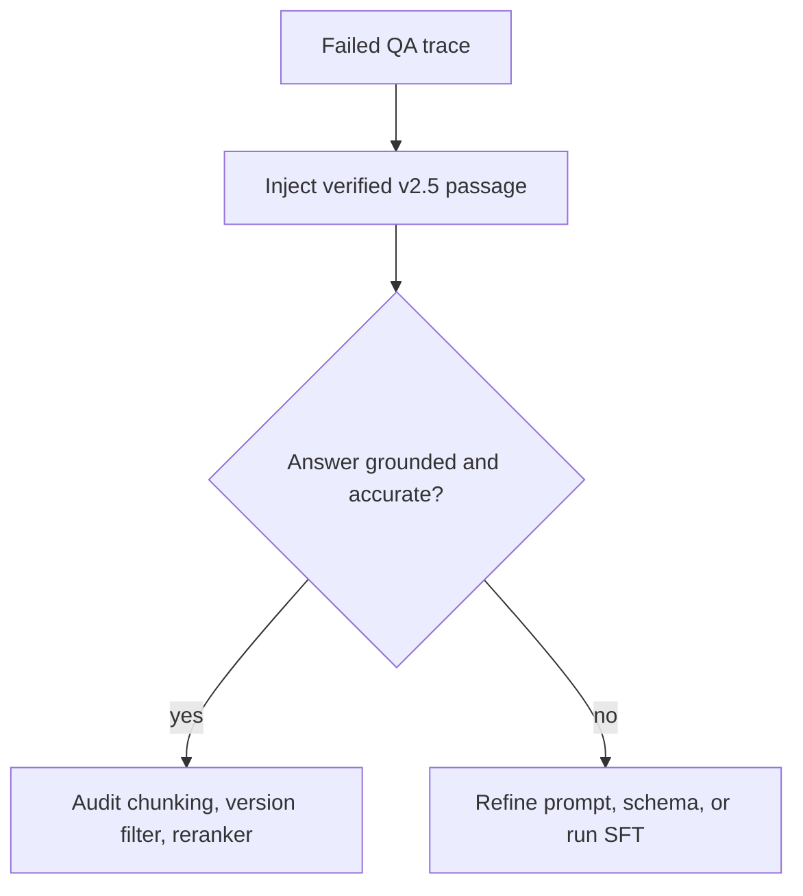

---
{
  "id": "blog-rag-vs-fine-tuning-vs-prompt-engineering",
  "title": "RAG vs Fine-Tuning vs Prompting: A Practical Guide",
  "slug": "rag-vs-fine-tuning-vs-prompt-engineering",
  "author": {
    "name": "LeetLLM Team"
  },
  "publishedAt": "2026-02-19",
  "updatedAt": "2026-11-15",
  "verifiedAt": "2026-11-15",
  "refreshAfter": "2027-01-08",
  "excerpt": "How prompting, retrieval-augmented generation (RAG), and fine-tuning act on different layers of an LLM system, and how to isolate retrieval failures from model behavior with controlled ablations.",
  "tags": [
    "AI Engineering",
    "RAG",
    "Fine-Tuning",
    "Prompting"
  ],
  "coverImage": "illustrations/_generated/three_approaches_dark.png",
  "featured": true,
  "draft": false
}
---

Teams building a specialized question-answering assistant often start with prompting, see mistakes once documents evolve or edge cases grow, and jump straight to fine-tuning or building a larger vector index. Before training weights or re-indexing, trace whether a bad answer failed because the model lacked the right source text or because it mishandled text already sitting in its prompt window. Separating evidence delivery from learned generation behavior lets you pick the smallest intervention that fixes the actual bottleneck and combine techniques cleanly when a system needs more than one layer.

Consider a developer documentation assistant supporting an inference runtime whose defaults changed between `v2.4` and `v2.5`: in `v2.5`, the KV-cache quantization default moved from `fp16` to `fp8`, requiring `--kv-cache-dtype fp16` for exact bitwise parity on regression suites. When an engineer asks *"Does setting `--max-model-len 32768` alone preserve FP16 KV parity in `v2.5`?"*, a poorly configured assistant fails for one of two completely different reasons. Either the retriever handed it a stale `v2.4` flag guide, or the retriever found the `v2.5` release note and the model still skipped the `--kv-cache-dtype` exception.

## Three intervention points in one inference stack

[Prompt engineering](/learn/prompt-engineering-fundamentals) modifies the instructions, formatting rules, and contrasting demonstrations placed directly inside the model request. <span data-glossary="rag">Retrieval-augmented generation (RAG)</span> looks up external documents at query time and injects relevant excerpts into that same input window. Fine-tuning updates all or a low-rank subset of the model weights on curated input-output pairs so learned patterns persist across requests without repeating lengthy demonstrations on every call.

These three levers are orthogonal rather than mutually exclusive stages in a fixed ladder. A RAG pipeline still needs prompt instructions telling the generator how to cite sources and abstain when passages lack an answer, while a fine-tuned model can read dynamically retrieved chunks at inference time. Understanding which mechanism edits the request text versus the learned parameters clarifies how each component behaves when the underlying documentation changes:

<figure>
  
  <figcaption>Prompting and retrieval reshape the input context per request, while supervised fine-tuning modifies the generator or attaches a lightweight LoRA adapter. Production assistants frequently combine all three paths.</figcaption>
</figure>

The same separation explains maintenance overhead during a software release. When `v2.5` changes CLI defaults, editing external markdown files updates retrieval immediately without launching a GPU training job, whereas teaching a compact 8B model to emit strict nested JSON abstentions reliably across thousands of requests may warrant training a small adapter:

| Intervention | What changes in the system | Runtime cost profile | Response to `v2.5` release change |
|:---|:---|:---|:---|
| Prompting | Instructions, rules, and few-shot pairs in the input text | Extra input tokens per request | Edit prompt text or paste updated migration excerpt immediately |
| RAG | External search index, metadata filters, and retrieved chunks | Embedding query, index lookup, and chunk tokens | Ingest `v2.5` docs and tag `v2.4` chunks as archived |
| Fine-tuning | Model weights or low-rank adapter matrices ($\Delta W = BA$) | Training GPU hours once; compact prompts at inference | Keep reading external `v2.5` docs; retrain only if output format or reasoning shifts |

## Run an oracle-evidence check before tuning weights or indexes

Open a failing trace and inspect the exact prompt strings that reached the language model rather than trusting a log entry that says "search succeeded." Often a vector query returned high similarity scores against an older `v2.4` migration guide, missed a flag caveat buried in a sibling table, or truncated the decisive paragraph when trimming chunks to fit context limits. Replacing the retrieved passages with a verified excerpt while keeping the model, question, and instructions constant creates a crisp **oracle-evidence test** that isolates retrieval failure from generation failure.

For the KV-cache parity question, assume you inject the verified `v2.5` release snippet directly above the user question:

> `[runtime-docs@v2.5, kv-cache section]` Starting in `v2.5`, `--kv-cache-dtype` defaults to `fp8` whenever `--quantization` is omitted. Passing `--max-model-len 32768` alone leaves FP8 KV storage active; pass `--kv-cache-dtype fp16` explicitly for FP16 parity.

Compare the assistant's answer under automated retrieval against its answer when given that exact excerpt. If accuracy jumps dramatically once the verified paragraph sits in context, model weights are not the primary bottleneck, so audit chunking, version metadata filters, lexical-plus-dense hybrid search, and reranker cutoffs next. If the model still ignores the explicit `--kv-cache-dtype fp16` caveat even with clean text directly in front of it, invest in clearer instructions, few-shot demonstrations, structured outputs, or targeted fine-tuning.



Repeat this controlled swap over a representative slice of positive, deprecated-flag, and intentionally unanswerable questions so one lucky fix cannot mislead you. Because pasting a single clean paragraph also removes noisy distractor chunks at the same time it supplies the missing fact, follow up by measuring how the generator handles clean evidence mixed with two or three topically similar distractor excerpts. Evaluating evidence delivery separately from evidence consumption keeps engineering effort focused on the stage actually dropping points.

> **Key insight:** A retrieval-backed model can still hold the right document inside its database and fail every user query. Always inspect the exact tokens passed to generation and run the oracle-evidence swap before blaming model capacity.

## Use prompting to structure reasoning, format, and abstention

Suppose your runtime assistant already receives the `v2.5` note cleanly, yet still answers *"yes, `--max-model-len 32768` keeps FP16 parity"* whenever a snippet discusses KV caching. Plain zero-shot phrasing like *"Answer the user's question using the docs"* leaves too much ambiguity about how to distinguish optional optimization flags from unchanged defaults or silent omissions. Adding explicit decision criteria alongside two or three contrasting few-shot examples often resolves this failure mode immediately without touching weights, matching Brown and colleagues' finding that in-context demonstrations steer task behavior without gradient updates.[^brown2020]

Pairing clear instructions with a structured JSON output schema forces the generator to declare its intermediate state explicitly before summarizing in prose. Schema constraints such as strict JSON Schema decoding guarantee syntactic adherence to field names and enums, though OpenAI's structured-output documentation emphasizes that valid JSON keys still allow semantically wrong field values.[^openai_structured_outputs] Validate syntax programmatically in Python, then score semantic grounding separately across labeled examples:

```json title="docs_assistant_response.json"
{
  "status": "flag_required",
  "version": "v2.5",
  "required_flag": "--kv-cache-dtype fp16",
  "evidence_id": "runtime-docs@v2.5#kv-cache",
  "summary": "v2.5 defaults KV storage to fp8, so setting --max-model-len 32768 alone requires adding --kv-cache-dtype fp16 for FP16 parity."
}
```

Prompting also shines as a lightweight baseline when the entire reference specification fits comfortably in a single request, such as a focused 12-page API changelog or compiler flag reference. Keeping a short guide directly in a stable cacheable system prefix avoids building ingestion jobs, embedding pipelines, and vector infrastructure prematurely while letting engineers verify prompt wording and abstention rate first. Only move beyond inline prompts when the reference corpus grows beyond clean single-window fitting, changes continuously across versions, or pushes recurring input-token latency and spend past what compact weights can deliver.

## Let RAG handle evolving facts, versions, and document access

Once your oracle-evidence benchmark succeeds reliably while automated runs fail on stale or multi-repository documentation, retrieval earns its operational complexity. Externalizing volatile facts into a search index lets your team ship `v2.5` and `v2.6` documentation updates in seconds without re-running gradient updates, reflecting the core separation between parametric knowledge and retrieved memory demonstrated by Lewis and colleagues.[^lewis2020] Modern production stacks typically start with frozen pretrained generators and hybrid lexical-plus-dense retrieval rather than training end-to-end retriever-generator checkpoints from scratch.

Ingestion splits source documents into coherent sections tagged with metadata fields including document ID, software version, effective status (`active` vs `archived`), and caller permission groups. At query time, dense embeddings match semantic paraphrases while lexical search (such as BM25 or exact symbol grep) prevents rare CLI flags like `--kv-cache-dtype` from slipping past embedding models, before a cross-encoder <span data-glossary="reranker">reranker</span> orders the final candidates. Crucially, versioning requires active metadata filtering rather than simply appending `v2.5` markdown alongside `v2.4`, because near-duplicate paragraphs across releases compete directly in cosine similarity.

<figure>
  
  <figcaption>Appending new release notes does not stop legacy docs from matching user keywords. Explicit version metadata filtering and caller ACL enforcement isolate active, permitted evidence before packing the context window.</figcaption>
</figure>

Access scoping and prompt-injection hygiene belong strictly in application code rather than prompt wording. Filter the search index by the authenticated caller's repository permissions before chunks ever reach the reranker, re-verify permissions when loading full text, and wrap retrieved snippets in clear delimiters marking them as untrusted external data rather than executable instructions. For rapidly changing runtime metrics or live cluster telemetry, query monitoring endpoints directly instead of copying ephemeral numbers into a vector store where they go stale minutes later. Consult [Designing a Production RAG Pipeline](/learn/design-production-rag-pipeline) for chunking, hybrid scoring, and permissioned index patterns in detail.

## Reserve fine-tuning for consistent behavior, format, and compact serving

When verified passages, crisp instructions, and few-shot examples still leave a persistent behavioral gap, or when embedding three thousand tokens of demonstrations into every request breaks latency and cost budgets, fine-tuning provides a principled upgrade path. <span data-glossary="supervised-fine-tuning">Supervised fine-tuning (SFT)</span> optimizes trainable parameters over input-target demonstrations using cross-entropy loss on completion tokens so desired reasoning patterns and formatting habits move directly into weights.[^huggingface2026sfttrainer] Freezing the pretrained backbone and inserting low-rank adapters (**LoRA**, $\Delta W = B A$ with rank $r \ll d$) keeps trainable parameters under 1% of full model size while cutting optimizer VRAM dramatically.[^hu2021]

Effective SFT datasets train the model on **how to read inputs**, not what static answers to memorize. Each training row should pair a complete realistic input context (question + retrieved doc snippet + target version) with the structured output derived strictly from that snippet, including negative examples where an omitted flag forces an `insufficient_evidence` abstention. Training solely on static pairs like *"Does v2.5 default to FP16 KV? -> No, pass --kv-cache-dtype fp16"* bakes brittle facts into weights that go wrong on `v2.6` and destroys performance whenever retrieved docs intentionally contradict base priors:

| Retrieved doc version | Excerpt present in context | Question focus | Expected structured `status` |
|:---|:---|:---|:---|
| `v2.4` | Default KV cache is `fp16` | Parity with `--max-model-len 32768` | `supported` (default in `v2.4`) |
| `v2.5` | Default KV cache changed to `fp8` | Parity with `--max-model-len 32768` | `flag_required` (`--kv-cache-dtype fp16`) |
| `v2.5` | Only memory allocator flags shown | KV dtype parity guarantee | `insufficient_evidence` (abstain and request KV section) |
| `v2.5` + `v2.4` conflict | Explicitly marked `v2.5` overrides `v2.4` | Active default in `v2.5` | `flag_required` (follow `v2.5` effective doc) |

```checkpoint
Your SFT dataset contains 500 pairs answering v2.5 CLI questions where every target returns `flag_required`. Why does holding out randomly sampled v2.5 rows fail to measure generalization?
---
A random split of identical behavior lets the model achieve high accuracy by always predicting `flag_required` without reading the retrieved snippet. A valid evaluation split must vary version tags, include `v2.4` rows expecting `supported`, and include stripped-evidence controls where abstention (`insufficient_evidence`) is required.
```

Research comparing retrieval with weight updates reinforces keeping volatile knowledge external whenever documentation changes frequently. Ovadia and colleagues evaluated unsupervised fine-tuning against RAG for injecting new factual knowledge and found RAG consistently outperformed weight-only updates on newly introduced facts.[^ovadia2024] Use [LoRA Parameter-Efficient Fine-Tuning](/learn/lora-parameter-efficient-fine-tuning) and [Supervised Fine-Tuning Pipeline](/learn/supervised-fine-tuning-pipeline) to size adapter ranks, mask prompt-token loss correctly, and evaluate base-capability retention before serving adapters in production.

> **Common mistake:** Fine-tuning weights on private engineering docs does not create per-user access controls inside the model. Never deploy one fine-tuned adapter trained on restricted repositories to users lacking read access to those sources; keep sensitive docs strictly outside weights behind query-time ACLs.

## Compare all four cells in a 2x2 ablation matrix

Never evaluate prompting, RAG, and fine-tuning purely on aggregate headline accuracy or compare a fine-tuned model with a newly refined prompt against an older baseline running a stale prompt. Keep task prompt, schema, and evaluation items locked while varying **evidence source** (automated retrieval vs verified oracle chunks) and **generator weights** (base model vs LoRA-tuned checkpoint) across a clean 2x2 factorial grid:

| Candidate | Input evidence | Generator model | Diagnostic question isolated |
|:---|:---|:---|:---|
| `A` | Verified oracle passages | Base model | Can the prompt and base model interpret clean evidence accurately? |
| `B` | Live automated RAG | Base model | How many points does the retrieval index currently drop relative to `A`? |
| `C` | Verified oracle passages | SFT / LoRA model | Does fine-tuning improve structured reasoning and abstention given perfect context? |
| `D` | Live automated RAG | SFT / LoRA model | Does fine-tuning improve end-to-end production behavior over `B`? |

Reading deltas across these four cells eliminates guesswork cleanly. If `A` and `C` both score 95%+ while `B` and `D` stall near 70%, fine-tuning is solving the wrong problem and retrieval recall needs work; if `B` already clears quality targets but costs too much because it requires 2,400 prompt tokens of demonstrations, `D` justifies tuning only if it matches quality with a leaner prompt. The script below computes both exact LoRA parameter overhead for a 32-layer Llama-style 8B architecture and a case-by-case paired regression check showing how small aggregate gains can conceal behavioral regressions:

<!-- leetllm: test, deps=numpy, output=show, output_title="LoRA adapter size and paired 2x2 ablation check" -->
```python title="ablation_and_lora_budget.py"
import numpy as np


def lora_parameter_budget(
    layers: int,
    hidden_dim: int,
    rank: int,
    adapted_projections: int = 4,
    base_params: int = 8_030_000_000,
) -> dict[str, float | int]:
    # Each adapted linear map adds A (hidden_dim x rank) + B (rank x hidden_dim).
    trainable = layers * adapted_projections * (2 * hidden_dim * rank)
    return {
        "trainable_params": trainable,
        "pct_of_base": 100.0 * trainable / base_params,
        "bf16_adapter_mb": (trainable * 2) / (1024**2),
    }


budget = lora_parameter_budget(layers=32, hidden_dim=4096, rank=16)

# Synthetic 100-question 2x2 ablation outcomes (1 = grounded pass, 0 = fail).
base_rag = np.array([1] * 70 + [0] * 30)
base_oracle = np.array([1] * 95 + [0] * 5)
tuned_rag = np.array([0] * 9 + [1] * 71 + [0] * 20)
tuned_oracle = np.array([1] * 98 + [0] * 2)

fixed = int(np.sum((base_rag == 0) & (tuned_rag == 1)))
regressed = int(np.sum((base_rag == 1) & (tuned_rag == 0)))

assert budget["trainable_params"] == 16_777_216
assert (int(base_rag.sum()), int(tuned_rag.sum())) == (70, 71)
assert (fixed, regressed) == (10, 9)

print(
    f"LoRA r=16 trainable params: {budget['trainable_params']:,} "
    f"({budget['pct_of_base']:.2f}% of 8.03B base, {budget['bf16_adapter_mb']:.1f} MiB BF16)"
)
print(
    f"2x2 accuracy (%): Base+RAG={base_rag.mean()*100:.0f}, "
    f"Base+Oracle={base_oracle.mean()*100:.0f}, "
    f"Tuned+RAG={tuned_rag.mean()*100:.0f}, "
    f"Tuned+Oracle={tuned_oracle.mean()*100:.0f}"
)
print(f"Paired RAG diff (Tuned vs Base): +1 net hides {fixed} fixed / {regressed} regressed")
```

<!-- leetllm: output:start -->
```text title="LoRA adapter size and paired 2x2 ablation check" output compact
LoRA r=16 trainable params: 16,777,216 (0.21% of 8.03B base, 32.0 MiB BF16)
2x2 accuracy (%): Base+RAG=70, Base+Oracle=95, Tuned+RAG=71, Tuned+Oracle=98
Paired RAG diff (Tuned vs Base): +1 net hides 10 fixed / 9 regressed
```
<!-- leetllm: output:end -->

Two numbers in that output settle most architecture debates before a single GPU run starts. First, replacing live retrieval with verified evidence lifts Base model accuracy by 25 percentage points (70% to 95%) while SFT adds only 1 net point under live retrieval (70% to 71%), proving retrieval quality governs the ceiling here. Second, joining outputs query-by-query uncovers 9 regressions hidden behind a "+1 net" aggregate improvement; if those 9 failures represent lost abstentions on missing docs rather than minor formatting slips, shipping the adapter degrades safety immediately.

Track total system cost across input tokens, GPU training runs, document ingestion jobs, freshness checks, and adapter version pinpoints whenever deploying hybrid combinations. Every production checkpoint should log the exact prompt template hash, index snapshot revision, and base-or-adapter ID together so any regression can be reproduced cleanly. When your 2x2 matrix identifies missing or stale chunks as the primary bottleneck, continue with [RAG Evaluation: Faithfulness and Relevance](/learn/rag-evaluation-faithfulness-relevance) to build automated slice diagnostics; once oracle accuracy still stalls or prompt tokens blow past latency targets, inspect [Supervised Fine-Tuning Pipeline](/learn/supervised-fine-tuning-pipeline) to curate paired behavior datasets safely.
