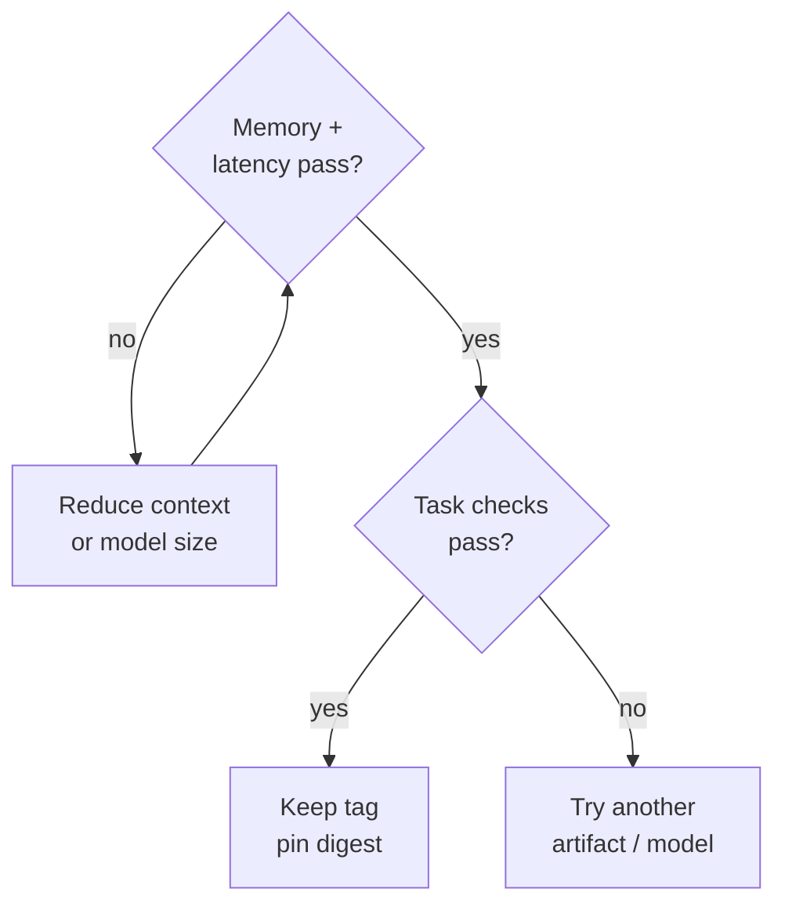
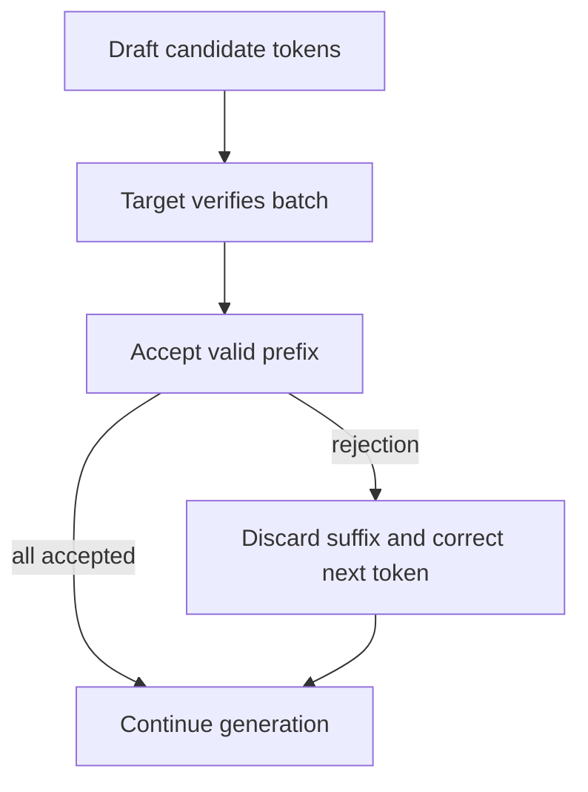

---
{
  "id": "blog-run-gemma4-local-ollama",
  "title": "Run Gemma 4 with Ollama: Model Tags and Memory Requirements",
  "slug": "run-gemma4-local-ollama",
  "author": {
    "name": "LeetLLM Team"
  },
  "publishedAt": "2026-04-02",
  "updatedAt": "2026-11-15",
  "verifiedAt": "2026-11-15",
  "refreshAfter": "2026-12-15",
  "excerpt": "Run Gemma 4 locally with Ollama. Choose a model tag, budget memory for context, verify GPU placement with ollama ps, and test the native API.",
  "tags": [
    "Local LLM",
    "Ollama",
    "Gemma 4",
    "Quantization",
    "GPU Inference"
  ],
  "featured": false,
  "draft": false,
  "coverImage": "social_banner.png"
}
---

You pull a model, ask one question, and get an answer. Then you give it a repository file and the response slows to a crawl. Nothing is obviously broken: the weights fit, but context memory and runtime buffers changed the plan. Check workload fit across memory, latency, and task quality after the first answer.

To find that stall, choose one artifact, check where the process runs at a stated context length, and save the timing record. The installation and inference commands document the workflow. The Python timing example uses sample response metrics; a local GPU run provides actual hardware measurements.

Ollama runs a local model server and exposes an HTTP API. It binds to `127.0.0.1:11434` by default, and that endpoint doesn't require authentication.[^ollama2026faq][^ollama2026authentication]

A local endpoint still needs access controls. Keep the bind address local unless you have deliberately added network controls, authentication, and TLS.

Gemma 4 is Google DeepMind's Apache 2.0 open-weights family. It has five sizes: E2B, E4B, 12B, 26B A4B, and 31B.[^gemma4modelcard2026]

E2B and E4B use per-layer <span data-glossary="embedding">embeddings</span>, so their total stored parameter counts exceed their effective parameter counts. The model card gives E2B and E4B 128K context limits, and 12B, 26B A4B, and 31B 256K limits.[^gemma4modelcard2026]

Those limits describe model context capacity. Measure whether your Ollama process can allocate the full window and keep the model in fast memory; a short prompt may succeed while a repository file stalls.

Google introduced the unified 12B model on June 3, 2026 for machines with 16 GB of <span data-glossary="vram">VRAM</span> or unified memory.[^google2026gemma412b]

Its current Q4_K_M Ollama artifact is 8.0 GB. Compare that download size with available memory, then test runtime fit on the target hardware. If memory is tight, compare `gemma4:e4b-it-qat`.[^ollama2026gemma4tags]

Ollama's published local tags currently advertise text and image input. Google's <span data-glossary="model-card">model card</span> lists native audio for E2B, E4B, and 12B, so treat local audio as unsupported until the exact Ollama tag advertises it.[^gemma4modelcard2026][^ollama2026gemma4tags]

In the tag names below, `qat` means <span data-glossary="quantization-aware-training">quantization-aware training (QAT)</span>. The model sees simulated low-precision behavior during training before its final weights are packed. That can change fit; measure task quality on the exact artifact you plan to run.

## Choose an exact Ollama tag

An Ollama tag names the variant and packaged artifact. It can also select <span data-glossary="quantization">quantization</span> or a runtime path. Before you compare quality, choose the exact artifact you intend to measure.

These published sizes were checked November 15, 2026. GB is the registry's rounded artifact size. Measure RAM and VRAM use with the intended context and runtime.[^ollama2026gemma4tags]

| Tag | Published artifact | Model limit | Start here when |
|---|---:|---:|---|
| `gemma4:e2b-it-qat` | 4.3 GB | 128K | Tightest local memory budget |
| `gemma4:e4b-it-qat` | 6.1 GB | 128K | E2B misses quality and 12B won't leave enough headroom |
| `gemma4:12b-it-q4_K_M` | 8.0 GB | 256K | 12B trial with room for cache and runtime |
| `gemma4:12b-it-qat` | 7.2 GB | 256K | Compare QAT quality and runtime with the 12B baseline |
| `gemma4:26b-a4b-it-qat` | 16 GB | 256K | Workstation trial with much more free memory |
| `gemma4:31b-it-qat` | 19 GB | 256K | Dense 31B comparison with clear memory margin |

`gemma4:cloud` and `gemma4:31b-cloud` call cloud models. A localhost API URL can still route to those models, so the URL alone doesn't prove local inference.[^ollama2026gemma4tags][^ollama2026authentication] For a local-only setup, disable cloud features in Ollama's configuration or set `OLLAMA_NO_CLOUD=1` in the server environment and restart it. Model downloads still require network access.[^ollama2026faq]

The 26B A4B model is a <span data-glossary="mixture-of-experts">Mixture-of-Experts</span> model with 25.2B total parameters and 3.8B active parameters per <span data-glossary="token">token</span>. Ollama rounds that active path to 4B.[^gemma4modelcard2026][^ollama2026gemma4]

The active count describes compute per token, while the total artifact determines weight-memory needs. The 4B active-parameter count applies to each token's routed path; the full model still has a much larger stored expert set.



> **Fit rule:** Keep the smallest exact tag that passes your task evaluation at the context length you actually use.

Avoid short aliases in benchmark scripts. `latest` currently names E4B, with registry variants spanning 6.6–9.5 GB. `26b` spans 16–19 GB. Neither alias fixes one quantization or backend.[^ollama2026gemma4tags] Even a descriptive tag can be updated: record the full digest returned by `/api/tags`, and retain the artifact if you need an exact <span data-glossary="rollback">rollback</span>.[^ollama2026tags] A pinned digest names the bytes. Measure those bytes against the context length, runtime buffers, and KV cache you intend to use.

## Budget runtime memory

Runtime memory also covers metadata, runtime buffers, prompt processing, the <span data-glossary="kv-cache">key-value (KV) cache</span>, and a safety margin beyond published artifact size.

The KV cache stores attention state from earlier tokens, so longer context and concurrent requests raise memory use. [Inference: TTFT, TPS & KV Cache](/learn/inference-mechanics-ttft-tps-kv-cache) is the place to size that cache instead of guessing from download size.

Keep units and memory pools consistent. An 8.0 GB file is approximately 7.45 GiB because a GiB is 2³⁰ bytes. That conversion still doesn't tell you its resident allocation. Discrete GPU VRAM is separate from host RAM; unified memory is shared with the OS and other applications.

For a 16 GiB unified-memory budget, reserve 4 GiB for the OS and applications. Suppose measured resident weights use 7 GiB and runtime buffers use 1 GiB. That leaves 4 GiB for cache and any additional margin. If each independent request needs 4 GiB of cache, one fills the budget and two require 20 GiB. This accounting example uses assumed round values; measure Gemma 4 on the target device and retain a safety margin.

<figure>
  
  <figcaption>Same weights, different request capacity. The assumed cache doubles with two independent requests and no sharing. Actual cache allocation depends on the model, context, cache precision, and runtime configuration.</figcaption>
</figure>

The final fit check happens after a real request. On a discrete <span data-glossary="gpu">GPU</span>, partial <span data-glossary="model-offload">CPU offload</span> can hurt latency.

On Apple Silicon, CPU and GPU share unified memory, so read `ollama ps` placement labels next to measured throughput. Benchmark the exact machine, tag, context, and workload. [Local LLM Deployment](/learn/local-llm-deployment-hardware-quantization) walks through the full weights-plus-cache-plus-reserve budget, including when to roll back a tag. A passing placement check doesn't show whether this tag generates fast enough at the context you will actually use.

## What QAT and MTP change

Fit and speed are different limits, and these two names get attached to both. QAT can change which artifact fits. <span data-glossary="multi-token-prediction">Multi-token prediction (MTP)</span> can change how many target passes a generation needs. Neither one replaces the placement check.

QAT simulates low-precision behavior during training so the model can adapt before weights are compressed. Google's official QAT release covers Q4_0 checkpoints and mobile-specific formats.[^google2026gemma4qat]

Ollama's explicit Q4_K_M and QAT tags use different quantization formats, so their published size gap mixes QAT with packaging. Current E2B sizes are 4.6 GB versus 4.3 GB, E4B 6.6 GB versus 6.1 GB, and 12B 8.0 GB versus 7.2 GB. Treat each tag as its own artifact instead of assuming one percentage.[^ollama2026gemma4tags] [Model Quantization: GPTQ, AWQ & GGUF](/learn/model-quantization-gptq-awq-gguf) explains how QAT differs from <span data-glossary="post-training-quantization">post-training quantization</span> and why GGUF is a container rather than a bit width.

<figure>
  
  <figcaption>Published artifact sizes differ by 0.3, 0.5, and 0.8 GB. Measure peak memory and compare quality with a controlled QAT ablation before attributing those differences to QAT.</figcaption>
</figure>

MTP is a speculative-decoding path. A small drafter proposes tokens and the target verifies them in a batch. Accepted drafts can raise generated-token throughput when saved target passes outweigh drafting and verification overhead. MTP doesn't shrink target weights or remove prompt-processing and KV-cache cost.[^google2026gemma4mtp]



Ollama's documented MTP path is runtime-specific. Ollama 0.31 added automatic MTP for Gemma 4 on Apple Silicon MLX. The published recipe is to update Ollama and re-pull `gemma4:12b-mlx`; no MTP flag is required.[^ollama2026gemma4mtp]

The separate `gemma4:31b-coding-mtp-bf16` artifact is 64 GB. The current 26B MTP Q4_K_M artifact is 19 GB. A tag containing `mtp` identifies packaging. Measure speed on your machine by checking the supported runtime and comparing generation rates with prompt, context, thinking mode, and sampling held constant. [Speculative Decoding](/learn/speculative-decoding) explains acceptance and correction in more detail.

## Install from the official package

Install Ollama from the official download page on macOS or Windows. On Linux, the official guide offers an install script and manual packages.[^ollamagithub2026][^ollama2026linux]

The commands below download the script for inspection before execution. `sh -n` checks shell syntax, not trustworthiness. Running the final installation command changes the machine; use your organization's approved package process where required.

```bash title="terminal"
curl --fail --location --proto '=https' --tlsv1.2 \
  https://ollama.com/install.sh --output ollama-install.sh
sh -n ollama-install.sh
less ollama-install.sh
sh ollama-install.sh
ollama --version
```

Pull one descriptive local tag. Check free disk first, because the pull stores several gigabytes. The walkthrough uses the Q4_K_M 12B artifact throughout; substitute a smaller tag consistently if necessary.

```bash title="terminal"
ollama pull gemma4:12b-it-q4_K_M
```

Check the server and save the artifact identity before generation. This Bash snippet requires `jq`. A failed `curl` means the server or HTTP request failed; a successful request followed by a failed selection means the expected tag was not found.[^ollama2026tags]

```bash title="verify-ollama.sh"
set -euo pipefail

curl --fail --silent --show-error http://127.0.0.1:11434/api/tags \
  --output ollama-tags.json
jq -e '.models[] | select(.name == "gemma4:12b-it-q4_K_M")
       | {name, digest, size, details}' ollama-tags.json
```

On a Linux manual install, start `ollama serve` in another terminal if no service is running. Desktop apps normally manage the server. Keep the bind address at `127.0.0.1` unless the deployment has a deliberate authentication, firewall, and TLS plan.[^ollama2026faq][^ollama2026authentication]

## Call the native API

The native `/api/generate` endpoint returns the response and runtime timing fields in one JSON record. It also accepts `num_ctx`, so it's a useful first benchmark surface.[^ollama2026generate][^ollama2026apiusage]

Set context explicitly. Ollama's context guide describes hardware-dependent defaults, while the FAQ gives 4096 as the baseline; neither is evidence of your running allocation. The example requests 8192 tokens, far below the model's advertised ceiling.[^ollama2026context][^ollama2026faq]

Disable streaming so one JSON object contains text and timings. Disable thinking for this short baseline so the output cap isn't consumed by a separate thinking response. Temperature zero reduces sampling variation; compare repeated runs because runtime and hardware can still change output.[^ollama2026generate]

```bash title="benchmark-gemma4.sh"
set -euo pipefail

curl --fail --silent --show-error \
  http://127.0.0.1:11434/api/generate \
  -H 'Content-Type: application/json' \
  -d '{
    "model": "gemma4:12b-it-q4_K_M",
    "prompt": "List three checks for a failing unit test.",
    "stream": false,
    "think": false,
    "keep_alive": "5m",
    "options": {
      "num_ctx": 8192,
      "num_predict": 128,
      "temperature": 0
    }
  }' > gemma4-12b-run.json

jq -e '.done == true and (.response | length > 0)' gemma4-12b-run.json
jq '{model, done, done_reason, prompt_eval_count, prompt_eval_cached_count, eval_count, total_duration,
     load_duration, prompt_eval_duration, eval_duration}' gemma4-12b-run.json
ollama ps
```

`ollama ps` shows allocated `CONTEXT` and `PROCESSOR` placement. Check both after generation. A CPU/GPU split shows partial placement; on unified memory also inspect system memory pressure.[^ollama2026faq][^ollama2026context]

Ollama reports durations in nanoseconds. `done: true` means generation ended. Check answer correctness and completeness separately. Inspect `done_reason`: a length limit can stop an answer halfway through.[^ollama2026apiusage][^ollama2026generate]

Generated-token rate is `eval_count / (eval_duration / 1e9)`. Prompt timing needs another step: Ollama reports the total input count as `prompt_eval_count`, cached input as `prompt_eval_cached_count`, and time spent evaluating uncached tokens as `prompt_eval_duration`. Subtract the cached count before calculating uncached prompt tokens per second.[^ollama2026generate]

Suppose a run record reports 1,000 input tokens, 800 cached tokens, and 0.2 seconds of prompt evaluation. The measured uncached rate is $(1000 - 800) / 0.2 = 1000$ tokens/second. Dividing the full input count by that duration would report 5,000 tokens/second and mistake cache reuse for faster computation. With no uncached input, report the uncached rate as unavailable rather than dividing by zero. Keep prompt rate and decode rate separate: a model can ingest a long file slowly and still generate quickly afterward.

The evaluator below checks positive generated counts and timings, a valid cached-token count, and a nonempty response that stopped with `done_reason: "stop"`. It checks a target <span data-glossary="slo">SLO</span> of at least 20 generated tokens/second and at most 5 seconds of server time. Verify task quality separately, since a confident but wrong answer can stop normally. These thresholds and stop checks measure runtime behavior.

The sample JSON payload below reports 128 generated tokens in 3.2 seconds: 40 tokens/second. Its server total is 3.42 seconds, so you can verify the rate formulas directly against those numbers. Save this code as `evaluate_ollama_run.py`; with no arguments it evaluates that built-in payload. Pass `--report` to evaluate your saved JSON file.

<!-- leetllm: test, output=show -->
```python title="evaluate_ollama_run.py"
import json
import sys
from pathlib import Path

def parse_ollama_metrics(payload: dict) -> dict[str, float | str | bool | None]:
    if payload.get("done") is not True:
        raise ValueError("Expected a completed non-streaming response")
    for field in ("eval_count", "eval_duration", "prompt_eval_count", "total_duration"):
        if payload.get(field, 0) <= 0:
            raise ValueError(f"Expected a positive integer: {field}")
    cache_state_known = "prompt_eval_cached_count" in payload
    cached = payload.get("prompt_eval_cached_count", 0)
    if not 0 <= cached <= payload["prompt_eval_count"]:
        raise ValueError("Cached count must be between zero and prompt count")
    uncached = payload["prompt_eval_count"] - cached
    prompt_duration = payload.get("prompt_eval_duration", -1)
    if prompt_duration < 0:
        raise ValueError("Expected a nonnegative integer: prompt_eval_duration")
    if uncached > 0 and prompt_duration == 0:
        raise ValueError("Uncached prompt tokens require positive evaluation time")
    response = payload.get("response") or ""
    normal_stop_with_text = (
        bool(response.strip())
        and payload.get("done_reason") == "stop"
    )
    decode_tps = payload["eval_count"] / (payload["eval_duration"] / 1e9)
    prompt_tps = uncached / (prompt_duration / 1e9) if cache_state_known and uncached else None
    total_seconds = payload["total_duration"] / 1e9

    return {
        "model": payload.get("model", ""),
        "cache_state_known": cache_state_known,
        "uncached_prompt_tokens_per_second": round(prompt_tps, 2) if prompt_tps is not None else None,
        "generated_tokens_per_second": round(decode_tps, 2),
        "server_total_seconds": round(total_seconds, 3),
        "normal_stop_with_text": normal_stop_with_text,
        "timing_passed": decode_tps >= 20.0 and total_seconds <= 5.0,
        "timing_and_stop_passed": normal_stop_with_text and decode_tps >= 20.0 and total_seconds <= 5.0,
    }

sample_response = {
    "model": "gemma4:12b-it-q4_K_M",
    "done": True,
    "done_reason": "stop",
    "prompt_eval_count": 16,
    "prompt_eval_cached_count": 0,
    "prompt_eval_duration": 180_000_000,
    "eval_count": 128,
    "eval_duration": 3_200_000_000,
    "total_duration": 3_420_000_000,
    "response": "1. Verify test inputs and initial state.\n2. Check assertion diffs.\n3. Isolate environment state.",
}

# Cache reuse must not inflate the uncached processing rate.
partly_cached = {**sample_response, "prompt_eval_count": 1000,
                 "prompt_eval_cached_count": 800, "prompt_eval_duration": 200_000_000}
assert parse_ollama_metrics(partly_cached)["uncached_prompt_tokens_per_second"] == 1000.0
fully_cached = {**sample_response, "prompt_eval_cached_count": 16, "prompt_eval_duration": 0}
assert parse_ollama_metrics(fully_cached)["uncached_prompt_tokens_per_second"] is None
truncated = {**sample_response, "done_reason": "length"}
assert parse_ollama_metrics(truncated)["timing_and_stop_passed"] is False

if __name__ == "__main__":
    payload = sample_response
    if "--report" in sys.argv:
        report_path = sys.argv[sys.argv.index("--report") + 1]
        payload = json.loads(Path(report_path).read_text())
    print(json.dumps(parse_ollama_metrics(payload), indent=2))
```

<!-- leetllm: output:start -->
```text title="Output" output compact
{
  "model": "gemma4:12b-it-q4_K_M",
  "cache_state_known": true,
  "uncached_prompt_tokens_per_second": 88.89,
  "generated_tokens_per_second": 40.0,
  "server_total_seconds": 3.42,
  "normal_stop_with_text": true,
  "timing_passed": true,
  "timing_and_stop_passed": true
}
```
<!-- leetllm: output:end -->

Run `python evaluate_ollama_run.py --report gemma4-12b-run.json` for the saved request. Server total and client wall time cover different intervals. A non-streaming response exposes no time-to-first-token (TTFT) event; use a streaming client and timestamps to measure user-visible TTFT.

Older logs may omit `prompt_eval_cached_count`. The evaluator then returns `cache_state_known: false` and leaves uncached prompt rate unavailable. Treat cache state as unknown until the runtime and experiment confirm it. Keep the raw response before comparing prompt-processing rates.

```checkpoint
Two responses have the same token counts and timings. Both stop normally, but one answers a different question. Which fields in the evaluator reveal that quality failure?
---
None. The evaluator measures timing and the stop condition. Add a separate task check, such as matching the requested assertions or validating extracted fields against the source file. A normal stop and a fast decode rate can both accompany an incorrect answer.
```

Separate cold model loading from warm requests. Preload with the same context allocation and keep-alive setting, then execute the benchmark before the model unloads:[^ollama2026faq][^ollama2026generate]

```bash title="warmup-gemma4.sh"
curl --fail --silent --show-error \
  http://127.0.0.1:11434/api/generate \
  -H 'Content-Type: application/json' \
  -d '{"model": "gemma4:12b-it-q4_K_M", "stream": false,
       "keep_alive": "5m", "options": {"num_ctx": 8192}}' > /dev/null
```

> **Measurement rule:** Record cold and warm trials separately. Repeating identical prompts can reuse prompt work, so label cache state and use representative distinct prompts when measuring prefill. Hold tag, context, thinking, sampling, output cap, concurrency, and machine load constant.

The native call can pin context. A client that already speaks the OpenAI API cannot pass that same field, so a localhost URL does not by itself keep the window you just measured.

## Use the OpenAI-compatible API carefully

Ollama supports `/v1/chat/completions` and the non-stateful flavor of `/v1/responses`. Point the client at `http://127.0.0.1:11434/v1/` and use a placeholder key such as `ollama`. The local server ignores that key.[^ollama2026openai]

Compare supported fields and behavior before moving a hosted integration to this API.

OpenAI-compatible requests don't set Ollama context size per request. To pin context, create a derived model:

```text title="Modelfile"
FROM gemma4:12b-it-q4_K_M
PARAMETER num_ctx 8192
```

Then create it and call the derived name:

```bash title="terminal"
set -euo pipefail

ollama create gemma4-12b-8k -f Modelfile
curl --fail --silent --show-error \
  http://127.0.0.1:11434/v1/chat/completions \
  -H 'Authorization: Bearer ollama' \
  -H 'Content-Type: application/json' \
  -d '{
    "model": "gemma4-12b-8k",
    "messages": [{"role": "user", "content": "Reply with local-ready"}],
    "stream": false
  }' | jq -e '.choices[0].message.content | select(type == "string" and length > 0)'
```

Ollama's OpenAI compatibility docs say `/v1/responses` arrived in Ollama 0.13.3.[^ollama2026openai]

It doesn't support `previous_response_id` or `conversation` state. Keep conversation state in the application when the integration depends on Responses API semantics.

## Keep the template and modalities inside the runtime

Gemma 4 uses standard `system`, `user`, and `assistant` roles. Google recommends sampling with <span data-glossary="temperature">temperature</span> 1.0, <span data-glossary="top-p">top-p</span> 0.95, and <span data-glossary="top-k">top-k</span> 64 for general model behavior.[^gemma4modelcard2026][^ollama2026gemma4]

Temperature zero fixes a test condition; Google's quality recommendations are separate. Thinking mode changes the workload too: if enabled, preserve and inspect the separate thinking field, allow enough generation budget, and report the mode with results.[^ollama2026generate]

Ollama applies the model <span data-glossary="chat-template">chat template</span> when you use chat endpoints, so pass roles and content instead of assembling control tokens by hand.[^ollama2026gemma4]

For native API images, use its documented base64 `images` field and let Ollama assemble the multimodal input.[^ollama2026generate] The listed local tags advertise text and image only. Google's model-level audio support doesn't confirm support in a particular Ollama artifact.[^ollama2026gemma4tags]

## Diagnose from the symptom

| Symptom | Inspect | Next test |
|---|---|---|
| `curl` gets connection refused | Ollama service | Start the app or `ollama serve`, then retry `/api/tags` |
| Pull stops | Free disk and exact error | Free space, then retry the exact tag |
| Model loads but the machine swaps | Context and total process memory | Lower `num_ctx` or use a smaller QAT tag |
| Discrete GPU shows a CPU split | `ollama ps` `PROCESSOR` | Lower context or model size, then rerun latency |
| First response is much slower | `load_duration` | Warm the model, then compare warm trials |
| Request ends without a full answer | `done_reason`, response, and thinking fields | Disable thinking for the baseline or raise the output cap |
| Generated tokens are slow | `eval_duration` and `eval_count` | Compare the exact tag and runtime with context fixed |
| QAT fits but answers regress | Task-specific acceptance set | Keep the larger artifact or choose a different model |
| Audio request fails | Ollama tag capabilities | Use a supported runtime, or treat the workflow as unsupported |

Don't change tag, prompt, context, sampling, and runtime together. One changed variable lets the run record answer one question.

Start with service and tag checks, then placement, then context, then timing, then task quality. Once a single tag survives that order, compare it with another tag without mixing the causes.

## Build a reproducible local comparison

Hold the machine, context, and sampling still, and change one thing on purpose. Use three prompt classes: short structured extraction, a realistic repository explanation, and fixed-length generation. The first isolates instruction following, the second introduces realistic context pressure, and the third exposes sustained decode speed.

Warm each tag once, run several measured trials, and store the raw JSON. Record:

```text title="gemma4-run-record.txt"
machine: <CPU, GPU, and memory>
ollama_version: <ollama --version>
tag: gemma4:12b-it-q4_K_M
tag_digest: </api/tags digest>
context: 8192
processor: <ollama ps PROCESSOR>
prompt_pack: <path or commit>
sampling: temperature=0
thinking: false
output_cap: 128
concurrency: 1
warm_state: <cold model, warm model, repeated prompt>
client_wall_seconds: <measured separately>
raw_response: gemma4-12b-run.json
```

Pin a tag, separate download size from runtime memory, and read a timing log without treating cache hits as faster math. Latency still isn't quality. Write task checks before you compare, such as valid <span data-glossary="json-schema">JSON schema</span>, correct failing assertions, or a cited answer from a source file. A faster tag loses if it misses the required behavior. Keep the smallest tag that meets both quality and latency budgets under real context.
