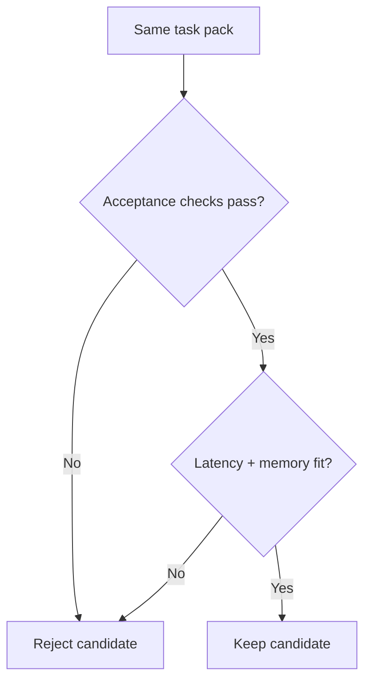

---
{
  "id": "blog-run-qwen35-local-ollama",
  "title": "Qwen3.5 Ollama Guide Is Retired",
  "slug": "run-qwen35-local-ollama",
  "author": {
    "name": "LeetLLM Team"
  },
  "publishedAt": "2026-03-02",
  "updatedAt": "2026-11-15",
  "verifiedAt": "2026-11-15",
  "refreshAfter": "2026-12-15",
  "excerpt": "This Qwen3.5 Ollama guide is retired. Use the Qwen3.6 Unsloth GGUF guide for the replacement local coding setup.",
  "tags": [
    "Local LLM",
    "Ollama",
    "Qwen3.5"
  ],
  "featured": false,
  "draft": true,
  "private": true,
  "redirectTo": "/blog/run-qwen36-local-unsloth-gguf",
  "coverImage": "social_banner.png"
}
---
Your first Qwen3.5 response can look healthy and still miss its latency budget. A model may return valid JSON while part of it runs on the CPU, or while a cold load dominates the wait. The response, placement, and timing records answer different questions.[^ollama2026context][^ollama2026apiusage]

Stay with an existing `qwen3.5:9b-q4_K_M` setup. Record the artifact Ollama actually resolved, choose the context length instead of accepting a default, check one native API response, and save enough evidence to compare a replacement. Commands use Bash, `curl`, and `jq`. They download about 6.6 GB of weights if the model isn't already present.

This retired page preserves maintenance guidance for existing Qwen3.5 tags, Modelfiles, and benchmark history. Its replacement is [Run Qwen3.6 Locally with Unsloth GGUF](/blog/run-qwen36-local-unsloth-gguf); [Run Gemma 4 Locally with Ollama](/blog/run-gemma4-local-ollama) covers another setup. Benchmark a replacement against your current model before migrating.

> **Review scope:** Catalog, model cards, and API documentation were checked on November 15, 2026. Shell syntax and offline memory arithmetic were tested. A target-machine review still needs to download weights, run Ollama generation, and benchmark hardware. The retirement label reflects LeetLLM's editorial guidance; consult Ollama's catalog for support status.

## Choose an exact Ollama artifact

Ollama's Qwen3.5 catalog currently lists seven primary local aliases: `0.8b`, `2b`, `4b`, `9b`, `27b`, `35b`, and `122b`. The primary tags accept text and images, and the family page exposes vision, tool, and thinking capabilities.[^qwen352026]

Those aliases are useful entry points. Check explicit quantized and runtime-specific variants for complete runtime details. The table selects exact GGUF tags checked on November 15, 2026; an alias can select other artifacts. These published download sizes are separate from runtime memory requirements:

| Family alias | Qwen shape | Selected GGUF artifact | Exact tag after `qwen3.5:` |
|---|---|---:|---|
| `qwen3.5:0.8b` | 0.8B dense | 1.0 GB | `0.8b-q8_0` |
| `qwen3.5:2b` | 2B dense | 2.7 GB | `2b-q8_0` |
| `qwen3.5:4b` | 4B dense | 3.3 GB | `4b-q4_K_M` |
| `qwen3.5:9b` | 9B dense | 6.6 GB | `9b-q4_K_M` |
| `qwen3.5:27b` | 27B dense | 17 GB | `27b-q4_K_M` |
| `qwen3.5:35b` | 35B-A3B MoE | 22 GB | `35b-a3b-q4_K_M` |
| `qwen3.5:122b` | 122B-A10B MoE | 81 GB | `122b-a10b-q4_K_M` |

The `35b` and `122b` families are <span data-glossary="mixture-of-experts">Mixture of Experts</span> (MoE) models. Their checkpoints contain 35B and 122B total parameters, while each <span data-glossary="token">token</span> activates 3B and 10B parameters respectively.[^qwen3535ba3b2026][^qwen35122ba10b2026] Active parameters affect compute, but total stored weights still drive artifact and residency requirements.

`qwen3.5:9b` and `latest` currently share an alias manifest, but the catalog lists a 6.6–7.6 GB range across runtime variants. The `0.8b`, `2b`, `4b`, and `27b` aliases also list ranges. Resolve the exact encoding with an explicit <span data-glossary="quantization">quantization</span> tag such as `qwen3.5:9b-q4_K_M`, then record the digest from Ollama's tags endpoint. Preserve both the digest and underlying blobs for future replay.

`Q4_K_M` and `Q8_0` name low-bit <span data-glossary="tensor">tensor</span> encodings inside Ollama's GGUF artifacts. The current 9B <span data-glossary="bf16">BF16</span> tag is 19 GB, compared with 6.6 GB for `Q4_K_M`. Tags marked `MLX`, including `mxfp8` variants, belong to a different runtime lane.[^qwen352026] [Model Quantization: GPTQ, AWQ & GGUF](/learn/model-quantization-gptq-awq-gguf) explains why GGUF is a container while names such as `Q4_K_M` identify the encoding inside it.

Local memory planning starts with a downloaded local artifact. Resolve the selected tag before measuring it because Ollama can also route requests to its cloud service.[^ollama2026faq] A local digest confirms which bytes you downloaded. Measure running allocation separately from the catalog's download size.

<figure>
  
  <figcaption>The chart preserves the archived October 10, 2026 catalog snapshot. These exact-tag downloads use different formats: the two smallest selected tags use Q8_0, while the others use Q4_K_M.[^qwen352026tags] Measure runtime memory separately from download size.</figcaption>
</figure>

## Turn artifact size into a memory budget

The process also allocates buffers, recurrent state, and a <span data-glossary="kv-cache">KV cache</span> for attention alongside the downloaded weights. The backend that provides them depends on the artifact and platform. The current catalog includes a separate MLX path for Apple Silicon. Treat GGUF and MLX as distinct configurations and benchmark each on its target platform.[^ollamagithub2026][^ollama2026mlx]

The cache retains keys and values from earlier tokens. Recurrent layers instead update a compact state as tokens arrive. Qwen3.5-9B is hybrid: its 32 layers include 24 Gated DeltaNet layers and eight full-attention layers. Applying a 32-layer ordinary Transformer KV formula would overcount the full-attention cache while overlooking the separate recurrent state.[^qwen359b2026]

On a discrete <span data-glossary="gpu">GPU</span>, video memory (VRAM) and host RAM are separate budgets. On Apple Silicon they share one unified-memory pool: moving work to the CPU doesn't create another pool for oversized weights. Also keep units consistent: a GB is one billion bytes, while a GiB is 1,073,741,824 bytes. The catalog's rounded 6.6 GB is about 6.15 GiB; actual loaded allocation can differ from either number.

For a concrete cache estimate, assume one sequence, 16-bit floating-point (FP16) keys and values, and no shared prompt cache between requests. Eight attention layers × four KV heads × 256 elements per head × two tensors × two bytes gives **32,768 bytes per cached token**. At 8,192 tokens, that's 0.25 GiB of attention KV; at 65,536, it's 2 GiB. Add weights, recurrent state, image-processing buffers, workspace, allocator overhead, and other applications to estimate total memory.[^qwen359b2026]

<figure>
  
  <figcaption>Context and concurrency consume the same cache budget. These calculations cover attention only; measure backend allocation and account for Qwen's recurrent state to estimate total Ollama memory.</figcaption>
</figure>

For a 16 GiB host, reserve 4 GiB for other work and use 6.15 GiB as a rough weight proxy. That leaves 5.85 GiB before runtime allocations. The 8K attention estimate leaves 5.60 GiB; the four-sequence 32K estimate leaves 1.85 GiB. Use this subtraction to screen configurations for measurement. The artifact is a download-size estimate, and runtime allocations can consume the apparent headroom.

This dependency-free Python script reproduces those numbers. It counts attention K/V only, so the recurrent state and runtime buffers remain outside the estimate:

<!-- leetllm: test, output=show, output_title="Qwen3.5-9B attention cache estimates" -->
```python title="qwen35_attention_cache.py"
LAYERS, KV_HEADS, HEAD_DIM = 8, 4, 256
BYTES_PER_TOKEN = LAYERS * KV_HEADS * HEAD_DIM * 2 * 2  # K and V, FP16
GIB = 2**30


def cache_gib(tokens_per_sequence: int, sequences: int = 1) -> float:
    return tokens_per_sequence * sequences * BYTES_PER_TOKEN / GIB


print(f"bytes per token: {BYTES_PER_TOKEN:,}")
for label, tokens, sequences in [
    ("1 x 8K", 8192, 1),
    ("1 x 32K", 32768, 1),
    ("1 x 64K", 65536, 1),
    ("4 x 32K", 32768, 4),
]:
    print(f"{label}: {cache_gib(tokens, sequences):.2f} GiB")

host_budget = 16 - 4 - 6.15
print(f"headroom before cache: {host_budget:.2f} GiB")
print(f"after 1 x 8K: {host_budget - cache_gib(8192):.2f} GiB")
print(f"after 4 x 32K: {host_budget - cache_gib(32768, 4):.2f} GiB")
```

<!-- leetllm: output:start -->
```text title="Qwen3.5-9B attention cache estimates" output compact
bytes per token: 32,768
1 x 8K: 0.25 GiB
1 x 32K: 1.00 GiB
1 x 64K: 2.00 GiB
4 x 32K: 4.00 GiB
headroom before cache: 5.85 GiB
after 1 x 8K: 5.60 GiB
after 4 x 32K: 1.85 GiB
```
<!-- leetllm: output:end -->

> **Sizing rule:** Keep available memory comfortably above the published artifact. Then measure the loaded process at target context and concurrency. [Local LLM Deployment](/learn/local-llm-deployment-hardware-quantization) gives the full weights, cache, buffers, reserve, and offload budgeting method.

Use your already-working tag as the baseline. If no configuration fits comfortably, start with a smaller artifact, one request at a time, and short context. A model-size-to-hardware-tier table would hide the runtime and workload variables that determine fit.

## Install, pull, and capture the tag

Start with a narrow question: is Ollama running, and can its loopback API answer? Install Ollama through the official project instructions, then run both checks before pulling weights.[^ollamagithub2026]

```bash title="verify-ollama.sh"
set -euo pipefail
ollama --version
curl -fsS http://127.0.0.1:11434/api/version | jq
```

If the HTTP check fails, open the Ollama desktop app or run `ollama serve` in a separate terminal. Don't start a second server when another process already owns port 11434. The next command deliberately pulls the explicit tag; skip the pull only when preserving an older installed artifact is part of your experiment.

### Capture the resolved model

Pull the requested quantization tag, then query Ollama's local tag inventory. The script keeps the requested name beside the digest that Ollama actually resolved.[^ollama2026tags]

```bash title="capture-qwen35-model.sh"
set -euo pipefail
MODEL=qwen3.5:9b-q4_K_M
ollama pull "$MODEL"

curl -fsS http://127.0.0.1:11434/api/tags |
  jq -e --arg model "$MODEL" '
    [.models[] | select((.name | ascii_downcase) == ($model | ascii_downcase))]
    | if length != 1 then error("expected exactly one model") else .[0] end
    | if (.digest | type) != "string" or (.digest | length) == 0
      then error("missing digest") else . end
    | {requested: $model, name, digest, size, details}
  ' > qwen35-model.json
jq '{requested, digest, size}' qwen35-model.json
```

The final command prints the selected tag, digest, and byte size. A missing tag or digest exits nonzero instead of silently accepting an empty record. Don't use the output file after any failed command. If a later pull resolves the same tag to a different digest, treat it as a new artifact.

Also save the installed model's configuration. The native `/api/show` endpoint returns its template, parameters, model information, and capabilities; recent releases also expose thinking metadata. The generation guide recommends checking that metadata before choosing thinking controls.[^ollamagithub2026][^ollama2026generate]

```bash title="capture-qwen35-configuration.sh"
set -euo pipefail
MODEL=qwen3.5:9b-q4_K_M
curl -fsS http://127.0.0.1:11434/api/show \
  -H 'Content-Type: application/json' \
  -d "$(jq -n --arg model "$MODEL" '{model: $model}')" \
  > qwen35-show.json
jq -e 'if .error then error(.error) else {details, capabilities, thinking, parameters} end' \
  qwen35-show.json
```

Keep the full file even though the printed view is small. Older Ollama versions may omit `thinking` from the response, so record the version and check its supported controls before applying an effort name from another model.

Derived Modelfiles need the same discipline. `FROM qwen3.5:9b` records a mutable base alias. Use a fully qualified quantization tag in the Modelfile and save the base model's digest in the benchmark record. Measure context allocation on the target machine; the record identifies weights only.

## Set context deliberately

The catalog lists 256K context. Qwen's 9B model card gives 262,144 native tokens and describes a separate extension configuration. Measure how much context a local Ollama run allocates. The dedicated Ollama context page documents VRAM-based defaults: below 24 GiB, 4K. From 24 to below 48 GiB, 32K. At least 48 GiB, 256K. The FAQ still says 4,096 by default, so set and inspect context explicitly because the documentation differs.[^qwen352026][^qwen359b2026][^ollama2026context][^ollama2026faq]

Start the <span data-glossary="smoke-test">smoke test</span> at 8,192 tokens, or smaller if memory is tight. Move to 32,768 or 65,536 when the task needs it and measured placement and latency remain acceptable. Ollama recommends at least 64,000 tokens for long-context tools; verify hardware fit at that size. Instructions, chat history, tool results, and generated output all need room in the window.[^ollama2026context]

Ollama **Modelfiles** bake configuration into a derived local tag. Use one when the same context length, <span data-glossary="temperature">temperature</span>, and system prompt should apply across sessions. This file changes those defaults without replacing the Qwen <span data-glossary="chat-template">chat template</span>:

```text title="Qwen-Dev.Modelfile"
FROM qwen3.5:9b-q4_K_M
PARAMETER num_ctx 8192
PARAMETER temperature 0.3
SYSTEM """You are a precise coding assistant. Respond in Markdown. Be concise."""
```

Build and run the derived model, then inspect what was allocated:[^ollama2026modelfile]

```bash title="create-qwen35-dev.sh"
set -euo pipefail
ollama create qwen-dev -f Qwen-Dev.Modelfile
ollama run qwen-dev
# Exit the interactive chat with /bye first.
ollama ps
```

The same setting has a different control surface for each client:

| Client path | Context control |
|---|---|
| Interactive `ollama run` | `/set parameter num_ctx 32768` |
| Native `/api/chat` or `/api/generate` | `"options": {"num_ctx": 32768}` |
| OpenAI-compatible `/v1` | Derived Modelfile tag or server-wide `OLLAMA_CONTEXT_LENGTH` |

Ollama's compatibility layer exposes context through the derived model or server configuration rather than an OpenAI request field. Use the derived model name with `/v1`; an output-token limit does not set context allocation. A server-wide setting such as `OLLAMA_CONTEXT_LENGTH=64000 ollama serve` applies to that server process. Configure and restart the actual server using the platform-specific instructions.[^ollama2026openai][^ollama2026context][^ollama2026faq]

## Verify the local API behavior

Keep the first API check small enough that a failure has one likely cause. Ollama exposes parts of the OpenAI API at `http://127.0.0.1:11434/v1/`, but the native endpoint exposes the controls needed for this diagnosis. The local API doesn't require authentication, so keep port 11434 on loopback unless an authenticated proxy and network rules sit in front of it.[^ollama2026openai][^ollama2026authentication]

Use non-streaming native output for the first repeatable check. This request uses the base tag and excludes the optional `qwen-dev` system prompt above. Stop other loaded models before measuring if they would compete for memory. One JSON object contains the model response, completion state, and timing fields. `think: false` requests non-thinking output. The small output cap and fixed seed configure this smoke test; assess coding quality and cross-hardware repeatability separately.[^ollama2026generate][^ollama2026apiusage]

```bash title="run-qwen35-check.sh"
set -euo pipefail
curl -fsS http://127.0.0.1:11434/api/generate \
  -H 'Content-Type: application/json' \
  -d '{
    "model": "qwen3.5:9b-q4_K_M",
    "prompt": "Return JSON only: {\"status\":\"ready\",\"checks\":[\"local-generation\"]}",
    "stream": false,
    "think": false,
    "keep_alive": "5m",
    "format": "json",
    "options": {
      "num_ctx": 8192,
      "num_predict": 64,
      "temperature": 0,
      "seed": 42
    }
  }' > qwen35-run.json
```

Validate both layers of the response: Ollama's outer `.done` flag and the JSON object nested inside `.response`.[^ollama2026generate]

```bash title="validate-qwen35-check.sh"
set -euo pipefail
jq -e '
  .done == true
  and .done_reason == "stop"
  and (
    (.response | fromjson) as $body
    | $body.status == "ready"
    and ($body.checks | type) == "array"
    and $body.checks == ["local-generation"]
  )
' qwen35-run.json
ollama ps
```

The validator prints `true` and exits zero for the required fields. It rejects malformed JSON, a string masquerading as the `checks` array, and a length-limited completion. It also rejects a missing or unfamiliar stop reason; inspect an older runtime's raw response before adjusting that check. It does not measure task quality or memory headroom. Run `ollama ps` promptly while the model is still resident, and inspect both `PROCESSOR` and `CONTEXT`.

Decode throughput uses the returned token count and nanosecond duration. The guard requires positive integer token and decode-duration fields, plus nonnegative integer total and load durations. Missing, fractional, and wrong-type values fail instead of becoming a plausible rate:[^ollama2026apiusage]

```bash title="read-qwen35-timing.sh"
jq -e '
  def nonnegative_integer: type == "number" and . >= 0 and . == floor;
  if (.eval_count | nonnegative_integer and . > 0)
     and (.eval_duration | nonnegative_integer and . > 0)
     and (.total_duration | nonnegative_integer)
     and (.load_duration | nonnegative_integer)
  then {
    generated_tokens: .eval_count,
    decode_tokens_per_second: (.eval_count * 1e9 / .eval_duration),
    total_seconds: (.total_duration / 1e9),
    load_seconds: (.load_duration / 1e9)
  }
  else error("invalid generated-token timing")
  end
' qwen35-run.json
```

For 64 tokens in 2,000,000,000 ns, this reports 32 tokens/s. That excludes loading and prompt evaluation. Measure client-observed time to first token separately, from request start to the first streamed content token. Report cold loads separately from warm runs, and retain every failed attempt.

Current usage docs distinguish `prompt_eval_count` (all input tokens), `prompt_eval_cached_count` (reused input tokens), and `prompt_eval_duration` (time evaluating uncached input tokens). A second run of the same prompt can have a warm model and a reused prefix. Those are separate advantages. Preserve the cache count when comparing prefill; if a runtime omits it, don't invent a hit count or divide all prompt tokens by an uncached-only duration.[^ollama2026apiusage]

For custom scripts, Ollama also supports parts of the OpenAI API, including `/v1/chat/completions` and `/v1/responses`.[^ollama2026openai] Point an SDK at `http://127.0.0.1:11434/v1/`, use a placeholder key such as `ollama`, and send `model: "qwen3.5:9b-q4_K_M"` to match the baseline artifact. `/v1/responses` is non-stateful, so `previous_response_id` and `conversation` don't preserve server-side history.[^ollama2026openai]

A loopback URL can still route cloud-model names through Ollama. For a local-only deployment, use local tags and configure `OLLAMA_NO_CLOUD=1` on the server, then restart it and check its logs. This disables Ollama's cloud features; separately inspect network calls from any editor, agent, or tool.[^ollama2026faq]

## Read failures from evidence

When a local run fails, change one layer at a time. First separate a down service from a missing model. Then separate model fit from context fit. Only after those checks pass should you tune throughput.

| Symptom | Check first | Next move |
|---|---|---|
| Port 11434 refuses connections | Ollama app or `ollama serve` process | Start the service, then repeat the version check |
| Pull stops | Preserved error, free disk, and network | Fix the reported cause and retry the same explicit tag |
| First prompt crashes | `CONTEXT`, free memory, and process log | Restart at 8K or choose a smaller tag |
| Model runs but feels slow | `ollama ps` `PROCESSOR` column | Reduce context or use a smaller artifact |
| Long requests fail after short ones pass | Context and parallel request count | Tune one dimension at a time |
| Results differ between machines | Tag digest, Ollama version, and placement | Align the record before comparing output |
| `/v1` client can't set context | Derived tag or server default | Put `num_ctx` in the Modelfile |

`ollama ps` reports placement. `100% GPU` means the model is fully loaded there, while `48%/52% CPU/GPU` reports a split; neither value measures GPU utilization or latency. If latency is poor, compare context, placement, cold-load time, and prompt-evaluation time before blaming sampling.[^ollama2026faq]

Ollama documents keep-alive, parallel-request, Flash Attention, and KV-cache settings.[^ollama2026faq] Context slots grow with parallelism, while total memory also depends on weights, recurrent state, buffers, cache precision, and backend behavior. Check whether a tuning option applies to the selected backend before using it, and change one setting at a time. With one tag stable, compare a replacement without mixing the causes.

## Compare migration paths with one task pack

Changing model and runtime together hides the cause of a regression. Record a Qwen3.5 baseline before evaluating a replacement. Sometimes a new model requires a new runtime; label that a combined system comparison rather than attributing the difference to model weights alone.



| Comparison | Keep fixed | Change |
|---|---|---|
| Qwen3.5 quant | Prompt pack, context, sampling, Ollama version | Quantization tag and digest |
| Ollama update | Model digest, prompt pack, context, sampling | Ollama version |
| Qwen3.5 vs. Qwen3.6 | Prompt pack, output cap, acceptance checks, hardware | Model and required runtime |
| Ollama vs llama.cpp | Model family, quant tier, context, prompt pack | Runtime and artifact packaging |

Record quality, <span data-glossary="ttft">time to first token</span> (TTFT), generated-token throughput, peak memory, placement, and failures. A faster run that misses required JSON fields, tests, or facts fails the acceptance gate. Keep shared settings fixed where compatible; when a model needs different sampling or templates, record the difference instead of concealing it.

A small migration pack can contain repository search, patch explanation, structured extraction, and one tool-call request. Store expected fields and failure labels ahead of time for both models. The winning path is the one that clears those checks inside your latency and memory limits.

## Keep a reproducible record

Store these items beside every benchmark:

- machine, operating system, and available memory
- `ollama --version`
- requested tag, resolved digest, and `qwen35-model.json`
- `qwen35-show.json`, including template, parameters, and capabilities
- context, sampling options, and thinking mode
- `ollama ps` output after the measured request
- prompt-pack revision and acceptance checks
- raw response, timing fields, and every failed run

That record turns “Qwen3.5 worked on my laptop” into a result another person can inspect. An existing tag stays comparable when you keep the exact digest, the explicit context, and separate evidence for the JSON body, placement, and latency. It also gives a clean baseline for Qwen3.6 or Gemma 4. For the broader weights-plus-cache model, continue with [Local LLM Deployment](/learn/local-llm-deployment-hardware-quantization). For artifact formats and quantization trade-offs, read [Model Quantization: GPTQ, AWQ & GGUF](/learn/model-quantization-gptq-awq-gguf).
