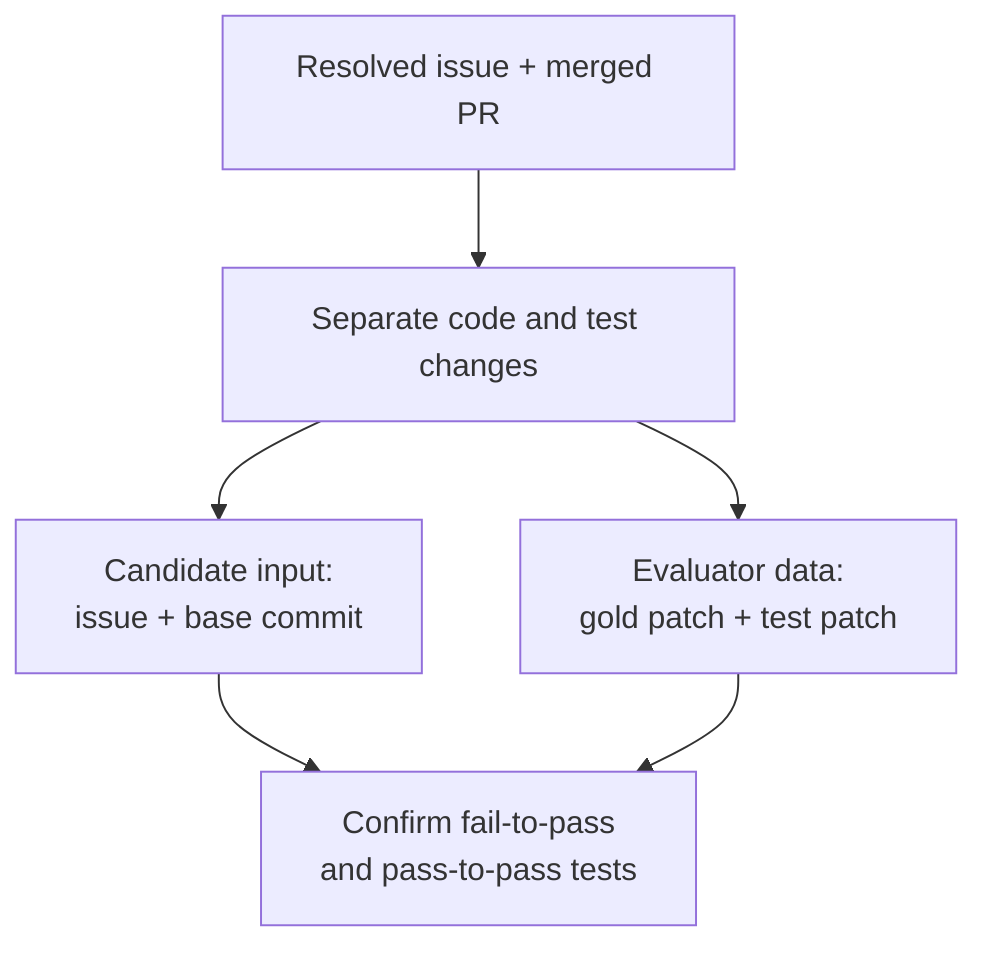

---
{
  "id": "blog-swe-bench-deep-dive",
  "title": "Understanding SWE-bench",
  "slug": "swe-bench-deep-dive",
  "author": {
    "name": "LeetLLM Team"
  },
  "publishedAt": "2026-02-17",
  "updatedAt": "2026-11-07",
  "verifiedAt": "2026-11-07",
  "refreshAfter": "2026-11-21",
  "excerpt": "Read SWE-bench as a repository-repair experiment: trace a patch through grading, compare variants and attempt rules, and check the limits of public scores. Updated for Multimodal v2.",
  "tags": [
    "Benchmarks",
    "Evaluation",
    "SWE-bench",
    "Agents",
    "Deep Dive"
  ],
  "featured": false,
  "coverImage": "illustrations/_generated/agent_workflow_dark.png"
}
---

A coding system gets a real GitHub issue, a checkout from just before the human fix, and no list of target files. Its answer has to be a patch that survives tests added by the original fix. That combines two different skills: writing code and finding the small change that makes a large repository behave correctly.

A headline such as "76% on <span data-glossary="swe-bench">SWE-bench</span>" leaves out most of that experiment. The score belongs to a **system**: benchmark variant and revision, model, tools, attempt rule, and budget. Its <span data-glossary="agent-scaffold">agent scaffold</span> controls how the model searches, edits, and retries; a separate <span data-glossary="eval-harness">harness</span> runs the final grading tests. Change either and the percentage answers a different question.

## A patch inside a real repository

HumanEval, a 164-function Python set, gives a model a function signature and docstring. MBPP (Mostly Basic Programming Problems) gives a short programming prompt and tests. Both mainly test small, isolated program synthesis: the coding target is already named.[^chen2021] [^austin2021]

SWE-bench starts one step earlier. It pairs a GitHub issue with the repository state from before the human fix and asks the system to find and implement a patch.[^jimenez2024] The system has to decide where to look before it can decide what to change.

<figure>
  
  <figcaption>Function benchmarks name the coding target. SWE-bench adds a search problem: gold fixes edit 1.7 files on average inside repositories with about 3,010 non-test files.</figcaption>
</figure>

The original test split contains 2,294 instances from 12 Python repositories. Across task instances, the reference fixes average 1.7 edited files and 32.8 added or removed lines. Their codebases average about 438,000 non-test lines.[^jimenez2024] Each average weights task instances equally. Repository sizes therefore receive unequal weight. Most of the tree is irrelevant to any one issue. **Localization**, finding the code responsible for the reported behavior, is part of the benchmark. The open question is what the candidate is allowed to see.

## How a task is constructed

The candidate sees the issue and the pre-fix checkout. The tests that define success stay with the grader. Each instance starts with a resolved issue and its merged pull request (PR). The dataset pins the repository's pre-fix `base_commit`, then splits the PR into a **gold patch** (the accepted non-test change) and a **test patch** (tests added or changed to expose the repaired behavior).[^jimenez2024]

The builder runs those tests against both sides of the history pair. Tests that flip from failing to passing become `FAIL_TO_PASS`; tests that were already green and remain green become `PASS_TO_PASS`. Those two <span data-glossary="hidden-tests">hidden-test</span> lists turn the issue into a repair gate: a patch can't "succeed" by fixing one path while breaking covered behavior.

| Artifact | Standard task input? | Evaluation job |
|---|---|---|
| Problem statement | Yes | Describes requested behavior, often from original issue text |
| Repository at `base_commit` | Yes | Holds broken code and existing tests |
| Gold patch | No | Reference solution for construction and analysis; not applied when grading a candidate |
| Test patch | No | Adds or updates tests from the resolving PR inside the grading environment |
| `FAIL_TO_PASS` list | No | Names tests that must flip from fail to pass |
| `PASS_TO_PASS` list | No | Names regression tests that must keep passing |
| `hints_text` | No | Optional human hints from the original issue; official submissions must not use them |

Here, **hidden** means withheld from the candidate during inference and available to the public. Dataset downloads can contain patches and test lists. The runner must keep evaluator fields out of prompts, mounted files, and tool results; web access must not retrieve the original solution. Existing checkout tests provide local feedback, while final grading knowledge and `hints_text` remain outside the candidate's inputs.[^swebenchrepo2026] [^swebenchexperiments2026]



The gold patch provides one accepted solution. Alternative edits should pass when they implement the requested behavior. A <span data-glossary="hidden-tests">hidden test</span> can still check an unmentioned helper name or another detail tied to the reference implementation. The 2026 audits found repeated examples of this verifier problem.[^openai2026swebenchlimits] [^openai2026proaudit] Construction fixes the input and hidden tests. It leaves systems free to search, edit, and decide when a patch is ready.

## What a coding system must do

SWE-bench doesn't require one agent architecture. A non-interactive pipeline can retrieve files and generate a patch; an interactive agent can search, edit, run tests, and retry. Agentless showed that localization, <span data-glossary="candidate-generation">candidate generation</span>, and <span data-glossary="reranker">reranking</span> can be competitive without a long autonomous loop.[^xia2024agentless]

For an interactive system, the useful question is what happens between issue and submission. A compact repair cycle gives each tool call a job:

<figure>
  
  <figcaption>Spend the budget before submission on search, reproduction, localization, patching, visible checks, and evidence-led retries. Use visible feedback to debug. The hidden harness produces the final grade.</figcaption>
</figure>

Keep this minimal issue in mind through the grading example:

> `mean([])` must raise `StatisticsError`, but the current implementation returns `0.0`.

A disciplined trace searches for `mean`, its callers, and nearby tests. It confirms that the public function returns `0.0` on an empty list, locates the empty-input branch, and changes that branch to raise the package's exception. It then checks both `mean([])` and ordinary inputs such as `mean([1, 2, 3]) == 2`. Editing the first similarly named function without following the public call path could produce a plausible diff that changes nothing users reach.

Local green tests are optional before submission. An agent can run out of budget and submit its best available patch. The hidden harness grades it independently. The repair loop shows how feedback can guide iteration before final grading.

Tool design controls how much useful evidence that trace produces. SWE-agent calls its tool layer an <span data-glossary="agent-computer-interface">agent-computer interface (ACI)</span>: commands for search, file viewing, editing, execution, and concise feedback.[^yang2024sweagent] The [AI Coding Workflow with Agents](/learn/ai-coding-workflow-with-agents) lesson turns those mechanics into an engineering workflow built around file ownership, before-and-after test evidence, and human merge review. The [Code Generation & Sandboxing](/learn/code-generation-agents-sandboxing) lesson covers execution isolation: the model proposes a patch, a trusted host validates and runs the job, and tests execute in an isolated container. Local checks can look green and the submitted patch can still fail. The harness grade is a separate step, and it does not treat the agent's trace as partial credit.

## How the harness grades a patch

Once a candidate returns a patch, the harness follows a fixed path. It starts the task-specific container, applies the candidate patch, applies the evaluator's test patch, runs the task's evaluation script, parses its output, and checks both required test sets.[^swebenchrepo2026] The gold patch stays out of this path; it helped construct the task but doesn't rescue the candidate.

<figure>
  
  <figcaption>Each stage gates the next: the candidate must apply cleanly, clear all fix tests, and avoid regressions to score 1.</figcaption>
</figure>

Take two task rows: one patch applies and clears both gates, while another fails one regression test. The first row contributes one resolved task; the second contributes zero. For task $i$, write that verdict as $r_i=1$ only when patch application and test execution succeed and both required test sets satisfy the pinned harness's grading rules; otherwise $r_i=0$. Across $N$ declared tasks:

$$
\text{Resolved rate} = \frac{1}{N}\sum_{i=1}^{N} r_i
$$

Use the full declared split as $N$ when reading an official row. Count a missing prediction, patch-application error, timeout, or infrastructure failure as unresolved. Track infrastructure failures separately and repair or rerun them under a declared policy; silently dropping them changes the denominator. For example, 60 resolved tasks out of 100 declared tasks is 60%, even if 10 other tasks failed during setup. Reporting 60/90 = 66.7% describes a different population.

The harness can record how many `FAIL_TO_PASS` tests passed; that partial count helps diagnose the patch, while public credit requires every required test to pass. A patch that clears some fix tests and all regressions still scores zero for the task.[^swebench]

**Read the parsed statuses as well as the verdict.** In the cited harness revision, rechecked November 7, 2026, a skipped `FAIL_TO_PASS` test contributes no repair evidence, while a skipped `PASS_TO_PASS` test can count as maintained. The parser's `XFAIL` status also counts as passing. These rules apply to the ordinary pass-and-fail grading mode; some JavaScript suites use a failure-only parser. Before treating a reported resolution as confirmation that regression assertions ran, pin the harness revision and inspect skips, expected failures, and execution logs.[^swebenchgrading2026]

For a task with one fix test and one regression test, these parsed results illustrate the distinction:

| Fix test | Regression test | Task verdict in pass-and-fail mode |
|---|---|---|
| `PASSED` | `PASSED` | Resolved |
| `SKIPPED` | `PASSED` | Not resolved |
| `PASSED` | `SKIPPED` | Resolved, although the regression assertion didn't execute |
| `XFAIL` | `PASSED` | Resolved under this revision's status rules |
| Missing from parsed output | `PASSED` | Not resolved |

This grading trace still requires the full test process. If a dependency change makes a regression test skip, retain its original status and the skip reason alongside the verdict. Two runs can then have the same resolved count but different evidence of preserved behavior.

```checkpoint
A candidate passes every FAIL_TO_PASS test but fails one PASS_TO_PASS regression test. What resolved rate should the task receive?
---
Zero. SWE-bench's task-level result requires all required tests, including regressions, to pass. Treat the failure as evidence about the patch or harness instead of counting partial progress as a resolved task.
```

That all-or-nothing gate rejects plausible-looking partial patches. Grade fairness depends on the task and verifier: tests can be too narrow, too broad, underspecified, or coupled to one implementation. The score also depends on the task set behind the label. Which SWE-bench produced the percentage?

## Choose the benchmark before reading a score

The label "SWE-bench" covers several official test sets plus a separately maintained benchmark. Their percentages aren't interchangeable because each label changes the task population. This snapshot was checked November 7, 2026 against the official leaderboard and primary dataset sources.[^swebench] [^jimenez2024] [^jimenez2024lite] [^openai2024swebenchverified] [^swebenchpro]

| Set | Scored tasks | Source scope | Read as |
|---|---:|---|---|
| Full (test) | 2,294 | 12 Python repositories | Original test split |
| Lite | 300 | 11 of those repositories | Filtered, cheaper subset |
| Verified | 500 | Human-reviewed slice of Full | Public comparison set |
| Multilingual | 300 | 42 repositories, 9 languages | Cross-language split |
| Multimodal v2 | 480 | Visual software issues, predominantly JavaScript | Revised image-grounded test split |
| SWE-Bench Pro | 731 public (1,865 total) | 41 repositories; public, held-out, commercial | Separate successor protocol |

Lite is cheaper for iteration because its selection removes several expensive or ambiguous shapes. It drops instances with images, external links, commit SHAs, pointers to other issues or PRs, fewer than 40 words of issue text, gold patches that edit more than one file or more than three hunks, file create/delete, and tests that check error-message strings.[^jimenez2024lite] Multi-file and visually grounded repair therefore disappear from this subset.

The project repository's current dataset guide has a conflicting Lite count, while the official Lite page and leaderboard define the public test set as 300 tasks. For historical comparisons, use that original 300-task definition; for a new run, pin the dataset revision and count the split you actually loaded.[^jimenez2024lite][^swebenchrepo2026]

Verified is a 500-instance subset created after professional developers reviewed 1,699 original problems, with three experts independently reviewing each problem during construction.[^openai2024swebenchverified] [^openai2026swebenchlimits] That curation improved task quality, but the set remains public and heavily studied.

Multilingual changes both language and repository mix. Multimodal adds visual evidence such as screenshots. Its original release scored 517 test issues. **Multimodal v2**, released September 1, 2026, retains 480 tasks after removing known flaky or ungradeable cases, rebuilds Docker environments for dependency and browser drift, and opens the complete test split and evaluation tooling.[^swebenchmultimodal2026] A v1-to-v2 score change can reflect revised tasks and infrastructure as well as agent improvements. Pin both the dataset and harness revision.

SWE-Bench Pro is a separate Scale AI benchmark with its own evaluation setup and leaderboard. Its 1,865 human-verified tasks come from 41 repositories: 731 public, 858 held out, and 276 commercial.[^swebenchpro] The public set uses copyleft-licensed repositories by design. Keep denominators separate across these variants. Inside one of those sets, what else is hiding inside the percentage?

## What a leaderboard row records

An unrestricted leaderboard row is a system result. It mixes the model with its scaffold, tools, prompt, budget, and retry policy, so it can compare usable systems but can't isolate model quality.

The official Verified leaderboard offers a **Bash Only** view to narrow that variation: model runs use mini-SWE-agent instead of separate product scaffolds.[^swebench] Check each row's release version, prompts, sampling settings, and budget before treating it as a controlled model comparison.

> **Comparison rule:** Compare model rows only when variant, dataset revision, scaffold version, tools, attempt policy, and budgets match. Otherwise describe a system comparison.

Even matching protocols need task-level interpretation. Suppose two systems run the same 100 tasks once:

| Outcome on the same task | Tasks |
|---|---:|
| Both resolve it | 60 |
| Only A resolves it | 16 |
| Only B resolves it | 15 |
| Neither resolves it | 9 |

A scores 76% and B scores 75%, but they disagree on 31 tasks. That one-point lead isn't evidence that A is reliably better on future work. Inspect the disagreements, repeat the runs, and measure uncertainty with the pairing preserved. If total inference spend was \$75 for A and \$7.50 for B, their observed cost per resolved task would be \$75/76 ≈ \$0.99 and \$7.50/75 = \$0.10. Include failed attempts in the spend and report environment and review costs separately.

The submission policy also separates attempt rules. Treat these as different claims, even when they use the same task set:[^swebenchexperiments2026]

| Reported rule | What happened | Valid official % Resolved? |
|---|---|---|
| Pass@1 / single attempt | One attempt produces one submitted patch per task | Yes, the default Bash Only reading |
| Best@k | Several attempts, then a separate selector picks one patch without using `FAIL_TO_PASS` / `PASS_TO_PASS` | Yes, if labeled `2+` attempts |
| Pass@k | Several attempts, each graded, credit if any passed | No. That inflates resolved rate |

<span data-glossary="pass-at-k">pass@k</span> answers a search question: did any of several sampled patches work? The single-submission SWE-bench headline reports one submitted patch per task. [Evaluating AI Agents](/learn/agent-evaluation-benchmarks) derives `pass@k`, repeatability metrics, hard gates, and cost per successful task.

For example, suppose two of five candidate patches would pass hidden grading. Choosing one uniformly at random succeeds with probability 2/5 = 40%; grading all five and accepting any success gives pass@5 = 100% for that pool. A real best@5 selector doesn't know those hidden verdicts. Its result depends on which patch it selects, and all five attempts contribute to cost. Repeated edits inside one agent rollout aren't automatically five independent attempts.

Before comparing a row, ask:

- Which variant and exact dataset revision?
- Which model snapshot and agent or retrieval scaffold?
- Which tools, system prompt, image access, and test access?
- How many attempts, steps, <span data-glossary="token">tokens</span>, and retries per task?
- What selection rule turned multiple patches into one submission?
- What were total cost, latency, setup failures, and timeouts?
- Are predictions, trajectories, logs, and harness reports available?
- If the system can browse the web, what blocked it from fetching the original PR?

Leaderboard coverage also reflects eligibility. Since November 18, 2025, new Verified and Multilingual entries require an academic or research affiliation plus a public arXiv preprint or technical report. Earlier submissions remain, and Multimodal remains open to other submitters.[^swebenchexperiments2026] Read a missing table entry as unknown benchmark status unless submission and eligibility records explain it.

## What the 2026 audits changed

Reproducibility doesn't make a benchmark valid by itself. On February 23, 2026, OpenAI announced it had stopped reporting Verified for frontier launches, citing flawed tasks and training exposure to public solutions.[^openai2026swebenchlimits]

<figure>
  
  <figcaption>Verified's 59.4% uses 138 selected tasks as its denominator. Pro's broken-task percentages use all 731, although deeper review focused on 286 flagged tasks; don't add its two review counts.</figcaption>
</figure>

Reviewers examined 138 tasks that OpenAI o3 didn't solve consistently across 64 runs. Their 59.4% issue rate applies to **that selected subset**; the full benchmark contains 500 tasks.

For example, `pylint-dev__pylint-4551` asks pyreverse to read type hints, but its tests import an unrequested `get_annotation` helper. A behaviorally correct implementation can fail that import.[^openai2026swebenchlimits]

Every frontier model tested reproduced gold patches or verbatim task details in some cases. This evidence supports <span data-glossary="benchmark-contamination">contamination</span> in some cases. Use further evidence to attribute individual successes to memorization. Prior exposure can reveal details missing from an underspecified issue.

SWE-Bench Pro already existed when OpenAI published the Verified audit. OpenAI recommended Pro in February, then retracted that recommendation on July 8, 2026.[^swebenchpro] [^openai2026proaudit] Its initial filter flagged 286 of the 731 public tasks for deeper review. Agent-assisted review labeled 200 tasks broken (27.4% of 731); human review labeled 249 (34.1%). The two review pools overlap, so their counts cannot be summed as unique broken tasks. OpenAI summarized the finding as roughly 30%, citing four patterns:

- tests that require unmentioned implementation details
- prompts that omit behavior enforced by tests
- tests too weak to catch incomplete solutions
- prompts that point toward behavior inconsistent with tests

These audits don't make every public result useless. They narrow the claim. Verified remains useful for historical and reproducible system comparisons, especially when the scaffold is open, but public exposure makes it weak evidence for fine-grained frontier ranking. Pro may still diagnose systems on its surviving tasks; an aggregate score across a disputed public split needs task-level quality analysis. [LLM Benchmarks & Limitations](/learn/llm-evaluation-benchmarks-limitations) carries the broader hygiene lesson: name the split, harness, and failure mode before treating a percentage as capability.

> **Evidence rule:** Treat a public benchmark score as screening evidence. Use task-level traces and an internal held-out suite before making a product or release decision.

## Reproduce a claim before comparing it

To compare a claim, start with one leaderboard row or paper table. Save a run manifest that preserves the protocol rather than relying on a screenshot or memory:

```json title="swebench-run-manifest.json"
{
  "benchmark": "<variant, split, and dataset revision>",
  "task_ids": ["<ordered task ids>"],
  "model": "<provider and immutable model version>",
  "scaffold_commit": "<git commit or release tag>",
  "harness_commit": "<git commit>",
  "container_image": "<immutable image digest>",
  "attempt_policy": "pass@1",
  "samples_per_task": 1,
  "temperature": "<recorded value or unset>",
  "max_steps": "<fixed budget>",
  "timeout_seconds": "<fixed timeout>"
}
```

Keep each patch, observable trace, test log, harness report, cost, and latency beside that manifest. Recompute the resolved rate over the declared task IDs, and label missing predictions or infrastructure failures instead of hiding them.

For current public submissions, the SWE-bench experiments repository holds an entry whose `metadata.yaml` points to the submitter's public artifact repository. Older entries can still point to S3. The `swebench submit verify` command re-derives grades from recorded test output; it doesn't rerun the patch or confirm that the tasks are fair. Use it to check that a claimed result agrees with its logs, then reproduce execution separately when needed.[^swebenchexperiments2026]

Run a small fixed slice before spending on the full set. Check checkout, dependency setup, patch application, test discovery, timeout behavior, and report parsing. That <span data-glossary="smoke-test">smoke test</span> validates plumbing. The benchmark score requires a completed evaluation, and runs with drifted dataset containers or provider endpoints should remain separate.

For a model comparison, hold scaffold, task IDs, tools, image, prompt, attempt policy, and budgets constant. If any of those change, call it a system comparison. A matched score is still a repair score under this harness. The benchmark never asked the system to own a product, a migration, or an incident.

## What SWE-bench leaves untested

A high score is evidence of targeted repository repair under one harness. It doesn't answer whether an agent can own:

- greenfield architecture and product discovery
- multi-week migrations and coordination
- code review, security review, and performance review
- deployment, <span data-glossary="rollback">rollback</span>, and incident ownership
- private repository conventions and weak local test suites
- your languages, frameworks, permissions, and latency budget

Build a private suite from representative repository work that wasn't used to tune the agent. Include narrow fixes, cross-file changes, ambiguous requests that should trigger clarification, unsafe instructions that should be rejected, flaky setup, and tasks where the correct response is to stop. Grade final behavior, regressions, scope, cost, latency, and review burden alongside test pass rate.

## Practice: trace the verdict

Return to the `mean([])` issue from the repair trace:

> `mean([])` must raise `StatisticsError`, but the current implementation returns `0.0`.

Trace three implementations against this task: one keeps the bug, one fixes empty input while breaking ordinary inputs, and one satisfies both requirements. This in-process example models a strict boolean test conjunction only, not Docker setup, patch application, or the real harness's skip and expected-failure statuses. `safe_run` turns an unexpected exception into a failed test. A real agent's untrusted code needs an isolated runner, not execution inside the evaluator process.

<!-- leetllm: test, output=show -->
```python title="swebench_eval_harness.py"
from collections.abc import Callable
from dataclasses import dataclass


class StatisticsError(ValueError):
    """Raised when statistics function receives invalid inputs."""


# Candidate patches for mean(data)
def buggy_patch_mean(data: list[float]) -> float:
    # Preserves bug: returns 0.0 instead of raising StatisticsError
    if not data:
        return 0.0
    return sum(data) / len(data)


def regressive_patch_mean(data: list[float]) -> float:
    # Fixes empty input but introduces regression on valid inputs
    if not data:
        raise StatisticsError("mean requires at least one data point")
    raise RuntimeError("unexpected regression on valid data")


def correct_patch_mean(data: list[float]) -> float:
    # Satisfies both fix test and existing behavior
    if not data:
        raise StatisticsError("mean requires at least one data point")
    return sum(data) / len(data)


@dataclass(frozen=True)
class TaskInstance:
    instance_id: str
    fail_to_pass: list[Callable[[Callable[[list[float]], float]], bool]]
    pass_to_pass: list[Callable[[Callable[[list[float]], float]], bool]]


def test_empty_raises(fn: Callable[[list[float]], float]) -> bool:
    try:
        fn([])
        return False
    except StatisticsError:
        return True


def test_single_element(fn: Callable[[list[float]], float]) -> bool:
    return fn([42.0]) == 42.0


def test_multi_element(fn: Callable[[list[float]], float]) -> bool:
    return fn([1.0, 2.0, 3.0]) == 2.0


def safe_run(test: Callable[[Callable[[list[float]], float]], bool], fn: Callable[[list[float]], float]) -> bool:
    try:
        return bool(test(fn))
    except Exception:
        return False


def evaluate_task(instance: TaskInstance, candidate_fn: Callable[[list[float]], float]) -> dict[str, bool]:
    if not instance.fail_to_pass:
        raise ValueError("A repair task needs at least one FAIL_TO_PASS test")
    # Collect all results before aggregation so a failure doesn't skip diagnostics.
    f2p_passed = all([safe_run(test, candidate_fn) for test in instance.fail_to_pass])
    p2p_passed = all([safe_run(test, candidate_fn) for test in instance.pass_to_pass])
    resolved = f2p_passed and p2p_passed
    return {
        "fail_to_pass": f2p_passed,
        "pass_to_pass": p2p_passed,
        "resolved": resolved,
    }


instance = TaskInstance(
    instance_id="math__statistics-101",
    fail_to_pass=[test_empty_raises],
    pass_to_pass=[test_single_element, test_multi_element],
)

buggy_res = evaluate_task(instance, buggy_patch_mean)
regressive_res = evaluate_task(instance, regressive_patch_mean)
correct_res = evaluate_task(instance, correct_patch_mean)

b_r, b_f, b_p = buggy_res["resolved"], buggy_res["fail_to_pass"], buggy_res["pass_to_pass"]
r_r, r_f, r_p = regressive_res["resolved"], regressive_res["fail_to_pass"], regressive_res["pass_to_pass"]
c_r, c_f, c_p = correct_res["resolved"], correct_res["fail_to_pass"], correct_res["pass_to_pass"]

print(f"Buggy patch:      resolved={b_r} (F2P={b_f}, P2P={b_p})")
print(f"Regressive patch: resolved={r_r} (F2P={r_f}, P2P={r_p})")
print(f"Correct patch:    resolved={c_r} (F2P={c_f}, P2P={c_p})")

assert not buggy_res["resolved"] and not buggy_res["fail_to_pass"]
assert not regressive_res["resolved"] and not regressive_res["pass_to_pass"]
assert correct_res["resolved"] and correct_res["fail_to_pass"] and correct_res["pass_to_pass"]
```

<!-- leetllm: output:start -->
```text title="Output" output compact
Buggy patch:      resolved=False (F2P=False, P2P=True)
Regressive patch: resolved=False (F2P=True, P2P=False)
Correct patch:    resolved=True (F2P=True, P2P=True)
```
<!-- leetllm: output:end -->

Three rows tell three different failure stories. The buggy patch preserves the issue, so it fails `FAIL_TO_PASS`. A regressive patch raises the requested exception but breaks non-empty inputs, so it fails `PASS_TO_PASS`. Only the third patch clears both gates and counts as resolved.

Now remove `test_empty_raises` from `fail_to_pass`. The evaluator raises `ValueError` instead of claiming success: Python's `all([])` is `True`, but an empty fix-test list offers no evidence of repair. This guard catches a malformed example task. Also check that the original code fails the declared fix tests and the reference patch passes them.

```checkpoint
A run declares 100 tasks, resolves 60, and loses 10 others to container setup errors. Another run resolves 65 with no setup errors. Can you claim the first is better by reporting 60/90 = 66.7%?
---
No. The first run resolved 60% of the declared population. Diagnose or rerun its setup failures using a stated policy, but don't remove them selectively. Even 65% versus 60% needs matched task IDs, budgets, repeated runs, and task-level disagreement analysis before drawing a broad capability conclusion.
```

A SWE-bench percentage is a system result. Put the variant, the attempt rule, and the harness status rules next to it before you treat the number as model quality. Two habits transfer to real agent work. Review a patch against exact behavior, not whether the diff looks plausible. Preserve the run context that explains every verdict. Build that workflow in [AI Coding Workflow with Agents](/learn/ai-coding-workflow-with-agents), then use [Evaluating AI Agents](/learn/agent-evaluation-benchmarks) to design private episodes, repeatability checks, and release gates around it.
