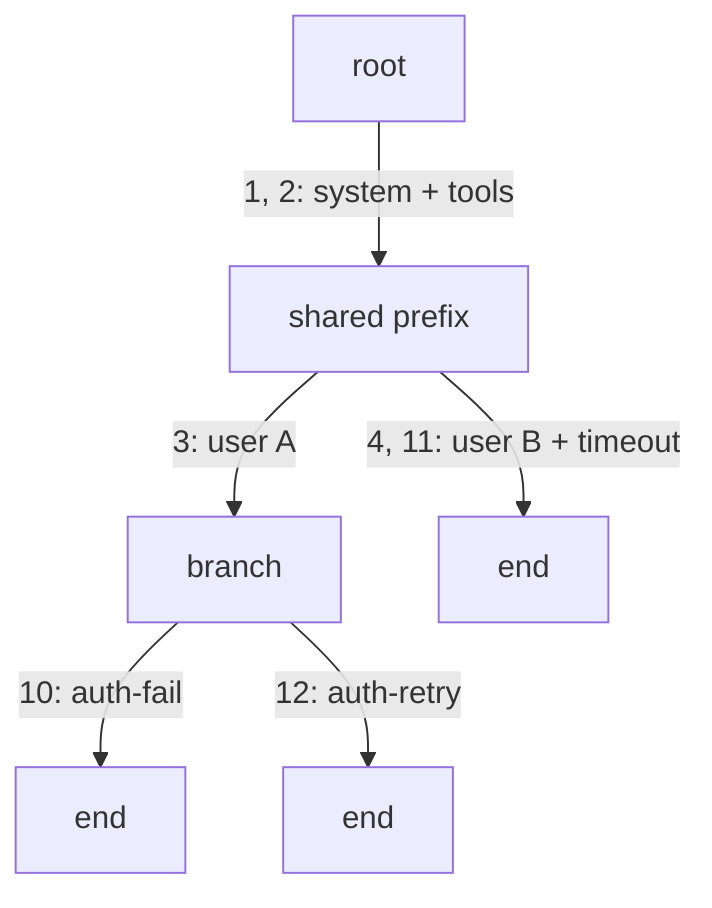
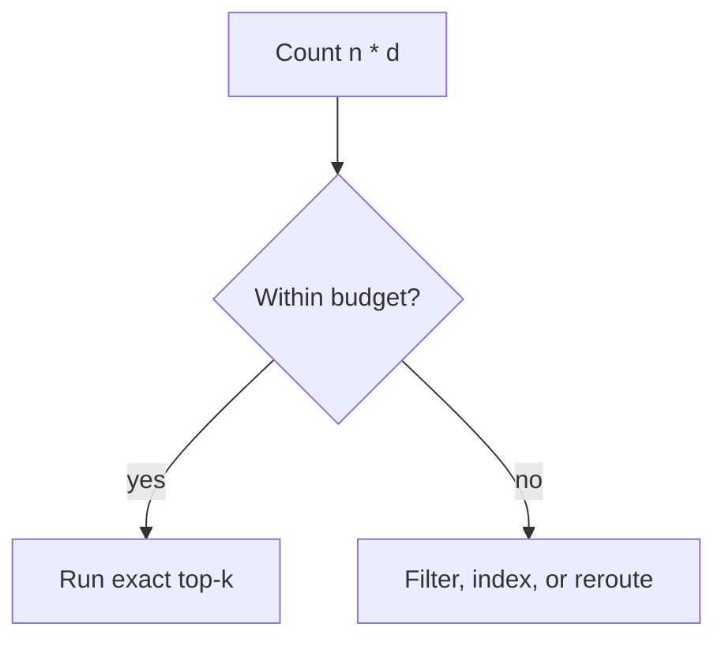

---
{
  "id": "algorithms-complexity-ml-engineers",
  "title": "Algorithms for ML Engineers",
  "slug": "algorithms-complexity-ml-engineers",
  "section": "Computing Foundations",
  "category": "MLOps & Deployment",
  "difficulty": "Easy",
  "order": 9,
  "coverImage": "illustrations/_generated/chapter_flow_dark.png",
  "companies": [
    "OpenAI",
    "Anthropic",
    "Google",
    "Meta"
  ],
  "shortDescription": "When four authorized chunks become 50,000, count which operation repeats before you choose a scan, heap, prefix tree, or latency guard.",
  "keyConceptsTested": [
    "operation counting",
    "big-O notation",
    "Big-O versus Theta and bound qualifiers",
    "linear and quadratic growth",
    "sorting and exact-key search",
    "binary search",
    "radix tree prefix match",
    "longest common prefix",
    "iteration and nested-loop counting",
    "time and space complexity",
    "worst-case, expected, and amortized cost",
    "vector scoring cost",
    "bounded top-k selection",
    "time-space tradeoffs",
    "retrieval budget guards"
  ],
  "prerequisites": [
    "numpy-and-tensor-shapes",
    "data-structures-for-ai-systems",
    "sql-databases-data-modeling-ai"
  ],
  "relatedQuestions": [
    "core-retrieval-algorithms",
    "prefix-caching-prompt-caching",
    "calculus-gradients-backpropagation-optimization"
  ]
}
---

Suppose you ask an internal engineering assistant:

> Why did the auth tests fail?

Its permission filter returns four authorized text chunks (small passages) in a local <span data-glossary="fixture">fixture</span>. Only one mentions an expired test setup, so finding it means inspecting all four. That is a reasonable place to start. What changes when the same search has 50,000 candidates?

That scan works. The question is how much work it repeats as the corpus grows. An **algorithm** is a recipe for completing a task; **complexity** describes how its work or memory grows as its input grows. We'll keep the four-row search in view while counting the work a larger corpus would repeat.

## What grows when the corpus grows

Before comparing lookups, let's be clear about what each one receives. The SQL permission filter, optionally reinforced by row-level security (per-row access rules), has already returned only `auth` project chunks permitted for this request. Four symbols name the inputs that later code will grow with:

| Symbol | Meaning here | Example |
|---|---|---:|
| `n` | authorized chunks eligible for ranking | 4, then 8, then 50,000 |
| `d` | numbers in one <span data-glossary="embedding">embedding</span> vector (a numerical representation of text) | 3 in the lab, 768 in the larger example |
| `k` | citations returned to the answer generator | 2 or 5 |
| `t` | tokens in a later prompt preview | 128 or 512 |

A permission filter can shrink `n`, and a wider embedding increases `d`. Returning two citations controls `k`, but it doesn't skip scoring every remaining candidate. That last distinction will matter when we replace a full sort with a heap.

## Count a complete scan

Let's start with a retriever we can inspect. It scores a chunk by counting question words that appear in its text. Even though the question matches only one of the four rows below, the scan inspects all four chunks to find out:

<!-- leetllm: test, output=show -->
```python title="count-one-scan.py"
chunks = [
    {"id": "auth-fixture", "text": "auth tests fail when fixture expires"},
    {"id": "ci-timeout", "text": "ci job timeout after slow integration test"},
    {"id": "cli-flag", "text": "readme documents old command line flag"},
    {"id": "deploy-runbook", "text": "rollback service after canary error"},
]

def lexical_scan(question: str, allowed_chunks: list[dict]) -> tuple[list[tuple[int, str]], int]:
    terms = set(question.lower().split())
    matches = []
    checked = 0
    for chunk in allowed_chunks:
        checked += 1
        overlap = len(terms & set(chunk["text"].lower().split()))
        if overlap:
            matches.append((overlap, chunk["id"]))
    return sorted(matches, reverse=True), checked

matches, checked = lexical_scan("auth tests fixture", chunks)
print("chunks_checked", checked)
print("best_chunk", matches[0][1])
```

<!-- leetllm: output:start -->
```text title="Output" output compact
chunks_checked 4
best_chunk auth-fixture
```
<!-- leetllm: output:end -->

`chunks_checked` isn't elapsed time. It makes one repeated action visible: inspecting a candidate chunk. Four authorized chunks mean four inspections; forty thousand mean forty thousand. We can now see exactly what grows when this scan handles a larger corpus.

Real text work also depends on chunk length. A configured chunk-size limit lets us use candidate count as a useful first model. Without that bound, words read per chunk become another growing input. A counter exposes repeated work; it doesn't measure how quickly a machine performs it.

Find that repeated operation before reaching for an index.

## Big-O names the growth shape

<span data-glossary="big-o-notation">Big-O</span> gives an asymptotic upper bound: how a cost can grow as an input gets large, ignoring fixed multipliers and small-input details. The label alone doesn't say whether you're describing a worst case, an average case, or an amortized sequence of operations, so name both the operation and the kind of bound.[^nist2019bigo]

Under the bounded-chunk simplification, this scan visits every authorized chunk. Its candidate-inspection work is tight: **Θ(n)**, which also means **O(n)**. Read Θ as "theta": it says the count grows linearly, not merely that linear growth is an upper limit.

Watch the count while repeating the same four rows. Repetition here changes workload size, not the meaning or quality of the documents:

<!-- leetllm: test, output=show -->
```python title="observe-linear-growth.py"
base_chunks = [
    {"id": "auth-fixture", "text": "auth fixture expired"},
    {"id": "ci-timeout", "text": "ci timeout"},
    {"id": "cli-flag", "text": "old cli flag"},
    {"id": "deploy-runbook", "text": "canary rollback"},
]

def count_checks(question: str, allowed_chunks: list[dict]) -> int:
    terms = set(question.split())
    checks = 0
    for chunk in allowed_chunks:
        checks += 1
        _ = terms & set(chunk["text"].split())
    return checks

for copies in (1, 2, 4, 8):
    corpus = base_chunks * copies
    print(f"n={len(corpus):>2} checks={count_checks('auth fixture', corpus):>2}")
```

<!-- leetllm: output:start -->
```text title="Output" output compact
n= 4 checks= 4
n= 8 checks= 8
n=16 checks=16
n=32 checks=32
```
<!-- leetllm: output:end -->

Doubling `n` doubles the repeated checks. Building a set of question terms still costs something, but that overhead doesn't grow once per candidate. Big-O helps us keep our attention on the part that can become expensive at scale.

It would be misleading to call the whole assistant "O(n)." Keep the claim attached to one operation: **the candidate-inspection part of this bounded-length scan is Θ(n)**. The SQL filter, result ordering, network calls, and answer generation each have their own costs.

There's another operation inside the function: it sorts its `r` matching chunks before returning them. Here `r` is the number of matches, and `r <= n`. The scan is Θ(n), while sorting is O(r log r). If every chunk matches, the full function can be O(n log n). Looking at the steps separately keeps the scan from hiding an expensive sort.

```checkpoint
An authorized-chunk scan checks 8,000 bounded-length chunks. If the corpus doubles while the algorithm stays unchanged, about how many chunk inspections should you expect?
---
About 16,000. The scan is O(n) in candidate chunks, so doubling `n` doubles the dominant repeated work.
```

## Choose a bound that says what you mean

The growth class tells us how work scales. These three labels answer a different question: what kind of bound are we describing?

| Bound | What it describes | Example in this lesson |
|---|---|---|
| Worst case | The most work allowed for an input of size `n` | A full sort takes O(n log n) comparisons in the worst case. |
| Average or expected case | Average under a stated input distribution, algorithm randomness, or hash assumption | Set membership is expected O(1) when hashes distribute keys well, but its worst case can be O(n). |
| Amortized | Average cost across a sequence, even when one operation is expensive | A Python list append is amortized O(1); a resize can copy O(n) references once. |

**Θ** is a tight growth class: both an upper and a lower bound hold, up to fixed multipliers for sufficiently large inputs.[^nist2016theta] The pair loop later performs exactly `n * (n - 1) / 2` comparisons, so its loop count is Θ(n²); writing O(n²) alone states only the upper bound.

**O** is still useful when you promise only an upper bound, but it isn't automatically a worst-case label. Average-case analysis depends on an input distribution, expected-case analysis averages randomness or hash behavior, and amortized analysis accounts for operation history.

A correct label still doesn't choose the lookup. The scan we counted grows with every authorized chunk. When does the data let a cheaper search win?

## Pick a search that matches the data

A cheaper lookup wins only when you already have the structure that search needs. Finding an exact key in an unsorted list, finding one in a sorted list, and finding similar meaning are different jobs. The [Data Structures for AI](/learn/data-structures-for-ai-systems) lesson matched those jobs to containers. Here we'll compare the work they require. An approximate-nearest-neighbor (ANN) index changes which candidates we inspect, so measure its recall alongside latency. In the graph row, `V` counts nodes and `E` counts links:

| Search need | Required structure or precondition | Work per lookup | Other cost to remember |
|---|---|---:|---|
| Exact key in unsorted candidates | None | Θ(n) worst-case scan | An early match can stop sooner |
| Exact key in sorted candidates | Persisted sorted order; **binary search** halves the remaining interval each step | O(log n) | Sorting costs O(n log n); inserting into a Python list can cost O(n) |
| Exact key in a hash set | Hashable keys and a usable hash distribution | Expected O(1), worst O(n) | Stores Θ(n) keys; hashing a long string still reads its characters |
| Shared prefix of stored strings or token IDs | Trie or <span data-glossary="radix-tree">radix tree</span> | O(p + 1) expected descent for matched length `p` | Assumes constant-time child lookup; not semantic search |
| Follow citation or dependency links | Adjacency lists and a visited set | O(V + E) for a full traversal | Following cycles without tracking visited nodes can repeat forever |
| Nearest embedding | <span data-glossary="vector">Vector</span> representation and a distance rule | Exact scan is Θ(n * d) | ANN indexes change the candidate path, so measure recall as well as latency |

For 50,000 sorted IDs, binary search needs at most 16 interval decisions because $2^{16} = 65{,}536$. Sorting those IDs on every request would erase the benefit, so sorted order or a hash index must be built and maintained outside the hot path.

Binary search also can't rank embeddings. Semantic similarity doesn't provide one scalar ordering where nearby vectors are guaranteed to sit next to each other. That is a different input and a different index problem.

A hash set is the right tool when you already have the exact ID. It can't answer "which stored prompts start like this one?" That is a prefix problem. The [Data Structures](/learn/data-structures-for-ai-systems) lesson built a character trie for `token`, `tool`, and `top`. This chapter counts that work, then compresses the trie into a structure serving engines actually use.

### Binary search halves a sorted range

The four authorized chunk IDs are already sorted alphabetically. `cli-flag` happens to sit at the midpoint, so this search gets a lucky one-step hit. On a miss, the ordering still tells us which half could contain the target.

`lo` is the first possible index and `hi` is one past the last. The remaining range is therefore `[lo, hi)`. Integer division `// 2` chooses a midpoint; advancing an endpoint discards the half that can't contain the target.

<!-- leetllm: test, output=show -->
```python title="count-binary-search-steps.py"
sorted_ids = ["auth-fixture", "ci-timeout", "cli-flag", "deploy-runbook"]

def binary_search(sorted_ids: list[str], target: str) -> tuple[int | None, int]:
    lo, hi = 0, len(sorted_ids)
    steps = 0
    while lo < hi:
        mid = (lo + hi) // 2
        steps += 1
        if sorted_ids[mid] == target:
            return mid, steps
        if sorted_ids[mid] < target:
            lo = mid + 1
        else:
            hi = mid
    return None, steps

index, steps = binary_search(sorted_ids, "cli-flag")
print("index", index)
print("steps", steps)
print("full_scan_checks", len(sorted_ids))
```

<!-- leetllm: output:start -->
```text title="Output" output compact
index 2
steps 1
full_scan_checks 4
```
<!-- leetllm: output:end -->

The search finishes in one midpoint check here. An early-stopping linear search would find `cli-flag` on its third check; the earlier ranking scan would inspect all four. Binary search's worst-case guarantee comes from halving the remaining interval, so its step count stays O(log n) even when `n` is tens of thousands. A midpoint check may perform both `==` and `<`; we're counting visited midpoints, not individual comparison operators.

Exact counts still need care. This half-open implementation can require 17 midpoint checks for 65,536 items because the final one-element interval needs its own comparison. The list has to stay sorted, and a new ID inserted in the middle of a Python list still costs O(n).

## Prefix match, tries, and radix trees

Imagine several requests that begin with the same system prompt and tool schema. If a lookup rereads that shared prefix for every stored request, it pays for those tokens again and again. A <span data-glossary="trie">trie</span> stores one symbol per edge: lookup of a prefix of length `p` walks `p` edges, then enumeration costs whatever the returned completions require. Reaching the prefix doesn't get more expensive just because unrelated keys were added elsewhere.

Long unique suffixes waste nodes. The words `token` and `tokenize` share `token`; `tokenize` then adds a chain `i -> z -> e` that never branches. A <span data-glossary="radix-tree">radix tree</span>, also called a Patricia trie or compressed prefix tree, collapses each non-branching run into **one edge that holds a sequence**. Lookup still follows exact symbols, but it compares a whole shared run at once.

The names are easy to mix up, so keep the jobs in view. A radix tree answers a longest **exact** prefix. An embedding index finds approximate **nearby** vectors. Radix sort is a third, separate algorithm.



Three stored prompts share the system and tool tokens, then split. The compressed edge stores `system + tools` once. A new request that starts the same way follows that edge before checking its remaining tokens. Keep that picture in mind while the next program counts the work with token IDs.

Count the difference on small token-ID lists. `1, 2` is the shared system-and-tools prefix. `3` is user A. `4, 11` is user B's whole remaining path.

<!-- leetllm: test, output=show -->
```python title="count-prefix-comparisons.py"
prompts = [
    [1, 2, 3, 10],
    [1, 2, 4, 11],
    [1, 2, 3, 12],
]
query = [1, 2, 3, 13]

def naive_prefix(query: list[int], prompts: list[list[int]]) -> tuple[int, int]:
    comparisons = 0
    best = 0
    for prompt in prompts:
        shared = 0
        for left, right in zip(query, prompt):
            comparisons += 1
            if left != right:
                break
            shared += 1
        best = max(best, shared)
    return best, comparisons

# first token -> (edge tokens, child map)
tree = {
    1: (
        (1, 2),
        {
            3: ((3,), {10: ((10,), {}), 12: ((12,), {})}),
            4: ((4, 11), {}),
        },
    )
}

def radix_prefix(query: list[int], node: dict) -> tuple[int, int]:
    comparisons = 0
    index = 0
    current = node
    while index < len(query):
        child = current.get(query[index])
        if child is None:
            break
        edge, nxt = child
        shared = 0
        mismatch = False
        for offset in range(min(len(query) - index, len(edge))):
            comparisons += 1
            if query[index + offset] != edge[offset]:
                mismatch = True
                break
            shared += 1
        index += shared
        if mismatch or shared < len(edge):
            break
        current = nxt
    return index, comparisons

naive_len, naive_cmp = naive_prefix(query, prompts)
radix_len, radix_cmp = radix_prefix(query, tree)
print("shared_tokens", naive_len, radix_len)
print("naive_comparisons", naive_cmp)
print("radix_comparisons", radix_cmp)
```

<!-- leetllm: output:start -->
```text title="Output" output compact
shared_tokens 3 3
naive_comparisons 11
radix_comparisons 3
```
<!-- leetllm: output:end -->

The naive scan rereads `1, 2` for every stored prompt, so three keys take 11 token comparisons. The radix walk reads the shared edge once, follows the `3` branch, and stops after **3** explicit token comparisons. Both find the same longest prefix of length 3. The tree also makes three dictionary lookups, including the failed lookup for `13`; those aren't included in the comparison counter.

Indexing `query[index + offset]` avoids copying the remaining query at each edge. Writing `query[index:]` inside the loop would create a new list every time. Many short edges could then cause quadratic copying even while the token-comparison counter stayed linear.

Add a thousand other prompts that share only `[1, 2]` and the scan keeps paying per key. With expected constant-time child lookup, the tree's descent takes O(p + 1) work for `p` matched tokens. The extra 1 accounts for detecting a mismatch, including an immediate miss. Enumeration after the match is a separate cost, because returning more completions means doing more work.

For token sequences $x$ and $y$, the longest common prefix is the greatest number $p$ of initial tokens that agree. In this notation, $x_{1:j}$ means the first $j$ tokens; $j=0$ includes the empty prefix:

$$
p=\max\{j:x_{1:j}=y_{1:j}\}.
$$

Matching tokens can make previously computed model state reusable, but only when the model and other inputs that produced that state also match. The unmatched suffix still needs processing; a prefix hit doesn't make the whole request free.

Serving uses the same idea on token IDs. A <span data-glossary="prefix-cache">prefix cache</span> can reuse the prompt-processing work, called <span data-glossary="prefill">prefill</span>, for a compatible cached prefix. <span data-glossary="sglang">SGLang</span>'s <span data-glossary="radixattention">RadixAttention</span> organizes token prefixes in a radix tree.[^sglang2024] <span data-glossary="vllm">vLLM</span> instead hashes full blocks of cached model state. Its keys include preceding blocks and additional identity such as adapter or multimodal inputs, and fixed block limits cap the reused length. Exact token agreement is necessary, but does not by itself guarantee safe reuse across models or cache scopes.[^vllm2026prefix]

You don't need to implement the cache here. Keep its algorithm test: if the question is longest exact prefix, count work in `p`. If the question is nearby meaning, you're back in the $n \times d$ scoring column.

```checkpoint
Three cached prompts each share the first 6 tokens with a new request of length 8, then diverge. About how many token comparisons does a naive per-key scan do, and what does a radix-tree walk scale with?
---
The scan compares the 6 shared tokens plus the first mismatch on each of the 3 keys, about 21 comparisons. A radix-tree descent with first-token child lookup scales with prefix length `p`, not with how many other keys share an earlier edge.
```

## Vector scoring adds another input

We have answered one question: which prompts share an exact prefix? To find text with nearby meaning, semantic retrieval commonly represents the question and each chunk as embedding vectors, then computes a score. The [NumPy and tensor shapes](/learn/numpy-and-tensor-shapes) lesson treated a vector as coordinates and a <span data-glossary="dot-product">dot product</span> as paired multiplies plus adds. Here we'll count those multiplies in plain Python so the growing input stays visible.

Each exact **dot-product** score inspects `d` coordinates. When both vectors have Euclidean norm one, meaning $\sqrt{\sum_i x_i^2}=1$, their dot product equals <span data-glossary="cosine-similarity">cosine similarity</span>. This describes their magnitude, not their number of coordinates. The lab vectors below aren't normalized that way, so treat this as a raw dot product. Scoring all `n` allowed chunks performs work proportional to `n * d`.

Scoring four vectors of three coordinates each requires twelve coordinate multiplications, even when two query coordinates are zero:

<!-- leetllm: test, output=show -->
```python title="count-vector-scoring-work.py"
chunk_ids = ["auth-fixture", "ci-timeout", "cli-flag", "deploy-runbook"]
chunk_vectors = [
    [1.0, 0.2, 0.1],
    [0.0, 1.0, 0.2],
    [0.8, 0.1, 0.4],
    [0.1, 0.2, 1.0],
]
question = [1.0, 0.0, 0.0]

def dot(left: list[float], right: list[float]) -> tuple[float, int]:
    score = 0.0
    multiplies = 0
    for a, b in zip(left, right, strict=True):
        score += a * b
        multiplies += 1
    return score, multiplies

scores = []
coordinate_multiplies = 0
for vector in chunk_vectors:
    score, used = dot(question, vector)
    scores.append(score)
    coordinate_multiplies += used

best = max(range(len(scores)), key=lambda i: scores[i])
print("best_chunk", chunk_ids[best])
print("scores", [round(s, 1) for s in scores])
print("coordinate_multiplies", coordinate_multiplies)
```

<!-- leetllm: output:start -->
```text title="Output" output compact
best_chunk auth-fixture
scores [1.0, 0.0, 0.8, 0.1]
coordinate_multiplies 12
```
<!-- leetllm: output:end -->

The question vector is `[1.0, 0.0, 0.0]`, so only the first coordinate of each chunk contributes to each sum. The other multiplies still happen; they add zero. `zip(..., strict=True)` pairs coordinates and raises `ValueError` if the lengths differ. `max(..., key=lambda i: scores[i])` returns the index with the largest score. A dense matrix multiply performs the same $n \times d$ coordinate products, often much faster than a Python loop.

Even though only coordinate 0 of the question vector is nonzero, this dense loop still performs all 12 multiplications (4 chunks $\times$ 3 coordinates). A dense matrix operation doesn't automatically exploit arbitrary zero values. Sparse representations and specialized kernels can change the work, but they require a different execution path.

With 50,000 chunks and 768 coordinates, the same pass uses 38,400,000 multiplications before it chooses citations. The exact score pass is **Θ(n * d)** in time.

Scoring work is only half the picture. Those float32 vectors take `50,000 * 768 * 4 = 153,600,000` bytes, about 146.5 MiB: **Θ(n * d)** input memory, separate from temporary workspace. The build-it function later materializes its `allowed` rows, adding O(n) temporary references; a streaming exact scan can keep only the query vector and running winners in extra memory.

## Return top-k without sorting every result

The answer needs only `k = 2` citations, but a full sort orders every candidate. That's the mismatch to keep in mind as we choose a selection method. In product code, treat `k <= 0` as an empty result so heap logic never reads from an empty list.

<!-- leetllm: test, output=show -->
```python title="full-sort-is-correct-but-does-extra-work.py"
scores = [
    (1.0, "auth-fixture"),
    (0.0, "ci-timeout"),
    (0.8, "cli-flag"),
    (0.1, "deploy-runbook"),
]

top_two = sorted(scores, reverse=True)[:2]
print("top_two", top_two)
print("fully_reordered_scores", len(scores))
```

<!-- leetllm: output:start -->
```text title="Output" output compact
top_two [(1.0, 'auth-fixture'), (0.8, 'cli-flag')]
fully_reordered_scores 4
```
<!-- leetllm: output:end -->

The result is correct, but two losers were sorted even though they'll never be shown. Full sorting costs O(n log n) comparisons in the worst case and materializes all `n` scored results. When `k` is small, what structure could keep the weakest winner easy to replace without ordering every candidate?

In [Data Structures for AI](/learn/data-structures-for-ai-systems) you already used a <span data-glossary="min-heap">min-heap</span> so the weakest retained result sits at the root. A bounded min-heap stores only the <span data-glossary="top-k">top-k</span> values seen so far. A stronger candidate can replace the current weakest winner. Repairing the heap follows one path through a tree with `k` entries. That path has at most about `log2(k)` parent-child steps: three for `k = 8`, ten for `k = 1,024`.

Python's <span data-glossary="heapq">heapq</span> helpers implement that structure in the lab. Tuples compare left to right, so `(score, id)` breaks a score tie using the ID: this code favors the lexicographically larger string. Change the key if your requirement differs; for integer IDs, `(score, -doc_id)` makes smaller IDs win ties.

Here's the invariant that lets us trust the heap: after each input, it contains the strongest `k` items seen so far, or all the items if fewer than `k` have arrived. Once it's full, a candidate no stronger than the root can't displace a winner. A stronger candidate replaces the weakest winner, and the heap is repaired. The condition `item > heap[0]` matters because `heapreplace` replaces the root even when the incoming item is worse.[^python2026heapq]

For `2 <= k <= n`, maintaining the heap costs O(n log k) after scoring, with O(k) selection memory. Sorting the final winners adds O(k log k), still within that bound. For `k = 1`, one running maximum gives O(n) selection; for `k > n`, there are only `n` items to retain.[^cormen2009]

The next function accepts the same scored rows and keeps at most two winners. Compare its result with the full sort:

<!-- leetllm: test, output=show -->
```python title="keep-only-top-k-scores.py"
from heapq import heappush, heapreplace

scores = [
    (1.0, "auth-fixture"),
    (0.0, "ci-timeout"),
    (0.8, "cli-flag"),
    (0.1, "deploy-runbook"),
]

def bounded_top_k(items: list[tuple[float, str]], k: int) -> list[tuple[float, str]]:
    if k <= 0:
        return []
    heap: list[tuple[float, str]] = []
    for item in items:
        if len(heap) < k:
            heappush(heap, item)
        elif item > heap[0]:
            heapreplace(heap, item)
    return sorted(heap, reverse=True)

top_two = bounded_top_k(scores, k=2)
print("top_two", top_two)
print("selection_values_stored", len(top_two))
assert bounded_top_k(scores, k=0) == []
for fixture in (scores, list(reversed(scores)), [(0.5, "a"), (0.5, "c"), (0.5, "b")]):
    for k in (1, 2, len(fixture), len(fixture) + 1):
        assert bounded_top_k(fixture, k) == sorted(fixture, reverse=True)[:k]
```

<!-- leetllm: output:start -->
```text title="Output" output compact
top_two [(1.0, 'auth-fixture'), (0.8, 'cli-flag')]
selection_values_stored 2
```
<!-- leetllm: output:end -->

The heap improves **selection**, not exact vector scoring. You still paid O(n * d) to produce the four scores above, and you'd still pay 38.4 million coordinate products at `n = 50,000`, `d = 768`. A faster tail step can't fix an expensive upstream step.

```checkpoint
You replace a full sort with a top-10 heap, but still score 50,000 vectors of dimension 768. Which cost remains O(n * d)?
---
The exact vector-scoring pass. The heap reduces selection to O(n log k) and O(k) retained values, but it doesn't remove the 38.4 million coordinate products.
```

## Keep separate time and memory ledgers

The same algorithm can have one growth rate for work and another for storage. Before changing code, label each number as input memory, output memory, or temporary workspace:

| Operation | Time | Memory to account for |
|---|---:|---|
| Exact vector score pass | Θ(n * d) | Resident vector matrix is Θ(n * d); a streamed pass needs O(d + k) extra for the query and winners |
| Full sort of scored results | O(n log n) worst case | The scored-result list is Θ(n); sorting may need additional implementation workspace |
| Binary search in a sorted ID list | O(log n) comparisons | The sorted list is Θ(n); the search itself uses O(1) extra |
| Radix-tree longest-prefix match | O(p + 1) expected descent with constant-time child lookup | Shared prefixes occupy shared edges; the walk uses O(1) extra |
| Bounded top-k selection, `2 <= k <= n` | O(n log k) worst case, or Θ(n) when `k` is fixed | Heap holds Θ(k) winners |
| Pairwise comparison without storing pairs | Θ(n²) | O(1) extra; materializing every pair would require Θ(n²) space too |

A heap can cut selection memory from Θ(n) to Θ(k), but it can't shrink a vector matrix that the service keeps resident. Likewise, changing a nested loop to stream its counter can save memory while leaving its Θ(n²) time unchanged. Time and memory need separate fixes.

When exact vector scoring exceeds the compute budget, changing the sort won't help because the score pass comes first. We need to change which candidates the search examines, then compare that path against the exact baseline.

<figure>
  
  <figcaption>If a graph search scores 160 vectors, its dot products use 160 × 768 = 122,880 coordinate multiplications. This calculation assumes 160 visits; actual visit counts and search quality depend on the index and query. Measure total latency and recall, including graph traversal, filters, and index memory.</figcaption>
</figure>

## Spot a quadratic trap

Linear work doubles when the input doubles. **Quadratic** work grows much faster because each item is compared with many others. To spot the difference in a loop, ask whether the inner range grows along with the outer one.

A tempting cleanup step might compare every retrieved chunk against every other retrieved chunk to remove near-duplicates. For `n` chunks it evaluates `n * (n - 1) / 2` pairs, which is Θ(n²). Scaling from 16 to 1,000 chunks pushes that pairwise count from 120 to nearly half a million:

<!-- leetllm: test, output=show -->
```python title="count-all-pairs.py"
def pair_comparisons(n: int) -> int:
    comparisons = 0
    for left in range(n):
        for right in range(left + 1, n):
            comparisons += 1
    return comparisons

for n in (4, 8, 16, 1_000):
    print(f"n={n:>4} pairs={pair_comparisons(n):>6}")
```

<!-- leetllm: output:start -->
```text title="Output" output compact
n=   4 pairs=     6
n=   8 pairs=    28
n=  16 pairs=   120
n=1000 pairs=499500
```
<!-- leetllm: output:end -->

At `n = 1,000`, a request-time pairwise pass makes 499,500 comparisons. That's a concrete failure case: a harmless-looking loop can consume the latency budget before generation begins. The count came from the changing inner range, not from the fact that the code has two `for` statements.

Two nested loops aren't automatically quadratic. If the inner loop visits exactly 32 tokens for each chunk, the count is `32 * n`, which is Θ(n) because 32 doesn't grow with `n`. Count the iterations, not the indentation.

For **exact duplicate** removal, a set changes the operation. It remembers texts already seen instead of comparing every pair. Semantic similarity still needs a method that compares meaning or representation.

<!-- leetllm: test, output=show -->
```python title="deduplicate-exact-text-with-a-set.py"
candidate_texts = [
    "auth fixture expiry",
    "auth test failure",
    "auth fixture expiry",
    "ci timeout retry",
    "auth test failure",
]

seen = set()
unique = []
membership_checks = 0
for text in candidate_texts:
    membership_checks += 1
    if text not in seen:
        seen.add(text)
        unique.append(text)

print("unique_chunks", len(unique))
print("membership_checks", membership_checks)
```

<!-- leetllm: output:start -->
```text title="Output" output compact
unique_chunks 3
membership_checks 5
```
<!-- leetllm: output:end -->

This path performs exactly `n` membership checks. With normal hash-table behavior, each check takes expected O(1), so the pass takes expected O(n) total time. Collisions can make one check O(n). Hashing still reads each text, so unbounded string length remains part of the real cost.

It still can't tell whether two different strings mean nearly the same thing. That's a different requirement, so don't trade away semantic matching just to get a nicer complexity label.

## The same square shape appears later in attention

The same counting habit will reappear in <span data-glossary="transformer">Transformer</span> internals. For now, carry one preview: scaled dot-product attention computes a score from every query position against every key position. Vaswani et al. write that matrix as $QK^{\top}$, so a <span data-glossary="self-attention">self-attention</span> sequence with `t` token positions has `t * t` score cells.[^vaswani2017]

Doubling the prompt from 256 to 512 tokens quadruples the cell count:

<!-- leetllm: test, output=show -->
```python title="preview-square-token-work.py"
def score_matrix_size(tokens: int) -> tuple[int, float]:
    cells = tokens * tokens
    mib_if_float32 = cells * 4 / (1024 * 1024)
    return cells, mib_if_float32

for tokens in (128, 256, 512, 1_024):
    cells, mib = score_matrix_size(tokens)
    print(f"tokens={tokens:>4} cells={cells:>7} raw_matrix_mib={mib:>4.2f}")
```

<!-- leetllm: output:start -->
```text title="Output" output compact
tokens= 128 cells=  16384 raw_matrix_mib=0.06
tokens= 256 cells=  65536 raw_matrix_mib=0.25
tokens= 512 cells= 262144 raw_matrix_mib=1.00
tokens=1024 cells=1048576 raw_matrix_mib=4.00
```
<!-- leetllm: output:end -->

Doubling tokens quadruples cells. Treat this as a per-layer, per-head order of magnitude for a dense float32 score grid for one sequence during <span data-glossary="prefill">prefill</span>, before multi-head batching, fused kernels, or <span data-glossary="kv-cache">KV-cache</span> decode optimizations.

If each query and key has $d_k$ coordinates (the per-head width in later chapters), forming that grid also performs $\Theta(t^{2} d_{k})$ multiply-accumulate work per head, while the score grid itself takes $\Theta(t^{2})$ values. This doesn't model a complete language model or serving memory yet. It transfers the algorithm skill: when you see an all-pairs <span data-glossary="matrix">matrix</span>, ask whether an input is being squared.

```checkpoint
A dense attention score grid grows from 256 to 512 token positions. How does its cell count change?
---
It grows from `256^2` to `512^2`, so the grid has four times as many cells. This is the O(t^2) all-pairs warning sign.
```

## Prefill versus decode: two computational regimes

An autoregressive Transformer processes the prompt before it starts generating, then adds one token at a time. These are two useful phases to count separately. The dense-attention costs below are per head, with head width $d_k$; they don't include projections, feed-forward layers, or the rest of the serving request:

1. **Prefill (prompt evaluation):** Process the prompt's $T$ positions together, possibly in chunks. Causal attention lets each position attend to itself and earlier positions. Dense attention work is $\Theta(T^2 d_k)$ per head, up to the causal constant factor. Matrix-matrix operations can reuse loaded values well, so large prefills often become compute-bound. Prefill contributes to **time to first token (TTFT)**, which also includes queueing, preprocessing, and other work.
2. **Decode (token generation):** For one sequence, a step adds one query against a cached history of length $t$. Its attention work is $\Theta(t d_k)$ per head. Small decode batches often become bandwidth-bound while reading model weights and KV state. Larger batches, kernel choices, and hardware can change the bottleneck. Decode contributes to **inter-token latency (ITL)**; batching and scheduling also affect the gaps observed by a client.

Neither phase has one universal FLOPs-per-byte value. A batched decode also combines work across sequences, so it does not have to execute as one literal vector-matrix kernel. Fused attention such as FlashAttention can avoid storing the full score grid in device memory while retaining dense attention's quadratic arithmetic.[^dao2022]

<figure>
  
  <figcaption>Count dense attention separately from the whole model: Θ(T² d_k) for prefill and Θ(t d_k) for one decode step. Large prefill batches often favor compute reuse; small decode batches often wait on memory. Measure each workload on its target hardware because these tendencies vary by system.</figcaption>
</figure>

## Attention compute scaling versus KV cache memory

The KV cache stores past key and value activations so decode doesn't recompute them at every step. One dense-attention decode step is linear in cached length, but the cache grows as generation continues. Across $G$ generated tokens after a prompt of length $T$, attending to the growing history totals $\Theta((GT + G^2)d_k)$ work per head. Caching saves recomputation; it doesn't make an arbitrarily long continuation linear in total output length.

For an exact decode trace, start with eight completed positions already cached. Consuming one additional input appends its key and value before its causal attention reads nine positions, including itself. Two more consumed inputs read ten and eleven positions. Those three rows total 30 key reads and leave eleven cached positions. In general, G consumed inputs after T previously cached positions read G × T + G(G + 1)/2 keys per head. This counts consumed decoder inputs; prompt prefill already produces the logits for the first sampled output.

For Llama 3 8B's 32 layers, 8 Grouped-Query Attention (GQA) key-value heads, and head dimension $d_k = 128$, assume a 16-bit KV cache (2 bytes per element).[^llama2026modelspecs] Each stored token then requires:

$$
\text{KV memory per token} = 2 \times 32 \text{ layers} \times 8 \text{ KV heads} \times 128 \times 2 \text{ bytes} = 131{,}072 \text{ bytes} = 128 \text{ KiB}.
$$

The first factor of 2 counts separate keys and values; the last counts bytes per element. This model has 32 **query** heads, but groups of four share one key-value head. Cache storage therefore uses the 8 KV heads, not the 32 query heads. Each query head still computes its own attention scores.[^ainslie2023][^llama2026modelspecs]

At a concurrent batch size of $B = 16$ streams, context length directly dictates your serving memory budget:
- At 1,024 tokens per stream: $16 \times 1{,}024 \times 128 \text{ KiB} = 2.0 \text{ GiB}$.
- At 4,096 tokens per stream: $16 \times 4{,}096 \times 128 \text{ KiB} = 8.0 \text{ GiB}$.
- At 8,192 tokens per stream: $16 \times 8{,}192 \times 128 \text{ KiB} = 16.0 \text{ GiB}$.

These counts include raw KV values only, with equal-length streams and no prefix sharing. Model weights, temporary workspace, cache metadata, and unused space in partially filled blocks consume additional memory. Cache quantization or sharing changes the count.

<figure>
  
  <figcaption>The upper illustration counts cells in a conceptual $t^2$ score grid. Implementations may avoid materializing that grid, and GPU utilization depends on kernels and workload. The lower illustration counts raw KV values for the specified architecture and dtype. Doubling cached length doubles this memory; it quadruples dense prefill's score-grid cells.</figcaption>
</figure>

## Measure scale and install a budget guard

Big-O shows how a workload can grow, but it can't tell you whether today's hardware meets the service objective. Count expected work to spot risk, then benchmark the real implementation on representative data and hardware. A guard can reject or reroute requests whose predicted work exceeds the supported budget.

The first guard uses a multiply count, not a made-up millisecond conversion. That keeps the example honest: hardware and kernels determine how many milliseconds those operations take.

<!-- leetllm: test, output=show -->
```python title="guard-exact-retrieval-work.py"
def exact_score_work(candidate_chunks: int, embedding_dim: int) -> int:
    return candidate_chunks * embedding_dim

def within_budget(candidate_chunks: int, embedding_dim: int, max_multiplies: int) -> bool:
    return exact_score_work(candidate_chunks, embedding_dim) <= max_multiplies

budget = 1_000_000
for candidates in (500, 2_000, 50_000):
    work = exact_score_work(candidates, embedding_dim=768)
    print(candidates, work, within_budget(candidates, 768, budget))
```

<!-- leetllm: output:start -->
```text title="Output" output compact
500 384000 True
2000 1536000 False
50000 38400000 False
```
<!-- leetllm: output:end -->



When a request exceeds the budget, authorization still applies and the answer still needs relevant evidence. Exact ranking over that many authorized candidates no longer fits this budget. Possible next experiments are a stricter legitimate filter, an offline-created index, or an <span data-glossary="ann-search">approximate nearest-neighbor</span> index evaluated for recall.

A later option is <span data-glossary="hnsw">HNSW</span>, a hierarchical proximity-graph approach to approximate nearest-neighbor search. It trades exact scoring of every vector for graph-guided candidate exploration. The original paper reports logarithmic scaling under its construction assumptions; treat that as a reason to measure recall and latency together, not as a free O(log n) replacement for the exact baseline.[^malkov2018] That belongs in Vector DB Internals, not in this foundation exercise.

### Guarding tail latency in production

Operation counts tell us how work grows. To enforce a wall-clock budget in production, we also need to learn where the time goes:

- **Look beyond the median:** The mean and p50 are different statistics, and neither describes the slowest requests. A serving endpoint can easily show a 20 ms median alongside an 800 ms p99. Measure the percentiles and deadlines your users need, then include queue time as well as computation in the budget.
- **Profile Python collection:** CPython uses reference counting plus a cyclic garbage collector. Collection can contribute pauses, but their duration depends on the object graph and runtime. Measure collection activity before changing it. `gc.disable()` stops automatic cyclic collection. Reference counting continues, and unreachable cycles can accumulate without a deliberate collection policy.[^python2026gc]
- **Bound batch formation time:** A rule that waits for exactly eight arrivals can leave a low-traffic request waiting. Ray Serve's `batch_wait_timeout_s` limits how long it tries to fill a batch after the first request; Triton has its own `max_queue_delay_microseconds` setting. These settings don't cap total request latency when execution is already busy.[^ray2026dynamicbatch][^triton2026DynamicBatcher]
- **Measure preprocessing separately:** Tokenization or cleaning can leave an accelerator waiting for input. Worker pools and overlapping preparation with execution can help, but they add scheduling, memory, and transfer costs. Compare the measured pipeline before and after rather than assuming more workers keep the GPU busy.

There is another useful retrieval pattern: **retrieve, then refine**. A quick first-stage score proposes a shortlist, then a slower scorer or <span data-glossary="cross-encoder">cross-encoder</span> ranks only those candidates. A one-stage top-k heap still uses one score for both selection and ranking. Refinement needs a second scoring function, and the shortlist must preserve authorization and enough recall for the final answer.

The sample dataset below makes that second stage visible using precomputed scores, not real model calls. Its rows have already passed the permission filter. The first stage reads four cheap scores; the second reads richer scores for only three shortlisted rows. A real reranker would compute those richer scores on demand. Here the counters track score reads so you can inspect which rows reach each stage.

<!-- leetllm: test, output=show -->
```python title="retrieve-then-refine.py"
from heapq import nlargest

authorized_rows = [
    {"id": "auth-fixture", "cheap_score": 0.91, "refine_score": 0.80},
    {"id": "ci-timeout", "cheap_score": 0.88, "refine_score": 0.55},
    {"id": "cli-flag", "cheap_score": 0.75, "refine_score": 0.95},
    {"id": "deploy-runbook", "cheap_score": 0.10, "refine_score": 0.20},
]

def retrieve_then_refine(
    rows: list[dict],
    shortlist_size: int,
    result_size: int,
) -> tuple[list[str], int, int]:
    shortlist = nlargest(
        shortlist_size,
        rows,
        key=lambda row: (row["cheap_score"], row["id"]),
    )
    refined = sorted(
        ((row["refine_score"], row["id"]) for row in shortlist),
        reverse=True,
    )[:result_size]
    return [row_id for _, row_id in refined], len(rows), len(shortlist)

citations, candidate_scored, refinement_scored = retrieve_then_refine(
    authorized_rows,
    shortlist_size=3,
    result_size=2,
)
print("candidate_stage_scored", candidate_scored)
print("refinement_stage_scored", refinement_scored)
print("citations", citations)
assert citations == ["cli-flag", "auth-fixture"]
assert candidate_scored == 4
assert refinement_scored == 3

# Offline reference: rank every authorized row under the final scorer.
reference_ids = {
    row["id"]
    for row in sorted(
        authorized_rows, key=lambda row: (row["refine_score"], row["id"]), reverse=True
    )[:2]
}
for shortlist_size in (2, 3):
    result_ids, _, scored = retrieve_then_refine(authorized_rows, shortlist_size, 2)
    recovered = len(set(result_ids) & reference_ids)
    print(f"shortlist={shortlist_size} refine_reads={scored} recovered={recovered}/2 ids={result_ids}")
    assert recovered == (1 if shortlist_size == 2 else 2)
```

<!-- leetllm: output:start -->
```text title="Output" output compact
candidate_stage_scored 4
refinement_stage_scored 3
citations ['cli-flag', 'auth-fixture']
shortlist=2 refine_reads=2 recovered=1/2 ids=['auth-fixture', 'ci-timeout']
shortlist=3 refine_reads=3 recovered=2/2 ids=['cli-flag', 'auth-fixture']
```
<!-- leetllm: output:end -->

Here the cheap score chooses candidates and the richer score changes their order. A shortlist of two still returns two citations, but it drops `cli-flag`, the final scorer's best result. Refinement can reorder `auth-fixture` and `ci-timeout`; it can't bring back a row it never sees. The three-row shortlist keeps both reference winners.

Here **recall at 2 against the final-score reference** is the number of recovered reference IDs divided by 2: `1/2` versus `2/2`. Computing that reference requires all four richer scores during offline evaluation. It doesn't belong in the live shortcut, and a perfect result on this small sample cannot prove corpus-wide recall. Compare authorized candidates under the same final scoring and tie rules, then measure shortlist quality before celebrating lower refinement cost.

```checkpoint
A top-k heap keeps the strongest five rows under one embedding score. Has it performed retrieve-then-refine?
---
No. It performed one-stage scoring and selection. Retrieve-then-refine needs a distinct second scorer that runs only on the shortlist; a heap can select that shortlist, but it doesn't create the second stage.
```

## Build it: an authorized exact top-k retriever

The guard runs *before* vector scoring, and the sample permission table makes the cutoff visible: it contains three allowed auth rows, one private auth row, and one billing row. Only the allowed rows contribute to the scoring budget:

- Authorization happens first.
- Every authorized vector is scored exactly.
- A bounded heap retains only `k` citations.
- A preflight count rejects work above the configured multiply budget.

<!-- leetllm: test, output=show -->
```python title="authorized-exact-top-k-retriever.py"
from heapq import heappush, heapreplace

rows = [
    {"id": "auth-fixture", "project": "auth", "principals": {"engineer:u3"}, "vector": [1.0, 0.0, 0.1]},
    {"id": "auth-ci-timeout", "project": "auth", "principals": {"engineer:u3"}, "vector": [0.2, 1.0, 0.1]},
    {"id": "auth-cli-flag", "project": "auth", "principals": {"engineer:u3"}, "vector": [0.8, 0.1, 0.4]},
    {"id": "auth-secrets-private", "project": "auth", "principals": {"engineer:u1"}, "vector": [0.0, 0.3, 1.0]},
    {"id": "billing-auth-fixture", "project": "billing", "principals": {"engineer:u3"}, "vector": [1.0, 0.0, 0.0]},
]

def dot(left: list[float], right: list[float]) -> float:
    return sum(a * b for a, b in zip(left, right, strict=True))

def authorized_exact_top_k(
    question: list[float],
    all_rows: list[dict],
    project: str,
    principal: str,
    k: int,
    max_multiplies: int = 1_000_000,
) -> tuple[list[str], int]:
    if k <= 0:
        return [], 0
    allowed = [
        row
        for row in all_rows
        if row["project"] == project and principal in row["principals"]
    ]
    required_work = len(allowed) * len(question)
    if required_work > max_multiplies:
        raise ValueError(
            f"exact scoring needs {required_work} multiplies; budget is {max_multiplies}"
        )
    heap: list[tuple[float, str]] = []
    coordinate_multiplies = 0
    for row in allowed:
        score = dot(question, row["vector"])
        coordinate_multiplies += len(question)
        item = (score, row["id"])
        if len(heap) < k:
            heappush(heap, item)
        elif item > heap[0]:
            heapreplace(heap, item)
    ranked = sorted(heap, reverse=True)
    return [chunk_id for _, chunk_id in ranked], coordinate_multiplies

citations, work = authorized_exact_top_k(
    [1.0, 0.0, 0.0],
    rows,
    "auth",
    "engineer:u3",
    k=2,
)
print("citations", citations)
print("coordinate_multiplies", work)
assert "auth-secrets-private" not in citations
assert "billing-auth-fixture" not in citations
assert work == 9
assert authorized_exact_top_k(
    [1.0, 0.0, 0.0],
    rows,
    "auth",
    "engineer:u3",
    k=0,
) == ([], 0)

try:
    authorized_exact_top_k(
        [1.0, 0.0, 0.0], rows, "auth", "engineer:u3", k=2, max_multiplies=8
    )
except ValueError as error:
    print("rejected:", error)
else:
    raise AssertionError("over-budget scoring should have been rejected")
```

<!-- leetllm: output:start -->
```text title="Output" output compact
citations ['auth-fixture', 'auth-cli-flag']
coordinate_multiplies 9
rejected: exact scoring needs 9 multiplies; budget is 8
```
<!-- leetllm: output:end -->

The first call stays within budget, scores three allowed vectors, and returns two citations. The second call has room for only eight multiplies, so it stops before any dot product. Authorization still scans the input rows, and the guard doesn't bound that work or elapsed time. It protects one named stage, which is why we need to measure the rest of the request too.

For this lab, vectors contain finite numbers and must have the query's dimension. `zip(..., strict=True)` detects a mismatched dimension instead of silently dropping coordinates. Compare any optimized retriever against this exact ranking on the same allowed rows, with the same tie rule.

## Check the growth by hand

You've seen these counts in code. Try each one without code now: write down the input that grows, the operation you're counting, and your expected result before checking the sketches.

1. A project has `n = 2,500` authorized chunks, each with `d = 384` coordinates. How many coordinate multiplications does an exact dot-product scan perform?
2. A full sort orders 10,000 scored results even though the assistant returns `k = 5`. Which part does a bounded heap reduce, and which part remains unchanged?
3. A near-duplicate cleanup compares each of 200 chunks with every later chunk. How many comparisons occur?
4. An attention preview changes prompt length from 256 <span data-glossary="token">tokens</span> to 1,024 tokens. By what factor does the number of score cells grow?
5. Your guard allows one million coordinate multiplications. Does exact scoring fit for `n = 4,000`, `d = 256`?
6. Three cached prompts share the first 6 tokens with a new 8-token request, then diverge. About how many token comparisons does a naive per-key scan do if each key stops at the first mismatch?
7. A sorted catalog has 65,536 chunk IDs. What is the worst-case number of midpoint checks for binary search?

### Solution sketches

1. `2,500 * 384 = 960,000` coordinate multiplications.
2. The heap reduces selecting the best five values from full-sort work to bounded top-k work. It doesn't remove the exact score pass that produced all 10,000 values.
3. `200 * 199 / 2 = 19,900` comparisons.
4. Token length grows by `1,024 / 256 = 4`, so square score-cell count grows by `4 * 4 = 16`.
5. No. `4,000 * 256 = 1,024,000`, which exceeds the one-million budget.
6. Each of the 3 keys compares 6 matches plus 1 mismatch, so about 21 comparisons. A radix-tree walk would scale with the prefix length, not with `n`.
7. At most 17 midpoint checks. Although $2^{16} = 65{,}536$, this half-open binary search can spend a seventeenth comparison checking the final one-item interval. For example, searching for the first ID visits 17 midpoints.

## Which input grows which cost

When a request slows down, start by asking which input grew and what operation now repeats. This table gives you a first place to look:

| Operation | Input that grows | Work shape | First engineering response |
|---|---:|---:|---|
| Scan authorized text chunks | `n` chunks | O(n) | Count candidates after permission filtering |
| Binary search a sorted ID list | `n` sorted keys | O(log n) | Keep the list sorted off the hot path |
| Longest exact prefix | matched length `p` | O(p + 1) expected radix descent | Count child lookups as well as token comparisons |
| Score exact embedding vectors | `n` chunks, `d` coordinates | O(n * d) | Measure score work before choosing an index |
| Select best `k` scored chunks | `n` scores, `2 <= k <= n` | O(n log k) with a heap | Don't fully sort discarded results |
| Compare every candidate pair | `n` chunks | O(n^2) | Challenge whether all-pairs work is required |
| Preview an attention score grid | `t` tokens | O(t^2) cells (per layer/head order of magnitude; prefill, before KV-cache decode) | Notice square growth before later model lessons |

Keep these three habits as you move into later AI systems:

1. Name the operation and its growing inputs before stating a complexity.
2. Keep a smallest-correct baseline so optimization can be checked for correctness.
3. Couple latency work with product requirements: authorization, citation quality, and recall don't disappear when a faster algorithm arrives.

```mastery-quiz
[
  {
    "question": "A lexical retriever's candidate-scan step inspects each authorized chunk once, and chunk length is bounded. If allowed chunks grow from 4 to 32 for the same question, what claim is justified?",
    "options": [
      "32 inspections; linear O(n) work for this bounded-length candidate scan.",
      "5 inspections; constant O(1) work because the question length stays fixed.",
      "1,024 inspections; quadratic O(n²) work because the scan forms chunk pairs.",
      "32 inspections; linear O(n) work for the complete assistant, including generation."
    ],
    "answer": "32 inspections; linear O(n) work for this bounded-length candidate scan.",
    "explanation": "The repeated operation is inspecting one authorized candidate chunk. With bounded chunk length, each extra authorized chunk adds one more inspection, while fixed question-processing overhead doesn't grow once per candidate. The complexity claim should name this scan step, not the whole product."
  },
  {
    "question": "A permission-aware query returns 600 chunks for auth and 12,000 chunks for a large project. Both use 256-coordinate embeddings, and the exact-scoring budget is 1,000,000 coordinate multiplications per request. Which decision follows?",
    "options": [
      "3 and 3 products: both fit. Use returned-citation count k as the exact-scoring work budget for both projects.",
      "153,600 and 3,072,000 products: auth fits, project exceeds. Reduce eligible rows or benchmark an ANN index.",
      "856 and 12,256 products: both fit. Add n and d, then preserve the current exact-scoring retrieval path.",
      "153,600 and 153,600 products: both fit. Reuse the auth scan candidate count for the larger project."
    ],
    "answer": "153,600 and 3,072,000 products: auth fits, project exceeds. Reduce eligible rows or benchmark an ANN index.",
    "explanation": "Exact scoring multiplies n by d: 600×256=153,600 and 12,000×256=3,072,000. The first fits the million-product budget; the second exceeds it. Citation count does not limit an exact scan, n+d uses the wrong work formula, and the larger project has its own candidate count. Preserve authorization when reducing the eligible set or measuring a recall-tested ANN alternative."
  },
  {
    "question": "A log search checks each of `n` bounded-length entries against a fixed query. It uses merge sort to order the `r` matches by score. Each score comparison takes constant time. Which complexity statement is most precise?",
    "options": [
      "Scan O(1); sort O(r log r); worst-case full cost O(r log r) when r=n.",
      "Scan Θ(n²); sort O(r log r); worst-case full cost Θ(n²) when r=n.",
      "Scan Θ(n); sort O(r log r); worst-case full cost O(n log n) when r=n.",
      "Scan Θ(n); sort O(1); worst-case full cost Θ(n) when r=n."
    ],
    "answer": "Scan Θ(n); sort O(r log r); worst-case full cost O(n log n) when r=n.",
    "explanation": "One pass takes n visits. Each entry needs only a bounded number of word checks, so the scan takes Θ(n) time. A quadratic count would fit a scan that compared every pair of entries. A score comparison takes constant time, but each merge level can process all r matches. The sorted runs double in length at each level, giving O(r log r) sorting time. When all n entries match, the scan and sort together take O(n log n) time."
  },
  {
    "question": "A service keeps 50,000 float32 vectors of dimension 768 in memory and streams scores through a k=5 heap. Which memory statement is accurate?",
    "options": [
      "Resident vectors Θ(k); stream O(d+k); score work Θ(k*d).",
      "Resident vectors Θ(n*d); stream Θ(n); retained heap Θ(n).",
      "Resident vectors Θ(n²); stream O(d+k); retained heap Θ(k).",
      "Resident vectors Θ(n*d); stream O(d+k); retained heap Θ(k)."
    ],
    "answer": "Resident vectors Θ(n*d); stream O(d+k); retained heap Θ(k).",
    "explanation": "Streaming avoids making another scored-results list, but it doesn't erase a corpus matrix that the service keeps resident. The query and running winners add O(d + k) workspace, while the score work remains Θ(n * d) and the heap stores Θ(k) items. Pairwise memory isn't involved in this exact dot-product scan."
  },
  {
    "question": "A retriever computes an exact dot product for every authorized vector and then returns `sorted(scores, reverse=True)[:3]`. If the full sort is replaced with a bounded min-heap, what changes?",
    "options": [
      "Selection O(n log k), heap Θ(k); exact scoring Θ(n*d).",
      "Selection O(n log k), heap Θ(k); exact scoring Θ(k*d).",
      "Selection Θ(n log n), heap Θ(n); exact scoring Θ(n*d).",
      "Selection O(k log k), heap Θ(k); exact scoring Θ(k*d)."
    ],
    "answer": "Selection O(n log k), heap Θ(k); exact scoring Θ(n*d).",
    "explanation": "A bounded heap compares each scored candidate against its retained winners, using O(n log k) selection work and Θ(k) heap slots. It still computes n exact d-coordinate dot products. Returning three winners does not remove unseen score computations; the bounded heap does not retain n scores or require a full sort."
  },
  {
    "question": "An exact retriever filters by project and principal before scoring. Seven rows have four-coordinate vectors: four auth rows allow engineer:u3, one auth row allows engineer:u1, and two billing rows allow engineer:u3. For auth, engineer:u3, and k = 2, what follows?",
    "options": [
      "Score seven vectors for 28 products; remove unauthorized rows after scoring.",
      "Score four allowed vectors for 16 products; cite authorized auth rows.",
      "Score two vectors for eight products; k determines the exact-scan length.",
      "Score four allowed vectors for 16 products; billing rows remain eligible citations."
    ],
    "answer": "Score four allowed vectors for 16 products; cite authorized auth rows.",
    "explanation": "Project and principal filtering leave four allowed auth rows. Each exact score reads four coordinates, for 4 × 4 = 16 products. The output cap changes winner storage, not which allowed vectors need scoring, and a tie cannot authorize a billing row."
  },
  {
    "question": "A teammate proposes a request-time cleanup that compares each unordered pair among 2,000 retrieved snippets once to remove semantically similar text. What is the risk, and when is a set a valid replacement?",
    "options": [
      "It performs 4,000,000 comparisons, an O(n^2) path. A set is a valid replacement for semantic near-duplicates after lowercasing, punctuation removal, and hashing the normalized text.",
      "It performs 512,000 coordinate checks if embeddings have 256 dimensions, an O(n * d) path. A set is valid by storing each embedding vector as the key and treating equal vectors as similar.",
      "It performs 1,999,000 comparisons, an O(n^2) path. Under normal hashing, a set gives an expected linear pass for exact strings or an explicitly defined exact key, not semantic similarity.",
      "It performs about 22,000 comparisons, an O(n log n) path. A set is valid whenever snippets can be sorted by score and only adjacent results are checked for duplicates."
    ],
    "answer": "It performs 1,999,000 comparisons, an O(n^2) path. Under normal hashing, a set gives an expected linear pass for exact strings or an explicitly defined exact key, not semantic similarity.",
    "explanation": "Comparing each unordered pair once gives n * (n - 1) / 2 comparisons, so 2,000 snippets produce 1,999,000 comparisons. A hash set changes the problem only when equality of a string or exact key is the requirement; it doesn't decide that two different texts have similar meaning. The linear expected bound assumes normal hash distribution; worst-case collisions and unbounded key length require separate accounting."
  },
  {
    "question": "A dense self-attention score grid grows from 384 to 1,152 token positions. What happens to its cell count?",
    "options": [
      "Threefold: 147,456 becomes 442,368 cells.",
      "Sixfold: 147,456 becomes 884,736 cells.",
      "Unchanged: caching fixes the grid at 147,456 cells.",
      "Ninefold: 147,456 becomes 1,327,104 cells."
    ],
    "answer": "Ninefold: 147,456 becomes 1,327,104 cells.",
    "explanation": "The token count triples. Squaring both dimensions multiplies score cells by nine: 384² = 147,456 and 1,152² = 1,327,104. This counts a conceptual dense score grid, not all model memory or a guarantee that a fused kernel stores it."
  },
  {
    "question": "A serving cache looks up a new prompt against stored token sequences. Two designs are proposed: a radix tree over token IDs, and an HNSW index over embeddings. Which statement is accurate?",
    "options": [
      "Radix: longest exact token prefix. HNSW: nearby embedding vectors. Token-cache reuse needs the exact-prefix result.",
      "Radix: longest exact token prefix. HNSW: longest exact token prefix. Similar wording permits either cache path.",
      "Radix: character prefixes with no token-ID support. HNSW: exact token-ID prefixes. Token caches require the graph.",
      "Radix: semantic vector neighbors. HNSW: exact token-ID prefixes. Token-cache reuse needs the semantic result."
    ],
    "answer": "Radix: longest exact token prefix. HNSW: nearby embedding vectors. Token-cache reuse needs the exact-prefix result.",
    "explanation": "A radix tree walks exact symbols and reports the longest shared prefix. That match is necessary for cache reuse, which also requires compatible model state and cache scope. HNSW searches approximate neighbors in embedding space; it does not check exact token prefixes."
  },
  {
    "question": "A binary search looks for the first key in a sorted list of distinct keys. Its half-open range starts with lo = 0 and hi = 131,072. Each iteration reads the key at mid = (lo + hi) // 2. The search returns on equality and sets hi = mid if the key is too large. How many midpoint checks does it make?",
    "options": [
      "17 checks",
      "18 checks",
      "35 checks",
      "1 check"
    ],
    "answer": "18 checks",
    "explanation": "The search visits indices 65,536, 32,768 and successive halves down to 1. Those 17 checks leave the range [0, 1). Reading index 0 finds the key on check 18. A scan starting at index 0 would find it in one check. Counting equality and ordering separately gives 35 comparisons, two at each of the 17 misses and one at the match. Both tests at a miss use the same midpoint."
  }
]
```

> **Next:** Continue to [Gradients and Backprop](/learn/calculus-gradients-backpropagation-optimization). Say which input grew and which operation repeated, and keep a smallest-correct baseline before you try to make it faster. Next you'll start from a one-parameter latency model and ask which stored number to nudge so a wrong prediction gets less wrong. Complexity told you the cost of a step. A <span data-glossary="gradient">gradient</span> tells you which step reduces the error.
