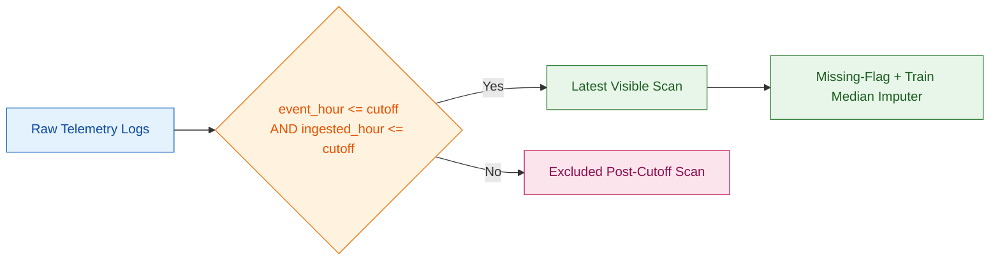

---
{
  "id": "capstone-delivery-eta-prediction",
  "title": "Capstone: Delivery ETA Prediction",
  "slug": "capstone-delivery-eta-prediction",
  "section": "Portfolio Capstones",
  "category": "MLOps & Deployment",
  "difficulty": "Hard",
  "order": 1,
  "coverImage": "social_banner.png",
  "companies": ["Amazon", "Uber", "DoorDash", "Instacart"],
  "shortDescription": "Build an end-to-end delivery ETA and late-risk pipeline with dual-clock point-in-time joins, gradient-boosted regression, locally scaled conformal intervals, Platt calibration, and asymmetric cost optimization.",
  "keyConceptsTested": [
    "point-in-time feature joins",
    "label maturity cutoffs",
    "gradient-boosted regression",
    "normalized split conformal intervals",
    "probability calibration",
    "asymmetric decision thresholds"
  ]
}
---

Delivery platforms do not just predict when a parcel will arrive; they use those predictions to decide whether to trigger customer delay notices, dispatch recovery couriers, or hold standard routing. Treating that problem as a single point-estimate regression misses three failure modes that break production systems. First, offline training tables frequently absorb telemetry written after the live decision clock, producing impressive validation scores that fail during dispatch. Second, point forecasts hide heteroscedastic weather uncertainty, leaving operators blind to whether an arrival window spans forty minutes or four hours. Third, triggering proactive recovery at a naive probability threshold of `0.50` ignores asymmetric SLA penalties where missing a late parcel costs far more than sending a spare alert.

This capstone builds and verifies the complete pipeline over `720` chronological shipments in [the ETA modeling module](assets/eta_lab.py). You assemble dual-clock <span data-glossary="prediction-timestamp">point-in-time</span> features, separate training from calibration and threshold validation with maturity windows, and compare linear and boosted ETA models. From those held-out residuals, you construct normalized <span data-glossary="conformal-prediction">split conformal intervals</span>, apply Platt <span data-glossary="probability-calibration">probability calibration</span>, and optimize an asymmetric operational threshold before locking one final holdout evaluation.

<figure>

<figcaption>Dual-clock point-in-time feature assembly feeds parallel ETA regression and late-risk classification branches, each calibrated on a dedicated held-out split before thresholded alerting.</figcaption>
</figure>

## Dual-Clock Telemetry and Chronological Maturity

Every parcel telemetry event carries two distinct timestamps: `event_hour` records when the scanner or courier GPS emitted the reading, while `ingested_hour` records when storage committed that scan. During offline training table assembly, a reading from a courier whose truck entered a dead zone might carry an `event_hour` before the scoring cutoff (`cutoff_hour`) even though its `ingested_hour` arrived in storage hours later. Because a live dispatch scorer running at `cutoff_hour` can only see scans committed to storage by that moment, historical backfills must require both `event_hour <= cutoff_hour` and `ingested_hour <= cutoff_hour` [^feast2026pit].

Label timing introduces a second temporal trap alongside feature <span data-glossary="feature-leakage">leakage</span>. Suppose you split shipments chronologically into `train`, `calibration`, `validation`, and `test`, and freeze training data at hour `T`. Any shipment dispatched shortly before `T` whose final delivery timestamp `delivered_hour` exceeds `T` has no known outcome at freeze time unless you apply a label maturity buffer. Dropping uncompleted parcels without a cutoff creates survivorship bias because faster parcels complete on time while delayed parcels vanish from the training pool; enforcing an explicit maturity horizon keeps only intervals whose full transit window had closed before the next split starts [^sklearn2026leakage].

<figure>

<figcaption>Each evaluation window advances strictly in dispatch time and guards split boundaries against late-ingested scans and incomplete labels.</figcaption>
</figure>

Let us generate the `720`-shipment stream with `pandas` and `numpy` to quantify how dual-clock telemetry guards change downstream features. We compare the strict join (`event_hour <= cutoff_hour` and `ingested_hour <= cutoff_hour`) against an `event_hour`-only baseline that ignores storage commit delays. Finally, we partition the resulting table into four strictly chronological subsets spanning training, calibration, threshold validation, and untouched holdout testing.

<!-- leetllm: test, id=pit_build, output=show -->
```python title="Dual-clock point-in-time feature assembly and chronological splits"
import numpy as np
import pandas as pd
from assets import eta_lab

deliveries, telemetry = eta_lab.generate_delivery_dataset(n_parcels=720, seed=42)
pit_df = eta_lab.assemble_point_in_time_features(
    deliveries, telemetry, enforce_ingestion_time=True
)
naive_event_only = eta_lab.assemble_point_in_time_features(
    deliveries, telemetry, enforce_ingestion_time=False
)

splits = eta_lab.split_chronological(pit_df)
changed_scans = int(
    (pit_df["hub_queue_depth"].fillna(-1) != naive_event_only["hub_queue_depth"].fillna(-1)).sum()
)

print("Total parcels:", len(pit_df))
print("Parcels whose latest visible scan changed under ingested_hour guard:", changed_scans)
print("Missing telemetry rate at cutoff:", round(float(pit_df["telemetry_missing"].mean()), 4))
print("Chronological split sizes:", {name: len(df) for name, df in splits.items()})
```

<!-- leetllm: output:start -->
```text title="Output" output compact
Total parcels: 720
Parcels whose latest visible scan changed under ingested_hour guard: 113
Missing telemetry rate at cutoff: 0.0278
Chronological split sizes: {'train': 324, 'calibration': 144, 'validation': 126, 'test': 126}
```
<!-- leetllm: output:end -->

Notice how `113` out of `720` shipments (`15.7%`) showed fresher `hub_queue_depth` scans under an `event_hour`-only filter than storage had committed by scoring time, while `2.78%` (`0.0278`) had zero committed telemetry prior to `cutoff_hour`. Treating missingness explicitly prevents silent feature corruption during dispatch outages. Rather than fabricating zeros when scans are absent, the pipeline emits a `telemetry_missing` indicator and fits a training-only `SimpleImputer(strategy="median")` inside a scikit-learn `ColumnTransformer`, preventing median leakage across splits.



## Remaining-Transit Regression: Linear vs Boosted Interactions

Transit delays rarely add up linearly across variables. Long highway distance combined with heavy evening rush hour slows routes modestly, whereas severe storms combined with deep sortation-hub queues trigger compounding dock backlogs and multi-hour delays. To measure how much nonlinear feature interactions matter, let us fit both a regularized `Ridge` regression pipeline [^sklearnLinearRegression2026] and a `HistGradientBoostingRegressor` [^sklearnHistGradientBoosting2026] on the same `324` training shipments using only transit physics (`FEATURE_COLUMNS`), leaving promised SLA windows (`promise_hours`) out of the physical duration regressor.

<!-- leetllm: test, id=eta_reg, continue=pit_build, output=show -->
```python title="Ridge linear baseline versus HistGradientBoostingRegressor on remaining transit hours"
from sklearn.ensemble import HistGradientBoostingRegressor
from sklearn.linear_model import Ridge
from sklearn.metrics import mean_absolute_error, root_mean_squared_error
from sklearn.pipeline import Pipeline

train_df, test_df = splits["train"], splits["test"]
X_train, y_train = train_df[eta_lab.FEATURE_COLUMNS], train_df["remaining_hours"].to_numpy()
X_test, y_test = test_df[eta_lab.FEATURE_COLUMNS], test_df["remaining_hours"].to_numpy()

ridge_model = Pipeline([("prep", eta_lab._make_preprocessor()), ("reg", Ridge(alpha=2.0))])
gbdt_model = Pipeline(
    [
        ("prep", eta_lab._make_preprocessor()),
        (
            "reg",
            HistGradientBoostingRegressor(
                max_depth=4, learning_rate=0.08, max_iter=120, min_samples_leaf=8, random_state=42
            ),
        ),
    ]
)

ridge_model.fit(X_train, y_train)
gbdt_model.fit(X_train, y_train)

mean_pred = np.full_like(y_test, float(np.mean(y_train)))
ridge_pred = ridge_model.predict(X_test)
gbdt_pred = gbdt_model.predict(X_test)

print(f"Constant mean MAE: {mean_absolute_error(y_test, mean_pred):.3f} h")
print(f"Ridge linear MAE:  {mean_absolute_error(y_test, ridge_pred):.3f} h")
print(f"GBDT nonlinear MAE:{mean_absolute_error(y_test, gbdt_pred):.3f} h (RMSE: {root_mean_squared_error(y_test, gbdt_pred):.3f} h)")
```

<!-- leetllm: output:start -->
```text title="Output" output compact
Constant mean MAE: 2.079 h
Ridge linear MAE:  0.867 h
GBDT nonlinear MAE:0.672 h (RMSE: 0.935 h)
```
<!-- leetllm: output:end -->

Switching from additive `Ridge` regression (`0.867 h` MAE) to `HistGradientBoostingRegressor` (`0.672 h` MAE) removes `22.5%` of remaining prediction error on holdout deliveries. Tree splits capture the sharp slowdown threshold when severe weather meets deep hub queues, whereas regularized linear combinations smooth that kink away. Below is a compact comparison across all three regression baselines before wrapping those point predictions in calibrated uncertainty bounds.

| Model | Holdout MAE (hours) | Captures Storm-Queue Interaction | Role in Pipeline |
| :--- | :---: | :---: | :--- |
| Constant Training Mean | 2.079 | No | Sanity baseline |
| Scaled `Ridge(alpha=2.0)` | 0.867 | No | Linear benchmark |
| `HistGradientBoostingRegressor` | 0.672 | Yes | Primary ETA predictor |

## Locally Scaled Split Conformal Intervals

Customers and hub managers care about uncertainty as much as the expected arrival minute: promising a tight 45-minute delivery band during a regional storm destroys trust, whereas broadcasting a five-hour band for every calm metro run wastes capacity. Inductive split <span data-glossary="conformal-prediction">conformal prediction</span> turns any base regressor into a distribution-free <span data-glossary="prediction-interval">prediction interval</span> with finite-sample marginal coverage guarantees under exchangeability [^lei2018conformalRegression] [^angelopoulos2021conformal]. Using the dedicated `calibration` split (`n = 144` shipments unseen by the regressor), we sort nonconformity residuals $r_i = |y_i - \hat{y}_i|$ and pick the order statistic at level

$$
q_{1-\alpha} = \operatorname{Quantile}\!\left(\{r_1, \dots, r_n\};\;\frac{\lceil (n + 1)(1 - \alpha) \rceil}{n}\right)
$$

for target coverage $1 - \alpha = 0.90$. A constant residual threshold $q_{\text{const}}$ produces identical interval widths for calm metro drops and storm-delayed freight routes. To make intervals adapt to local difficulty while preserving the marginal guarantee, normalized split conformal divides each calibration residual by a positive scale estimate $\hat{\sigma}(x_i)$ trained via cross-fitted out-of-fold absolute residuals on the training split [^lei2018conformalRegression]:

$$
s_i = \frac{|y_i - \hat{y}_i|}{\hat{\sigma}(x_i)}, \qquad \hat{C}(x) = \left[\hat{y}(x) - q_{\text{norm}}\,\hat{\sigma}(x),\; \hat{y}(x) + q_{\text{norm}}\,\hat{\sigma}(x)\right].
$$

Let us fit $\hat{\sigma}(x)$ using four-fold `cross_val_predict` residuals on `train`, leaving calibration points completely unseen by both $\hat{y}$ and $\hat{\sigma}$. We then compute both constant and normalized conformal quantiles on `calibration` (`n = 144`) using the finite-sample rank rule. Finally, we evaluate empirical coverage and mean interval width across weather regimes on the untouched `test` deliveries.

<!-- leetllm: test, id=conformal, continue=eta_reg, output=show -->
```python title="Constant versus locally scaled split conformal ETA intervals"
from sklearn.model_selection import cross_val_predict

cal_df = splits["calibration"]
X_cal, y_cal = cal_df[eta_lab.FEATURE_COLUMNS], cal_df["remaining_hours"].to_numpy()

oof_pred = cross_val_predict(gbdt_model, X_train, y_train, cv=4)
scale_model = Pipeline(
    [
        ("prep", eta_lab._make_preprocessor()),
        (
            "reg",
            HistGradientBoostingRegressor(
                max_depth=2, learning_rate=0.06, max_iter=40, min_samples_leaf=20, random_state=42
            ),
        ),
    ]
)
scale_model.fit(X_train, np.maximum(np.abs(y_train - oof_pred), 0.25))

cal_res = np.abs(y_cal - gbdt_model.predict(X_cal))
q_const = eta_lab.split_conformal_quantile(cal_res, alpha=0.10)

cal_sigma = np.maximum(scale_model.predict(X_cal), 0.35)
q_norm = eta_lab.split_conformal_quantile(cal_res / cal_sigma, alpha=0.10)
test_sigma = np.maximum(scale_model.predict(X_test), 0.35)

const_cov = np.mean(np.abs(y_test - gbdt_pred) <= q_const)
norm_cov = np.mean(np.abs(y_test - gbdt_pred) <= q_norm * test_sigma)
norm_widths = 2.0 * q_norm * test_sigma

print(f"Constant conformal: q={q_const:.3f} h | test coverage={const_cov:.3f} | mean width={2*q_const:.3f} h")
print(f"Normalized conformal: q={q_norm:.3f} | test coverage={norm_cov:.3f} | mean width={norm_widths.mean():.3f} h")
for band in ("clear", "rain", "storm"):
    mask = (test_df["weather_band"] == band).to_numpy()
    print(f"  {band:>5s} mean normalized width: {norm_widths[mask].mean():.2f} h (n={mask.sum()})")
```

<!-- leetllm: output:start -->
```text title="Output" output compact
Constant conformal: q=1.555 h | test coverage=0.873 | mean width=3.109 h
Normalized conformal: q=2.367 | test coverage=0.944 | mean width=3.550 h
  clear mean normalized width: 3.10 h (n=77)
   rain mean normalized width: 3.11 h (n=27)
  storm mean normalized width: 5.65 h (n=22)
```
<!-- leetllm: output:end -->

The locally scaled quantile reaches `94.4%` empirical holdout coverage above the `90%` target while automatically tailoring uncertainty to route difficulty: clear routes receive `3.10 h` average bands and rain routes `3.11 h`, whereas storm routes widen sharply to `5.65 h`. That adaptive scaling keeps dispatchers from overpromising during storms without over-padding calm urban legs. Remember that finite-sample conformal guarantees rely on exchangeability between calibration and serving shipments; severe seasonal traffic shifts invalidate static quantiles unless calibration is refreshed on rolling recent windows [^barber2022exchangeability].

<figure>

<figcaption>Normalized conformal prediction bands on five holdout test shipments scale smoothly from narrow clear-weather windows to wide storm intervals.</figcaption>
</figure>

## Calibrated Risk Scores and Asymmetric Threshold Optimization

Predicting remaining hours accurately does not tell operations when to intervene unless you also account for the promised SLA deadline (`promise_hours`) and asymmetric action costs. Notice an important feature-design asymmetry: promised delivery deadlines should never influence physical transit duration, yet `promise_hours` is critical for classifying whether a shipment will breach SLA (`remaining_hours > promise_hours`). Separating physical regression features from SLA classification features keeps transit predictions faithful to courier road conditions.

Expressive gradient-boosted trees frequently push predicted class probabilities toward `0` and `1` relative to true empirical frequencies. If missed late deliveries incur `$22` in SLA refunds and expedite recovery while proactive reroute alerts cost `$3`, decision theory yields an analytical Bayes threshold over well-calibrated probabilities:

$$
t^*_{\text{Bayes}} = \frac{c_{\text{FP}}}{c_{\text{FP}} + c_{\text{FN}}} = \frac{3}{3 + 22} = 0.120.
$$

Unscaled classifier scores distort that cutoff and waste money. Let us fit a deep `HistGradientBoostingClassifier` on `train`, wrap it with Platt sigmoid calibration on `calibration` via `CalibratedClassifierCV(FrozenEstimator(...))` [^sklearnCalibration2026], compare <span data-glossary="brier-score">Brier score</span> and <span data-glossary="expected-calibration-error">ECE</span>, sweep thresholds on `validation` [^sklearnThresholdTuning2026], and evaluate the locked threshold once on `test`.

<!-- leetllm: test, id=calib_cost, continue=conformal, output=show -->
```python title="Platt probability calibration and asymmetric dispatch threshold sweep"
from sklearn.calibration import CalibratedClassifierCV
from sklearn.ensemble import HistGradientBoostingClassifier
from sklearn.frozen import FrozenEstimator
from sklearn.metrics import brier_score_loss

cfg = eta_lab.EtaCostConfig(missed_late_cost=22.0, false_alert_cost=3.0)
cal_df = splits["calibration"]
val_df = splits["validation"]

Xr_train, yr_train = train_df[eta_lab.RISK_FEATURE_COLUMNS], train_df["is_late"].to_numpy()
Xr_cal, yr_cal = cal_df[eta_lab.RISK_FEATURE_COLUMNS], cal_df["is_late"].to_numpy()
Xr_val, yr_val = val_df[eta_lab.RISK_FEATURE_COLUMNS], val_df["is_late"].to_numpy()
Xr_test, yr_test = test_df[eta_lab.RISK_FEATURE_COLUMNS], test_df["is_late"].to_numpy()

raw_clf = Pipeline(
    [
        ("prep", eta_lab._make_preprocessor(eta_lab.RISK_NUMERIC_FEATURES)),
        (
            "clf",
            HistGradientBoostingClassifier(
                max_depth=6, learning_rate=0.14, max_iter=150, min_samples_leaf=4, random_state=42
            ),
        ),
    ]
)
raw_clf.fit(Xr_train, yr_train)
cal_clf = CalibratedClassifierCV(FrozenEstimator(raw_clf), method="sigmoid")
cal_clf.fit(Xr_cal, yr_cal)

raw_test_p = raw_clf.predict_proba(Xr_test)[:, 1]
cal_test_p = cal_clf.predict_proba(Xr_test)[:, 1]
print(f"Raw Brier: {brier_score_loss(yr_test, raw_test_p):.4f} | Calibrated Brier: {brier_score_loss(yr_test, cal_test_p):.4f}")
print(f"Raw ECE:   {eta_lab.compute_ece(yr_test, raw_test_p):.4f} | Calibrated ECE:   {eta_lab.compute_ece(yr_test, cal_test_p):.4f}")

cal_val_p = cal_clf.predict_proba(Xr_val)[:, 1]
sweep = [eta_lab.evaluate_policy_cost(yr_val, cal_val_p, float(t), cfg) for t in np.arange(0.06, 0.86, 0.04)]
best_val = min(sweep, key=lambda r: r["mean_cost_per_parcel"])
print(f"Validation optimal threshold t* = {best_val['threshold']} (val cost ${best_val['mean_cost_per_parcel']:.3f}/parcel)")

for label, thr in [("Locked Val Optimal", best_val["threshold"]), ("Naive 0.50 Default", 0.50)]:
    res = eta_lab.evaluate_policy_cost(yr_test, cal_test_p, thr, cfg)
    print(f"Test [{label} @ {thr:.2f}]: cost=${res['mean_cost_per_parcel']:.3f}/parcel | recall={res['recall']:.3f} | missed={res['missed_late']}")
```

<!-- leetllm: output:start -->
```text title="Output" output compact
Raw Brier: 0.1046 | Calibrated Brier: 0.1032
Raw ECE:   0.1014 | Calibrated ECE:   0.0887
Validation optimal threshold t* = 0.26 (val cost $0.881/parcel)
Test [Locked Val Optimal @ 0.26]: cost=$0.976/parcel | recall=0.917 | missed=3
Test [Naive 0.50 Default @ 0.50]: cost=$1.008/parcel | recall=0.889 | missed=4
```
<!-- leetllm: output:end -->

Platt calibration lowers test ECE from `0.1014` down to `0.0887` and turns an uncalibrated plateau into a well-defined validation cost basin at `t* = 0.26` (`$0.881/parcel`), as plotted below. Locking that <span data-glossary="decision-threshold">decision threshold</span> before inspecting the test split reduces missed late deliveries on untouched shipments from `4` down to `3` (raising recall from `0.889` to `0.917` and lowering cost from `$1.008` to `$0.976/parcel`). As a result, realized holdout cost drops below both the naive `0.50` default and any cutoff selected from raw tree probabilities.

> **Key insight:** A Bayes cost cutoff such as $t^* = 3/(3+22) = 0.12$ assumes that predicted scores behave like true probabilities. When gradient-boosted trees push raw probabilities toward `0` and `1`, Platt calibration restores a smooth probability scale so validation threshold tuning actually lands on the low-cost basin.

<figure>

<figcaption>Validation dispatch cost across probability thresholds ($22 missed late parcel vs $3 false alert); Platt calibration unlocks a $0.88/parcel minimum at t* = 0.26.</figcaption>
</figure>

## Failure Mode: Post-Cutoff Telemetry Leakage in Production

To see why strict dual-clock joins matter in practice, run the failure experiment in `eta_lab.compare_leaky_vs_pit()`. A naive SQL `GROUP BY parcel_id` taking each shipment's latest scan without filtering on `cutoff_hour` accidentally hands the training pipeline congestion readings recorded after the dispatch cutoff. That leaky model looks remarkably accurate in offline validation (`0.499 h` MAE), yet collapses more than threefold to `1.657 h` MAE when deployed against genuine point-in-time test snapshots, performing far worse than a simple linear `Ridge` baseline.

<!-- leetllm: test, id=leakage_failure, output=show -->
```python title="Post-cutoff telemetry leakage failure comparison"
from assets import eta_lab

comparison = eta_lab.compare_leaky_vs_pit(seed=42)
print("Leaky model offline validation MAE:", comparison["leaky_offline_val_mae"], "h")
print("Leaky model live serving test MAE:", comparison["leaky_serving_test_mae"], "h")
print("Point-in-time model test MAE:     ", comparison["pit_serving_test_mae"], "h")
```

<!-- leetllm: output:start -->
```text title="Output" output compact
Leaky model offline validation MAE: 0.499 h
Leaky model live serving test MAE: 1.657 h
Point-in-time model test MAE:      0.672 h
```
<!-- leetllm: output:end -->

In addition to point-in-time feature parity and serialization hygiene (`joblib` or versioned artifacts keeping preprocessors, model weights, conformal quantile, and alert threshold pinned together [^sklearn2026modelpersistence] [^google2026mlops]), production telemetry should <span data-glossary="tracing">trace</span> `event_hour`, `ingested_hour`, and loaded model and threshold versions on every prediction. Feature freshness and `telemetry_missing` rates can be monitored immediately during live inference because both signals are observable at dispatch time. By contrast, realized SLA penalties, conformal coverage, and calibration drift must wait until deliveries complete and labels mature.

## Checkpoints

Work through these three failure scenarios to test your grasp of dual-clock joins, calibration isolation, and monitoring windows.

1. **Dual-clock staleness vs lookahead:** Suppose scan `A` was emitted 2 hours before dispatch and ingested 5 minutes later, while scan `B` was emitted 10 minutes before dispatch and ingested 40 minutes after dispatch. Which scan is visible during live scoring at dispatch time?
<details>
<summary>Check</summary>
Scan `A` only, because scan `B` had not reached storage by `cutoff_hour` even though its `event_hour` preceded dispatch.
</details>

2. **Conformal calibration separation:** Why must $q_{\text{norm}}$ be computed on `calibration` (`n = 144`) using cross-fitted out-of-fold $\hat{\sigma}(x)$ fitted on `train` rather than fitting `gbdt_model` residuals directly on `train`?
<details>
<summary>Check</summary>
Training residuals systematically underpredict out-of-sample error because `gbdt_model` overfits `train` points, which would shrink intervals and break finite-sample coverage on future parcels.
</details>

3. **Monitoring timing:** Immediately after deploying version `v2`, operators observe `telemetry_missing` jumping from `2.8%` to `18%`, while delivered labels for those parcels are not yet back. Should monitoring wait for matured outcomes before raising a pipeline alert?
<details>
<summary>Check</summary>
No. Feature missingness and scan lag exist at inference time and require immediate investigation, whereas realized SLA cost and coverage wait for label maturity.
</details>

## Mastery Quiz

```mastery-quiz
[
  {
    "question": "A dispatch scorer runs at 14:00 UTC for parcel #1595. Telemetry scan S1 has event_hour=13:20 and ingested_hour=13:22. Scan S2 has event_hour=13:55 and ingested_hour=14:25. Which scan should a backfill training join select for the 14:00 UTC feature row?",
    "options": [
      "S2, since its physical vehicle departure happened closest to 14:00 UTC.",
      "S1, since both its event_hour and ingested_hour fall prior to 14:00 UTC.",
      "An unweighted midpoint combining S1 and S2 timestamps sorted by recency.",
      "Zero prior telemetry, since intra-day scanner arrivals produce score leakage."
    ],
    "answer": "S1, since both its event_hour and ingested_hour fall prior to 14:00 UTC.",
    "explanation": "At 14:00 UTC in live serving, storage has committed S1 but has not yet received S2. Selecting S2 during offline backfills leaks information unavailable at decision time and causes train-serving skew."
  },
  {
    "question": "Why does dropping incomplete shipments whose delivered_hour falls after a training freeze horizon distort evaluation when no cutoff maturity rule is applied?",
    "options": [
      "Unfinished routes near the horizon include skewed slow long hauls, creating fast-delivery survivorship bias.",
      "Dropping recent unfinished parcel rows shrinks training row counts below sklearn gradient tree bounds.",
      "Filtering incomplete routes breaks missing categorical weather encoding inside HistGradientBoostingRegressor.",
      "Omitting open dispatches forces empirical alert thresholds close toward zero regardless of overtime rates."
    ],
    "answer": "Unfinished routes near the horizon include skewed slow long hauls, creating fast-delivery survivorship bias.",
    "explanation": "Short and on-time shipments finish before the freeze cutoff while severely delayed ones remain in transit. Filtering purely on observed completion removes the slowest tail and underestimates late rates."
  },
  {
    "question": "Why should promise_hours be included in RISK_FEATURE_COLUMNS for late-SLA classification while remaining excluded from FEATURE_COLUMNS in the remaining-transit ETA regressor?",
    "options": [
      "Gradient boosted trees face split instability past seven continuous numeric inputs per node.",
      "Travel time follows road physics unrelated to promises, whereas SLA breach pits remaining hours against it.",
      "Adding promise_hours to regression drops split conformal prediction test coverage well below 80%.",
      "StandardScaler weights collapse when target hours correlate positively with numeric distance columns."
    ],
    "answer": "Travel time follows road physics unrelated to promises, whereas SLA breach pits remaining hours against it.",
    "explanation": "Predicting physical transit time from courier promises conflates causal travel mechanics with commercial SLA buffers, whereas late classification explicitly estimates P(remaining_hours > promise_hours)."
  },
  {
    "question": "With 144 untouched calibration residuals, what rank k = ceil((144 + 1) * 0.90) gives the finite-sample 90% split conformal quantile?",
    "options": [
      "Rank 130, matching the empirical 90th percentile index of 144 sorted errors",
      "Rank 131, matching the ceil((n+1)*(1-alpha)) finite-sample exchangeability cutoff",
      "Rank 144, taking the maximum calibration residual across small split counts",
      "Rank 129, matching the asymptotic normal quantile over 144 calibration rows"
    ],
    "answer": "Rank 131, matching the ceil((n+1)*(1-alpha)) finite-sample exchangeability cutoff",
    "explanation": "Multiplying 145 by 0.90 yields 130.5, whose ceiling is rank 131 (1-indexed). That finite-sample adjustment guarantees P(Y_test in C(X_test)) >= 1 - alpha for exchangeable residuals."
  },
  {
    "question": "Why did normalized split conformal intervals keep clear and rain bands near 3.10-3.11 hours while widening storm bands to 5.65 hours, compared with constant conformal's uniform 3.109 hours?",
    "options": [
      "Normalized conformal swaps out empirical rank quantiles in favor of Gaussian variance intervals.",
      "Scaling residuals by out-of-fold sigma(x) yields widths q_norm * sigma(x) scaled to local volatility.",
      "Calm urban slices hold fewer severe residual outliers compared to storm subsets in calibration data.",
      "Normalized conformal skips alpha = 0.10 coverage sizing across storm subsets during interval construction."
    ],
    "answer": "Scaling residuals by out-of-fold sigma(x) yields widths q_norm * sigma(x) scaled to local volatility.",
    "explanation": "Scaling residuals by sigma(x) concentrates conformal margin where route uncertainty is highest (storm + long haul) without inflating calm urban prediction intervals."
  },
  {
    "question": "In this dispatch cost setup, missing a late delivery costs $22 and sending a false proactive alert costs $3. What is the Bayes optimal decision threshold on well-calibrated probabilities?",
    "options": [
      "0.500",
      "0.120",
      "0.136",
      "0.880"
    ],
    "answer": "0.120",
    "explanation": "Alerting is cheaper in expectation whenever p * $22 >= (1 - p) * $3, which solves to p >= 3 / (3 + 22) = 3 / 25 = 0.120."
  },
  {
    "question": "In the capstone experiment, why must threshold t* = 0.26 be chosen on the calibration-wrapped classifier's validation split rather than scanning test thresholds directly?",
    "options": [
      "Scanning thresholds on test rows fits cutoffs to noise and yields optimistically biased cost numbers.",
      "scikit-learn rejects evaluate_policy_cost metrics whenever invoked over uncalibrated held-out rows.",
      "Validation probabilities bypass missing-value imputation whereas test inference relies on training medians.",
      "Bayes optimal cutoffs diverge unpredictably once held-out precision or recall values climb past 0.90."
    ],
    "answer": "Scanning thresholds on test rows fits cutoffs to noise and yields optimistically biased cost numbers.",
    "explanation": "Every decision threshold tuned against a split consumes statistical degrees of freedom; keeping test untouched until t* is frozen preserves an unbiased estimate of live deployment cost."
  }
]
```

> **Next:** Continue to [Capstone: Product Ranking](/learn/capstone-product-ranking-recommendation). Delivery ETA modeling separates point-in-time telemetry, calibrated predictions, and asymmetric cost thresholds; product ranking introduces an additional feedback-loop hazard where logged positions shape what users click and what subsequent trainers treat as relevance truth.
