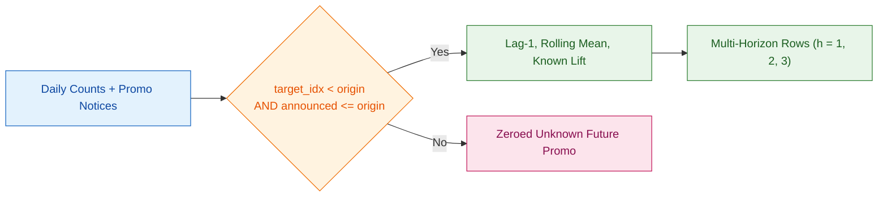

---
{
  "id": "capstone-demand-forecasting-alerts",
  "title": "Capstone: Demand Forecasting",
  "slug": "capstone-demand-forecasting-alerts",
  "section": "Portfolio Capstones",
  "category": "MLOps & Deployment",
  "difficulty": "Hard",
  "order": 3,
  "coverImage": "social_banner.png",
  "companies": ["Amazon", "Walmart", "DoorDash", "Instacart"],
  "shortDescription": "Build a multi-horizon parcel forecasting pipeline with origin-safe features, rolling-origin validation, conformal intervals, and Newsvendor staffing alerts.",
  "keyConceptsTested": ["rolling-origin evaluation", "seasonal naive baseline", "quantile gradient boosting", "split conformal prediction", "newsvendor staffing", "temporal leakage"]
}
---

Every morning before shift assignments lock, a parcel sortation hub faces two coupled timing constraints across its next three operating days. Planners need forecasts across <span data-glossary="forecast-horizon">forecast horizons</span> $h \in \{1, 2, 3\}$ days ahead using only completed daily volume counts before the morning freeze and promotional notices already announced on that planning date. At the same time, staffing too few sorters costs far more than staffing slightly ahead of demand, because unstaffed parcels trigger expedited linehaul and overtime shifts while excess capacity only leaves scheduled hands waiting. Evaluating this pipeline requires separating what is observable when a forecast is issued from the actual parcel counts that settle days later, then pairing calibrated uncertainty intervals with cost-aware <span data-glossary="quantile">quantile</span> decisions.

Rather than jumping straight from calendar features to a single squared-error predictor, a production forecasting pipeline walks through four causal stages in order. First, feature assembly gathers lag statistics strictly prior to the forecast origin and admits promotional lifts only when the notice date precedes the origin date. Next, an expanding-window <span data-glossary="rolling-origin-evaluation">rolling-origin evaluation</span> loop retrains both linear and boosted models on a realistic weekly cadence, reserving an intermediate calibration slice before scoring on the holdout window. From those out-of-sample calibration errors, distribution-free <span data-glossary="conformal-prediction">split conformal prediction</span> sizes valid coverage bands while quantile gradient boosting targets the asymmetric Newsvendor staffing level directly.

<figure>
  
  <figcaption>End-to-end architecture separating origin-safe feature engineering, causal weekly refits, split conformal interval sizing, and cost-optimal Newsvendor staffing decisions.</figcaption>
</figure>

## Target definition and origin-safe multi-horizon features

Forecasting teams first distinguish unconstrained arrival requests from throughput completions before writing a single line of modeling code. Suppose a facility receives $290$ incoming parcels on a busy afternoon, yet conveyor throughput caps processed outbound shipments at $260$ units for that shift. Training a regression model on completed shipments teaches it the warehouse's mechanical bottleneck rather than customer demand, guaranteeing systematic under-forecasting whenever downstream planners try to raise shift headcount. Always log unconstrained arrival volume (`parcel_count` in `daily_counts.csv`) and record the daily warehouse cutoff (`data_ready_hour`) explicitly alongside every series.

With an unconstrained target chosen, multi-horizon direct forecasting constructs one supervised training row per `(origin_date, target_date)` pair across horizons $h \in \{1, 2, 3\}$ [^benTaieb2014multiStep]. Every feature attached to origin $t$ must respect causal availability as of morning freeze:



Calendar harmonics capture smooth <span data-glossary="seasonality">seasonality</span> via weekly and biweekly sine-cosine pairs (`dow_sin`, `dow_cos`, `biweekly_sin`, `biweekly_cos`) alongside a linear day index (`trend_day`) so both linear and tree estimators see cyclic rhythm without one-hot explosion [^hyndman2021fpp3][^fpp3RegressionForecasts2026]. Autoregressive lag statistics (`lag_1_at_origin`, `rolling_7_mean`, `rolling_7_std`) read only counts strictly earlier than `origin_idx`, while `lag_7_from_target` aligns the matching weekday from one week prior to `target_idx`. Notice also how promotional events behave differently from calendar cycles: if marketing logs a promotion on April 8 for April 13, a forecast issued on April 7 cannot peek at that campaign yet. Let us verify how enforcing `announced_date <= origin_date` alters promotional visibility across our `120` daily observations and `8` planned events.

<!-- leetllm: test, id=origin_features, output=show -->
```python title="Leakage-safe horizon frames from daily counts and planned events"
from pathlib import Path
import pandas as pd
from assets import forecast_lab

data_dir = Path("assets")
daily_df = pd.read_csv(data_dir / "daily_counts.csv")
events_df = pd.read_csv(data_dir / "planned_events.csv")

safe_frame = forecast_lab.build_horizon_frame(
    daily_df, events_df, horizons=(1, 2, 3), enforce_event_notice=True
)
leaky_frame = forecast_lab.build_horizon_frame(
    daily_df, events_df, horizons=(1, 2, 3), enforce_event_notice=False
)

masked_promos = int(((safe_frame["known_promo"] == 0) & (leaky_frame["known_promo"] > 0)).sum())
print(f"Daily history: {len(daily_df)} rows | Planned promotions: {len(events_df)}")
print(f"Multi-horizon rows: {len(safe_frame)} | Unannounced promos withheld at origin: {masked_promos}")
print(
    safe_frame[["origin_date", "target_date", "horizon", "lag_1_at_origin", "known_promo", "actual_parcels"]]
    .head(6)
    .to_string(index=False)
)
```

<!-- leetllm: output:start -->
```text title="Output" output compact
Daily history: 120 rows | Planned promotions: 8
Multi-horizon rows: 315 | Unannounced promos withheld at origin: 2
origin_date target_date  horizon  lag_1_at_origin  known_promo  actual_parcels
 2025-01-15  2025-01-15      1.0            198.0          0.0           223.0
 2025-01-15  2025-01-16      2.0            198.0          0.0           220.0
 2025-01-15  2025-01-17      3.0            198.0          0.0           214.0
 2025-01-16  2025-01-16      1.0            223.0          0.0           220.0
 2025-01-16  2025-01-17      2.0            223.0          0.0           214.0
 2025-01-16  2025-01-18      3.0            223.0          0.0           176.0
```
<!-- leetllm: output:end -->

Checking `safe_frame` versus `leaky_frame` confirms that two early origin-horizon rows lose visibility into a not-yet-announced event, preventing the feature matrix from cheating with hindsight. Multi-horizon indexing also explains why target availability lags behind origin dates: when issuing forecasts on day $t$ for horizon $h = 3$, day $t+2$ has not completed yet, so a weekly refit loop on origin $t$ must train strictly on historical rows whose `target_idx < t` has already settled.

## Causal rolling-origin evaluation versus linear and boosted models

Real production schedulers do not retrain models from scratch every hour, nor do they sample future dates into past folds. Instead, `rolling_origin_predictions` mirrors a weekly Sunday refresh (`refit_every=7`) starting at `min_train_origin=56` across an intermediate calibration window (`origin <= 86`, yielding `93` calibration pairs) followed by an untouched holdout test window (`origin > 86`, yielding `96` forecast pairs) [^sklearnTimeSeriesSplit2026]. Comparing three distinct model families side-by-side highlights an essential inductive bias difference on trending series:

1. **Seasonal naive baseline (`naive_s7`):** Predicts each target day using the observed volume exactly seven days earlier (`lag_7_from_target`). Because it ignores upward volume drift, biweekly waves, and promotional lifts, it sets the floor that every learned pipeline must clear by a wide margin.
2. **Regularized linear regression (`Ridge`):** Combines standardized trend, Fourier harmonics, rolling lags, and known promotion lifts under $L_2$ shrinkage (`alpha=4.0`) [^sklearnLinearRegression2026][^numpyLstsq2026]. Smooth linear weights naturally extrapolate the steady `+0.35` parcels/day growth slope into future test weeks.
3. **Gradient boosted trees (`HistGradientBoostingRegressor`):** Fits stagewise shallow trees (`max_depth=3`) that automatically capture nonlinear interactions such as weekend amplification (`promo_x_weekend`) during major promotions [^sklearnHistGradientBoosting2026]. However, decision trees partition the observed feature box with piecewise-constant leaves, so they plateau at the maximum training trend level rather than extrapolating monotonic upward drift!

Let us run the causal weekly rolling evaluation across both validation slices and inspect test <span data-glossary="forecast-error">forecast errors</span> overall and by forecast horizon.

<!-- leetllm: test, id=rolling_eval, continue=origin_features, output=show -->
```python title="Rolling-origin baselines and gradient-boosted holdout errors"
from sklearn.metrics import mean_absolute_error, root_mean_squared_error

rolled = forecast_lab.rolling_origin_predictions(
    safe_frame, min_train_origin=56, cal_end_origin=86, refit_every=7, seed=19
)
cal_df = rolled["calibration"]
test_df = rolled["test"]
y_test = test_df["actual_parcels"].to_numpy()

print(f"Calibration rows: {len(cal_df)} | Holdout test rows: {len(test_df)}")
for label, col in [
    ("Seasonal Naive", "naive_s7"),
    ("Ridge (Linear + Fourier)", "ridge_pred"),
    ("GBDT (Squared Error)", "gbdt_pred"),
]:
    mae = mean_absolute_error(y_test, test_df[col])
    rmse = root_mean_squared_error(y_test, test_df[col])
    print(f"{label:26s} MAE={mae:5.2f}  RMSE={rmse:5.2f}")

print("\nHoldout MAE by horizon:")
for h, grp in test_df.groupby("horizon"):
    m_ridge = mean_absolute_error(grp["actual_parcels"], grp["ridge_pred"])
    m_gbdt = mean_absolute_error(grp["actual_parcels"], grp["gbdt_pred"])
    print(f"h={int(h)} | Ridge MAE={m_ridge:5.2f} | GBDT MAE={m_gbdt:5.2f}")
```

<!-- leetllm: output:start -->
```text title="Output" output compact
Calibration rows: 93 | Holdout test rows: 96
Seasonal Naive             MAE=30.16  RMSE=40.68
Ridge (Linear + Fourier)   MAE= 9.27  RMSE=10.85
GBDT (Squared Error)       MAE=14.49  RMSE=17.52

Holdout MAE by horizon:
h=1 | Ridge MAE= 8.98 | GBDT MAE=14.96
h=2 | Ridge MAE= 9.18 | GBDT MAE=14.50
h=3 | Ridge MAE= 9.66 | GBDT MAE=13.99
```
<!-- leetllm: output:end -->

Every number tells a cohesive physical story. Regularized `Ridge` drops holdout error from `30.16` MAE on `Seasonal Naive` down to `9.27` MAE because linear basis weights extrapolate smooth trend growth cleanly across unseen spring dates. Meanwhile, squared-error `HistGradientBoostingRegressor` posts `14.49` MAE because constant tree leaves lag slightly behind unbridled trend extrapolation, even while modeling sharp promotional variance spikes. Understanding *why* trees plateau on monotonic trends prevents engineers from blindly deploying default tree ensembles on drifting arrival volumes without detrending or hybrid linear bases.

## Split conformal prediction intervals on rolling residuals

Point forecasts rarely give operations teams enough information to judge risk when a promotion hits a weekend or arrival variance widens [^fpp3PredictionIntervals2026]. A <span data-glossary="prediction-interval">prediction interval</span> $[L(x), U(x)]$ wraps the point forecast $\hat{\mu}(x)$ with a calibrated uncertainty radius so at least $1 - \alpha$ of future actuals fall inside the range. Parametric Gaussian formulas ($\hat{\mu} \pm 1.645\hat{\sigma}$) assume homoscedastic, symmetric errors that break down quickly when promotional days carry wider swings than quiet weekdays.

Distribution-free <span data-glossary="conformal-prediction">split conformal prediction</span> requires no distributional assumption beyond approximate exchangeability of recent out-of-sample residuals [^angelopoulos2021conformal][^lei2018conformalRegression]. Using only absolute errors $R_i = |y_i - \hat{\mu}(x_i)|$ gathered on our `93` dedicated calibration rows `cal_df`, we compute the finite-sample quantile radius:

$$
\hat{q}_{1-\alpha} = \text{Quantile}\!\left(\{R_1, \dots, R_n\};\;\frac{\lceil (n + 1)(1 - \alpha) \rceil}{n}\right)
$$

Notice how clean the division of responsibilities stays: training windows produce $\hat{\mu}(x)$, the strictly future calibration slice estimates $\hat{q}_{0.90}$, and the disjoint holdout window verifies whether empirical coverage meets the $90\%$ target without touching the test labels during calibration.

<!-- leetllm: test, id=conformal_bands, continue=rolling_eval, output=show -->
```python title="Split conformal 90 percent intervals from calibration residuals"
import numpy as np

alpha = 0.10
cal_residuals = np.abs(cal_df["actual_parcels"].to_numpy() - cal_df["gbdt_pred"].to_numpy())
n_cal = len(cal_residuals)
conf_level = min(1.0, np.ceil((n_cal + 1) * (1.0 - alpha)) / n_cal)
q90 = float(np.quantile(cal_residuals, conf_level, method="higher"))

preds = test_df["gbdt_pred"].to_numpy()
lower_90 = preds - q90
upper_90 = preds + q90
covered = (y_test >= lower_90) & (y_test <= upper_90)

promo_mask = test_df["known_promo"].to_numpy() > 0
print(f"Finite-sample level={conf_level:.4f} | Conformal radius q90=+/-{q90:.2f} parcels")
print(f"Overall test coverage ({int(covered.sum())}/{len(covered)}): {covered.mean():.3f}")
print(
    f"Normal-day coverage: {covered[~promo_mask].mean():.3f} | "
    f"Promotional-day coverage: {covered[promo_mask].mean():.3f}"
)
```

<!-- leetllm: output:start -->
```text title="Output" output compact
Finite-sample level=0.9140 | Conformal radius q90=+/-30.06 parcels
Overall test coverage (87/96): 0.906
Normal-day coverage: 0.910 | Promotional-day coverage: 0.857
```
<!-- leetllm: output:end -->

Across the `96` holdout decisions, a split conformal radius of `30.06` parcels achieves `0.906` empirical coverage (`87/96` observations inside the band), landing right on the $90\%$ target. Plotting the $h=1$ daily test path shows how conformal bands track major surge windows like April 13 (`285` actual inside the `[251.7, 311.8]` band) and April 26 (`291` actual inside `[235.5, 295.6]`). Still, notice how split conformal's single constant radius leaves slightly narrower slack on extreme promotional spikes than normal days; the next section addresses that directly by learning conditional quantiles tuned to asymmetric staffing economics.

<figure>
  
  <figcaption>Horizon-1 holdout trajectory comparing actual arrivals against the upper and lower 90% split conformal interval and the cost-optimal q80 staffing schedule.</figcaption>
</figure>

## Asymmetric Newsvendor staffing and capacity surge alerts

Symmetric mean forecasts optimize expected squared error, yet sortation hubs never pay equal penalties for positive and negative mistakes. When actual arrivals exceed planned headcount $S$, unstaffed parcels require emergency linehaul and overtime labor costing $c_u = 72$ dollars per unit. When planned headcount exceeds arrivals, unused shift capacity wastes $c_o = 18$ dollars per idle unit. Under this classic Newsvendor objective [^mit2014newsvendor]:

$$
\min_{S} \; \mathbb{E}\!\left[\,c_u \max(Y - S, 0) + c_o \max(S - Y, 0)\,\right]
$$

taking the subgradient with respect to $S$ yields a single closed-form rule: the cost-minimizing staffing level is not the mean or median, but the conditional <span data-glossary="quantile">quantile</span> matching the critical fractile:

$$
\tau^* = \frac{c_u}{c_u + c_o} = \frac{72}{72 + 18} = 0.80
$$

Because `HistGradientBoostingRegressor(loss="quantile", quantile=0.80)` minimizes asymmetric pinball loss directly on the training observations [^sklearnGradientBoosting2026], its `q80_pred` predictions expand naturally during noisy promotions without bloating calm days into false overtime shifts. When `q80_pred` crosses the hub's standing `fixed_capacity=260` threshold, an automated staffing alert requests temporary overflow labor ahead of the shift. Let us compare pinball loss, expected daily staffing cost, shortfall counts, and surge alerts across `Seasonal Naive`, `q50`, `q80`, and `q90` on our holdout horizon-days.

<!-- leetllm: test, id=newsvendor_policy, continue=conformal_bands, output=show -->
```python title="Newsvendor critical fractile and pinball loss comparison"
from sklearn.metrics import mean_pinball_loss

cfg = forecast_lab.NewsvendorCostConfig(
    understaff_cost=72.0, overstaff_cost=18.0, fixed_capacity=260.0
)
tau_star = cfg.understaff_cost / (cfg.understaff_cost + cfg.overstaff_cost)

print(f"Critical fractile tau* = {tau_star:.2f} (c_u=${cfg.understaff_cost:.0f}, c_o=${cfg.overstaff_cost:.0f})")
print(
    f"Pinball loss at tau=0.80 -> q50={mean_pinball_loss(y_test, test_df['q50_pred'], alpha=0.80):.2f} | "
    f"q80={mean_pinball_loss(y_test, test_df['q80_pred'], alpha=0.80):.2f} | "
    f"q90={mean_pinball_loss(y_test, test_df['q90_pred'], alpha=0.80):.2f}\n"
)

for name, col in [
    ("Seasonal Naive", "naive_s7"),
    ("Median (q50)", "q50_pred"),
    ("Critical (q80)", "q80_pred"),
    ("Buffer (q90)", "q90_pred"),
]:
    res = forecast_lab.evaluate_newsvendor_cost(y_test, test_df[col].to_numpy(), cfg)
    print(
        f"{name:15s} cost=${res['mean_daily_cost']:7.2f} | "
        f"shortfall_days={res['shortfall_days']:2d} | surge_alerts={res['surge_alert_days']:2d}"
    )

alerts = test_df[test_df["q80_pred"] > cfg.fixed_capacity][
    ["origin_date", "target_date", "horizon", "q80_pred", "actual_parcels"]
]
print("\nHoldout surge alerts (q80 > 260):")
print(alerts.to_string(index=False))
```

<!-- leetllm: output:start -->
```text title="Output" output compact
Critical fractile tau* = 0.80 (c_u=$72, c_o=$18)
Pinball loss at tau=0.80 -> q50=8.19 | q80=5.84 | q90=6.35

Seasonal Naive  cost=$1499.62 | shortfall_days=54 | surge_alerts=12
Median (q50)    cost=$ 736.82 | shortfall_days=61 | surge_alerts= 3
Critical (q80)  cost=$ 525.60 | shortfall_days=34 | surge_alerts= 6
Buffer (q90)    cost=$ 571.32 | shortfall_days=32 | surge_alerts=17

Holdout surge alerts (q80 > 260):
origin_date target_date  horizon   q80_pred  actual_parcels
 2025-04-11  2025-04-13      3.0 289.117443           285.0
 2025-04-12  2025-04-13      2.0 289.081335           285.0
 2025-04-13  2025-04-13      1.0 289.081335           285.0
 2025-04-24  2025-04-26      3.0 284.982997           291.0
 2025-04-25  2025-04-26      2.0 284.982997           291.0
 2025-04-26  2025-04-26      1.0 284.982997           291.0
```
<!-- leetllm: output:end -->

The holdout economics prove the Newsvendor derivation cleanly. Staffing to `Seasonal Naive` costs `$1,499.62/day` (`54` shortfall days), and symmetric `q50` median staffing costs `$736.82/day` (`61` understaffed horizon-days). Switching to critical-fractile `q80` drops expected cost to **`$525.60/day`**, cutting costs by `29%` versus the median while firing just `6` precision surge alerts on true promotional peaks such as April 13 (`q80=289.1`, `actual=285`) and April 26 (`q80=285.0`, `actual=291`). Pushing even higher to `q90` raises cost back up to `$571.32/day` and nearly triples surge alerts to `17` days due to unnecessary idle reserve capacity.

<figure>
  
  <figcaption>Mean holdout daily cost under asymmetric ($72 understaff vs $18 idle) staffing loss: the q80 critical fractile reaches minimum operational cost without excessive alert fatigue.</figcaption>
</figure>

## Failure mode: shuffled cross-validation leakage on overlapping windows

Standard tabular instinct reaches for randomized k-fold cross-validation whenever model scores fluctuate. On multi-horizon demand tables where Monday, Tuesday, and Wednesday share almost identical `rolling_7_mean`, `trend_day`, and target dates across `h=1,2,3`, shuffling rows randomly across folds leaks the future right next to every validation sample. Both adjacent neighbors share the same promotion wave and macro level, letting decision trees memorize near-exact day neighbors rather than forecasting ahead in time, creating a classic form of <span data-glossary="data-leakage">data leakage</span>.

Let us measure that exact illusion side by side against our causal rolling-origin GBDT error.

<!-- leetllm: test, id=kfold_leakage, continue=newsvendor_policy, output=show -->
```python title="Shuffled K-fold leakage check against rolling-origin error"
import numpy as np
from sklearn.ensemble import HistGradientBoostingRegressor
from sklearn.metrics import mean_absolute_error
from sklearn.model_selection import KFold

X_all = safe_frame[forecast_lab.FORECAST_FEATURES].to_numpy()
y_all = safe_frame["actual_parcels"].to_numpy()

kf = KFold(n_splits=5, shuffle=True, random_state=19)
leaky_maes = []
for tr_idx, va_idx in kf.split(X_all):
    model = HistGradientBoostingRegressor(
        max_depth=3, learning_rate=0.09, max_iter=80, min_samples_leaf=8, random_state=19
    )
    model.fit(X_all[tr_idx], y_all[tr_idx])
    leaky_maes.append(mean_absolute_error(y_all[va_idx], model.predict(X_all[va_idx])))

causal_mae = mean_absolute_error(y_test, test_df["gbdt_pred"])
leaky_mae = float(np.mean(leaky_maes))

print(f"Shuffled 5-Fold CV MAE (LEAKY) : {leaky_mae:5.2f} parcels")
print(f"Causal Rolling GBDT MAE (HONEST): {causal_mae:5.2f} parcels")
print(f"Optimism gap ratio: {causal_mae / leaky_mae:.2f}x underestimate")
```

<!-- leetllm: output:start -->
```text title="Output" output compact
Shuffled 5-Fold CV MAE (LEAKY) :  5.72 parcels
Causal Rolling GBDT MAE (HONEST): 14.49 parcels
Optimism gap ratio: 2.54x underestimate
```
<!-- leetllm: output:end -->

Random k-fold cross-validation advertises a deceptively tight `5.72` parcel MAE when honest causal rolling evaluation measures `14.49` MAE, a `2.54x` underestimate of live forecasting error. Deploying a staffing system tuned under shuffled folds narrows safety buffers, spikes `$72` overtime shortfalls, and breaks empirical conformal coverage on week one.

> **Common mistake:** Treating multi-horizon time-series rows as independent observations in `KFold(shuffle=True)`. Adjacent origins share rolling averages and overlapping target dates, so trees interpolate between neighboring days instead of forecasting ahead.

<figure>
  
  <figcaption>Holdout MAE comparison contrasting leaky shuffled 5-fold validation (5.7) against causal rolling Ridge (9.3), rolling GBDT (14.5), and seasonal naive (30.2).</figcaption>
</figure>

## Summary of pipeline validation and staffing metrics

| Stage / Estimator | Metric Evaluated | Holdout Result | Deployment Implication |
| :--- | :--- | :--- | :--- |
| **Notice Guard** | Masked post-hoc promos | `2` horizon rows masked | Keeps future unannounced promos invisible at origin |
| **Seasonal Naive (`naive_s7`)** | Point MAE / RMSE / Cost | `30.16` / `40.68` / `$1,499.62/day` | Ignores trend drift and promo surges |
| **Linear (`Ridge` + Fourier)** | Point MAE / RMSE | `9.27` / `10.85` (lowest point error) | Smooth weights extrapolate linear upward volume drift |
| **Squared-Error GBDT** | Point MAE / RMSE | `14.49` / `17.52` | Tree leaves plateau on monotonic trend growth |
| **Split Conformal (`90%`)** | Radius / Test coverage | `±30.06` / `90.6%` (`87/96`) | Matches distribution-free finite-sample coverage target |
| **Critical Quantile (`q80`)** | Daily cost / Surge alerts | `$525.60/day` / `6` alerts | Optimal `tau*=0.80` saves `29%` vs median `q50` (`$736.82`) |
| **Shuffled 5-Fold CV** | Leaky MAE illusion | `5.72` (`2.54x` optimistic) | Caught by causal rolling-origin evaluation |

## Mastery verification quiz

```mastery-quiz
[
  {
    "question": "A hub completes 260 outbound shipments on a day when 295 customer parcel orders arrived, leaving 35 orders delayed until the next day. If your goal is predicting next week's staffing requirement, which target should you model?",
    "options": [
      "Daily completed shipments, since completed parcel scans record physical departures already processed at loading docks.",
      "Unconstrained incoming arrival requests (295), since completions cap observed throughput below customer volume.",
      "Pointwise minimum comparing daily completed outbound scans against declared warehouse processing shift capacity.",
      "Zero-clipped surplus parcel differences observed whenever inbound counts climb cleanly above 260 shipments daily."
    ],
    "answer": "Unconstrained incoming arrival requests (295), since completions cap observed throughput below customer volume.",
    "explanation": "Training on capped completions teaches the model the warehouse bottleneck instead of customer demand, causing systematic under-forecasting during busy periods."
  },
  {
    "question": "A marketing campaign targeting April 13 is entered into planned_events.csv on April 10. Why must a rolling forecast issued on April 7 zero out known_promo for target date April 13?",
    "options": [
      "Because scikit-learn decision tree splits exclude future promotional indicators beyond horizon step h=2.",
      "Because April 7 precedes the April 10 entry date, so using it leaks post-origin event data unavailable then.",
      "Because retail marketing campaigns raise weekend arrival variance without shifting expected mean demand levels.",
      "Because rolling horizon h=3 baselines utilize trailing weekly seasonal lags without calendar indicators."
    ],
    "answer": "Because April 7 precedes the April 10 entry date, so using it leaks post-origin event data unavailable then.",
    "explanation": "Origin-safe feature pipelines enforce announced_date <= origin_date so backtests match what the live morning scheduler actually knew on each forecast day."
  },
  {
    "question": "In the holdout rolling evaluation, why did linear Ridge (9.27 MAE) outperform squared-error HistGradientBoostingRegressor (14.49 MAE) despite non-linear promotion-weekend effects?",
    "options": [
      "Ridge completes ten times more boosting gradient updates across daily arrivals than HistGradientBoostingRegressor.",
      "Tree leaves stay piecewise-constant on training bounds and miss extrapolating the +0.35/day trend into holdout.",
      "HistGradientBoostingRegressor drops harmonic Fourier sine and cosine terms when fitting shallow splits.",
      "Regularized linear Ridge minimizes asymmetric pinball loss directly instead of symmetric squared error terms."
    ],
    "answer": "Tree leaves stay piecewise-constant on training bounds and miss extrapolating the +0.35/day trend into holdout.",
    "explanation": "Tree ensembles cannot extrapolate monotonic linear drift outside observed training bounds, whereas regularized linear models extrapolate the fitted trend slope smoothly."
  },
  {
    "question": "How does split conformal prediction determine the 90% interval half-width q90 from 93 calibration rows without altering holdout test fairness?",
    "options": [
      "It fits a secondary variance estimator directly over absolute forecast residuals from 96 holdout test days.",
      "It takes the ceil((n+1)*(1-alpha))/n empirical quantile of absolute errors from the pre-test calibration split.",
      "It scales training residual standard deviation by factor 1.96 under symmetric Gaussian arrival noise assumptions.",
      "It doubles average validation pinball loss computed from the baseline median q50 gradient-boosted estimator."
    ],
    "answer": "It takes the ceil((n+1)*(1-alpha))/n empirical quantile of absolute errors from the pre-test calibration split.",
    "explanation": "Computing the quantile strictly on non-overlapping out-of-sample calibration residuals yields distribution-free finite-sample coverage without peeking at holdout labels."
  },
  {
    "question": "Overtime/expedited understaffing costs $72 per parcel, while idle shift surplus costs $18 per parcel. What quantile level tau* minimizes expected daily staffing cost under the Newsvendor loss?",
    "options": [
      "0.20, evaluated from 18 / (72 + 18) surplus ratio",
      "0.50, evaluating the median point minimizing mean MAE",
      "0.80, evaluated from 72 / (72 + 18) critical fractile",
      "0.90, sizing intervals wider around surge demand tails"
    ],
    "answer": "0.80, evaluated from 72 / (72 + 18) critical fractile",
    "explanation": "The Newsvendor critical fractile tau* = c_u / (c_u + c_o) equals 72 / 90 = 0.80, explaining why q80 outperforms both q50 and overly conservative q90 in holdout daily cost."
  },
  {
    "question": "Why does raising the staffing rule from q80 ($525.60/day) to q90 ($571.32/day) worsen daily operational cost even though shortfall days drop slightly from 34 to 32?",
    "options": [
      "Pinball loss gradients vanish above quantile level 0.80 across multi-depth histogram tree regression ensembles.",
      "Moving from q80 to q90 adds 11 surge alerts and frequent $18 idle-shift costs above minor overtime savings.",
      "Regularized linear Ridge overrides tree quantile predictions whenever daily point forecasts pass 260 parcels.",
      "Fixed hub processing ceilings fall below 200 parcels per shift as soon as q90 predictions pass 260 units."
    ],
    "answer": "Moving from q80 to q90 adds 11 surge alerts and frequent $18 idle-shift costs above minor overtime savings.",
    "explanation": "Moving past the critical fractile tau*=0.80 adds $18 idle cost on most days while cutting $72 shortfalls on only rare tail shocks, increasing total expected cost."
  },
  {
    "question": "Why did random 5-fold KFold(shuffle=True) report 5.72 MAE when causal rolling holdout GBDT measured 14.49 MAE on the identical feature matrix?",
    "options": [
      "KFold splits scored single-step h=1 horizons whereas causal rolling splits evaluated full h=3 forecast gaps.",
      "Adjacent shuffled windows share overlapping lags and targets across folds, leaking future trajectory context.",
      "StandardScaler weights inside the Ridge pipeline leaked into random histogram splits inside KFold validation.",
      "Seasonal naive benchmark predictions dropped out of shuffled validation sets during fold cross-validation runs."
    ],
    "answer": "Adjacent shuffled windows share overlapping lags and targets across folds, leaking future trajectory context.",
    "explanation": "Shuffling correlated time-series windows allows models to interpolate between temporally adjacent rows rather than forecasting genuinely unseen future dates."
  }
]
```

> **Next:** Continue to [Capstone: Image Damage Classifier](/learn/capstone-damaged-package-vision-classifier). You separated forecast-origin visibility from future target outcomes and matched staffing levels to asymmetric shortage costs. Next, apply disciplined image quality checks to package photos before a vision classifier routes damaged claims.
