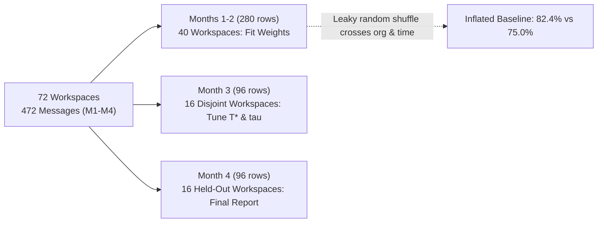

---
{
  "id": "capstone-fine-tuned-classifier",
  "title": "Capstone: Fine-Tuned Classifier",
  "slug": "capstone-fine-tuned-classifier",
  "section": "Portfolio Capstones",
  "category": "Fine-Tuning & Training",
  "difficulty": "Hard",
  "order": 8,
  "coverImage": "social_banner.png",
  "companies": [
    "OpenAI",
    "Anthropic",
    "Google",
    "Meta"
  ],
  "shortDescription": "Build and calibrate an NLP text classifier with grouped temporal splits, PyTorch phrase modeling, DistilBERT fine-tuning recipes, temperature scaling, and threshold gating.",
  "keyConceptsTested": [
    "grouped temporal evaluation split",
    "bag-of-words baseline",
    "neural sequence classification",
    "DistilBERT fine-tuning recipe",
    "temperature scaling calibration",
    "F0.5 precision-recall threshold tuning",
    "confidence abstention routing",
    "deterministic artifact packaging"
  ],
  "relatedQuestions": [
    "capstone-reproducible-research-study",
    "sentence-embeddings-contrastive-learning",
    "agent-evaluation-benchmarks"
  ]
}
---

Deploying a fine-tuned text classifier fails most often after training finishes rather than during gradient descent. Teams optimize cross-entropy loss on randomly shuffled support logs, celebrate an inflated F1 score, ship raw <span data-glossary="softmax">softmax</span> probabilities into automated routing queues, and then discover that workspace phrasing leaked across splits while overconfident logits misroute edge cases at high velocity. Fixing those failures together requires treating splitting, representation learning, probability calibration, and packaging as one connected engineering pipeline.

Reliable text classification requires four coupled engineering stages. First, we enforce a grouped chronological split so neither recurring customer vocabulary nor future drift leaks into training [^sklearn_groupkfold]. Second, we benchmark a fast TF-IDF baseline before stepping up to a neural model that resolves word order and negation. Third, we freeze weights at validation convergence, tune a post-hoc temperature parameter on disjoint validation logits [^guo2017], and choose an asymmetric paging cutoff from a validation precision-recall curve [^sklearnThresholdTuning2026]. Fourth, we serialize the model weights, vocabulary or <span data-glossary="tokenizer-artifact">tokenizer artifact</span>, temperature scalar, and checksum together so serving reproduces offline evaluation identically [^pytorch2026reproducibility].

<figure>
  
  <figcaption>End-to-end classification architecture separating data splitting, neural logit extraction, post-hoc calibration, and thresholded routing across confidence bands.</figcaption>
</figure>

## Compositional triage data and grouped temporal splits

Consider an incoming technical support queue where customer engineering messages belong to three operational classes: `api_outage`, `billing_error`, and `usage_question`. Real support threads mix domain vocabulary across categories. A customer reporting a broken webhook often mentions that their monthly invoice already cleared, whereas a billing dispute frequently explains that production endpoints are healthy.

Evaluating this classifier with a uniform row-level shuffle introduces two hidden leaks [^sklearn2026leakage]. Messages from the same workspace share tenant identifiers, stack-trace boilerplate, and recurring phrasing across weeks, so a model memorizes tenant priors from Months 1 and 2 and scores artificially high when other messages from that same tenant appear in validation. Simultaneously, temporal label proportions shift over time. Isolating workspaces by month avoids both flaws cleanly.



<figure>
  
  <figcaption>Isolating both organizations and chronological windows removes tenant vocabulary leakage (0.824 naive random accuracy versus 0.750 grouped validation accuracy and 0.688 Month 4 test accuracy).</figcaption>
</figure>

The first runnable cell constructs a 472-message compositional support dataset spanning 72 organizations across four chronological months. It asserts zero workspace overlap across training, validation, and held-out test folds before running any feature extractor. Finally, it measures the exact accuracy drop between a leaky random-split unigram TF-IDF logistic regression classifier and an honest grouped chronological baseline [^sklearn_groupkfold].

<!-- leetllm: test, id=clf_data, output=show, deps=torch,scikit-learn,numpy,scipy -->
```python title="Compositional triage data with random and grouped chronological splits"
import hashlib
import json
import re
import tempfile
from pathlib import Path

import numpy as np
import torch
import torch.nn as nn
import torch.nn.functional as F
from scipy.optimize import minimize_scalar
from sklearn.feature_extraction.text import TfidfVectorizer
from sklearn.linear_model import LogisticRegression
from sklearn.metrics import (
    accuracy_score,
    average_precision_score,
    f1_score,
    precision_recall_curve,
)

CLASSES = ("api_outage", "billing_error", "usage_question")


def build_support_corpus(seed: int = 42) -> list[dict]:
    rng = np.random.default_rng(seed)
    bad_phrases = [
        "timed out with 502",
        "failed twice after retry",
        "rejected by upstream host",
        "stalled over tls",
    ]
    ok_phrases = [
        "looks normal today",
        "settled cleanly earlier",
        "responded fine yesterday",
        "passed health check",
    ]
    ask_phrases = [
        "needs sample curl snippet",
        "asks how to export csv",
        "requests retry docs",
        "wants dashboard guide",
    ]

    records = []
    for org_idx in range(72):
        if org_idx < 40:
            month_choices, n_msgs = [1, 2], 7
        elif org_idx < 56:
            month_choices, n_msgs = [3], 6
        else:
            month_choices, n_msgs = [4], 6

        sig = f"tenant{org_idx % 20} region{org_idx % 3}"
        dominant = org_idx % 3
        for k in range(n_msgs):
            month = month_choices[k % len(month_choices)]
            cls = dominant if (month <= 2 and rng.random() < 0.72) else int(rng.integers(0, 3))
            gw_bad = bad_phrases[int(rng.integers(0, len(bad_phrases)))]
            inv_bad = bad_phrases[int(rng.integers(0, len(bad_phrases)))]
            gw_ok = ok_phrases[int(rng.integers(0, len(ok_phrases)))]
            inv_ok = ok_phrases[int(rng.integers(0, len(ok_phrases)))]
            ask_p = ask_phrases[int(rng.integers(0, len(ask_phrases)))]

            if cls == 0:
                text = (
                    f"{sig} production webhook {gw_bad} while monthly invoice {inv_ok}"
                    if rng.random() < 0.65
                    else f"{sig} monthly invoice {inv_ok} not a charge problem streaming gateway {gw_bad}"
                )
            elif cls == 1:
                text = (
                    f"{sig} monthly invoice {inv_bad} while production webhook {gw_ok}"
                    if rng.random() < 0.65
                    else f"{sig} streaming gateway {gw_ok} not an outage duplicate invoice {inv_bad}"
                )
            else:
                text = f"{sig} workspace team {ask_p} for webhook quota and monthly invoice export"

            if rng.random() < 0.08:
                cls = int((cls + 1) % 3)

            records.append(
                {
                    "msg_id": f"m-{len(records) + 1:04d}",
                    "org_id": f"ws-{org_idx:02d}",
                    "month": month,
                    "label": cls,
                    "text": text,
                }
            )
    return records


records = build_support_corpus()
texts = [r["text"] for r in records]
labels = np.array([r["label"] for r in records])
orgs = np.array([r["org_id"] for r in records])
months = np.array([r["month"] for r in records])

train_mask = months <= 2
val_mask = months == 3
test_mask = months == 4

assert len(set(orgs[train_mask]) & set(orgs[val_mask])) == 0
assert len(set(orgs[val_mask]) & set(orgs[test_mask])) == 0

# Naive random split baseline (leaks tenant signatures and future label priors)
perm = np.random.default_rng(42).permutation(len(records))
cut = int(0.70 * len(records))
vec_rand = TfidfVectorizer(ngram_range=(1, 1))
X_tr_r = vec_rand.fit_transform([texts[i] for i in perm[:cut]])
X_ev_r = vec_rand.transform([texts[i] for i in perm[cut:]])
clf_rand = LogisticRegression(max_iter=300).fit(X_tr_r, labels[perm[:cut]])
rand_acc = accuracy_score(labels[perm[cut:]], clf_rand.predict(X_ev_r))

# Honest grouped chronological split baseline
vec_base = TfidfVectorizer(ngram_range=(1, 1))
X_tr_b = vec_base.fit_transform([t for t, m in zip(texts, train_mask) if m])
X_va_b = vec_base.transform([t for t, m in zip(texts, val_mask) if m])
X_te_b = vec_base.transform([t for t, m in zip(texts, test_mask) if m])
clf_base = LogisticRegression(max_iter=300).fit(X_tr_b, labels[train_mask])

va_base_acc = accuracy_score(labels[val_mask], clf_base.predict(X_va_b))
te_base_acc = accuracy_score(labels[test_mask], clf_base.predict(X_te_b))
te_base_f1 = f1_score(labels[test_mask], clf_base.predict(X_te_b), average="macro")

print(f"Split counts -> train={train_mask.sum()}, val={val_mask.sum()}, test={test_mask.sum()} (0 shared orgs)")
print(f"Naive random TF-IDF accuracy  : {rand_acc:.3f}")
print(f"Grouped temporal TF-IDF val   : {va_base_acc:.3f}")
print(f"Grouped temporal TF-IDF test  : {te_base_acc:.3f} (macro-F1={te_base_f1:.3f})")
```

<!-- leetllm: output:start -->
```text title="Output" output compact
Split counts -> train=280, val=96, test=96 (0 shared orgs)
Naive random TF-IDF accuracy  : 0.824
Grouped temporal TF-IDF val   : 0.750
Grouped temporal TF-IDF test  : 0.688 (macro-F1=0.675)
```
<!-- leetllm: output:end -->

Because bag-of-words discards phrase structure, `"production webhook timed out while monthly invoice settled cleanly"` and `"monthly invoice rejected while production webhook responded fine"` carry nearly identical unigram counts. A simple linear classifier over unigrams cannot tell which noun phrase is failing, capping grouped validation accuracy at `0.750` and Month 4 test accuracy at `0.688`. Resolving which clause carries the failure verb demands a model that encodes adjacent word sequences rather than isolated bags of tokens.

## Training a neural phrase classifier and watching calibration drift

Stepping up to a neural text model lets local word order disambiguate negations and attached failure clauses [^pytorch2019]. We construct a multi-kernel 1D convolutional network (`PhraseCNN`) combining bigram (`kernel_size=2`) and trigram (`kernel_size=3`) convolutions over token embeddings, followed by global max pooling and a linear classification head trained with `AdamW` [^pytorchAdamW2026] under `CrossEntropyLoss` [^pytorchCrossEntropy2026]. Sharing that phrase architecture across classes captures negated clauses cleanly in under a second on CPU.

Tracking both training and validation <span data-glossary="negative-log-likelihood">negative log-likelihood (NLL)</span> across epochs exposes a fundamental neural calibration tradeoff [^guo2017]. Accuracy rises rapidly and reaches `0.979` on Month 3 validation around epoch 20 (`val_loss = 0.150`), then stays high near `0.948` while training keeps driving weight magnitudes larger. As softmax logits grow sharper on hard or borderline phrasing, validation NLL climbs back to `0.255` by epoch 45. Classification accuracy stabilizes even while predicted probabilities become systematically overconfident.

<figure>
  
  <figcaption>Training NLL falls monotonically across 45 epochs while validation NLL bottoms near epoch 20 (0.150) and rises again (0.255) as weights inflate overconfident logits.</figcaption>
</figure>

The second runnable cell continues from `clf_data` and builds a vocabulary strictly from Months 1 and 2 training tokens so future terms map to `<unk>`. It then trains `PhraseCNN` for 45 epochs with `AdamW`, logs validation loss climbing after its mid-training minimum, and reports held-out Month 4 accuracy and macro-F1 relative to the unigram baseline.

<!-- leetllm: test, id=clf_train, continue=clf_data, output=show, deps=torch,scikit-learn,numpy,scipy -->
```python title="Word-level neural phrase classifier and calibration drift"
def tokenize_words(text: str) -> list[str]:
    return re.findall(r"[a-z0-9_]+", text.lower())


vocab = {"<pad>": 0, "<unk>": 1}
for text, is_train in zip(texts, train_mask):
    if is_train:
        for tok in tokenize_words(text):
            vocab.setdefault(tok, len(vocab))

MAX_LEN = 22


def encode_batch(sub_texts: list[str]) -> torch.Tensor:
    arr = np.zeros((len(sub_texts), MAX_LEN), dtype=np.int64)
    for i, text in enumerate(sub_texts):
        ids = [vocab.get(tok, 1) for tok in tokenize_words(text)[:MAX_LEN]]
        arr[i, : len(ids)] = ids
    return torch.tensor(arr)


tr_X = encode_batch([t for t, m in zip(texts, train_mask) if m])
va_X = encode_batch([t for t, m in zip(texts, val_mask) if m])
te_X = encode_batch([t for t, m in zip(texts, test_mask) if m])
tr_y = torch.tensor(labels[train_mask], dtype=torch.long)
va_y = torch.tensor(labels[val_mask], dtype=torch.long)
te_y = torch.tensor(labels[test_mask], dtype=torch.long)


class PhraseCNN(nn.Module):
    def __init__(self, vocab_size: int, dim: int = 24, num_classes: int = 3) -> None:
        super().__init__()
        self.emb = nn.Embedding(vocab_size, dim, padding_idx=0)
        self.conv2 = nn.Conv1d(dim, dim, kernel_size=2, padding=1)
        self.conv3 = nn.Conv1d(dim, dim, kernel_size=3, padding=1)
        self.head = nn.Linear(dim * 2, num_classes)

    def forward(self, x: torch.Tensor) -> torch.Tensor:
        emb = self.emb(x).transpose(1, 2)
        h2 = F.relu(self.conv2(emb)).amax(dim=-1)
        h3 = F.relu(self.conv3(emb)).amax(dim=-1)
        return self.head(torch.cat([h2, h3], dim=-1))


torch.manual_seed(7)
model = PhraseCNN(len(vocab))
opt = torch.optim.AdamW(model.parameters(), lr=2.5e-2, weight_decay=1e-4)
crit = nn.CrossEntropyLoss()

for epoch in range(1, 46):
    model.train()
    opt.zero_grad()
    tr_loss = crit(model(tr_X), tr_y)
    tr_loss.backward()
    opt.step()

    if epoch in (1, 10, 20, 30, 45):
        model.eval()
        with torch.inference_mode():
            va_logits_ep = model(va_X)
            va_loss = crit(va_logits_ep, va_y).item()
            va_acc = (va_logits_ep.argmax(-1) == va_y).float().mean().item()
        print(f"Epoch {epoch:2d} | tr_loss={tr_loss.item():.3f} | va_loss={va_loss:.3f} | va_acc={va_acc:.3f}")

model.eval()
with torch.inference_mode():
    va_logits = model(va_X).numpy()
    te_logits = model(te_X).numpy()

te_pred = te_logits.argmax(axis=1)
te_acc = accuracy_score(labels[test_mask], te_pred)
te_f1 = f1_score(labels[test_mask], te_pred, average="macro")
print(f"Held-out Month 4 neural accuracy={te_acc:.3f}, macro-F1={te_f1:.3f} (vs TF-IDF {te_base_acc:.3f})")
```

<!-- leetllm: output:start -->
```text title="Output" output compact
Epoch  1 | tr_loss=1.210 | va_loss=1.170 | va_acc=0.667
Epoch 10 | tr_loss=0.316 | va_loss=0.248 | va_acc=0.927
Epoch 20 | tr_loss=0.193 | va_loss=0.150 | va_acc=0.979
Epoch 30 | tr_loss=0.127 | va_loss=0.179 | va_acc=0.948
Epoch 45 | tr_loss=0.069 | va_loss=0.255 | va_acc=0.948
Held-out Month 4 neural accuracy=0.865, macro-F1=0.861 (vs TF-IDF 0.688)
```
<!-- leetllm: output:end -->

### Scaling up to a pretrained DistilBERT encoder in production

For long multi-paragraph documents, unseen synonyms, or subtle syntactic scope beyond fixed word n-grams, a compact pretrained transformer such as `distilbert-base-uncased` replaces the custom convolutional encoder directly [^sanh2019Distilbert][^distilbertConfig2026]. DistilBERT distills the six-layer bidirectional encoder from BERT [^devlin2019] and exposes a `AutoModelForSequenceClassification` head [^wolf2020transformers][^hfDistilbertHead2026] using <span data-glossary="subword-tokenization">WordPiece subword tokenization</span> [^hfWordPieceCourse2026] so rare SDK versions and unknown identifiers degrade into character fragments rather than collapsing to `<unk>`.

In production fine-tuning with Hugging Face `Trainer` [^hfTrainer2026][^huggingface2026datacollator], keep `truncation=True` with an explicit `max_length` aligned to serving latency budgets, pass `DataCollatorWithPadding` for dynamic batch padding, evaluate on the exact same grouped chronological split, and extract raw validation logits with `model.eval()` inside `torch.inference_mode()` [^pytorchInferenceMode2026] before running calibration:

```python title="DistilBERT fine-tuning with the Trainer API"
from datasets import Dataset
from transformers import (
    AutoModelForSequenceClassification,
    AutoTokenizer,
    DataCollatorWithPadding,
    Trainer,
    TrainingArguments,
)

checkpoint = "distilbert-base-uncased"
tokenizer = AutoTokenizer.from_pretrained(checkpoint)

def preprocess(batch):
    return tokenizer(batch["text"], truncation=True, max_length=128)

train_ds = Dataset.from_list(train_rows).map(preprocess, batched=True)
val_ds = Dataset.from_list(val_rows).map(preprocess, batched=True)

encoder = AutoModelForSequenceClassification.from_pretrained(
    checkpoint,
    num_labels=len(CLASSES),
    id2label=dict(enumerate(CLASSES)),
    label2id={name: idx for idx, name in enumerate(CLASSES)},
)

args = TrainingArguments(
    output_dir="artifacts/distilbert-triage",
    learning_rate=3e-5,
    per_device_train_batch_size=16,
    per_device_eval_batch_size=32,
    num_train_epochs=4,
    weight_decay=0.01,
    eval_strategy="epoch",
    save_strategy="epoch",
    load_best_model_at_end=True,
    metric_for_best_model="eval_loss",
    seed=7,
)

trainer = Trainer(
    model=encoder,
    args=args,
    train_dataset=train_ds,
    eval_dataset=val_ds,
    processing_class=tokenizer,
    data_collator=DataCollatorWithPadding(tokenizer),
)
trainer.train()
val_logits = trainer.predict(val_ds).predictions
```

Because `PhraseCNN` and `DistilBERT` both expose normalized or unnormalized `float32` logit vectors $\mathbf{z} \in \mathbb{R}^K$, swapping backbones does not alter downstream evaluation logic. Every calibration solver, threshold search, and bundle serializer built below consumes those validation logits without modification. That separation allows offline tuning and confidence routing policies to remain invariant across encoder upgrades.

## Post-hoc temperature scaling, asymmetric thresholds, and artifact serialization

Raw neural logits after 45 training epochs tend to concentrate softmax mass near 0.98 even on ambiguous samples. Temperature scaling [^guo2017][^sklearnCalibration2026] fixes this single-parameter flaw without altering rank order or argmax accuracy. Given unnormalized logits $\mathbf{z}$ and scalar temperature $T > 0$, calibrated class probabilities take the form:

$$
\hat{\mathbf{p}}(\mathbf{z}; T) = \mathrm{softmax}\!\left(\frac{\mathbf{z}}{T}\right)
$$

Values $T > 1$ soften overconfident extremes toward uniform uncertainty, whereas $T < 1$ sharpens underconfident distributions. Optimizing $T^*$ strictly on validation NLL via one-dimensional bounded minimization (`scipy.optimize.minimize_scalar`) yields $T^* = 1.620$. Applying that single learned scalar lowers validation Expected Calibration Error (ECE) while cutting held-out Month 4 test NLL by nearly 28% (`0.694` to `0.502`) [^niculescu2005]. Notice that once probabilities reflect empirical correctness frequency, two downstream routing choices can replace naive `argmax` across triage queues:

| Stage or Policy | Validation Metric | Month 4 Held-Out Test Result | Operational Purpose |
| :--- | :--- | :--- | :--- |
| Unigram TF-IDF + Logistic Regression | Acc `0.750` | Acc `0.688`, Macro-F1 `0.675` | Fast grouped baseline; struggles with clause negation |
| Raw `PhraseCNN` (Epoch 45) | Acc `0.948`, NLL `0.255`, ECE `0.035` | Acc `0.865`, NLL `0.694`, ECE `0.093` | Resolves word order; top bin confidence `0.984` vs `0.905` acc |
| Temperature-Scaled (`T* = 1.620`) | NLL `0.220`, ECE `0.027` | NLL `0.502` (-27.7%), Macro-F1 `0.861` | Calibrates probability mass across validation & future months |
| Urgent Paging Cutoff ($F_{0.5}$ $\tau = 0.749$) | `api_outage` Prec `1.000`, Rec `0.892` | `api_outage` Prec `0.897`, Rec `0.839` | Avoids paging engineers on noisy false positives |
| Confidence Abstention ($\max p \ge 0.65$) | Calibrated confidence floor | Acc `0.906` at `88.5%` coverage (`85/96`) | Routes uncertain `11.5%` borderline messages to human review |

Choosing the paging threshold with $F_{0.5}$ rather than $F_1$ or fixed `0.50` reflects asymmetric operational costs. Missing an uncalibrated false alarm wastes incident-response attention, so $F_{0.5}$ weights <span data-glossary="precision">precision</span> twice as heavily as <span data-glossary="recall">recall</span> when scanning `precision_recall_curve` on validation probabilities [^sklearnThresholdTuning2026]. Pairing that urgent escalation score with a calibrated confidence floor ($\max \hat{p} \ge 0.65$) separates high-assurance automated routing (`90.6%` test accuracy across `88.5%` volume) from uncertain cases queued for human review.

<figure>
  
  <figcaption>Post-hoc calibration at T*=1.62 lowers Month 4 test NLL from 0.694 to 0.502 while confidence gating at 0.65 lifts automated test accuracy from 86.2% to 90.6% by abstaining on 11.5% borderline tickets.</figcaption>
</figure>

The final runnable cell optimizes scalar temperature $T^*$ exclusively on Month 3 validation logits, selects the `api_outage` $F_{0.5}$ escalation cutoff, and measures how calibrated abstention lifts test accuracy across operating points. It then serializes `weights.pt` alongside `bundle.json` containing the vocabulary, sequence length, temperature, cutoffs, and SHA-256 weight digest, reloads the package under `weights_only=True`, and tests empty and truncated edge inputs [^pytorchSavingLoading2026].

<!-- leetllm: test, id=clf_calibrate_bundle, continue=clf_train, output=show, deps=torch,scikit-learn,numpy,scipy -->
```python title="Temperature scaling, F0.5 threshold, and artifact serialization"
def softmax_np(logits: np.ndarray) -> np.ndarray:
    shifted = logits - logits.max(axis=1, keepdims=True)
    exp = np.exp(shifted)
    return exp / exp.sum(axis=1, keepdims=True)


def nll_for_temperature(temp: float, logits: np.ndarray, y_true: np.ndarray) -> float:
    probs = softmax_np(logits / temp)
    p_true = np.clip(probs[np.arange(len(y_true)), y_true], 1e-12, 1.0)
    return float(-np.log(p_true).mean())


def expected_calibration_error(probs: np.ndarray, y_true: np.ndarray, bins: int = 6) -> float:
    conf = probs.max(axis=1)
    acc = (probs.argmax(axis=1) == y_true).astype(float)
    edges = np.linspace(0.0, 1.0, bins + 1)
    ece = 0.0
    for low, high in zip(edges[:-1], edges[1:]):
        mask = (conf > low) & (conf <= high) if low > 0 else (conf >= low) & (conf <= high)
        if mask.any():
            ece += float(mask.mean()) * abs(float(acc[mask].mean()) - float(conf[mask].mean()))
    return ece


opt_res = minimize_scalar(
    lambda t: nll_for_temperature(t, va_logits, labels[val_mask]),
    bounds=(0.3, 8.0),
    method="bounded",
)
t_star = float(opt_res.x)

va_p_raw, va_p_cal = softmax_np(va_logits), softmax_np(va_logits / t_star)
te_p_raw, te_p_cal = softmax_np(te_logits), softmax_np(te_logits / t_star)

print(
    f"Temperature T*={t_star:.3f} | "
    f"Val NLL: {nll_for_temperature(1.0, va_logits, labels[val_mask]):.3f} -> "
    f"{nll_for_temperature(t_star, va_logits, labels[val_mask]):.3f} | "
    f"Val ECE: {expected_calibration_error(va_p_raw, labels[val_mask]):.3f} -> "
    f"{expected_calibration_error(va_p_cal, labels[val_mask]):.3f}"
)
print(
    f"Month 4 Test NLL: {nll_for_temperature(1.0, te_logits, labels[test_mask]):.3f} -> "
    f"{nll_for_temperature(t_star, te_logits, labels[test_mask]):.3f}"
)

# Choose F0.5 operating threshold on validation api_outage probability
y_va_outage = (labels[val_mask] == 0).astype(int)
y_te_outage = (labels[test_mask] == 0).astype(int)
prec, rec, thresholds = precision_recall_curve(y_va_outage, va_p_cal[:, 0])
f05_candidates = [
    ((1.25 * p * r / (0.25 * p + r)) if (p + r) > 0 else 0.0, float(p), float(r), float(th))
    for p, r, th in zip(prec[:-1], rec[:-1], thresholds)
]
_, val_p, val_r, outage_tau = max(f05_candidates, key=lambda item: item[0])

te_outage_pred = (te_p_cal[:, 0] >= outage_tau).astype(int)
tp = int(((te_outage_pred == 1) & (y_te_outage == 1)).sum())
fp = int(((te_outage_pred == 1) & (y_te_outage == 0)).sum())
fn = int(((te_outage_pred == 0) & (y_te_outage == 1)).sum())
print(
    f"F0.5 outage threshold tau={outage_tau:.3f} | "
    f"Val P={val_p:.3f}, R={val_r:.3f} | "
    f"Test P={tp / max(tp + fp, 1):.3f}, R={tp / max(tp + fn, 1):.3f}"
)

for conf_cut in (0.50, 0.65, 0.75, 0.85):
    auto = te_p_cal.max(axis=1) >= conf_cut
    auto_acc = float((te_p_cal.argmax(axis=1)[auto] == labels[test_mask][auto]).mean())
    print(f"Confidence cutoff {conf_cut:.2f}: coverage={auto.mean():.3f} ({auto.sum()}/{len(auto)}), auto_acc={auto_acc:.3f}")


def save_serving_bundle(bundle_dir: Path, trained_model: nn.Module, temp: float, tau: float) -> Path:
    bundle_dir.mkdir(parents=True, exist_ok=True)
    weights_path = bundle_dir / "weights.pt"
    torch.save(trained_model.state_dict(), weights_path)
    digest = hashlib.sha256(weights_path.read_bytes()).hexdigest()
    meta = {
        "classes": list(CLASSES),
        "vocab": vocab,
        "max_len": MAX_LEN,
        "temperature": temp,
        "outage_threshold": tau,
        "abstain_confidence": 0.65,
        "weights_sha256": digest,
    }
    (bundle_dir / "bundle.json").write_text(json.dumps(meta, indent=2))
    return bundle_dir


def route_texts(bundle_dir: Path, raw_texts: list[str]) -> list[dict]:
    meta = json.loads((bundle_dir / "bundle.json").read_text())
    weights_bytes = (bundle_dir / "weights.pt").read_bytes()
    assert hashlib.sha256(weights_bytes).hexdigest() == meta["weights_sha256"]

    loaded = PhraseCNN(len(meta["vocab"]), num_classes=len(meta["classes"]))
    loaded.load_state_dict(torch.load(bundle_dir / "weights.pt", weights_only=True))
    loaded.eval()

    tok_map = meta["vocab"]
    encoded = np.zeros((len(raw_texts), meta["max_len"]), dtype=np.int64)
    for idx, txt in enumerate(raw_texts):
        ids = [tok_map.get(w, 1) for w in tokenize_words(txt)[: meta["max_len"]]]
        encoded[idx, : len(ids)] = ids

    with torch.inference_mode():
        logits = loaded(torch.tensor(encoded)).numpy()
    assert np.isfinite(logits).all()

    probs = softmax_np(logits / meta["temperature"])
    results = []
    for p_vec in probs:
        top_idx = int(p_vec.argmax())
        top_prob = float(p_vec[top_idx])
        action = "urgent_page" if p_vec[0] >= meta["outage_threshold"] else (
            "auto_route" if top_prob >= meta["abstain_confidence"] else "human_review"
        )
        results.append(
            {
                "label": meta["classes"][top_idx],
                "confidence": round(top_prob, 3),
                "p_outage": round(float(p_vec[0]), 3),
                "action": action,
            }
        )
    return results


with tempfile.TemporaryDirectory() as tmpdir:
    pkg = save_serving_bundle(Path(tmpdir) / "clf-v1", model, t_star, outage_tau)
    sample_inputs = [
        "tenant1 region0 streaming gateway stalled over tls while monthly invoice looks normal today",
        "monthly invoice rejected by upstream host while production webhook passed health check",
        "",
        " ".join(["unknown_symbol"] * 40),
    ]
    routed = route_texts(pkg, sample_inputs)
    for row in routed:
        print(row)
```

<!-- leetllm: output:start -->
```text title="Output" output compact
Temperature T*=1.620 | Val NLL: 0.255 -> 0.220 | Val ECE: 0.035 -> 0.027
Month 4 Test NLL: 0.694 -> 0.502
F0.5 outage threshold tau=0.749 | Val P=1.000, R=0.892 | Test P=0.897, R=0.839
Confidence cutoff 0.50: coverage=0.979 (94/96), auto_acc=0.862
Confidence cutoff 0.65: coverage=0.885 (85/96), auto_acc=0.906
Confidence cutoff 0.75: coverage=0.865 (83/96), auto_acc=0.904
Confidence cutoff 0.85: coverage=0.781 (75/96), auto_acc=0.893
{'label': 'api_outage', 'confidence': 0.954, 'p_outage': 0.954, 'action': 'urgent_page'}
{'label': 'billing_error', 'confidence': 0.661, 'p_outage': 0.006, 'action': 'auto_route'}
{'label': 'billing_error', 'confidence': 0.339, 'p_outage': 0.339, 'action': 'human_review'}
{'label': 'api_outage', 'confidence': 0.786, 'p_outage': 0.786, 'action': 'urgent_page'}
```
<!-- leetllm: output:end -->

Every safeguard tested above prevents a specific production failure. Saving `vocab`, `max_len`, `temperature`, `outage_threshold`, and `abstain_confidence` inside the same versioned directory as `weights.pt` prevents <span data-glossary="training-serving-skew">training-serving skew</span>, verifying the SHA-256 digest prevents silent partial uploads or weight mismatches, and edge inputs such as empty strings (`""`) or unknown tokens past `max_len` stay below `abstain_confidence` (`0.65`) and fall back cleanly to `human_review` rather than silently misrouting traffic.

```mastery-quiz
[
  {
    "question": "Why does randomly shuffling support messages across rows inflate offline validation accuracy compared to a grouped chronological split?",
    "options": [
      "Random shuffling places tenant-specific boilerplate and future priors across training and evaluation folds",
      "TfidfVectorizer skips rare unigrams whenever documents arrive sorted chronologically by send timestamp",
      "LogisticRegression stalls at non-convex local minima whenever inputs follow strict timestamp ordering",
      "CrossEntropyLoss clips gradients on random batches while skipping gradient clipping inside grouped splits"
    ],
    "answer": "Random shuffling places tenant-specific boilerplate and future priors across training and evaluation folds",
    "explanation": "Messages from the same tenant share boilerplate tokens and recurring phrasing across time. A random split leaks those tenant signatures and future label distributions across folds, inflating validation accuracy (0.824 vs 0.750 on a grouped chronological split)."
  },
  {
    "question": "What operational problem did Epoch 45 of PhraseCNN reveal even though validation accuracy remained at 94.8%?",
    "options": [
      "Gradient norm vanished toward zero prior to convolutional filter extraction over bigram windows",
      "Validation negative log-likelihood rose from 0.150 up to 0.255 as growing logits made misses overconfident",
      "Token embeddings collapsed padding indices straight toward the embedding vector of the majority label",
      "Global max pooling discarded trigram features whenever sequence lengths stayed under 22 tokens"
    ],
    "answer": "Validation negative log-likelihood rose from 0.150 up to 0.255 as growing logits made misses overconfident",
    "explanation": "Training cross-entropy keeps pushing weights outward even after classification accuracy plateaus. Larger logit margins improve neither rank order nor accuracy on ambiguous inputs, raising validation NLL and Expected Calibration Error."
  },
  {
    "question": "Why can temperature scaling (softmax(z / T) with T > 1) lower test negative log-likelihood from 0.694 to 0.502 without altering held-out macro-F1?",
    "options": [
      "Scaling logits by shared positive constant T leaves relative logit order unchanged across inputs",
      "Setting T > 1 injects zero-mean noise into validation logits matching downstream test spread",
      "Temperature scaling swaps out linear projection heads with shallow gradient boosted ensembles",
      "Post-hoc scaling rescales learned embedding norms strictly across minority class categories"
    ],
    "answer": "Scaling logits by shared positive constant T leaves relative logit order unchanged across inputs",
    "explanation": "Because z / T is a positive strictly monotonic rescaling of logits, argmax(z / T) equals argmax(z), preserving top-1 accuracy and macro-F1 while softening overconfident probability extremes."
  },
  {
    "question": "On which dataset split must the scalar temperature T* and the F0.5 paging cutoff tau be optimized?",
    "options": [
      "The held-out Month 4 test set, incorporating shifts from the latest serving distribution",
      "The training split jointly alongside AdamW weights via standard end-to-end backpropagation",
      "The disjoint Month 3 validation split right after frozen model checkpoint selection",
      "Unlabeled live serving messages recorded prior to candidate checkpoint promotion"
    ],
    "answer": "The disjoint Month 3 validation split right after frozen model checkpoint selection",
    "explanation": "Fitting calibration parameters on training residuals underestimates overconfidence, while tuning them on the final test set leaks evaluation outcomes into model selection. A disjoint chronological validation split isolates both."
  },
  {
    "question": "Why did threshold selection use F0.5 rather than default 0.50 probability or F1 for the urgent api_outage paging queue?",
    "options": [
      "F0.5 ignores validation probabilities whenever empirical class imbalance climbs past 10%",
      "F0.5 weights precision twice over recall, preventing noisy predictions from false paging",
      "Default softmax boundaries at 0.50 fail to separate predictions past binary problem setups",
      "F0.5 refreshes token embedding norms live whenever serving latency crosses target SLOs"
    ],
    "answer": "F0.5 weights precision twice over recall, preventing noisy predictions from false paging",
    "explanation": "When false-positive pages carry higher operational cost than forwarding borderline cases to standard triage queues, F_beta with beta=0.5 prioritizes precision over recall across the validation precision-recall curve."
  },
  {
    "question": "How does coupling a calibrated confidence floor (max p >= 0.65) with artifact SHA-256 verification protect serving inference?",
    "options": [
      "Low-confidence inputs under 0.65 escalate to human triage while SHA-256 catches mismatched weights",
      "Artifact checksums quantize model weights toward INT8 while confidence clipping drops padding tokens",
      "Both checks trigger automated DistilBERT fine-tuning as soon as vocabulary coverage falls off",
      "Confidence thresholding replaces CrossEntropyLoss probabilities using TF-IDF cosine distances live"
    ],
    "answer": "Low-confidence inputs under 0.65 escalate to human triage while SHA-256 catches mismatched weights",
    "explanation": "Calibration ensures low-confidence edge cases such as empty inputs or unseen tokens fall below the abstention threshold and route to human review, while hashing the serialized weights with matching tokenizer and scalar metadata prevents training-serving skew."
  }
]
```

> **Next:** Continue to [Capstone: Reproducible ML Study](/learn/capstone-reproducible-research-study). With calibrated thresholds, grouped evaluation, and deterministic bundle packaging complete, the final capstone moves from a production classifier to multi-seed research verification and ablation discipline.
