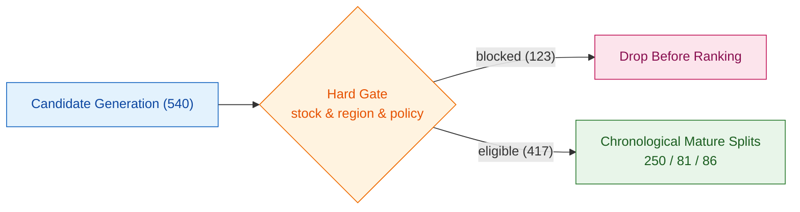

---
{
  "id": "capstone-product-ranking-recommendation",
  "title": "Capstone: Product Ranking",
  "slug": "capstone-product-ranking-recommendation",
  "section": "Portfolio Capstones",
  "category": "Evaluation & Benchmarks",
  "difficulty": "Hard",
  "order": 2,
  "coverImage": "social_banner.png",
  "companies": ["Amazon", "Netflix", "Spotify", "Instacart"],
  "shortDescription": "Build an end-to-end learning-to-rank pipeline with hard eligibility gates, PyTorch pairwise RankNet, clipped Inverse Propensity Scoring click debiasing, MMR diversity reranking, and SRM rollout checks.",
  "keyConceptsTested": [
    "hard eligibility filtering",
    "pairwise learning to rank",
    "label maturity cutoffs",
    "inverse propensity scoring",
    "maximal marginal relevance",
    "experiment guardrails"
  ]
}
---

Product search engines must solve two coupled problems at once: surfacing items shoppers genuinely want and preventing historical display order from corrupting future training data. Unlike static regression datasets, ranking logs reflect whichever list an earlier ranker chose to display. An outdated heuristic pinned at slot one attracts disproportionate user clicks even when better candidates sit further down, while eligible stock and regional shipping constraints decide which candidates are even lawful to render.

This capstone builds the complete multi-stage search pipeline in [the ranking module](assets/ranking_lab.py) over `540` recorded search impressions stored in [the session log](assets/temporal-ranking.csv). You separate strict pre-ranking eligibility from scoring, guard temporal splits against delayed conversion outcomes, and train a <span data-glossary="reranker">pairwise RankNet</span> model in PyTorch. You then remove <span data-glossary="position-bias">position bias</span> via clipped <span data-glossary="inverse-propensity-scoring">Inverse Propensity Scoring (IPS)</span>, balance relevance against catalog variety with <span data-glossary="maximal-marginal-relevance">Maximal Marginal Relevance (MMR)</span>, and verify online launch traffic with Sample Ratio Mismatch (SRM) and `p95` latency checks.

<figure>

<figcaption>Hard eligibility rules drop out-of-stock, unshippable, and policy-blocked items before ranking; downstream models compare explicit pairwise RankNet against IPS-debiased click training before MMR diversity reranking.</figcaption>
</figure>

## Hard Eligibility Gates and Maturity-Guarded Splits

Multi-stage retrieval pipelines generate hundreds of candidates using lexical relevance signals such as `bm25_score` [^tensorflow2026retrieval]. Some top lexical matches, however, cannot legally or physically fulfill the order: inventory may be exhausted (`in_stock == 0`), fulfillment may exclude the shopper's postal zone (`ships_region == 0`), or trust teams may flag policy violations (`policy_blocked == 1`). Applying a soft numerical penalty such as `-0.30` during ranking still lets a high-matching unavailable product outrank valid items whenever title and click signals compensate. Filtering ineligible items before scoring guarantees zero invalid impressions while keeping <span data-glossary="recall-at-k">Recall@k</span> and <span data-glossary="ndcg">NDCG@k</span> denominators restricted strictly to shippable inventory [^manning2008ir].

Chronological splits introduce a subtle outcome lag alongside eligibility filtering. Explicit purchase and return-adjusted relevance grades require two days (`maturity_lag_days = 2`) after `query_day` to stabilize. Freezing a training snapshot on day `12` without checking `label_mature_day <= 14` leaks post-cutoff conversion events or drops slow-converting queries unfairly. Restricting training impressions to sessions whose query day precedes the freeze cutoff (`query_day <= 12`) and whose maturity window fits inside the snapshot boundary keeps evaluation temporally clean.

<figure>

<figcaption>Chronological windows exclude immature conversion sessions around the training cutoff before tuning diversity parameters on validation and locking the final holdout test pass.</figcaption>
</figure>

Let us inspect the raw `540`-row impression table using `pandas` to compare soft ranking penalties against deterministic eligibility filtering. First, we score every item using `bm25_score` minus a `-0.30` offset on invalid listings and count how many unshippable rows leak into top-5 lists. Next, we strip out blocked inventory cleanly and partition the remaining `417` eligible candidates along chronological cutoff days with two-day conversion maturity.

<!-- leetllm: test, id=elig_split, deps=torch,numpy, output=show -->
```python title="Soft ranking penalty leakage versus hard pre-ranking eligibility filtering"
import numpy as np
import pandas as pd
from assets import ranking_lab

raw_df = pd.read_csv("assets/temporal-ranking.csv")
soft_penalty_score = raw_df["bm25_score"] - 0.30 * (1 - raw_df["eligible"])
raw_work = raw_df.assign(soft_score=soft_penalty_score)

leaked_top5 = 0
for _, qdf in raw_work.groupby("query_id", sort=False):
    top5 = qdf.sort_values("soft_score", ascending=False).iloc[:5]
    leaked_top5 += int((top5["eligible"] == 0).sum())

elig_df = ranking_lab.filter_eligible(raw_df)
splits = ranking_lab.split_temporal_sessions(elig_df, train_cutoff_day=12, val_cutoff_day=16, maturity_lag_days=2)

print("Raw candidates:", len(raw_df), "| Blocked:", len(raw_df) - len(elig_df), "| Eligible:", len(elig_df))
print("Ineligible items leaked into top-5 under -0.30 soft penalty:", leaked_top5)
print("Chronological eligible splits:", {k: len(v) for k, v in splits.items()})
```

<!-- leetllm: output:start -->
```text title="Output" output compact
Raw candidates: 540 | Blocked: 123 | Eligible: 417
Ineligible items leaked into top-5 under -0.30 soft penalty: 14
Chronological eligible splits: {'train': 250, 'validation': 81, 'test': 86}
```
<!-- leetllm: output:end -->

A soft penalty of `-0.30` still slipped `14` unavailable or policy-blocked listings into top-5 slates across the `45` search sessions. Once strong textual match or historical popularity pushes raw utility high enough, subtracting an arbitrary scalar constant cannot guarantee compliance. Enforcing a deterministic boolean filter removes all `123` invalid candidates up front and leaves `250` training rows, `81` validation rows, and `86` untouched holdout test rows.



## Pairwise RankNet vs Pointwise Regression

Ranking quality is measured by relative ordering within each query rather than absolute score error across disparate searches. An item earning grade `3` should appear near the top even when overall feature magnitudes vary from query to query. <span data-glossary="ndcg">NDCG@k</span> formalizes this intuition by weighting top slots logarithmically and dividing by the ideal possible score for that slate:

$$
\operatorname{DCG}@k = \sum_{i=1}^{k} \frac{2^{\text{rel}_i} - 1}{\log_2(i + 1)}, \qquad \operatorname{NDCG}@k = \frac{\operatorname{DCG}@k}{\operatorname{IDCG}@k}.
$$

Pointwise models minimize squared error across all training rows pooled together, expending capacity on calibrating irrelevant magnitude differences across unrelated queries. By contrast, **RankNet** minimizes binary cross-entropy over intra-query preference pairs $(i, j)$ where item $i$ strictly outranks item $j$ ($\text{rel}_i > \text{rel}_j$) [^burges2005ranknet] [^burges2010lambda]:

$$
\mathcal{L}_{\text{RankNet}} = \sum_{y_i > y_j} \log\!\big(1 + \exp(-(s_i - s_j))\big).
$$

Let us fit both a `HistGradientBoostingRegressor` [^ke2017lightgbm] on raw integer relevance grades and a two-layer PyTorch RankNet MLP (`ranking_lab.train_pytorch_ranknet`). Every training query supplies ordered pairs strictly from eligible items observed prior to the day-12 freeze cutoff. We then evaluate both trained rankers alongside the raw lexical `bm25_score` sort on the untouched `86` holdout test impressions.

<!-- leetllm: test, id=ranknet_vs_gbdt, deps=torch,numpy, continue=elig_split, output=show -->
```python title="Pointwise GBDT versus PyTorch pairwise RankNet on NDCG@5"
from sklearn.ensemble import HistGradientBoostingRegressor

train_df, val_df, test_df = splits["train"], splits["validation"], splits["test"]
X_train = train_df[ranking_lab.RANK_FEATURES]
y_train = train_df["relevance_grade"].to_numpy()

gbdt = HistGradientBoostingRegressor(max_depth=3, learning_rate=0.08, max_iter=80, random_state=7)
gbdt.fit(X_train, y_train)
gbdt_scores = gbdt.predict(test_df[ranking_lab.RANK_FEATURES])

ranknet_model, r_scaler = ranking_lab.train_pytorch_ranknet(train_df, epochs=120, lr=0.04, seed=7)
ranknet_scores = ranking_lab.score_ranknet(ranknet_model, r_scaler, test_df)

for name, scores in [
    ("BM25 Baseline", test_df["bm25_score"].to_numpy()),
    ("Pointwise GBDT", gbdt_scores),
    ("PyTorch RankNet", ranknet_scores),
]:
    m = ranking_lab.evaluate_ranking_metrics(test_df, scores, k=5)
    print(f"{name:>16s} | NDCG@5={m['ndcg@5']:.4f} | Recall@5={m['recall@5']:.4f}")
```

<!-- leetllm: output:start -->
```text title="Output" output compact
   BM25 Baseline | NDCG@5=0.7423 | Recall@5=0.7685
  Pointwise GBDT | NDCG@5=0.9066 | Recall@5=0.8796
 PyTorch RankNet | NDCG@5=0.9203 | Recall@5=0.9444
```
<!-- leetllm: output:end -->

Optimizing pairwise preference order lifts holdout `NDCG@5` from `0.7423` (raw lexical sort) and `0.9066` (pointwise GBDT) to `0.9203`, while `Recall@5` of top-tier relevance items jumps to `0.9444`. Gradient updates spend their budget fixing top-of-list swaps instead of minimizing squared error on tail grades. Notice that training purely on pairwise differences makes RankNet indifferent to global score shifts, which works well for single-query sorting unless downstream multi-slate blending requires <span data-glossary="probability-calibration">calibrated click probabilities</span> [^guo2017].

## Removing Click Position Bias via Clipped IPS

In production search systems, human relevance judgments cover only a fraction of queries; most training data arrives as <span data-glossary="impression-log">impression and click logs</span> generated by an existing policy. Under the Examination Hypothesis, a click requires two events simultaneously: the shopper must inspect rank $k$ (occurring with <span data-glossary="propensity-score">examination propensity</span> $e_k$), and the product must match shopper intent [^agarwal2019positionBias]. Because shoppers inspect top slots far more frequently than lower slots ($e_k = k^{-0.85}$), a mediocre product pinned at slot `1` by a legacy ranker accumulates more clicks than a superior product buried at slot `7`.

Training directly on unweighted clicks causes the new ranker to imitate the legacy ordering's mistakes. **Inverse Propensity Scoring (IPS)** removes examination bias by weighting each clicked sample by $w_k = \min(1 / e_k,\, M)$ during training [^joachims2017]. Clipping the maximum weight at $M = 5.0$ prevents rare clicks at deep positions (`logged_position >= 8`) from introducing extreme gradient variance. Let us fit two `LogisticRegression` click models purely from `observed_click` (without touching `relevance_grade`) and verify how naive vs clipped-IPS perform on true holdout relevance.

<!-- leetllm: test, id=ips_debias, deps=torch,numpy, continue=ranknet_vs_gbdt, output=show -->
```python title="Clipped Inverse Propensity Scoring debiasing on position-biased click logs"
from sklearn.linear_model import LogisticRegression
from sklearn.preprocessing import StandardScaler

scaler = StandardScaler()
X_tr = scaler.fit_transform(train_df[ranking_lab.RANK_FEATURES].to_numpy())
y_clk = train_df["observed_click"].to_numpy()
prop = ranking_lab.examination_propensity(np.maximum(train_df["logged_position"].to_numpy(), 1))

naive_clk = LogisticRegression(max_iter=500, random_state=7).fit(X_tr, y_clk)

unclipped_w = np.where(y_clk == 1, 1.0 / prop, 1.0)
clipped_w = np.where(y_clk == 1, np.minimum(1.0 / prop, 5.0), 1.0)
ips_clk = LogisticRegression(max_iter=500, random_state=7).fit(X_tr, y_clk, sample_weight=clipped_w)

X_te = scaler.transform(test_df[ranking_lab.RANK_FEATURES].to_numpy())
naive_m = ranking_lab.evaluate_ranking_metrics(test_df, naive_clk.predict_proba(X_te)[:, 1], k=5)
ips_m = ranking_lab.evaluate_ranking_metrics(test_df, ips_clk.predict_proba(X_te)[:, 1], k=5)

print(f"Max click weight: unclipped={unclipped_w.max():.2f} | clipped={clipped_w.max():.2f}")
print(f"Naive Click Ranker (biased logs): NDCG@5={naive_m['ndcg@5']:.4f} | Recall@5={naive_m['recall@5']:.4f}")
print(f"Clipped IPS Click Ranker:         NDCG@5={ips_m['ndcg@5']:.4f} | Recall@5={ips_m['recall@5']:.4f}")
```

<!-- leetllm: output:start -->
```text title="Output" output compact
Max click weight: unclipped=6.47 | clipped=5.00
Naive Click Ranker (biased logs): NDCG@5=0.8108 | Recall@5=0.8056
Clipped IPS Click Ranker:         NDCG@5=0.9455 | Recall@5=0.9167
```
<!-- leetllm: output:end -->

Reweighting observed clicks by inverse examination propensity recovers true item quality without reading any ground-truth editorial labels during fit: `NDCG@5` climbs by `+0.1347` (`0.8108 -> 0.9455`) and `Recall@5` improves from `0.8056` to `0.9167`. Upweighting rare bottom-of-list clicks lets strong but historically underexposed products surface near slot one. Clipping caps extreme single-click sample weights from `6.47` down to `5.00`, reducing gradient variance inflation when deep-slot impressions are noisy.

<figure>

<figcaption>Holdout test NDCG@5 across all five ranking strategies. Unweighted click training mimics legacy ranker bias (0.811), whereas clipped IPS debiasing reaches 0.946.</figcaption>
</figure>

## Diversity Reranking with Maximal Marginal Relevance

High relevance scores alone can flood the top-5 list with near-identical variants from a single dominant brand or seller. **Maximal Marginal Relevance (MMR)** greedily builds the served slate $S$ one position at a time by balancing normalized relevance $\hat{r}(d)$ against maximum cosine similarity to items already chosen [^carbonell1998]:

$$
\operatorname{MMR}(d) = \lambda\,\hat{r}(d) - (1 - \lambda) \max_{d' \in S} \operatorname{sim}(d, d').
$$

We pair MMR with a hard business cap of at most two listings per seller (`max_per_seller = 2`) so no single merchant monopolizes above-the-fold slots. First, we score test items with our trained PyTorch RankNet weights before greedily picking the next diverse item per slot. Then we sweep $\lambda \in \{1.00, 0.72, 0.45\}$ to quantify how `NDCG@5` trades off against intra-list pairwise diversity (`1 - mean cosine similarity`).

<!-- leetllm: test, id=mmr_rerank, deps=torch,numpy, continue=ips_debias, output=show -->
```python title="Maximal Marginal Relevance diversity sweep with per-seller cap"
test_work = test_df.copy()
test_work["_rn"] = ranknet_scores

for lam in (1.00, 0.72, 0.45):
    ndcgs, divs = [], []
    for _, qdf in test_work.groupby("query_id", sort=False):
        reranked, div = ranking_lab.mmr_rerank_query(
            qdf, qdf["_rn"].to_numpy(), k=5, lam=lam, max_per_seller=2
        )
        divs.append(div)
        discounts = 1.0 / np.log2(np.arange(2, len(reranked) + 2))
        dcg = float(np.sum((np.power(2.0, reranked["relevance_grade"].to_numpy()) - 1.0) * discounts))
        ideal = np.sort(qdf["relevance_grade"].to_numpy())[::-1][:5]
        idcg = float(np.sum((np.power(2.0, ideal) - 1.0) * discounts[: len(ideal)]))
        ndcgs.append(dcg / idcg if idcg > 0 else 0.0)
    print(f"MMR lambda={lam:.2f} | Test NDCG@5={np.mean(ndcgs):.4f} | Intra-list diversity={np.mean(divs):.4f}")
```

<!-- leetllm: output:start -->
```text title="Output" output compact
MMR lambda=1.00 | Test NDCG@5=0.9203 | Intra-list diversity=0.7753
MMR lambda=0.72 | Test NDCG@5=0.9134 | Intra-list diversity=0.8034
MMR lambda=0.45 | Test NDCG@5=0.8327 | Intra-list diversity=0.8930
```
<!-- leetllm: output:end -->

Setting $\lambda = 0.72$ broadens product cluster diversity from `0.7753` to `0.8034` while sacrificing less than `0.007` `NDCG@5`. Moderate diversity weighting breaks repetitive variants out of the top five without pushing mismatched accessories into primary slots. Conversely, over-weighting diversity at $\lambda = 0.45$ drops `NDCG@5` down to `0.8327` as weak candidates displace top matches, as summarized below.

| Strategy | Training Target | Debiasing / Diversity | Holdout NDCG@5 | Holdout Recall@5 |
| :--- | :--- | :--- | :---: | :---: |
| `bm25_score` | Unsupervised match | None | 0.7423 | 0.7685 |
| Naive Click Ranker | Observed clicks | Biased by slot order | 0.8108 | 0.8056 |
| Pointwise GBDT | Explicit grades `0..3` | None | 0.9066 | 0.8796 |
| PyTorch RankNet ($\lambda=1.00$) | Intra-query pairs | Pairwise objective | 0.9203 | 0.9444 |
| RankNet + MMR ($\lambda=0.72$) | Pairs + variety | Seller cap `<=2` | 0.9134 | 0.9444 |
| Clipped IPS Click Ranker | Observed clicks | $w_k = \min(1/e_k, 5)$ | 0.9455 | 0.9167 |

## Failure Mode: Sample Ratio Mismatch and Latency Guardrails

Passing offline metrics never replaces online <span data-glossary="ab-testing">experiment validation</span>. A common rollout failure occurs when candidate timeout drops or cache misses alter traffic allocation between control (`50%`) and treatment (`50%`), creating a **Sample Ratio Mismatch (SRM)** [^kohavi2020]. If slower candidate timeouts silently drop low-intent treatment requests before logging, treatment conversion looks artificially inflated even though user experience degraded. Pairing a Pearson $\chi^2$ SRM check against <span data-glossary="p95-latency">p95 latency</span> <span data-glossary="guardrail">guardrails</span> triggers an immediate <span data-glossary="rollback">rollback</span> whenever routing diverges.

<!-- leetllm: test, id=ab_guardrail, deps=scipy,numpy, output=show -->
```python title="Pearson chi-square Sample Ratio Mismatch and p95 latency guardrails"
import numpy as np
from scipy.stats import chisquare

# Suppose 10,000 sessions intended 50/50 had 420 slow treatment sessions dropped before logging.
observed_counts = np.array([5000, 4580])
expected_counts = np.array([4790.0, 4790.0])
chi2_stat, p_val = chisquare(f_obs=observed_counts, f_exp=expected_counts)

rng = np.random.default_rng(7)
control_p95 = float(np.percentile(rng.gamma(shape=4.0, scale=11.0, size=500), 95))
candidate_p95 = float(np.percentile(rng.gamma(shape=5.5, scale=14.0, size=500), 95))

print(f"SRM check: chi2={chi2_stat:.2f}, p={p_val:.2e} -> srm_alert={p_val < 0.001}")
print(f"Latency check (budget 90ms): control p95={control_p95:.1f}ms | candidate p95={candidate_p95:.1f}ms")
```

<!-- leetllm: output:start -->
```text title="Output" output compact
SRM check: chi2=18.41, p=1.78e-05 -> srm_alert=True
Latency check (budget 90ms): control p95=80.6ms | candidate p95=140.0ms
```
<!-- leetllm: output:end -->

With $\chi^2 = 18.41$ ($p = 1.78 \times 10^{-5} < 0.001$) and candidate `p95` latency hitting `140.0 ms` above the `90 ms` budget, automated release checks halt promotion immediately instead of declaring false click lifts from truncated traffic. Recording synchronous exposure propensities alongside variant identifiers keeps every online failure traceable to either serving timeouts or upstream filter skew. Once latency regressions are resolved, engineers reset traffic splits and collect a fresh uncorrupted baseline before evaluating candidate metrics again.

## Checkpoints

Work through these three ranking failure checks before attempting the final mastery quiz. Each scenario targets a recurring leak where offline metrics stay green while live search quality regresses. Verify your diagnosis against each concise check below.

1. **Eligibility vs score penalty:** Suppose an out-of-stock top match scores `0.97` on BM25 and historical CTR, while an eligible match scores `0.78`. Why does subtracting `0.15` fail where a hard filter succeeds?
   - **Check:** The penalized score (`0.82`) still exceeds `0.78`, allowing an unorderable product onto the page, whereas a hard boolean gate guarantees zero ineligible impressions.
2. **Unclipped vs clipped IPS variance:** Why cap inverse propensity weights at $M = 5.0$ when position `10` has examination probability $e_{10} = 10^{-0.85} \approx 0.141$?
   - **Check:** Unclipped weights (`~7.1` to `8.5` or higher at deeper ranks) amplify stochastic clicks on irrelevant deep items into huge gradient steps, destabilizing the fitted model.
3. **Logging before outcomes arrive:** What two fields must be logged synchronously when rendering slots `1..5` so offline IPS replay and SRM monitoring remain valid days later?
   - **Check:** Every served item's displayed position (`logged_position`) and the logging policy's examination propensity $e_k$, alongside assigned experiment variant and response latency before outcome join.

## Mastery Quiz

```mastery-quiz
[
  {
    "question": "Why must stock availability, regional shipping, and policy checks run as hard filters prior to ranking rather than soft negative score penalties?",
    "options": [
      "Soft negative offsets run slower inside PyTorch forward passes while boolean array masks vectorize cleanly on CPUs.",
      "High relevance and popularity scores outweigh a fixed penalty, allowing blocked or unshippable items into top ranks.",
      "Hard filters remove zero-relevance negatives cleanly so NDCG denominator sums inflate during offline evaluation runs.",
      "PyTorch RankNet raises numerical NaN exceptions when any input vector carries negative fulfillment penalty terms."
    ],
    "answer": "High relevance and popularity scores outweigh a fixed penalty, allowing blocked or unshippable items into top ranks.",
    "explanation": "A strong candidate with invalid fulfillment can retain a net score above valid alternatives after subtracting a fixed offset. Pre-ranking boolean filtering guarantees invalid listings never render and keeps metrics restricted to valid inventory."
  },
  {
    "question": "In the chronological split with a two-day conversion maturity delay (label_mature_day = query_day + 2), what happens if day-11 and day-12 sessions are included in a training freeze taken on day 12?",
    "options": [
      "Fast-converting queries dominate matured rows by day 12, leaking post-cutoff sales and distorting target priors.",
      "Maximal Marginal Relevance diversity collapses toward 1.0 uniformly across held-out daytime ranking evaluations.",
      "BM25 lexical text scores become strictly collinear with historical seller ratings inside regularized trees.",
      "Inverse examination propensity weights flip polarity across upper slots during unbiased click regression fits."
    ],
    "answer": "Fast-converting queries dominate matured rows by day 12, leaking post-cutoff sales and distorting target priors.",
    "explanation": "Checking label_mature_day <= freeze_day ensures every retained session has had its full outcome observation window finish before training begins."
  },
  {
    "question": "What does PyTorch RankNet's logistic pairwise objective log(1 + exp(-(s_i - s_j))) optimize that pointwise squared error ignores?",
    "options": [
      "Exact residual calibration against item price and shipping revenue inside continuous dollar loss bounds.",
      "Intra-query relative score ordering for candidate pairs inside each query where relevance_i > relevance_j.",
      "Exact L2-normalized cosine similarity margins computed across distinct marketplace seller catalog vectors.",
      "Balanced traffic allocation ratios across concurrent search experiment arms prior to final rollout clicks."
    ],
    "answer": "Intra-query relative score ordering for candidate pairs inside each query where relevance_i > relevance_j.",
    "explanation": "RankNet focuses gradient updates exclusively on margin differences s_i - s_j within the same search session, directly aligning with ordering metrics such as NDCG@k and Recall@k."
  },
  {
    "question": "Under the Examination Hypothesis with propensity e_k = k^(-0.85), why did naive unweighted logistic training on observed clicks lag behind clipped IPS by 0.135 NDCG@5?",
    "options": [
      "Naive unweighted models mistake heavy rank-1 position exposure for true relevance, copying old policy bias.",
      "LogisticRegression zeros out lexical BM25 coefficients during convergence on sparse session-click logs.",
      "Unweighted binary click classifiers restrict raw logit probabilities inside a fixed [0.2, 0.8] band.",
      "Inverse propensity reweighting retains out-of-stock candidates inside validation metrics after hard filtering."
    ],
    "answer": "Naive unweighted models mistake heavy rank-1 position exposure for true relevance, copying old policy bias.",
    "explanation": "Items shown near position 1 receive more clicks purely because shoppers examine top slots frequently. Weighting clicked events by min(1 / e_k, M) counteracts that exposure decay."
  },
  {
    "question": "What trade-off does clipping inverse propensity weights at M = 5.0 resolve?",
    "options": [
      "It prevents rare deep-rank clicks from causing extreme gradient variance while keeping upper-slot debiasing intact.",
      "It converts non-smooth pairwise ranking objectives cleanly into smooth pointwise Huber regression loss terms.",
      "It caps p95 serving model inference latency below 90 milliseconds across dense PyTorch batch scoring stages.",
      "It eliminates pre-ranking stock and regional shipping masks prior to constructing intra-query training pairs."
    ],
    "answer": "It prevents rare deep-rank clicks from causing extreme gradient variance while keeping upper-slot debiasing intact.",
    "explanation": "As examination propensity e_k approaches zero at deep slots, 1 / e_k blows up variance. Clipping bounds the variance contribution of noisy deep clicks."
  },
  {
    "question": "When lowering MMR parameter lambda from 1.00 to 0.72 with max_per_seller = 2, how did the test slate change?",
    "options": [
      "Intra-list diversity rose from 0.7753 to 0.8034 while NDCG@5 changed by less than 0.007 on test.",
      "Held-out test NDCG@5 plunged sharply below the uncalibrated BM25 lexical baseline score.",
      "Out-of-stock and policy-blocked listings re-entered rank position 1 on high-traffic queries.",
      "Ranked slates collapsed to identical top-5 catalogs independent of user query feature vectors."
    ],
    "answer": "Intra-list diversity rose from 0.7753 to 0.8034 while NDCG@5 changed by less than 0.007 on test.",
    "explanation": "Moderate MMR penalization breaks near-duplicate clusters in the top 5 while retaining high-utility candidates, whereas aggressive penalization (lambda = 0.45) costs significant NDCG."
  },
  {
    "question": "An A/B test configured for a 50/50 split logs 5,000 control impressions and 4,580 treatment impressions (SRM chi2 = 18.41, p = 1.78e-5) while treatment CTR rises 3%. What should operations do?",
    "options": [
      "Pause rollout and trace the missing 420 treatment sessions prior to interpreting engagement lift rates.",
      "Promote treatment broadly because p < 0.001 signals statistical significance for click-through gains.",
      "Retrain the pairwise RankNet checkpoint on combined logs totaling 9,580 randomized impressions.",
      "Raise max_per_seller from 2 up to 5 inside the production MMR diversity reranking service."
    ],
    "answer": "Pause rollout and trace the missing 420 treatment sessions prior to interpreting engagement lift rates.",
    "explanation": "An SRM p-value below 0.001 signals broken assignment or asymmetric request drops (such as candidate timeouts), rendering observed engagement lifts invalid."
  }
]
```

> **Next:** Continue to [Capstone: Demand Forecasting](/learn/capstone-demand-forecasting-alerts). Product ranking closes the feedback loop between displayed lists, propensity logs, and online checks; demand forecasting turns to non-stationary time series, where multi-horizon rolling evaluation, split conformal intervals, and asymmetric newsvendor cost cutoffs govern inventory and staffing decisions.
