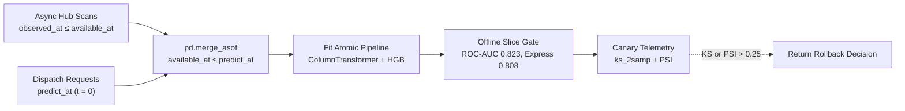

---
{
  "id": "capstone-production-ml-pipeline",
  "title": "Capstone: Production ML Pipeline",
  "slug": "capstone-production-ml-pipeline",
  "section": "Portfolio Capstones",
  "category": "MLOps & Deployment",
  "difficulty": "Hard",
  "order": 5,
  "coverImage": "social_banner.png",
  "companies": [
    "Google",
    "Amazon",
    "Uber",
    "Airbnb"
  ],
  "shortDescription": "Build an end-to-end shipment delay pipeline with pandas merge_asof point-in-time joins, atomic scikit-learn packaging, SHA-256 verification, slice gates, and KS/PSI canary rollback.",
  "keyConceptsTested": [
    "point-in-time merge_asof joins",
    "delayed outcome windowing",
    "atomic sklearn Pipeline serialization",
    "SHA-256 artifact verification",
    "cohort slice release gates",
    "Kolmogorov-Smirnov drift detection",
    "Population Stability Index monitoring",
    "canary promotion and rollback decisions"
  ]
}
---

Offline metrics routinely lie when feature tables ignore arrival time, preprocessing diverges between notebooks and serving workers, or live telemetry shifts silently after deployment [^sculley2015]. A model scoring near 1.000 validation ROC-AUC in a training notebook can fail immediately in production if the evaluation join pulled telemetry recorded hours after departure or missed an ingestion lag between warehouse ETL runs [^google2026mlops].

In this capstone, you assemble a complete tabular late-shipment risk pipeline in [`assets/production_pipeline.py`](assets/production_pipeline.py) and run it end to end. The pipeline enforces <span data-glossary="point-in-time-join">point-in-time joins</span> across asynchronous telemetry streams [^feast2026pit][^databricks2026pit], wraps imputation, scaling, and encoding inside an atomic `scikit-learn` <span data-glossary="training-serving-skew">pipeline</span> [^sklearn2011], gates candidate promotion on vulnerable operational slices, verifies reloaded `joblib` artifacts via SHA-256 digests [^sklearn2026modelpersistence], and evaluates canary batches with Kolmogorov-Smirnov (`ks_2samp`) and <span data-glossary="population-stability-index">Population Stability Index (PSI)</span> checks that produce promotion or rollback decisions [^scipyKs2Sample2026][^potgieter2026psi].

<figure>
  
  <figcaption>Feature assembly, verified packaging, and slice tests lead to a canary decision. A deployment controller consumes the promotion or rollback decision to change traffic routing.</figcaption>
</figure>

## Point-in-time feature assembly and delayed labels

Every dispatch arrives at timestamp `predict_at` requiring an immediate late-delivery risk score, while carrier scan telemetry arrives asynchronously in a separate stream. Each scan carries two timestamps that must never be conflated: `observed_at` records when a hub sensor emitted the reading, and `available_at` records when upstream ETL actually landed that reading in the queryable store. Filtering on `observed_at` alone leaks records that were still queued in transit when inference ran [^feast2024].

Outcomes also arrive late. Shipments dispatched just before the `420h` validation split cutoff only receive delivery confirmation 8 to 36 hours later (`label_available_at`). Excluding those unsettled rows drops 21 rows from the training window (`439` eligible training rows instead of `460`), preventing training jobs from peeking past the evaluation split timestamp [^sklearn2026leakage].



The first runnable cell imports `production_pipeline` directly from the bundled assets module and builds both streams over 30 simulated days. It runs `pd.merge_asof` [^pandas2026mergeasof] against a naive latest-scan baseline, tracks unsettled delayed training labels, and trains both `LogisticRegression` [^sklearnLogisticRegression2026] and `HistGradientBoostingClassifier` [^sklearnHistGradientBoosting2026][^friedman2001gbm] across identical operational slices.

<!-- leetllm: test, id=pipe_pit_train, output=show, deps=pandas,scikit-learn,scipy,numpy,joblib -->
```python title="Point-in-time features and linear versus boosted pipelines"
from pathlib import Path
import sys
import tempfile

import numpy as np

sys.path.insert(0, str(Path("assets")))
import production_pipeline as pp

dispatches, scans = pp.generate_shipment_streams(seed=19, n_shipments=800)

pit_frame = pp.build_point_in_time_features(dispatches, scans)
leaky_frame = pp.build_leaky_latest_features(dispatches, scans)

tr_pit, va_pit, live_pit = pp.split_temporal_windows(pit_frame)
tr_leaky, va_leaky, _ = pp.split_temporal_windows(leaky_frame)

dropped_delayed = int((pit_frame["predict_at"] < 420.0).sum()) - len(tr_pit)
missing_scan_rate = float(va_pit["hub_queue_depth"].isna().mean())

# Train linear baseline and gradient-boosted tree inside identical preprocessing pipelines
pipe_lr = pp.build_training_pipeline("lr").fit(tr_pit[pp.FEATURE_COLUMNS], tr_pit["true_late"])
pipe_hgb = pp.build_training_pipeline("hgb").fit(tr_pit[pp.FEATURE_COLUMNS], tr_pit["true_late"])
pipe_leaky = pp.build_training_pipeline("hgb").fit(tr_leaky[pp.FEATURE_COLUMNS], tr_leaky["true_late"])

p_va_lr = pipe_lr.predict_proba(va_pit[pp.FEATURE_COLUMNS])[:, 1]
p_va_hgb = pipe_hgb.predict_proba(va_pit[pp.FEATURE_COLUMNS])[:, 1]
p_va_leaky = pipe_leaky.predict_proba(va_leaky[pp.FEATURE_COLUMNS])[:, 1]

tau_lr = pp.select_f1_threshold(va_pit["true_late"].to_numpy(), p_va_lr)
tau_hgb = pp.select_f1_threshold(va_pit["true_late"].to_numpy(), p_va_hgb)
policy = pp.GatePolicy()

leaky_report = pp.evaluate_release_slices(va_leaky, p_va_leaky, 0.50, policy)
lr_report = pp.evaluate_release_slices(va_pit, p_va_lr, tau_lr, policy)
hgb_report = pp.evaluate_release_slices(va_pit, p_va_hgb, tau_hgb, policy)

print(f"Windows -> train={len(tr_pit)} (dropped delayed labels={dropped_delayed}), val={len(va_pit)}, live={len(live_pit)}")
print(f"Validation missing pre-dispatch scan rate (imputed inside Pipeline): {missing_scan_rate:.3f}")
print("Leaky latest-scan join :", leaky_report)
print("PIT LogisticRegression :", lr_report)
print("PIT HistGradientBoost  :", hgb_report)
```

<!-- leetllm: output:start -->
```text title="Output" output compact
Windows -> train=439 (dropped delayed labels=21), val=174, live=166
Validation missing pre-dispatch scan rate (imputed inside Pipeline): 0.144
Leaky latest-scan join : {'roc_auc': 1.0, 'pr_auc': 1.0, 'brier': 0.007, 'threshold': 0.5, 'slice_recall': {'express': 1.0, 'night_dispatch': 1.0, 'west_region': 0.969}, 'passed_offline_gate': True}
PIT LogisticRegression : {'roc_auc': 0.719, 'pr_auc': 0.689, 'brier': 0.201, 'threshold': 0.427, 'slice_recall': {'express': 0.577, 'night_dispatch': 0.824, 'west_region': 0.844}, 'passed_offline_gate': False}
PIT HistGradientBoost  : {'roc_auc': 0.823, 'pr_auc': 0.757, 'brier': 0.172, 'threshold': 0.278, 'slice_recall': {'express': 0.808, 'night_dispatch': 0.912, 'west_region': 0.875}, 'passed_offline_gate': True}
```
<!-- leetllm: output:end -->

Three concrete mechanisms explain those validation numbers. Naive joining achieves `1.000` <span data-glossary="roc-auc">ROC-AUC</span> only because it incorporates post-dispatch hub congestion readings recorded hours after each truck left the terminal. Under strict point-in-time joins, missing pre-dispatch scans (`14.4%` in validation) and non-linear thermal or night-region interactions break linear separability, leaving `LogisticRegression` at `0.719` ROC-AUC and `0.577` recall on `express` shipments (failing the `0.65` slice floor). Replacing only the final estimator with `HistGradientBoostingClassifier` captures those threshold interactions cleanly, reaching `0.823` ROC-AUC, `0.757` PR-AUC, `0.172` Brier score, and `0.808` recall on `express` shipments.

<figure>
  
  <figcaption>Top: scans must satisfy observed_at &le; available_at &le; predict_at, turning lagged arrivals into missing inputs until ETL settles. Bottom: removing lookahead leakage lowers ROC-AUC from 1.000 to 0.823, where tree splits outperform linear features.</figcaption>
</figure>

## Atomic serialization, slice gates, and inference parity

Keeping feature engineering inside `ColumnTransformer` [^sklearn2026Preprocessing] guarantees that serving workers compute identical median imputation, z-score standardization [^sklearnStandardScaler2026], and unknown-safe categorical encoding [^sklearnOneHot2026] without hand-maintained YAML parameters or notebook code duplication. Every pipeline candidate also clears an explicit slice table alongside aggregate validation metrics before touching live traffic:

| Candidate / Check | ROC-AUC | PR-AUC | Brier Score | Worst Slice Recall (`express`) | Release Gate Decision |
| :--- | :--- | :--- | :--- | :--- | :--- |
| Release Minimum Floor | `>= 0.780` | `>= 0.700` | `<= 0.190` | `>= 0.650` | Required on validation window |
| Naive Latest-Scan HGB | `1.000` | `1.000` | `0.007` | `1.000` (`0.969` west) | Reject: lookahead leakage from post-dispatch scans |
| PIT `LogisticRegression` | `0.719` | `0.689` | `0.201` | `0.577` | Reject: fails ROC-AUC, PR-AUC, Brier, and `express` recall |
| PIT `HistGradientBoosting` | `0.823` | `0.757` | `0.172` | `0.808` | Approve for canary rollout with SHA-256 bundle |

Artifact integrity protects serving workers just as strongly as offline evaluation. Exporting both `model.joblib` and a JSON `manifest.json` storing the ordered `feature_columns`, tuned threshold (`0.278`), training feature distributions (`hub_queue_depth`, `route_speed_kmh`), and SHA-256 digest guarantees reproducible deserialization. If a container attempts to mount a stale preprocessing pickle or truncated model binary, SHA-256 verification fails immediately before inference starts [^sklearn2026modelpersistence].

## Drift checks and canary decisions

Changing the meaning of a live feature can change predictions even when the stored model stays fixed [^chen2023drift]. The 166 live shipments (`days 24..29`) form two batches of 83. Window 1 uses the first batch unchanged. Windows 2 and 3 apply alternative faults to the second batch, so we can compare each fault against the same shipments. During Window 1, both Kolmogorov-Smirnov (`ks_2samp`) and quantile-binned PSI remain well below trigger cutoffs (`queue KS = 0.080`, `PSI = 0.092`), producing a canary-promotion decision [^argoCanaryRouting2026].

During Window 2, queue depths rise unexpectedly by `+7` units across regional hubs (`queue KS = 0.266`, `PSI = 0.469`). During Window 3, an upstream telemetry parser emits `route_speed_kmh` in meters per second (`0.278x` scale bug, a classic <span data-glossary="schema-drift">unit schema shift</span>) alongside extreme hub congestion (`speed KS = 0.997`, `speed PSI = 7.365`), raising mean predicted delay risk to `0.651`, compared with `0.342` in the healthy first batch. The monitor returns `rollback_to_previous` for both fault scenarios. To act on that decision in a deployed service, connect it to a rollout controller that halts promotion and routes traffic back to a retained model version [^automated_rollback_ml][^cloudrun_traffic_migration].

<figure>
  
  <figcaption>Healthy Window 1 passes the queue checks (KS 0.080, PSI 0.092). Queue shift in Window 2 (KS 0.266) and speed-unit corruption in Window 3 (KS 0.997) exceed the 0.25 KS threshold, producing rollback decisions.</figcaption>
</figure>

The second runnable cell saves the validated pipeline bundle (`v2`) alongside its manifest and SHA-256 digest, then reloads it in a fresh loader check confirming single-row versus batch numerical parity (`atol=1e-12`, `rtol=0`). It also injects a corrupted model binary to test checksum rejection before traffic shifts, and finally evaluates the healthy batch and the two fault scenarios.

<!-- leetllm: test, id=pipe_canary_rollback, continue=pipe_pit_train, output=show, deps=pandas,scikit-learn,scipy,numpy,joblib -->
```python title="Verified bundle serialization and batch versus single-row parity"
with tempfile.TemporaryDirectory() as tmpdir:
    bundle_root = Path(tmpdir) / "delay-risk-v2"
    pp.save_verified_bundle(bundle_root, pipe_hgb, tr_pit, tau_hgb, hgb_report, version="v2")
    loaded_pipe, manifest = pp.load_verified_bundle(bundle_root)

    # Verify batch vs single-row serving parity
    batch_probs = loaded_pipe.predict_proba(va_pit[pp.FEATURE_COLUMNS].iloc[:5])[:, 1]
    single_probs = np.array(
        [loaded_pipe.predict_proba(va_pit[pp.FEATURE_COLUMNS].iloc[[i]])[0, 1] for i in range(5)]
    )
    assert np.allclose(batch_probs, single_probs, atol=1e-12, rtol=0)
    print(f"Bundle v2 SHA-256 verified; batch/single max diff={np.abs(batch_probs - single_probs).max():.1e}")

    # Confirm corrupted model weights fail checksum verification before serving
    corrupt_root = Path(tmpdir) / "delay-risk-corrupt"
    pp.save_verified_bundle(corrupt_root, pipe_hgb, tr_pit, tau_hgb, hgb_report, version="v2-corrupt")
    (corrupt_root / "model.joblib").write_bytes(b"corrupted-payload")
    try:
        pp.load_verified_bundle(corrupt_root)
    except ValueError as err:
        msg_prefix, msg_target = str(err).split(":", 1)[0].rsplit(" for ", 1)
        print("Tamper check blocked bad artifact:", f"{msg_prefix} for {Path(msg_target).name}")

    # Compare a healthy batch and two alternative faults in the next batch
    w1_healthy = live_pit.iloc[:83].copy()
    w2_queue_shift = live_pit.iloc[83:].copy()
    w2_queue_shift["hub_queue_depth"] = w2_queue_shift["hub_queue_depth"] + 7.0

    w3_unit_fault = live_pit.iloc[83:].copy()
    w3_unit_fault["hub_queue_depth"] = w3_unit_fault["hub_queue_depth"] + 19.0
    w3_unit_fault["route_speed_kmh"] = w3_unit_fault["route_speed_kmh"] * 0.278

    for label, batch in (
        ("W1 Healthy", w1_healthy),
        ("W2 Queue Shift (+7)", w2_queue_shift),
        ("W3 Unit Bug + Surge", w3_unit_fault),
    ):
        report = pp.monitor_canary_batch(batch, loaded_pipe, manifest, policy)
        print(f"{label:22s} ->", report)
```

<!-- leetllm: output:start -->
```text title="Output" output compact
Bundle v2 SHA-256 verified; batch/single max diff=0.0e+00
Tamper check blocked bad artifact: Checksum mismatch for model.joblib
W1 Healthy             -> {'n_rows': 83, 'mean_pred_risk': 0.342, 'flagged_rate': 0.422, 'queue_ks': 0.08, 'queue_psi': 0.092, 'speed_ks': 0.079, 'speed_psi': 0.057, 'decision': 'promote_canary'}
W2 Queue Shift (+7)    -> {'n_rows': 83, 'mean_pred_risk': 0.437, 'flagged_rate': 0.53, 'queue_ks': 0.266, 'queue_psi': 0.469, 'speed_ks': 0.075, 'speed_psi': 0.026, 'decision': 'rollback_to_previous'}
W3 Unit Bug + Surge    -> {'n_rows': 83, 'mean_pred_risk': 0.651, 'flagged_rate': 0.855, 'queue_ks': 0.609, 'queue_psi': 3.229, 'speed_ks': 0.997, 'speed_psi': 7.365, 'decision': 'rollback_to_previous'}
```
<!-- leetllm: output:end -->

The capstone connects feature assembly to a release decision: point-in-time joins keep future scans out of training features, delayed-label filtering respects the training cutoff, and a serialized `scikit-learn` pipeline keeps fitted transformations with model weights. The checksum check rejects changed model bytes. Slice metrics determine whether a candidate clears the offline tests, and drift checks produce decisions that a rollout controller can act on.

```mastery-quiz
[
  {
    "question": "Why does filtering telemetry scans solely on observed_at <= predict_at fail to prevent feature leakage in production?",
    "options": [
      "Upstream ingestion delay hides scans captured prior to departure from online stores until after prediction time.",
      "pandas.merge_asof requires descending index sorting on observed_at prior to grouping rows by shipment_id.",
      "OneHotEncoder skips missing timestamps unless observed_at values undergo scaling via StandardScaler first.",
      "HistGradientBoostingClassifier skips rows carrying negative arrival-versus-dispatch timestamp intervals."
    ],
    "answer": "Upstream ingestion delay hides scans captured prior to departure from online stores until after prediction time.",
    "explanation": "A reading recorded at the hub before predict_at cannot be served online if ETL writes it later. Point-in-time joins must filter on available_at <= predict_at as well as observed_at <= available_at."
  },
  {
    "question": "Why did the naive latest-scan join produce 1.000 validation ROC-AUC while the strict point-in-time HGB pipeline achieved 0.823?",
    "options": [
      "Latest-scan joining overwrote missing hub scans cleanly using zero constants ahead of median imputation.",
      "Latest-scan joining exposed post-dispatch arrival scans recorded hours past predict_at encoding the late outcome.",
      "pandas.merge_asof dropped 14.4% of held-out validation rows prior to computing final ROC-AUC scores.",
      "HistGradientBoostingClassifier skipped categorical column encoding when trained on the naive feature matrix."
    ],
    "answer": "Latest-scan joining exposed post-dispatch arrival scans recorded hours past predict_at encoding the late outcome.",
    "explanation": "Carrier telemetry emitted hours after departure strongly encodes whether the shipment actually arrived late. Joining each shipment's last available row leaks that post-decision outcome into offline features."
  },
  {
    "question": "Why were 21 pre-cutoff dispatches excluded from training when predict_at < 420.0h?",
    "options": [
      "Their pre-dispatch carrier telemetry arrived at storage prior to training cutoff initiation.",
      "Their numeric distance_km features landed outside fitted StandardScaler quantile limits.",
      "Their ground-truth outcomes settled at label_available_at > 420.0h, past the split cutoff.",
      "HistGradientBoostingClassifier limits batch training partitions up to at most 440 rows."
    ],
    "answer": "Their ground-truth outcomes settled at label_available_at > 420.0h, past the split cutoff.",
    "explanation": "Training at decision cutoff t=420h cannot use labels for recently dispatched shipments whose true outcome is not observed until 8 to 36 hours later."
  },
  {
    "question": "Why did the release gate reject PIT LogisticRegression even though point-in-time joins were clean?",
    "options": [
      "LogisticRegression hit memory allocation failure inside the ColumnTransformer category step.",
      "ROC-AUC (0.719 < 0.780), PR-AUC (0.689 < 0.700), Brier (0.201 > 0.190), and express recall (0.577 < 0.650) missed targets.",
      "Serialized checksum comparison detected SHA-256 mismatch right after joblib loading completed.",
      "Offline batch scores differed from live single-row serving predictions past a 0.05 tolerance."
    ],
    "answer": "ROC-AUC (0.719 < 0.780), PR-AUC (0.689 < 0.700), Brier (0.201 > 0.190), and express recall (0.577 < 0.650) missed targets.",
    "explanation": "Threshold and U-shaped thermal effects make delay risk non-linear. LogisticRegression failed aggregate gates and dropped express-tier recall below 0.65, whereas HistGradientBoosting passed all slice floors."
  },
  {
    "question": "What failure does bundling SimpleImputer, StandardScaler, OneHotEncoder, and HistGradientBoostingClassifier inside one Pipeline serialized with a SHA-256 manifest eliminate?",
    "options": [
      "Silent metric-unit regressions occurring inside upstream live telemetry stream collectors.",
      "Training-serving skew caused by mismatched transforms or corrupted model artifact bundles.",
      "Delayed ground-truth label arrival affecting shipments departing near split cutoffs.",
      "Non-stationary label prevalence shifts occurring between seasonal training time windows."
    ],
    "answer": "Training-serving skew caused by mismatched transforms or corrupted model artifact bundles.",
    "explanation": "Atomic pipeline serialization guarantees serving applies exact training-fit medians, means, scales, and category mappings, while SHA-256 verification blocks truncated or mismatched binaries before traffic routes to them."
  },
  {
    "question": "In canary Window 3, why did speed_ks jump to 0.997 and produce a rollback decision even though model inference returned probabilities?",
    "options": [
      "An upstream unit change shifted route_speed_kmh to m/s (0.278x), drifting features far off training baselines.",
      "ColumnTransformer raised KeyError exceptions right after numeric route_speed_kmh values dropped below 20.",
      "The SHA-256 digest of model.joblib drifted mid-window across live Window 3 batch inference requests.",
      "HistGradientBoostingClassifier pins KS=1.0 whenever incoming canary window batch size hits 83 items."
    ],
    "answer": "An upstream unit change shifted route_speed_kmh to m/s (0.278x), drifting features far off training baselines.",
    "explanation": "The unit change leaves valid numeric inputs, so the model still returns probabilities (0.651 mean predicted risk). Comparing KS and PSI with training distributions detects the shift and returns a rollback decision for the deployment controller."
  }
]
```

> **Next:** Continue to [Capstone: Document QA](/learn/capstone-document-qa-product). The next capstone applies evaluation and release decisions to retrieval-augmented generation and citation grounding.
