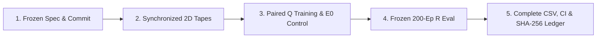

---
{
  "id": "capstone-reproducible-research-study",
  "title": "Capstone: Reproducible ML Study",
  "slug": "capstone-reproducible-research-study",
  "section": "Portfolio Capstones",
  "category": "Evaluation & Benchmarks",
  "difficulty": "Hard",
  "order": 9,
  "coverImage": "social_banner.png",
  "companies": ["OpenAI", "Anthropic", "Google", "Meta"],
  "shortDescription": "Two training curves can make an unchanged algorithm look like an improvement. Test one reward-shaping claim with paired seeds, keep the regressions, and leave a package a reviewer can rerun.",
  "keyConceptsTested": [
    "paper triage",
    "falsifiable hypothesis",
    "expected result and rejection rule",
    "baseline and controlled comparison",
    "paired random seeds",
    "bootstrap uncertainty",
    "ablation design",
    "artifact manifest",
    "negative-result reporting",
    "technical presentation"
  ],
  "prerequisites": [
    "introduction-to-reinforcement-learning-fundamentals",
    "hypothesis-tests-confidence-intervals-passk",
    "experiment-design-ab-testing"
  ],
  "relatedQuestions": [
    "jax-for-ml-research",
    "agent-evaluation-benchmarks",
    "llm-as-judge-automated-evaluation",
    "mechanistic-interpretability-sparse-autoencoders"
  ]
}
---

Two training curves can easily make an unchanged algorithm look like a breakthrough. One random run discovers the goal early and bootstraps from good fortune, while another spends most of its training budget wandering through unrewarded states. Henderson and colleagues documented how random seeds, hyperparameters, codebases, and implementation details can dominate comparisons of policy-gradient algorithms on continuous-control benchmarks.[^henderson2018] Reporting only the best curve hides precisely the variation a sound comparison has to measure.

Telling whether a change genuinely helped requires discipline up front: specify the exact comparison in advance, run every planned seed without early stopping, and report uncertainty alongside the average. Pairing two arms on identical random streams can reduce shared noise whenever their outcomes covary positively, though bootstrap intervals still carry sampling assumptions of their own. Moreover, cryptographic file hashes only verify that two byte sequences match; actual repeatability demands rerunning the workload under a pinned environment, and frameworks such as PyTorch can still diverge across releases or hardware platforms even with identical seeds.[^pytorchReproducibility2026]

In this capstone, you apply those principles to a compact reinforcement-learning study: does potential-based reward shaping accelerate early goal-reaching in a stochastic seven-state corridor while leaving final greedy success unchanged under the original environment reward? You will trace the mathematical claim from Ng, Harada, and Russell's theorem to a concrete simulator, run a paired 24-seed comparison, inspect five individual seeds that regressed despite a positive average, cross-check inference with SciPy, and assemble the complete artifact bundle an outside reviewer needs to audit every number. Putting code, statistical tests, and controls side by side turns an abstract claim into a repeatable scientific measurement.

<figure>
  
  <figcaption>Each seed delivers identical random draws to the sparse baseline, the shaped candidate, and a zero-potential sanity check during training. Frozen policies are then evaluated for 200 greedy episodes on original reward R, separating early learning speed from final-policy preservation.</figcaption>
</figure>

The study runs locally on a CPU using code-generated corridor transitions and NumPy, so it needs no private logs, live traffic, paid APIs, or accelerators. Both training arms share the same environment reward and indexed random inputs, differing only by the training shaping bonus $F$, while final evaluation scores both frozen policies strictly on original environment reward. Note that the 24-seed dataset embedded here is a worked run whose plan was not independently preregistered prior to execution; repeating seeds 0 through 23 tests repeatability, whereas a true confirmatory claim requires freezing your plan first and evaluating on a fresh, untouched seed range.

## Read the claim before building the simulator

The first engineering judgment in a reproduction study is deciding whether a research paper states one claim crisp enough to test honestly. Start with Ng, Harada, and Russell's theorem on policy invariance under reward transformations, whose core statement translates cleanly into code: adding a potential-based shaping bonus guides exploration while leaving the optimal policy set invariant whenever the shaping function and terminal handling obey the theorem's assumptions.[^ng1999] Rather than attempting to implement every experiment in a paper at once, follow Keshav's three-pass reading method by classifying the paper's claims first, inspecting its evidence and edge conditions second, and finally reconstructing only the piece you intend to test.[^keshav2007] That discipline prevents an elegant equation from sprawling into an unfinishable reimplementation. Capture your notes in a structured triage card with explicit section pointers so any reviewer can audit how your test maps back to the source paper.

| Triage field | Corridor-study note |
| --- | --- |
| problem | sparse rewards provide little learning signal before goal completion |
| paper claim | potential-based shaping preserves optimal policies under stated assumptions |
| equation to implement | $F(s,a,s') = \gamma \Phi(s') - \Phi(s)$ |
| smallest test | seven-state corridor with tabular Q-learning |
| theorem assumptions to check | same discounted Markov decision process, finite potential, correct terminal handling |
| measurement control | final evaluation uses original environment reward |
| evidence you can reproduce | learning speed across fixed simulator seeds |
| claim you can't make | the method improves deep RL or deployed agents |

### First pass: classify the claim

Keshav's first pass is a rapid structural scan across the title, abstract, introduction, section headings, mathematical statements, conclusion, and bibliography, saving detailed plots for the second pass (note that Ng and colleagues' author-hosted manuscript also includes revisions from February 2016).[^ng1999][^keshav2007] Summarize the paper's problem, proposed mechanism, baseline comparison, and claimed guarantee in one clear sentence each; if those four sentences remain ambiguous, the study is not ready to code. For potential-based shaping, the method computes each step's bonus from a state potential difference, and the invariance theorem applies strictly to that form because arbitrary bonuses can alter which actions are optimal. Conclude this first pass with an explicit scope decision (reproduce, extend, or decline), which in this capstone narrows to testing one empirical implication in a small tabular environment with full uncertainty reporting.

### Second pass: inspect evidence and assumptions

In the second pass, examine every axis, error bar, equation, and failure condition, writing down explicitly what stays constant across arms, what is allowed to vary, and which metric scores success. Never silently fill in an unspecified detail; record every missing assumption in a dedicated assumptions log. Pay particular attention to the evaluation reward, because a candidate trained with shaping will trivially appear stronger if scored on a return that still includes its extra training bonus instead of comparing frozen policies on the original reward. Record your own adaptations explicitly too, since the seven-state corridor, Q-learning hyperparameters, 15% slip rate, 24-seed budget, and <span data-glossary="bootstrap-resampling">bootstrap</span> protocol are capstone design choices rather than values lifted from the original paper.

### Third pass: reconstruct the test

Close the paper, write the shaping equation from memory, and design the minimal environment where moving closer to a goal changes state potential, stating your predictions about both early learning speed and final policy quality well before executing code. Next, interrogate your own design like a skeptical reviewer: could the candidate secretly receive extra steps, a luckier random stream, or a softer evaluation criterion, or could one favorable seed carry the entire average? Turn each plausible shortcut into an automated control, an explicit ablation row, or a documented limitation. Close out `paper_triage.md` by tagging every decision as `supported by source`, `study adaptation`, or `unresolved` so implementation choices are never misattributed to the original authors.

## Turn curiosity into a testable specification

The triage card connects a paper claim to a compact simulator, yet a serious hypothesis also names the exact observation that could refute it. A vague question such as "Does reward shaping help agents learn?" fails to specify the learner, environment dynamics, shaping rule, summary statistic, sample size, or decision threshold. Making a question falsifiable strengthens the engineering: every noun in the hypothesis translates directly into a configuration field, table column, or unit test. Frame the capstone around this exact question:

> In a stochastic seven-state corridor, does potential-based shaping increase tabular Q-learning's first-30-episode goal-reaching rate versus sparse reward, while keeping final greedy-policy success unchanged under original reward?

Lock the experimental specification in writing before inspecting confirmatory outputs so nobody can reshape the target after seeing the numbers. Every entry below binds a theoretical phrase in the question above to a concrete value, sample size, and decision rule in code. Changing any row after executing confirmatory runs automatically reclassifies the output as exploratory rather than confirmatory:

| Specification field | Locked value |
| --- | --- |
| unit of analysis | one paired simulator seed |
| baseline | tabular Q-learning with sparse terminal reward |
| candidate | same Q-learning plus potential-based shaping during training |
| primary metric | first-30-episode success-rate difference, shaped minus sparse |
| uncertainty | 90% paired bootstrap interval over seed differences |
| minimum useful effect | mean paired difference at least `+0.10` |
| final-policy <span data-glossary="guardrail">guardrail</span> | observed mean and 90% paired interval stay within `[-0.02, +0.02]` |
| worked sample | seeds 0 through 23; reserve new seeds for a new confirmatory study |
| stopping rule | run all 24 seed pairs |

### State the expected result

A clear prediction belongs on record before any confirmatory outputs exist. A distance-oriented potential provides dense intermediate feedback before the learner ever reaches the goal, making faster early progress a credible hypothesis. At the same time, policy-invariance theory concerns optimal policies rather than finite-sample Q-tables after just 80 episodes, leaving final parity as an empirical question that must be measured directly rather than assumed from the proof.[^ng1999] In a live confirmatory project, write that expected signature in `study_plan.md` and commit it before executing untouched confirmatory seeds, while treating seeds 0 through 23 here as an already-observed worked example. Keeping the frozen plan in version control makes every subsequent edit auditable, whereas true independent preregistration places hypotheses, variables, tests, exclusion rules, and decision thresholds in a timestamped read-only registry before any data is collected.[^osf2026preregistration] The signature recorded up front should specify four concrete items:

- positive early paired difference
- interval above zero
- near-zero final difference
- timestamp and retained commit for the frozen plan

### Write the rejection rule

Define exact pass and fail thresholds in advance so interpretation stays mechanical rather than persuasive. Under our rule, the study supports the narrow claim only if the mean early paired difference reaches at least `+0.10`, the lower endpoint of its 90% paired bootstrap interval clears `0`, and both the final mean difference and its 90% interval sit inside `[-0.02, +0.02]`. Support is withheld whenever any single condition misses: an early mean of `+0.09` falls below the practical threshold even with a positive interval, and an early gain of `+0.20` is disqualified if final original-reward performance drifts outside the guardrail. Likewise, claiming an effect of at least `+0.10` with 90% confidence requires the interval's lower bound itself to exceed `+0.10`, and whenever an interval spans both trivial and practically meaningful gains, report the evidence as inconclusive rather than claiming either "no effect" or "harm."

## Keep the study public-safe

Even synthetic research needs clear scope limits around data, credentials, and licensing before artifacts leave a laptop. Generated transitions eliminate customer privacy concerns, yet public repositories routinely expose <span data-glossary="secrets-management">API credentials</span>, proprietary snippets, or local machine metadata if nobody checks what goes into the bundle. Because our corridor simulator computes transitions deterministically from a small configuration and integer seeds without external models, network calls, or private logs, it is completely safe for open release once audited. Document these inclusion and exclusion rules explicitly in the project README at the start:

| Surface | Included | Excluded |
| --- | --- | --- |
| data | generated corridor transitions | user messages, production logs, private datasets |
| compute | local CPU and NumPy | remote model APIs, paid accelerators |
| actions | left/right in simulator | browser, shell, account, or network actions |
| outputs | metrics, tables, plots, manifests | secrets, identifiers, raw third-party content |
| claim | this simulator and implementation | human behavior, robotics, deployed-agent safety |

Before pushing a public tag, scan the repository for leaked secrets and remove any local environment tokens. Verify that manifest files contain no personal usernames, local machine hostnames, or home directory paths. Finally, attach an explicit open-source license covering only code and generated assets that you have full rights to redistribute.

## Build the smallest controlled environment

The corridor consists of integer states `0` through `6`. Every episode begins at state `0`, reaching goal state `6` delivers an environment reward of `1`, all other steps yield `0`, every intended move reverses with probability `0.15` before clamping at the endpoints, and each episode stops after at most `12` steps. Write down the full Markov decision process specification prior to coding the agent so subtle differences in reward timing, resets, or step caps cannot slip into one arm silently and masquerade as an algorithmic improvement.

| Environment field | Locked specification |
| --- | --- |
| observation | integer state in `{0, 1, ..., 6}` |
| actions | `0 = left`, `1 = right` |
| reset | return state `0`; select pre-generated tape by seed |
| transition | move one cell, clamp at endpoints, reverse intended move on a `0.15` slip |
| reward | `1` on first arrival at state `6`; otherwise `0` |
| terminated | agent reaches state `6` |
| truncated | 12 steps elapse without reaching goal |
| random inputs | exploration, action, tie-break, and slip draws indexed by seed, episode, and step |
| logged output | state, intended action, realized move, environment reward, termination reason |

Distinguish `terminated` (arriving at goal state `6`) from `truncated` (hitting the 12-step rollout limit). Because the underlying discounted control task has no intrinsic deadline, the Q-learning update still bootstraps next-state values at a 12-step timeout, whereas arriving at state `6` ends bootstrapping (`target = reward`), and our reported metric separately measures goal attainment within 12 steps. Treating a timeout as zero future value or bootstrapping across the true goal alters the Bellman target altogether, so never toggle between episodic formulations silently.[^gymnasiumTimeLimits2026] In a full study, save complete transition traces alongside aggregate row metrics so suspicious episodes can be inspected directly.

[Tabular Q-learning](/learn/introduction-to-reinforcement-learning-fundamentals) maintains an explicit table of action values and updates each visited $(s, a)$ toward observed reward plus discounted maximum next-state value.[^sutton2018] On every step in our corridor, both baseline and candidate observe the same environment reward $R$ and experience identical paired slip rules. Candidate training alone adds a potential-based shaping term $F$, while final evaluation disables $F$ completely so both policies face the exact same objective. Define the distance potential $\Phi(s)$ and transition shaping term $F(s, a, s')$ as:

$$
\Phi(s) = -\frac{6-s}{6}
$$

$$
F(s,a,s') = \gamma \Phi(s') - \Phi(s).
$$

With discount $\gamma = 0.95$, states nearer the goal hold higher (less negative) potential, so moving right typically creates a positive learning pulse while moving left creates a negative one. Specifically, $\Phi(0) = -1$ and $\Phi(1) = -5/6$, giving $F(0 \to 1) = 0.95(-5/6) - (-1) = +0.208$ toward the goal, $F(1 \to 0) = -0.117$ on a step away, and even a clamped self-loop $0 \to 0$ yields $F(0 \to 0) = (0.95 - 1)(-1) = +0.050$ despite zero motion. Checking those single-transition edge cases numerically in advance catches sign errors before running all 24 seeds.

<figure>
  
  <figcaption>The curve plots linear state potential Phi(s) = -(6 - s)/6 from start to goal, while the summary cards isolate environment reward R (zero prior to state 6) from the training-only shaping bonus F for goalward progress (+0.208), slip reversal (-0.117), and a clamped self-loop (+0.050).</figcaption>
</figure>

Potential-based shaping preserves the optimal policy in infinite-horizon discounted MDPs because consecutive terms telescope cleanly across any trajectory of length $T$. Expanding consecutive pairs collapses every intermediate state potential $\Phi(s_1), \dots, \Phi(s_{T-1})$, leaving only the start potential and discounted terminal potential. That algebraic cancellation is what guarantees invariant relative action values once discounting matches the underlying Bellman update:

$$
\sum_{t=0}^{T-1}\gamma^t F(s_t,s_{t+1})=-\Phi(s_0)+\gamma^T\Phi(s_T).
$$

Because every completed path reaches goal state `6` where $\Phi(6) = 0$, the discounted sum of shaping terms equals $-\Phi(0) = +1$ regardless of path length. In the infinite-horizon limit, any bounded potential also forces the terminal factor $\gamma^T \Phi(s_T)$ to vanish cleanly. Under an artificial rollout truncation where $s_T \neq 6$, however, $\gamma^T \Phi(s_T)$ remains non-zero, demonstrating why terminal potential definitions and timeout bootstrapping must be verified in code rather than assumed from the equation alone.[^ng1999] Verify the arithmetic and path-invariance property directly in pure Python:

<!-- leetllm: test, output=show -->

```python title="shaping_one_step.py"
GAMMA = 0.95
GOAL = 6


def potential(state: int) -> float:
    return -(GOAL - state) / GOAL


def shaping(state: int, next_state: int) -> float:
    return GAMMA * potential(next_state) - potential(state)


toward = shaping(0, 1)
away = shaping(1, 0)
assert potential(0) == -1
assert abs(potential(1) - (-5 / 6)) < 1e-12
assert toward > 0
assert away < 0
assert abs(shaping(0, 0) - 0.05) < 1e-12
print(f"Phi(0)={potential(0):.3f}  Phi(1)={potential(1):.3f}")
print(f"F(0->1)={toward:+.3f}")
print(f"F(1->0)={away:+.3f}")
print(f"F(0->0)={shaping(0, 0):+.3f}")

# Two completed trajectories take different lengths but get the same addition.
for path in ([0, 1, 2, 3, 4, 5, 6], [0, 1, 0, 1, 2, 3, 4, 5, 6]):
    bonus = sum(GAMMA**t * shaping(s, n) for t, (s, n) in enumerate(zip(path, path[1:])))
    assert abs(bonus - 1.0) < 1e-12
print("Completed-path discounted bonus: +1.000 for both paths")
```

<!-- leetllm: output:start -->
```text title="Output" output compact
Phi(0)=-1.000  Phi(1)=-0.833
F(0->1)=+0.208
F(1->0)=-0.117
F(0->0)=+0.050
Completed-path discounted bonus: +1.000 for both paths
```
<!-- leetllm: output:end -->

Notice how even a clamped wall collision (`0 -> 0`) earns $F = +0.050$ without changing position, reinforcing why shaping is strictly an intermediate training signal rather than an evaluation score. Scoring final policies on $R + F$ would credit idle boundary steps instead of genuine goal completion. Summarizing shared versus differing components in one table confirms that states, action spaces, learning updates, and random tapes match bit-for-bit so automated controls can audit directly that nothing beyond the candidate's training reward differs in code:

| Component | Sparse baseline | Shaped candidate |
| --- | --- | --- |
| states and actions | identical | identical |
| slip tape | paired | paired |
| Q-learning update | identical | identical |
| environment reward | goal only | goal only |
| training-only addition | none | $\gamma\Phi(s')-\Phi(s)$ |
| final evaluation reward | goal only | goal only |

## Make randomness and controls explicit

Reinforcement-learning outcomes are notoriously sensitive to random seeds, environment stochasticity, and minor implementation choices, to the point where two runs of the same method can look like completely separate algorithms.[^henderson2018] Treating pseudorandom streams as first-class experimental inputs rather than background noise turns variance from a mystery into a measurable quantity. How you structure those streams determines how much shared environment difficulty cancels out between baseline and candidate.

### The paired seed trial protocol

If baseline arm $X_i$ and candidate arm $Y_j$ are run on independent streams of $n$ seeds each, their random disturbances never cancel across arms. Because independent arms have zero covariance, the variance of the difference between sample means equals the sum of their individual mean variances, forcing you to collect larger samples just to overcome unrelated draw luck:

$$
\operatorname{Var}(\bar{Y} - \bar{X}) = \frac{\operatorname{Var}(Y) + \operatorname{Var}(X)}{n}.
$$

How many seeds an experiment needs depends on expected effect size, noise level, desired interval width, and whether draws are paired. In a **paired seed trial**, each seed $i$ delivers the exact same indexed random tape to both baseline and candidate, allowing shared difficult episodes to depress both arms together rather than biasing one arm arbitrarily. Even though differing learned actions can still send the two arms along different trajectories and transitions, evaluating each pair through its difference $\Delta_i = Y_i - X_i$ changes the variance expression to:

$$
\operatorname{Var}(\bar{\Delta}) = \frac{\operatorname{Var}(Y) + \operatorname{Var}(X) - 2\operatorname{Cov}(X, Y)}{n}.
$$

When shared randomness creates positive covariance $\operatorname{Cov}(X, Y) > 0$, pairing removes common-noise variance and tightens confidence intervals relative to unpaired arms with the same marginal spread. That improvement is not automatic, however: because reversing a left move pushes the agent forward while reversing a right move pushes it back, the same slip can help one policy and hurt another, potentially making covariance zero or negative. Run this small counterexample to observe how negative covariance doubles mean-difference variance under pairing:

<!-- leetllm: test, output=show -->

```python title="pairing_can_increase_variance.py"
from statistics import covariance, mean, variance

baseline = [0.0, 0.25, 0.5, 0.75, 1.0]
candidate = [1.0 - score for score in baseline]
differences = [y - x for x, y in zip(baseline, candidate)]
n = len(baseline)
paired_estimate = variance(differences) / n
independent_estimate = (variance(candidate) + variance(baseline)) / n
assert paired_estimate == 2 * independent_estimate
print(f"Mean difference: {mean(differences):+.3f}")
print(f"Sample covariance: {covariance(baseline, candidate):+.4f}")
print(f"Estimated mean variance, paired / independent: {paired_estimate:.4f} / {independent_estimate:.4f}")
```

<!-- leetllm: output:start -->
```text title="Output" output compact
Mean difference: +0.000
Sample covariance: -0.1562
Estimated mean variance, paired / independent: 0.1250 / 0.0625
```
<!-- leetllm: output:end -->

Even when pairing does not shrink variance, keeping seed $i$ as the paired experimental unit preserves clean alignment across configurations. You can still examine every individual seed difference directly, count how many seeds improved or regressed, and diagnose outliers against a shared random tape. Dropping the pairing altogether would force you to infer distributions from unrelated runs without per-seed attribution.

### Synchronizing randomness with a 2D tape

Naive sequential random number generators drift out of alignment as soon as one arm solves an episode faster than the other. If the shaped agent solves episode 0 in 6 steps while the sparse agent takes all 12 steps, drawing sequentially from one flat stream leaves episode 1 starting at offset 6 for one arm and offset 12 for the other, and any conditional tie-break draws widen the offset further. Pre-generating a 2D random tape shaped `(TRAIN_EPISODES, MAX_STEPS)` for every stochastic decision prevents stream desynchronization completely. Indexing every draw by `(episode, step)` guarantees that both arms encounter identical exploration triggers and environment slip schedules on corresponding episodes, even when earlier episodes ended after 6 steps versus 12, without forcing both agents to pick identical actions:

1. `explore`: continuous uniform float in $[0, 1)$ for $\epsilon$-greedy exploration checks.
2. `action`: discrete uniform integer in $\{0, 1\}$ for random action draws.
3. `tie`: discrete uniform integer in $\{0, 1\}$ for reproducible random Q-value tie-breaking.
4. `slip`: continuous uniform float in $[0, 1)$ for the 15% environment action reversal.

### Separate pilot and confirmatory seeds

Reserve a small debug pool such as seeds `900`, `901`, and `902` for unit tests, figure debugging, and smoke runs, and never fold those seeds into confirmatory totals because observing them early makes inclusion dependent on outcomes. Here, integers `0` through `23` form our worked 24-seed dataset; in your own preregistered study, freeze the entire harness first and execute on an untouched seed range sized to your precision target. Final greedy evaluation draws independent slip streams seeded at `10000 + training_seed` with learning disabled so Q-tables remain frozen, and you should never tune hyperparameters on evaluation streams and then reuse those same evaluation seeds as an unbiased test. Run every planned pair cleanly without early stopping once ten seeds look encouraging, because sequential stopping requires dedicated sequential procedures covered in the [experiment-design lesson](/learn/experiment-design-ab-testing), and document any mechanical execution crash rules up front before inspecting aggregate metrics.

### Add controls before interpretation

Two sanity checks guard against implementation bugs masquerading as scientific findings. First, run a zero-potential control setting $\Phi(s) = 0$: under identical random tapes, every weight, transition, and score must match the sparse baseline bit-for-bit, or else the candidate path modified something beyond the reward calculation and analysis must stop immediately. Second, score final frozen policies strictly on original environment reward under paired evaluation tapes so shaping bonuses never inflate final performance. You may additionally run a sign-reversed potential $-\Phi(s)$ as an exploratory stress test after primary checks complete, while keeping its findings clearly separated from the confirmatory question.

### Plan the ablation matrix

An ablation table turns multi-factor exploration into a crisp single-change ledger where each row modifies one component and holds everything else fixed. Separating controls, primary runs, sensitivity checks, and exploratory probes in advance stops post-hoc story crafting before data runs start. Never retroactively present an unplanned hyperparameter grid search as a planned ablation after keeping only its strongest configuration; instead, log every run executed and tag post-result sweeps as exploratory:

| ID | Comparison | One changed factor | Purpose | Report class |
| --- | --- | --- | --- | --- |
| `E0` | sparse vs zero potential | shaping term fixed at zero | catch implementation drift | required control |
| `E1` | sparse vs distance potential | training reward only | evaluate primary rule | worked run here; confirmatory with a fresh planned sample |
| `E2` | paired vs independently resampled arms | resampling indices | inspect uncertainty when covariance is omitted | sensitivity analysis |
| `E3` | distance vs reversed potential | potential sign | inspect learning sensitivity | exploratory |

## Define metrics and uncertainty

Select the statistical estimand and uncertainty interval well in advance of looking at outcomes so the threshold never shifts to fit noisy numbers. For each seed $i \in \{0, \dots, 23\}$, let $p^{\text{shape}}_{i,30}$ and $p^{\text{sparse}}_{i,30}$ denote the fraction of the first 30 training episodes reaching goal state `6`, so each pair contributes difference $d_i = p^{\text{shape}}_{i,30} - p^{\text{sparse}}_{i,30}$. That formulation makes the primary estimate simply the sample mean across all 24 pairs:

$$
\bar{d} = \frac{1}{24}\sum_{i=0}^{23}d_i.
$$

This mean estimates average early acceleration under the fixed trial generator without implying universal improvement on every run. A positive mean can easily coexist with several negative individual pairs whenever exploration dynamics shift unpredictably. That is why the final report also tracks all 24 individual seed differences, counts every regression explicitly, and evaluates uncertainty over the complete distribution rather than hiding behind a single headline figure.

### Choose uncertainty at the seed-pair level

Exact small-sample Student-$t$ intervals assume independent normally distributed differences, whereas early success proportions over 30 episodes lie on increments of $1/30$ with differences in $[-1, +1]$ and potential skew across only 24 pairs. Even though $t$-intervals often remain reasonably robust as approximations, resampling the observed seed pairs via a percentile bootstrap avoids Gaussian assumptions while still treating the 24 seeds as representative independent trials; rare edge behaviors absent from 24 runs cannot be invented by resampling alone. Agarwal and colleagues highlight confidence intervals over point-only means for finite-run reinforcement-learning evaluation, though this single-corridor interval is much simpler than their multi-task aggregated rliable estimators.[^agarwal2021rl]

Treating the 24 observed pairs $\{d_0, d_1, \dots, d_{23}\}$ as empirical distribution $\hat{F}_n$, draw $B = 10{,}000$ resamples with replacement using fixed bootstrap seed `20260731`. Each replicate averages 24 draws sampled uniformly with replacement from the observed pair differences. Repeating that sampling ten thousand times produces an empirical sampling distribution for the paired mean without assuming normality:

$$
\mathbf{d}^{*(b)} = (d_1^{*(b)}, d_2^{*(b)}, \dots, d_{24}^{*(b)}), \quad b = 1, \dots, B
$$

$$
\bar{d}^{*(b)} = \frac{1}{24}\sum_{j=1}^{24} d_j^{*(b)}.
$$

Our primary script takes the 5th and 95th percentiles of those $10{,}000$ replicate means using NumPy's `method="linear"`, which linearly interpolates at zero-based index $q(B-1)$ rather than selecting raw order statistics.[^numpyQuantile2026] Alternative procedures such as bias-corrected and accelerated (`BCa`) bootstrap intervals and paired nonparametric hypothesis tests like Wilcoxon signed-rank are exposed directly in SciPy, though no small-sample method guarantees exact nominal coverage under heavy skew.[^scipyBootstrap2026] You should also keep the unit of independence clear: the 30 episodes inside a single run are correlated snapshots of one evolving Q-table rather than 30 independent samples, and a 90% confidence interval is a frequentist procedure targeting 90% long-run coverage rather than a 90% posterior probability on the hypothesis.

### Keep a final-policy guardrail

After 80 training episodes, freeze both policies and score each over 200 greedy episodes under original environment reward using paired evaluation slip tapes (`10000 + seed`). Require both the mean final difference and its 90% paired bootstrap interval to fall entirely within `[-0.02, +0.02]`. Even a `[+0.000, +0.000]` difference interval checks only similarity between two learned policies on observed evaluation draws rather than absolute competence, so inspect per-seed final rates individually too in case offsetting wins and losses mask localized regressions.

## Plan the experiment table before running

Maintain a declarative experiment table in `study_plan.md` mirrored inside `configs/study.json` and commit both alongside the hypothesis so notebook state never turns into improvised methodology. Track every run with one explicit status vocabulary (`planned`, `running`, `complete`, `mechanical_failure`, or `excluded_by_locked_rule`), rather than silently excluding a completed seed because its outcome looked disappointing. Logging pilot runs, required controls, primary studies, and exploratory probes in the same schema turns experimental discipline into machine-checkable structure:

| Run | Seeds | Episodes | Evaluation | Output | Decision role |
| --- | ---: | ---: | ---: | --- | --- |
| pilot smoke | 900-902 | 10 | 20 | console trace | debug only |
| zero-potential control | 0-23 | 80 | 200 | exact-equality log | implementation check |
| primary worked study | 0-23 | 80 | 200 | seed table + bootstrap | demonstrate declared decision rule |
| unpaired sensitivity | same completed rows | none | none | interval comparison | planned sensitivity analysis |
| reversed-potential stress | 0-23 | 80 | 200 | separate seed table | exploratory appendix |

## Package an exact repository

Organizing files by role prevents locked hypotheses, simulator source, immutable run artifacts, reports, and presentation slides from tangling together. Clear directory boundaries stop stray helper notebooks or intermediate screenshots from polluting the official result tables. Alongside the executable core on this page, a portfolio-ready capstone follows a layout like this:

```text title="repository-tree.txt"
reproducible-reward-shaping/
├── README.md
├── LICENSE
├── CITATION.cff
├── pyproject.toml
├── uv.lock
├── study_plan.md
├── paper_triage.md
├── configs/
│   └── study.json
├── src/
│   └── corridor_study/
│       ├── __init__.py
│       ├── environment.py
│       ├── train.py
│       ├── analyze.py
│       └── manifest.py
├── tests/
│   ├── test_environment.py
│   ├── test_zero_potential.py
│   └── test_manifest.py
├── data/
│   └── generated/
│       └── README.md
├── artifacts/
│   ├── manifest.json
│   ├── runs/
│   │   ├── primary_seed_rows.csv
│   │   └── bootstrap_means.npy
│   └── checksums.sha256
├── report/
│   ├── report.md
│   ├── figures/
│   │   └── paired_seed_delta.svg
│   └── tables/
│       └── primary_result.csv
└── talk/
    ├── outline.md
    └── q-and-a.md
```

### Pin environment and entrypoint

Pin Python, NumPy, SciPy, and tooling dependencies inside `pyproject.toml` and `uv.lock`, and document one clean command such as `uv run corridor-study --config configs/study.json` in `README.md`. Execute confirmatory runs from a <span data-glossary="reproducible-environment">fresh clone</span> or container and capture operating system, CPU architecture, interpreter version, numerical library versions, commit hash, config digest, and runtime duration inside the manifest, scrubbing personal hostnames or user paths. Follow the Machine Learning Reproducibility Checklist by reporting seeds, hyperparameters, architectures, and exact execution commands alongside a <span data-glossary="dependency-lockfile">lockfile</span>, remembering that locked versions assist reproducibility without guaranteeing identical hardware instructions.[^reproducible_research_seeds]

### Record data lineage

Code-generated data still requires complete lineage documentation so another engineer can regenerate every row cleanly from source. Store the generator version, seed range, transition probabilities, state count, step cap, and source hashes inside `data/generated/README.md` alongside the exact command that produces each CSV file. If you later adapt the pipeline to an external dataset, retain original URL, version, retrieval timestamp, license, file <span data-glossary="checksum">checksum</span>, preprocessing script, and exclusion rules instead of relying on an undocumented local filename.

### Create an artifact manifest

A manifest inventories the software, configuration, and outputs tied to a reported run, connecting every published table back to the exact environment that ran. Keep in mind that byte digests, execution validity, and producer identity answer three distinct verification questions that no single hash can resolve alone. Recording commit revisions, dependency locks, platform metadata, frozen parameters, and output checksums separately keeps all three layers auditable:

1. **Commit**: `git rev-parse HEAD` names the committed snapshot, so check and record working-tree cleanliness separately to catch uncommitted edits.
2. **Executed source**: hash the source tree with deterministic filename sorting and UTF-8 encoding, comparing against an expected snapshot rather than trusting a self-reported digest alone.
3. **Dependencies and interpreter**: archive `uv.lock` alongside exact Python patch version and package builds, recognizing that `==3.12.*` spans multiple patch releases.
4. **Platform**: record OS, CPU architecture, and BLAS or accelerator runtime details, while remembering that identical coarse OS fields do not guarantee bitwise floating-point identity.
5. **Configuration**: hash the frozen configuration file bytes and link that digest in the run record, noting that a hash recomputed post-hoc cannot prove when the configuration was frozen.
6. **Outputs**: compute digests of the seed CSV and JSON summaries and store reference checksums separately so a later overwrite cannot mask divergence.

<figure>
  
  <figcaption>All five SHA-256 prefixes for study code, runner script, configuration, seed CSV, and summary JSON match the stored manifest, confirming unchanged file bytes while leaving producer identity unverified until signed with a trusted external key.</figcaption>
</figure>

The Mermaid flow below maps how the frozen specification gates inputs, controls, evaluation, and output digests into the final evidence ledger. Every arrow tracks an explicit handoff so regressions or missing controls cannot silently enter the summary tables. Together with the manifest schema below, it clarifies which fields are locked in advance versus populated once all 24 seeds finish:



Before execution begins, pre-populate `study_id`, `confirmatory_seeds`, and `bootstrap_seed` in the template manifest below, leaving SHA-256 output digests empty until completion. At runtime, the script checks commit cleanliness, records Python and NumPy versions, and computes final file digests. Keeping those roles separate makes it obvious which inputs were locked beforehand versus computed from completed outputs:

```json title="artifacts/manifest.json"
{
  "study_id": "corridor-reward-shaping-v1",
  "git_commit": "<full-40-char-commit-hash>",
  "config_sha256": "<sha256-of-configs-study-json>",
  "source_sha256": "<sha256-of-src-tree>",
  "python": "3.12.x",
  "numpy": "2.2.6",
  "os": "Darwin",
  "architecture": "arm64",
  "confirmatory_seeds": [0, 1, 2, 3, 4, 5, 6, 7, 8, 9, 10, 11, 12, 13, 14, 15, 16, 17, 18, 19, 20, 21, 22, 23],
  "bootstrap_seed": 20260731,
  "outputs": {
    "primary_seed_rows.csv": "<sha256-hash>",
    "study_results.json": "<sha256-hash>"
  },
  "status": "worked-run-not-preregistered"
}
```

State explicitly what comparison must succeed for a verification rerun. Under this pinned NumPy environment, rerunning the study targets exact byte reproduction of the CSV and JSON outputs, whereas cross-platform runs may require pre-declared numeric field tolerances (preserving both files and never widening tolerances post-hoc after seeing a mismatch). The bundle's `illustrations/run_study.py` script executes `reward_shaping_study.py` and writes the manifest, though as a local unsigned bundle it proves byte self-consistency rather than external authorship. Run the brief hash demonstration below to see why identical JSON payloads can produce distinct byte digests and why an unauthenticated script can wrap fabricated metrics in a valid self-consistent hash:

<!-- leetllm: test, output=show -->

```python title="a_hash_identifies_bytes.py"
import hashlib
import json

row = {"seed": 0, "success": 0.5}
compact = json.dumps(row, sort_keys=True, separators=(",", ":")).encode()
pretty = json.dumps(row, sort_keys=True, indent=2).encode()
digest = lambda data: hashlib.sha256(data).hexdigest()
print("Equal decoded values:", json.loads(compact) == json.loads(pretty))
print("Equal byte digests:", digest(compact) == digest(pretty))

invented_output = b'{"success": 1.0}'
self_reported_manifest = {"output_sha256": digest(invented_output)}
print("Invented output matches its own manifest:",
      digest(invented_output) == self_reported_manifest["output_sha256"])
```

<!-- leetllm: output:start -->
```text title="Output" output compact
Equal decoded values: True
Equal byte digests: False
Invented output matches its own manifest: True
```
<!-- leetllm: output:end -->

A reviewer therefore needs either an independently stored reference digest or an explicit field-level numerical comparison rule, paired with origin tracking outside the self-reported file. Including a `CITATION.cff` file alongside the manifest gives both humans and automated tools standardized citation fields rendered directly in repository headers. Once archived in Zenodo or a similar long-term repository, you can attach a persistent DOI to that citation metadata.[^githubCitationFiles]

## Run the miniature study

The full study script builds paired 2D random tapes for seeds `0` through `23`, runs the sparse baseline and distance-shaped candidate, verifies exact bit-for-bit equality of the zero-potential control, evaluates both frozen policies over 200 greedy episodes on original reward, and prints both the paired and unpaired bootstrap confidence intervals. NumPy `2.2.6` is pinned for this worked run because random seeds alone do not freeze generator call behavior across library upgrades, builds, or ports.[^numpyRandomCompatibility2026] A translation using Python's standard `random` module, for instance, will generate different sequences and rows while leaving sample size and decision logic intact, so treat any library port as a new implementation rather than expecting byte parity. Inspect the key control points (`make_tape`, `train`, `evaluate`, and `bootstrap_interval`), then execute the study with `uv run reward_shaping_study.py`:

<!-- leetllm: test, deps=numpy==2.2.6, output=show, id=corridor-study -->

```python title="reward_shaping_study.py"
#!/usr/bin/env -S uv run --script
# /// script
# requires-python = "==3.12.*"
# dependencies = ["numpy==2.2.6"]
# ///

import numpy as np


N_STATES = 7
GOAL = N_STATES - 1
GAMMA = 0.95
ALPHA = 0.35
EPSILON = 0.20
TRAIN_EPISODES = 80
MAX_STEPS = 12
EARLY_EPISODES = 30
EVAL_EPISODES = 200
SLIP_PROBABILITY = 0.15
BOOTSTRAP_REPLICATES = 10_000
SEEDS = tuple(range(24))


def potential(state: int) -> float:
    return -(GOAL - state) / GOAL


def make_tape(seed: int) -> dict[str, np.ndarray]:
    rng = np.random.default_rng(seed)
    shape = (TRAIN_EPISODES, MAX_STEPS)
    return {
        "explore": rng.random(shape),
        "action": rng.integers(0, 2, shape),
        "tie": rng.integers(0, 2, shape),
        "slip": rng.random(shape),
    }


def q_target(reward: float, next_state: int, q: np.ndarray) -> float:
    # A rollout timeout is not a terminal state in the underlying task.
    return reward if next_state == GOAL else reward + GAMMA * q[next_state].max()


def train(tape: dict[str, np.ndarray], shaped: bool, phi=potential) -> tuple[np.ndarray, np.ndarray, np.ndarray]:
    q = np.zeros((N_STATES, 2), dtype=float)
    solved: list[int] = []
    steps: list[int] = []

    for episode in range(TRAIN_EPISODES):
        state = 0
        reached_goal = False

        for step in range(MAX_STEPS):
            if tape["explore"][episode, step] < EPSILON:
                action = int(tape["action"][episode, step])
            else:
                best = np.flatnonzero(q[state] == q[state].max())
                action = int(best[tape["tie"][episode, step] % len(best)])

            move = -1 if action == 0 else 1
            if tape["slip"][episode, step] < SLIP_PROBABILITY:
                move = -move

            next_state = int(np.clip(state + move, 0, GOAL))
            environment_reward = float(next_state == GOAL)
            shaping_reward = (
                GAMMA * phi(next_state) - phi(state)
                if shaped
                else 0.0
            )
            training_reward = environment_reward + shaping_reward
            target = q_target(training_reward, next_state, q)
            q[state, action] += ALPHA * (target - q[state, action])
            state = next_state

            if state == GOAL:
                reached_goal = True
                break

        solved.append(int(reached_goal))
        steps.append(step + 1)

    return q, np.asarray(solved), np.asarray(steps)


def evaluate(q: np.ndarray, seed: int) -> float:
    rng = np.random.default_rng(10_000 + seed)
    slips = rng.random((EVAL_EPISODES, MAX_STEPS))
    ties = rng.integers(0, 2, (EVAL_EPISODES, MAX_STEPS))
    successes = 0

    for episode in range(EVAL_EPISODES):
        state = 0
        for step in range(MAX_STEPS):
            best = np.flatnonzero(q[state] == q[state].max())
            action = int(best[ties[episode, step] % len(best)])
            move = -1 if action == 0 else 1
            if slips[episode, step] < SLIP_PROBABILITY:
                move = -move
            state = int(np.clip(state + move, 0, GOAL))
            if state == GOAL:
                successes += 1
                break

    return successes / EVAL_EPISODES


def bootstrap_interval(values: np.ndarray, rng: np.random.Generator) -> tuple[float, float]:
    n = len(values)
    indices = rng.integers(0, n, size=(BOOTSTRAP_REPLICATES, n))
    means = values[indices].mean(axis=1)
    low, high = np.quantile(means, [0.05, 0.95], method="linear")
    return float(low), float(high)


def unpaired_bootstrap_interval(baseline: np.ndarray, candidate: np.ndarray, rng: np.random.Generator) -> tuple[float, float]:
    n = len(baseline)
    idx_x = rng.integers(0, n, size=(BOOTSTRAP_REPLICATES, n))
    idx_y = rng.integers(0, n, size=(BOOTSTRAP_REPLICATES, n))
    deltas = candidate[idx_y].mean(axis=1) - baseline[idx_x].mean(axis=1)
    low, high = np.quantile(deltas, [0.05, 0.95], method="linear")
    return float(low), float(high)


rows = []
for seed in SEEDS:
    tape = make_tape(seed)
    q_sparse, solved_sparse, steps_sparse = train(tape, shaped=False)
    q_zero, solved_zero, steps_zero = train(tape, shaped=True, phi=lambda _: 0.0)
    assert np.array_equal(q_sparse, q_zero)
    assert np.array_equal(solved_sparse, solved_zero)
    assert np.array_equal(steps_sparse, steps_zero)

    q_shaped, solved_shaped, steps_shaped = train(tape, shaped=True)
    rows.append(
        [
            seed,
            float(solved_sparse[:EARLY_EPISODES].mean()),
            float(solved_shaped[:EARLY_EPISODES].mean()),
            evaluate(q_sparse, seed),
            evaluate(q_shaped, seed),
            int(steps_sparse.sum()),
            int(steps_shaped.sum()),
        ]
    )

results = np.asarray(rows, dtype=float)
early_delta = results[:, 2] - results[:, 1]
final_delta = results[:, 4] - results[:, 3]

rng = np.random.default_rng(20260731)
interval_low, interval_high = bootstrap_interval(early_delta, rng)
final_low, final_high = bootstrap_interval(final_delta, rng)
unpaired_low, unpaired_high = unpaired_bootstrap_interval(results[:, 1], results[:, 2], rng)

guardrail_passed = (
    -0.02 <= final_delta.mean() <= 0.02
    and final_low >= -0.02
    and final_high <= 0.02
)
supported = early_delta.mean() >= 0.10 and interval_low > 0.0 and guardrail_passed

print(f"paired seeds: {len(results)}")
print("zero-potential control: exact equality on all 24 seeds")
print(f"early sparse mean: {results[:, 1].mean():.3f}")
print(f"early shaped mean: {results[:, 2].mean():.3f}")
print(f"mean paired delta: {early_delta.mean():+.3f}")
print(f"90% paired bootstrap CI: [{interval_low:+.3f}, {interval_high:+.3f}]")
print(
    "seeds improved / tied / regressed: "
    f"{int(np.sum(early_delta > 0))} / "
    f"{int(np.sum(early_delta == 0))} / "
    f"{int(np.sum(early_delta < 0))}"
)
print(f"final sparse mean: {results[:, 3].mean():.3f}")
print(f"final shaped mean: {results[:, 4].mean():.3f}")
print(f"mean final delta: {final_delta.mean():+.3f}")
print(f"90% final-difference interval: [{final_low:+.3f}, {final_high:+.3f}]")
print(f"unpaired sensitivity interval: [{unpaired_low:+.3f}, {unpaired_high:+.3f}]")
print(f"mean training transitions sparse / shaped: {results[:, 5].mean():.1f} / {results[:, 6].mean():.1f}")
print(f"decision: {'SUPPORT UNDER RULE' if supported else 'WITHHOLD SUPPORT'}")
print(f"guardrail: {'PASS' if guardrail_passed else 'FAIL'}")
```

<!-- leetllm: output:start -->
```text title="Output" output compact
paired seeds: 24
zero-potential control: exact equality on all 24 seeds
early sparse mean: 0.439
early shaped mean: 0.582
mean paired delta: +0.143
90% paired bootstrap CI: [+0.061, +0.225]
seeds improved / tied / regressed: 19 / 0 / 5
final sparse mean: 0.911
final shaped mean: 0.911
mean final delta: +0.000
90% final-difference interval: [+0.000, +0.000]
unpaired sensitivity interval: [+0.049, +0.236]
mean training transitions sparse / shaped: 773.2 / 754.7
decision: SUPPORT UNDER RULE
guardrail: PASS
```
<!-- leetllm: output:end -->

## Read the result without hiding variance

Prior to trusting the headline mean, examine the full per-seed distribution. Our decision rule requires an average early improvement of at least +10 percentage points alongside a lower interval bound above zero, yet neither aggregate metric reveals whether the gain held consistently across individual seeds. Visualizing all 24 pairs alongside the confidence intervals exposes both the positive average and the individual regressions simultaneously.

<figure>
  
  <figcaption>All 24 executed seed pairs appear in the scatter plot above, highlighting the five regressions (seeds 6, 11, 17, 19, and 23) in red despite the +14.3 pp mean gain. The paired 90% bootstrap interval (+6.1 to +22.5 pp) sits cleanly above zero and narrows the unpaired interval (+4.9 to +23.6 pp), while final original-reward parity holds at +0.0 pp.</figcaption>
</figure>

The worked mean equals $+0.143$ (+14.3 percentage points), clearing the declared $+0.10$ point-estimate bar, while its 90% paired percentile bootstrap interval spans $[+0.061, +0.225]$. Although this interval sits strictly above zero, its lower bound extends down to `+6.1` percentage points, meaning the run satisfies our pre-stated criterion (`mean >= +0.10` and `lower > 0`) without showing at 90% confidence that the true gain exceeds 10 percentage points. Independent arm resampling yields $[+0.049, +0.236]$, roughly 15% wider because positive covariance across paired early scores (about $0.009525$) reduces noise when pairs stay intact. Note that this sensitivity interval merely resamples the completed table; quantifying variation across fresh streams requires drawing new independent seed sets.

### The five regressions and exploratory traps

Five out of 24 seeds scored lower with shaping ($\Delta_i < 0$): **6, 11, 17, 19, and 23**, whereas neighbors such as seeds 9, 13, and 21 gained substantially. Identifying regressions accurately requires inspecting the executed data directly rather than guessing plausible stories. Why can a goal-directed potential slow down early learning on specific seeds? Look at a single backward slip from state 1 to state 0: the transition delivers $F(1,0) = 0.95(-1.0) - (-5/6) = -0.117$ directly into $Q(1, \text{right})$, because Q-learning credits the starting state and **intended** action rather than the arrival state! When an unlucky early slip drives that right-action value negative, the greedy policy can temporarily avoid stepping right even though moving right is optimal. Run the small transition trace below to verify which table entry turns negative (noting this isolated transition check illustrates the update rule rather than reconstructing seed 6's trajectory):

<!-- leetllm: test, output=show -->

```python title="which_q_entry_changes.py"
gamma, alpha, goal = 0.95, 0.35, 6
phi = lambda s: -(goal - s) / goal
q = [[0.0, 0.0] for _ in range(goal + 1)]
state, intended_action, next_state = 1, 1, 0
bonus = gamma * phi(next_state) - phi(state)
target = bonus + gamma * max(q[next_state])
q[state][intended_action] += alpha * (target - q[state][intended_action])
assert q[0][1] == 0.0 and q[1][1] < 0.0
print(f"Q(1, right) after slipped action: {q[1][1]:+.3f}")
print(f"Q(0, right) remains: {q[0][1]:+.3f}")
```

<!-- leetllm: output:start -->
```text title="Output" output compact
Q(1, right) after slipped action: -0.041
Q(0, right) remains: +0.000
```
<!-- leetllm: output:end -->

Shaping alters finite-horizon exploration dynamics, yet aggregate seed totals cannot by themselves confirm which transition sequences drove a regression; pinning down the exact mechanism requires retaining full episode traces and testing that hypothesis in a new pre-registered run. Whatever story looks plausible in hindsight, deleting the five negative seeds would falsely jump the average from $+0.143$ to roughly $+0.239$, which is selection on the outcome rather than valid analysis. Report all 24 pairs unconditionally and tag post-hoc explanations as exploratory.

### Assess competence separately from equivalence

Seed 18 exposes a separate diagnostic lesson: both baseline and shaped candidate reached only 45.5% greedy success (91 of 200 evaluation episodes), yielding a paired difference of `+0.000`. That tie satisfies the equivalence guardrail while revealing weak absolute performance, reminding us that equivalence does not imply high competence. Inspecting seed 18's frozen Q-tables explains why: both policies learned action `0` (left) at state `0`, relying on a 15% random slip to propel the agent rightward into state `1` before walking cleanly to the goal. Policy-invariance theory applies to true optimal policies, whereas our finite-run guardrail checks only whether two 80-episode runs landed at matching evaluation scores.

Inspecting individual failing or stalled seeds directly from the live run prevents misleading stories built from group averages alone. Running the script below extracts the five regressed seeds, measures the exact distortion from dropping them, exposes Seed 18's suboptimal frozen actions, and cross-checks our NumPy percentile bootstrap against SciPy's BCa interval and exact Wilcoxon signed-rank test at `N=24` versus underpowered `N=5`:

<!-- leetllm: test, deps=numpy==2.2.6,scipy, output=show, continue=corridor-study -->

```python title="inspect_the_worked_rows.py"
from scipy import stats

regressed_seeds = results[early_delta < 0, 0].astype(int).tolist()
print("Regressed seeds:", regressed_seeds)
print(f"Mean using all seeds: {early_delta.mean():+.3f}")
print(f"Mean after improper outcome exclusion: {early_delta[early_delta > 0].mean():+.3f}")
for shaped in (False, True):
    frozen_q, _, _ = train(make_tape(18), shaped=shaped)
    policy = np.argmax(frozen_q[:GOAL], axis=1).tolist()
    score = evaluate(frozen_q, seed=18)
    arm = "shaped" if shaped else "sparse"
    print(f"Seed 18 {arm}: actions={policy}, success={score:.3f}")

# Paired Wilcoxon signed-rank and SciPy BCa bootstrap over all 24 pairs
w_all = stats.wilcoxon(early_delta, alternative="greater")
bca = stats.bootstrap((early_delta,), np.mean, n_resamples=4000, confidence_level=0.90, method="BCa", random_state=20260731)
print(f"Wilcoxon signed-rank (n=24, one-sided): stat={w_all.statistic:.1f}, p={w_all.pvalue:.4f}")
print(f"SciPy 90% BCa bootstrap CI: [{bca.confidence_interval.low:+.3f}, {bca.confidence_interval.high:+.3f}]")
# Compare minimum two-sided Wilcoxon resolution when running only 5 positive seeds: 2 * 0.5^5 = 0.0625
w_small = stats.wilcoxon(np.array([0.10, 0.20, 0.13, 0.43, 0.17]), alternative="two-sided")
print(f"Min 2-sided Wilcoxon p at n=5 all-positive seeds: {w_small.pvalue:.4f}")
```

<!-- leetllm: output:start -->
```text title="Output" output compact
Regressed seeds: [6, 11, 17, 19, 23]
Mean using all seeds: +0.143
Mean after improper outcome exclusion: +0.239
Seed 18 sparse: actions=[0, 1, 1, 1, 1, 1], success=0.455
Seed 18 shaped: actions=[0, 1, 1, 1, 1, 1], success=0.455
Wilcoxon signed-rank (n=24, one-sided): stat=238.5, p=0.0057
SciPy 90% BCa bootstrap CI: [+0.058, +0.228]
Min 2-sided Wilcoxon p at n=5 all-positive seeds: 0.0625
```
<!-- leetllm: output:end -->

SciPy's BCa interval (`[+0.058, +0.228]`) aligns closely with the NumPy percentile interval (`[+0.061, +0.225]`), confirming that mild skew leaves the conclusion stable. The small-sample comparison also explains why underpowered RL studies with just `N=5` seeds cannot reach formal two-sided Wilcoxon significance even when all five runs improve (`p = 0.0625 > 0.05`), whereas 24 paired seeds resolve the directional gain cleanly at $p = 0.0057$. Note as well that both arms consumed 80 training **episodes** rather than identical environment **steps** (`773.2` sparse transitions versus `754.7` shaped transitions on average because goal completion ends episodes early), meaning this design measures per-episode early learning speed rather than matched-step sample efficiency.

### Separate experimental evidence from theory

Potential-based shaping theory motivates candidate algorithms, while this empirical bundle tests one specific tabular implementation across 24 stochastic corridor seeds. Likewise, bootstrap confidence intervals measure sampling variability under this fixed simulator procedure without guaranteeing how the same change will behave under deep neural function approximation, different reward scales, longer horizons, or altered hyperparameters. Choose your reporting verbs carefully: prefer `observed`, `estimated`, `passed the declared rule`, or (when preregistered on fresh seeds) `supported under the preregistered rule`, and avoid sweeping overclaims like `proved`, `guaranteed`, `always`, or `production-ready`.

### Preserve the complete seed table

Your output ledger should store every planned seed with columns for `seed`, `early_sparse`, `early_shaped`, `early_delta`, `final_sparse`, `final_shaped`, and run status, ordered strictly by seed index rather than sorted by performance. If a mechanical failure occurs and your pre-locked rerun policy authorizes a replacement, preserve both the crashed record with its stack trace and the linked replacement run rather than silently overwriting the row. Always link aggregate summary tables to the row table's SHA-256 digest because a static screenshot cannot support independent reanalysis.

## Treat negative results as artifacts

A reproducibility capstone succeeds whenever it identifies cleanly which hypothesis claim the evidence supports or refutes, regardless of sign. Never alter metrics, drop inconvenient seeds, or disguise a failing comparison with celebratory framing; preserve the identical table structure and replace positive headlines with the exact observed effect, uncertainty interval, failure diagnosis, and discriminating follow-up experiment. Use this diagnostic lookup after locked analysis runs complete:

| Symptom | Plausible cause | Honest response |
| --- | --- | --- |
| interval crosses zero | seed budget too small or effect unstable | report inconclusive result and wider interval |
| mean below `+0.10` | effect smaller than useful threshold | reject practical claim even if sign is positive |
| final guardrail fails | undertraining, stochastic variation, or an implementation error | withhold support; inspect updates and per-seed outcomes |
| a few extreme seeds dominate | unstable exploration or environment interaction | show seed distribution and robust summary |
| zero-potential control differs | code paths aren't identical | stop analysis and fix experiment harness |
| clean clone can't run | missing dependency, data, or command | repair artifact before sharing report |

Well-documented negative outcomes still drive scientific progress: a wide interval calibrates future sample-size power calculations, a crisp null eliminates an ineffective potential function, and a guardrail breach exposes subtle terminal shaping errors. When interpreting unexpected failures such as seed 6's drop, explicitly label post-hoc hypotheses as exploratory triggers for fresh diagnostic traces and a new preregistered run rather than conclusions proven by aggregate rows. Treating negative or inconclusive outcomes with the same artifact rigor keeps teams from repeating failed ablations unknowingly.

## Produce a figure, table, and report

Every scientific artifact pairs three synchronized views derived from the exact same output file: an exact tabular record (`primary_seed_rows.csv`), a distribution-preserving figure showing every seed delta alongside summary intervals, and a concise report linking evidence back to the hypothesis. Never transcribe summary figures by hand across scripts, because manual edits allow reports and plots to drift silently away from actual runs. Inside this bundle, `illustrations/run_study.py` executes `reward_shaping_study.py` directly and exports `primary_seed_rows.csv`, `study_results.json`, and `artifact_manifest.json` so plots read machine-generated outputs directly:

```bash title="regenerate-study-artifacts.sh"
uv run web/src/content/foundations/capstone-reproducible-research-study/illustrations/run_study.py
```

Recall that checksum parity verifies unchanged bytes across repeats under the same environment, whereas independent code reimplementation is needed to catch shared logic bugs. When plotting negative and positive deltas, encode sign via spatial position, distinct labels, and accessible high-contrast colors rather than relying solely on red-green hues. Always regenerate both raster slides and summary tables from the exact artifact command above after any code change.

### Required table

`report/tables/primary_result.csv` summarizes both arms and their paired summary metrics directly from the locked 24-seed evaluation run. Presenting early speed, bootstrap uncertainty, win/tie/loss counts, and final original-reward parity in one compact ledger stops selective cherry-picking across tables. Every cell matches the live Python outputs printed earlier without manual rounding drift:

| Metric | Sparse | Shaped | Paired difference |
| --- | ---: | ---: | ---: |
| first-30 success | 0.439 | 0.582 | +0.143 |
| 90% interval | n/a | n/a | [+0.061, +0.225] |
| improved/tied/regressed seeds | n/a | n/a | 19/0/5 |
| final original-reward success | 0.911 | 0.911 | +0.000 |

### Required figure

Plot every individual seed difference along a shared zero reference line paired with the mean and confidence interval, avoiding summary-only bar charts that hide spread and regressions. Write an inference-driven caption naming the five negative seeds and explaining what the interval confirms and leaves open. Finally, export both vector SVG for reports and raster PNG for slides, recording every generating script path inside the artifact manifest.

### Required report

Structure the writeup cleanly so an outside reviewer can inspect every claim, control, negative result, and reproduction command in one sitting. Keep section headings aligned directly with the locked experiment ledger so claims trace cleanly back to saved files. Track any departure from the original specification in an explicit deviations table, claiming `none` only after verifying `git diff` between the frozen specification commit and the final experiment configuration:

1. Abstract with scope and decision.
2. Paper claim and study adaptation.
3. Locked hypothesis, expected result, and rejection rule.
4. Environment, baseline, candidate, controls, and seed plan.
5. Primary table, figure, uncertainty, and negative seeds.
6. Ablations and mechanical checks.
7. Limitations, negative findings, and next study.
8. Reproduction command, manifest, license, and citation.

## Write limitations that constrain the claim

Rather than writing boilerplate caveats, turn every limitation into a precise statement of what remains unsupported and what concrete experiment would test it next. Also distinguish theoretical validity from empirical testing: Ng and colleagues' theorem guarantees optimal policy invariance under exact infinite-horizon conditions, whereas finite Q-learning can diverge through undertraining, step truncation, or flawed terminal handling. Remember too that claims about real human workflows always require data collected from genuine tasks rather than simulator rollouts alone. At minimum, document these six constraints for this corridor study:

| Limitation | Unsupported inference | Useful next study |
| --- | --- | --- |
| one seven-state corridor | shaping helps other environments | add branching grid and delayed traps |
| tabular Q-learning only | effect transfers to neural agents | preregister small function-approximation study |
| one potential | any potential speeds learning | compare several locked potential families |
| one hyperparameter set | result is tuning-robust | crossed seed-by-hyperparameter design |
| 24 seeds | effect estimate is highly precise | plan seed count from target interval width |
| synthetic task | deployed-agent value or safety | separate study on representative interaction logs |

## Stage the evidence for review

Structure your capstone delivery across four milestone checkpoints so each artifact layer is verified before building the next, keeping live confirmatory runs strictly on fresh untouched seeds. Track any pre-run specification amendments cleanly in `reviews/` or version history rather than editing figures silently. Dividing the submission into sequential review gates catches specification gaps long before computing final statistics:

### Milestone 1: paper and study specification

Deliver `paper_triage.md`, `study_plan.md`, citation links, falsifiable hypothesis, expected pattern, rejection rule, public-safety scope limits, and preliminary limitations table before touching any confirmatory seeds. Verify that each assumption lifted or adapted from Ng and colleagues is explicitly tagged so implementation choices are never confused with theorem statements. Ready to advance once another engineer can predict cleanly from your spec which outcomes pass, fail, or remain inconclusive.

### Milestone 2: simulator and baseline

Deliver the clean repository tree, environment unit tests, sparse baseline, pilot trace on seeds 900–902, zero-potential equality check, config schema, `uv.lock`, and clean entrypoint command. Exercise edge cases directly in unit tests, checking both endpoint clamping at states `0` and `6` and Q-learning target bootstrapping at step-12 truncations. Ready to advance once an independent run confirms transition dynamics, 12-step truncation, and bit-for-bit equality under zero potential.

### Milestone 3: confirmatory evidence

Deliver the complete paired seed table, bootstrap intervals, experiment ledger, manifest, checksums, primary distribution plot, planned ablations, and deviations table using immutable commits or release assets so earlier results remain verifiable. Lock every summary output to the row CSV digest so regenerated slides and tables cannot diverge from primary numbers. Ready to advance once headline metrics recompute cleanly from the retained CSV with zero manual transcription.

### Milestone 4: public artifact and defense

Deliver the concise technical report, exact clean-clone reproduction commands, license, `CITATION.cff`, slide outline, Q&A matrix, and audit checklist. Scan every archive file one final time to confirm zero leaked credentials, machine-specific user paths, or ambiguous rerun steps. Ready for final sign-off once an outside reviewer executes the study end-to-end from a fresh clone and clearly articulates both what the package demonstrates and where its evidence ends.

## Prepare a ten-minute talk

A ten-minute talk forces you to lead with scientific decisions and evidence rather than walking line by line through source directories. Fit the main talk into seven focused slides with at least two minutes reserved for questions, backed by appendix slides covering anticipated critiques. Leading immediately with the falsifiable hypothesis, paired seed scatter plot, and negative seeds signals serious experimental rigor right away:

| Time | Slide | Job |
| ---: | --- | --- |
| 0:00-0:45 | problem | sparse reward and narrow corridor question |
| 0:45-1:45 | paper claim | potential-based shaping and assumption limits |
| 1:45-3:00 | hypothesis | primary effect, expected pattern, rejection rule |
| 3:00-4:30 | design | baseline, candidate, paired tapes, seeds, controls |
| 4:30-6:15 | evidence | seed plot, interval, five regressions, final guardrail |
| 6:15-7:15 | failure checks | zero potential, original-reward evaluation, deviations |
| 7:15-8:00 | limitations | scope limits and next study |
| 8:00-10:00 | Q&A | defend choices with artifact links |

### Build Q&A from attack surfaces

Draft responses to likely technical challenges in advance, anchoring every reply to a specific file, test, or honest acknowledgement of remaining uncertainty rather than improvising new claims during Q&A. Notice especially that "collect more data" is not the universal answer; flawed measurement, unverified controls, or overbroad claims require structural fixes rather than larger sample sizes. Practicing exact answers against each common objection below prepares you for external critique:

| Question | Strong answer shape |
| --- | --- |
| Why 24 seeds? | bounded laptop budget; report interval width and seed-level variation; assess precision for the study question |
| Why 90% interval? | worked analysis choice; document preregistration status separately; choose the level before a new study and label alternatives |
| Why mean? | primary estimand was paired mean; whole distribution and regression count remain visible |
| Did shaping change the task? | training rewards differed; final measurement used original reward; report the metric and guardrail outcome alongside the theorem assumptions |
| Why can five seeds regress? | method changes learning dynamics; a positive paired mean can coexist with seed-level regressions |
| Seed 18's finals are both 0.455. Did the guardrail fail? | the guardrail checks paired differences and their interval; seed 18 has equal final rates, which says little about competence on each seed |
| What does the theorem demonstrate? | the theorem gives a result under stated assumptions; the artifact checks one finite implementation |
| What evidence supports transfer to agents? | this study covers a corridor, tabular learner, and synthetic data; agent transfer needs its own evaluation |
| What would falsify next idea? | preregister environment family and potential comparison with rejection thresholds |

## Review the artifact like an outsider

ACM's artifact vocabulary separates three escalating verification standards: **repeatability** means the original team recovers the result with its own setup, **reproducibility** means an independent team recovers it using the authors' packaged artifacts, and **replicability** means an independent team recovers it using an independently built implementation.[^acm2020artifacts] This capstone guarantees repeatability directly and packages clean instructions, locked environments, and checksums to enable external reproducibility, aligning with ACM functional criteria (documented, consistent, complete, and exercisable) as well as FAIR metadata principles (findable, accessible, interoperable, and reusable, noting that FAIR supports controlled access when real datasets require authentication rather than demanding unrestricted public release).[^wilkinson2016] Checking your submission against every point below ensures nothing breaks when evaluated outside your own machine:

### Outsider checklist

- Can a reviewer locate the hypothesis and the commit where it was frozen?
- Can a reviewer install all pinned dependencies cleanly without global system packages?
- Can a reviewer regenerate the simulator rows strictly from saved config and seeds?
- Can a reviewer verify source, configuration, and output SHA-256 checksums?
- Can a reviewer recompute every reported table metric and figure directly from the saved CSV?
- Can a reviewer inspect failed mechanical runs and logged deviations?
- Can a reviewer separate pre-planned checks from post-hoc exploratory slices?
- Can a reviewer identify accurately where the study's claim stops?
- Can a reviewer locate a valid open-source license and `CITATION.cff`?
- Can a reviewer reproduce the primary decision cleanly from a fresh clone?

## Defend bounded evidence

Every strong empirical study rests on three habits: turning a paper's mechanism into a falsifiable question over finite data, inspecting failure modes and full distributions alongside summary averages, and keeping every claim strictly smaller than the evidence supporting it. Paired tapes control shared simulator noise, bootstrap intervals and paired Wilcoxon tests expose sampling uncertainty, and original-reward evaluation prevents training tricks from distorting task metrics. Those exact habits carry directly into supervised model evaluation, retrieval ranking, LLM judges, and multi-step agent benchmarks, where every bundle you release earns trust precisely because its limits are stated as clearly as its code.

```checkpoint
Your shaped agent has higher shaped return but identical original-reward success. Which value belongs in final-policy guardrail?
---
Original-reward success. Shaping is a training signal, so scoring it in the final comparison would change the metric in the candidate's favor.
```

```checkpoint
Mean early paired difference is +0.12, but 90% bootstrap interval is [-0.03, +0.24]. Does locked rule support H1?
---
No. The mean clears the practical threshold, but the interval's lower bound isn't above zero. Report the result as inconclusive or rejected under the locked rule, and don't change the interval after seeing the output.
```

```checkpoint
You find a terminal-transition bug after inspecting first six confirmatory seeds. Can you fix code and append eighteen fresh seeds to old six?
---
No. Preserve the invalid results, record an amendment, version the correction, and rerun the complete seed set for a comparable corrected analysis. Because some outcomes already influenced development, label that rerun as amended evidence; reserve a new untouched set for a fresh confirmatory claim. Don't mix versions or erase the deviation.
```

```checkpoint
A reviewer gets a different seed table from clean clone, although source and config hashes match yours. Should report stay unchanged because aggregate conclusion matches?
---
No. Treat the row mismatch as a reproducibility failure. Preserve both outputs, compare runtime and NumPy versions, platform metadata, nondeterministic operations, and input hashes, then fix or document the cause. A matching conclusion doesn't excuse unaccounted execution drift.
```

```mastery-quiz
[
  {
    "question": "For a given transition, discount is .90, current potential is −.80 and successor potential is −.20. Original reward is zero. What training-only shaping addition follows?",
    "options": [
      "−.62, keeping the original reward separately zero.",
      "+.62, keeping the original reward separately zero.",
      "+.60, keeping the original reward separately zero.",
      "−.52, keeping the original reward separately zero."
    ],
    "answer": "+.62, keeping the original reward separately zero.",
    "explanation": "Discounted successor potential minus current potential gives .9×(−.2)−(−.8)=.62. Omitting the discount gives .60; reversing or misordering the potentials changes the calculation. A positive shaping addition is not itself an original-reward success."
  },
  {
    "question": "A learner chooses left at state 3, slips to nonterminal state 4 and receives reward 0. Both left-action entries currently hold .20. A separate transition reaches a true goal with reward 1 and has an old action value of .20. In both cases the successor row has a stored maximum of .60, the discount is .90 and the step size is .25. Which entry and value should the learner write after the slip, and what value should it write for the action that reached the goal?",
    "options": [
      "Write .285 to Q(4,left) after the slip and .535 for the goal transition.",
      "Write .150 to Q(4,left) after the slip and .400 for the goal transition.",
      "Write .150 to Q(3,left) after the slip and .535 for the goal transition.",
      "Write .285 to Q(3,left) after the slip and .400 for the goal transition."
    ],
    "answer": "Write .285 to Q(3,left) after the slip and .400 for the goal transition.",
    "explanation": "Credit the left action at state 3, where the learner chose it. State 4 provides the next value. The target after the slip is .90 × .60 = .54, so the entry becomes .20 + .25 × (.54 − .20) = .285. At the goal, the reward of 1 is the full target, giving .20 + .25 × (1 − .20) = .400. Writing to Q(4,left) credits the arrival state. Dropping the future value after the slip gives .20 + .25 × (0 − .20) = .150. Adding .54 to the goal target gives .535 and counts future reward after the task has ended."
  },
  {
    "question": "Ten independent seed pairs have estimated marginal variances .09 and .16, with covariance +.05 between arm scores. What are the estimated variances of the paired mean difference and an independently sampled-arm mean difference with the same marginal variances and ten runs per arm?",
    "options": [
      "Paired .015; independent .025.",
      "Paired .025; independent .015.",
      "Paired .035; independent .025.",
      "Paired .150; independent .250."
    ],
    "answer": "Paired .015; independent .025.",
    "explanation": "Pairing subtracts twice covariance before dividing by 10: (.09+.16−2×.05)/10=.015. Independent arms give (.09+.16)/10=.025. Adding covariance uses the wrong sign; omitting division by the number of independent pairs confuses run variance with mean variance. Shared draws do not guarantee positive covariance in another study."
  },
  {
    "question": "A tiny paired-bootstrap illustration has seed differences [−.2,.1,.3,.6]. One four-pair draw uses zero-based indices [3,3,0,1]. Separately, five sorted replicate means are [−.2,0,.1,.4,.5]. What are this draw’s mean and the linear-method quantile at q=.90 of those five sorted means?",
    "options": [
      "Draw mean .200; quantile .500.",
      "Draw mean .275; quantile .500.",
      "Draw mean .275; quantile .460.",
      "Draw mean .350; quantile .460."
    ],
    "answer": "Draw mean .275; quantile .460.",
    "explanation": "The selected values are .6,.6,−.2,.1, summing 1.1 and averaging .275. Linear quantile position is .9×(5−1)=3.6, so interpolate .4+.6×(.5−.4)=.46. Repeated indices are valid replacement draws; removing duplicates or taking the next order statistic changes the specified procedure."
  },
  {
    "question": "Team A examines pilot outcomes for seeds 80 and 81, then freezes a four-pair plan covering 80 through 83 before running the remaining two. Team B freezes its four-pair plan for 84 through 87 before seeing any of those outcomes. Both later finish every planned pair. Which all-four-pair claim has the required untouched confirmatory history?",
    "options": [
      "Only B has untouched confirmatory history; A’s combined four-pair evidence includes observed pilot outcomes.",
      "Only A has untouched confirmatory history; B’s combined four-pair evidence includes observed pilot outcomes.",
      "Both have untouched confirmatory history; completing all planned pairs removes the earlier pilot distinction.",
      "Neither has untouched confirmatory history; four-pair plans cannot distinguish pilot and confirmatory evidence."
    ],
    "answer": "Only B has untouched confirmatory history; A’s combined four-pair evidence includes observed pilot outcomes.",
    "explanation": "B’s complete sample was reserved before its plan encountered those outcomes. A included two already observed pilot seeds in its combined sample. Finishing the other pairs cannot make the earlier observations unobserved. Preserve A’s full history and label its amended evidence; use an untouched planned sample for a fresh confirmatory claim."
  },
  {
    "question": "Two paths start at potential −.90 and each lasts two transitions. One reaches a goal with potential 0. An external collection cap stops the other at a state with potential −.50. With a discount of .60 per transition, what total discounted potential-based shaping reward does each path accumulate?",
    "options": [
      "Goal +.900, cap +.900.",
      "Goal +.324, cap +.144.",
      "Goal +.900, cap +.600.",
      "Goal +.900, cap +.720."
    ],
    "answer": "Goal +.900, cap +.720.",
    "explanation": "When the discounted step rewards are added, the intermediate potential cancels. The start contributes +.90 on both paths. The goal contributes zero. At the cap, the end potential contributes .60² × (−.50) = −.180, giving a total of .720. Giving both paths .900 erases the potential at the cap. The capped value .600 discounts the end potential just once. The pair .324 and .144 discounts the whole potential change, including the start at time zero."
  },
  {
    "question": "A reviewer keeps the reference and rerun JSON files and both SHA-256 digests. The files have different digests. The locked comparison checks one field, the mean score, with an absolute tolerance of .0005. The reference gives .8128 and the rerun gives .8132. An unsigned manifest names a lab and lists the correct digest for the rerun file. What do these checks tell us about the score and the producer?",
    "options": [
      "The score comparison fails and the producer’s identity remains unverified.",
      "The score comparison passes and the producer’s identity remains unverified.",
      "The score comparison passes and the digest confirms the named lab produced the file.",
      "The score comparison fails and the digest confirms the named lab produced the file."
    ],
    "answer": "The score comparison passes and the producer’s identity remains unverified.",
    "explanation": "The scores differ by .8132 − .8128 = .0004, within the .0005 tolerance. Failing the score because the file digests differ would apply a byte-for-byte comparison. A matching digest in the manifest lets the reviewer check which file it describes. Anyone holding that file could record its digest and name the lab. Confirming who produced it requires independent evidence of identity."
  },
  {
    "question": "An outside lab checks a published study twice. For its first run, it builds a simulator from the paper before receiving any of the authors’ artifacts. For its second run, it uses the authors’ archived package. Both runs recover the published result within the declared tolerance. Under the ACM terminology used in this lesson, how should the lab classify each run relative to the published study?",
    "options": [
      "Replicability for the first run and replicability for the second.",
      "Reproducibility for the first run and replicability for the second.",
      "Replicability for the first run and reproducibility for the second.",
      "Reproducibility for the first run and reproducibility for the second."
    ],
    "answer": "Replicability for the first run and reproducibility for the second.",
    "explanation": "The team is independent of the authors in both runs. Its own simulator provides evidence of replicability. Running the authors’ package provides evidence of reproducibility. Reversing the labels assigns each result to the wrong implementation. Calling both runs replicability overlooks reuse of the package. Calling both reproducibility overlooks the independently built simulator. Repeatability would concern the original team using the same setup."
  },
  {
    "question": "Eight complete seed differences in their locked table are [.6,.4,−.5,−.3,.2,.1,0,0]. A proposed rewrite removes only the two negative rows while keeping both ties. What are the original and rewritten means, and which one retains the planned eight-pair estimand?",
    "options": [
      "Original .0625; rewritten about .2167; original retains the planned estimand.",
      "Original .0625; rewritten .3250; original retains the planned estimand.",
      "Original .2167; rewritten .3250; rewritten retains the planned estimand.",
      "Original .0625; rewritten about .2167; rewritten retains the planned estimand."
    ],
    "answer": "Original .0625; rewritten about .2167; original retains the planned estimand.",
    "explanation": "All eight sum to .5, giving .0625. Removing −.5 and −.3 leaves sum 1.3 over six, or .2167; dropping the ties too would instead give .325. Outcome-based exclusion changes the analysis. Keep all planned pairs and investigate the regressions without selecting a preferred mean."
  },
  {
    "question": "A fresh worksheet has early mean +.18 with 90% interval [+.08,+.24], final mean difference 0 with interval [−.03,+.01], and both absolute final rates .97. Require early mean at least +.10 and its 90% lower bound strictly above zero. Require the final mean difference and its entire interval to stay within ±.02. What may the report say about the early result, final guardrail and combined support?",
    "options": [
      "The early rule passes and the final guardrail passes. Support the combined claim.",
      "The early rule fails and the final guardrail fails. Withhold support for the combined claim.",
      "The early rule passes and the final guardrail fails. Withhold support for the combined claim.",
      "The early rule passes and the final guardrail fails. Support the combined claim."
    ],
    "answer": "The early rule passes and the final guardrail fails. Withhold support for the combined claim.",
    "explanation": "The early mean of +.18 clears +.10, and the early lower bound of +.08 clears zero. Rejecting the early result because +.08 is below +.10 would apply the threshold for the mean to the interval. Both final rates are high, but the final interval extends down to −.03, outside the allowed band. The study requires both faster early learning and similar final performance. Report the early gain and withhold support for the combined claim."
  }
]
```

> **Next:** Continue to [Sentence Embeddings & Contrastive Loss](/learn/sentence-embeddings-contrastive-learning). A research claim needs reproducible evidence, and the package should say clearly where that evidence stops. Next you will study contrastive objectives that shape reusable sentence <span data-glossary="vector">vectors</span>, applying this same experimental discipline whenever someone claims a new loss function, negative-mining strategy, or pooling rule improves retrieval.
