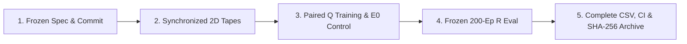

---
{
  "id": "capstone-reproducible-research-study",
  "title": "Capstone: Reproducible ML Study",
  "slug": "capstone-reproducible-research-study",
  "section": "Portfolio Capstones",
  "category": "Evaluation & Benchmarks",
  "difficulty": "Hard",
  "order": 9,
  "coverImage": "social_banner.png",
  "companies": ["OpenAI", "Anthropic", "Google", "Meta"],
  "shortDescription": "Two training curves can make an unchanged algorithm look like an improvement. Test one reward-shaping claim with paired seeds, keep the regressions, and leave a package a reviewer can rerun.",
  "keyConceptsTested": [
    "paper triage",
    "falsifiable hypothesis",
    "expected result and rejection rule",
    "baseline and controlled comparison",
    "paired random seeds",
    "bootstrap uncertainty",
    "ablation design",
    "artifact manifest",
    "negative-result reporting",
    "technical presentation"
  ],
  "prerequisites": [
    "introduction-to-reinforcement-learning-fundamentals",
    "hypothesis-tests-confidence-intervals-passk",
    "experiment-design-ab-testing"
  ],
  "relatedQuestions": [
    "jax-for-ml-research",
    "agent-evaluation-benchmarks",
    "llm-as-judge-automated-evaluation",
    "mechanistic-interpretability-sparse-autoencoders"
  ]
}
---

Two training curves can make an unchanged algorithm look like a breakthrough. One random run stumbles onto the goal early and bootstraps from good fortune; another wanders through unrewarded states until its training budget runs out. Henderson and colleagues showed that random seeds, hyperparameters, and small implementation details routinely swing reinforcement-learning benchmarks by more than the gap between competing algorithms.[^henderson2018] Plotting only the best curve hides the exact variation an honest experiment has to measure.

How do you tell whether an algorithmic change actually helped? Fix the question and decision rule before looking at confirmatory results, run every planned seed without early stopping, and report the full distribution alongside the mean. Pairing two arms on shared random draws cancels common noise whenever their outcomes covary positively, and pinning the environment makes reruns repeatable across machines (though frameworks like PyTorch can still diverge across releases or hardware even with identical seeds).[^pytorchReproducibility2026]

Our concrete test case is a classic reinforcement-learning theorem: Ng, Harada, and Russell's result on potential-based reward shaping.[^ng1999] Does adding a distance-based shaping bonus speed up early goal-reaching for tabular Q-learning in a stochastic seven-state corridor while leaving final greedy success unchanged under the original reward? We will derive the shaping math, run a paired 24-seed experiment locally on CPU with NumPy, inspect five individual seeds that regressed despite a positive average, cross-check the bootstrap interval with SciPy, and package a self-contained artifact another engineer can rerun.

<figure>
  
  <figcaption>Each seed delivers identical random draws to the sparse baseline, the shaped candidate, and a zero-potential sanity check during training. Frozen policies are then evaluated for 200 greedy episodes on original reward R, separating early learning speed from final-policy preservation.</figcaption>
</figure>

## Read the claim before building the simulator

Most reproduction attempts stall because they try to rebuild an entire paper at once. Start instead by isolating one crisp claim you can test end to end. Ng, Harada, and Russell proved that adding a potential-based shaping term $F(s,a,s') = \gamma \Phi(s') - \Phi(s)$ leaves the optimal policy set unchanged in a discounted Markov decision process.[^ng1999]

Keshav's three-pass reading method keeps that triage fast: classify the claim on pass one, check equations and hidden assumptions on pass two, and reconstruct the smallest test from memory on pass three.[^keshav2007] Capture the mapping in a compact triage table so your own adaptations stay distinct from the source paper:

| Triage field | Corridor-study note |
| --- | --- |
| problem | sparse rewards give no learning signal until the agent reaches the goal |
| paper claim | potential-based shaping preserves optimal policies under stated assumptions |
| equation to implement | $F(s,a,s') = \gamma \Phi(s') - \Phi(s)$ |
| smallest test | seven-state corridor with tabular Q-learning |
| theorem assumptions | same discounted MDP, finite potential, matching terminal handling |
| measurement control | final evaluation uses original environment reward only |
| what we test | early learning speed and final parity across 24 fixed seeds |
| out of scope | deep RL function approximation or deployed agents |

> **Key insight:** Never score a shaped agent on its shaped return at test time. Shaping is strictly a training signal; final evaluation must compare frozen policies under the original environment reward.

<details>
<summary>Deep dive: Keshav's three-pass triage checklist</summary>

1. **First pass (classify):** Scan title, abstract, headings, theorems, and conclusion. Summarize the problem, mechanism, baseline, and theoretical claim in one sentence each, then decide whether to reproduce, extend, or stop.
2. **Second pass (assumptions):** Record what stays constant across arms, what varies, and every unspecified detail you had to choose yourself (here: the seven-state corridor, 15% slip rate, Q-learning hyperparameters, 24-seed budget, and <span data-glossary="bootstrap-resampling">bootstrap</span> protocol).
3. **Third pass (reconstruct):** Close the paper, write $F(s,a,s') = \gamma\Phi(s') - \Phi(s)$ from memory, and ask how a bug could mimic a win (extra steps, luckier random streams, or leaked shaping bonus at evaluation). Turn each threat into an automated control or ablation row.

</details>

## Turn curiosity into a testable specification

"Does reward shaping help agents learn?" is too vague to falsify. Every phrase in a testable question should map to a number in code:

> In a stochastic seven-state corridor, does potential-based shaping increase tabular Q-learning's first-30-episode goal-reaching rate versus sparse reward, while keeping final greedy-policy success unchanged under original reward?

Freeze the experimental specification before running confirmatory seeds so the target cannot move after seeing the data. In this walkthrough, seeds `0` through `23` form our worked dataset; for a fresh confirmatory study of your own, commit this table (or place it in a timestamped read-only registry like OSF) before running an untouched seed range.[^osf2026preregistration]

| Specification field | Locked value |
| --- | --- |
| unit of analysis | one paired simulator seed |
| baseline | tabular Q-learning with sparse terminal reward |
| candidate | same Q-learning plus potential-based shaping during training |
| primary metric | first-30-episode success-rate difference, shaped minus sparse |
| uncertainty | 90% paired bootstrap interval over seed differences |
| minimum useful effect | mean paired difference at least `+0.10` |
| final-policy <span data-glossary="guardrail">guardrail</span> | observed mean and 90% paired interval stay within `[-0.02, +0.02]` |
| worked sample | seeds 0 through 23 (use fresh seeds for a new confirmatory run) |
| stopping rule | run all 24 seed pairs |

### Expected signature and rejection rule

Because a distance potential gives immediate directional feedback before the first goal visit, we expect a positive early paired difference whose 90% interval sits above zero. Because policy invariance applies to optimal policies rather than finite 80-episode Q-tables, final parity stays an empirical check rather than an assumption.[^ng1999]

Under our decision rule, the evidence supports the narrow claim only if all three conditions hold together:

1. Mean early paired difference is at least `+0.10`.
2. Lower bound of its 90% paired bootstrap interval exceeds `0`.
3. Both the final mean difference and its 90% interval lie inside `[-0.02, +0.02]`.

If any single condition misses, withhold support. An early mean of `+0.09` fails the practical threshold even with a positive interval, and a `+0.20` early jump fails if final performance drifts outside `[-0.02, +0.02]`.

## Keep the study public-safe

Generated corridor transitions contain no customer data, but public repositories still leak <span data-glossary="secrets-management">API credentials</span>, local usernames, or absolute home paths if you bundle files carelessly. Keep the scope boundary explicit in your README:

| Surface | Included | Excluded |
| --- | --- | --- |
| data | generated corridor transitions | user logs, private datasets |
| compute | local CPU and NumPy | remote model APIs, paid accelerators |
| outputs | metrics, tables, plots, manifests | secrets, machine hostnames, local paths |
| claim | this simulator and implementation | robotics or deployed-agent behavior |

Before publishing a tag, scan for secrets, strip personal paths from manifests, and attach an open-source license covering the code and generated assets you have rights to share.

## Build the smallest controlled environment

Our corridor has integer states `0` through `6`. Every episode starts at `0`, reaching goal state `6` pays environment reward `1` (all other steps pay `0`), every intended action reverses with probability `0.15` before clamping at the ends, and episodes stop after at most `12` steps.

| Environment field | Locked specification |
| --- | --- |
| states & actions | states `{0, ..., 6}`; actions `0 = left`, `1 = right` |
| transition | move one cell, reverse on `0.15` slip, clamp to `[0, 6]` |
| reward | `1` on first arrival at state `6`; `0` otherwise |
| terminated vs truncated | `terminated` at state `6`; `truncated` after 12 steps |

Keep `terminated` and `truncated` strictly separate. Because the underlying discounted task has no intrinsic deadline, hitting the 12-step cap still bootstraps $\gamma \max_a Q(s', a)$, whereas reaching goal state `6` ends bootstrapping (`target = reward`). Confusing truncation with termination silently changes the Bellman equation.[^gymnasiumTimeLimits2026]

[Tabular Q-learning](/learn/introduction-to-reinforcement-learning-fundamentals) updates each visited $(s, a)$ toward observed reward plus discounted best next-state value.[^sutton2018] Both arms receive identical environment reward $R$ and identical slip draws; only the candidate adds the training shaping bonus $F(s,a,s')$ derived from linear distance potential $\Phi(s)$:

$$
\Phi(s) = -\frac{6-s}{6}, \qquad F(s,a,s') = \gamma \Phi(s') - \Phi(s).
$$

With $\gamma = 0.95$, states closer to the goal have less negative potential. Stepping forward from `0` to `1` yields $F(0 \to 1) = 0.95(-5/6) - (-1) = +0.208$; slipping back yields $F(1 \to 0) = -0.117$; even bumping the left wall yields $F(0 \to 0) = (0.95 - 1)(-1) = +0.050$.

<figure>
  
  <figcaption>The curve plots linear state potential Phi(s) = -(6 - s)/6 from start to goal, while the summary cards isolate environment reward R (zero prior to state 6) from the training-only shaping bonus F for goalward progress (+0.208), slip reversal (-0.117), and a clamped self-loop (+0.050).</figcaption>
</figure>

Why does potential-based shaping preserve optimal policies? Across any trajectory of length $T$, intermediate potentials cancel in a telescoping sum:

$$
\sum_{t=0}^{T-1}\gamma^t F(s_t,s_{t+1})=-\Phi(s_0)+\gamma^T\Phi(s_T).
$$

For every path that reaches goal state `6` (where $\Phi(6) = 0$), the total discounted shaping bonus equals $-\Phi(0) = +1$, independent of path length! On truncated episodes ($s_T \neq 6$), $\gamma^T\Phi(s_T)$ stays nonzero, which is why terminal potential definitions and timeout bootstrapping matter in code.[^ng1999] Verify the single-step bonuses and path telescoping directly:

<!-- leetllm: test, output=show -->

```python title="shaping_one_step.py"
GAMMA = 0.95
GOAL = 6


def potential(state: int) -> float:
    return -(GOAL - state) / GOAL


def shaping(state: int, next_state: int) -> float:
    return GAMMA * potential(next_state) - potential(state)


toward = shaping(0, 1)
away = shaping(1, 0)
assert potential(0) == -1
assert abs(potential(1) - (-5 / 6)) < 1e-12
assert toward > 0
assert away < 0
assert abs(shaping(0, 0) - 0.05) < 1e-12
print(f"Phi(0)={potential(0):.3f}  Phi(1)={potential(1):.3f}")
print(f"F(0->1)={toward:+.3f}")
print(f"F(1->0)={away:+.3f}")
print(f"F(0->0)={shaping(0, 0):+.3f}")

# Two completed trajectories take different lengths but get the same addition.
for path in ([0, 1, 2, 3, 4, 5, 6], [0, 1, 0, 1, 2, 3, 4, 5, 6]):
    bonus = sum(GAMMA**t * shaping(s, n) for t, (s, n) in enumerate(zip(path, path[1:])))
    assert abs(bonus - 1.0) < 1e-12
print("Completed-path discounted bonus: +1.000 for both paths")
```

<!-- leetllm: output:start -->
```text title="Output" output compact
Phi(0)=-1.000  Phi(1)=-0.833
F(0->1)=+0.208
F(1->0)=-0.117
F(0->0)=+0.050
Completed-path discounted bonus: +1.000 for both paths
```
<!-- leetllm: output:end -->

Notice that bumping the left wall (`0 -> 0`) earns $+0.050$ even with zero progress. That single number illustrates why final evaluation must drop $F$ completely and score both policies on $R$ alone.

## Make randomness and controls explicit

In reinforcement learning, pseudorandom streams are part of the experimental apparatus.[^henderson2018] How you share those streams across arms directly affects how tightly you can estimate the difference between them.

### Paired seed trials and 2D random tapes

When baseline $X_i$ and candidate $Y_j$ draw from independent random streams, their mean-difference variance adds:

$$
\operatorname{Var}(\bar{Y} - \bar{X}) = \frac{\operatorname{Var}(Y) + \operatorname{Var}(X)}{n}.
$$

In a **paired seed trial**, each seed $i$ supplies the same random stream to both arms, and we analyze per-seed differences $\Delta_i = Y_i - X_i$:

$$
\operatorname{Var}(\bar{\Delta}) = \frac{\operatorname{Var}(Y) + \operatorname{Var}(X) - 2\operatorname{Cov}(X, Y)}{n}.
$$

When hard episodes pull both arms down together ($\operatorname{Cov}(X, Y) > 0$), pairing cancels common noise and tightens the confidence interval. That variance reduction is not automatic, however: if the same slip helps one policy and hurts the other ($\operatorname{Cov}(X, Y) < 0$), pairing can widen variance instead:

<!-- leetllm: test, output=show -->

```python title="pairing_can_increase_variance.py"
from statistics import covariance, mean, variance

baseline = [0.0, 0.25, 0.5, 0.75, 1.0]
candidate = [1.0 - score for score in baseline]
differences = [y - x for x, y in zip(baseline, candidate)]
n = len(baseline)
paired_estimate = variance(differences) / n
independent_estimate = (variance(candidate) + variance(baseline)) / n
assert paired_estimate == 2 * independent_estimate
print(f"Mean difference: {mean(differences):+.3f}")
print(f"Sample covariance: {covariance(baseline, candidate):+.4f}")
print(f"Estimated mean variance, paired / independent: {paired_estimate:.4f} / {independent_estimate:.4f}")
```

<!-- leetllm: output:start -->
```text title="Output" output compact
Mean difference: +0.000
Sample covariance: -0.1562
Estimated mean variance, paired / independent: 0.1250 / 0.0625
```
<!-- leetllm: output:end -->

> **Common mistake:** Drawing sequentially from a single flat RNG stream breaks pairing the moment one arm finishes episode 0 in 6 steps while the other takes 12. Episode 1 immediately starts at different RNG offsets for each arm.

Pre-generate four 2D arrays of shape `(TRAIN_EPISODES, MAX_STEPS)` indexed by `(episode, step)`: `explore` (for $\epsilon$-greedy checks), `action` (random action), `tie` (Q-value tie-breaks), and `slip` (15% move reversals). Now episode $e$, step $t$ sees identical draws regardless of how early previous episodes ended.

### Controls, pilot seeds, and ablations

Keep debug seeds (`900`–`902`) completely separate from study seeds (`0`–`23`), and draw frozen greedy evaluation slips from independent seeds `10000 + seed`. Run all 24 pairs without peeking to stop early (sequential stopping requires dedicated tests covered in [Experiment Design and A/B Testing](/learn/experiment-design-ab-testing)).

Before interpreting the main comparison, run a **zero-potential control** ($\Phi(s) = 0$). Under identical 2D tapes, every Q-table entry, step count, and score must match the sparse baseline bit-for-bit; any discrepancy reveals a code-path bug immediately. Organize all planned comparisons in one ablation table:

| ID | Comparison | One changed factor | Purpose | Report class |
| --- | --- | --- | --- | --- |
| `E0` | sparse vs zero potential | shaping term fixed at zero | catch code-path drift | required control |
| `E1` | sparse vs distance potential | training reward only | evaluate primary rule | primary worked run |
| `E2` | paired vs unpaired resampling | resampling indices | inspect covariance effect | sensitivity analysis |
| `E3` | distance vs reversed potential | potential sign | probe learning sensitivity | exploratory |

## Define metrics and uncertainty

For each seed $i \in \{0, \dots, 23\}$, let $p^{\text{shape}}_{i,30}$ and $p^{\text{sparse}}_{i,30}$ be the goal-reaching rates over the first 30 training episodes, with paired difference $d_i = p^{\text{shape}}_{i,30} - p^{\text{sparse}}_{i,30}$ and sample mean

$$
\bar{d} = \frac{1}{24}\sum_{i=0}^{23}d_i.
$$

Because 30-episode success rates sit on discrete $1/30$ steps and can be skewed across 24 seeds, we compute a **percentile bootstrap** over seed pairs rather than assuming Gaussian differences (following the interval-first spirit of Agarwal et al.'s RL evaluation recommendations).[^agarwal2021rl] Draw $B = 10{,}000$ resamples of size 24 with replacement (using fixed bootstrap seed `20260731`):

$$
\mathbf{d}^{*(b)} = (d_1^{*(b)}, \dots, d_{24}^{*(b)}), \qquad \bar{d}^{*(b)} = \frac{1}{24}\sum_{j=1}^{24} d_j^{*(b)}.
$$

Take the 5th and 95th percentiles of those $10{,}000$ replicate means with NumPy's `method="linear"`, and cross-check against SciPy's bias-corrected accelerated (`BCa`) bootstrap and paired Wilcoxon signed-rank test.[^numpyQuantile2026][^scipyBootstrap2026] Remember that the unit of independence is the **seed pair**, not the 30 correlated episodes inside a single training run.

For the **final-policy guardrail**, freeze both Q-tables after 80 episodes, evaluate each over 200 greedy episodes on original reward $R$ using paired evaluation tapes (`10000 + seed`), and verify that both the final mean difference and its 90% interval stay inside `[-0.02, +0.02]`.

## Plan the experiment table before running

Mirror the locked experiment plan in `configs/study.json` and track each run with an explicit status (`planned`, `running`, `complete`, `mechanical_failure`, or `excluded_by_locked_rule`) so inconvenient runs can never disappear silently:

| Run | Seeds | Episodes | Evaluation | Output | Decision role |
| --- | ---: | ---: | ---: | --- | --- |
| pilot smoke | 900-902 | 10 | 20 | console trace | debug only |
| zero-potential control | 0-23 | 80 | 200 | exact-equality log | implementation check |
| primary worked study | 0-23 | 80 | 200 | seed table + bootstrap | evaluate declared rule |
| unpaired sensitivity | same rows | none | none | interval comparison | planned sensitivity check |
| reversed-potential stress | 0-23 | 80 | 200 | separate seed table | exploratory appendix |

## Package an exact repository

Keep locked hypotheses, simulator code, immutable run outputs, and reports in separate directories so exploratory notebooks never overwrite official tables. Pin dependencies in `pyproject.toml` and `uv.lock`, and document one clean command such as `uv run corridor-study --config configs/study.json` following standard reproducibility checklists.[^reproducible_research_seeds]

<details>
<summary>Deep dive: Portfolio repository layout and manifest template</summary>

```text title="repository-tree.txt"
reproducible-reward-shaping/
├── README.md
├── LICENSE
├── CITATION.cff
├── pyproject.toml
├── uv.lock
├── study_plan.md
├── paper_triage.md
├── configs/
│   └── study.json
├── src/
│   └── corridor_study/
│       ├── __init__.py
│       ├── environment.py
│       ├── train.py
│       ├── analyze.py
│       └── manifest.py
├── tests/
│   ├── test_environment.py
│   ├── test_zero_potential.py
│   └── test_manifest.py
├── data/
│   └── generated/
│       └── README.md
├── artifacts/
│   ├── manifest.json
│   ├── runs/
│   │   ├── primary_seed_rows.csv
│   │   └── bootstrap_means.npy
│   └── checksums.sha256
├── report/
│   ├── report.md
│   ├── figures/
│   │   └── paired_seed_delta.svg
│   └── tables/
│       └── primary_result.csv
└── talk/
    ├── outline.md
    └── q-and-a.md
```

```json title="artifacts/manifest.json"
{
  "study_id": "corridor-reward-shaping-v1",
  "git_commit": "<full-40-char-commit-hash>",
  "config_sha256": "<sha256-of-configs-study-json>",
  "source_sha256": "<sha256-of-src-tree>",
  "python": "3.12.x",
  "numpy": "2.2.6",
  "os": "Darwin",
  "architecture": "arm64",
  "confirmatory_seeds": [0, 1, 2, 3, 4, 5, 6, 7, 8, 9, 10, 11, 12, 13, 14, 15, 16, 17, 18, 19, 20, 21, 22, 23],
  "bootstrap_seed": 20260731,
  "outputs": {
    "primary_seed_rows.csv": "<sha256-hash>",
    "study_results.json": "<sha256-hash>"
  },
  "status": "worked-run"
}
```

</details>

### Artifact manifests and what SHA-256 actually verifies

A manifest ties every table and figure back to the exact Git commit (plus working-tree cleanliness), source hash, dependency lockfile, platform metadata, frozen config hash, and output SHA-256 digests. Include a `CITATION.cff` file so repositories render citation metadata cleanly and pair naturally with persistent Zenodo DOIs.[^githubCitationFiles]

<figure>
  
  <figcaption>All five SHA-256 prefixes for study code, runner script, configuration, seed CSV, and summary JSON match the stored manifest, confirming unchanged file bytes while leaving producer identity unverified until signed with a trusted external key.</figcaption>
</figure>



Keep clear what a hash checks: SHA-256 verifies exact **bytes**, not semantic equality and not authorship. Formatting whitespace changes a JSON file's digest even when its values match, and anyone can hash a fabricated result into an unsigned self-reported manifest:

<!-- leetllm: test, output=show -->

```python title="a_hash_identifies_bytes.py"
import hashlib
import json

row = {"seed": 0, "success": 0.5}
compact = json.dumps(row, sort_keys=True, separators=(",", ":")).encode()
pretty = json.dumps(row, sort_keys=True, indent=2).encode()
digest = lambda data: hashlib.sha256(data).hexdigest()
print("Equal decoded values:", json.loads(compact) == json.loads(pretty))
print("Equal byte digests:", digest(compact) == digest(pretty))

invented_output = b'{"success": 1.0}'
self_reported_manifest = {"output_sha256": digest(invented_output)}
print("Invented output matches its own manifest:",
      digest(invented_output) == self_reported_manifest["output_sha256"])
```

<!-- leetllm: output:start -->
```text title="Output" output compact
Equal decoded values: True
Equal byte digests: False
Invented output matches its own manifest: True
```
<!-- leetllm: output:end -->

For cross-platform reruns where floating-point formatting may differ slightly, declare field-level numeric tolerances in advance rather than widening them after seeing a mismatch.

## Run the miniature study

Now we run all 24 paired seeds end to end. The script constructs the 2D random tapes, asserts bit-for-bit equality on the zero-potential control (`E0`), trains sparse and shaped Q-tables for 80 episodes, evaluates frozen policies over 200 greedy episodes on original reward $R$, and computes both paired and unpaired 90% bootstrap intervals. Pinning NumPy in the script header keeps the RNG stream exact across runs.[^numpyRandomCompatibility2026]

<!-- leetllm: test, deps=numpy==2.2.6, output=show, id=corridor-study -->

```python title="reward_shaping_study.py"
#!/usr/bin/env -S uv run --script
# /// script
# requires-python = "==3.12.*"
# dependencies = ["numpy==2.2.6"]
# ///

import numpy as np


N_STATES = 7
GOAL = N_STATES - 1
GAMMA = 0.95
ALPHA = 0.35
EPSILON = 0.20
TRAIN_EPISODES = 80
MAX_STEPS = 12
EARLY_EPISODES = 30
EVAL_EPISODES = 200
SLIP_PROBABILITY = 0.15
BOOTSTRAP_REPLICATES = 10_000
SEEDS = tuple(range(24))


def potential(state: int) -> float:
    return -(GOAL - state) / GOAL


def make_tape(seed: int) -> dict[str, np.ndarray]:
    rng = np.random.default_rng(seed)
    shape = (TRAIN_EPISODES, MAX_STEPS)
    return {
        "explore": rng.random(shape),
        "action": rng.integers(0, 2, shape),
        "tie": rng.integers(0, 2, shape),
        "slip": rng.random(shape),
    }


def q_target(reward: float, next_state: int, q: np.ndarray) -> float:
    # A rollout timeout is not a terminal state in the underlying task.
    return reward if next_state == GOAL else reward + GAMMA * q[next_state].max()


def train(tape: dict[str, np.ndarray], shaped: bool, phi=potential) -> tuple[np.ndarray, np.ndarray, np.ndarray]:
    q = np.zeros((N_STATES, 2), dtype=float)
    solved: list[int] = []
    steps: list[int] = []

    for episode in range(TRAIN_EPISODES):
        state = 0
        reached_goal = False

        for step in range(MAX_STEPS):
            if tape["explore"][episode, step] < EPSILON:
                action = int(tape["action"][episode, step])
            else:
                best = np.flatnonzero(q[state] == q[state].max())
                action = int(best[tape["tie"][episode, step] % len(best)])

            move = -1 if action == 0 else 1
            if tape["slip"][episode, step] < SLIP_PROBABILITY:
                move = -move

            next_state = int(np.clip(state + move, 0, GOAL))
            environment_reward = float(next_state == GOAL)
            shaping_reward = (
                GAMMA * phi(next_state) - phi(state)
                if shaped
                else 0.0
            )
            training_reward = environment_reward + shaping_reward
            target = q_target(training_reward, next_state, q)
            q[state, action] += ALPHA * (target - q[state, action])
            state = next_state

            if state == GOAL:
                reached_goal = True
                break

        solved.append(int(reached_goal))
        steps.append(step + 1)

    return q, np.asarray(solved), np.asarray(steps)


def evaluate(q: np.ndarray, seed: int) -> float:
    rng = np.random.default_rng(10_000 + seed)
    slips = rng.random((EVAL_EPISODES, MAX_STEPS))
    ties = rng.integers(0, 2, (EVAL_EPISODES, MAX_STEPS))
    successes = 0

    for episode in range(EVAL_EPISODES):
        state = 0
        for step in range(MAX_STEPS):
            best = np.flatnonzero(q[state] == q[state].max())
            action = int(best[ties[episode, step] % len(best)])
            move = -1 if action == 0 else 1
            if slips[episode, step] < SLIP_PROBABILITY:
                move = -move
            state = int(np.clip(state + move, 0, GOAL))
            if state == GOAL:
                successes += 1
                break

    return successes / EVAL_EPISODES


def bootstrap_interval(values: np.ndarray, rng: np.random.Generator) -> tuple[float, float]:
    n = len(values)
    indices = rng.integers(0, n, size=(BOOTSTRAP_REPLICATES, n))
    means = values[indices].mean(axis=1)
    low, high = np.quantile(means, [0.05, 0.95], method="linear")
    return float(low), float(high)


def unpaired_bootstrap_interval(baseline: np.ndarray, candidate: np.ndarray, rng: np.random.Generator) -> tuple[float, float]:
    n = len(baseline)
    idx_x = rng.integers(0, n, size=(BOOTSTRAP_REPLICATES, n))
    idx_y = rng.integers(0, n, size=(BOOTSTRAP_REPLICATES, n))
    deltas = candidate[idx_y].mean(axis=1) - baseline[idx_x].mean(axis=1)
    low, high = np.quantile(deltas, [0.05, 0.95], method="linear")
    return float(low), float(high)


rows = []
for seed in SEEDS:
    tape = make_tape(seed)
    q_sparse, solved_sparse, steps_sparse = train(tape, shaped=False)
    q_zero, solved_zero, steps_zero = train(tape, shaped=True, phi=lambda _: 0.0)
    assert np.array_equal(q_sparse, q_zero)
    assert np.array_equal(solved_sparse, solved_zero)
    assert np.array_equal(steps_sparse, steps_zero)

    q_shaped, solved_shaped, steps_shaped = train(tape, shaped=True)
    rows.append(
        [
            seed,
            float(solved_sparse[:EARLY_EPISODES].mean()),
            float(solved_shaped[:EARLY_EPISODES].mean()),
            evaluate(q_sparse, seed),
            evaluate(q_shaped, seed),
            int(steps_sparse.sum()),
            int(steps_shaped.sum()),
        ]
    )

results = np.asarray(rows, dtype=float)
early_delta = results[:, 2] - results[:, 1]
final_delta = results[:, 4] - results[:, 3]

rng = np.random.default_rng(20260731)
interval_low, interval_high = bootstrap_interval(early_delta, rng)
final_low, final_high = bootstrap_interval(final_delta, rng)
unpaired_low, unpaired_high = unpaired_bootstrap_interval(results[:, 1], results[:, 2], rng)

guardrail_passed = (
    -0.02 <= final_delta.mean() <= 0.02
    and final_low >= -0.02
    and final_high <= 0.02
)
supported = early_delta.mean() >= 0.10 and interval_low > 0.0 and guardrail_passed

print(f"paired seeds: {len(results)}")
print("zero-potential control: exact equality on all 24 seeds")
print(f"early sparse mean: {results[:, 1].mean():.3f}")
print(f"early shaped mean: {results[:, 2].mean():.3f}")
print(f"mean paired delta: {early_delta.mean():+.3f}")
print(f"90% paired bootstrap CI: [{interval_low:+.3f}, {interval_high:+.3f}]")
print(
    "seeds improved / tied / regressed: "
    f"{int(np.sum(early_delta > 0))} / "
    f"{int(np.sum(early_delta == 0))} / "
    f"{int(np.sum(early_delta < 0))}"
)
print(f"final sparse mean: {results[:, 3].mean():.3f}")
print(f"final shaped mean: {results[:, 4].mean():.3f}")
print(f"mean final delta: {final_delta.mean():+.3f}")
print(f"90% final-difference interval: [{final_low:+.3f}, {final_high:+.3f}]")
print(f"unpaired sensitivity interval: [{unpaired_low:+.3f}, {unpaired_high:+.3f}]")
print(f"mean training transitions sparse / shaped: {results[:, 5].mean():.1f} / {results[:, 6].mean():.1f}")
print(f"decision: {'SUPPORT UNDER RULE' if supported else 'WITHHOLD SUPPORT'}")
print(f"guardrail: {'PASS' if guardrail_passed else 'FAIL'}")
```

<!-- leetllm: output:start -->
```text title="Output" output compact
paired seeds: 24
zero-potential control: exact equality on all 24 seeds
early sparse mean: 0.439
early shaped mean: 0.582
mean paired delta: +0.143
90% paired bootstrap CI: [+0.061, +0.225]
seeds improved / tied / regressed: 19 / 0 / 5
final sparse mean: 0.911
final shaped mean: 0.911
mean final delta: +0.000
90% final-difference interval: [+0.000, +0.000]
unpaired sensitivity interval: [+0.049, +0.236]
mean training transitions sparse / shaped: 773.2 / 754.7
decision: SUPPORT UNDER RULE
guardrail: PASS
```
<!-- leetllm: output:end -->

## Read the result without hiding variance

The headline mean is $+0.143$ (+14.3 percentage points), clearing our $+0.10$ bar, and the 90% paired bootstrap interval $[+0.061, +0.225]$ sits cleanly above zero (about 15% narrower than the unpaired interval $[+0.049, +0.236]$ thanks to positive covariance $\approx 0.0095$ across shared tapes). Final greedy success matches identically at `0.911` versus `0.911` (`[+0.000, +0.000]`).

Yet plotting all 24 seed pairs immediately exposes something a bar chart would hide: **five seeds regressed** (`6, 11, 17, 19, 23`).

<figure>
  
  <figcaption>All 24 executed seed pairs appear in the scatter plot above, highlighting the five regressions (seeds 6, 11, 17, 19, and 23) in red despite the +14.3 pp mean gain. The paired 90% bootstrap interval (+6.1 to +22.5 pp) sits cleanly above zero and narrows the unpaired interval (+4.9 to +23.6 pp), while final original-reward parity holds at +0.0 pp.</figcaption>
</figure>

### Why can goal-directed shaping hurt individual seeds?

Trace a single unlucky slip from state `1` back to state `0` when the agent intended `right`. Q-learning credits the starting state and **intended** action:

<!-- leetllm: test, output=show -->

```python title="which_q_entry_changes.py"
gamma, alpha, goal = 0.95, 0.35, 6
phi = lambda s: -(goal - s) / goal
q = [[0.0, 0.0] for _ in range(goal + 1)]
state, intended_action, next_state = 1, 1, 0
bonus = gamma * phi(next_state) - phi(state)
target = bonus + gamma * max(q[next_state])
q[state][intended_action] += alpha * (target - q[state][intended_action])
assert q[0][1] == 0.0 and q[1][1] < 0.0
print(f"Q(1, right) after slipped action: {q[1][1]:+.3f}")
print(f"Q(0, right) remains: {q[0][1]:+.3f}")
```

<!-- leetllm: output:start -->
```text title="Output" output compact
Q(1, right) after slipped action: -0.041
Q(0, right) remains: +0.000
```
<!-- leetllm: output:end -->

One early backward slip pushes $Q(1, \text{right})$ to `-0.041`, making the greedy policy temporarily avoid stepping right even though right is optimal. Deleting those five regressed seeds would falsely inflate the mean from `+0.143` to `+0.239` (outcome-based selection). Always report every planned seed unconditionally.

### Competence is separate from equivalence

Seed 18 reveals a second lesson: both sparse and shaped policies tied at only `0.455` greedy success (`+0.000` difference). Both learned to choose `left` at state `0`, relying on a 15% slip to bounce into state `1` before walking to the goal! The equivalence guardrail checks whether two finite runs ended at similar scores; inspecting per-seed rows reveals whether they actually solved the task.

Let's inspect the regressed seeds, Seed 18's frozen policy, and cross-check our NumPy percentile bootstrap against SciPy's BCa interval and exact Wilcoxon signed-rank test:

<!-- leetllm: test, deps=numpy==2.2.6,scipy, output=show, continue=corridor-study -->

```python title="inspect_the_worked_rows.py"
from scipy import stats

regressed_seeds = results[early_delta < 0, 0].astype(int).tolist()
print("Regressed seeds:", regressed_seeds)
print(f"Mean using all seeds: {early_delta.mean():+.3f}")
print(f"Mean after improper outcome exclusion: {early_delta[early_delta > 0].mean():+.3f}")
for shaped in (False, True):
    frozen_q, _, _ = train(make_tape(18), shaped=shaped)
    policy = np.argmax(frozen_q[:GOAL], axis=1).tolist()
    score = evaluate(frozen_q, seed=18)
    arm = "shaped" if shaped else "sparse"
    print(f"Seed 18 {arm}: actions={policy}, success={score:.3f}")

# Paired Wilcoxon signed-rank and SciPy BCa bootstrap over all 24 pairs
w_all = stats.wilcoxon(early_delta, alternative="greater")
bca = stats.bootstrap((early_delta,), np.mean, n_resamples=4000, confidence_level=0.90, method="BCa", random_state=20260731)
print(f"Wilcoxon signed-rank (n=24, one-sided): stat={w_all.statistic:.1f}, p={w_all.pvalue:.4f}")
print(f"SciPy 90% BCa bootstrap CI: [{bca.confidence_interval.low:+.3f}, {bca.confidence_interval.high:+.3f}]")
# Compare minimum two-sided Wilcoxon resolution when running only 5 positive seeds: 2 * 0.5^5 = 0.0625
w_small = stats.wilcoxon(np.array([0.10, 0.20, 0.13, 0.43, 0.17]), alternative="two-sided")
print(f"Min 2-sided Wilcoxon p at n=5 all-positive seeds: {w_small.pvalue:.4f}")
```

<!-- leetllm: output:start -->
```text title="Output" output compact
Regressed seeds: [6, 11, 17, 19, 23]
Mean using all seeds: +0.143
Mean after improper outcome exclusion: +0.239
Seed 18 sparse: actions=[0, 1, 1, 1, 1, 1], success=0.455
Seed 18 shaped: actions=[0, 1, 1, 1, 1, 1], success=0.455
Wilcoxon signed-rank (n=24, one-sided): stat=238.5, p=0.0057
SciPy 90% BCa bootstrap CI: [+0.058, +0.228]
Min 2-sided Wilcoxon p at n=5 all-positive seeds: 0.0625
```
<!-- leetllm: output:end -->

SciPy's BCa interval (`[+0.058, +0.228]`) agrees closely with the NumPy percentile interval (`[+0.061, +0.225]`). Notice also the power lesson at the bottom: with only `N=5` seeds, even five unanimous positive runs can reach at best $p = 2 \times 0.5^5 = 0.0625 > 0.05$ on a two-sided Wilcoxon test, whereas 24 paired seeds resolve the gain at $p = 0.0057$. Also note the unit of compute: both arms ran 80 **episodes** (`773.2` sparse transitions vs `754.7` shaped transitions because solving faster ends episodes sooner), so this measures per-episode speed rather than matched-step sample efficiency.

## Treat negative results as artifacts

A reproducibility study succeeds whenever it cleanly determines what the evidence supports or refutes, regardless of sign. Keep the exact same table and plot format when a run fails or lands inconclusive:

| Symptom | Plausible cause | Honest response |
| --- | --- | --- |
| interval crosses zero | seed budget too small or effect unstable | report inconclusive result and wider interval |
| mean below `+0.10` | effect smaller than useful threshold | withhold practical claim even if sign is positive |
| final guardrail fails | undertraining, stochastic variation, or bug | withhold support; inspect updates and per-seed outcomes |
| a few extreme seeds dominate | unstable exploration dynamics | show full seed distribution alongside robust summary |
| zero-potential control differs | code paths diverged | stop analysis and fix experiment harness |
| clean clone fails to run | missing dependency or command | repair packaging before sharing report |

## Produce a figure, table, and report

Generate the seed CSV, summary table, and figure from one command so numbers never drift through manual transcription. Inside this bundle, `illustrations/run_study.py` runs `reward_shaping_study.py` and writes `primary_seed_rows.csv`, `study_results.json`, and `artifact_manifest.json`:

```bash title="regenerate-study-artifacts.sh"
uv run web/src/content/foundations/capstone-reproducible-research-study/illustrations/run_study.py
```

The primary summary table presents early speed, uncertainty, win/tie/loss counts, and final parity side by side:

| Metric | Sparse | Shaped | Paired difference |
| --- | ---: | ---: | ---: |
| first-30 success | 0.439 | 0.582 | +0.143 |
| 90% interval | n/a | n/a | [+0.061, +0.225] |
| improved/tied/regressed seeds | n/a | n/a | 19/0/5 |
| final original-reward success | 0.911 | 0.911 | +0.000 |

Pair that table with a per-seed scatter plot (never a summary-only bar chart) and a concise report linking hypothesis, controls, regressions, limitations, and exact reproduction command.

## Write limitations that constrain the claim

Turn every limitation into a concrete boundary and a follow-up experiment:

| Limitation | Unsupported inference | Useful next study |
| --- | --- | --- |
| one seven-state corridor | shaping helps other environments | add branching grids and delayed traps |
| tabular Q-learning only | effect transfers to neural agents | preregister a function-approximation study |
| one potential function | any potential speeds learning | compare several locked potential families |
| one hyperparameter set | result is tuning-robust | crossed seed-by-hyperparameter design |
| 24 seeds | effect size is tightly pinned | size seed budget to target interval width |
| synthetic task | deployed-agent value or safety | evaluate on representative interaction logs |

## Stage the evidence for review

Build and verify the study in four clean checkpoints before touching fresh confirmatory seeds:

<details>
<summary>Deep dive: Four delivery milestones</summary>

1. **Specification:** Commit `paper_triage.md`, `study_plan.md`, falsifiable hypothesis, rejection rule, and limitations table before executing confirmatory seeds.
2. **Simulator and baseline:** Ship the repository tree, environment unit tests (endpoint clamping and step-12 truncation bootstrapping), pilot trace (`900`–`902`), zero-potential equality check, `uv.lock`, and single entrypoint command.
3. **Confirmatory results:** Generate the complete seed CSV, bootstrap intervals, manifest, SHA-256 checksums, distribution plot, planned ablations, and deviations log directly from committed code.
4. **Public package and defense:** Publish the concise report, clean-clone reproduction commands, license, `CITATION.cff`, and talk outline after scanning for leaked secrets or local paths.

</details>

## Prepare a ten-minute talk

Lead a ten-minute research talk with the hypothesis, per-seed scatter plot, and negative seeds rather than walking file by file through the repo:

| Time | Slide | Focus |
| ---: | --- | --- |
| 0:00-1:45 | problem & claim | sparse corridor question and potential-based shaping theorem |
| 1:45-4:30 | hypothesis & design | locked rule, paired 2D tapes, zero-potential control |
| 4:30-7:15 | evidence & checks | 24-seed scatter plot, CI, five regressions, Seed 18, final parity |
| 7:15-8:00 | limitations | where the evidence stops and the next experiment |
| 8:00-10:00 | Q&A | defend design choices with exact artifact links |

<details>
<summary>Deep dive: Anticipated Q&A defense matrix</summary>

| Question | Strong answer shape |
| --- | --- |
| Why 24 seeds? | Bounded laptop budget; full interval width and seed spread stay visible |
| Why can five seeds regress? | Shaping changes finite-sample exploration; early slips can push $Q(1, \text{right})$ negative |
| Seed 18 finished at 0.455 on both arms. Did the guardrail fail? | The guardrail tests parity between arms (`+0.000`); per-seed inspection catches low absolute competence separately |
| Does this transfer to deep RL agents? | No; this study tests tabular Q-learning on a 7-state corridor and neural transfer needs its own preregistered run |

</details>

## Review the artifact like an outsider

ACM's artifact standard distinguishes three levels of verification: **repeatability** (same team, same setup), **reproducibility** (independent team, authors' packaged artifacts), and **replicability** (independent team, independently built code).[^acm2020artifacts] Combining a fresh-clone entrypoint, locked dependencies, and FAIR metadata (findable, accessible, interoperable, reusable) moves your package from local repeatability to external reproducibility.[^wilkinson2016]

Before sharing, verify from a fresh clone that an outside engineer can find the frozen hypothesis, install pinned dependencies cleanly, regenerate the CSV from config and seeds, verify SHA-256 checksums, recompute every reported table number from the CSV, and see clearly where the claim stops.

## Defend bounded evidence

Strong empirical engineering comes down to three habits: turn a claim into a falsifiable question over finite data, inspect the full seed distribution and regressions alongside averages, and keep your conclusions strictly smaller than your evidence. Paired 2D tapes remove shared simulator noise, bootstrap intervals and Wilcoxon tests quantify uncertainty, and original-reward evaluation keeps training tricks from distorting the objective. Those exact habits transfer directly to retrieval benchmarks, LLM judges, and agent evaluations.

```checkpoint
Your shaped agent has higher shaped return but identical original-reward success. Which value belongs in final-policy guardrail?
---
Original-reward success. Shaping is a training signal, so scoring it in the final comparison would change the metric in the candidate's favor.
```

```checkpoint
Mean early paired difference is +0.12, but 90% bootstrap interval is [-0.03, +0.24]. Does locked rule support H1?
---
No. The mean clears the practical threshold, but the interval's lower bound isn't above zero. Report the result as inconclusive or rejected under the locked rule, and don't change the interval after seeing the output.
```

```checkpoint
You find a terminal-transition bug after inspecting first six confirmatory seeds. Can you fix code and append eighteen fresh seeds to old six?
---
No. Preserve the invalid results, record an amendment, version the correction, and rerun the complete seed set for a comparable corrected analysis. Because some outcomes already influenced development, label that rerun as amended evidence; reserve a new untouched set for a fresh confirmatory claim. Don't mix versions or erase the deviation.
```

```checkpoint
A reviewer gets a different seed table from clean clone, although source and config hashes match yours. Should report stay unchanged because aggregate conclusion matches?
---
No. Treat the row mismatch as a reproducibility failure. Preserve both outputs, compare runtime and NumPy versions, platform metadata, nondeterministic operations, and input hashes, then fix or document the cause. A matching conclusion doesn't excuse unaccounted execution drift.
```

```mastery-quiz
[
  {
    "question": "For a given transition, discount is .90, current potential is −.80 and successor potential is −.20. Original reward is zero. What training-only shaping addition follows?",
    "options": [
      "−.62, keeping the original reward separately zero.",
      "+.62, keeping the original reward separately zero.",
      "+.60, keeping the original reward separately zero.",
      "−.52, keeping the original reward separately zero."
    ],
    "answer": "+.62, keeping the original reward separately zero.",
    "explanation": "Discounted successor potential minus current potential gives .9×(−.2)−(−.8)=.62. Omitting the discount gives .60; reversing or misordering the potentials changes the calculation. A positive shaping addition is not itself an original-reward success."
  },
  {
    "question": "A learner chooses left at state 3, slips to nonterminal state 4 and receives reward 0. Both left-action entries currently hold .20. A separate transition reaches a true goal with reward 1 and has an old action value of .20. In both cases the successor row has a stored maximum of .60, the discount is .90 and the step size is .25. Which entry and value should the learner write after the slip, and what value should it write for the action that reached the goal?",
    "options": [
      "Write .285 to Q(4,left) after the slip and .535 for the goal transition.",
      "Write .150 to Q(4,left) after the slip and .400 for the goal transition.",
      "Write .150 to Q(3,left) after the slip and .535 for the goal transition.",
      "Write .285 to Q(3,left) after the slip and .400 for the goal transition."
    ],
    "answer": "Write .285 to Q(3,left) after the slip and .400 for the goal transition.",
    "explanation": "Credit the left action at state 3, where the learner chose it. State 4 provides the next value. The target after the slip is .90 × .60 = .54, so the entry becomes .20 + .25 × (.54 − .20) = .285. At the goal, the reward of 1 is the full target, giving .20 + .25 × (1 − .20) = .400. Writing to Q(4,left) credits the arrival state. Dropping the future value after the slip gives .20 + .25 × (0 − .20) = .150. Adding .54 to the goal target gives .535 and counts future reward after the task has ended."
  },
  {
    "question": "Ten independent seed pairs have estimated marginal variances .09 and .16, with covariance +.05 between arm scores. What are the estimated variances of the paired mean difference and an independently sampled-arm mean difference with the same marginal variances and ten runs per arm?",
    "options": [
      "Paired .015; independent .025.",
      "Paired .025; independent .015.",
      "Paired .035; independent .025.",
      "Paired .150; independent .250."
    ],
    "answer": "Paired .015; independent .025.",
    "explanation": "Pairing subtracts twice covariance before dividing by 10: (.09+.16−2×.05)/10=.015. Independent arms give (.09+.16)/10=.025. Adding covariance uses the wrong sign; omitting division by the number of independent pairs confuses run variance with mean variance. Shared draws do not guarantee positive covariance in another study."
  },
  {
    "question": "A tiny paired-bootstrap illustration has seed differences [−.2,.1,.3,.6]. One four-pair draw uses zero-based indices [3,3,0,1]. Separately, five sorted replicate means are [−.2,0,.1,.4,.5]. What are this draw’s mean and the linear-method quantile at q=.90 of those five sorted means?",
    "options": [
      "Draw mean .200; quantile .500.",
      "Draw mean .275; quantile .500.",
      "Draw mean .275; quantile .460.",
      "Draw mean .350; quantile .460."
    ],
    "answer": "Draw mean .275; quantile .460.",
    "explanation": "The selected values are .6,.6,−.2,.1, summing 1.1 and averaging .275. Linear quantile position is .9×(5−1)=3.6, so interpolate .4+.6×(.5−.4)=.46. Repeated indices are valid replacement draws; removing duplicates or taking the next order statistic changes the specified procedure."
  },
  {
    "question": "Team A examines pilot outcomes for seeds 80 and 81, then freezes a four-pair plan covering 80 through 83 before running the remaining two. Team B freezes its four-pair plan for 84 through 87 before seeing any of those outcomes. Both later finish every planned pair. Which all-four-pair claim has the required untouched confirmatory history?",
    "options": [
      "Only B has untouched confirmatory history; A’s combined four-pair evidence includes observed pilot outcomes.",
      "Only A has untouched confirmatory history; B’s combined four-pair evidence includes observed pilot outcomes.",
      "Both have untouched confirmatory history; completing all planned pairs removes the earlier pilot distinction.",
      "Neither has untouched confirmatory history; four-pair plans cannot distinguish pilot and confirmatory evidence."
    ],
    "answer": "Only B has untouched confirmatory history; A’s combined four-pair evidence includes observed pilot outcomes.",
    "explanation": "B’s complete sample was reserved before its plan encountered those outcomes. A included two already observed pilot seeds in its combined sample. Finishing the other pairs cannot make the earlier observations unobserved. Preserve A’s full history and label its amended evidence; use an untouched planned sample for a fresh confirmatory claim."
  },
  {
    "question": "Two paths start at potential −.90 and each lasts two transitions. One reaches a goal with potential 0. An external collection cap stops the other at a state with potential −.50. With a discount of .60 per transition, what total discounted potential-based shaping reward does each path accumulate?",
    "options": [
      "Goal +.900, cap +.900.",
      "Goal +.324, cap +.144.",
      "Goal +.900, cap +.600.",
      "Goal +.900, cap +.720."
    ],
    "answer": "Goal +.900, cap +.720.",
    "explanation": "When the discounted step rewards are added, the intermediate potential cancels. The start contributes +.90 on both paths. The goal contributes zero. At the cap, the end potential contributes .60² × (−.50) = −.180, giving a total of .720. Giving both paths .900 erases the potential at the cap. The capped value .600 discounts the end potential just once. The pair .324 and .144 discounts the whole potential change, including the start at time zero."
  },
  {
    "question": "A reviewer keeps the reference and rerun JSON files and both SHA-256 digests. The files have different digests. The locked comparison checks one field, the mean score, with an absolute tolerance of .0005. The reference gives .8128 and the rerun gives .8132. An unsigned manifest names a lab and lists the correct digest for the rerun file. What do these checks tell us about the score and the producer?",
    "options": [
      "The score comparison fails and the producer’s identity remains unverified.",
      "The score comparison passes and the producer’s identity remains unverified.",
      "The score comparison passes and the digest confirms the named lab produced the file.",
      "The score comparison fails and the digest confirms the named lab produced the file."
    ],
    "answer": "The score comparison passes and the producer’s identity remains unverified.",
    "explanation": "The scores differ by .8132 − .8128 = .0004, within the .0005 tolerance. Failing the score because the file digests differ would apply a byte-for-byte comparison. A matching digest in the manifest lets the reviewer check which file it describes. Anyone holding that file could record its digest and name the lab. Confirming who produced it requires independent evidence of identity."
  },
  {
    "question": "An outside lab checks a published study twice. For its first run, it builds a simulator from the paper before receiving any of the authors’ artifacts. For its second run, it uses the authors’ archived package. Both runs recover the published result within the declared tolerance. Under the ACM terminology used in this lesson, how should the lab classify each run relative to the published study?",
    "options": [
      "Replicability for the first run and replicability for the second.",
      "Reproducibility for the first run and replicability for the second.",
      "Replicability for the first run and reproducibility for the second.",
      "Reproducibility for the first run and reproducibility for the second."
    ],
    "answer": "Replicability for the first run and reproducibility for the second.",
    "explanation": "The team is independent of the authors in both runs. Its own simulator provides evidence of replicability. Running the authors’ package provides evidence of reproducibility. Reversing the labels assigns each result to the wrong implementation. Calling both runs replicability overlooks reuse of the package. Calling both reproducibility overlooks the independently built simulator. Repeatability would concern the original team using the same setup."
  },
  {
    "question": "Eight complete seed differences in their locked table are [.6,.4,−.5,−.3,.2,.1,0,0]. A proposed rewrite removes only the two negative rows while keeping both ties. What are the original and rewritten means, and which one retains the planned eight-pair estimand?",
    "options": [
      "Original .0625; rewritten about .2167; original retains the planned estimand.",
      "Original .0625; rewritten .3250; original retains the planned estimand.",
      "Original .2167; rewritten .3250; rewritten retains the planned estimand.",
      "Original .0625; rewritten about .2167; rewritten retains the planned estimand."
    ],
    "answer": "Original .0625; rewritten about .2167; original retains the planned estimand.",
    "explanation": "All eight sum to .5, giving .0625. Removing −.5 and −.3 leaves sum 1.3 over six, or .2167; dropping the ties too would instead give .325. Outcome-based exclusion changes the analysis. Keep all planned pairs and investigate the regressions without selecting a preferred mean."
  },
  {
    "question": "A fresh worksheet has early mean +.18 with 90% interval [+.08,+.24], final mean difference 0 with interval [−.03,+.01], and both absolute final rates .97. Require early mean at least +.10 and its 90% lower bound strictly above zero. Require the final mean difference and its entire interval to stay within ±.02. What may the report say about the early result, final guardrail and combined support?",
    "options": [
      "The early rule passes and the final guardrail passes. Support the combined claim.",
      "The early rule fails and the final guardrail fails. Withhold support for the combined claim.",
      "The early rule passes and the final guardrail fails. Withhold support for the combined claim.",
      "The early rule passes and the final guardrail fails. Support the combined claim."
    ],
    "answer": "The early rule passes and the final guardrail fails. Withhold support for the combined claim.",
    "explanation": "The early mean of +.18 clears +.10, and the early lower bound of +.08 clears zero. Rejecting the early result because +.08 is below +.10 would apply the threshold for the mean to the interval. Both final rates are high, but the final interval extends down to −.03, outside the allowed band. The study requires both faster early learning and similar final performance. Report the early gain and withhold support for the combined claim."
  }
]
```

> **Next:** Continue to [Sentence Embeddings & Contrastive Loss](/learn/sentence-embeddings-contrastive-learning). A research claim needs reproducible evidence, and the package should say clearly where that evidence stops. Next you will study contrastive objectives that shape reusable sentence <span data-glossary="vector">vectors</span>, applying this same experimental discipline whenever someone claims a new loss function, negative-mining strategy, or pooling rule improves retrieval.
