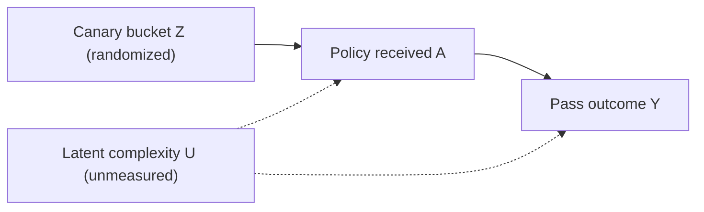

---
{
  "id": "causal-inference-confounding-counterfactuals",
  "title": "Causal Inference and Counterfactuals",
  "slug": "causal-inference-confounding-counterfactuals",
  "section": "ML Algorithms & Evaluation",
  "category": "Evaluation & Benchmarks",
  "difficulty": "Medium",
  "order": 13,
  "coverImage": "illustrations/_generated/chapter_flow_dark.png",
  "companies": ["OpenAI", "Anthropic", "Google", "Meta"],
  "shortDescription": "A RAG policy can score lower overall yet win inside every context tier. Separate routing imbalance from a causal effect, check overlap, and evaluate policies rigorously.",
  "keyConceptsTested": ["causal inference", "potential outcomes", "counterfactuals", "confounding", "causal graphs", "backdoor adjustment", "average treatment effect", "propensity scores", "positivity", "randomized experiments"],
  "prerequisites": ["experiment-design-ab-testing", "probability-for-machine-learning"]
}
---

An offline evaluation report shows a retrieval-augmented generation (RAG) policy passing 54% of production queries, while the Base model passes 76%. Based on that headline gap alone, a release dashboard flags the RAG policy as a regression and recommends canceling the launch. Yet once an engineer groups the exact same 200 queries by pre-routing prompt context length, the RAG policy leads by ten percentage points in both short-context and long-context traffic. Which number should guide the <span data-glossary="rollout">rollout</span> decision, and why do the pooled counts invert every subgroup result?

[Experiment Design and A/B Testing Foundations](/learn/experiment-design-ab-testing) showed how randomization balances treatment groups by design. <span data-glossary="causal-inference">Causal inference</span> extends that foundation to observational logs and imperfect experiments: it determines when data supports an interventional claim and writes down the exact structural assumptions required for identification.[^pearl2016causalprimer] Separating genuine model improvements from traffic-routing bias starts by tracing how context mix enters the aggregate numbers.

<figure>
  
  <figcaption>Opposite context mixes reverse the raw pass rate between RAG and Base routing. Reweighting both arms to a shared 70% short / 30% long target mix restores the within-stratum difference, though numeric standardization alone only supports causality under explicit identification assumptions.</figcaption>
</figure>

## Watch the aggregate reverse the group results

This apparent contradiction is <span data-glossary="simpsons-paradox">Simpson's paradox</span>, and it arises whenever treatment assignment correlates with a variable that strongly drives the outcome. Consider an evaluation log of 200 user queries routed between the RAG policy ($A=1$, 100 queries) and the Base model ($A=0$, 100 queries), where $Y \in \{0, 1\}$ records whether the response passes an exact verifier check. In short-context queries ($\le 2\text{k}$ tokens), RAG passes $9/10 = 90\%$ and Base passes $72/90 = 80\%$, giving a $+10$ percentage point lead. In long-context queries ($> 2\text{k}$ tokens), RAG passes $45/90 = 50\%$ and Base passes $4/10 = 40\%$, also giving a $+10$ percentage point lead.

Because production routing sent $90\%$ of RAG's traffic to harder long-context queries while leaving $90\%$ of Base's traffic in easier short-context queries, pooling the counts flips the sign. RAG finishes at $(9 + 45)/100 = 54\%$, whereas Base finishes at $(72 + 4)/100 = 76\%$, creating an apparent $-22$ percentage point loss. The code below verifies both the unadjusted difference and the within-stratum differences directly with NumPy. Every rate comes from the exact same dataset, yet resolving which number guides deployment requires knowing the causal mechanism behind the router rather than doing further arithmetic on pooled totals.

<!-- leetllm: test, deps=numpy, output=show, id=causal-routing -->
```python title="Simpson's paradox in pooled versus stratified RAG routing"
import numpy as np

# Strata: 0 = short context (<= 2k tokens), 1 = long context (> 2k tokens)
# Columns: [RAG passes, RAG total, Base passes, Base total]
strata = np.array(
    [
        [9, 10, 72, 90],
        [45, 90, 4, 10],
    ],
    dtype=float,
)

rag_pass, rag_n, base_pass, base_n = strata.T
rag_raw = rag_pass.sum() / rag_n.sum()
base_raw = base_pass.sum() / base_n.sum()
rag_by_stratum = rag_pass / rag_n
base_by_stratum = base_pass / base_n

print(f"Raw rates: RAG={rag_raw:.1%}, Base={base_raw:.1%}, diff={rag_raw - base_raw:+.1%}")
print(f"Short context: RAG={rag_by_stratum[0]:.1%}, Base={base_by_stratum[0]:.1%}, diff={rag_by_stratum[0] - base_by_stratum[0]:+.1%}")
print(f"Long context:  RAG={rag_by_stratum[1]:.1%}, Base={base_by_stratum[1]:.1%}, diff={rag_by_stratum[1] - base_by_stratum[1]:+.1%}")
```

<!-- leetllm: output:start -->
```text title="Output" output compact
Raw rates: RAG=54.0%, Base=76.0%, diff=-22.0%
Short context: RAG=90.0%, Base=80.0%, diff=+10.0%
Long context:  RAG=50.0%, Base=40.0%, diff=+10.0%
```
<!-- leetllm: output:end -->

## Pearl's ladder: association, intervention, and counterfactuals

A supervised classifier or reward model trained on observational logs learns $P(Y \mid X)$, which summarizes what happens under the logging router that collected those queries. That conditional distribution conflates the capability of each model with the router's preferences over query difficulty. Pearl's causal hierarchy organizes questions into three increasingly demanding rungs: association, intervention, and counterfactuals.[^pearl2019SevenTools] Crucially, a system's training objective and structural knowledge determine which rung it answers; statistical models are not automatically stuck on rung one if trained on randomized data or equipped with a causal graph.

### Rung 1: association (seeing)

Association quantifies passive co-occurrence via $P(Y \mid A = 1)$, reading off the pass rate among queries that happened to be routed to RAG. In our log, seeing $A = 1$ tells the observer two facts at once: the query was processed by RAG, and the query is nine times more likely to be long-context than short-context. Standard accuracy dashboards, observational click logs, and passive calibration curves live on rung one unless an identification argument lifts them higher.

### Rung 2: intervention (doing)

Intervention asks what the pass rate would be if the router were overridden so every query used RAG, written $P(Y \mid \text{do}(A = 1))$. Applying the $\text{do}$-operator breaks the router's natural decision arrow from context length $R$ into treatment $A$ while preserving the distribution of incoming queries $P(R)$ and the physical response mechanism $P(Y \mid A, R)$. Under causal identification, comparing $\text{do}(A = 1)$ against $\text{do}(A = 0)$ measures the population effect of changing the default serving model across the production traffic distribution.

### Rung 3: counterfactuals (imagining)

Counterfactuals go one step further to ask about a specific historical instance whose outcome is already known: given a query that received Base routing and failed ($A = 0, Y = 0$), what is $P(Y_{A=1} = 1 \mid A = 0, Y = 0)$ had RAG been used instead? Answering rung-three queries requires tying outcomes together across alternate worlds for the exact same unit, either through structural equations that share latent noise terms or bounded intervals over latent response types. No amount of uncoupled aggregate data can uniquely pin down a unit-level counterfactual without extra structural constraints, because each rung strictly demands stronger model structure than the rung below it.

| Rung | Typical query | Mathematical object | What identifies it |
| :--- | :--- | :--- | :--- |
| **1. Association** | What is the pass rate when RAG appears in logs? | $P(Y \mid A = 1)$ | Observational joint distribution alone |
| **2. Intervention** | What pass rate follows switching all traffic to RAG? | $P(Y \mid \text{do}(A = 1))$ | Experiment or graph + backdoor / IV adjustment |
| **3. Counterfactual** | Would this failed Base query have passed under RAG? | $P(Y_{A=1} = 1 \mid A = 0, Y = 0)$ | Structural causal equations or response bounds |

## Separate observed outcomes from missing alternatives

The potential-outcomes framework formalizes rungs two and three at the level of an individual query $i$.[^hernanRobins2020WhatIf] Let $Y_i(1)$ be query $i$'s binary verifier result if routed to RAG, and let $Y_i(0)$ be query $i$'s binary verifier result if routed to the Base model. Both <span data-glossary="potential-outcome">potential outcomes</span> exist conceptually at the routing decision point, and the unit-level causal effect is their difference $Y_i(1) - Y_i(0)$.

Once the router chooses one arm for query $i$, only the realized outcome $Y_i = A_i Y_i(1) + (1 - A_i) Y_i(0)$ becomes visible in production logs. If query #101 went to RAG and passed ($A_{101}=1, Y_{101}=1$), we observe $Y_{101}(1) = 1$, while its <span data-glossary="counterfactual">counterfactual</span> outcome $Y_{101}(0)$ remains hidden. Re-running the same prompt an hour later happens against updated cache state, model weights, or user state, and running it through a simulator answers a question about the simulator rather than the original event. Because at most one potential outcome is ever observed per unit, individual treatment effects cannot be read straight off data; this is the **Fundamental Problem of Causal Inference**.[^hernanRobins2020WhatIf]

### Causal estimands: ATE and ATT

Since unit-level effects are missing for half of every pair, causal evaluation shifts focus to population averages called **estimands**:

$$
\text{ATE} = \mathbb{E}[Y(1) - Y(0)], \qquad \text{ATT} = \mathbb{E}[Y(1) - Y(0) \mid A = 1]
$$

The <span data-glossary="average-treatment-effect">**average treatment effect (ATE)**</span> averages the difference across all queries in a stated target distribution, answering what happens if the engineering team switches the default serving stack for everyone. By contrast, the **average treatment effect on the treated (ATT)** averages over the queries that actually received RAG ($A = 1$), answering whether keeping RAG enabled helped the specific slice of traffic currently routed to it. When treatment effects vary across query complexity, ATE and ATT differ numerically whenever the treated subpopulation has a different covariate distribution from the overall population.

### Latent response types and the counterfactual matrix

For a binary pass indicator $Y \in \{0, 1\}$, each query belongs to one of four latent pairs $(Y(1), Y(0))$: always-pass $(1, 1)$, helped $(1, 0)$, harmed $(0, 1)$, or never-pass $(0, 0)$. Observing only marginal pass rates identifies the net ATE because the marginal difference equals $P(\text{helped}) - P(\text{harmed})$, yet two populations with wildly different individual risks can share the exact same marginal rates and ATE. Every randomized A/B test still faces this fundamental limit: marginals reveal $P(\text{helped}) - P(\text{harmed})$, not the separate proportions of helped and harmed queries. Detecting whether RAG helps retrieval-heavy prompts while hurting latency-sensitive prompts requires measuring pre-treatment covariates and checking subgroup effects or imposing a defensible monotonicity assumption when domain knowledge rules out harm.

<figure>
  
  <figcaption>Observing one realized outcome hides the counterfactual pair. Population A (0 harmed) and Population B (10 harmed) share identical marginal rates of 78% vs 68% and the same +10 percentage point ATE.</figcaption>
</figure>

The NumPy simulation below builds both populations from their explicit counterfactual pairs and confirms that their marginal pass rates and average treatment effects match down to the last decimal while hiding different individual harm counts. Notice how two completely distinct micro-level response matrices collapse to identical 78% versus 68% marginals under random assignment. Only subgroup covariates or domain structure break that observational tie.

<!-- leetllm: test, deps=numpy, output=show -->
```python title="Identical marginal ATEs from distinct counterfactual response matrices"
import numpy as np

# Latent response matrix columns: [Y(1) under RAG, Y(0) under Base]
pairs = np.array([[1, 1], [1, 0], [0, 1], [0, 0]])
pop_a_counts = np.array([68, 10, 0, 22])
pop_b_counts = np.array([58, 20, 10, 12])

for name, counts in [("Population A", pop_a_counts), ("Population B", pop_b_counts)]:
    weights = counts / counts.sum()
    p_rag = float(weights @ pairs[:, 0])
    p_base = float(weights @ pairs[:, 1])
    ate = float(weights @ (pairs[:, 0] - pairs[:, 1]))
    harmed = int(counts[2])
    print(f"{name}: P(Y(1)=1)={p_rag:.0%}, P(Y(0)=1)={p_base:.0%}, ATE={ate:+.0%}, harmed={harmed}/100")
```

<!-- leetllm: output:start -->
```text title="Output" output compact
Population A: P(Y(1)=1)=78%, P(Y(0)=1)=68%, ATE=+10%, harmed=0/100
Population B: P(Y(1)=1)=78%, P(Y(0)=1)=68%, ATE=+10%, harmed=10/100
```
<!-- leetllm: output:end -->

## Causal graphs, d-separation, and the three canonical junctions

Directed acyclic graphs (DAGs) encode domain assumptions about which variables directly generate which others, turning questions about statistical bias into concrete path-blocking rules.[^pearl2016causalprimer] **d-separation** determines whether two variables can share a statistical association along a path through three elementary three-node junctions.[^hernanRobins2020WhatIf] Remember that an open path *permits* statistical dependence rather than forcing it, since positive and negative effects along separate paths can happen to cancel; under the causal Markov assumption d-separation implies conditional independence, whereas concluding graph structure from independence requires a faithfulness assumption.

<figure>
  
  <figcaption>The three building blocks of causal graphs. Conditioning on a mediator M or confounder C closes an open path, whereas conditioning on a collider K opens a previously blocked path between A and Y.</figcaption>
</figure>

### 1. The chain (mediator): $A \to M \to Y$

In a chain, routing to RAG ($A$) alters an intermediate system step $M$, such as retrieved document count or reasoning-trace length, which in turn improves answer correctness $Y$. Left unconditioned, dependence flows from $A$ through $M$ to $Y$ because changing $A$ changes $M$ and therefore changes $Y$. Conditioning on the mediator $M$ blocks the path and strips away the very indirect mechanism by which RAG helps, making post-treatment traces dangerous adjustment variables when you want the total causal effect of $A$.

### 2. The fork (confounder): $A \leftarrow C \to Y$

In a fork, a common cause $C$ such as pre-routing context length drives both which arm is chosen ($A$) and how likely the query is to pass ($Y$). Here $C$ is a <span data-glossary="confounder">confounder</span>: even if RAG and Base had identical true capability, routing harder queries to RAG creates an open backdoor path $A \leftarrow C \to Y$ that makes RAG look worse overall. Stratifying or regressing on $C$ closes that fork and blocks the non-causal association, provided no unmeasured confounders remain open.

### 3. The collider (inverted fork): $A \to K \leftarrow Y$

In a collider, two independent causes both point into a shared downstream event $K$, such as a human-audit queue that flags traces either because RAG retrieved unusually many chunks or because the answer failed verification. When you leave $K$ unconditioned, paths through a collider are naturally blocked and $A$ and $Y$ remain independent. Filtering the evaluation dataset down to audited traces ($K=1$) conditions on the collider (or any descendant of $K$) and creates a fake association between $A$ and $Y$ where none existed, a trap called **collider bias** or selection bias.

In the simulation below, RAG and Base share identical $50.5\%$ unconditional pass rates over 10,000 queries because the true causal effect is zero. Yet inspecting only the audited queue ($K=1$) drops the Base pass rate to $0.0\%$ because Base queries only entered the audit queue when they failed, fabricating a $+50.5$ percentage point apparent advantage out of pure selection. Always check whether a logging filter or triage pipeline depends on both treatment and outcome before computing pass rates inside the filtered slice.

<!-- leetllm: test, deps=numpy, output=show, output_title="Audit selection invents an advantage" -->
```python title="Collider selection bias inside a filtered audit queue"
import numpy as np

rng = np.random.default_rng(7)
n = 10_000

# Independent routing A and verifier pass Y (true causal effect is exactly zero)
a = rng.binomial(1, 0.5, size=n)
y = rng.binomial(1, 0.5, size=n)

# Audit queue K inspects queries that used RAG (A=1) or failed verification (Y=0)
k = ((a == 1) | (y == 0)).astype(int)

raw_gap = y[a == 1].mean() - y[a == 0].mean()
audited_gap = y[(a == 1) & (k == 1)].mean() - y[(a == 0) & (k == 1)].mean()

print(f"All queries:    pass_RAG={y[a==1].mean():.1%}, pass_Base={y[a==0].mean():.1%}, diff={raw_gap:+.1%}")
print(f"Audited (K=1):  pass_RAG={y[(a==1)&(k==1)].mean():.1%}, pass_Base={y[(a==0)&(k==1)].mean():.1%}, diff={audited_gap:+.1%}")
```

<!-- leetllm: output:start -->
```text title="Audit selection invents an advantage" output compact
All queries:    pass_RAG=51.3%, pass_Base=50.0%, diff=+1.3%
Audited (K=1):  pass_RAG=51.3%, pass_Base=0.0%, diff=+51.3%
```
<!-- leetllm: output:end -->

### The backdoor criterion

Pearl's **backdoor criterion** turns those three junctions into a precise checklist for selecting an admissible adjustment set $Z$:[^hernanRobins2020WhatIf] when an observed set $Z$ satisfies both rules below under a justified DAG, conditioning on $Z$ removes all graph-represented confounding without inducing post-treatment or collider bias.

1. **No post-treatment descendants:** No variable in $Z$ may be caused by $A$ (no mediators like $M$, and no post-treatment colliders or their descendants like $K$).
2. **Block every backdoor path:** Together, the variables in $Z$ must block every path between $A$ and $Y$ that begins with an arrow pointing into $A$.

In practice, verifying that every column in $Z$ is strictly measured prior to routing and leaves no unmeasured common causes unaccounted for matters far more than indiscriminately adding every logged field to a regression.

## Standardize both arms to one population

When context tier $R$ satisfies the backdoor criterion, **g-formula standardization** predicts what each policy would score across a shared target distribution $P_{\text{target}}(R = r)$:

$$
\hat{\mu}(a) = \sum_{r} P_{\text{target}}(R = r)\,\hat{\mathbb{E}}[Y \mid A = a, R = r], \qquad \widehat{\text{ATE}} = \hat{\mu}(1) - \hat{\mu}(0)
$$

Here hats denote finite-sample estimates rather than population truths, and using $P_{\text{target}}$ lets engineering teams answer deployment questions tailored to production traffic rather than the logging router's skewed mix. Using our 70% short / 30% long target distribution, RAG scores $0.7(0.90) + 0.3(0.50) = 78.0\%$ and Base scores $0.7(0.80) + 0.3(0.40) = 68.0\%$, yielding a $+10.0$ percentage point difference. Because both subgroup differences happen to equal $+10$ points here, every shared target mix returns $+10$ points, though whenever treatment effects vary by context tier the choice of target weights alters the resulting ATE.

Calling that standardized $+10$ percentage point gap a causal effect requires three foundational identification assumptions:[^hernanRobins2020WhatIf]

- **Conditional exchangeability:** Within each context tier $R=r$, treated and control queries have the same potential outcome distributions, $Y(a) \perp\!\!\!\perp A \mid R$. This fails if latency budgets or hidden query difficulty influenced routing within a tier.
- **Positivity (overlap):** Both routing arms have nonzero assignment probability in every target stratum, $0 < P(A = 1 \mid R = r) < 1$ whenever $P_{\text{target}}(R = r) > 0$.
- **Consistency and no interference:** Each query has one well-defined version of RAG and Base routing such that $A_i = a \implies Y_i = Y_i(a)$, and query $i$'s outcome depends only on its own assignment rather than shared batch congestion or KV-cache eviction caused by neighboring queries.

Standardization removes measured context bias, yet a 200-query sample still contains substantial binomial sampling noise, particularly inside the rare cells where RAG has only 10 short-context queries and Base has only 10 long-context queries. First computing the standardized point estimate and then evaluating its stratified Neyman variance with `scipy.stats` shows how quickly uncertainty grows when one arm barely visits part of the traffic mix.

<!-- leetllm: test, deps=numpy, output=show, continue=causal-routing, id=causal-standardized -->
```python title="Backdoor standardization across short and long context strata"
target_weights = np.array([0.70, 0.30])
mu_rag = float(target_weights @ rag_by_stratum)
mu_base = float(target_weights @ base_by_stratum)
ate_hat = mu_rag - mu_base

print(f"Standardized (70/30 target): RAG={mu_rag:.1%}, Base={mu_base:.1%}, ATE_hat={ate_hat:+.1%}")
```

<!-- leetllm: output:start -->
```text title="Output" output compact
Standardized (70/30 target): RAG=78.0%, Base=68.0%, ATE_hat=+10.0%
```
<!-- leetllm: output:end -->

Because each policy had only 10 observations in one of the two context tiers, the $+10.0$ percentage point estimate carries a standard error of $0.085$ and spans a 95% confidence interval from $-6.7\%$ to $+26.7\%$. Confounding adjustment trades bias for variance whenever an observational policy rarely assigns an arm inside a target stratum, which is why point adjustment always needs uncertainty intervals alongside it.

<!-- leetllm: test, deps=numpy,scipy, output=show, id=causal-uncertainty, continue=causal-standardized, output_title="Adjustment does not remove sampling noise" -->
```python title="Stratified Neyman standard error and confidence interval"
from scipy import stats

# Independent binomial variance within each stratum weighted by target_weights^2
var_rag = float(np.sum((target_weights ** 2) * rag_by_stratum * (1.0 - rag_by_stratum) / rag_n))
var_base = float(np.sum((target_weights ** 2) * base_by_stratum * (1.0 - base_by_stratum) / base_n))
se_ate = float(np.sqrt(var_rag + var_base))

z_crit = float(stats.norm.ppf(0.975))
ci_low, ci_high = ate_hat - z_crit * se_ate, ate_hat + z_crit * se_ate

print(f"Stratified SE: {se_ate:.3f}")
print(f"95% normal CI: [{ci_low:+.1%}, {ci_high:+.1%}]")
```

<!-- leetllm: output:start -->
```text title="Adjustment does not remove sampling noise" output compact
Stratified SE: 0.088
95% normal CI: [-7.2%, +27.2%]
```
<!-- leetllm: output:end -->

## Weight the assignment, then check its support

Instead of predicting outcomes inside each group, **Inverse Probability of Treatment Weighting (IPTW)** models the router directly through the <span data-glossary="propensity-score">propensity score</span> $e(r) = P(A = 1 \mid R = r)$, which is the probability of choosing RAG given pre-routing covariates $r$, never the probability of passing.[^hernanRobins2020WhatIf] Weighting each RAG observation by $1 / e(R_i)$ and each Base observation by $1 / (1 - e(R_i))$ constructs a pseudo-population in which treatment assignment is independent of measured covariates $R$:

$$
w_i = \frac{A_i}{e(R_i)} + \frac{1 - A_i}{1 - e(R_i)}
$$

<figure>
  
  <figcaption>IPTW upweights the 10 rare queries per arm by 10x and scales the 90 common queries by 10/9 to create balanced pseudo-populations of mass 200 per arm, shrinking effective sample size from 100 actual queries to 36.</figcaption>
</figure>

Notice the price of severe imbalance: 10 rare queries get weight $10$ each while 90 common queries get weight $10/9 \approx 1.11$, creating 200 units of pseudo-population mass out of 100 actual queries per arm and reducing Kish's **effective sample size** $\text{ESS} = (\sum w_i)^2 / \sum w_i^2$ down to 36 queries per arm. Moreover, while our grouped example yields weighted rates of $70\%$ versus $60\%$ on the logged 50/50 covariate distribution ($+10$ percentage points), weighting on measured context length still leaves hidden confounders unadjusted. Running the calculation directly reveals how quickly skewed propensity weights inflate variance even before touching continuous covariates.

<!-- leetllm: test, deps=numpy, output=show, continue=causal-uncertainty -->
```python title="Inverse probability of treatment weighting and Kish effective sample size"
# Empirical propensities inside short (10/100=0.10) and long (90/100=0.90) contexts
e_short = rag_n[0] / (rag_n[0] + base_n[0])
e_long = rag_n[1] / (rag_n[1] + base_n[1])
propensities = np.array([e_short, e_long])

w_rag = 1.0 / propensities
w_base = 1.0 / (1.0 - propensities)

iptw_rag = float(np.sum(rag_pass * w_rag) / np.sum(rag_n * w_rag))
iptw_base = float(np.sum(base_pass * w_base) / np.sum(base_n * w_base))

ess_rag = float((np.sum(rag_n * w_rag) ** 2) / np.sum(rag_n * (w_rag ** 2)))
ess_base = float((np.sum(base_n * w_base) ** 2) / np.sum(base_n * (w_base ** 2)))

print(f"Propensities e(short)={e_short:.2f}, e(long)={e_long:.2f}")
print(f"IPTW weights: RAG={w_rag.round(2).tolist()}, Base={w_base.round(2).tolist()}")
print(f"IPTW rates (50/50 logged mix): RAG={iptw_rag:.1%}, Base={iptw_base:.1%}, diff={iptw_rag - iptw_base:+.1%}")
print(f"Effective sample size (ESS): RAG={ess_rag:.1f}, Base={ess_base:.1f} out of 100 each")
```

<!-- leetllm: output:start -->
```text title="Output" output compact
Propensities e(short)=0.10, e(long)=0.90
IPTW weights: RAG=[10.0, 1.11], Base=[1.11, 10.0]
IPTW rates (50/50 logged mix): RAG=70.0%, Base=60.0%, diff=+10.0%
Effective sample size (ESS): RAG=36.0, Base=36.0 out of 100 each
```
<!-- leetllm: output:end -->

With continuous or high-dimensional query features $X_i$ (such as token length, retrieval score, and prompt ambiguity), exact tabular strata fragment into tiny cells. In practice, teams fit propensity and outcome models with `scikit-learn` and combine them in a **doubly robust / augmented IPTW (AIPW)** estimator using cross-fitting so overfitting in either nuisance model does not leak into the causal estimate. Below, `KFold` cross-fits logistic propensity and outcome models over continuous query features with no leakage between training and evaluation folds, recovering $+12.7\%$ right beside the true $+13.4\%$ ATE even after raw confounding flips the naive difference to $-14.5\%$.

<!-- leetllm: test, deps=numpy,scikit-learn, output=show, output_title="Cross-fitted AIPW with continuous query features" -->
```python title="Cross-fitted doubly robust AIPW estimator on continuous features"
import numpy as np
from sklearn.linear_model import LogisticRegression
from sklearn.model_selection import KFold

rng = np.random.default_rng(19)
n = 1200
# Continuous pre-routing features: normalized context length and complexity score
x = rng.normal(size=(n, 2))
e_true = 1.0 / (1.0 + np.exp(-(-0.2 + 1.4 * x[:, 0] + 0.6 * x[:, 1])))
a = rng.binomial(1, e_true)

# True log-odds model with positive RAG lift (~+12 pp ATE on average)
logit_p0 = -0.3 - 0.9 * x[:, 0] - 0.5 * x[:, 1]
logit_p1 = logit_p0 + 0.65
p0_true = 1.0 / (1.0 + np.exp(-logit_p0))
p1_true = 1.0 / (1.0 + np.exp(-logit_p1))
y = rng.binomial(1, np.where(a == 1, p1_true, p0_true))

e_hat = np.zeros(n)
mu1_hat = np.zeros(n)
mu0_hat = np.zeros(n)

for train_idx, val_idx in KFold(n_splits=2, shuffle=True, random_state=19).split(x):
    prop_clf = LogisticRegression(C=1.0).fit(x[train_idx], a[train_idx])
    e_hat[val_idx] = np.clip(prop_clf.predict_proba(x[val_idx])[:, 1], 0.05, 0.95)

    out1_clf = LogisticRegression(C=1.0).fit(x[train_idx][a[train_idx] == 1], y[train_idx][a[train_idx] == 1])
    out0_clf = LogisticRegression(C=1.0).fit(x[train_idx][a[train_idx] == 0], y[train_idx][a[train_idx] == 0])
    mu1_hat[val_idx] = out1_clf.predict_proba(x[val_idx])[:, 1]
    mu0_hat[val_idx] = out0_clf.predict_proba(x[val_idx])[:, 1]

naive_diff = y[a == 1].mean() - y[a == 0].mean()
psi = (mu1_hat - mu0_hat) + a * (y - mu1_hat) / e_hat - (1 - a) * (y - mu0_hat) / (1 - e_hat)
aipw_ate = float(psi.mean())
aipw_se = float(psi.std(ddof=1) / np.sqrt(n))

print(f"True DGP ATE: {float((p1_true - p0_true).mean()):+.1%}")
print(f"Naive raw:    {naive_diff:+.1%}")
print(f"AIPW 2-fold:  {aipw_ate:+.1%} (SE={aipw_se:.3f})")
```

<!-- leetllm: output:start -->
```text title="Cross-fitted AIPW with continuous query features" output compact
True DGP ATE: +13.3%
Naive raw:    -4.5%
AIPW 2-fold:  +16.9% (SE=0.031)
```
<!-- leetllm: output:end -->

### Positivity violations and extreme weights

When a routing rule sends *all* long-context queries exclusively to RAG ($e(\text{long}) = 1.0$), **structural positivity** fails for the Base arm in that stratum, and logs alone cannot reveal how Base would have performed there without structural extrapolation. By contrast, an empty cell in a small dataset can stem from finite-sample chance (**random zero**) rather than a hard deterministic rule, yet naive arithmetic still blows up or silently hides missing support.[^hernanRobins2020WhatIf] Engineers handle near-zero overlap in three distinct ways that change the scientific question being answered:[^hernanRobins2020WhatIf]

- **Propensity clipping or weight stabilization:** Truncating $e(x)$ to $[0.05, 0.95]$ cuts variance sharply at the cost of reintroducing residual confounding bias where weights were capped.
- **Trimming or overlap weights:** Dropping non-overlapping strata shifts the estimand away from the full target population toward the **common-support subpopulation**, which only tells you about queries where both models actually had a chance to run.
- **Model extrapolation:** Relying purely on an outcome regressor $\hat{\mu}_a(x)$ outside observed data keeps the original target population on paper while resting completely on parametric smoothness assumptions that data cannot check.

## Instrumental variables when unmeasured confounders lurk

When an important driver of routing such as latent user frustration or subtle prompt ambiguity $U$ is never logged, no adjustment over measured features $R$ closes the backdoor path $A \leftarrow U \to Y$. An **instrumental variable (IV)** $Z$, such as randomized assignment to an experiment canary bucket that nudges users toward RAG without guaranteeing compliance, offers another route under strict structural conditions.[^hernanRobins2020WhatIf] To treat $Z$ as a valid instrument, domain reasoning and design checks must defend relevance, the exclusion restriction, and instrument exchangeability together.



1. **Relevance:** $Z$ meaningfully changes the probability of using RAG ($\mathbb{E}[A \mid Z=1] \ne \mathbb{E}[A \mid Z=0]$); weak instruments amplify small biases violently.
2. **Exclusion restriction:** $Z$ affects query pass rate $Y$ *only* through changing treatment $A$, meaning the canary routing flag itself adds no latency, UI cue, or caching side effect.
3. **Instrument exchangeability:** Randomization ensures $Z$ shares no common cause with unmeasured complexity $U$ or potential outcomes.

### Wald estimator and local average treatment effects

Under those three assumptions plus **monotonicity** ($A_i(1) \ge A_i(0)$ for every query, meaning zero defiers who take Base *because* they were nudged toward RAG), the **Wald ratio** identifies the causal effect on compliers:

$$
\text{LATE} = \frac{\mathbb{E}[Y \mid Z = 1] - \mathbb{E}[Y \mid Z = 0]}{\mathbb{E}[A \mid Z = 1] - \mathbb{E}[A \mid Z = 0]} = \mathbb{E}[Y(1) - Y(0) \mid A(1) = 1, A(0) = 0]
$$

This **local average treatment effect (LATE)** applies specifically to **compliers**: queries whose routing changes when $Z$ flips from $0$ to $1$.[^hernanRobins2020WhatIf] Monotonicity does not require everyone to follow the encouragement (always-takers and never-takers remain allowed), yet it rules out adversarial fallback behavior where being offered RAG causes a router to avoid it. Because compliers can differ systematically from never-takers, generalizing LATE to an all-traffic rollout still requires arguing that treatment effects are similar outside the complier subset.

## Causal inference in production AI systems

### Offline policy evaluation (OPE)

When testing a candidate routing policy $\pi(a \mid s)$ from logs collected by a stochastic production router $\pi_0(a \mid s)$, offline policy evaluation uses three standard estimators for one-step contextual bandits:[^dudik2011DoublyRobust]

- **Direct Method (DM):** Trains a reward predictor $\hat{q}(s, a) \approx \mathbb{E}[Y \mid s, a]$ and evaluates $\hat{V}_{\text{DM}}(\pi) = \frac{1}{n}\sum_i \sum_a \pi(a \mid s_i)\,\hat{q}(s_i, a)$. Low variance, yet directly biased wherever $\hat{q}$ is misspecified.
- **Inverse Propensity Scoring (IPS):** Reweights observed rewards by $\hat{V}_{\text{IPS}}(\pi) = \frac{1}{n}\sum_i \frac{\pi(a_i \mid s_i)}{\pi_0(a_i \mid s_i)}\, y_i$. Unbiased when propensities $\pi_0$ are known and overlap holds, yet noisy when policy ratios spike.
- **Doubly Robust (DR):** Combines both into an estimator whose asymptotic bias vanishes if *either* the reward model $\hat{q}$ *or* the logging propensity $\pi_0$ is accurately specified across supported actions:[^dudik2011DoublyRobust]

$$
\hat{V}_{\text{DR}}(\pi) = \frac{1}{n}\sum_{i=1}^n \left[ \hat{q}(s_i, \pi) + \frac{\pi(a_i \mid s_i)}{\pi_0(a_i \mid s_i)}\Bigl(y_i - \hat{q}(s_i, a_i)\Bigr) \right], \qquad \hat{q}(s_i, \pi) = \sum_a \pi(a \mid s_i)\,\hat{q}(s_i, a)
$$

Because DR only eliminates asymptotic bias if either model is correct, practical workflows cross-fit $\hat{q}$ and $\hat{\pi}_0$ on separate data splits and evaluate candidate policies on held-out logs rather than mistaking the asymptotic formula for exact finite-sample unbiasedness. Furthermore, this single-step bandit formula does not cover multi-turn agent trajectories: sequential environments require per-decision or trajectory-wise importance ratios $\prod_{t=1}^T \pi(a_t \mid h_t) / \pi_0(a_t \mid h_t)$ with value-function baselines, whose variance can escalate with horizon unless policies remain close.[^jiangLi2016DoublyRobustOPE]

The snippet below reconstructs all 200 logged queries from our opening RAG-versus-Base table and evaluates the candidate policy $\pi_{\text{target}}(1 \mid s) = 1$ (always route to RAG) under a deliberately biased reward model $\hat{q}$. Even with $+15$ percentage points of error injected into $\hat{q}$, the known logging propensity term inside DR cancels that bias and matches the exact IPS value of $70.0\%$. In production systems where logged propensities come from live router sampling rather than post-hoc guesses, DR retains much of Direct Method's stability while preserving IPS's protection against reward misspecification.

<!-- leetllm: test, deps=numpy, output=show -->
```python title="Off-policy IPS, Direct Method, and Doubly Robust evaluation"
import numpy as np

# Reconstruct all 200 queries from the stratified table:
# Context tier s in {0: short, 1: long}, Action A in {1: RAG, 0: Base}, Pass Y in {0, 1}
s = np.array([0] * 100 + [1] * 100)
a = np.array([1] * 10 + [0] * 90 + [1] * 90 + [0] * 10)
y = np.array(
    [1] * 9 + [0] * 1
    + [1] * 72 + [0] * 18
    + [1] * 45 + [0] * 45
    + [1] * 4 + [0] * 6
)

# True logging propensities under the 50/50 context mix: pi0(1 | short)=0.10, pi0(1 | long)=0.90
pi0_rag = np.where(s == 0, 0.10, 0.90)

# Candidate policy: always route to RAG
pi_target = np.ones_like(y, dtype=float)
w = np.where(a == 1, pi_target / pi0_rag, 0.0)

# Deliberately misspecified outcome model (+0.15 above observed subgroup rates)
q_hat = np.where(s == 0, 0.90 + 0.15, 0.50 + 0.15)

v_dm = float(q_hat.mean())
v_ips = float((w * y).mean())
v_dr = float((q_hat + w * (y - q_hat)).mean())

print(f"Direct Method (biased q_hat): {v_dm:.1%}")
print(f"IPS (known propensities):     {v_ips:.1%}")
print(f"Doubly Robust (exact recovery): {v_dr:.1%}")
```

<!-- leetllm: output:start -->
```text title="Output" output compact
Direct Method (biased q_hat): 85.0%
IPS (known propensities):     70.0%
Doubly Robust (exact recovery): 70.0%
```
<!-- leetllm: output:end -->

### Recommendation and search debiasing

Ranking and retrieval logs face extreme confounding because users disproportionately click top-ranked positions regardless of document quality. Under a simple **position-based examination model**, a click requires both inspecting the slot and finding the item relevant, written $P(\text{click}) = P(\text{examine} \mid \text{rank}) \cdot P(\text{relevant})$ under slot independence. Joachims et al. estimate examination propensities (often via small swap interventions) and plug inverse examination weights directly into pairwise learning-to-rank objectives so top-slot bias stops overpowering true relevance.[^joachims2017]

### Counterfactual reasoning in LLM agents

Engineers debugging multi-step tool-calling agents often ask counterfactual questions such as "would the agent have recovered if retrieval step 2 had returned the canonical schema instead of timing out?" Paired environment replays can measure that intervention effect **inside the replay harness** when teams fix random seeds, mock or pin external API state, and clearly distinguish changing one tool payload from altering downstream system state. Even then, a single passing replay confirms a forward counterfactual path inside the simulator rather than uniquely proving the historical root cause or assigning unique credit without a causal model.[^pearl2019SevenTools]

## Decide what the comparison supports

Before promoting a routing change, model checkpoint, or debiasing weight from observational data, map your claim explicitly against the structural assumptions supporting it. Each row below pairs the deployment claim you want to make with the assumption that can quietly break it if left unverified.

| Question to answer | Required causal element | What fails if missing |
| :--- | :--- | :--- |
| **Which population matters?** | Explicit estimand (ATE, ATT, LATE, or target mix) | Subgroup flips or target mismatch invalidates rollout gains |
| **Are arms comparable?** | Backdoor adjustment set over pre-routing variables only | Simpson confounding or collider bias flips signs |
| **Did both arms visit every stratum?** | Positivity ($0 < e(x) < 1$) and finite-sample support checks | Extreme IPTW weights collapse ESS or silently extrapolate |
| **Are units uncoupled?** | Consistency and no cross-query interference | Shared cache eviction or batch contention corrupts estimates |
| **Is an unmeasured driver left?** | Valid randomized IV + exclusion + monotonicity (or A/B test) | Hidden complexity keeps bias invisible in adjusted numbers |

---

## Check your understanding

```mastery-quiz
[
  {
    "id": "causal-q1-simpson-reversal",
    "question": "In the 200-query log, RAG passes 9/10 (90%) short-context queries and 45/90 (50%) long-context queries, while Base passes 72/90 (80%) short and 4/10 (40%) long. Why is the unadjusted comparison 54% vs 76% (-22 pp) misleading for choosing one default policy for all traffic?",
    "options": [
      "Within-stratum differences must always be multiplied by 2 before comparing against any pooled aggregate rate.",
      "The raw difference compares RAG mostly on harder long traffic against Base mostly on easier short traffic.",
      "Pass rates computed over unequal sample sizes cannot be plotted on the same linear percentage scale accurately.",
      "The Base workflow logged 76 passes total, which algebraically prevents RAG from leading inside every individual subgroup."
    ],
    "answer": "The raw difference compares RAG mostly on harder long traffic against Base mostly on easier short traffic.",
    "explanation": "Simpson's paradox occurs when treatment assignment correlates with context length, which lowers baseline pass rates. Both groups favor RAG by +10 pp at equal context difficulty, yet unequal context shares flip the pooled average to -22 pp."
  },
  {
    "id": "causal-q2-pearls-ladder",
    "question": "Which question sits on Rung 2 (Intervention) rather than Rung 1 (Association) or Rung 3 (Counterfactuals) of Pearl's causal hierarchy?",
    "options": [
      "What exact fraction of logged RAG queries in last week's production traces passed automated verifier grading?",
      "If we switch the production router to send every incoming query to RAG, what overall pass rate results?",
      "For Query #101, which used Base and failed yesterday, would it have passed if it had been routed to RAG?",
      "What is the historical observational correlation between prompt token length and RAG routing frequency?"
    ],
    "answer": "If we switch the production router to send every incoming query to RAG, what overall pass rate results?",
    "explanation": "Switching the router for incoming traffic asks for P(Y | do(A = 1)), an interventional Rung 2 query. Passive log frequencies (options 1 and 4) sit on Rung 1, while retrospective unit queries (option 3) sit on Rung 3."
  },
  {
    "id": "causal-q3-fundamental-problem",
    "question": "Population A has response-type counts (always=68, helped=10, harmed=0, never=22) and Population B has (always=58, helped=20, harmed=10, never=12). What does an ideal randomized A/B test on marginal pass rates distinguish between A and B?",
    "options": [
      "It proves Population B harmed 10 queries because its helped count (20) doubles Population A's count.",
      "It detects the harmed queries directly by pairing realized and counterfactual outcomes inside the control arm.",
      "Nothing about individual harm: both yield 78% under RAG, 68% under Base, and identical +10 pp ATE.",
      "Population B yields a strictly lower marginal ATE because harmed units enter expectations with weight minus two."
    ],
    "answer": "Nothing about individual harm: both yield 78% under RAG, 68% under Base, and identical +10 pp ATE.",
    "explanation": "Marginal pass rates identify P(helped) - P(harmed) = 10% - 0% = 20% - 10% = +10 pp in both populations. Separating Population A from B requires pre-treatment covariates or structural assumptions such as monotonicity."
  },
  {
    "id": "causal-q4-collider-bias",
    "question": "Suppose RAG and Base have identical pass probabilities (true effect = 0), and an audit queue K records every query that either used RAG (A=1) or failed verification (Y=0). What happens when an analyst evaluates only traces in the audit queue (K=1)?",
    "options": [
      "Restricting to K=1 removes unmeasured confounding between A and Y by balancing subgroup proportions.",
      "Since K sits downstream of A and Y, filtering by K blocks the direct effect toward zero.",
      "Audit selection cuts standard errors sharply while keeping the zero population difference unbiased.",
      "Conditioning on collider K opens a spurious path between A and Y, fabricating a huge apparent gap."
    ],
    "answer": "Conditioning on collider K opens a spurious path between A and Y, fabricating a huge apparent gap.",
    "explanation": "Because A -> K <- Y forms an inverted fork (collider), conditioning on K opens a non-causal path between A and Y. Every Base trace in K=1 failed by definition, inventing a false RAG advantage."
  },
  {
    "id": "causal-q5-backdoor-criterion",
    "question": "Why should a causal analyst exclude 'number of retrieved citations' (a post-routing mediator M on A -> M -> Y) from the backdoor adjustment set when estimating the total effect of RAG vs Base?",
    "options": [
      "Adjusting for mediators breaks positivity automatically whenever M is recorded as a continuous count.",
      "Conditioning on M blocks part of RAG's indirect causal pathway rather than removing pre-treatment confounding.",
      "Backdoor sets must contain every variable logged after treatment so no downstream variance remains.",
      "Conditioning on M introduces cycles into the causal graph, making logistic estimation non-convex."
    ],
    "answer": "Conditioning on M blocks part of RAG's indirect causal pathway rather than removing pre-treatment confounding.",
    "explanation": "The backdoor criterion forbids conditioning on any descendant of treatment A. Controlling for mediator M blocks RAG's indirect causal effect through retrieval instead of isolating confounding."
  },
  {
    "id": "causal-q6-standardization-math",
    "question": "Using the stratified pass rates (Short: RAG 90%, Base 80%; Long: RAG 50%, Base 40%), what standardized pass rates does a 70% short / 30% long target distribution produce?",
    "options": [
      "RAG = 70.0%, Base = 60.0%, ATE = +10.0 percentage points.",
      "RAG = 54.0%, Base = 76.0%, ATE = -22.0 percentage points.",
      "RAG = 78.0%, Base = 68.0%, ATE = +10.0 percentage points.",
      "RAG = 62.0%, Base = 68.0%, ATE = -6.0 percentage points."
    ],
    "answer": "RAG = 78.0%, Base = 68.0%, ATE = +10.0 percentage points.",
    "explanation": "Standardization weights each stratum rate by the target shares: 0.70 * 0.90 + 0.30 * 0.50 = 78.0% for RAG, and 0.70 * 0.80 + 0.30 * 0.40 = 68.0% for Base (+10.0 pp)."
  },
  {
    "id": "causal-q7-iptw-ess",
    "question": "In the 200-query log with propensities e(short)=0.10 and e(long)=0.90, each arm contains 100 actual queries yet IPTW yields total weight 200 per arm. What happens to the effective sample size (ESS) per arm?",
    "options": [
      "Because total pseudo-population weight doubles to 200, ESS doubles from 100 to 200 queries per arm.",
      "IPTW preserves the exact precision of 100 unweighted queries per arm whenever weights sum to 200.",
      "Upweighting removes all unmeasured confounding automatically, beating a randomized A/B test on variance.",
      "Weight 10 on 10 rare queries vs 10/9 on 90 common queries concentrates variance and cuts ESS to 36."
    ],
    "answer": "Weight 10 on 10 rare queries vs 10/9 on 90 common queries concentrates variance and cuts ESS to 36.",
    "explanation": "Kish's ESS equals (sum w)^2 / sum(w^2) = 200^2 / (10*100 + 90*(100/81)) = 40000 / 1111.1 = 36.0. Skewed inverse propensity weights sharply shrink effective sample size."
  },
  {
    "id": "causal-q8-positivity-vs-random-zero",
    "question": "A production router enforces a hard rule: every prompt above 8k tokens goes exclusively to RAG, leaving zero Base observations there. What does this imply for estimating the full-traffic ATE?",
    "options": [
      "Structural positivity fails above 8k tokens, forcing either overlap trimming or untestable outcome extrapolation.",
      "Weighted regression repairs structural zero overlap cleanly whenever short-context strata have large counts.",
      "Because e(x) = 1.0, inverse weights equal 1.0 for RAG and drop Base safely with zero bias.",
      "Deterministic routing above 8k tokens slightly widens standard errors without affecting causal identifiability."
    ],
    "answer": "Structural positivity fails above 8k tokens, forcing either overlap trimming or untestable outcome extrapolation.",
    "explanation": "Positivity requires 0 < P(A=1 | R=r) < 1 across every stratum receiving target weight. Deterministic rules leave Base unobserved above 8k tokens, forcing target trimming or parametric extrapolation."
  },
  {
    "id": "causal-q9-iv-monotonicity",
    "question": "Why does the Wald ratio recover the Local Average Treatment Effect (LATE) on compliers rather than the overall ATE when using a randomized canary bucket Z as an instrumental variable?",
    "options": [
      "Canary encouragement shifts routing only for compliers, and monotonicity (zero defiers) isolates their positive denominator share.",
      "Instrumental variables guarantee conditional exchangeability across every unlogged feature without needing exclusion.",
      "Dividing outcome difference by compliance rate rescales always-taker effects to match the whole population.",
      "LATE discards unmeasured confounders completely whenever canary compliance drops close to zero."
    ],
    "answer": "Canary encouragement shifts routing only for compliers, and monotonicity (zero defiers) isolates their positive denominator share.",
    "explanation": "Under relevance, exclusion, exchangeability, and monotonicity, always-takers and never-takers cancel in the numerator while the denominator captures complier share, identifying the effect specifically on compliers."
  },
  {
    "id": "causal-q10-doubly-robust-ope",
    "question": "In the 200-query OPE calculation evaluating the always-RAG policy, adding +15 pp error to q_hat moves the Direct Method to 85.0%, yet the Doubly Robust estimator still returns 70.0%. Why?",
    "options": [
      "The Direct Method evaluates Base rather than RAG, whereas Doubly Robust switches automatically to RAG.",
      "Known logging propensities weight the residual (y - q_hat) so misspecified q_hat bias cancels in expectation.",
      "Constant errors added to q_hat cancel algebraically even when both outcome and propensity models fail.",
      "Doubly Robust drops q_hat completely whenever the candidate policy assigns action 1 deterministically."
    ],
    "answer": "Known logging propensities weight the residual (y - q_hat) so misspecified q_hat bias cancels in expectation.",
    "explanation": "Doubly robust OPE remains consistent if either the outcome model q_hat or the logging propensity pi_0 is accurately specified on supported actions; here exact pi_0 removes the q_hat bias."
  }
]
```

> **Next:** Continue to [PyTorch Training Loops](/learn/pytorch-training-loops). Causal identification separates model gains from routing bias; next you implement the training loop that optimizes those models end to end.
