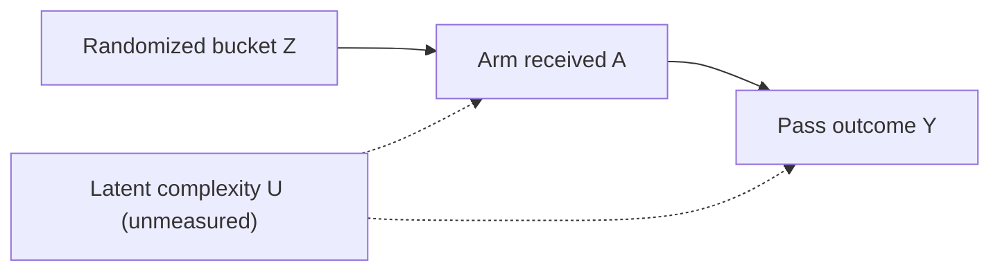

---
{
  "id": "causal-inference-confounding-counterfactuals",
  "title": "Causal Inference and Counterfactuals",
  "slug": "causal-inference-confounding-counterfactuals",
  "section": "Classical ML & Evaluation",
  "category": "Evaluation & Benchmarks",
  "difficulty": "Easy",
  "order": 8,
  "coverImage": "illustrations/_generated/chapter_flow_dark.png",
  "companies": [
    "OpenAI",
    "Anthropic",
    "Google",
    "Meta"
  ],
  "shortDescription": "A RAG router can score lower overall yet win inside every context tier. Separate routing imbalance from a causal effect, check overlap, and evaluate policies rigorously.",
  "keyConceptsTested": [
    "causal inference",
    "potential outcomes",
    "counterfactuals",
    "confounding",
    "causal graphs",
    "backdoor adjustment",
    "average treatment effect",
    "propensity scores",
    "positivity",
    "randomized experiments"
  ],
  "prerequisites": [
    "experiment-design-ab-testing",
    "probability-for-machine-learning"
  ]
}
---

An offline report shows a retrieval-augmented (RAG) router passing 54% of queries while the Base model passes 76%. On the headline number alone, RAG looks like a 22-point regression. Yet split those exact same 200 queries by prompt length and RAG wins by **+10 percentage points** on short prompts *and* **+10 percentage points** on long prompts. How can a model beat its baseline in every single subgroup and still lose overall?

In [Experiment Design and A/B Testing](/learn/experiment-design-ab-testing), randomization balanced treatment groups by construction. <span data-glossary="causal-inference">Causal inference</span> handles the harder, everyday case where logs come from an existing router or an imperfect experiment: it tells you when observational data supports an interventional claim and makes the structural assumptions explicit.[^pearl2016causalprimer]

<figure>
  
  <figcaption>Opposite context mixes reverse the raw pass rate between RAG and Base routing. Reweighting both arms to a shared 70% short / 30% long target mix restores the +10 pp within-stratum difference.</figcaption>
</figure>

## Watch the aggregate reverse the group results

This sign flip is <span data-glossary="simpsons-paradox">Simpson's paradox</span>. It happens whenever assignment ($A = 1$ for RAG, $A = 0$ for Base) correlates with a variable that strongly drives the outcome $Y \in \{0, 1\}$.

In our 200-query log:
- **Short prompts ($\le 2\text{k}$ tokens):** RAG passes $9/10 = 90\%$; Base passes $72/90 = 80\%$ (`+10 pp`).
- **Long prompts ($> 2\text{k}$ tokens):** RAG passes $45/90 = 50\%$; Base passes $4/10 = 40\%$ (`+10 pp`).

Because the router sent 90% of RAG traffic to harder long prompts and 90% of Base traffic to easier short prompts, pooling averages flips the winner: RAG lands at $54/100 = 54\%$ versus Base at $76/100 = 76\%$ (`-22 pp`).

<!-- leetllm: test, deps=numpy, output=show, id=causal-routing -->
```python title="Simpson's paradox in pooled versus stratified RAG routing"
import numpy as np

# Strata: 0 = short context (<= 2k tokens), 1 = long context (> 2k tokens)
# Columns: [RAG passes, RAG total, Base passes, Base total]
strata = np.array(
    [
        [9, 10, 72, 90],
        [45, 90, 4, 10],
    ],
    dtype=float,
)

rag_pass, rag_n, base_pass, base_n = strata.T
rag_raw = rag_pass.sum() / rag_n.sum()
base_raw = base_pass.sum() / base_n.sum()
rag_by_stratum = rag_pass / rag_n
base_by_stratum = base_pass / base_n

print(f"Raw rates: RAG={rag_raw:.1%}, Base={base_raw:.1%}, diff={rag_raw - base_raw:+.1%}")
print(f"Short context: RAG={rag_by_stratum[0]:.1%}, Base={base_by_stratum[0]:.1%}, diff={rag_by_stratum[0] - base_by_stratum[0]:+.1%}")
print(f"Long context:  RAG={rag_by_stratum[1]:.1%}, Base={base_by_stratum[1]:.1%}, diff={rag_by_stratum[1] - base_by_stratum[1]:+.1%}")
```

<!-- leetllm: output:start -->
```text title="Output" output compact
Raw rates: RAG=54.0%, Base=76.0%, diff=-22.0%
Short context: RAG=90.0%, Base=80.0%, diff=+10.0%
Long context:  RAG=50.0%, Base=40.0%, diff=+10.0%
```
<!-- leetllm: output:end -->

Every number comes from the same 200 rows. Choosing between `-22%` and `+10%` requires knowing the causal structure behind how queries were routed.

## Pearl's ladder: association, intervention, and counterfactuals

A classifier fit on observational logs learns $P(Y \mid A)$, mixing model capability with the router's selection habit. Pearl's causal ladder separates three levels of causal questions, each demanding stronger structural knowledge than the rung below it:[^pearl2019SevenTools]

| Rung | Typical question | Mathematical object | What identifies it |
| :--- | :--- | :--- | :--- |
| **1. Association (seeing)** | What pass rate appears on logged RAG queries? | $P(Y \mid A = 1)$ | Observational joint distribution alone |
| **2. Intervention (doing)** | What happens if we force *all* traffic to RAG? | $P(Y \mid \text{do}(A = 1))$ | Randomized test or causal graph + backdoor / IV adjustment |
| **3. Counterfactual (imagining)** | Would this failed Base query have passed under RAG? | $P(Y_{A=1} = 1 \mid A = 0, Y = 0)$ | Structural equations or latent response bounds |

On **Rung 1**, observing $A = 1$ tells you both that RAG ran and that the prompt is 9x more likely to be long. On **Rung 2**, the $\text{do}(A = 1)$ operator severs the router's arrow from context length $R$ into $A$ while leaving incoming query mix $P(R)$ and response mechanism $P(Y \mid A, R)$ intact. On **Rung 3**, reasoning about one specific historical query under an alternate choice requires tying both worlds together through shared unit-level noise.

## Separate observed outcomes from missing alternatives

The potential-outcomes framework formalizes Rungs 2 and 3 per query $i$.[^hernanRobins2020WhatIf] Let $Y_i(1)$ be query $i$'s outcome under RAG and $Y_i(0)$ its outcome under Base. Because the router picks one arm, logs reveal only the realized outcome $Y_i = A_i Y_i(1) + (1 - A_i) Y_i(0)$, hiding the <span data-glossary="counterfactual">counterfactual</span> alternative. This missing-data limit is the **Fundamental Problem of Causal Inference**.[^hernanRobins2020WhatIf]

Rather than identifying individual effects, we estimate population averages (**estimands**):

$$
\text{ATE} = \mathbb{E}[Y(1) - Y(0)], \qquad \text{ATT} = \mathbb{E}[Y(1) - Y(0) \mid A = 1].
$$

The <span data-glossary="average-treatment-effect">**average treatment effect (ATE)**</span> averages over the full target distribution (switching the default stack for everyone). The **average treatment effect on the treated (ATT)** averages only over queries currently routed to RAG ($A = 1$). When effects vary by prompt difficulty, ATE and ATT differ.

### Latent response types: why equal ATEs can hide harm

For binary $Y \in \{0, 1\}$, every query belongs to one of four latent pairs $(Y(1), Y(0))$: always-pass $(1,1)$, helped $(1,0)$, harmed $(0,1)$, or never-pass $(0,0)$. Marginal rates identify only the net difference $\text{ATE} = P(\text{helped}) - P(\text{harmed})$. Even an ideal A/B test cannot separate Population A (10 helped, 0 harmed) from Population B (20 helped, 10 harmed):

<figure>
  
  <figcaption>Observing one realized outcome hides the counterfactual pair. Population A (0 harmed) and Population B (10 harmed) share identical marginal rates of 78% vs 68% and the same +10 percentage point ATE.</figcaption>
</figure>

<!-- leetllm: test, deps=numpy, output=show -->
```python title="Identical marginal ATEs from distinct counterfactual response matrices"
import numpy as np

# Latent response matrix columns: [Y(1) under RAG, Y(0) under Base]
pairs = np.array([[1, 1], [1, 0], [0, 1], [0, 0]])
pop_a_counts = np.array([68, 10, 0, 22])
pop_b_counts = np.array([58, 20, 10, 12])

for name, counts in [("Population A", pop_a_counts), ("Population B", pop_b_counts)]:
    weights = counts / counts.sum()
    p_rag = float(weights @ pairs[:, 0])
    p_base = float(weights @ pairs[:, 1])
    ate = float(weights @ (pairs[:, 0] - pairs[:, 1]))
    harmed = int(counts[2])
    print(f"{name}: P(Y(1)=1)={p_rag:.0%}, P(Y(0)=1)={p_base:.0%}, ATE={ate:+.0%}, harmed={harmed}/100")
```

<!-- leetllm: output:start -->
```text title="Output" output compact
Population A: P(Y(1)=1)=78%, P(Y(0)=1)=68%, ATE=+10%, harmed=0/100
Population B: P(Y(1)=1)=78%, P(Y(0)=1)=68%, ATE=+10%, harmed=10/100
```
<!-- leetllm: output:end -->

To uncover heterogeneous harm, inspect subgroup effects across pre-treatment covariates rather than trusting a single pooled average.

## Causal graphs, d-separation, and the three canonical junctions

Directed acyclic graphs (DAGs) map domain assumptions into path-blocking rules (**d-separation**).[^pearl2016causalprimer][^hernanRobins2020WhatIf] Every path breaks down into three three-node junctions:

<figure>
  
  <figcaption>The three building blocks of causal graphs. Conditioning on a mediator M or confounder C closes an open path, whereas conditioning on a collider K opens a previously blocked path between A and Y.</figcaption>
</figure>

1. **Chain (mediator) $A \to M \to Y$:** Routing to RAG ($A$) increases retrieved passages ($M$), which raises pass rate ($Y$). Conditioning on $M$ blocks the indirect causal path, so exclude post-treatment mediators when estimating the total effect of $A$.
2. **Fork (confounder) $A \leftarrow C \to Y$:** Context length ($C$) drives both routing ($A$) and difficulty ($Y$). Conditioning on <span data-glossary="confounder">confounder</span> $C$ closes this backdoor path.
3. **Collider (inverted fork) $A \to K \leftarrow Y$:** Suppose a review queue $K$ collects traces that *either* used RAG ($A=1$) *or* failed verification ($Y=0$). Unconditioned, the path through $K$ is blocked. Filtering your dataset to reviewed traces ($K=1$) opens the collider and invents a huge fake RAG advantage even when the true causal effect is zero:

<!-- leetllm: test, deps=numpy, output=show, output_title="Review selection invents an advantage" -->
```python title="Collider selection bias inside a filtered review queue"
import numpy as np

rng = np.random.default_rng(7)
n = 10_000

# Independent routing A and verifier pass Y (true causal effect is exactly zero)
a = rng.binomial(1, 0.5, size=n)
y = rng.binomial(1, 0.5, size=n)

# Review queue K inspects queries that used RAG (A=1) or failed verification (Y=0)
k = ((a == 1) | (y == 0)).astype(int)

raw_gap = y[a == 1].mean() - y[a == 0].mean()
reviewed_gap = y[(a == 1) & (k == 1)].mean() - y[(a == 0) & (k == 1)].mean()

print(f"All queries:    pass_RAG={y[a==1].mean():.1%}, pass_Base={y[a==0].mean():.1%}, diff={raw_gap:+.1%}")
print(f"Reviewed (K=1): pass_RAG={y[(a==1)&(k==1)].mean():.1%}, pass_Base={y[(a==0)&(k==1)].mean():.1%}, diff={reviewed_gap:+.1%}")
```

<!-- leetllm: output:start -->
```text title="Review selection invents an advantage" output compact
All queries:    pass_RAG=51.3%, pass_Base=50.0%, diff=+1.3%
Reviewed (K=1): pass_RAG=51.3%, pass_Base=0.0%, diff=+51.3%
```
<!-- leetllm: output:end -->

Every Base query in `K=1` failed by construction (`0.0%`), fabricating a `+51.3%` gap out of thin air!

> **Key insight (Backdoor criterion):** An adjustment set $Z$ removes graph-represented confounding when (1) no variable in $Z$ is a descendant of treatment $A$ (no mediators, no colliders), and (2) $Z$ blocks every backdoor path from $A$ to $Y$ starting with an arrow into $A$.[^hernanRobins2020WhatIf]

## Standardize both arms to one population

When context tier $R$ satisfies the backdoor criterion, **g-formula standardization** evaluates both arms on a shared target traffic mix $P_{\text{target}}(R = r)$:

$$
\hat{\mu}(a) = \sum_{r} P_{\text{target}}(R = r)\,\hat{\mathbb{E}}[Y \mid A = a, R = r], \qquad \widehat{\text{ATE}} = \hat{\mu}(1) - \hat{\mu}(0).
$$

Interpreting $\widehat{\text{ATE}}$ causally rests on three assumptions:[^hernanRobins2020WhatIf] **conditional exchangeability** ($Y(a) \perp\!\!\!\perp A \mid R$, no unmeasured confounders within strata), **positivity** ($0 < P(A=1 \mid R=r) < 1$ in every target stratum), and **consistency / no interference** (each query's outcome depends only on its own arm, not shared batch contention or KV-cache eviction).

On a 70% short / 30% long target distribution, RAG scores $0.7(0.90) + 0.3(0.50) = 78.0\%$ and Base scores $0.7(0.80) + 0.3(0.40) = 68.0\%$ (`+10.0%`):

<!-- leetllm: test, deps=numpy, output=show, continue=causal-routing, id=causal-standardized -->
```python title="Backdoor standardization across short and long context strata"
target_weights = np.array([0.70, 0.30])
mu_rag = float(target_weights @ rag_by_stratum)
mu_base = float(target_weights @ base_by_stratum)
ate_hat = mu_rag - mu_base

print(f"Standardized (70/30 target): RAG={mu_rag:.1%}, Base={mu_base:.1%}, ATE_hat={ate_hat:+.1%}")
```

<!-- leetllm: output:start -->
```text title="Output" output compact
Standardized (70/30 target): RAG=78.0%, Base=68.0%, ATE_hat=+10.0%
```
<!-- leetllm: output:end -->

Standardization removes measured context bias, yet each arm has only 10 queries in its rare cell! Computing the stratified Neyman standard error shows how wide uncertainty stays (`SE = 0.088`, 95% CI `[-7.2%, +27.2%]`):

<!-- leetllm: test, deps=numpy,scipy, output=show, id=causal-uncertainty, continue=causal-standardized, output_title="Adjustment does not remove sampling noise" -->
```python title="Stratified Neyman standard error and confidence interval"
from scipy import stats

# Independent binomial variance within each stratum weighted by target_weights^2
var_rag = float(np.sum((target_weights ** 2) * rag_by_stratum * (1.0 - rag_by_stratum) / rag_n))
var_base = float(np.sum((target_weights ** 2) * base_by_stratum * (1.0 - base_by_stratum) / base_n))
se_ate = float(np.sqrt(var_rag + var_base))

z_crit = float(stats.norm.ppf(0.975))
ci_low, ci_high = ate_hat - z_crit * se_ate, ate_hat + z_crit * se_ate

print(f"Stratified SE: {se_ate:.3f}")
print(f"95% normal CI: [{ci_low:+.1%}, {ci_high:+.1%}]")
```

<!-- leetllm: output:start -->
```text title="Adjustment does not remove sampling noise" output compact
Stratified SE: 0.088
95% normal CI: [-7.2%, +27.2%]
```
<!-- leetllm: output:end -->

## Weight the assignment, then check its support

**Inverse Probability of Treatment Weighting (IPTW)** models the router via the <span data-glossary="propensity-score">propensity score</span> $e(r) = P(A = 1 \mid R = r)$, weighting treated queries by $1 / e(R_i)$ and control queries by $1 / (1 - e(R_i))$:[^hernanRobins2020WhatIf]

$$
w_i = \frac{A_i}{e(R_i)} + \frac{1 - A_i}{1 - e(R_i)}.
$$

<figure>
  
  <figcaption>IPTW upweights the 10 rare queries per arm by 10x and scales the 90 common queries by 10/9 to create balanced pseudo-populations of mass 200 per arm, shrinking effective sample size from 100 actual queries to 36.</figcaption>
</figure>

Upweighting rare cells by $10\times$ shrinks Kish's **effective sample size** $\text{ESS} = (\sum w_i)^2 / \sum w_i^2$ from 100 down to 36 per arm:

<!-- leetllm: test, deps=numpy, output=show, continue=causal-uncertainty -->
```python title="Inverse probability of treatment weighting and Kish effective sample size"
# Empirical propensities inside short (10/100=0.10) and long (90/100=0.90) contexts
e_short = rag_n[0] / (rag_n[0] + base_n[0])
e_long = rag_n[1] / (rag_n[1] + base_n[1])
propensities = np.array([e_short, e_long])

w_rag = 1.0 / propensities
w_base = 1.0 / (1.0 - propensities)

iptw_rag = float(np.sum(rag_pass * w_rag) / np.sum(rag_n * w_rag))
iptw_base = float(np.sum(base_pass * w_base) / np.sum(base_n * w_base))

ess_rag = float((np.sum(rag_n * w_rag) ** 2) / np.sum(rag_n * (w_rag ** 2)))
ess_base = float((np.sum(base_n * w_base) ** 2) / np.sum(base_n * (w_base ** 2)))

print(f"Propensities e(short)={e_short:.2f}, e(long)={e_long:.2f}")
print(f"IPTW weights: RAG={w_rag.round(2).tolist()}, Base={w_base.round(2).tolist()}")
print(f"IPTW rates (50/50 logged mix): RAG={iptw_rag:.1%}, Base={iptw_base:.1%}, diff={iptw_rag - iptw_base:+.1%}")
print(f"Effective sample size (ESS): RAG={ess_rag:.1f}, Base={ess_base:.1f} out of 100 each")
```

<!-- leetllm: output:start -->
```text title="Output" output compact
Propensities e(short)=0.10, e(long)=0.90
IPTW weights: RAG=[10.0, 1.11], Base=[1.11, 10.0]
IPTW rates (50/50 logged mix): RAG=70.0%, Base=60.0%, diff=+10.0%
Effective sample size (ESS): RAG=36.0, Base=36.0 out of 100 each
```
<!-- leetllm: output:end -->

With continuous features $X_i$, combine cross-fitted propensity and outcome models into a **doubly robust (AIPW)** estimator. Below, 2-fold cross-fitting recovers `+16.9%` (`SE = 0.031`) near the true `+13.3%` ATE even after confounding drags the naive difference down to `-4.5%`:

<!-- leetllm: test, deps=numpy,scikit-learn, output=show, output_title="Cross-fitted AIPW with continuous query features" -->
```python title="Cross-fitted doubly robust AIPW estimator on continuous features"
import numpy as np
from sklearn.linear_model import LogisticRegression
from sklearn.model_selection import KFold

rng = np.random.default_rng(19)
n = 1200
# Continuous pre-routing features: normalized context length and complexity score
x = rng.normal(size=(n, 2))
e_true = 1.0 / (1.0 + np.exp(-(-0.2 + 1.4 * x[:, 0] + 0.6 * x[:, 1])))
a = rng.binomial(1, e_true)

# True log-odds model with positive RAG lift (~+13 pp ATE on average)
logit_p0 = -0.3 - 0.9 * x[:, 0] - 0.5 * x[:, 1]
logit_p1 = logit_p0 + 0.65
p0_true = 1.0 / (1.0 + np.exp(-logit_p0))
p1_true = 1.0 / (1.0 + np.exp(-logit_p1))
y = rng.binomial(1, np.where(a == 1, p1_true, p0_true))

e_hat = np.zeros(n)
mu1_hat = np.zeros(n)
mu0_hat = np.zeros(n)

for train_idx, val_idx in KFold(n_splits=2, shuffle=True, random_state=19).split(x):
    prop_clf = LogisticRegression(C=1.0).fit(x[train_idx], a[train_idx])
    e_hat[val_idx] = np.clip(prop_clf.predict_proba(x[val_idx])[:, 1], 0.05, 0.95)

    out1_clf = LogisticRegression(C=1.0).fit(x[train_idx][a[train_idx] == 1], y[train_idx][a[train_idx] == 1])
    out0_clf = LogisticRegression(C=1.0).fit(x[train_idx][a[train_idx] == 0], y[train_idx][a[train_idx] == 0])
    mu1_hat[val_idx] = out1_clf.predict_proba(x[val_idx])[:, 1]
    mu0_hat[val_idx] = out0_clf.predict_proba(x[val_idx])[:, 1]

naive_diff = y[a == 1].mean() - y[a == 0].mean()
psi = (mu1_hat - mu0_hat) + a * (y - mu1_hat) / e_hat - (1 - a) * (y - mu0_hat) / (1 - e_hat)
aipw_ate = float(psi.mean())
aipw_se = float(psi.std(ddof=1) / np.sqrt(n))

print(f"True DGP ATE: {float((p1_true - p0_true).mean()):+.1%}")
print(f"Naive raw:    {naive_diff:+.1%}")
print(f"AIPW 2-fold:  {aipw_ate:+.1%} (SE={aipw_se:.3f})")
```

<!-- leetllm: output:start -->
```text title="Cross-fitted AIPW with continuous query features" output compact
True DGP ATE: +13.3%
Naive raw:    -4.5%
AIPW 2-fold:  +16.9% (SE=0.031)
```
<!-- leetllm: output:end -->

### Handling positivity violations

If a deterministic rule routes *every* prompt above 8k tokens to RAG ($e(\text{long}) = 1.0$), **structural positivity** fails for Base there (distinct from a small-sample **random zero**).[^hernanRobins2020WhatIf] Every fix changes your tradeoff: clipping $e(x)$ to $[0.05, 0.95]$ cuts variance at the cost of bias; trimming non-overlapping regions shifts the estimand to the common-support subpopulation; relying purely on $\hat{\mu}_a(x)$ extrapolates from untestable smoothness assumptions.

## Instrumental variables when unmeasured confounders lurk

When an unmeasured variable $U$ (like hidden query ambiguity) affects both routing and outcomes, no backdoor set closes $A \leftarrow U \to Y$. A randomized **instrumental variable (IV)** $Z$ that encourages RAG without forcing compliance can still identify a causal effect:[^hernanRobins2020WhatIf]



A valid instrument requires **relevance** ($\mathbb{E}[A \mid Z=1] \ne \mathbb{E}[A \mid Z=0]$), the **exclusion restriction** ($Z$ affects $Y$ only through $A$), **exchangeability** ($Z$ is independent of $U$ and potential outcomes), and **monotonicity** ($A_i(1) \ge A_i(0)$, no defiers). Under those four conditions, the **Wald ratio** identifies the **local average treatment effect (LATE)** specifically on **compliers** (queries whose arm switches with $Z$):[^hernanRobins2020WhatIf]

$$
\text{LATE} = \frac{\mathbb{E}[Y \mid Z = 1] - \mathbb{E}[Y \mid Z = 0]}{\mathbb{E}[A \mid Z = 1] - \mathbb{E}[A \mid Z = 0]} = \mathbb{E}[Y(1) - Y(0) \mid A(1) = 1, A(0) = 0].
$$

## Causal inference in production AI systems

### Offline policy evaluation (OPE)

To score a candidate routing policy $\pi(a \mid s)$ from logs collected by a stochastic router $\pi_0(a \mid s)$, contextual-bandit evaluation uses three estimators:[^dudik2011DoublyRobust]

- **Direct Method (DM):** $\hat{V}_{\text{DM}}(\pi) = \frac{1}{n}\sum_i \sum_a \pi(a \mid s_i)\,\hat{q}(s_i, a)$ (low variance, biased if $\hat{q}$ is wrong).
- **Inverse Propensity Scoring (IPS):** $\hat{V}_{\text{IPS}}(\pi) = \frac{1}{n}\sum_i \frac{\pi(a_i \mid s_i)}{\pi_0(a_i \mid s_i)} y_i$ (unbiased with known $\pi_0$ and overlap, high variance when weights spike).
- **Doubly Robust (DR):** Consistent if *either* $\hat{q}$ *or* $\pi_0$ is right (and cross-fit in practice):[^dudik2011DoublyRobust]

$$
\hat{V}_{\text{DR}}(\pi) = \frac{1}{n}\sum_{i=1}^n \left[ \hat{q}(s_i, \pi) + \frac{\pi(a_i \mid s_i)}{\pi_0(a_i \mid s_i)}\Bigl(y_i - \hat{q}(s_i, a_i)\Bigr) \right].
$$

(Multi-step agent trajectories generalize this to sequential importance ratios $\prod_t \pi(a_t \mid h_t) / \pi_0(a_t \mid h_t)$ with value baselines, where variance grows quickly with horizon.)[^jiangLi2016DoublyRobustOPE]

Watch DR cancel a deliberate `+15 pp` error in $\hat{q}$ across our 200 logged queries using known logging propensities $\pi_0$:

<!-- leetllm: test, deps=numpy, output=show -->
```python title="Off-policy IPS, Direct Method, and Doubly Robust evaluation"
import numpy as np

# Reconstruct all 200 queries from the stratified table:
# Context tier s in {0: short, 1: long}, Action A in {1: RAG, 0: Base}, Pass Y in {0, 1}
s = np.array([0] * 100 + [1] * 100)
a = np.array([1] * 10 + [0] * 90 + [1] * 90 + [0] * 10)
y = np.array(
    [1] * 9 + [0] * 1
    + [1] * 72 + [0] * 18
    + [1] * 45 + [0] * 45
    + [1] * 4 + [0] * 6
)

# True logging propensities under the 50/50 context mix: pi0(1 | short)=0.10, pi0(1 | long)=0.90
pi0_rag = np.where(s == 0, 0.10, 0.90)

# Candidate policy: always route to RAG
pi_target = np.ones_like(y, dtype=float)
w = np.where(a == 1, pi_target / pi0_rag, 0.0)

# Deliberately misspecified outcome model (+0.15 above observed subgroup rates)
q_hat = np.where(s == 0, 0.90 + 0.15, 0.50 + 0.15)

v_dm = float(q_hat.mean())
v_ips = float((w * y).mean())
v_dr = float((q_hat + w * (y - q_hat)).mean())

print(f"Direct Method (biased q_hat): {v_dm:.1%}")
print(f"IPS (known propensities):     {v_ips:.1%}")
print(f"Doubly Robust (exact recovery): {v_dr:.1%}")
```

<!-- leetllm: output:start -->
```text title="Output" output compact
Direct Method (biased q_hat): 85.0%
IPS (known propensities):     70.0%
Doubly Robust (exact recovery): 70.0%
```
<!-- leetllm: output:end -->

### Search debiasing and agent replays

Search click logs suffer heavy position confounding because users click top slots more often regardless of relevance. Under a position-based examination model, $P(\text{click}) = P(\text{examine} \mid \text{rank}) \cdot P(\text{relevant})$, Joachims et al. estimate examination propensities via small swap interventions and apply inverse examination weights inside learning-to-rank objectives.[^joachims2017] Similarly, paired deterministic replays in LLM agent harnesses test a forward counterfactual ("if tool step 2 returned the schema instead of timing out, does the replay succeed?") while remembering that a replay tests the simulator's forward path rather than uniquely proving historical root cause without a causal graph.[^pearl2019SevenTools]

## Decide what the comparison supports

| Question to answer | Required causal element | What fails if missing |
| :--- | :--- | :--- |
| **Which population matters?** | Explicit estimand (ATE, ATT, LATE, or target mix) | Subgroup flips or target mismatch invalidates deployment gains |
| **Are arms comparable?** | Backdoor set over pre-routing variables only | Simpson confounding or collider bias flips signs |
| **Did both arms visit every stratum?** | Positivity ($0 < e(x) < 1$) and ESS checks | Extreme IPTW weights collapse ESS or silently extrapolate |
| **Are units uncoupled?** | Consistency and no interference | Shared cache eviction or batch contention corrupts estimates |
| **Is an unmeasured driver left?** | Valid IV + exclusion + monotonicity (or A/B test) | Hidden complexity keeps bias invisible in adjusted numbers |

---

## Check your understanding

```mastery-quiz
[
  {
    "id": "causal-q1-simpson-reversal",
    "question": "In the 200-query log, RAG passes 9/10 (90%) short-context queries and 45/90 (50%) long-context queries, while Base passes 72/90 (80%) short and 4/10 (40%) long. Why is the unadjusted comparison 54% vs 76% (-22 pp) misleading for choosing one default router for all traffic?",
    "options": [
      "Within-stratum differences must always be multiplied by 2 before comparing against any pooled aggregate rate.",
      "The raw difference compares RAG mostly on harder long traffic against Base mostly on easier short traffic.",
      "Pass rates computed over unequal sample sizes cannot be plotted on the same linear percentage scale accurately.",
      "The Base workflow logged 76 passes total, which algebraically prevents RAG from leading inside every individual subgroup."
    ],
    "answer": "The raw difference compares RAG mostly on harder long traffic against Base mostly on easier short traffic.",
    "explanation": "Simpson's paradox occurs when treatment assignment correlates with context length, which lowers baseline pass rates. Both groups favor RAG by +10 pp at equal context difficulty, yet unequal context shares flip the pooled average to -22 pp."
  },
  {
    "id": "causal-q2-pearls-ladder",
    "question": "Which question sits on Rung 2 (Intervention) rather than Rung 1 (Association) or Rung 3 (Counterfactuals) of Pearl's causal hierarchy?",
    "options": [
      "What exact fraction of logged RAG queries in last week's production traces passed automated verifier grading?",
      "If we switch the production router to send every incoming query to RAG, what overall pass rate results?",
      "For Query #101, which used Base and failed yesterday, would it have passed if it had been routed to RAG?",
      "What is the historical observational correlation between prompt token length and RAG routing frequency?"
    ],
    "answer": "If we switch the production router to send every incoming query to RAG, what overall pass rate results?",
    "explanation": "Switching the router for incoming traffic asks for P(Y | do(A = 1)), an interventional Rung 2 query. Passive log frequencies (options 1 and 4) sit on Rung 1, while retrospective unit queries (option 3) sit on Rung 3."
  },
  {
    "id": "causal-q3-fundamental-problem",
    "question": "Population A has response-type counts (always=68, helped=10, harmed=0, never=22) and Population B has (always=58, helped=20, harmed=10, never=12). What does an ideal randomized A/B test on marginal pass rates distinguish between A and B?",
    "options": [
      "It proves Population B harmed 10 queries because its helped count (20) doubles Population A's count.",
      "It detects the harmed queries directly by pairing realized and counterfactual outcomes inside the control arm.",
      "Nothing about individual harm: both yield 78% under RAG, 68% under Base, and identical +10 pp ATE.",
      "Population B yields a strictly lower marginal ATE because harmed units enter expectations with weight minus two."
    ],
    "answer": "Nothing about individual harm: both yield 78% under RAG, 68% under Base, and identical +10 pp ATE.",
    "explanation": "Marginal pass rates identify P(helped) - P(harmed) = 10% - 0% = 20% - 10% = +10 pp in both populations. Separating Population A from B requires pre-treatment covariates or structural assumptions such as monotonicity."
  },
  {
    "id": "causal-q4-collider-bias",
    "question": "Suppose RAG and Base have identical pass probabilities (true effect = 0), and a review queue K records every query that either used RAG (A=1) or failed verification (Y=0). What happens when an analyst evaluates only traces in the review queue (K=1)?",
    "options": [
      "Restricting to K=1 removes unmeasured confounding between A and Y by balancing subgroup proportions.",
      "Since K sits downstream of A and Y, filtering by K blocks the direct effect toward zero.",
      "Review selection cuts standard errors sharply while keeping the zero population difference unbiased.",
      "Conditioning on collider K opens a spurious path between A and Y, fabricating a huge apparent gap."
    ],
    "answer": "Conditioning on collider K opens a spurious path between A and Y, fabricating a huge apparent gap.",
    "explanation": "Because A -> K <- Y forms an inverted fork (collider), conditioning on K opens a non-causal path between A and Y. Every Base trace in K=1 failed by definition, inventing a false RAG advantage."
  },
  {
    "id": "causal-q5-backdoor-criterion",
    "question": "Why should a causal analyst exclude 'number of retrieved citations' (a post-routing mediator M on A -> M -> Y) from the backdoor adjustment set when estimating the total effect of RAG vs Base?",
    "options": [
      "Adjusting for mediators breaks positivity automatically whenever M is recorded as a continuous count.",
      "Conditioning on M blocks part of RAG's indirect causal pathway rather than removing pre-treatment confounding.",
      "Backdoor sets must contain every variable logged after treatment so no downstream variance remains.",
      "Conditioning on M introduces cycles into the causal graph, making logistic estimation non-convex."
    ],
    "answer": "Conditioning on M blocks part of RAG's indirect causal pathway rather than removing pre-treatment confounding.",
    "explanation": "The backdoor criterion forbids conditioning on any descendant of treatment A. Controlling for mediator M blocks RAG's indirect causal effect through retrieval instead of isolating confounding."
  },
  {
    "id": "causal-q6-standardization-math",
    "question": "Using the stratified pass rates (Short: RAG 90%, Base 80%; Long: RAG 50%, Base 40%), what standardized pass rates does a 70% short / 30% long target distribution produce?",
    "options": [
      "RAG = 70.0%, Base = 60.0%, ATE = +10.0 percentage points.",
      "RAG = 54.0%, Base = 76.0%, ATE = -22.0 percentage points.",
      "RAG = 78.0%, Base = 68.0%, ATE = +10.0 percentage points.",
      "RAG = 62.0%, Base = 68.0%, ATE = -6.0 percentage points."
    ],
    "answer": "RAG = 78.0%, Base = 68.0%, ATE = +10.0 percentage points.",
    "explanation": "Standardization weights each stratum rate by the target shares: 0.70 * 0.90 + 0.30 * 0.50 = 78.0% for RAG, and 0.70 * 0.80 + 0.30 * 0.40 = 68.0% for Base (+10.0 pp)."
  },
  {
    "id": "causal-q7-iptw-ess",
    "question": "In the 200-query log with propensities e(short)=0.10 and e(long)=0.90, each arm contains 100 actual queries yet IPTW yields total weight 200 per arm. What happens to the effective sample size (ESS) per arm?",
    "options": [
      "Because total pseudo-population weight doubles to 200, ESS doubles from 100 to 200 queries per arm.",
      "IPTW preserves the exact precision of 100 unweighted queries per arm whenever weights sum to 200.",
      "Upweighting removes all unmeasured confounding automatically, beating a randomized A/B test on variance.",
      "Weight 10 on 10 rare queries vs 10/9 on 90 common queries concentrates variance and cuts ESS to 36."
    ],
    "answer": "Weight 10 on 10 rare queries vs 10/9 on 90 common queries concentrates variance and cuts ESS to 36.",
    "explanation": "Kish's ESS equals (sum w)^2 / sum(w^2) = 200^2 / (10*100 + 90*(100/81)) = 40000 / 1111.1 = 36.0. Skewed inverse propensity weights sharply shrink effective sample size."
  },
  {
    "id": "causal-q8-positivity-vs-random-zero",
    "question": "A production router enforces a hard rule: every prompt above 8k tokens goes exclusively to RAG, leaving zero Base observations there. What does this imply for estimating the full-traffic ATE?",
    "options": [
      "Structural positivity fails above 8k tokens, forcing either overlap trimming or untestable outcome extrapolation.",
      "Weighted regression repairs structural zero overlap cleanly whenever short-context strata have large counts.",
      "Because e(x) = 1.0, inverse weights equal 1.0 for RAG and drop Base safely with zero bias.",
      "Deterministic routing above 8k tokens slightly widens standard errors without affecting causal identifiability."
    ],
    "answer": "Structural positivity fails above 8k tokens, forcing either overlap trimming or untestable outcome extrapolation.",
    "explanation": "Positivity requires 0 < P(A=1 | R=r) < 1 across every stratum receiving target weight. Deterministic rules leave Base unobserved above 8k tokens, forcing target trimming or parametric extrapolation."
  },
  {
    "id": "causal-q9-iv-monotonicity",
    "question": "Why does the Wald ratio recover the Local Average Treatment Effect (LATE) on compliers rather than the overall ATE when using a randomized bucket Z as an instrumental variable?",
    "options": [
      "Bucket encouragement shifts routing only for compliers, and monotonicity (zero defiers) isolates their positive denominator share.",
      "Instrumental variables guarantee conditional exchangeability across every unlogged feature without needing exclusion.",
      "Dividing outcome difference by compliance rate rescales always-taker effects to match the whole population.",
      "LATE discards unmeasured confounders completely whenever bucket compliance drops close to zero."
    ],
    "answer": "Bucket encouragement shifts routing only for compliers, and monotonicity (zero defiers) isolates their positive denominator share.",
    "explanation": "Under relevance, exclusion, exchangeability, and monotonicity, always-takers and never-takers cancel in the numerator while the denominator captures complier share, identifying the effect specifically on compliers."
  },
  {
    "id": "causal-q10-doubly-robust-ope",
    "question": "In the 200-query OPE calculation evaluating the always-RAG policy, adding +15 pp error to q_hat moves the Direct Method to 85.0%, yet the Doubly Robust estimator still returns 70.0%. Why?",
    "options": [
      "The Direct Method evaluates Base rather than RAG, whereas Doubly Robust switches automatically to RAG.",
      "Known logging propensities weight the residual (y - q_hat) so misspecified q_hat bias cancels in expectation.",
      "Constant errors added to q_hat cancel algebraically even when both outcome and propensity models fail.",
      "Doubly Robust drops q_hat completely whenever the candidate policy assigns action 1 deterministically."
    ],
    "answer": "Known logging propensities weight the residual (y - q_hat) so misspecified q_hat bias cancels in expectation.",
    "explanation": "Doubly robust OPE remains consistent if either the outcome model q_hat or the logging propensity pi_0 is accurately specified on supported actions; here exact pi_0 removes the q_hat bias."
  }
]
```

> **Next:** Continue to [Neural Networks from Scratch](/learn/neural-networks-from-scratch).
