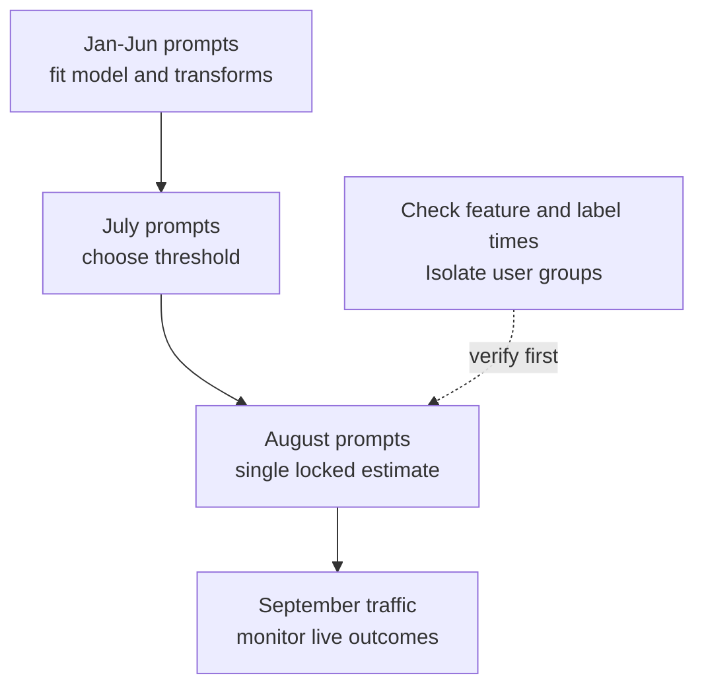

---
{
  "id": "cross-validation-leakage-generalization",
  "title": "Validation and Leakage",
  "slug": "cross-validation-leakage-generalization",
  "section": "Classical ML & Evaluation",
  "category": "Evaluation & Benchmarks",
  "difficulty": "Easy",
  "order": 5,
  "coverImage": "illustrations/_generated/chapter_flow_dark.png",
  "companies": [
    "OpenAI",
    "Anthropic",
    "Google",
    "Meta"
  ],
  "shortDescription": "An evaluation score can look nearly perfect because a post-inference field, a repeat user, or a contaminated benchmark already leaked the answer.",
  "keyConceptsTested": [
    "decision-time feature availability",
    "label availability at the model-fit cutoff",
    "train/validation/test split",
    "cross-validation",
    "group leakage",
    "temporal split",
    "preprocessing leakage",
    "locked test set",
    "LLM benchmark contamination",
    "generalization"
  ],
  "aliases": [
    "statistical-learning-theory-generalization"
  ]
}
---

At `09:00:00 UTC` on July 1, prompt `#10234` hits a safety classifier. An hour later (`10:22`), downstream orchestration triggers a fallback retry, and two weeks later (July 15) a human reviewer updates the final label. Inside your warehouse table, all of those columns sit neatly on the same row. Feed that table straight into training and your offline F1 jumps toward `1.00`, yet when the model deploys it collapses because none of those downstream columns exist at `09:00:00 UTC`.

Even when every feature is valid at prediction time, training loss still flatters the model. Given a sample $S$ of $n$ examples and loss function $L$, training minimizes **empirical risk**:

$$
\hat{R}_S(h) = \frac{1}{n}\sum_{i=1}^n L(h(x_i), y_i).
$$

What we actually care about is **population risk**, the expected loss on unseen inputs drawn from $\mathcal{D}$:

$$
R(h) = \mathbb{E}_{(x, y) \sim \mathcal{D}}[L(h(x), y)].
$$

Their difference, $G(h) = R(h) - \hat{R}_S(h)$, is the **generalization gap**.[^hastie2009] <span data-glossary="offline-evaluation">Offline evaluation</span> estimates $R(h)$ only when your split mirrors deployment reality. <span data-glossary="data-leakage">Data leakage</span> breaks that mirror whenever future information, repeated users, or validation statistics slip into training or model selection.

<figure>
  
  <figcaption>For prompt #10234, only fields readable by 09:00:00 UTC enter the inference feature vector. Post-routing fallbacks, reviewer edits, and later label overrides arrive after prediction and stay excluded from model inputs.</figcaption>
</figure>

## Start at the decision moment

Consider a lightweight safety <span data-glossary="guardrail">guardrail</span> deciding at `09:00:00 UTC` whether an incoming prompt needs human review (`needs_escalation`). Every candidate feature must already be readable by the serving runtime at that exact <span data-glossary="prediction-timestamp">decision timestamp</span>:

| Field | When it exists | Valid at `09:00`? | Reason |
| :--- | :--- | :--- | :--- |
| `prompt_tokens` | Before inference | Yes | Counted from submitted user prompt |
| `prior_flags_90d` | Before inference | Yes | Historical count cached before request opens |
| `ambiguity_score` | Before inference | Yes | Scored from raw prompt text at entry |
| `fallback_triggered_at` | After routing | No | Created by the model's own routing path |
| `audit_override_at` | Days later | No | Captures post-inference label review history |
| `needs_escalation` | After review | Label only | Ground-truth target predicted by the classifier |

Compare each column's observation timestamp against the `09:00:00` cutoff in NumPy before touching a model:

<!-- leetllm: test, deps=numpy, output=show -->
```python title="check-feature-availability.py"
import numpy as np

decision_sec = np.datetime64("2026-07-01T09:00:00")
fields = np.array(["prompt_tokens", "prior_flags_90d", "ambiguity_score", "fallback_triggered_at", "audit_override_at"])
observed_sec = np.array([
    "2026-07-01T08:55:00",
    "2026-07-01T08:59:00",
    "2026-07-01T08:59:12",
    "2026-07-01T10:22:15",
    "2026-07-15T12:00:00",
], dtype="datetime64[s]")

allowed = observed_sec <= decision_sec
for name, is_valid in zip(fields, allowed):
    print(f"{name:22} {'ALLOW' if is_valid else 'BLOCK'}")
```

<!-- leetllm: output:start -->
```text title="Output" output compact
prompt_tokens          ALLOW
prior_flags_90d        ALLOW
ambiguity_score        ALLOW
fallback_triggered_at  BLOCK
audit_override_at      BLOCK
```
<!-- leetllm: output:end -->

> **Key insight:** Observation time is when the serving runtime can *read* a value, not when an upstream event happened. A flag logged at `08:50` that syncs to Redis at midnight is invisible at `09:00`. Labels follow the same rule: a June prompt reviewed in August cannot enter a July 1 training fit.

```checkpoint
Why is `fallback_triggered_at` invalid even though it appears on every completed trace in the production log?
---
The classifier scores the request before fallback orchestration runs. Feeding downstream routing timestamps into the model gives it a consequence of its own decision, turning offline evaluation into an impossible hindsight simulator.
```

## Train, validation, and test have different jobs

Valid features are only half the story. Fitting weights, choosing thresholds, and estimating final generalization each require a distinct role:[^hastie2009]

| Partition | Allowed operation | Disallowed mistake |
| :--- | :--- | :--- |
| **Train** | Fit weights, tree splits, scalers, encoders, selectors | Treating training loss as deployment generalization |
| **Validation** | Tune hyperparameters, features, architectures, thresholds | Reporting the tuned maximum as an untouched final score |
| **Test** | Score one frozen candidate on prespecified metrics | Iterating on test errors and claiming the new score is independent |

For time-ordered traffic, assign chronological windows cleanly: fit on January through June, choose the operating threshold on July, and evaluate once on locked August data.

<!-- leetllm: test, deps=numpy, output=show -->
```python title="make-a-locked-time-split.py"
import numpy as np

# Two prompt episodes per calendar month across months 1..8 (Jan..Aug)
months = np.repeat(np.arange(1, 9), 2)
train_idx = np.flatnonzero(months <= 6)
val_idx = np.flatnonzero(months == 7)
test_idx = np.flatnonzero(months == 8)

print(f"train prompts = {len(train_idx)} (months {months[train_idx].min()}..{months[train_idx].max()})")
print(f"valid prompts = {len(val_idx)} (month {months[val_idx][0]})")
print(f"test  prompts = {len(test_idx)} (month {months[test_idx][0]}, locked)")
```

<!-- leetllm: output:start -->
```text title="Output" output compact
train prompts = 12 (months 1..6)
valid prompts = 2 (month 7)
test  prompts = 2 (month 8, locked)
```
<!-- leetllm: output:end -->



Once you inspect August mistakes and tweak a regex or threshold, August has become a validation set. Any revised candidate needs fresh September data for an unbiased estimate.[^hastie2009]

## Cross-validation rotates the validation job

A single validation slice can be unusually easy or noisy. <span data-glossary="cross-validation">Cross-validation (CV)</span> rotates the validation role across $K$ disjoint folds $V_1, \dots, V_K$ of development data, refitting the full pipeline $h_{-k}$ from scratch on every $K-1$ training split:[^sklearn2026CrossValidation]

$$
\hat{R}_{\text{CV}}(h) = \frac{1}{K} \sum_{k=1}^K \hat{R}_{V_k}(h_{-k}).
$$

Choosing $K=5$ or $10$ trains on 80%–90% of development data per fold; Leave-One-Out ($K=n$) trains on $n-1$ rows with heavy overlap across fits.[^hastie2009] **Stratified K-Fold** preserves class proportions across folds, though it cannot split fewer positives than folds and does not enforce group or time boundaries:[^sklearn2026CrossValidation]

<!-- leetllm: test, deps=numpy,scikit-learn, output=show -->
```python title="three-positives-cannot-fill-five-folds.py"
import warnings
import numpy as np
from sklearn.model_selection import StratifiedKFold

X = np.zeros((10, 1))
y = np.array([0] * 7 + [1] * 3)
with warnings.catch_warnings(record=True) as caught:
    warnings.simplefilter("always", UserWarning)
    folds = list(StratifiedKFold(n_splits=5).split(X, y))

counts = [int(y[val].sum()) for _, val in folds]
assert sum(counts) == 3 and counts.count(0) == 2
assert any("least populated class" in str(item.message) for item in caught)
print("positive counts per fold:", counts)
print("folds with no positive:", counts.count(0))
print("rare-class warning captured cleanly")
```

<!-- leetllm: output:start -->
```text title="Output" output compact
positive counts per fold: [0, 0, 1, 1, 1]
folds with no positive: 2
rare-class warning captured cleanly
```
<!-- leetllm: output:end -->

Suppose five folds produce F1 scores `[0.67, 0.75, 0.58, 0.83, 0.71]`. Report the mean and fold spread together (and specify whether you averaged per-fold F1 or pooled out-of-fold counts, because nonlinear ratios can differ between the two):

<!-- leetllm: test, deps=numpy, output=show -->
```python title="summarize-cross-validation-folds.py"
import numpy as np

fold_f1 = np.array([0.67, 0.75, 0.58, 0.83, 0.71])
mean_f1 = float(fold_f1.mean())
std_f1 = float(fold_f1.std(ddof=1))

print("fold F1 =", fold_f1.tolist())
print(f"mean F1 = {mean_f1:.2f}")
print(f"std  F1 = {std_f1:.2f}")
```

<!-- leetllm: output:start -->
```text title="Output" output compact
fold F1 = [0.67, 0.75, 0.58, 0.83, 0.71]
mean F1 = 0.71
std  F1 = 0.09
```
<!-- leetllm: output:end -->

## Target leakage: when a feature steals the answer key

**Target leakage** happens when an input feature is derived from the target or recorded after the decision. Below, an honest pre-decision rule scores `0.75` on eight prompts, whereas peeking at a post-review column jumps straight to `1.00`:

<!-- leetllm: test, deps=numpy,scikit-learn, output=show -->
```python title="future-field-leakage.py"
import numpy as np
from sklearn.metrics import accuracy_score

ambiguity = np.array([1.4, -0.2, 0.8, 0.1, 1.1, -0.5, 0.3, 0.6])
rule_match = np.array([0, 1, 0, 1, 0, 1, 0, 1])
y = np.array([1, 0, 1, 0, 1, 0, 0, 1])

# Decision-time score uses only prompt ambiguity and rule match known at inference
honest_pred = (ambiguity - 0.9 * rule_match > 0).astype(int)
# Post-decision field mirrors the outcome label after review completes
leaked_pred = y.copy()

print(f"decision-time accuracy={accuracy_score(y, honest_pred):.2f} preds={honest_pred.tolist()}")
print(f"future-field  accuracy={accuracy_score(y, leaked_pred):.2f}")
```

<!-- leetllm: output:start -->
```text title="Output" output compact
decision-time accuracy=0.75 preds=[1, 0, 1, 0, 1, 0, 1, 0]
future-field  accuracy=1.00
```
<!-- leetllm: output:end -->

Whenever an offline metric looks suspiciously close to `1.00`, check feature timestamps, duplicate rows, and label construction before trusting the model.

## Clustered entities change the generalization claim

Production requests cluster naturally by user, session, or document. If you want to know how well a model handles **brand-new users**, putting one prompt from user `u03` in train and another in validation lets a nearest-neighbor or high-capacity model memorize user fingerprints instead of learning generalizable signals.

Watch a 1-nearest-neighbor classifier score `1.00` when each user's two prompts are split across train and validation, then collapse to `0.00` once `GroupKFold` holds entire users out:[^sklearn2026CrossValidation]

<!-- leetllm: test, deps=numpy,scikit-learn, output=show -->
```python title="group-leakage-from-repeat-users.py"
import numpy as np
from sklearn.metrics import accuracy_score
from sklearn.model_selection import GroupKFold
from sklearn.neighbors import KNeighborsClassifier

# Eight users each submit two prompts; label tracks each user's baseline risk profile
users = np.repeat(np.arange(8), 2)
X_user_fingerprint = np.column_stack([users, np.tile([0.0, 0.01], 8)])
y = users % 2

# Alternating row split puts one prompt from every user in train and the other in validation
even_idx, odd_idx = np.arange(0, len(users), 2), np.arange(1, len(users), 2)
row_accs = []
for tr, va in [(even_idx, odd_idx), (odd_idx, even_idx)]:
    clf = KNeighborsClassifier(n_neighbors=1).fit(X_user_fingerprint[tr], y[tr])
    row_accs.append(accuracy_score(y[va], clf.predict(X_user_fingerprint[va])))

# GroupKFold isolates entire users on each side of every fold
group_accs = []
for tr, va in GroupKFold(n_splits=2).split(X_user_fingerprint, y, groups=users):
    clf = KNeighborsClassifier(n_neighbors=1).fit(X_user_fingerprint[tr], y[tr])
    group_accs.append(accuracy_score(y[va], clf.predict(X_user_fingerprint[va])))

print(f"paired-row split accuracy    = {np.mean(row_accs):.2f}")
print(f"held-out-user group accuracy = {np.mean(group_accs):.2f}")
```

<!-- leetllm: output:start -->
```text title="Output" output compact
paired-row split accuracy    = 1.00
held-out-user group accuracy = 0.00
```
<!-- leetllm: output:end -->

> **Common mistake:** Dropping the `user_id` column does not remove user leakage; writing style, locale, timestamps, and workspace metadata still identify returning accounts. Group the split by `user_id` explicitly, and combine with a time cutoff when predicting future unseen users.

```checkpoint
Why should every prompt from the same user stay in the same fold when testing generalization to new users?
---
Prompts from one account share writing style, domain topics, and metadata fingerprints. Allowing the same user on both sides of a fold rewards user memorization instead of testing generalization to unfamiliar accounts.
```

## Preprocessing can learn from validation rows

Any stateful transform that learns parameters from data (`StandardScaler`, imputer, PCA, feature selector, target encoder) leaks held-out information if `.fit()` sees validation rows.[^sklearn2026leakage]

<figure>
  
  <figcaption>Using validation labels during feature selection picks feature L (class separation 0.75 vs 0.50), yielding 4/4 on validation despite fitting classifiers on training rows alone. Honest training-only selection picks T and scores 2/4.</figcaption>
</figure>

On eight rows with two binary features `T` and `L`, selecting the feature with the largest class-mean gap across all rows picks `L` and hits `1.00` validation accuracy; honest training-only selection picks `T` and reveals the true `0.50` score:

<!-- leetllm: test, deps=numpy,scikit-learn, output=show -->
```python title="preprocessing-leakage-two-columns.py"
import numpy as np
from sklearn.metrics import accuracy_score
from sklearn.neighbors import NearestCentroid

T = np.array([1, 1, 0, 0, 1, 1, 0, 0], dtype=float)
L = np.array([1, 0, 0, 0, 1, 0, 1, 0], dtype=float)
y = np.array([1, 1, 0, 0, 1, 0, 1, 0])
train_idx = slice(0, 4)
val_idx = slice(4, 8)

def class_gap(col, slc):
    return float(abs(col[slc][y[slc] == 1].mean() - col[slc][y[slc] == 0].mean()))

cols = {"T": T, "L": L}
leaky_col = max(cols, key=lambda k: class_gap(cols[k], slice(0, 8)))
safe_col = max(cols, key=lambda k: class_gap(cols[k], train_idx))

clf_leaky = NearestCentroid().fit(cols[leaky_col][train_idx, None], y[train_idx])
clf_safe = NearestCentroid().fit(cols[safe_col][train_idx, None], y[train_idx])

print(f"train gap T={class_gap(T, train_idx):.2f} L={class_gap(L, train_idx):.2f}")
print(f"all   gap T={class_gap(T, slice(0, 8)):.2f} L={class_gap(L, slice(0, 8)):.2f}")
print(f"select {leaky_col} on all rows -> val acc = {accuracy_score(y[val_idx], clf_leaky.predict(cols[leaky_col][val_idx, None])):.2f}")
print(f"select {safe_col} on train    -> val acc = {accuracy_score(y[val_idx], clf_safe.predict(cols[safe_col][val_idx, None])):.2f}")
```

<!-- leetllm: output:start -->
```text title="Output" output compact
train gap T=1.00 L=0.50
all   gap T=0.50 L=0.75
select L on all rows -> val acc = 1.00
select T on train    -> val acc = 0.50
```
<!-- leetllm: output:end -->

Scikit-learn's pitfalls guide demonstrates the same effect on 200 pure-noise rows with 10,000 random features: global top-25 selection inflates holdout accuracy from `0.50` to `0.76`.[^sklearn2026leakage] Putting every stateful transform inside a scikit-learn `Pipeline` ensures `cross_validate` clones and fits scalers and selectors inside each training fold alone. (For target encoders, use `TargetEncoder.fit_transform` so training rows are internally cross-fitted rather than encoding their own targets.)[^sklearnTargetEncoder2026]

<!-- leetllm: test, deps=numpy,scikit-learn, output=show -->
```python title="leakage-safe-pipeline.py"
import numpy as np
from sklearn.feature_selection import SelectKBest, f_classif
from sklearn.linear_model import LogisticRegression
from sklearn.model_selection import StratifiedKFold, cross_validate
from sklearn.pipeline import Pipeline
from sklearn.preprocessing import StandardScaler

X = np.column_stack((np.arange(20, dtype=float), np.tile([0, 1], 10)))
y = np.array([0] * 10 + [1] * 10)
folds = list(StratifiedKFold(n_splits=5).split(X, y))

pipeline = Pipeline([
    ("scaler", StandardScaler()),
    ("selector", SelectKBest(score_func=f_classif, k=1)),
    ("classifier", LogisticRegression()),
])
result = cross_validate(pipeline, X, y, cv=folds, return_estimator=True)
fold_means = [float(est.named_steps["scaler"].mean_[0]) for est in result["estimator"]]

for (tr, _), m in zip(folds, fold_means):
    assert np.isclose(m, X[tr, 0].mean())

print("global feature-0 mean:  ", float(X[:, 0].mean()))
print("per-fold training means:", fold_means)
```

<!-- leetllm: output:start -->
```text title="Output" output compact
global feature-0 mean:   9.5
per-fold training means: [10.5, 10.0, 9.5, 9.0, 8.5]
```
<!-- leetllm: output:end -->

```checkpoint
Where should a scaler, imputer, or supervised selector fit its parameters during cross-validation?
---
Fit every stateful transform strictly inside each training fold using a Pipeline, then apply .transform() alone to the held-out fold. Target encoders also require internal cross-fitting on training rows so a sample never encodes its own label.
```

## Temporal validation: future requests, ready labels, and usable history

Prompt distributions drift across launches and seasons. <span data-glossary="rolling-origin-evaluation">Rolling-origin evaluation</span> (walk-forward CV) advances the training cutoff strictly forward so every validation window lies after its training window.[^hyndman2021fpp3]

<figure>
  
  <figcaption>Walk-forward folds expand history strictly forward through June while reserving July for threshold selection and keeping August locked. Prompt r2 opens on June 20 yet cannot enter the July 1 training fit because its label arrives on August 2.</figcaption>
</figure>

Three timing bugs still break naive chronological splits:

1. **Delayed labels:** Prompt `r2` arrived June 20, yet its label finished August 2. Filter training rows by *both* request time and label-ready time.
2. **Late-arriving feature backfills:** Filter rolling aggregates by *system ingestion time*, not just event time.
3. **Overlapping target horizons:** Multi-day targets straddle fold boundaries; use **purging** and **embargoes** when labels span future windows.[^skfolioPurgedCV2026] Remember that `TimeSeriesSplit(gap=...)` counts rows, not calendar days.[^sklearnTimeSeriesSplit2026]

<!-- leetllm: test, deps=numpy,scikit-learn, output=show -->
```python title="walk-forward-and-backfill-check.py"
import numpy as np
from sklearn.model_selection import TimeSeriesSplit

months = np.repeat(np.arange(1, 7), 2)
tscv = TimeSeriesSplit(n_splits=2, test_size=4)
for fold, (tr, va) in enumerate(tscv.split(months), start=1):
    assert months[tr].max() < months[va].min()
    print(f"fold {fold}: train <= m{months[tr].max()}, validate = m{months[va].min()}..m{months[va].max()}")

decision = np.datetime64("2026-07-01T00:05:00")
window_start = decision - np.timedelta64(7, "D")
event_t = np.array(["2026-06-29T10:00:00", "2026-06-30T10:00:00", "2026-06-30T18:00:00"], dtype="datetime64[s]")
ingest_t = np.array(["2026-06-29T10:00:01", "2026-06-30T10:00:01", "2026-07-01T12:00:00"], dtype="datetime64[s]")

naive_count = int(((window_start <= event_t) & (event_t < decision)).sum())
available_count = int(((window_start <= event_t) & (event_t < decision) & (ingest_t <= decision)).sum())
print(f"event-time-only count: {naive_count}, decision-available count: {available_count}")
```

<!-- leetllm: output:start -->
```text title="Output" output compact
fold 1: train <= m2, validate = m3..m4
fold 2: train <= m4, validate = m5..m6
event-time-only count: 3, decision-available count: 2
```
<!-- leetllm: output:end -->

### Combining time and user splits

Future months mix returning accounts with brand-new users. Slice them separately, and notice the subtlety on user `u2` below: even though `r2`'s delayed August 2 label excludes it from the July 1 training fit, `u2` still counts as a **seen user** in July because prior prompts already arrived before July 1.

<!-- leetllm: test, deps=numpy, output=show -->
```python title="check-time-groups-and-label-availability.py"
import numpy as np

req_id = np.array(["r1", "r2", "r3", "r4", "r5"])
user_id = np.array(["u1", "u2", "u3", "u1", "u4"])
open_dt = np.array(["2026-01-03", "2026-06-20", "2026-06-10", "2026-07-03", "2026-07-05"], dtype="datetime64[D]")
label_dt = np.array(["2026-01-10", "2026-08-02", "2026-06-20", "2026-07-10", "2026-07-20"], dtype="datetime64[D]")

fit_at, end_at = np.datetime64("2026-07-01"), np.datetime64("2026-08-01")
history = open_dt < fit_at
train_ready = history & (label_dt <= fit_at)
seen_users = set(user_id[history])

july = (open_dt >= fit_at) & (open_dt < end_at)
returning_mask = july & np.isin(user_id, list(seen_users))
new_mask = july & ~returning_mask

print("training requests:", req_id[train_ready].tolist())
print("returning July:   ", req_id[returning_mask].tolist())
print("new-user July:    ", req_id[new_mask].tolist())
```

<!-- leetllm: output:start -->
```text title="Output" output compact
training requests: ['r1', 'r3']
returning July:    ['r4']
new-user July:     ['r5']
```
<!-- leetllm: output:end -->

<details>
<summary>Deep dive: Nested cross-validation against validation overuse</summary>

Searching dozens or thousands of hyperparameter sets on one validation split introduces selection optimism.[^hastie2009] <span data-glossary="nested-cross-validation">Nested cross-validation</span> isolates that search inside an inner loop:

1. **Outer loop:** Holds out outer test blocks that never touch feature selection, hyperparameters, or threshold tuning.
2. **Inner loop:** Runs the full tuning search inside each outer training partition.
3. **Outer score:** Refits the inner winner on the outer training fold and scores the untouched outer block once.

The outer average estimates the quality of your *tuning-and-fitting procedure*. Once validated, run the inner selection procedure once on all development data to produce the candidate scored on your locked test split.

</details>

## Threshold selection: validation chooses, test reports

Turning a continuous score $p \in [0, 1]$ into a binary decision $\hat{y} = \mathbb{I}(p \ge \theta)$ separates **decision thresholding** from **probability calibration**.[^sklearnThresholdTuning2026] Pick $\theta$ on July validation (`0.50`, F1 `1.00`), then evaluate once on locked August (`0.67`):

<!-- leetllm: test, deps=numpy,scikit-learn, output=show -->
```python title="choose-threshold-before-opening-test.py"
import numpy as np
from sklearn.metrics import f1_score

thresholds = [0.30, 0.50, 0.70]
val_prob = np.array([0.82, 0.62, 0.58, 0.42, 0.31, 0.12])
val_y = np.array([1, 1, 1, 0, 0, 0])
test_prob = np.array([0.77, 0.49, 0.39, 0.52, 0.66, 0.14])
test_y = np.array([1, 1, 0, 0, 1, 0])

val_scores = {t: float(f1_score(val_y, (val_prob >= t).astype(int))) for t in thresholds}
chosen = max(val_scores, key=val_scores.get)
test_f1 = float(f1_score(test_y, (test_prob >= chosen).astype(int)))

for t, s in val_scores.items():
    print(f"threshold={t:.2f} valid_f1={s:.2f}")
print(f"chosen threshold={chosen:.2f} test_f1={test_f1:.2f}")
```

<!-- leetllm: output:start -->
```text title="Output" output compact
threshold=0.30 valid_f1=0.75
threshold=0.50 valid_f1=1.00
threshold=0.70 valid_f1=0.50
chosen threshold=0.50 test_f1=0.67
```
<!-- leetllm: output:end -->

Watch out for **selective label coverage**: if human reviewers only inspect prompts flagged with $p \ge 0.50$, missed positives below threshold never receive labels. That leaves precision observable while true recall stays unknown unless you also sample a slice of unflagged traffic.[^selectiveLabels2017]

## Modern relevance: benchmark contamination in large language models

Every tabular split rule carries straight into RAG pipelines, post-training datasets, and foundation model benchmarks:

| System | Contamination channel | Isolation rule |
| :--- | :--- | :--- |
| **<span data-glossary="rag">RAG</span> systems (new docs)** | Test chunks or synthetic queries inform prompt/retriever tuning | Partition parent documents *before* <span data-glossary="chunking">chunking</span> or question generation |
| **SFT and RL post-training** | Evaluation items or reasoning <span data-glossary="tracing">traces</span> leak into training sets | Deduplicate hashes, record origin, and isolate test splits |
| **Public LLM benchmarks** | Web scrapes absorb GSM8K, MMLU, or HumanEval | Combine overlap screening with fresh dated tasks |

When evaluating a RAG assistant on unseen manuals, splitting chunks instead of parent documents leaks shared headings and definitions across partitions:

<!-- leetllm: test, deps=numpy, output=show -->
```python title="split-documents-before-chunking.py"
import numpy as np

doc_chunks = np.array([
    ("guide_rag", "chunk_1"), ("guide_rag", "chunk_2"),
    ("guide_agents", "chunk_1"), ("guide_agents", "chunk_2"),
    ("guide_eval", "chunk_1"), ("guide_eval", "chunk_2"),
])

# Mistake: split alternating chunks across train and test
chunk_train_docs = set(doc_chunks[::2, 0].tolist())
chunk_test_docs = set(doc_chunks[1::2, 0].tolist())

# Fix: split complete parent documents first, then chunk inside each partition
safe_train_mask = np.isin(doc_chunks[:, 0], ["guide_rag", "guide_agents"])
safe_train_docs = set(doc_chunks[safe_train_mask, 0].tolist())
safe_test_docs = set(doc_chunks[~safe_train_mask, 0].tolist())

print("split chunks first shared docs =", sorted(chunk_train_docs & chunk_test_docs))
print("split docs first   shared docs =", sorted(safe_train_docs & safe_test_docs))
```

<!-- leetllm: output:start -->
```text title="Output" output compact
split chunks first shared docs = ['guide_agents', 'guide_eval', 'guide_rag']
split docs first   shared docs = []
```
<!-- leetllm: output:end -->

At <span data-glossary="pretraining">pretraining</span> scale, teams combine three contamination diagnostics:

1. **Exact $n$-gram screening:** GPT-3 screened 13-word overlaps (adjusting to 8–13 words for shorter tasks),[^brown2020] and Llama 3 checked 8-gram token overlap, flagging 85% of HellaSwag and seeing a 14.8-point clean-vs-full gap on Llama 3 8B.[^dubey2024]
2. **MinHash and dense embeddings:** MinHash catches near-duplicate edits at scale,[^broder1997] while embedding search spots paraphrases that drop shared $n$-grams.
3. **Loss screening and fresh benchmarks:** Unusually low perplexity flags suspect items for inspection, though boilerplate also scores low.[^codeContaminationCountermeasures2024] Dynamic benchmarks like LiveBench[^white2024][^livebenchRepository2026] and contest-dated sets like LiveCodeBench[^jain2024][^livecodebenchRepository2026] keep fresh tasks past training cutoffs.

<!-- leetllm: test, deps=numpy, output=show -->
```python title="ngram-contamination-smoke-test.py"
import numpy as np

training_prompts = [
    "route risky prompt with missing citations to human review",
    "approve low ambiguity coding answer after sandbox tests pass",
]
evaluation_prompts = [
    "route risky prompt with missing citations to human review",
    "flag an ambiguous agent response for verifier scoring",
]

def ngrams(text, n=5):
    words = np.array(text.lower().split())
    return {" ".join(words[i : i + n]) for i in range(len(words) - n + 1)}

train_grams = set().union(*(ngrams(p) for p in training_prompts))
for prompt in evaluation_prompts:
    overlap = len(ngrams(prompt) & train_grams)
    print(f"{'FLAG' if overlap else 'CLEAN'} (shared 5-grams={overlap}): {prompt}")
```

<!-- leetllm: output:start -->
```text title="Output" output compact
FLAG (shared 5-grams=5): route risky prompt with missing citations to human review
CLEAN (shared 5-grams=0): flag an ambiguous agent response for verifier scoring
```
<!-- leetllm: output:end -->

## Historical logs don't reveal unchosen actions

Every split above evaluates predictions under the historical router's observed choices. When you test a *new* routing policy that sends traffic to a different model or branch, server logs only contain outcomes for the action that actually ran. <span data-glossary="off-policy">Off-policy evaluation</span> (OPE) reweights logged outcomes using behavior probabilities, yet neither chronological splits nor importance weights can recover outcomes for an action that had zero logging probability.[^sutton2018] Measuring uplift for an unexplored branch still requires randomized traffic.

## Write the production evaluation checklist

Write down the decision timestamp, entity boundary, pipeline isolation, and labeling rules in plain text beside your experiment config before running August evaluation:

```text title="safety-router-evaluation-plan.txt"
Decision moment: prompt arrival at 09:00 UTC, before fallback routing or moderation actions
Allowed features: prompt_tokens, prior_flags_90d, ambiguity_score
Forbidden features: fallback_triggered_at, human_edit_sec, audit_override_at
Train fit: January-June prompts with labels ready before the fit cutoff date
Validation: July prompts using train-fitted scalers to choose operating threshold
Locked test: August prompts scored once with frozen weights, preprocessing, and threshold
Label coverage: sample unflagged traces so recall accounts for selective review
Entity reporting: slice returning accounts and brand-new users separately
Preprocessing: place scalers, imputers, selectors, and cross-fitted target encoders inside Pipeline
Metrics: review F1, missed critical positives, and human review volume
```

## Stress-test the evaluation plan

Test your intuition on five quick perturbations:

1. `human_edit_sec` finishes at `11:05` on the same day. Why is it still target leakage for a `09:00` prediction?
2. You switch your target claim from *new* users to *returning* users. Which chronological rule still applies?
3. Add a balanced neutral feature `N = [0, 1, 1, 0, 0, 1, 1, 0]` to the preprocessing example. Does it change either the leaky or honest choice?
4. A test RAG chunk is paraphrased from a tuning manual. Why does 5-gram filtering miss it?
5. Your logs come from a deterministic legacy router that never chose branch `B`. What can a time split tell you about branch `B`?

<details>
<summary>Check what each stress test reveals</summary>

1. **Same-day edits still follow the prediction:** `11:05` happens after `09:00`, so human edit time is a consequence of routing, not an input available at inference.
2. **Returning users still obey time:** Allowing known users across train and test matches the claim, yet training must still precede evaluation chronologically and respect label readiness.
3. **Neutral columns have zero separation:** Both class means of `N` are `0.50`, so `L` still wins leaky all-row selection and `T` still wins honest training selection.
4. **Paraphrases break lexical hashing:** Reworded sentences drop shared 5-grams and lower MinHash overlap, so combine dense embedding search with dataset lineage checks.
5. **Unchosen actions remain unobserved:** Zero logging propensity for branch `B` leaves its outcomes unidentifiable offline; measure it with randomized exploration or a small live experiment.

</details>

---

## Check your understanding

```mastery-quiz
[
  {
    "question": "A prompt is scored at 10:00. An account flag occurred at 09:50 yet synced to the serving cache at 10:05. An ambiguity score was readable at 09:58. Which opening snapshot is valid?",
    "options": [
      "Include ambiguity; exclude the flag until its serving observation time.",
      "Include both fields because their event timestamps precede 10:00.",
      "Exclude both fields because same-day updates sit outside historical splits.",
      "Include the delayed flag; exclude ambiguity computed close to inference."
    ],
    "answer": "Include ambiguity; exclude the flag until its serving observation time.",
    "explanation": "Inference features must be readable by the serving runtime at the prediction timestamp. Event time alone would wrongly include a value missing from cache until 10:05."
  },
  {
    "question": "A team reserves October for threshold selection and November for the locked report. Which development schedule rehearses periodic retraining without spending those windows?",
    "options": [
      "Fit January-March, score April; fit January-April, score May.",
      "Fit January-April, score March; fit January-May, score April.",
      "Fit January-September, tune on October, then retune on November.",
      "Fit January-October, score November, then pick the best November winner."
    ],
    "answer": "Fit January-March, score April; fit January-April, score May.",
    "explanation": "Each development validation fold falls chronologically after its training window and stays strictly inside January-September, leaving October and November untouched."
  },
  {
    "question": "Two folds have confusion counts (TP, FP, FN) of (3, 1, 2) and (1, 0, 0). What are mean fold F1 and pooled F1 across concatenated predictions?",
    "options": [
      "Mean 5/6; pooled 8/11.",
      "Mean 8/11; pooled 5/6.",
      "Mean 2/3; pooled 8/9.",
      "Mean 5/6; pooled 5/6."
    ],
    "answer": "Mean 5/6; pooled 8/11.",
    "explanation": "Per-fold F1 equals 6/9 = 2/3 and 2/2 = 1, giving mean 5/6. Pooling totals TP=4, FP=1, FN=2 yields 8 / (8 + 1 + 2) = 8/11."
  },
  {
    "question": "A September fit skips an August prompt because its human review label arrives in October. That same user sends a labeled September prompt. For a future brand-new-user evaluation slice, how is that September prompt categorized?",
    "options": [
      "Returning user; prior prompt history exists even without a ready August label.",
      "New user; no labeled record from that account entered training weights.",
      "New user; advancing chronologically clears prior entity exposure across months.",
      "Returning user only after October; exposure begins once human review labels close."
    ],
    "answer": "Returning user; prior prompt history exists even without a ready August label.",
    "explanation": "Account novelty depends on whether prior prompts appeared before September, regardless of whether an August label was ready in time for training."
  },
  {
    "question": "A selector ranks two features using labels from both development and held-out splits before the classifier fits on development rows alone. Which fix closes this leak?",
    "options": [
      "Refit feature selection strictly inside each training fold before transforming held-out folds.",
      "Refit the classifier on the training rows while keeping the globally chosen features.",
      "Fit a fresh feature selector directly on each held-out fold prior to predicting.",
      "Drop explicit row IDs while keeping feature rankings computed over all labeled rows."
    ],
    "answer": "Refit feature selection strictly inside each training fold before transforming held-out folds.",
    "explanation": "Any supervised selector reads labels, so running it across held-out data leaks evaluation answers. Wrapping selection inside the training-fold Pipeline eliminates that leak."
  },
  {
    "question": "Validation probabilities [0.90, 0.70, 0.55, 0.30] carry labels [1, 0, 1, 0]. Candidate cutoffs are 0.40 and 0.60 with flagging when score >= threshold. Which plan is valid?",
    "options": [
      "Pick 0.40 on validation F1 = 0.80, then evaluate once on locked test.",
      "Pick 0.60 on validation F1 = 0.80, then evaluate once on locked test.",
      "Pick 0.40 on validation F1 = 0.80, then retune cutoff on test data.",
      "Pick 0.60 on validation F1 = 0.50, then publish that score as final."
    ],
    "answer": "Pick 0.40 on validation F1 = 0.80, then evaluate once on locked test.",
    "explanation": "At 0.40, TP=2, FP=1, FN=0 produces F1 = 4/5 = 0.80, whereas 0.60 yields F1 = 0.50. Choose the cutoff on validation and test it once frozen."
  },
  {
    "question": "A RAG benchmark evaluates generalization to unseen documents using a manual page, a paraphrased chunk from that page, and two derived questions. If the manual entered retriever tuning, where must all derived artifacts sit?",
    "options": [
      "Keep all paraphrased chunks and derived questions with their source document on the tuning side.",
      "Move paraphrased chunks into the held-out test set once verbatim duplicates are stripped.",
      "Place derived questions in the test set whenever the source document stays out of verbatim retrieval.",
      "Shuffle chunks randomly across tuning and test so both partitions span identical topics."
    ],
    "answer": "Keep all paraphrased chunks and derived questions with their source document on the tuning side.",
    "explanation": "Derived chunks and questions inherit information from the parent page even after paraphrasing, so document-level isolation requires holding out entire unseen source manuals."
  },
  {
    "question": "A lexical filter flags a common five-word phrase in test prompt A while test prompt B is a semantic paraphrase sharing no five-word run. What action fits best?",
    "options": [
      "Inspect both prompts using dataset lineage checks and semantic embeddings alongside lexical matching.",
      "Check prompt A's training origins while clearing prompt B automatically for zero n-gram hits.",
      "Sort both prompts strictly by token perplexity and drop prompts below a fixed loss cutoff.",
      "Delete common five-word boilerplate matches while approving the remaining split unchecked."
    ],
    "answer": "Inspect both prompts using dataset lineage checks and semantic embeddings alongside lexical matching.",
    "explanation": "Exact n-gram screens catch verbatim leaks yet yield false positives on common boilerplate and miss paraphrased text, requiring embedding similarity and lineage checks together."
  },
  {
    "question": "For a certain prompt category, a legacy router routed 100% of traffic to RAG and 0% to Base. A candidate policy routes 20% of those queries to Base. What can a time split over logged RAG rewards reveal?",
    "options": [
      "Rewards under the unchosen Base branch remain unsupported and unidentifiable from those logs.",
      "It recovers the exact Base reward directly by scaling logged RAG rewards by 0.20.",
      "It identifies Base outcomes cleanly using inverse weighting with logging propensity zero.",
      "Chronological splitting removes the missing-action gap once test traffic follows training."
    ],
    "answer": "Rewards under the unchosen Base branch remain unsupported and unidentifiable from those logs.",
    "explanation": "Because the logging policy assigned zero probability to Base on that slice, neither chronological splits nor importance weighting can identify unseen counterfactual rewards."
  },
  {
    "question": "Training starts September 1. Prompt A arrived August 20 with label ready September 3; prompt B arrived August 25 with label ready August 30. Both have valid opening features. Which rows enter the September 1 fit?",
    "options": [
      "Prompt B enters training; prompt A waits until its label becomes ready.",
      "Prompt A enters training; prompt B waits because August 30 sits near cutoff.",
      "Both enter training because both prompts opened prior to September 1.",
      "Neither enters training because supervised labels must exist at prompt arrival."
    ],
    "answer": "Prompt B enters training; prompt A waits until its label becomes ready.",
    "explanation": "Model fitting needs both pre-decision features and ground-truth outcomes available by the fit cutoff date; prompt A's September 3 label arrives too late."
  }
]
```

> **Next:** Continue to [Dataset Pipelines and Data Quality](/learn/dataset-pipelines-data-quality).
