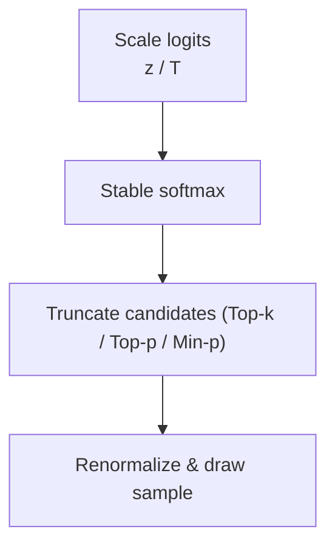

---
{
  "id": "decoding-algorithms",
  "title": "Decoding Algorithms",
  "slug": "decoding-algorithms",
  "section": "ML Algorithms & Evaluation",
  "category": "Inference Optimization",
  "difficulty": "Medium",
  "order": 11,
  "coverImage": "illustrations/_generated/chapter_flow_dark.png",
  "companies": [
    "OpenAI",
    "Anthropic",
    "Google",
    "Meta"
  ],
  "shortDescription": "The same scores for a prompt completion can emit attention, supervision, or regression. Decoding selects next tokens using deterministic search, stochastic sampling, or structured constraints.",
  "keyConceptsTested": [
    "search space formulation",
    "numerically stable softmax",
    "greedy decoding and myopic traps",
    "beam search and length normalization",
    "repetition penalty",
    "temperature and entropy",
    "top-k and top-p sampling",
    "min-p sampling",
    "constrained decoding",
    "test-time search and reasoning verifiers",
    "speculative decoding"
  ]
}
---

Feed a language model the prompt `"Modern language models rely primarily on self-"` right after a passage describing multi-head self-attention. The model outputs one vector of next-token scores across its vocabulary: `attention` leads, `supervision` sits close behind, and `consistency` and `regression` trail in the tail. With those **exact same scores**, one run writes `self-attention`, another writes `self-supervision`, and a third wanders off into `self-regression`.

**Decoding** is the algorithm that turns raw next-token scores into emitted text. Picking up from [Core Retrieval Algorithms](/learn/core-retrieval-algorithms), we will trace every major decoding mechanism on concrete score vectors: stable softmax, greedy and beam search, length normalization and repetition penalties, temperature and Top-k/Top-p/Min-p sampling, grammar constraints, test-time verifiers, and exact speculative decoding.

## The autoregressive search space: $|V|^T$ exponential token trees

An autoregressive model generates one token at a time, factoring sequence probability into a product of conditional next-token distributions over vocabulary $V$:

$$
P(y_{1:T} \mid x) = \prod_{t=1}^T P(y_t \mid x, y_{<t}), \qquad \log P(y_{1:T} \mid x) = \sum_{t=1}^T \log P(y_t \mid x, y_{<t}).
$$

Summing <span data-glossary="logprob">log-probabilities</span> (computed directly via stable log-softmax) avoids underflowing to zero when multiplying dozens of small probabilities.

Finding the highest-probability sequence $y^* = \arg\max_{y \in \mathcal{Y}} \sum_t \log P(y_t \mid x, y_{<t})$ is intractable by brute force: with $|V| = 32{,}000$ tokens and horizon $T = 100$, there are $32{,}000^{100} \approx 3.27 \times 10^{450}$ paths, and because attention depends on the full prefix rather than a small Markov state, Viterbi-style dynamic programming cannot collapse the tree.

Greedy and beam search approximate sequence maximization. **Sampling** pursues a different goal: drawing directly from the conditional distribution (reshaped by temperature, truncation filters, or grammar masks) to preserve fluency and diversity.

<figure>
  
  <figcaption>Greedy decoding selects <code>attention</code>, while top-p at 0.90 keeps both <code>attention</code> and <code>supervision</code> with cumulative probability mass 0.913. A uniform random draw of u=0.75 lands in the <code>supervision</code> interval.</figcaption>
</figure>

## From raw logits to numerically stable probabilities

Consider our running prompt ending in `Modern language models rely primarily on self-` with four candidate **<span data-glossary="logits">logits</span>**:

| Token | Logit | Role in completion |
|---|---:|---|
| `attention` | `3.0` | Supported directly by the context passage |
| `supervision` | `2.5` | Common ML continuation, unsupported by context |
| `consistency` | `1.0` | Plausible ML noun, lower score |
| `regression` | `-1.0` | Low-probability tail candidate |

<span data-glossary="softmax">Softmax</span> maps real-valued logits to probabilities. Subtracting the maximum logit $m = \max_j z_j$ leaves every ratio unchanged while preventing exponential overflow:[^blanchard2019softmax]

$$
p_i = \frac{\exp(z_i - m)}{\sum_j \exp(z_j - m)}.
$$

<!-- leetllm: test, id=softmax, deps=numpy, output=show -->

```python title="stable-softmax.py"
import numpy as np

tokens = ["attention", "supervision", "consistency", "regression"]
logits = [3.0, 2.5, 1.0, -1.0]

def softmax(scores) -> np.ndarray:
    scores = np.asarray(scores, dtype=np.float64)
    if scores.ndim != 1 or scores.size == 0:
        raise ValueError("scores must be a nonempty vector")
    if np.isnan(scores).any() or np.isposinf(scores).any():
        raise ValueError("NaN and positive infinity are invalid logits")
    if not np.isfinite(scores).any():
        raise ValueError("all tokens are masked")
    # Negative infinity represents an intentional mask and gets zero weight.
    weights = np.exp(scores - scores.max())
    return weights / weights.sum()

probabilities = softmax(logits)
for token, score, probability in zip(tokens, logits, probabilities):
    print(f"{token:8} logit={score:>4.1f} probability={probability:.3f}")
print(f"sum={sum(probabilities):.3f}")
```

<!-- leetllm: output:start -->
```text title="Output" output compact
attention logit= 3.0 probability=0.568
supervision logit= 2.5 probability=0.345
consistency logit= 1.0 probability=0.077
regression logit=-1.0 probability=0.010
sum=1.000
```
<!-- leetllm: output:end -->

`attention` leads at `0.568`, yet raw sampling still draws `supervision` more than a third of the time (`0.345`). And subtracting $m$ is essential even for ordinary FP64 floats, because `exp(1000)` overflows while `exp(0)` is exact:

<!-- leetllm: test, continue=softmax, id=stable-math, output=show -->

```python title="avoid-softmax-overflow.py"
from math import exp

large_logits = [1000.0, 999.0, 998.0]

try:
    raw_weights = [exp(score) for score in large_logits]
    naive = [weight / sum(raw_weights) for weight in raw_weights]
    print("naive:", naive)
except OverflowError:
    print("naive softmax: overflow")

print("stable:", softmax(large_logits).round(3).tolist())
print("extreme gap:", softmax([0.0, -1000.0]).tolist())
try:
    softmax([-np.inf, -np.inf])
except ValueError as exc:
    print("rejected:", str(exc))
```

<!-- leetllm: output:start -->
```text title="Output" output compact
naive softmax: overflow
stable: [0.665, 0.245, 0.09]
extreme gap: [1.0, 0.0]
rejected: all tokens are masked
```
<!-- leetllm: output:end -->

## Deterministic search: greedy myopic traps and beam exploration

In the <span data-glossary="autoregressive-decoding">autoregressive</span> loop, a <span data-glossary="kv-cache">KV cache</span> stores past attention keys and values for speed without changing which token gets selected.[^kwon2023] **Greedy decoding** simply takes the highest-scoring token at every step, $y_t = \arg\max_{w \in V} P(w \mid x, y_{<t})$:

<!-- leetllm: test, output=show -->

```python title="greedy-generation-loop.py"
example_logits = [
    {"attention": 3.0, "supervision": 2.5, "consistency": 1.0, "regression": -1.0},
    {".": 4.0, "then": 1.5, "after": 0.5},
]

def greedy_token(scores: dict[str, float]) -> str:
    return max(scores, key=scores.get)

generated = []
for step, scores in enumerate(example_logits, start=1):
    chosen = greedy_token(scores)
    generated.append(chosen)
    print(f"step {step}: chose {chosen!r} from {len(scores)} candidates")

answer = "Modern language models rely primarily on self-" + " ".join(generated).replace(" .", ".")
print(answer)
```

<!-- leetllm: output:start -->
```text title="Output" output compact
step 1: chose 'attention' from 4 candidates
step 2: chose '.' from 3 candidates
Modern language models rely primarily on self-attention.
```
<!-- leetllm: output:end -->

Greedy decoding is fast and clean, yet it falls into **myopic traps**: committing to the locally best first token can miss a far more probable full sequence.

### Beam search tracks parallel hypotheses

<span data-glossary="beam-search">Beam search</span> keeps the top $B$ partial sequences at every step, expands each by every next token, sums cumulative log-probabilities, and prunes back to the top $B$. On a two-step continuation after `"The model uses"`, greedy grabs `attention` (`0.40`) and finishes at `0.080`, while width $B=2$ keeps `recurrent` (`0.35`) alive and uncovers `recurrent cells` at `0.245`:

| Candidate path | Step 1 prob | Step 2 continuation | Step 2 prob | Joint probability |
|---|---:|---|---:|---:|
| `attention` $\to$ `mechanism` | `0.40` | `mechanism` | `0.20` | **0.080** (Greedy) |
| `recurrent` $\to$ `cells` | `0.35` | `cells` | `0.70` | **0.245** (Beam winner) |
| `linear` $\to$ `layers` | `0.25` | `layers` | `0.30` | 0.075 (Pruned) |

<figure>
  
  <figcaption>At step one, beam width two retains <code>attention</code> and <code>recurrent</code>, while <code>linear</code> is pruned. Expanding both reveals that <code>recurrent cells</code> reaches joint probability 0.245, triple the greedy path <code>attention mechanism</code> (0.080).</figcaption>
</figure>

<!-- leetllm: test, id=beam, output=show -->

```python title="two-step-beam-search.py"
from math import exp, isclose, log

first_step = {"attention": 0.40, "recurrent": 0.35, "linear": 0.25}
second_step = {
    "attention": {"mechanism": 0.20, "layers": 0.19, "weights": 0.18, "blocks": 0.17, "patterns": 0.14, "units": 0.12},
    "recurrent": {"cells": 0.70, "layers": 0.20, "units": 0.10},
    "linear": {"layers": 0.30, "projections": 0.25, "units": 0.25, "mappings": 0.20},
}

def beam_search(distributions, width: int, steps: int):
    if width < 1:
        raise ValueError("beam width must be a positive integer")
    beam = [((), 0.0)]
    for _ in range(steps):
        candidates = []
        for prefix, score in beam:
            probs = distributions[prefix]
            assert isclose(sum(probs.values()), 1.0)
            assert all(0 <= p <= 1 for p in probs.values())
            for token, p in probs.items():
                if p > 0:
                    candidates.append((prefix + (token,), score + log(p)))
        beam = sorted(candidates, key=lambda row: row[1], reverse=True)[:width]
    return beam

tree = {(): first_step, **{(token,): probs for token, probs in second_step.items()}}
greedy_first = max(first_step, key=first_step.get)
greedy_second = max(second_step[greedy_first], key=second_step[greedy_first].get)
greedy_prob = first_step[greedy_first] * second_step[greedy_first][greedy_second]

winner, winner_log_p = beam_search(tree, width=2, steps=2)[0]
print("greedy:", f"{greedy_first} {greedy_second}", f"probability={greedy_prob:.3f}")
print("beam:  ", " ".join(winner), f"probability={exp(winner_log_p):.3f}")
```

<!-- leetllm: output:start -->
```text title="Output" output compact
greedy: attention mechanism probability=0.080
beam:   recurrent cells probability=0.245
```
<!-- leetllm: output:end -->

Beam search is still heuristic: once a branch is pruned at step 1, it is gone forever even if step 2 had probability `1.0`. Serving engines can share common prefix KV-cache blocks across beams rather than multiplying memory blindly by $B$.[^kwon2023]

<!-- leetllm: test, continue=beam, output=show -->

```python title="beam-can-prune-the-best-path.py"
counterexample = {
    (): {"A": 0.5, "B": 0.3, "C": 0.2},
    ("A",): {str(i): 0.1 for i in range(10)},
    ("B",): {str(i): 0.2 for i in range(5)},
    ("C",): {"win": 1.0},
}
for width in (2, 3):
    path, score = beam_search(counterexample, width, steps=2)[0]
    print(f"width={width}: {' '.join(path)} probability={exp(score):.3f}")
```

<!-- leetllm: output:start -->
```text title="Output" output compact
width=2: B 0 probability=0.060
width=3: C win probability=0.200
```
<!-- leetllm: output:end -->

## Length normalization and repetition penalties

### Length normalization

Adding each extra token adds a non-positive log-probability, so any extension of a prefix scores no higher than the prefix itself:

$$
\sum_{t=1}^{L+1} \log P(y_t \mid x,y_{<t}) \le \sum_{t=1}^L \log P(y_t \mid x,y_{<t}) \le 0.
$$

To counter an unwanted bias toward terse completions, beam search divides cumulative log-probability by a length penalty. Watch the exact formula: GNMT uses $\text{LP}(L) = (5+L)^\alpha / (5+1)^\alpha$,[^wu2016gnmt] whereas Hugging Face's `length_penalty` divides by $L^\alpha$.[^huggingface2026generation] On the two candidates below, dividing by $L$ ($\alpha=1$) picks the longer answer (`-0.320 > -0.500`), whereas GNMT at $\alpha=1$ (`-0.857 > -0.960`) still picks the short one:

<!-- leetllm: test, output=show -->

```python title="length-aware-sequence-score.py"
candidates = [
    {"text": "attention <EOS>", "log_probability": -1.0, "tokens": 2},
    {"text": "attention mechanism with causal masking <EOS>", "log_probability": -1.6, "tokens": 5},
]

raw_winner = max(candidates, key=lambda row: row["log_probability"])
normalized_winner = max(candidates, key=lambda row: row["log_probability"] / row["tokens"])

print("raw winner:               ", raw_winner["text"])
print("length-normalized winner: ", normalized_winner["text"])
for row in candidates:
    average = row["log_probability"] / row["tokens"]
    print(f"{row['text']:31} raw={row['log_probability']:.3f} average={average:.3f}")
```

<!-- leetllm: output:start -->
```text title="Output" output compact
raw winner:                attention <EOS>
length-normalized winner:  attention mechanism with causal masking <EOS>
attention <EOS>                 raw=-1.000 average=-0.500
attention mechanism with causal masking <EOS> raw=-1.600 average=-0.320
```
<!-- leetllm: output:end -->

### Repetition penalties

Likelihood maximization can fall into degenerate loops ("generated the token and generated the token...").[^holtzman2020] Following CTRL,[^keskar2019] Hugging Face applies a **sign-aware repetition penalty** ($\theta > 1$) to every token already seen in the sequence:[^huggingface2026logits]

$$
z_w \leftarrow \begin{cases}
z_w / \theta & \text{if } z_w > 0 \\
z_w \cdot \theta & \text{if } z_w \le 0.
\end{cases}
$$

Dividing positive logits and multiplying negative logits pushes every seen token downward without banning it outright:

<!-- leetllm: test, output=show -->

```python title="repetition-penalty.py"
import math

def apply_repetition_penalty(
    logits: dict[str, float], sequence: list[str], theta: float = 1.2
) -> dict[str, float]:
    if not math.isfinite(theta) or theta < 1:
        raise ValueError("theta must be finite and at least one in this lab")
    penalized = dict(logits)
    for token in set(sequence):
        if token in penalized:
            score = penalized[token]
            penalized[token] = score / theta if score > 0 else score * theta
    return penalized

step_logits = {"attention": 3.0, "transformer": 2.8, "recurrent": 2.5}
print("unpenalized choice:", max(step_logits, key=step_logits.get))

# After 'attention' was emitted at step 1, apply repetition penalty:
penalized = apply_repetition_penalty(step_logits, ["attention"], theta=1.2)
print("penalized 'attention' logit:", f"{penalized['attention']:.2f}")
print("penalized choice:        ", max(penalized, key=penalized.get))
```

<!-- leetllm: output:start -->
```text title="Output" output compact
unpenalized choice: attention
penalized 'attention' logit: 2.50
penalized choice:         transformer
```
<!-- leetllm: output:end -->

Use repetition penalties lightly on code or structured data, where repeating variable names and punctuation is normal.[^huggingface2026logits]

## Temperature reshapes entropy

**<span data-glossary="temperature">Temperature</span>** $T > 0$ divides logits before softmax:

$$
p_i(T) = \frac{\exp(z_i / T)}{\sum_j \exp(z_j / T)}.
$$

- **$T < 1$** sharpens the distribution and lowers Shannon entropy $H(p) = -\sum_i p_i \log p_i$.
- **$T = 1$** leaves the model's raw probabilities unchanged.
- **$T > 1$** flattens the distribution toward uniform over unmasked tokens, raising entropy and tail mass.

<!-- leetllm: test, continue=stable-math, id=temperature, output=show -->

```python title="temperature-and-entropy.py"
tokens = ["attention", "supervision", "consistency", "regression"]
logits = [3.0, 2.5, 1.0, -1.0]

def entropy(probabilities) -> float:
    positive = np.asarray(probabilities)[np.asarray(probabilities) > 0]
    return float(-np.sum(positive * np.log(positive)))

for temperature in (0.5, 1.0, 2.0):
    probabilities = softmax([score / temperature for score in logits])
    table = dict(zip(tokens, probabilities))
    print(
        f"T={temperature:.1f}: attention={table['attention']:.3f} "
        f"regression={table['regression']:.3f} entropy={entropy(probabilities):.3f}"
    )
```

<!-- leetllm: output:start -->
```text title="Output" output compact
T=0.5: attention=0.721 regression=0.000 entropy=0.647
T=1.0: attention=0.568 regression=0.010 entropy=0.933
T=2.0: attention=0.438 regression=0.059 entropy=1.190
```
<!-- leetllm: output:end -->

> **Common mistake:** Near-zero temperature is not identical to greedy decoding when top logits tie! Softmax splits mass `50/50` across tied maxima as $T \to 0$, whereas `argmax` picks the first index deterministically. Use the runtime's explicit greedy flag (like `do_sample=False` in Hugging Face) instead of plugging $T=0$ into softmax.[^huggingface2026generation]

<!-- leetllm: test, continue=temperature, output=show -->

```python title="temperature-ties-and-masks.py"
scores = np.array([2.0, 2.0, 0.0, -np.inf])
for temperature in (0.01, 1_000_000.0):
    probabilities = softmax((scores - scores.max()) / temperature)
    assert probabilities[3] == 0
    print(f"T={temperature:g}: {probabilities.round(3).tolist()}")
print("greedy tie rule picks index:", int(np.argmax(scores)))
```

<!-- leetllm: output:start -->
```text title="Output" output compact
T=0.01: [0.5, 0.5, 0.0, 0.0]
T=1e+06: [0.333, 0.333, 0.333, 0.0]
greedy tie rule picks index: 0
```
<!-- leetllm: output:end -->

```checkpoint
Does setting temperature to 0.2 eliminate the risk of sampling an unsupported tail token?
---
No. Lowering temperature enlarges scaled logit gaps and reduces lower-scoring candidates' mass. In exact arithmetic, each finite logit still has positive probability; floating-point underflow may round tiny weights to zero. A hard mask can exclude a particular token, but being low-probability isn't the same as being unsupported.
```

### Seeding and reproducibility

A fixed seed repeats draws from a static probability vector cleanly:

<!-- leetllm: test, output=show -->

```python title="seeded-sampling.py"
from random import Random

tokens = ["attention", "supervision", "consistency", "regression"]
probabilities = [0.568, 0.345, 0.077, 0.010]

def draw_sequence(seed: int, length: int = 8) -> list[str]:
    rng = Random(seed)
    return rng.choices(tokens, weights=probabilities, k=length)

for seed in (7, 7, 21):
    print(f"seed={seed}: {' '.join(draw_sequence(seed))}")
```

<!-- leetllm: output:start -->
```text title="Output" output compact
seed=7: attention attention supervision attention attention attention attention attention
seed=7: attention attention supervision attention attention attention attention attention
seed=21: attention supervision supervision attention attention supervision supervision attention
```
<!-- leetllm: output:end -->

In GPU serving, however, non-associative floating-point additions across changing batch sizes or kernels can shift logits slightly and flip near ties even under greedy decoding; deterministic runs require deterministic kernels and a pinned environment.[^pytorch2026numerical][^pytorch2026reproducibility] Check each hosted model's API parameters before sending local sampler settings, because some reasoning models reject `temperature`, `top_p`, or `top_k` outright.

## Truncating the long tail: Top-k, Top-p, and Min-p

Even a tiny $0.2\%$ per-step chance of sampling a bad tail token compounds quickly over 500 tokens: $1 - (1 - 0.002)^{500} \approx 63.2\%$. Truncation filters prune the tail before sampling and renormalize the surviving distribution.[^holtzman2020]

### Top-k: fixed rank cutoff

**<span data-glossary="top-k">Top-k</span>** keeps the $k$ highest-probability tokens and zeros everything else:[^fan2018]

<!-- leetllm: test, id=filter-k, output=show -->

```python title="top-k-filter.py"
from math import isclose, isfinite

peaked = {"attention": 0.568, "supervision": 0.345, "consistency": 0.077, "regression": 0.010}

def ranked_distribution(probabilities: dict[str, float]) -> list[tuple[str, float]]:
    values = list(probabilities.values())
    if not values or any(not isfinite(p) or p < 0 for p in values):
        raise ValueError("probabilities must be finite and nonnegative")
    if not isclose(sum(values), 1.0, rel_tol=1e-12, abs_tol=1e-12):
        raise ValueError("probabilities must sum to one")
    return sorted(
        ((token, p) for token, p in probabilities.items() if p > 0),
        key=lambda row: row[1], reverse=True,
    )

def top_k(probabilities: dict[str, float], k: int) -> list[tuple[str, float]]:
    if k < 1:
        raise ValueError("k must be a positive integer")
    ranked = ranked_distribution(probabilities)[:k]
    retained_mass = sum(prob for _, prob in ranked)
    return [(token, prob / retained_mass) for token, prob in ranked]

for token, prob in top_k(peaked, k=2):
    print(f"{token:8} renormalized={prob:.3f}")
```

<!-- leetllm: output:start -->
```text title="Output" output compact
attention renormalized=0.622
supervision renormalized=0.378
```
<!-- leetllm: output:end -->

Top-k's weakness is fixed width: $k=50$ drags in 49 weak tokens when one answer has 99% mass, yet cuts off good synonyms when the distribution is flat.

### Top-p (Nucleus): cumulative mass cutoff

**<span data-glossary="top-p">Top-p</span>** (nucleus sampling) adapts pool size dynamically by keeping the smallest ranked set whose probabilities sum to at least $p$:[^holtzman2020]

$$
V^{(p)} = \text{smallest prefix of ranked } V \text{ such that } \sum_{i \in V^{(p)}} p_i \ge p.
$$

<!-- leetllm: test, continue=filter-k, id=filter-p, output=show -->

```python title="top-p-adapts-to-the-distribution.py"
def nucleus(probabilities: dict[str, float], threshold: float) -> list[str]:
    if not isfinite(threshold) or not 0 < threshold <= 1:
        raise ValueError("top-p threshold must be in (0, 1]")
    ranked = ranked_distribution(probabilities)
    if threshold == 1:
        return [token for token, _ in ranked]
    kept = []
    cumulative = 0.0
    for token, prob in ranked:
        kept.append(token)
        cumulative += prob
        if cumulative >= threshold:
            break
    return kept

peaked = {"attention": 0.568, "supervision": 0.345, "consistency": 0.077, "regression": 0.010}
flat = {"attention": 0.28, "supervision": 0.25, "consistency": 0.24, "regression": 0.23}

print("peaked p=0.90:", nucleus(peaked, 0.90))
print("flat   p=0.90:", nucleus(flat, 0.90))
```

<!-- leetllm: output:start -->
```text title="Output" output compact
peaked p=0.90: ['attention', 'supervision']
flat   p=0.90: ['attention', 'supervision', 'consistency', 'regression']
```
<!-- leetllm: output:end -->

### Min-p: relative peak cutoff

**Min-p** scales the cutoff relative to the top token's probability: $V^{(\text{min-}p)} = \{i : p_i \ge p_{\text{base}} \cdot \max_j p_j\}$.[^nguyen2025] When the model is confident (`max_p = 0.90`), `p_base = 0.10` sets a strict `0.09` floor; when the distribution is flat (`max_p = 0.28`), the floor drops to `0.028` so all plausible continuations survive (supported natively via `min_p` in Hugging Face `GenerationConfig`).[^huggingface2026generation]

<!-- leetllm: test, continue=filter-p, id=filter-min-p, output=show -->

```python title="min-p-filter.py"
def min_p(probabilities: dict[str, float], base_threshold: float) -> list[str]:
    if not isfinite(base_threshold) or not 0 <= base_threshold <= 1:
        raise ValueError("min-p threshold must be in [0, 1]")
    ranked = ranked_distribution(probabilities)
    max_p = ranked[0][1]
    cutoff = base_threshold * max_p
    return [token for token, p in ranked if p >= cutoff]

peaked = {"attention": 0.568, "supervision": 0.345, "consistency": 0.077, "regression": 0.010}
flat = {"attention": 0.28, "supervision": 0.25, "consistency": 0.24, "regression": 0.23}

print("peaked min-p=0.10:", min_p(peaked, 0.10))
print("flat   min-p=0.10:", min_p(flat, 0.10))
```

<!-- leetllm: output:start -->
```text title="Output" output compact
peaked min-p=0.10: ['attention', 'supervision', 'consistency']
flat   min-p=0.10: ['attention', 'supervision', 'consistency', 'regression']
```
<!-- leetllm: output:end -->

<figure>
  
  <figcaption>Top-k retains two candidates in both distributions, keeping 0.913 mass when peaked but cutting 0.470 mass when flat. Top-p and Min-p expand dynamically when uncertainty rises.</figcaption>
</figure>

### Boundary cases and filter ordering

Stacking filters is **not commutative** when each filter renormalizes. Also check runtime boundary conventions (for instance, Hugging Face's Top-k processor keeps ties at the $k$-th logit and skips Top-k when `top_k=0`):[^huggingface2026logits][^huggingface2026generationLoop]

<!-- leetllm: test, continue=filter-min-p, id=filter-boundaries, output=show -->

```python title="filter-boundaries.py"
boundary = {"attention": 0.5, "supervision": 0.25, "consistency": 0.25, "regression": 0.0}
print("top-k k=2: ", [token for token, _ in top_k(boundary, 2)])
print("top-p p=.75:", nucleus(boundary, 0.75))
print("top-p p=1:  ", nucleus(boundary, 1.0))
print("min-p=.5:   ", min_p(boundary, 0.5))
print("min-p=1:    ", min_p({"attention": 0.5, "supervision": 0.5}, 1.0))

for label, call in [
    ("k=0", lambda: top_k(boundary, 0)),
    ("p=0", lambda: nucleus(boundary, 0)),
    ("zero mass", lambda: min_p({"attention": 0.0}, 0.1)),
]:
    try:
        call()
    except ValueError as exc:
        print(label, "REJECT", str(exc))
```

<!-- leetllm: output:start -->
```text title="Output" output compact
top-k k=2:  ['attention', 'supervision']
top-p p=.75: ['attention', 'supervision']
top-p p=1:   ['attention', 'supervision', 'consistency']
min-p=.5:    ['attention', 'supervision', 'consistency']
min-p=1:     ['attention', 'supervision']
k=0 REJECT k must be a positive integer
p=0 REJECT top-p threshold must be in (0, 1]
zero mass REJECT probabilities must sum to one
```
<!-- leetllm: output:end -->

<!-- leetllm: test, continue=filter-boundaries, id=filter-order, output=show -->

```python title="filter-order-changes-membership.py"
base = {"A": 0.60, "B": 0.25, "C": 0.15}
k_first = dict(top_k(base, 2))
p_after_k = nucleus(k_first, 0.70)

p_first = nucleus(base, 0.70)
mass = sum(base[token] for token in p_first)
p_distribution = {token: base[token] / mass for token in p_first}
k_after_p = [token for token, _ in top_k(p_distribution, 2)]
print("top-k then top-p:", p_after_k)
print("top-p then top-k:", k_after_p)
```

<!-- leetllm: output:start -->
```text title="Output" output compact
top-k then top-p: ['A']
top-p then top-k: ['A', 'B']
```
<!-- leetllm: output:end -->

After Top-k removes `C`, `A`'s renormalized probability jumps to $0.60/0.85 \approx 0.706$, clearing `0.70` alone; running Top-p first retains both `A` and `B`.



## Grammar-constrained decoding: syntax enforcement versus semantic truth

**Constrained decoding** enforces formal syntax (regex via an FSM, or recursive JSON/SQL via a pushdown automaton as in XGrammar) by masking every token whose decoded bytes would violate the grammar to $-\infty$ before softmax:[^willard2023][^xgrammar2024][^llamacpp_grammars_docs2026]

$$
z_i \leftarrow \begin{cases}
z_i & \text{if token } i \text{ is a valid grammar transition} \\
-\infty & \text{otherwise.}
\end{cases}
$$

<!-- leetllm: test, output=show -->

```python title="mask-invalid-step-tokens.py"
logits = {"regression": 6.0, "supervision": 4.0, "attention": 3.0, "consistency": 2.0}
schema_values = {"attention", "supervision", "consistency"}
context_grounded = {"attention"}

def constrained_greedy(scores: dict[str, float], allowed: set[str]) -> str:
    candidates = {token: score for token, score in scores.items() if token in allowed}
    if not candidates:
        raise ValueError("constraint removed every token")
    return max(candidates, key=candidates.get)

print("unconstrained:     ", max(logits, key=logits.get))
print("schema-only:       ", constrained_greedy(logits, schema_values))
print("context-grounded:  ", constrained_greedy(logits, context_grounded))
```

<!-- leetllm: output:start -->
```text title="Output" output compact
unconstrained:      regression
schema-only:        supervision
context-grounded:   attention
```
<!-- leetllm: output:end -->

> **Key insight:** Syntax enforcement is not factual verification.[^openai_structured_outputs] Schema-constrained decoding blocks `regression` yet still happily emits syntactically valid but ungrounded `supervision`. Also handle refusals, length truncations, and documented JSON Schema subsets in engines like OpenAI Structured Outputs and `llama.cpp`.[^openai_structured_outputs][^llamacpp_grammars_docs2026]

### Local masks distort sequence probabilities

Masking invalid tokens locally at each step differs from conditioning the model on generating a valid complete string.[^grammarAlignedDecoding2024] Suppose only `A x` and `B y` are valid, with $P(A)=0.4, P(x\mid A)=0.1$ and $P(B)=0.6, P(y\mid B)=0.9$:

<!-- leetllm: test, output=show -->

```python title="local-masks-versus-conditioned-sequences.py"
first = {"A": 0.4, "B": 0.6}
second = {
    "A": {"x": 0.1, "invalid": 0.9},
    "B": {"y": 0.9, "invalid": 0.1},
}
valid = {"A": "x", "B": "y"}
valid_mass = {prefix: first[prefix] * second[prefix][token]
              for prefix, token in valid.items()}
total_valid = sum(valid_mass.values())

for prefix, token in valid.items():
    # The first mask allows both prefixes; the second forces its valid token.
    local_mask_probability = first[prefix] * 1.0
    conditioned_probability = valid_mass[prefix] / total_valid
    print(f"{prefix} {token}: local={local_mask_probability:.3f} "
          f"conditioned={conditioned_probability:.3f}")
assert abs(total_valid - 0.58) < 1e-12
```

<!-- leetllm: output:start -->
```text title="Output" output compact
A x: local=0.400 conditioned=0.069
B y: local=0.600 conditioned=0.931
```
<!-- leetllm: output:end -->

Conditioned on validity, `A x` has probability `0.04 / 0.58 = 0.069`. Local masking keeps `A` at `0.400` and then forces `x`, inflating `A x` nearly sixfold!

## Test-time search and reasoning: verifiers and thought trees

Instead of searching token by token, test-time compute generates and evaluates multiple complete solutions or reasoning steps (in Snell et al.'s MATH experiments, compute-optimal test-time search could beat a much larger model at matched FLOPs on suitable prompts).[^snell2024]

- **Best-of-N with Outcome Reward Models (ORMs):** Sample $N$ full answers and pick $y^* = \arg\max_k \text{ORM}(x, y^{(k)})$ (or run an automated code/math checker).[^cobbe2021]
- **Process Reward Models (PRMs):** Score every intermediate step $r_t = \text{PRM}(x, s_1, \dots, s_t) \in [0, 1]$, catching flawed intermediate logic that a final-answer scorer can overlook.[^lightman2023]

<!-- leetllm: test, output=show -->

```python title="orm-vs-prm-verification.py"
candidates = [
    {
        "id": "proof_A",
        "steps": ["Extract linear equations", "Compute matrix rank", "Solve unique system"],
        "prm_steps": [0.95, 0.92, 0.98],
        "orm_score": 0.96,
    },
    {
        "id": "proof_B",
        "steps": ["Invert non-square matrix directly", "Compute matrix rank", "Solve unique system"],
        "prm_steps": [0.05, 0.90, 0.92],
        "orm_score": 0.72,
    },
]

def prm_min_score(traj: dict) -> float:
    return min(traj["prm_steps"])

orm_best = max(candidates, key=lambda t: t["orm_score"])
prm_best = max(candidates, key=prm_min_score)

print(f"ORM best: {orm_best['id']} (score={orm_best['orm_score']:.2f})")
print(f"PRM best: {prm_best['id']} (min_step={prm_min_score(prm_best):.2f})")
for t in candidates:
    print(f"{t['id']}: ORM={t['orm_score']:.2f} PRM_min={prm_min_score(t):.2f} first_step={t['steps'][0]!r}")
```

<!-- leetllm: output:start -->
```text title="Output" output compact
ORM best: proof_A (score=0.96)
PRM best: proof_A (min_step=0.92)
proof_A: ORM=0.96 PRM_min=0.92 first_step='Extract linear equations'
proof_B: ORM=0.72 PRM_min=0.05 first_step='Invert non-square matrix directly'
```
<!-- leetllm: output:end -->

**Tree of Thoughts** expands, evaluates, and prunes partial reasoning states with BFS/DFS,[^yao2023] while MCTS variants such as **RAP** allocate search visits via selection, expansion, simulation, and value backpropagation.[^hao2023rap]

## Speculative decoding: lossless serving optimization

At low batch sizes, autoregressive decoding is memory-bandwidth bound: reading billions of model weights produces just one token. **Exact <span data-glossary="speculative-decoding">speculative decoding</span>** pairs a fast draft model $q$ with the large target model $p$ to generate multiple tokens per target forward pass while preserving the **exact** target distribution $p$ (after any temperature, filters, or masks):[^leviathan2023]

1. **Draft:** The small model autoregressively proposes $K$ tokens.
2. **Verify in parallel:** One batched target forward pass evaluates all $K$ draft prefixes plus the $(K+1)$-th distribution.
3. **Modified rejection sampling:** Accept each draft token $x$ with probability $\min(1, p(x)/q(x))$.
4. **Residual correction:** At the first rejected token $j$, discard its suffix and sample one replacement from the normalized positive residual $\max(0, p_j(x) - q_j(x))$. If all $K$ pass, append a bonus token from $p_{K+1}$.

Why the residual distribution instead of redrawing from $p$ directly? Watch `attention` (over-proposed at `0.8` vs target `0.6`): all `0.20` of rejected mass must go to `supervision` so total output mass equals `[0.60, 0.30, 0.10]` exactly; redrawing from unadjusted $p$ wrongly inflates `attention` to `0.72`!

<!-- leetllm: test, output=show -->

```python title="speculative-probability-mass.py"
from math import isclose

target = {"attention": 0.6, "supervision": 0.3, "consistency": 0.1}
draft = {"attention": 0.8, "supervision": 0.1, "consistency": 0.1}
accepted_mass = {token: min(target[token], draft[token]) for token in target}
rejection_mass = 1 - sum(accepted_mass.values())
residual = {token: max(0.0, target[token] - draft[token]) for token in target}
residual_total = sum(residual.values())
assert isclose(residual_total, rejection_mass)

for token in target:
    correction = rejection_mass * residual[token] / residual_total
    output_mass = accepted_mass[token] + correction
    # Incorrect alternative: redraw from the unadjusted target on rejection.
    wrong_mass = accepted_mass[token] + rejection_mass * target[token]
    assert isclose(output_mass, target[token])
    print(
        f"{token:6} accepted={accepted_mass[token]:.2f} "
        f"corrected={output_mass:.2f} wrong_redraw={wrong_mass:.2f}"
    )
print(f"rejection mass={rejection_mass:.2f}")
```

<!-- leetllm: output:start -->
```text title="Output" output compact
attention accepted=0.60 corrected=0.60 wrong_redraw=0.72
supervision accepted=0.10 corrected=0.30 wrong_redraw=0.16
consistency accepted=0.10 corrected=0.10 wrong_redraw=0.12
rejection mass=0.20
```
<!-- leetllm: output:end -->

Real-world speedups (around 2x–3x in the original T5-XXL experiments) depend on draft acceptance rate, draft cost, and batch size; benchmark on your target workload.[^leviathan2023]

| Technique | Goal | Effect on target distribution |
|---|---|---|
| **Greedy Search** | Local mode at each step | Collapses to deterministic argmax |
| **Beam Search** | High-likelihood full sequence | Deterministic maximization over top $B$ paths |
| **Temperature / Top-k / Top-p / Min-p** | Control entropy and tail truncation | Reshapes and renormalizes distribution |
| **Constrained Decoding** | Enforce grammar or schema syntax | Masks invalid transitions (differs from global conditioning) |
| **Test-Time Search** | Select best trajectory via verifier | Concentrates mass on high-verifier outputs |
| **Exact Speculative Decoding** | Accelerate serving throughput | Preserves the exact target distribution |

## Production generation audits and offline evaluation

If a release changes retrieved passages and sampling temperature at the same time, you cannot tell which change moved accuracy. Log prompt hash, model ID, retrieval snapshot ID, exact decoding settings (temperature, filter order, repetition penalty, grammar version), seed, and stop reason (`stop_token` vs `length_limit`) on every run. Verify sampler distributions directly on a fixed logit vector before ablating prompts or retrieval:

<!-- leetllm: test, continue=filter-order, output=show -->

```python title="decoder-distribution-evaluation.py"
from math import exp
from random import Random

def distribution(temperature):
    if not isfinite(temperature) or temperature <= 0:
        raise ValueError("temperature must be finite and positive")
    scores = dict(attention=3.0, supervision=2.5, consistency=1.0, regression=-1.0)
    weights = {token: exp((z - max(scores.values())) / temperature) for token, z in scores.items()}
    total = sum(weights.values())
    return {token: weight / total for token, weight in weights.items()}

base = distribution(1.0)
kept = nucleus(base, 0.9)
retained_mass = sum(base[token] for token in kept)
strategies = {
    "greedy":     {max(base, key=base.get): 1.0},
    "sample T=2": distribution(2.0),
    "top-p p=.9": {token: base[token] / retained_mass for token in kept},
}

for label, probabilities in strategies.items():
    rng = Random(7)
    outputs = rng.choices(list(probabilities), weights=list(probabilities.values()), k=2000)
    observed = outputs.count("attention") / len(outputs)
    print(f"{label:12} expected={probabilities.get('attention', 0):.3f} observed={observed:.3f}")
```

<!-- leetllm: output:start -->
```text title="Output" output compact
greedy       expected=1.000 observed=1.000
sample T=2   expected=0.438 observed=0.457
top-p p=.9   expected=0.622 observed=0.621
```
<!-- leetllm: output:end -->

Hold decoding parameters constant when evaluating retrieval or prompt changes, and measure complete-answer accuracy across all requested prompts (including length-limited truncations).

```mastery-quiz
[
  {
    "question": "Tokens A, B, C and D have logits [9, 12, −∞, 12]. Two decoders use this same row. Greedy takes the first token tied for the highest score. The sampler draws from softmax at positive temperature T. Which logits should the sampler use after shifting by the maximum? As T approaches zero, what is the limiting probability of the pair (greedy B, sampled D)?",
    "options": [
      "Shift [−3, 0, −∞, 0]. Pair probability 0.",
      "Shift [0.75, 1, −∞, 1]. Pair probability 0.5.",
      "Shift [−3, 0, −∞, 0]. Pair probability 0.5.",
      "Shift [0.75, 1, −∞, 1]. Pair probability 0."
    ],
    "explanation": "Subtract 12 from each logit. A stays 3 points below B and D. Dividing by 12 shrinks that gap to 0.25 and gives A more probability at the same positive temperature. As T approaches zero, A's share approaches zero and C stays masked. B and D split the limiting probability equally. Greedy always picks B because it comes first, so the pair occurs whenever the sampler draws D. A pair probability of zero would apply the greedy tie rule to the sampler too.",
    "answer": "Shift [−3, 0, −∞, 0]. Pair probability 0.5."
  },
  {
    "question": "A fixed two-token tree starts A=.52, B=.31, C=.17. A has ten equally likely children; B has four equally likely children; C has one child with probability 1. Rank cumulative log probabilities, retain exactly the top B prefixes per step, and break ties by label. Which final path probabilities win for greedy, width 2 and width 3?",
    "options": [
      "Greedy A-child .052; width 2 B-child .0775; width 3 C-child .17.",
      "Greedy A-child .052; width 2 C-child .17; width 3 C-child .17.",
      "Greedy B-child .0775; width 2 A-child .052; width 3 C-child .17.",
      "Greedy A-child .052; width 2 B-child .0775; width 3 B-child .0775."
    ],
    "explanation": "Greedy commits to A and gets .52×.1=.052. Width 2 retains A/B before C can reveal its certain continuation, so B wins at .31×.25=.0775. Width 3 retains C and finds .17. Increasing width recovers the pruned path here, though beam width does not monotonically improve task quality in general.",
    "answer": "Greedy A-child .052; width 2 B-child .0775; width 3 C-child .17."
  },
  {
    "question": "Two completed candidates include EOS in their generated lengths. Short has log probability −1.2 and length 2; long has −2.0 and length 5. Compare raw log score, division by length, and GNMT division by (5+L)/6. Which winners follow?",
    "options": [
      "Raw short; per-token short; GNMT long.",
      "Raw long; per-token long; GNMT short.",
      "Raw short; per-token long; GNMT long.",
      "Raw short; per-token long; GNMT short."
    ],
    "explanation": "Raw prefers −1.2. Per-token scores are −.6 and −.4, favoring long. GNMT scores are −1.2/(7/6)≈−1.029 and −2/(10/6)=−1.2, favoring short. The formulas define different objectives and neither certifies task correctness.",
    "answer": "Raw short; per-token long; GNMT short."
  },
  {
    "question": "Logits are A=2.4, B=−0.6, C=1.8 and Z=0. Prefix tokens are [A,B,B,Z]. Apply the lab’s sign-aware repetition penalty once per distinct seen token with theta = 2. Which transformed scores and greedy token follow?",
    "options": [
      "A=1.2, B=−0.3, C=1.8, Z=0; choose C.",
      "A=1.2, B=−1.2, C=1.8, Z=0; choose C.",
      "A=1.2, B=−2.4, C=1.8, Z=0; choose C.",
      "A=−∞, B=−∞, C=1.8, Z=−∞; choose C."
    ],
    "explanation": "Divide positive A by 2, multiply negative B by 2, keep zero Z at zero, and leave unseen C alone. The repeated B entry does not apply the lab’s distinct-token penalty twice. This lowers treated logits without banning them or establishing factual support.",
    "answer": "A=1.2, B=−1.2, C=1.8, Z=0; choose C."
  },
  {
    "question": "A positive distribution is A=.48, B=.24, C=.18, D=.10. Use the lab’s exact-rank top-k with k = 2, smallest ranked-prefix nucleus with p=.80, and inclusive min-p with base=.50. Which retained sets follow before renormalization?",
    "options": [
      "Top-k AB; top-p AB; min-p ABC.",
      "Top-k ABC; top-p ABC; min-p AB.",
      "Top-k AB; top-p ABC; min-p AB.",
      "Top-k AB; top-p ABCD; min-p A."
    ],
    "explanation": "Top-k keeps the first two. Nucleus needs C because A+B=.72<.80 and A+B+C=.90. Min-p’s cutoff is .50×.48=.24, so B survives at equality and C does not. These filters rank probability, not truth.",
    "answer": "Top-k AB; top-p ABC; min-p AB."
  },
  {
    "question": "Start from A=.55, B=.30, C=.15. Apply the lab’s top-k k = 2 and nucleus p=.64, renormalizing after the first filter. Which candidate sets result from the two orders?",
    "options": [
      "Top-k then top-p: A. Top-p then top-k: AB.",
      "Top-k then top-p: AB. Top-p then top-k: A.",
      "Top-k then top-p: A. Top-p then top-k: A.",
      "Top-k then top-p: AB. Top-p then top-k: AB."
    ],
    "explanation": "Top-k first leaves mass .85, making A’s normalized probability .55/.85≈.647, enough for .64 alone. Nucleus on the original distribution needs B because .55<.64; subsequent top-k retains both. Processor order and intermediate renormalization change the resulting distribution.",
    "answer": "Top-k then top-p: A. Top-p then top-k: AB."
  },
  {
    "question": "A two-token grammar accepts only A x and B y. The model has P(A)=.30, P(B)=.70, P(x|A)=.20 and P(y|B)=.80; the remaining second-token mass is invalid. What probability does A x get under local mask-and-renormalize sampling and under the original model conditioned on a valid complete string?",
    "options": [
      "Local .097; conditioned .300.",
      "Local .300; conditioned .060.",
      "Local .097; conditioned .097.",
      "Local .300; conditioned .097."
    ],
    "explanation": "The first mask permits A/B, so local sampling chooses A with .30 and then forces x. Original valid masses are .30×.20=.06 and .70×.80=.56; conditioning gives .06/.62≈.097. Both rules return valid strings with different frequencies, and valid syntax does not verify factual accuracy.",
    "answer": "Local .300; conditioned .097."
  },
  {
    "question": "Two candidate trajectories carry ORM and PRM evaluator scores. X has ORM=.94 and PRM steps [.99,.20,.98]; Y has ORM=.84 and PRM steps [.82,.81,.90]. Best-of-N selects the largest ORM, while the process rule selects the largest minimum step score. Which selections and evidence scope follow?",
    "options": [
      "ORM X; min-PRM X; task validity remains untested.",
      "ORM X; min-PRM Y; task validity remains untested.",
      "ORM X; min-PRM X; scores establish task correctness.",
      "ORM X; min-PRM Y; scores establish task correctness."
    ],
    "explanation": "The outcome maximum is .94 for X. The step minima are .20 for X and .81 for Y, so the minimum rule selects Y. Learned ORM and PRM scores remain proxy estimates rather than formal proof verification. Judge the evaluator, aggregation and selected complete answers on relevant held-out tasks.",
    "answer": "ORM X; min-PRM Y; task validity remains untested."
  },
  {
    "question": "At one speculative-sampling position, intended target probabilities are p=[.50,.30,.20] and actual draft probabilities q=[.70,.20,.10]. Use accept=min(1,p/q), then normalized positive residual correction on rejection. Which accepted mass, rejection mass and conditional correction distribution follow?",
    "options": [
      "Accepted [.50,.20,.10]; rejection .20; correction [0,.50,.50].",
      "Accepted [.50,.20,.10]; rejection .20; correction [.50,.30,.20].",
      "Accepted [.50,.20,.10]; rejection .20; correction [0,.10,.10].",
      "Accepted [.70,.20,.10]; rejection 0; correction not needed."
    ],
    "explanation": "Accepted proposal mass is componentwise min(p,q)=[.50,.20,.10], totaling .80. Positive residual is [0,.10,.10], whose sum .20 equals rejection probability. Normalize it to [0,.50,.50]; adding its weighted correction restores p. Redrawing from unadjusted p or leaving the residual unnormalized biases the result.",
    "answer": "Accepted [.50,.20,.10]; rejection .20; correction [0,.50,.50]."
  },
  {
    "question": "Two cohorts each contain 200 requested answers under one fixed decoding configuration and grader. A has 180 first-token reference matches, 120 fully supported completed answers and 20 length-limited outputs. B has 160 first-token matches, 150 fully supported completed answers and 10 length-limited outputs. Count every requested answer. Which complete-answer rates and interpretation follow?",
    "options": [
      "A 66.7%; B 78.9%; first-token agreement and complete correctness are different events.",
      "A 66.7%; B 78.9%; first-token agreement establishes complete-answer correctness.",
      "A 60%; B 75%; first-token agreement and complete correctness are different events.",
      "A 60%; B 75%; first-token agreement establishes complete-answer correctness."
    ],
    "explanation": "Use 120/200=.60 and 150/200=.75. First-token matches give 90%/80%, a different event. Dropping length-limited outputs changes the requested-answer denominator. A fixed decoder does not isolate a decoder effect on its own, so confounding variables still require controlled ablation.",
    "answer": "A 60%; B 75%; first-token agreement and complete correctness are different events."
  }
]
```

> **Next:** Continue to [Experiment Design and A/B Testing](/learn/experiment-design-ab-testing). Hold the generator fixed while testing one retrieval change. The next lesson uses an <span data-glossary="ab-testing">A/B test</span> to ask whether <span data-glossary="query-rewriting">query rewriting</span> improves domain completion quality, without confusing that effect with a different sampler.
