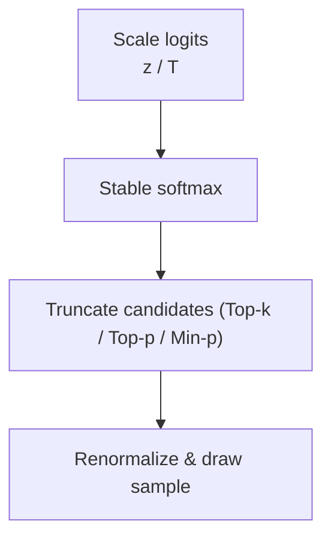

---
{
  "id": "decoding-algorithms",
  "title": "Decoding Algorithms",
  "slug": "decoding-algorithms",
  "section": "ML Algorithms & Evaluation",
  "category": "Inference Optimization",
  "difficulty": "Medium",
  "order": 11,
  "coverImage": "illustrations/_generated/chapter_flow_dark.png",
  "companies": [
    "OpenAI",
    "Anthropic",
    "Google",
    "Meta"
  ],
  "shortDescription": "The same scores for a prompt completion can emit attention, supervision, or regression. Decoding selects next tokens using deterministic search, stochastic sampling, or structured constraints.",
  "keyConceptsTested": [
    "search space formulation",
    "numerically stable softmax",
    "greedy decoding and myopic traps",
    "beam search and length normalization",
    "repetition penalty",
    "temperature and entropy",
    "top-k and top-p sampling",
    "min-p sampling",
    "constrained decoding",
    "test-time search and reasoning verifiers",
    "speculative decoding"
  ]
}
---

Consider a generation pipeline where retrieval provides technical documentation for sequence modeling architectures:

> Deep transformer architectures process sequence tokens using multi-head self-attention mechanisms.

This passage provides factual context for downstream generation. In [Core Retrieval Algorithms](/learn/core-retrieval-algorithms), retrieval selects relevant documentation chunks from the index. The language model then evaluates next-token affinities over its vocabulary to complete the prompt `Modern language models rely primarily on self-`. Depending on model calibration and decoding settings, high probability mass may land on `attention`, `supervision`, or `regression`. Even when the prompt context establishes `attention` as the sole supported continuation, the decoding policy ultimately dictates which token is emitted into the sequence.

**Decoding** translates raw model scores into generated text. The same scores can still emit different text. Greedy selection, a random draw, and a beam of partial paths are different rules. None of them turns an unsupported hallucination into ground truth. Worked examples throughout this lesson use explicit score vectors to isolate decoding mechanics, clarifying how temperature, truncation filters, and search bounds shape output distributions.

## The autoregressive search space: $|V|^T$ exponential token trees

An autoregressive model doesn't generate an entire sentence in one shot. It predicts text sequentially, token by token. Given an input prompt $x = (x_1, \dots, x_M)$, the model computes conditional probabilities over the vocabulary $V$ at each step $t$:

$$
P(y_{1:T} \mid x) = \prod_{t=1}^T P(y_t \mid x, y_{<t})
$$

Working in <span data-glossary="logprob">log-probability</span> space turns this product into a sum, avoiding the underflow of multiplying many small probabilities. Compute log-probabilities directly with a stable log-softmax when possible; taking a logarithm after a probability has rounded to zero cannot recover it.

$$
\log P(y_{1:T} \mid x) = \sum_{t=1}^T \log P(y_t \mid x, y_{<t})
$$

One possible search objective is the most probable sequence under the model:

$$
y^* = \arg\max_{y \in \mathcal{Y}} \sum_{t=1}^{|y|} \log P(y_t \mid x, y_{<t})
$$

Here $\mathcal{Y}$ must specify eligible sequences: a fixed token horizon, or completed answers including the probability of an end-of-sequence token (EOS) and a maximum length. Model probability isn't a factuality or usefulness score. With a vocabulary of $|V| = 32{,}000$ and a fixed horizon $T = 100$, unconstrained enumeration spans:

$$
|\mathcal{Y}| = |V|^T = 32{,}000^{100} \approx 3.27 \times 10^{450} \quad \text{possible sequence paths}
$$

These are length-100 paths, not a count of all intermediate tree nodes. EOS rules and constraints can reduce the eligible set. Vocabulary size is tokenizer-specific; 32,000 isn't a universal lower or upper bound.

Viterbi gains efficiency by merging histories that share a compact state with identical future transition probabilities. General transformer prefixes don't usually admit that small state space: retaining the entire prefix or KV cache as the state doesn't remove the explosion of distinct histories. Exhaustive search at this scale is impractical, though exact search on a small tree is possible.

Greedy and finite-width beam search approximate this sequence-maximization objective. **Sampling has a different goal.** Drawing each next token from the model's actual conditional distribution samples exactly from its joint distribution in ideal arithmetic, without finding its mode. Temperature, filters, constraints, and verifier selection define other output policies.

<figure>
  
  <figcaption>Greedy decoding selects <code>attention</code>, while top-p at 0.90 keeps both <code>attention</code> and <code>supervision</code> with cumulative probability mass 0.913. A uniform random draw of u=0.75 lands in the <code>supervision</code> interval, demonstrating how stochastic sampling can emit a non-modal token despite context support.</figcaption>
</figure>

## From raw logits to numerically stable probabilities

For clear arithmetic, treat each word below as a single token. Our prompt ends with:

```text title="completion-prompt.txt"
Context: Deep transformer architectures process sequence tokens using multi-head self-attention mechanisms.
Completion: Modern language models rely primarily on self-
```

Suppose the linear output head produces four candidate **<span data-glossary="logits">logits</span>**:

| Token | Logit | Role in sequence completion |
|---|---:|---|
| `attention` | `3.0` | Grounded by prompt context as the core mechanism. |
| `supervision` | `2.5` | Common ML continuation, ungrounded in the prompt. |
| `consistency` | `1.0` | Plausible ML noun, lower score. |
| `regression` | `-1.0` | Low-probability tail candidate. |

Logits aren't probabilities: they're real numbers that can be negative and don't sum to one. <span data-glossary="softmax">Softmax</span> converts unbounded logits into a normalized probability distribution:

$$
p_i = \frac{\exp(z_i - m)}{\sum_j \exp(z_j - m)}
\qquad \text{where} \qquad
m = \max_j z_j
$$

Subtracting the maximum logit $m$ doesn't alter the output probabilities. Because $\exp(z_i - m) = \exp(z_i) \cdot \exp(-m)$, the constant factor $\exp(-m)$ factors out of both numerator and denominator and cancels cleanly. For finite logits, shifted exponents are at most zero, so their exponentials cannot overflow.[^blanchard2019softmax] Unshifted `exp(1000)` exceeds even FP64's range: Python's `math.exp` raises an exception, while some array backends return infinity with a warning. Neither is a hardware crash.

<!-- leetllm: test, id=softmax, deps=numpy, output=show -->

```python title="stable-softmax.py"
import numpy as np

tokens = ["attention", "supervision", "consistency", "regression"]
logits = [3.0, 2.5, 1.0, -1.0]

def softmax(scores) -> np.ndarray:
    scores = np.asarray(scores, dtype=np.float64)
    if scores.ndim != 1 or scores.size == 0:
        raise ValueError("scores must be a nonempty vector")
    if np.isnan(scores).any() or np.isposinf(scores).any():
        raise ValueError("NaN and positive infinity are invalid logits")
    if not np.isfinite(scores).any():
        raise ValueError("all tokens are masked")
    # Negative infinity represents an intentional mask and gets zero weight.
    weights = np.exp(scores - scores.max())
    return weights / weights.sum()

probabilities = softmax(logits)
for token, score, probability in zip(tokens, logits, probabilities):
    print(f"{token:8} logit={score:>4.1f} probability={probability:.3f}")
print(f"sum={sum(probabilities):.3f}")
```

<!-- leetllm: output:start -->
```text title="Output" output compact
attention logit= 3.0 probability=0.568
supervision logit= 2.5 probability=0.345
consistency logit= 1.0 probability=0.077
regression logit=-1.0 probability=0.010
sum=1.000
```
<!-- leetllm: output:end -->

`attention` is the distribution mode with probability `0.568`. Unfiltered sampling chooses `supervision` at this single position with probability `0.345`. This value reflects single-step continuation uncertainty rather than full sequence correctness. Even if a generator emits a non-modal token at one step, downstream tokens may steer the completion back toward coherence. Evaluating overall generation quality requires scoring complete generated sequences rather than isolated next-token steps.

### Numerical stability under extreme ranges

The max shift isn't an optional speed trick. Directly calling `exp(1000)` overflows standard 64-bit floating-point math, even though the resulting probabilities are mathematically well behaved.

<!-- leetllm: test, continue=softmax, id=stable-math, output=show -->

```python title="avoid-softmax-overflow.py"
from math import exp

large_logits = [1000.0, 999.0, 998.0]

try:
    raw_weights = [exp(score) for score in large_logits]
    naive = [weight / sum(raw_weights) for weight in raw_weights]
    print("naive:", naive)
except OverflowError:
    print("naive softmax: overflow")

print("stable:", softmax(large_logits).round(3).tolist())
print("extreme gap:", softmax([0.0, -1000.0]).tolist())
try:
    softmax([-np.inf, -np.inf])
except ValueError as exc:
    print("rejected:", str(exc))
```

<!-- leetllm: output:start -->
```text title="Output" output compact
naive softmax: overflow
stable: [0.665, 0.245, 0.09]
extreme gap: [1.0, 0.0]
rejected: all tokens are masked
```
<!-- leetllm: output:end -->

The max subtraction eliminates exponential overflow, but hardware floating-point numbers still have finite precision. An extreme negative gap like `exp(-1000)` safely underflows to `0.0`. When every token is masked to negative infinity, total probability mass collapses to zero: the decoder must handle that condition explicitly rather than dividing zero by zero.

## Deterministic search: greedy myopic traps and beam exploration

After picking a token, the runtime appends it to the prefix and feeds the extended sequence back into the model to predict the subsequent position. Repeating that process builds the <span data-glossary="autoregressive-decoding">autoregressive</span> loop. In serving runtimes, a <span data-glossary="kv-cache">key-value (KV) cache</span> retains previous attention keys and values so earlier positions aren't recalculated from scratch.[^kwon2023] That architecture optimizes inference throughput, but it doesn't choose the token. Selecting tokens remains the responsibility of the decoding algorithm. **Greedy decoding** picks the token with the highest logit at every step:

$$
y_t = \arg\max_{w \in V} P(w \mid x, y_{<t})
$$

<!-- leetllm: test, output=show -->

```python title="greedy-generation-loop.py"
example_logits = [
    {"attention": 3.0, "supervision": 2.5, "consistency": 1.0, "regression": -1.0},
    {".": 4.0, "then": 1.5, "after": 0.5},
]

def greedy_token(scores: dict[str, float]) -> str:
    return max(scores, key=scores.get)

generated = []
for step, scores in enumerate(example_logits, start=1):
    chosen = greedy_token(scores)
    generated.append(chosen)
    print(f"step {step}: chose {chosen!r} from {len(scores)} candidates")

answer = "Modern language models rely primarily on self-" + " ".join(generated).replace(" .", ".")
print(answer)
```

<!-- leetllm: output:start -->
```text title="Output" output compact
step 1: chose 'attention' from 4 candidates
step 2: chose '.' from 3 candidates
Modern language models rely primarily on self-attention.
```
<!-- leetllm: output:end -->

Greedy token selection is deterministic given identical logits and a fixed tie rule. It avoids keeping alternative prefixes, but still performs an argmax and needs stopping/length rules. The model runtime can introduce numerical differences even when sampling is disabled. Greedy is a useful baseline; code correctness and extraction accuracy need task evaluation. Yet greedy decoding suffers from a fundamental search failure: **the myopic trap**. Because greedy search commits irreversibly to the immediate highest-scoring token at step $t$, it can miss globally higher-probability sequences that begin with a slightly lower-scoring first token.

### Beam search tracks parallel hypotheses

<span data-glossary="beam-search">Beam search</span> mitigates greedy myopia by maintaining a set of $B$ active hypotheses, where $B$ is the **beam width**.

At each step, the algorithm:
1. Expands all $B$ currently retained partial sequences by considering all possible continuations in $V$.
2. Computes the cumulative log-probability for each candidate extension: $\sum_{\tau=1}^t \log P(y_\tau \mid x, y_{<\tau})$.
3. Prunes the pool back to the top $B$ highest-scoring paths.

Consider a separate hand-built, fixed-two-token tree with prefix `The model uses`. These probabilities aren't the earlier softmax vector. Greedy grabs `attention` at step 1 because $0.40 \gt 0.35$. But look at step 2:

| Candidate path | Step 1 prob | Step 2 continuation | Step 2 prob | Joint probability $P(y_1, y_2 \mid x)$ |
|---|---:|---|---:|---:|
| `attention` $\to$ `mechanism` | `0.40` | `mechanism` | `0.20` | $0.40 \times 0.20 = \mathbf{0.080}$ (Greedy) |
| `recurrent` $\to$ `cells` | `0.35` | `cells` | `0.70` | $0.35 \times 0.70 = \mathbf{0.245}$ (Beam winner) |
| `linear` $\to$ `layers` | `0.25` | `layers` | `0.30` | $0.25 \times 0.30 = 0.075$ (Pruned) |

Greedy argmax commits irreversibly to `attention mechanism` at joint probability $0.080$. In contrast, a beam search with width $B = 2$ retains both `attention` and `recurrent` across step 1. At step 2, expanding both candidates uncovers `recurrent cells` at joint probability $0.245$, more than triple the joint probability of the greedy outcome.

<figure>
  
  <figcaption>At step one, beam width two retains <code>attention</code> and <code>recurrent</code>, while <code>linear</code> is pruned. Expanding both hypotheses reveals that <code>recurrent cells</code> attains joint probability 0.245, substantially outperforming the greedy path <code>attention mechanism</code> at 0.080.</figcaption>
</figure>

<!-- leetllm: test, id=beam, output=show -->

```python title="two-step-beam-search.py"
from math import exp, isclose, log

first_step = {"attention": 0.40, "recurrent": 0.35, "linear": 0.25}
second_step = {
    "attention": {"mechanism": 0.20, "layers": 0.19, "weights": 0.18, "blocks": 0.17, "patterns": 0.14, "units": 0.12},
    "recurrent": {"cells": 0.70, "layers": 0.20, "units": 0.10},
    "linear": {"layers": 0.30, "projections": 0.25, "units": 0.25, "mappings": 0.20},
}

def beam_search(distributions, width: int, steps: int):
    if width < 1:
        raise ValueError("beam width must be a positive integer")
    beam = [((), 0.0)]
    for _ in range(steps):
        candidates = []
        for prefix, score in beam:
            probs = distributions[prefix]
            assert isclose(sum(probs.values()), 1.0)
            assert all(0 <= p <= 1 for p in probs.values())
            for token, p in probs.items():
                if p > 0:
                    candidates.append((prefix + (token,), score + log(p)))
        beam = sorted(candidates, key=lambda row: row[1], reverse=True)[:width]
    return beam

tree = {(): first_step, **{(token,): probs for token, probs in second_step.items()}}
greedy_first = max(first_step, key=first_step.get)
greedy_second = max(second_step[greedy_first], key=second_step[greedy_first].get)
greedy_prob = first_step[greedy_first] * second_step[greedy_first][greedy_second]

winner, winner_log_p = beam_search(tree, width=2, steps=2)[0]
print("greedy:", f"{greedy_first} {greedy_second}", f"probability={greedy_prob:.3f}")
print("beam:  ", " ".join(winner), f"probability={exp(winner_log_p):.3f}")
```

<!-- leetllm: output:start -->
```text title="Output" output compact
greedy: attention mechanism probability=0.080
beam:   recurrent cells probability=0.245
```
<!-- leetllm: output:end -->

Beam search remains an approximate heuristic. Once a prefix falls outside the top $B$ hypotheses at any step, the search discards it permanently. Even if that pruned prefix would have unlocked a continuation with probability $1.0$, beam search can never recover it.

<!-- leetllm: test, continue=beam, output=show -->

```python title="beam-can-prune-the-best-path.py"
counterexample = {
    (): {"A": 0.5, "B": 0.3, "C": 0.2},
    ("A",): {str(i): 0.1 for i in range(10)},
    ("B",): {str(i): 0.2 for i in range(5)},
    ("C",): {"win": 1.0},
}
for width in (2, 3):
    path, score = beam_search(counterexample, width, steps=2)[0]
    print(f"width={width}: {' '.join(path)} probability={exp(score):.3f}")
```

<!-- leetllm: output:start -->
```text title="Output" output compact
width=2: B 0 probability=0.060
width=3: C win probability=0.200
```
<!-- leetllm: output:end -->

Width $B = 2$ prunes branch `C` at step 1 because $0.2 \lt 0.3$. It then settles for `B 0` at joint probability 0.060. Expanding width to $B = 3$ preserves `C`, discovering the global optimum `C win` at joint probability 0.200.

A larger beam retains more prefixes at a given pruning step, but isn't a general monotonic guarantee of final quality or score across runs. A naive implementation duplicates per-prefix caches, approaching $B$ times that cache storage. Model weights remain shared, and serving engines can share common-prefix cache blocks, so total memory does not need to grow by exactly $B$.[^kwon2023]

## Length normalization and repetition penalties

Raw likelihood search can prefer short completions and repetitive text. Neither behavior is inevitable, and changing the score changes the search objective.

### Length normalization changes which completions win

Every generated token multiplies the joint probability by a conditional value $P(y_t \mid \dots) \le 1$. In log space, adding non-positive log-probabilities causes cumulative path scores to decay monotonically with sequence length:

$$
\sum_{t=1}^{L+1} \log P(y_t \mid x,y_{<t}) \le \sum_{t=1}^L \log P(y_t \mid x,y_{<t}) \le 0
$$

This inequality compares a prefix with **its own extension**. It doesn't prove that every short completed answer outranks a longer answer on another branch. EOS has a conditional probability too. If `EOS` has probability 0.01 at the first position, while `attention` has probability 0.99 followed by EOS with probability 0.90, the longer completion has probability 0.891 and wins. Length normalization can counter an unwanted preference for brief answers, but there is no universally fair length score. One GNMT heuristic is:[^wu2016gnmt]

$$
S(Y) = \frac{\sum_{t=1}^L \log P(y_t \mid x, y_{<t})}{\text{LP}(L)}
\qquad \text{where} \qquad
\text{LP}(L) = \frac{(5 + L)^\alpha}{(5 + 1)^\alpha}
$$

Tune $\alpha$ on development data; it isn't restricted to $[0.6,1.0]$. At $\alpha=0$, this is raw log-probability. At $\alpha=1$, GNMT divides by $(5+L)/6$, **not** by $L$. Hugging Face's documented beam `length_penalty` instead divides by $L^\alpha$.[^huggingface2026generation] The next example applies $L^\alpha$ normalization at $\alpha=1$.

<!-- leetllm: test, output=show -->

```python title="length-aware-sequence-score.py"
candidates = [
    {"text": "attention <EOS>", "log_probability": -1.0, "tokens": 2},
    {"text": "attention mechanism with causal masking <EOS>", "log_probability": -1.6, "tokens": 5},
]

raw_winner = max(candidates, key=lambda row: row["log_probability"])
normalized_winner = max(candidates, key=lambda row: row["log_probability"] / row["tokens"])

print("raw winner:               ", raw_winner["text"])
print("length-normalized winner: ", normalized_winner["text"])
for row in candidates:
    average = row["log_probability"] / row["tokens"]
    print(f"{row['text']:31} raw={row['log_probability']:.3f} average={average:.3f}")
```

<!-- leetllm: output:start -->
```text title="Output" output compact
raw winner:                attention <EOS>
length-normalized winner:  attention mechanism with causal masking <EOS>
attention <EOS>                 raw=-1.000 average=-0.500
attention mechanism with causal masking <EOS> raw=-1.600 average=-0.320
```
<!-- leetllm: output:end -->

The winner changes because `-0.320 > -0.500`. That arithmetic doesn't check whether either text is a complete or applicable procedure. With GNMT's formula at $\alpha=1$, the scores would be $-1/(7/6)\approx-0.857$ and $-1.6/(10/6)=-0.960$: **the short candidate wins**. A parameter named `length_penalty` doesn't identify its formula.

### Repetition penalties discourage reused tokens

Holtzman et al. observed repetitive likelihood-maximizing continuations in their GPT-2 experiments.[^holtzman2020] An example of the pattern is:

> The model generated the token and generated the token and generated the token...

A model can assign rising probability to a phrase as that phrase repeats in its context. Maximization can exploit this feedback. Self-attention doesn't mathematically require that behavior, and modern models and tasks can differ. CTRL introduced penalized sampling.[^keskar2019] The following **sign-aware variant**, used by Hugging Face, lowers the logits of tokens seen in the prefix when $\theta>1$:[^huggingface2026logits]

$$
z_w \leftarrow \begin{cases}
z_w / \theta & \text{if } z_w > 0 \\
z_w \cdot \theta & \text{if } z_w \le 0
\end{cases}
\qquad \forall w \in \text{generated sequence}
$$

Positive logits decrease by division; negative logits decrease by multiplication. A zero logit stays zero. This reduces treated tokens' scores relative to untouched candidates, without banning them. After renormalization, an individual treated token's probability can still rise if other treated tokens were reduced more.

<!-- leetllm: test, output=show -->

```python title="repetition-penalty.py"
import math

def apply_repetition_penalty(
    logits: dict[str, float], sequence: list[str], theta: float = 1.2
) -> dict[str, float]:
    if not math.isfinite(theta) or theta < 1:
        raise ValueError("theta must be finite and at least one in this lab")
    penalized = dict(logits)
    for token in set(sequence):
        if token in penalized:
            score = penalized[token]
            penalized[token] = score / theta if score > 0 else score * theta
    return penalized

step_logits = {"attention": 3.0, "transformer": 2.8, "recurrent": 2.5}
print("unpenalized choice:", max(step_logits, key=step_logits.get))

# After 'attention' was emitted at step 1, apply repetition penalty:
penalized = apply_repetition_penalty(step_logits, ["attention"], theta=1.2)
print("penalized 'attention' logit:", f"{penalized['attention']:.2f}")
print("penalized choice:        ", max(penalized, key=penalized.get))
```

<!-- leetllm: output:start -->
```text title="Output" output compact
unpenalized choice: attention
penalized 'attention' logit: 2.50
penalized choice:         transformer
```
<!-- leetllm: output:end -->

With penalty strength $\theta=1.2$, `attention` drops below `transformer` in the candidate ranking. While this mechanism curbs pathological loops, it also penalizes legitimate repeated tokens, such as variable names or syntactic tokens in code. In addition, tokenization boundaries and whether prompt tokens are included in the penalty set directly affect output distributions.[^huggingface2026logits] Search still returns one high-scoring path. Sampling asks what happens if the next token is drawn from the scores instead of taken from the maximum.

## Temperature reshapes entropy

Sampling draws a token rather than searching for a sequence maximum. **<span data-glossary="temperature">Temperature</span>** $T>0$ scales logits before softmax:

$$
p_i(T) = \frac{\exp(z_i / T)}{\sum_j \exp(z_j / T)}
$$

- As $T \to 0$, mass concentrates on the maximum. With a unique finite maximum, this approaches greedy selection. With tied maxima, the limit is uniform over the ties, whereas greedy applies a tie rule.
- When $T = 1.0$, probabilities match the model's raw unscaled distribution.
- As $T \to \infty$, finite logits approach a uniform distribution over the unmasked candidates. Tokens masked to $-\infty$ stay excluded.

Shannon entropy is $H(p)=-\sum_i p_i\log p_i$, with $0\log0=0$. Natural logarithms give **nats**. For a fixed finite score vector and unchanged masks, entropy is non-decreasing with $T$. Higher entropy describes uncertainty in the next draw, not factual uncertainty or a full answer's quality.

<!-- leetllm: test, continue=stable-math, id=temperature, output=show -->

```python title="temperature-and-entropy.py"
tokens = ["attention", "supervision", "consistency", "regression"]
logits = [3.0, 2.5, 1.0, -1.0]

def entropy(probabilities) -> float:
    positive = np.asarray(probabilities)[np.asarray(probabilities) > 0]
    return float(-np.sum(positive * np.log(positive)))

for temperature in (0.5, 1.0, 2.0):
    probabilities = softmax([score / temperature for score in logits])
    table = dict(zip(tokens, probabilities))
    print(
        f"T={temperature:.1f}: attention={table['attention']:.3f} "
        f"regression={table['regression']:.3f} entropy={entropy(probabilities):.3f}"
    )
```

<!-- leetllm: output:start -->
```text title="Output" output compact
T=0.5: attention=0.721 regression=0.000 entropy=0.647
T=1.0: attention=0.568 regression=0.010 entropy=0.933
T=2.0: attention=0.438 regression=0.059 entropy=1.190
```
<!-- leetllm: output:end -->

At $T = 0.5$, entropy drops to $0.647$ nats and `attention` captures $72.1\%$ of the total probability mass. At $T = 2.0$, entropy rises to $1.190$ nats as the distribution flattens, increasing the probability of the tail token `regression` from $1\%$ to nearly $6\%$. Does near-zero temperature choose one winner when the largest scores tie? Try this before assuming it reproduces greedy:

<!-- leetllm: test, continue=temperature, output=show -->

```python title="temperature-ties-and-masks.py"
scores = np.array([2.0, 2.0, 0.0, -np.inf])
for temperature in (0.01, 1_000_000.0):
    probabilities = softmax((scores - scores.max()) / temperature)
    assert probabilities[3] == 0
    print(f"T={temperature:g}: {probabilities.round(3).tolist()}")
print("greedy tie rule picks index:", int(np.argmax(scores)))
```

<!-- leetllm: output:start -->
```text title="Output" output compact
T=0.01: [0.5, 0.5, 0.0, 0.0]
T=1e+06: [0.333, 0.333, 0.333, 0.0]
greedy tie rule picks index: 0
```
<!-- leetllm: output:end -->

The low-temperature sampler still has two choices; NumPy's argmax chooses the first tied index. The high-temperature limit has three choices, not four, because the mask remains in force. For a fixed score vector, lowering temperature sharpens the distribution. In exact arithmetic with $T>0$, every unmasked finite-logit token still has positive probability. To request greedy generation, use the runtime's dedicated control: Hugging Face uses `do_sample=False`.[^huggingface2026generation] Don't substitute $T=0$ into the softmax equation; an API's zero-temperature convention is a separate rule.

```checkpoint
Does setting temperature to 0.2 eliminate the risk of sampling an unsupported tail token?
---
No. Lowering temperature enlarges scaled logit gaps and reduces lower-scoring candidates' mass. In exact arithmetic, each finite logit still has positive probability; floating-point underflow may round tiny weights to zero. A hard mask can exclude a particular token, but being low-probability isn't the same as being unsupported.
```

### Seeding and production reproducibility

Sampling draws random tokens according to model probabilities. In local development, passing a fixed random seed allows repeatable draws from a static distribution:

<!-- leetllm: test, output=show -->

```python title="seeded-sampling.py"
from random import Random

tokens = ["attention", "supervision", "consistency", "regression"]
probabilities = [0.568, 0.345, 0.077, 0.010]

def draw_sequence(seed: int, length: int = 8) -> list[str]:
    rng = Random(seed)
    return rng.choices(tokens, weights=probabilities, k=length)

for seed in (7, 7, 21):
    print(f"seed={seed}: {' '.join(draw_sequence(seed))}")
```

<!-- leetllm: output:start -->
```text title="Output" output compact
seed=7: attention attention supervision attention attention attention attention attention
seed=7: attention attention supervision attention attention attention attention attention
seed=21: attention supervision supervision attention attention supervision supervision attention
```
<!-- leetllm: output:end -->

The repeated seed reproduces this static distribution's draws with this Python implementation. A seed alone doesn't make arbitrary model inference deterministic. Floating-point addition is non-associative. Different batching shapes, kernels, or accumulation precision can change logits; a near tie can then change even a greedy result.[^pytorch2026numerical] Parallel computation isn't inherently nondeterministic: deterministic kernels and a fixed environment can support repeatable inference. PyTorch documents additional randomness controls and limitations across releases, devices, and platforms.[^pytorch2026reproducibility]

Check the exact model's supported controls before sending a local sampler configuration to an API. **Checked November 6, 2026:** the [Claude Sonnet 5 documentation](https://platform.claude.com/docs/en/models/sonnet-5/overview) says that setting `temperature`, `top_p`, or `top_k` returns HTTP 400. Omit these unsupported fields and check the API contract for the model you actually call.

Record the exact model identifier, prompts, supported decoding settings, runtime details, and request/response identifiers. Record weight/tokenizer hashes when you control them. A hosted API may not expose hashes or guarantee replay. Temperature still leaves every unmasked token eligible. Which of those tokens should a draw be allowed to land on?

## Truncating the long tail: Top-k, Top-p, and Min-p

Holtzman et al. called low-probability candidates an **unreliable tail** in their open-ended generation experiments.[^holtzman2020] A rare token can nevertheless be the right identifier, name, or fact. Filtering ranks probabilities, not truth. In a constructed model where each of 500 positions has conditional tail-event probability $0.002$, including after every history with no previous tail event, the probability of at least one such event is:

$$
1 - (1 - 0.002)^{500} \approx 63.2\%
$$

Actual conditional probabilities change with the prefix. The calculation isn't an estimated hallucination rate. Truncation is one way to exclude low-ranked candidates; its effect on task quality needs evaluation.

### Top-k truncation: fixed rank cutoff

**<span data-glossary="top-k">Top-k</span>** sampling retains only the $k$ highest-probability tokens, setting the probability of all other tokens to zero and renormalizing the remaining mass:[^fan2018]

$$
V^{(k)} = \{i \in V : \text{rank}(p_i) \le k\}
$$

<!-- leetllm: test, id=filter-k, output=show -->

```python title="top-k-filter.py"
from math import isclose, isfinite

peaked = {"attention": 0.568, "supervision": 0.345, "consistency": 0.077, "regression": 0.010}

def ranked_distribution(probabilities: dict[str, float]) -> list[tuple[str, float]]:
    values = list(probabilities.values())
    if not values or any(not isfinite(p) or p < 0 for p in values):
        raise ValueError("probabilities must be finite and nonnegative")
    if not isclose(sum(values), 1.0, rel_tol=1e-12, abs_tol=1e-12):
        raise ValueError("probabilities must sum to one")
    return sorted(
        ((token, p) for token, p in probabilities.items() if p > 0),
        key=lambda row: row[1], reverse=True,
    )

def top_k(probabilities: dict[str, float], k: int) -> list[tuple[str, float]]:
    if k < 1:
        raise ValueError("k must be a positive integer")
    ranked = ranked_distribution(probabilities)[:k]
    retained_mass = sum(prob for _, prob in ranked)
    return [(token, prob / retained_mass) for token, prob in ranked]

for token, prob in top_k(peaked, k=2):
    print(f"{token:8} renormalized={prob:.3f}")
```

<!-- leetllm: output:start -->
```text title="Output" output compact
attention renormalized=0.622
supervision renormalized=0.378
```
<!-- leetllm: output:end -->

Top-k sampling has a major structural flaw: **fixed cardinality**. If a single token holds 99% of the mass and at least 50 candidates have positive probability, $k=50$ retains 49 lower-ranked candidates too. They aren't necessarily garbage, and their combined original mass is at most 1%. Conversely, when the distribution is flat because many synonyms are equally valid, $k = 50$ arbitrarily cuts off good candidates that happen to rank 51st.

### Top-p (Nucleus) sampling: dynamic cumulative thresholding

**<span data-glossary="top-p">Top-p sampling</span>**, or nucleus sampling, solves the fixed-cardinality problem by accumulating mass. It selects the smallest set of ranked tokens whose cumulative probability reaches a threshold $p \in (0, 1]$:[^holtzman2020]

$$
V^{(p)} = \text{smallest subset of } V \text{ such that } \sum_{i \in V^{(p)}} p_i \ge p
$$

<!-- leetllm: test, continue=filter-k, id=filter-p, output=show -->

```python title="top-p-adapts-to-the-distribution.py"
def nucleus(probabilities: dict[str, float], threshold: float) -> list[str]:
    if not isfinite(threshold) or not 0 < threshold <= 1:
        raise ValueError("top-p threshold must be in (0, 1]")
    ranked = ranked_distribution(probabilities)
    if threshold == 1:
        return [token for token, _ in ranked]
    kept = []
    cumulative = 0.0
    for token, prob in ranked:
        kept.append(token)
        cumulative += prob
        if cumulative >= threshold:
            break
    return kept

peaked = {"attention": 0.568, "supervision": 0.345, "consistency": 0.077, "regression": 0.010}
flat = {"attention": 0.28, "supervision": 0.25, "consistency": 0.24, "regression": 0.23}

print("peaked p=0.90:", nucleus(peaked, 0.90))
print("flat   p=0.90:", nucleus(flat, 0.90))
```

<!-- leetllm: output:start -->
```text title="Output" output compact
peaked p=0.90: ['attention', 'supervision']
flat   p=0.90: ['attention', 'supervision', 'consistency', 'regression']
```
<!-- leetllm: output:end -->

At threshold $p = 0.90$, Top-p keeps two candidate tokens in the peaked case ($0.568 + 0.345 = 0.913 \ge 0.90$) and dynamically expands to retain all four tokens in the flat case. The sampling pool size automatically adjusts to the concentration of the model logits.

### Min-p sampling: relative probability filtering

Higher temperatures can enlarge the nucleus needed to reach a fixed mass threshold. There is no universal failure boundary at $T=1.2$. The Min-p paper reports favorable comparisons in its tested models, tasks, and temperature settings; these aren't a guarantee of better text in every application.[^nguyen2025] **Min-p sampling** sets its truncation threshold relative to the top candidate's probability.[^nguyen2025] Instead of fixing rank $k$ or cumulative mass $p$, it keeps only tokens whose probability is at least a fraction $p_{\text{base}}$ of the maximum token's probability:

$$
V^{(\text{min-}p)} = \{i \in V : p_i \ge p_{\text{base}} \cdot \max_j p_j\}
$$

<!-- leetllm: test, continue=filter-p, id=filter-min-p, output=show -->

```python title="min-p-filter.py"
def min_p(probabilities: dict[str, float], base_threshold: float) -> list[str]:
    if not isfinite(base_threshold) or not 0 <= base_threshold <= 1:
        raise ValueError("min-p threshold must be in [0, 1]")
    ranked = ranked_distribution(probabilities)
    max_p = ranked[0][1]
    cutoff = base_threshold * max_p
    return [token for token, p in ranked if p >= cutoff]

peaked = {"attention": 0.568, "supervision": 0.345, "consistency": 0.077, "regression": 0.010}
flat = {"attention": 0.28, "supervision": 0.25, "consistency": 0.24, "regression": 0.23}

print("peaked min-p=0.10:", min_p(peaked, 0.10))
print("flat   min-p=0.10:", min_p(flat, 0.10))
```

<!-- leetllm: output:start -->
```text title="Output" output compact
peaked min-p=0.10: ['attention', 'supervision', 'consistency']
flat   min-p=0.10: ['attention', 'supervision', 'consistency', 'regression']
```
<!-- leetllm: output:end -->

Under the peaked distribution, the leading token is `attention` at `0.568`. With base threshold $p_{\text{base}} = 0.10$, the absolute cutoff becomes $0.10 \times 0.568 = 0.0568$. Consequently, `consistency` ($0.077$) survives, while the distant tail token `regression` ($0.010$) is removed. Under the flat distribution, the top token has probability `0.28`, establishing an absolute cutoff of $0.028$. All four tokens exceed this threshold, preserving full candidate diversity when the model exhibits high entropy.

With $p_{\text{base}}=0.10$, a peak of 0.90 gives a cutoff of 0.090, and a peak of 0.10 gives 0.010. The cutoff depends on each distribution's top-token score; assess model certainty and exploration separately. As $T\to\infty$, any fixed $p_{\text{base}}<1$ eventually admits all finite-logit candidates, so Min-p doesn't prevent degeneration at arbitrarily high temperatures. Hugging Face includes native support for `min_p` directly in `GenerationConfig`.[^huggingface2026generation]

<figure>
  
  <figcaption>Top-k retains two candidates in both distributions, keeping 0.913 mass when peaked but discarding 0.470 mass when flat. Top-p and Min-p dynamically expand their candidate sets in flat distributions, responding flexibly to predictive uncertainty.</figcaption>
</figure>

### Boundary cases in filter implementations

Production filter implementations must handle boundary conditions predictably:

<!-- leetllm: test, continue=filter-min-p, id=filter-boundaries, output=show -->

```python title="filter-boundaries.py"
boundary = {"attention": 0.5, "supervision": 0.25, "consistency": 0.25, "regression": 0.0}
print("top-k k=2: ", [token for token, _ in top_k(boundary, 2)])
print("top-p p=.75:", nucleus(boundary, 0.75))
print("top-p p=1:  ", nucleus(boundary, 1.0))
print("min-p=.5:   ", min_p(boundary, 0.5))
print("min-p=1:    ", min_p({"attention": 0.5, "supervision": 0.5}, 1.0))

for label, call in [
    ("k=0", lambda: top_k(boundary, 0)),
    ("p=0", lambda: nucleus(boundary, 0)),
    ("zero mass", lambda: min_p({"attention": 0.0}, 0.1)),
]:
    try:
        call()
    except ValueError as exc:
        print(label, "REJECT", str(exc))
```

<!-- leetllm: output:start -->
```text title="Output" output compact
top-k k=2:  ['attention', 'supervision']
top-p p=.75: ['attention', 'supervision']
top-p p=1:   ['attention', 'supervision', 'consistency']
min-p=.5:    ['attention', 'supervision', 'consistency']
min-p=1:     ['attention', 'supervision']
k=0 REJECT k must be a positive integer
p=0 REJECT top-p threshold must be in (0, 1]
zero mass REJECT probabilities must sum to one
```
<!-- leetllm: output:end -->

This lab excludes zero-mass candidates, breaks rank ties by dictionary insertion order, and rejects $k=0$. Runtime conventions differ. Hugging Face's Top-k processor compares logits with the kth score, so ties at the boundary can retain more than $k$ tokens.[^huggingface2026logits] Its `generate` loop skips that processor when `top_k=0`.[^huggingface2026generationLoop] Check the interface you're using.

The diagram describes **our** order: temperature first, then one filter, then renormalization and sampling. Other runtimes can order filters differently. Stacking filters is possible, but their interaction and order must be recorded and evaluated. For a concrete ordering trap, use the same thresholds twice:

<!-- leetllm: test, continue=filter-boundaries, id=filter-order, output=show -->

```python title="filter-order-changes-membership.py"
base = {"A": 0.60, "B": 0.25, "C": 0.15}
k_first = dict(top_k(base, 2))
p_after_k = nucleus(k_first, 0.70)

p_first = nucleus(base, 0.70)
mass = sum(base[token] for token in p_first)
p_distribution = {token: base[token] / mass for token in p_first}
k_after_p = [token for token, _ in top_k(p_distribution, 2)]
print("top-k then top-p:", p_after_k)
print("top-p then top-k:", k_after_p)
```

<!-- leetllm: output:start -->
```text title="Output" output compact
top-k then top-p: ['A']
top-p then top-k: ['A', 'B']
```
<!-- leetllm: output:end -->

After Top-k removes C, A's renormalized mass is $0.60/0.85\approx0.706$, enough to reach 0.70 alone. On the original distribution, Top-p needs A and B. The methods select different sets because Top-k renormalizes after truncation.



## Grammar-constrained decoding: syntax enforcement versus semantic truth

Structured tool and API pipelines often require output formatted as strict JSON or SQL. A formal grammar rejects trailing commas and unescaped quotes during decoding, while schema-level database validity and factual grounding still require downstream verification. **Constrained decoding** prevents syntax violations by applying a formal grammar (Context-Free Grammar, JSON Schema, or Regular Expression) directly to the decoding loop.[^willard2023][^xgrammar2024][^llamacpp_grammars_docs2026]

Regular-language constraints can use a finite-state machine (FSM). Recursive grammars, such as arbitrary JSON nesting, generally require stack-based state, as in XGrammar's byte-level pushdown automaton.[^xgrammar2024] At each step:
1. The matcher inspects its current state and identifies allowed continuations.
2. The engine checks each candidate token's full decoded character/byte sequence, which can cross several grammar boundaries.
3. Any token that would transition the output into an invalid state has its logit forced to $-\infty$ prior to softmax:

$$
z_i \leftarrow \begin{cases}
z_i & \text{if token } i \text{ is a valid grammar transition} \\
-\infty & \text{otherwise}
\end{cases}
$$

Masked tokens have zero weight. With a correct matcher, tokenizer integration, and permitted EOS only in an accepting state, this keeps generated prefixes compatible with the grammar. A length limit or interruption can still leave an incomplete JSON prefix. Unsupported schema features, grammar bugs, or an empty allowed set also need explicit handling.

<!-- leetllm: test, output=show -->

```python title="mask-invalid-step-tokens.py"
logits = {"regression": 6.0, "supervision": 4.0, "attention": 3.0, "consistency": 2.0}
schema_values = {"attention", "supervision", "consistency"}
context_grounded = {"attention"}

def constrained_greedy(scores: dict[str, float], allowed: set[str]) -> str:
    candidates = {token: score for token, score in scores.items() if token in allowed}
    if not candidates:
        raise ValueError("constraint removed every token")
    return max(candidates, key=candidates.get)

print("unconstrained:     ", max(logits, key=logits.get))
print("schema-only:       ", constrained_greedy(logits, schema_values))
print("context-grounded:  ", constrained_greedy(logits, context_grounded))
```

<!-- leetllm: output:start -->
```text title="Output" output compact
unconstrained:      regression
schema-only:        supervision
context-grounded:   attention
```
<!-- leetllm: output:end -->

Notice the clear distinction between the second and third lines:

- **Unconstrained decoding** picks `regression` because it has the highest raw logit (`6.0`).
- **Schema-constrained decoding** masks `regression`, but picks `supervision` (`4.0`) because `supervision` satisfies the syntactic grammar.
- **Context-grounded decoding** selects `attention` (`3.0`), aligning with the verified source document.

This illustrates the core boundary of constrained decoding: **syntax enforcement is not semantic verification**.[^openai_structured_outputs] The example selects whole enum values as if each were one token; it isn't a JSON parser or a measured verifier. Real engines must handle multi-token strings.

### Local masks define a different sampling policy

Grammar validity also differs from sampling the original model **conditioned on a valid complete sequence**. A local mask keeps any next token that can lead to a valid completion, then renormalizes at that position. It doesn't account for how much valid continuation probability lies beyond each surviving prefix.

Consider a two-token grammar tree. The grammar accepts only `A x` and `B y`. Both first tokens are allowed, but the model gives their required second tokens very different probabilities:

<!-- leetllm: test, output=show -->

```python title="local-masks-versus-conditioned-sequences.py"
first = {"A": 0.4, "B": 0.6}
second = {
    "A": {"x": 0.1, "invalid": 0.9},
    "B": {"y": 0.9, "invalid": 0.1},
}
valid = {"A": "x", "B": "y"}
valid_mass = {prefix: first[prefix] * second[prefix][token]
              for prefix, token in valid.items()}
total_valid = sum(valid_mass.values())

for prefix, token in valid.items():
    # The first mask allows both prefixes; the second forces its valid token.
    local_mask_probability = first[prefix] * 1.0
    conditioned_probability = valid_mass[prefix] / total_valid
    print(f"{prefix} {token}: local={local_mask_probability:.3f} "
          f"conditioned={conditioned_probability:.3f}")
assert abs(total_valid - 0.58) < 1e-12
```

<!-- leetllm: output:start -->
```text title="Output" output compact
A x: local=0.400 conditioned=0.069
B y: local=0.600 conditioned=0.931
```
<!-- leetllm: output:end -->

Unmasked model probability is `0.4 × 0.1 = 0.04` for `A x` and `0.6 × 0.9 = 0.54` for `B y`. Conditioning on validity divides by their total `0.58`, giving about `0.069` and `0.931`. Local masking instead gives `0.400` and `0.600`: each prefix's only valid second token becomes certain. Both policies produce valid strings, with different frequencies. Exact conditioning would require valid future probability mass, which can be expensive to compute. Grammar-aligned decoding studies this distinction.[^grammarAlignedDecoding2024] For this lesson's audits, record the actual mask-and-renormalize policy; don't infer a conditional sequence distribution from schema compliance alone. **Verified October 10, 2026:** OpenAI Structured Outputs supports a documented JSON Schema subset. Handle refusals and incomplete responses separately before consuming a completed schema-conforming result.[^openai_structured_outputs] llama.cpp's converter also supports a subset and documents that unsupported features can be skipped.[^llamacpp_grammars_docs2026] A grammar constrains what it represents; it doesn't validate arbitrary business rules or factual accuracy.

## Test-time search and reasoning: verifiers and thought trees

Inference-time computation can generate, revise, or evaluate multiple candidates. In Snell et al.'s MATH experiments with PaLM 2 models, some prompt-dependent strategies beat a roughly 14× larger model in specified FLOPs-matched settings. Difficult questions and high inference workloads could favor pretraining instead.[^snell2024] This isn't a universal 10× compute advantage or a claim that training becomes unnecessary. Instead of searching blindly across raw token spaces, test-time search operates across complete trajectories or discrete reasoning steps.

### Best-of-N selection with outcome evaluators

In **Best-of-N**, generate $N$ candidate answers, score each with an outcome evaluator, and select the best score. Independent draws from a fixed generator are one common design.[^cobbe2021] This rank-and-select procedure isn't the same as rejection sampling, which accepts samples using a specified acceptance rule.

$$
y^* = \arg\max_{y^{(k)} \in \{y^{(1)}, \dots, y^{(N)}\}} \text{ORM}(x, y^{(k)})
$$

An automated checker can replace a learned scorer when available. Passing a finite test suite verifies those cases, not every possible input. A formal proof checker verifies a proof relative to its formal statement and trusted assumptions.

### Process Reward Models catch intermediate reasoning failures

Outcome **supervision** gives one label for a whole solution, often from its final answer. An ORM can still read the complete trajectory; it isn't required to ignore the reasoning. Inferring where an error occurred from a final label is a credit-assignment problem.[^lightman2023] A correct final answer can conceal invalid steps. Conversely, a nearly correct derivation with a wrong final answer is correctly labeled wrong for a final-answer task, while that label says little about which steps were sound. **Process Reward Models (PRMs)** score intermediate steps, usually using preceding context. A probability-style output can be written as:

$$
r_t = \text{PRM}(x, s_1, s_2, \dots, s_t) \in [0, 1]
$$

The interval $[0,1]$ is one score convention for PRMs. Calibration needs separate evidence. Aggregating step scores by a minimum, product, or another rule is an additional design choice. Comparing outcome scores against minimum step scores shows how step-level verification catches flawed intermediate reasoning:

<!-- leetllm: test, output=show -->

```python title="orm-vs-prm-verification.py"
candidates = [
    {
        "id": "proof_A",
        "steps": ["Extract linear equations", "Compute matrix rank", "Solve unique system"],
        "prm_steps": [0.95, 0.92, 0.98],
        "orm_score": 0.96,
    },
    {
        "id": "proof_B",
        "steps": ["Invert non-square matrix directly", "Compute matrix rank", "Solve unique system"],
        "prm_steps": [0.05, 0.90, 0.92],
        "orm_score": 0.72,
    },
]

def prm_min_score(traj: dict) -> float:
    return min(traj["prm_steps"])

orm_best = max(candidates, key=lambda t: t["orm_score"])
prm_best = max(candidates, key=prm_min_score)

print(f"ORM best: {orm_best['id']} (score={orm_best['orm_score']:.2f})")
print(f"PRM best: {prm_best['id']} (min_step={prm_min_score(prm_best):.2f})")
for t in candidates:
    print(f"{t['id']}: ORM={t['orm_score']:.2f} PRM_min={prm_min_score(t):.2f} first_step={t['steps'][0]!r}")
```

<!-- leetllm: output:start -->
```text title="Output" output compact
ORM best: proof_A (score=0.96)
PRM best: proof_A (min_step=0.92)
proof_A: ORM=0.96 PRM_min=0.92 first_step='Extract linear equations'
proof_B: ORM=0.72 PRM_min=0.05 first_step='Invert non-square matrix directly'
```
<!-- leetllm: output:end -->

Both rules select `proof_A`, while the minimum-step rule exposes `proof_B`'s invalid first step (`0.05`) even though its final outcome score remains moderately high (`0.72`). Because learned PRMs can also misgrade valid algebraic shortcuts, benchmark step verifiers on end-to-end task accuracy rather than step agreement alone.

### Tree of Thoughts and Monte Carlo Tree Search

Reasoning can also be organized as a **tree of thoughts**.[^yao2023] It is one explicit search design. Reasoning-model runtimes use varied methods. Each node in the tree represents a partial reasoning state (a thought step or sub-goal). The search engine uses PRM step scores or heuristic value functions to:
- **Expand**: Propose $k$ candidate next reasoning thoughts.
- **Evaluate**: Use a learned scorer, a checker, or a prompted model heuristic.
- **Prune or backtrack**: Discard weak candidates under the chosen search rule. Any numeric threshold must be justified for that evaluator. The original Tree of Thoughts paper explored **BFS and DFS with model self-evaluation**, leaving MCTS for future work.[^yao2023] MCTS-based methods such as RAP separately use selection, expansion, simulation, and reward back-propagation to allocate visits.[^hao2023rap] Neither requires that a PRM be the evaluator. Search can miss a solution or amplify a scorer's mistake; more computation doesn't guarantee truth.

## Speculative decoding: lossless serving optimization

**Exact <span data-glossary="speculative-decoding">speculative decoding</span>** aims to accelerate a specified target policy while preserving its output distribution in ideal arithmetic.[^leviathan2023] Equal distributions don't mean identical sampled text for the same seed, nor a bitwise guarantee across different kernels. A standard autoregressive loop evaluates the target for each successive next-token choice, with the initial choice available from prefill. At low batch sizes, weight/cache reads can make decoding memory-bound; high batching and other workloads can have different bottlenecks.

Speculative decoding pairs the large target model $M_{\text{target}}$ with a small, lightweight draft model $M_{\text{draft}}$:
1. **Draft phase**: The small draft model autoregressively proposes a burst of $K$ candidate tokens quickly.
2. **Verification phase**: A batched target evaluation obtains distributions for the draft prefixes, including $p_{K+1}$ after all $K$ drafts. Causal attention lets it evaluate these known positions together.
3. **Modified rejection sampling**: For each draft token $i \in \{1, \dots, K\}$, if the target probability $p(x) \ge q(x)$ (where $q$ is the draft probability), the token is accepted. If $p(x) < q(x)$, the token is accepted with probability $p(x) / q(x)$.
4. **Correction**: At the first rejected position $j$, discard that token and its suffix. Draw a replacement from the **normalized** residual $\max(0,p_j(x)-q_j(x))$, using the already computed distributions.
5. **All accepted**: Append one additional token sampled from $p_{K+1}$. One iteration yields between 1 and $K+1$ tokens, subject to stopping rules.

Here $q$ must be the actual proposal distribution and $p$ the target policy after any intended temperature, filters, or masks. Acceptance alone isn't enough: the residual correction restores the target mass. A greedy target uses a matching deterministic verification rule. When the draft distribution overproduces `attention` (`0.8` versus `0.6`), residual sampling redirects the `0.20` rejected mass exclusively to `supervision`:

<!-- leetllm: test, output=show -->

```python title="speculative-probability-mass.py"
from math import isclose

target = {"attention": 0.6, "supervision": 0.3, "consistency": 0.1}
draft = {"attention": 0.8, "supervision": 0.1, "consistency": 0.1}
accepted_mass = {token: min(target[token], draft[token]) for token in target}
rejection_mass = 1 - sum(accepted_mass.values())
residual = {token: max(0.0, target[token] - draft[token]) for token in target}
residual_total = sum(residual.values())
assert isclose(residual_total, rejection_mass)

for token in target:
    correction = rejection_mass * residual[token] / residual_total
    output_mass = accepted_mass[token] + correction
    # Incorrect alternative: redraw from the unadjusted target on rejection.
    wrong_mass = accepted_mass[token] + rejection_mass * target[token]
    assert isclose(output_mass, target[token])
    print(
        f"{token:6} accepted={accepted_mass[token]:.2f} "
        f"corrected={output_mass:.2f} wrong_redraw={wrong_mass:.2f}"
    )
print(f"rejection mass={rejection_mass:.2f}")
```

<!-- leetllm: output:start -->
```text title="Output" output compact
attention accepted=0.60 corrected=0.60 wrong_redraw=0.72
supervision accepted=0.10 corrected=0.30 wrong_redraw=0.16
consistency accepted=0.10 corrected=0.10 wrong_redraw=0.12
rejection mass=0.20
```
<!-- leetllm: output:end -->

All `0.20` of rejected mass lands on `supervision`, restoring the exact `[0.60, 0.30, 0.10]` target law, whereas redrawing naively from the unadjusted target inflates `attention` to `0.72`. If $p=q$, rejection probability is zero and no residual draw is needed. The original paper reported roughly 2×–3× acceleration for its T5-XXL/T5X setup. Draft cost, acceptance, verification kernels, batch size, and generation length affect the result; speculation can slow a workload down.[^leviathan2023] Measure latency and throughput against the same target policy before estimating speedup on another system.

| Technique | Primary operational objective | Compared with raw model sampling |
|---|---|---|
| **Greedy Search** | Select each local mode | Generally changes it to a deterministic policy |
| **Beam Search** | Sequence-level joint likelihood exploration | Yes (maximization bias) |
| **Temperature / Top-p / Min-p** | Change concentration and eligible candidates | Changes it when the transform/filter has an effect |
| **Grammar-Constrained Decoding** | Restrict represented structures | Changes it when candidates are masked |
| **Test-Time Search** | Explore or select using an evaluator | Generally changes the selected-answer distribution |
| **Exact Speculative Decoding** | Accelerate a specified target policy | Preserves that target policy without requiring that it be raw sampling |

## Production generation audits and offline evaluation

Exact speculation is useful only when you know which target policy you preserved. If a release changes both the retrieved passages and the temperature, a worse generation answer does not identify which component caused the regression. A generation audit record must capture:
- Prompt hash, model identifier, and runtime build version.
- Retrieval evidence snapshot ID and document chunks.
- Decoding configuration: temperature, top-k, top-p, min-p, beam width, and length penalty.
- Repetition penalty $\theta$, filter/processor order, and grammar/schema version.
- Random seed and engine stop reason (e.g. `stop_token`, `length_limit`).
- Task-grading judgments and their source; keep learned scores distinct from ground truth. Before blaming a user-facing answer, check the decoder on a fixed score vector. If that simulation already prefers the wrong word, the retrieval change is not the only suspect.

<!-- leetllm: test, continue=filter-order, output=show -->

```python title="decoder-policy-evaluation.py"
from math import exp
from random import Random

def distribution(temperature):
    if not isfinite(temperature) or temperature <= 0:
        raise ValueError("temperature must be finite and positive")
    scores = dict(attention=3.0, supervision=2.5, consistency=1.0, regression=-1.0)
    weights = {token: exp((z - max(scores.values())) / temperature) for token, z in scores.items()}
    total = sum(weights.values())
    return {token: weight / total for token, weight in weights.items()}

base = distribution(1.0)
kept = nucleus(base, 0.9)
retained_mass = sum(base[token] for token in kept)
policies = {
    "greedy":     {max(base, key=base.get): 1.0},
    "sample T=2": distribution(2.0),
    "top-p p=.9": {token: base[token] / retained_mass for token in kept},
}

for label, probabilities in policies.items():
    rng = Random(7)
    outputs = rng.choices(list(probabilities), weights=list(probabilities.values()), k=2000)
    observed = outputs.count("attention") / len(outputs)
    print(f"{label:12} expected={probabilities.get('attention', 0):.3f} observed={observed:.3f}")
```

<!-- leetllm: output:start -->
```text title="Output" output compact
greedy       expected=1.000 observed=1.000
sample T=2   expected=0.438 observed=0.457
top-p p=.9   expected=0.622 observed=0.621
```
<!-- leetllm: output:end -->

Across 2,000 independent draws, greedy picks `attention` deterministically, nucleus sampling (`p=0.9`) lands at 62.1% against its 62.2% exact expectation, and `T=2.0` lands at 45.7% against 43.8% due to finite-sample Monte Carlo variance. Notice that if upstream retrieval or model weights ranked `supervision` highest, lowering temperature or tightening `p` would only lock in that wrong mode more aggressively. Always hold decoding hyperparameters fixed when ablating retrieval or prompt changes, and record stop reasons (`stop_token` versus `length_limit`) alongside complete-answer accuracy.

```mastery-quiz
[
  {
    "question": "Tokens A, B, C and D have logits [9, 12, −∞, 12]. Two decoders use this same row. Greedy takes the first token tied for the highest score. The sampler draws from softmax at positive temperature T. Which logits should the sampler use after shifting by the maximum? As T approaches zero, what is the limiting probability of the pair (greedy B, sampled D)?",
    "options": [
      "Shift [−3, 0, −∞, 0]. Pair probability 0.",
      "Shift [0.75, 1, −∞, 1]. Pair probability 0.5.",
      "Shift [−3, 0, −∞, 0]. Pair probability 0.5.",
      "Shift [0.75, 1, −∞, 1]. Pair probability 0."
    ],
    "explanation": "Subtract 12 from each logit. A stays 3 points below B and D. Dividing by 12 shrinks that gap to 0.25 and gives A more probability at the same positive temperature. As T approaches zero, A's share approaches zero and C stays masked. B and D split the limiting probability equally. Greedy always picks B because it comes first, so the pair occurs whenever the sampler draws D. A pair probability of zero would apply the greedy tie rule to the sampler too.",
    "answer": "Shift [−3, 0, −∞, 0]. Pair probability 0.5."
  },
  {
    "question": "A fixed two-token tree starts A=.52, B=.31, C=.17. A has ten equally likely children; B has four equally likely children; C has one child with probability 1. Rank cumulative log probabilities, retain exactly the top B prefixes per step, and break ties by label. Which final path probabilities win for greedy, width 2 and width 3?",
    "options": [
      "Greedy A-child .052; width 2 B-child .0775; width 3 C-child .17.",
      "Greedy A-child .052; width 2 C-child .17; width 3 C-child .17.",
      "Greedy B-child .0775; width 2 A-child .052; width 3 C-child .17.",
      "Greedy A-child .052; width 2 B-child .0775; width 3 B-child .0775."
    ],
    "explanation": "Greedy commits to A and gets .52×.1=.052. Width 2 retains A/B before C can reveal its certain continuation, so B wins at .31×.25=.0775. Width 3 retains C and finds .17. Increasing this fixture’s width repairs its pruning loss; this is not a general monotonic quality guarantee.",
    "answer": "Greedy A-child .052; width 2 B-child .0775; width 3 C-child .17."
  },
  {
    "question": "Two completed candidates include EOS in their generated lengths. Short has log probability −1.2 and length 2; long has −2.0 and length 5. Compare raw log score, division by length, and GNMT division by (5+L)/6. Which winners follow?",
    "options": [
      "Raw short; per-token short; GNMT long.",
      "Raw long; per-token long; GNMT short.",
      "Raw short; per-token long; GNMT long.",
      "Raw short; per-token long; GNMT short."
    ],
    "explanation": "Raw prefers −1.2. Per-token scores are −.6 and −.4, favoring long. GNMT scores are −1.2/(7/6)≈−1.029 and −2/(10/6)=−1.2, favoring short. The formulas define different objectives and neither certifies task correctness.",
    "answer": "Raw short; per-token long; GNMT short."
  },
  {
    "question": "Logits are A=2.4, B=−0.6, C=1.8 and Z=0. Prefix tokens are [A,B,B,Z]. Apply the lab’s sign-aware repetition penalty once per distinct seen token with theta = 2. Which transformed scores and greedy token follow?",
    "options": [
      "A=1.2, B=−0.3, C=1.8, Z=0; choose C.",
      "A=1.2, B=−1.2, C=1.8, Z=0; choose C.",
      "A=1.2, B=−2.4, C=1.8, Z=0; choose C.",
      "A=−∞, B=−∞, C=1.8, Z=−∞; choose C."
    ],
    "explanation": "Divide positive A by 2, multiply negative B by 2, keep zero Z at zero, and leave unseen C alone. The repeated B entry does not apply the lab’s distinct-token penalty twice. This lowers treated logits without banning them or establishing factual support.",
    "answer": "A=1.2, B=−1.2, C=1.8, Z=0; choose C."
  },
  {
    "question": "A positive distribution is A=.48, B=.24, C=.18, D=.10. Use the lab’s exact-rank top-k with k = 2, smallest ranked-prefix nucleus with p=.80, and inclusive min-p with base=.50. Which retained sets follow before renormalization?",
    "options": [
      "Top-k AB; top-p AB; min-p ABC.",
      "Top-k ABC; top-p ABC; min-p AB.",
      "Top-k AB; top-p ABC; min-p AB.",
      "Top-k AB; top-p ABCD; min-p A."
    ],
    "explanation": "Top-k keeps the first two. Nucleus needs C because A+B=.72<.80 and A+B+C=.90. Min-p’s cutoff is .50×.48=.24, so B survives at equality and C does not. These filters rank probability, not truth.",
    "answer": "Top-k AB; top-p ABC; min-p AB."
  },
  {
    "question": "Start from A=.55, B=.30, C=.15. Apply the lab’s top-k k = 2 and nucleus p=.64, renormalizing after the first filter. Which candidate sets result from the two orders?",
    "options": [
      "Top-k then top-p: A. Top-p then top-k: AB.",
      "Top-k then top-p: AB. Top-p then top-k: A.",
      "Top-k then top-p: A. Top-p then top-k: A.",
      "Top-k then top-p: AB. Top-p then top-k: AB."
    ],
    "explanation": "Top-k first leaves mass .85, making A’s normalized probability .55/.85≈.647, enough for .64 alone. Nucleus on the original distribution needs B because .55<.64; subsequent top-k retains both. Processor order and intermediate renormalization are part of the policy.",
    "answer": "Top-k then top-p: A. Top-p then top-k: AB."
  },
  {
    "question": "A two-token grammar accepts only A x and B y. The model has P(A)=.30, P(B)=.70, P(x|A)=.20 and P(y|B)=.80; the remaining second-token mass is invalid. What probability does A x get under local mask-and-renormalize sampling and under the original model conditioned on a valid complete string?",
    "options": [
      "Local .097; conditioned .300.",
      "Local .300; conditioned .060.",
      "Local .097; conditioned .097.",
      "Local .300; conditioned .097."
    ],
    "explanation": "The first mask permits A/B, so local sampling chooses A with .30 and then forces x. Original valid masses are .30×.20=.06 and .70×.80=.56; conditioning gives .06/.62≈.097. Both policies return valid strings with different frequencies. Valid syntax alone does not guarantee factual evidence support.",
    "answer": "Local .300; conditioned .097."
  },
  {
    "question": "Two candidate trajectories carry ORM and PRM evaluator scores. X has ORM=.94 and PRM steps [.99,.20,.98]; Y has ORM=.84 and PRM steps [.82,.81,.90]. Best-of-N selects the largest ORM, while the process rule selects the largest minimum step score. Which selections and evidence scope follow?",
    "options": [
      "ORM X; min-PRM X; task validity remains untested.",
      "ORM X; min-PRM Y; task validity remains untested.",
      "ORM X; min-PRM X; scores establish task correctness.",
      "ORM X; min-PRM Y; scores establish task correctness."
    ],
    "explanation": "The outcome maximum is .94 for X. The step minima are .20 for X and .81 for Y, so the minimum rule selects Y. Learned ORM and PRM scores remain proxy estimates rather than formal proof verification. Judge the evaluator, aggregation and selected complete answers on relevant held-out tasks.",
    "answer": "ORM X; min-PRM Y; task validity remains untested."
  },
  {
    "question": "At one speculative-sampling position, intended target probabilities are p=[.50,.30,.20] and actual draft probabilities q=[.70,.20,.10]. Use accept=min(1,p/q), then normalized positive residual correction on rejection. Which accepted mass, rejection mass and conditional correction distribution follow?",
    "options": [
      "Accepted [.50,.20,.10]; rejection .20; correction [0,.50,.50].",
      "Accepted [.50,.20,.10]; rejection .20; correction [.50,.30,.20].",
      "Accepted [.50,.20,.10]; rejection .20; correction [0,.10,.10].",
      "Accepted [.70,.20,.10]; rejection 0; correction not needed."
    ],
    "explanation": "Accepted proposal mass is componentwise min(p,q)=[.50,.20,.10], totaling .80. Positive residual is [0,.10,.10], whose sum .20 equals rejection probability. Normalize it to [0,.50,.50]; adding its weighted correction restores p. Redrawing from unadjusted p or leaving the residual unnormalized biases the result.",
    "answer": "Accepted [.50,.20,.10]; rejection .20; correction [0,.50,.50]."
  },
  {
    "question": "Two cohorts each contain 200 requested answers under one fixed decoding policy and grader. A has 180 first-token reference matches, 120 fully supported completed answers and 20 length-limited outputs. B has 160 first-token matches, 150 fully supported completed answers and 10 length-limited outputs. Count every requested answer. Which complete-answer rates and interpretation follow?",
    "options": [
      "A 66.7%; B 78.9%; first-token agreement and complete correctness are different events.",
      "A 66.7%; B 78.9%; first-token agreement establishes complete-answer correctness.",
      "A 60%; B 75%; first-token agreement and complete correctness are different events.",
      "A 60%; B 75%; first-token agreement establishes complete-answer correctness."
    ],
    "explanation": "Use 120/200=.60 and 150/200=.75. First-token matches give 90%/80%, a different event. Dropping length-limited outputs changes the requested-answer denominator. A fixed decoder does not make a measured difference a decoder effect, so confounding variables still require controlled ablation.",
    "answer": "A 60%; B 75%; first-token agreement and complete correctness are different events."
  }
]
```

> **Next:** Continue to [Experiment Design and A/B Testing](/learn/experiment-design-ab-testing). Hold the generator fixed while testing one retrieval change. The next lesson uses an <span data-glossary="ab-testing">A/B test</span> to ask whether <span data-glossary="query-rewriting">query rewriting</span> improves domain completion quality, without confusing that effect with a different sampler.
