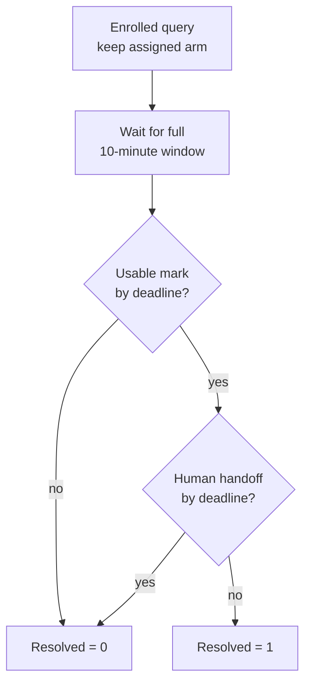

---
{
  "id": "experiment-design-ab-testing",
  "title": "Experiment Design and A/B Testing",
  "slug": "experiment-design-ab-testing",
  "section": "Classical ML & Evaluation",
  "category": "Evaluation & Benchmarks",
  "difficulty": "Easy",
  "order": 6,
  "coverImage": "illustrations/_generated/chapter_flow_dark.png",
  "companies": [
    "OpenAI",
    "Anthropic",
    "Google",
    "Meta"
  ],
  "shortDescription": "Design rigorous A/B tests for ML and LLM systems: multi-turn thread pinning, power planning, SRM, sequential tests, CUPED, judge calibration, and joint quality, latency, and cost guardrails.",
  "keyConceptsTested": [
    "control vs treatment and single-change isolation",
    "multi-turn thread pinning and SUTVA",
    "intention-to-treat and maturity windows",
    "power planning, MDE, and sample ratio mismatch",
    "peeking inflation, alpha spending, and mSPRT",
    "CUPED variance reduction and Thompson sampling",
    "paired prompt evaluation and LLM judge calibration",
    "joint quality, latency (TTFT/TPOT/p95), and cost guardrails"
  ],
  "aliases": [
    "ab-testing-online-evaluation-llms"
  ]
}
---

A customer asks your support assistant why a batch export throws HTTP 429 despite spare daily quota. The assistant writes a polite reply, yet cites the wrong doc, streams for ten seconds, and triggers a human escalation. Your team proposes adding a <span data-glossary="query-rewriting">query rewrite</span> step before retrieval. How do you know it genuinely resolves more issues rather than looking nicer in cherry-picked demos?

Building on [Decoding Algorithms](/learn/decoding-strategies-greedy-beam-nucleus), we isolate this retrieval change in a live RAG assistant with an <span data-glossary="ab-testing">A/B test</span>: randomly assign eligible conversations to **control** (raw query) or **treatment** (rewritten query), pin everything else, and evaluate resolution lift alongside safety, latency, and cost <span data-glossary="guardrail">guardrails</span> before shipping or <span data-glossary="rollback">rolling back</span>.

<figure>
  
  <figcaption>Only the retrieval query changes between arms. Control sends the raw user query; treatment rewrites it. Both arms share the same pinned index, prompt, and greedy decoder, logging one matured outcome per query unit.</figcaption>
</figure>

## Isolate one change and lock the metrics

Control sends the raw question to `rag-docs-v14`; treatment rewrites it into `batch export HTTP 429 burst rate limit retry configuration`. Everything else stays pinned (index, checkpoint, prompt, greedy decoder) so outcomes reflect only the rewrite step. Lock your design before traffic starts:[^kohavi2020]

| Element | Choice |
| --- | --- |
| Randomization unit | Conversation ID (pinned on first turn) |
| Primary metric | Resolved rate: usable answer and no human handoff within 10 minutes |
| Guardrail: grounding | 95% CI upper bound for grounding-failure delta `< +0.50 pp` (non-inferiority) |
| Guardrail: latency | <span data-glossary="p95-latency">p95 latency</span> delta `<= 150 ms` (timeouts included) and absolute p95 `<= 3,000 ms` |
| Guardrail: cost & load | Session cost delta `<= $0.010` (absolute `<= $0.080`); handoff delta `<= +0.50 pp` |
| Power & ship bar | `+2.0 pp` MDE at 80% <span data-glossary="statistical-power">power</span>; ship only if 95% CI lower bound `> 0`, lift `>= +2.0 pp`, and all guardrails pass |

Notice the two tests: the primary metric checks **superiority** (treatment beats control), while grounding checks **non-inferiority** (the upper bound rules out regressions as large as `+0.50 pp`).

## Pin multi-turn threads and preserve SUTVA

Never randomize individual chat turns. If turn 1 runs treatment and turn 2 flips to control, context, style, and retrieved chunks leak across arms and corrupt both UX and measurement. Separate telemetry by granularity: attach immediate reactions (code copies, thumbs down, regenerations) to `request_id`, and join delayed outcomes (task resolution, escalations) back to the immutable `(conversation_id, assigned_arm)` key.

Causal inference requires the **Stable Unit Treatment Value Assumption (SUTVA)**: no interference between units and no hidden treatment versions.[^hernanRobins2020WhatIf] In LLM products, interference sneaks in through shared customer accounts (one agent learns a fix from treatment and reuses it on control) and shared GPU / KV-cache queues (extra rewrite calls slow control requests; small canaries also suffer cold prefix-cache bias unless warm and cold latencies are tracked separately).[^kwon2023] When spillover happens within accounts, cluster-randomize by account and account for the **design effect** with cluster size $m$ and intraclass correlation $\rho_{\text{ICC}}$:[^clusterComposition2014][^microsoftCluster2020]

$$
\text{DEFF} = 1 + (m - 1)\rho_{\text{ICC}}
$$

At $m = 20$ queries per account and $\rho_{\text{ICC}} = 0.10$, variance inflates $2.9\times$, nearly tripling required traffic.

A <span data-glossary="stable-assignment">sticky router</span> hashes `(experiment_id, conversation_id)` with SHA-256 and persists the first-touch arm (via atomic insert-if-absent in production) so ramping new traffic from 10% to 50% never flips an active thread mid-conversation:

<!-- leetllm: test, output=show, output_title="Sticky multi-turn thread pinning" -->
```python title="sticky-thread-router.py"
import hashlib


class StickyRouter:
    def __init__(self):
        self.assignments: dict[tuple[str, str], str] = {}

    def assign(self, experiment_id: str, thread_id: str, fraction: float) -> str:
        key = (experiment_id, thread_id)
        if key not in self.assignments:
            digest = hashlib.sha256(f"{experiment_id}:{thread_id}".encode()).digest()[:8]
            bucket = int.from_bytes(digest, "big") / 2**64
            self.assignments[key] = "treatment" if bucket < fraction else "control"
        return self.assignments[key]


router = StickyRouter()
turn1 = router.assign("rag-query-rewrite:v1", "thread-7", fraction=0.10)
# Even after enrollment ramps to 50%, thread-7 keeps its initial arm.
turn2 = router.assign("rag-query-rewrite:v1", "thread-7", fraction=0.50)
print(f"thread-7 turn1={turn1}, turn2 (at 50% ramp)={turn2}, pinned={turn1 == turn2}")
for tid in ("qry-014", "qry-001", "qry-021"):
    print(f"{tid} -> {router.assign('rag-query-rewrite:v1', tid, fraction=0.50)}")
```

<!-- leetllm: output:start -->
```text title="Sticky multi-turn thread pinning" output compact
thread-7 turn1=control, turn2 (at 50% ramp)=control, pinned=True
qry-014 -> treatment
qry-001 -> treatment
qry-021 -> control
```
<!-- leetllm: output:end -->

High-risk LLM changes earn exposure progressively: **offline rubric check** -> **shadow mode** (users see control only; candidate runs side-effect-free with write tools disabled to test latency and errors) -> **canary** -> **full pinned A/B**.

### Protect the denominator: ITT and maturity windows

Two logging rules prevent silent bias when mapping raw events to resolution:

- **Intention-to-treat (ITT):** Keep every enrolled conversation in its assigned arm, including timed-out rewrites or model fallbacks. Dropping failed treatment calls discards its hardest queries and fabricates lift.
- **Wait for maturity:** A session observed for only 8 minutes is *pending*, not unresolved. Score sessions only after their full 10-minute window closes.



## Lift, intervals, unit mismatches, and power planning

Consider a matured experiment with `2,000` queries per arm:

| Variant | Queries | Resolved | Rate | p95 latency | Cost / session | Handoffs | Grounding failures |
| --- | ---: | ---: | ---: | ---: | ---: | ---: | ---: |
| Control (raw query) | 2,000 | 760 | 38.0% | 1,180 ms | \$0.042 | 310 | 22 |
| Treatment (rewritten) | 2,000 | 840 | 42.0% | 1,260 ms | \$0.048 | 306 | 23 |

Always label units: **absolute lift** is $\widehat{\Delta} = 0.42 - 0.38 = +4.0\text{ pp}$, while **relative lift** is $0.04 / 0.38 = +10.5\%$. Because the two arms enroll independent query sets, the standard error adds their Bernoulli variances:

$$
\text{SE}(\widehat{\Delta}) = \sqrt{\frac{\hat{p}_c(1 - \hat{p}_c)}{n_c} + \frac{\hat{p}_t(1 - \hat{p}_t)}{n_t}}
$$

Before traffic starts, size sample count $n$ per arm for a **minimum detectable effect (MDE)** $\delta$ at two-sided $\alpha = 0.05$ and power $1 - \beta = 0.80$:[^statsmodelsTwoPropPower2026]

$$
n \approx \frac{2p(1 - p)\left(z_{1 - \alpha/2} + z_{1 - \beta}\right)^2}{\delta^2}
$$

Because $\delta^2$ sits in the denominator, **halving MDE quadruples required traffic**. Also watch the **analysis-unit trap**: if a bad SQL join replicates every query across 4 chat turns ($4\times$ rows), estimated lift stays `+4.0 pp` while SE falsely halves by $\sqrt{4} = 2\times$. Aggregate strictly to **one row per randomization unit** (or use cluster-robust SEs) and run across at least one full 7-day weekly cycle so weekday/weekend mix shifts do not skew results.

<!-- leetllm: test, output=show, deps=numpy,scipy,statsmodels, output_title="CI, unit trap, and power sizing" -->
```python title="lift-interval-and-power.py"
from math import ceil
import numpy as np
from scipy.stats import norm
from statsmodels.stats.power import NormalIndPower
from statsmodels.stats.proportion import proportion_effectsize

p_c, p_t, z = 760 / 2000, 840 / 2000, float(norm.ppf(0.975))
lift = p_t - p_c
for copies, label in ((1, "unique queries (correct)"), (4, "4x turn rows (WRONG)")):
    se = np.sqrt((p_c * (1 - p_c) + p_t * (1 - p_t)) / (2000 * copies))
    print(f"{label:26s}: lift=+{lift*100:.1f} pp, SE={se*100:.2f} pp, 95% CI=[{(lift-z*se)*100:.1f}, {(lift+z*se)*100:.1f}] pp")

p0, mde = 0.38, 0.02
n_approx = ceil(2 * p0 * (1 - p0) * (z + norm.ppf(0.80)) ** 2 / mde**2)
n_exact = ceil(NormalIndPower().solve_power(proportion_effectsize(p0 + mde, p0), power=0.80, alpha=0.05))
print(f"Power sizing for MDE=+2.0 pp (80% power): shortcut={n_approx:,}/arm | statsmodels={n_exact:,}/arm")
```

<!-- leetllm: output:start -->
```text title="CI, unit trap, and power sizing" output compact
unique queries (correct)  : lift=+4.0 pp, SE=1.55 pp, 95% CI=[1.0, 7.0] pp
4x turn rows (WRONG)      : lift=+4.0 pp, SE=0.77 pp, 95% CI=[2.5, 5.5] pp
Power sizing for MDE=+2.0 pp (80% power): shortcut=9,246/arm | statsmodels=9,335/arm
```
<!-- leetllm: output:end -->

## Integrity checks: SRM, peeking, and sequential tests

Before inspecting any lift metric, check **<span data-glossary="sample-ratio-mismatch">sample ratio mismatch (SRM)</span>** on distinct randomized IDs using a chi-square goodness-of-fit test.[^kohavi2020][^microsoftSrm2020] If a 50/50 split logs `1,650` control vs `2,350` treatment units, $\chi^2 = 122.5$ ($p \approx 1.8 \times 10^{-28}$): halt immediately and fix routing, timeout drops, or bot filters rather than reading biased outcomes.

Next, never stop a fixed-horizon test the first time a live dashboard shows $|z| > 1.96$. Repeated peeking gives random-walk noise many chances to cross the boundary under a true zero effect:[^johari2017]

<!-- leetllm: test, output=show, deps=numpy,scipy, output_title="SRM and peeking inflation" -->
```python title="srm-and-peeking.py"
import numpy as np
from scipy.stats import chisquare, norm

chi2, p_srm = chisquare([1650, 2350], f_exp=[2000, 2000])
print(f"SRM check (1650 vs 2350): chi2={chi2:.1f}, p={p_srm:.2e}, alert={bool(chi2 > 10.83)}")

rng = np.random.default_rng(11)
trials, looks, batch, p_true = 5_000, 20, 100, 0.40
z_cut = float(norm.ppf(0.975))
n_grid = np.arange(1, looks + 1) * batch
p_c = np.cumsum(rng.binomial(batch, p_true, size=(trials, looks)), axis=1) / n_grid
p_t = np.cumsum(rng.binomial(batch, p_true, size=(trials, looks)), axis=1) / n_grid
se = np.sqrt((p_c * (1 - p_c) + p_t * (1 - p_t)) / n_grid)
crossed = (se > 0) & (np.abs(p_t - p_c) / np.where(se > 0, se, 1.0) > z_cut)
print(f"1 final look: {crossed[:, -1].mean():.1%} false wins | 20 peeks: {crossed.any(axis=1).mean():.1%} false wins")
```

<!-- leetllm: output:start -->
```text title="SRM and peeking inflation" output compact
SRM check (1650 vs 2350): chi2=122.5, p=1.79e-28, alert=True
1 final look: 5.3% false wins | 20 peeks: 24.7% false wins
```
<!-- leetllm: output:end -->

<figure>
  
  <figcaption>Under a true zero effect, peeking 20 times and stopping on the first $|z| > 1.96$ crossing inflates false positives from 5.3% to 24.7%.</figcaption>
</figure>

The same multiplicity trap hits teams slicing across 20 segments and celebrating one $p < 0.05$ win; adjust with Bonferroni or treat slices as follow-up hypotheses.[^nistBonferroni2026] For safe early stopping, use a sequential design:

- **Alpha spending (group sequential):** Budget cumulative Type I error across information fraction $t \in (0, 1]$. For a two-sided $\alpha$ test, **O'Brien-Fleming** spending allocates $2[1 - \Phi(\Phi^{-1}(1 - \alpha/4)/\sqrt{t})]$ per tail ($A(t) = 4[1 - \Phi(\Phi^{-1}(1 - \alpha/4)/\sqrt{t})]$ total), requiring extreme early evidence and keeping the final $z$ threshold near `1.96` (`2.045` at 6 equally spaced looks for $\alpha = 0.05$).[^gsdesign2026spending]
- **mSPRT:** Integrate the likelihood ratio over a mixing distribution $H(\theta)$: $\Lambda_n = \int \prod_{i=1}^n \frac{f_\theta(Y_i)}{f_0(Y_i)}\,dH(\theta)$.[^johari2021alwaysValid] Because $\Lambda_n$ is a nonnegative null martingale, **Ville's inequality** bounds $\mathbb{P}_0(\sup_{n \ge 1} \Lambda_n \ge 1/\alpha) \le \alpha$, yielding an **always-valid p-value** $p_n = \min(1, 1 / \max_{s \le n} \Lambda_s)$ calibrated at any stopping time.

## Speed up learning: CUPED and bandits

Instead of waiting weeks for more queries, **<span data-glossary="cuped">CUPED</span>** (Controlled-experiment Using Pre-Experiment Data) subtracts predictable baseline variation using a covariate $X$ frozen *before* assignment (such as an account's prior-month resolution rate):[^deng2013]

$$
Y_{\text{adj}} = Y - \theta\,(X - \bar{X}),
\qquad
\theta^* = \frac{\operatorname{Cov}(Y, X)}{\operatorname{Var}(X)},
\qquad
\operatorname{Var}(Y_{\text{adj}}) = \operatorname{Var}(Y)(1 - \rho^2)
$$

Because randomization keeps $\mathbb{E}[\bar{X}_t - \bar{X}_c] = 0$ and both arms share one pooled $\theta^*$, expected lift stays unbiased while variance shrinks by $\rho^2$. Never plug a post-assignment variable (like live rewrite latency) into CUPED, or you bias the causal effect.

<!-- leetllm: test, output=show, deps=numpy,scipy, output_title="CUPED variance reduction" -->
```python title="cuped-for-resolution.py"
import random
import numpy as np
from scipy.stats import pearsonr

rng = random.Random(27)
n = 20_000
arm = np.array([rng.randrange(2) for _ in range(n)])
prior_flag = np.array([rng.binomialvariate(1, 0.45) for _ in range(n)], dtype=float)
y = np.array([rng.binomialvariate(1, 0.18 + 0.46 * int(x) + 0.04 * int(a)) for x, a in zip(prior_flag, arm)], dtype=float)

theta = float(np.cov(y, prior_flag, ddof=1)[0, 1] / np.var(prior_flag, ddof=1))
y_adj = y - theta * (prior_flag - prior_flag.mean())

for name, vals in (("raw", y), ("CUPED", y_adj)):
    c, t = vals[arm == 0], vals[arm == 1]
    lift = float(t.mean() - c.mean())
    se = float(np.sqrt(c.var(ddof=1) / len(c) + t.var(ddof=1) / len(t)))
    print(f"{name:5s}: lift=+{lift*100:.2f} pp, SE={se*100:.2f} pp, 95% CI=[{(lift-1.96*se)*100:.2f}, {(lift+1.96*se)*100:.2f}] pp")
print(f"correlation={pearsonr(y, prior_flag)[0]:.3f} | variance reduced={1 - y_adj.var(ddof=1)/y.var(ddof=1):.1%}")
```

<!-- leetllm: output:start -->
```text title="CUPED variance reduction" output compact
raw  : lift=+4.68 pp, SE=0.70 pp, 95% CI=[3.32, 6.04] pp
CUPED: lift=+4.39 pp, SE=0.61 pp, 95% CI=[3.19, 5.59] pp
correlation=0.470 | variance reduced=22.1%
```
<!-- leetllm: output:end -->

<figure>
  
  <figcaption>Adjusting with a pre-experiment covariate ($\rho = 0.470$) cuts outcome variance by 22.1% and tightens the 95% confidence interval half-width from 1.36 pp to 1.20 pp.</figcaption>
</figure>

When your goal is minimizing cumulative regret $R(T) = \sum_{t=1}^T (\mu^* - \mu_{a_t})$ across transient variants (headlines or rotating prompts), a **multi-armed bandit** such as **Thompson Sampling** updates each arm's $\operatorname{Beta}(\alpha_k, \beta_k)$ posterior and routes to the highest posterior draw.[^russo2018ThompsonTutorial] Over 2,000 requests (`38%` vs `42%`), it routes roughly `77%` of traffic on average (median `~83%`) to the stronger arm automatically, trading off adaptive-stopping bias in naive means and thinner guardrail traffic unless you log propensities and use adaptive estimators.[^shin2019banditBias]

## Paired evaluation and the offline-to-online judge gap

Because prompt difficulty varies wildly in LLM workloads, offline evaluations gain precision by pairing both models on the *exact same prompt* (or **search interleaving** for ranked lists),[^chapelle2012] subtracting $2\operatorname{Cov}(Y_T, Y_C)$ from difference variance.

Offline screens never settle live traffic. Bridging the **offline-to-online gap** keeps two mechanisms distinct:

| Mechanism | Timing | Role | Latency impact |
| --- | --- | --- | --- |
| **Inline guardrail** | Synchronous, in request path | Block unsafe text or broken schemas before release (requires buffering streamed tokens) | Inside user latency budget |
| **Online <span data-glossary="llm-as-judge">LLM-as-a-judge</span>** | Asynchronous, on sampled traces | Track quality and grounding drift off the critical path using the same pinned rubric | Zero direct request delay |

Treat LLM judges as triage, never ground truth. Always randomize A/B display order to cancel <span data-glossary="position-bias">position bias</span>, slice disagreements by length for verbosity bias, isolate untrusted candidate text inside escaped JSON with zero tools (preventing prompt injection against the judge), and calibrate the pinned judge against rotating human labels.[^zheng2023]

Measure both chance-corrected **Cohen's kappa** $\kappa = (p_o - p_e) / (1 - p_e)$ and a **95% Wilson CI** on human-judge agreement before trusting judge trends online. Watch an 8-example calibration check fall short of an 80% threshold:

<!-- leetllm: test, output=show, deps=numpy,scipy, output_title="Judge calibration against human labels" -->
```python title="judge-calibration-check.py"
import numpy as np
from scipy.stats import norm

human = np.array(["A", "B", "A", "TIE", "B", "A", "B", "B"])
judge = np.array(["A", "B", "B", "TIE", "B", "A", "A", "B"])
n = len(human)
agree = float(np.mean(human == judge))
p_exp = sum(float(np.mean(human == c) * np.mean(judge == c)) for c in ("A", "B", "TIE"))
kappa = (agree - p_exp) / (1.0 - p_exp)

z = float(norm.ppf(0.975))
denom = 1.0 + z**2 / n
center = (agree + z**2 / (2.0 * n)) / denom
margin = (z / denom) * np.sqrt((agree * (1.0 - agree) + z**2 / (4.0 * n)) / n)
print(f"agreement: {int(np.sum(human == judge))}/{n} = {agree:.1%} (95% Wilson CI [{center-margin:.1%}, {center+margin:.1%}])")
print(f"Cohen's kappa: {kappa:.3f} | verdict: {'enable online judge' if agree >= 0.80 else 'recalibrate judge'}")
```

<!-- leetllm: output:start -->
```text title="Judge calibration against human labels" output compact
agreement: 6/8 = 75.0% (95% Wilson CI [40.9%, 92.9%])
Cohen's kappa: 0.579 | verdict: recalibrate judge
```
<!-- leetllm: output:end -->

`6/8 = 75.0%` ($\kappa = 0.579$) spans `[40.9%, 92.9%]` and misses the 80% bar, halting judge trust until the rubric is recalibrated.

## Joint quality, latency, and cost guardrails

Verbose reasoning chains or extra rewrite hops can buy `+4.0 pp` resolution at unacceptable latency or inference spend. Put **quality, latency, and unit cost** inside one unified launch decision:

- **Name streaming latencies precisely:** track **<span data-glossary="ttft">Time to First Token (TTFT)</span>**, inter-token latency (**ITL**), and **TPOT** = `(latency - TTFT) / (output_tokens - 1)`, pinned to the exact same client definition across arms.[^vllm2026benchmarkServeImplementation]
- **Pair relative non-inferiority with absolute SLO ceilings:** compare treatment against concurrent control (never stale historical baselines), *and* halt if both arms breach an absolute ceiling (two arms both at 3.5s against a 3.0s SLO have zero delta yet still fail users).
- **Pause on missing telemetry:** if cost or safety telemetry reports `None` or `NaN`, pause exposure immediately rather than assuming pass.

Combine every check on our 2,000-query worked experiment into one transparent launch scorecard:

<!-- leetllm: test, output=show, deps=numpy,scipy,statsmodels, output_title="Joint launch scorecard" -->
```python title="launch-decision.py"
from statsmodels.stats.proportion import confint_proportions_2indep

report = {
    "control":   {"n": 2000, "resolved": 760, "p95_ms": 1180, "cost_usd": 0.042, "handoffs": 310, "grounding_fail": 22},
    "treatment": {"n": 2000, "resolved": 840, "p95_ms": 1260, "cost_usd": 0.048, "handoffs": 306, "grounding_fail": 23},
    "min_ship_lift": 0.02,
    "srm_alert": False,
}
if report["srm_alert"]:
    raise ValueError("Investigate SRM before reading lift")

c, t = report["control"], report["treatment"]
lift = t["resolved"] / t["n"] - c["resolved"] / c["n"]
lift_lo, _ = confint_proportions_2indep(t["resolved"], t["n"], c["resolved"], c["n"], method="wald", compare="diff")
ground_delta = t["grounding_fail"] / t["n"] - c["grounding_fail"] / c["n"]
_, ground_hi = confint_proportions_2indep(t["grounding_fail"], t["n"], c["grounding_fail"], c["n"], method="wald", compare="diff")
lat_delta = t["p95_ms"] - c["p95_ms"]
cost_delta = t["cost_usd"] - c["cost_usd"]
handoff_delta = t["handoffs"] / t["n"] - c["handoffs"] / c["n"]

checks = {
    "traffic_integrity":        not report["srm_alert"],
    "positive_lift_interval":   lift_lo > 0,
    "observed_lift_threshold":  lift >= report["min_ship_lift"],
    "latency_delta_and_slo":    lat_delta <= 150 and t["p95_ms"] <= 3000,
    "cost_per_session_budget":  cost_delta <= 0.010 and t["cost_usd"] <= 0.080,
    "handoff_budget":           handoff_delta <= 0.005,
    "grounding_noninferiority": ground_hi < 0.005,
}
for name, ok in checks.items():
    print(f"{name:26s}: {'PASS' if ok else 'FAIL'}")
print(f"lift=+{lift*100:.1f} pp (lo=+{lift_lo*100:.1f} pp) | latency=+{lat_delta} ms | cost=+${cost_delta:.3f} | grounding=+{ground_delta*100:.2f} pp (hi=+{ground_hi*100:.2f} pp)")
print("decision:", "SHIP" if all(checks.values()) else "HOLD AND INVESTIGATE")
```

<!-- leetllm: output:start -->
```text title="Joint launch scorecard" output compact
traffic_integrity         : PASS
positive_lift_interval    : PASS
observed_lift_threshold   : PASS
latency_delta_and_slo     : PASS
cost_per_session_budget   : PASS
handoff_budget            : PASS
grounding_noninferiority  : FAIL
lift=+4.0 pp (lo=+1.0 pp) | latency=+80 ms | cost=+$0.006 | grounding=+0.05 pp (hi=+0.70 pp)
decision: HOLD AND INVESTIGATE
```
<!-- leetllm: output:end -->

<figure>
  
  <figcaption>Resolution lift (+4.0 pp), latency (+80 ms), and session cost (+\$0.006) clear their targets, yet the grounding-failure upper bound (+0.70 pp) crosses the +0.50 pp non-inferiority budget, holding the launch for more evidence.</figcaption>
</figure>

Even though grounding failures barely moved (`1.10%` vs `1.15%`, `+0.05 pp`), at 22 vs 23 failures per 2,000 queries the 95% interval spans `[-0.60, +0.70]` pp and cannot rule out a `+0.50 pp` regression. Never extend a fixed-horizon test quietly until it passes; run a powered confirmatory test or predeclared sequential design.[^johari2021alwaysValid]

> **Key insight:** Statistical significance on one primary metric never overrides broken randomization (SRM), uncalibrated judges, or an unconfirmed safety, latency, or unit-cost guardrail.

```checkpoint
Both arms measure a steady 3.5-second p95 latency against a 3.0-second service limit (0 ms treatment delta). Does the latency guardrail pass?
---
No. Zero difference relative to control shows no extra slowdown from treatment, but both arms violate the absolute 3.0-second SLO. Halt exposure and investigate the shared cluster issue.
```

```mastery-quiz
[
  {
    "question": "A multi-turn assistant hashes (experiment_id, conversation_id) on turn 1 at 10% rollout and stores the assigned arm. Later, new-conversation enrollment ramps to 50%, and 10% of treatment rewrites time out. Which handling preserves valid causal inference?",
    "options": [
      "Keep existing threads on their stored arm across turns and retain timed-out treatment conversations in treatment (intention-to-treat).",
      "Re-hash existing threads at 50% on turn 2 and drop timed-out treatment conversations from the denominator.",
      "Randomize each turn independently and reassign timed-out treatment calls to control.",
      "Keep existing threads pinned, but drop timed-out treatment conversations because users never saw a rewritten query."
    ],
    "answer": "Keep existing threads on their stored arm across turns and retain timed-out treatment conversations in treatment (intention-to-treat).",
    "explanation": "Persisting the first-touch assignment prevents mid-thread contamination during ramps, and intention-to-treat avoids post-assignment selection bias from discarding treatment's hardest failures."
  },
  {
    "question": "A faulty SQL join replicates every randomized query into 9 turn rows in both arms, and an analyst also wants to shrink MDE from 3 pp to 1 pp on a clean query-level dataset. What happens to the inflated SE and the required sample size, respectively?",
    "options": [
      "Replicating 9x shrinks calculated SE incorrectly by 3x; cutting MDE 3x increases required sample size 9x.",
      "Replicating 9x shrinks calculated SE incorrectly by 9x; cutting MDE 3x triples required sample size.",
      "Replicating 9x multiplies lift by 9x; cutting MDE 3x increases required sample size 9x.",
      "Replicating 9x leaves SE unchanged; cutting MDE 3x increases required sample size 6x."
    ],
    "answer": "Replicating 9x shrinks calculated SE incorrectly by 3x; cutting MDE 3x increases required sample size 9x.",
    "explanation": "Inflating n by 9 divides SE by sqrt(9) = 3 while leaving rates unchanged. Because sample size scales as 1 / MDE^2, dividing MDE by 3 multiplies required traffic by 3^2 = 9."
  },
  {
    "question": "In CUPED, Var(Y) = 25, Var(X) = 4, and Cov(Y, X) = 6 for a pre-experiment covariate X. What optimal theta and adjusted variance follow?",
    "options": [
      "theta = 1.5; adjusted variance = 16.",
      "theta = 1.5; adjusted variance = 10.",
      "theta = 0.24; adjusted variance = 16.",
      "theta = 1.5; adjusted variance = 9."
    ],
    "answer": "theta = 1.5; adjusted variance = 16.",
    "explanation": "Optimal theta = Cov(Y, X) / Var(X) = 6 / 4 = 1.5. Correlation is 6 / (5 * 2) = 0.6, so adjusted variance is 25 * (1 - 0.36) = 16."
  },
  {
    "question": "How should an online LLM-as-a-judge evaluator relate to inline safety filters and human labels?",
    "options": [
      "Run inline filters synchronously before streaming, run the pinned judge asynchronously on sampled traces, and calibrate judge agreement against human labels before trusting trends.",
      "Run the LLM judge synchronously on every token before streaming and skip human calibration once offline win rate exceeds 60%.",
      "Replace inline safety filters with asynchronous LLM judging to save TTFT.",
      "Pass candidate replies directly inside the judge's system prompt without swapping A/B order."
    ],
    "answer": "Run inline filters synchronously before streaming, run the pinned judge asynchronously on sampled traces, and calibrate judge agreement against human labels before trusting trends.",
    "explanation": "Inline checks block unsafe responses before users see tokens; asynchronous judges monitor quality drift off the critical path and require order swapping, payload isolation, and human calibration (agreement, Cohen's kappa, Wilson CI)."
  },
  {
    "question": "At the planned final look, 8 of 1,000 control checks and 9 of 1,000 treatment checks fail grounding. Non-inferiority requires the 95% CI upper bound (t - c) + 1.96 * SE to stay below +0.50 pp, while session cost rose +\\$0.004 (limit +\\$0.010). What upper bound and launch decision follow?",
    "options": [
      "Upper bound +0.90 pp; hold launch because grounding non-inferiority fails.",
      "Upper bound +0.10 pp; ship because cost and point difference are below budget.",
      "Upper bound +0.41 pp; ship because all guardrails clear.",
      "Upper bound +0.90 pp; extend the fixed-horizon test by 500 queries and re-check the same interval."
    ],
    "answer": "Upper bound +0.90 pp; hold launch because grounding non-inferiority fails.",
    "explanation": "Rates are 0.8% and 0.9% (+0.10 pp), SE = sqrt(0.008*0.992/1000 + 0.009*0.991/1000) = 0.411 pp, giving upper bound 0.10 + 1.96 * 0.411 = +0.90 pp > +0.50 pp. Extending a fixed-horizon test after peeking invalidates nominal coverage."
  }
]
```

> **Next:** Continue to [Feature Engineering & Point-in-Time Pipelines](/learn/feature-engineering-production-ml).
