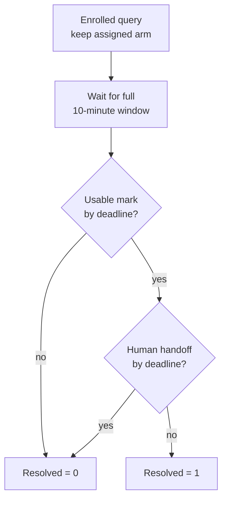

---
{
  "id": "experiment-design-ab-testing",
  "title": "Experiment Design and A/B Testing",
  "slug": "experiment-design-ab-testing",
  "section": "ML Algorithms & Evaluation",
  "category": "Evaluation & Benchmarks",
  "difficulty": "Medium",
  "order": 12,
  "coverImage": "illustrations/_generated/chapter_flow_dark.png",
  "companies": [
    "OpenAI",
    "Anthropic",
    "Google",
    "Meta"
  ],
  "shortDescription": "Design rigorous A/B tests for ML and LLM systems: randomization units, power planning, SRM checks, sequential testing, CUPED, bandits, and guardrail decisions.",
  "keyConceptsTested": [
    "control and treatment",
    "randomization unit and SUTVA",
    "primary and guardrail metrics",
    "absolute and relative lift",
    "confidence intervals and power planning",
    "sample ratio mismatch",
    "sequential testing and mSPRT",
    "CUPED variance reduction",
    "multi-armed bandits and interleaving"
  ]
}
---

A customer asks your technical support assistant why an API batch export throws HTTP 429 even when the dashboard shows spare daily quota. The assistant writes a crisp, polite reply, yet cites the wrong configuration guide, takes ten seconds to stream, and sends the customer to a human agent five minutes later. Your team proposes adding a <span data-glossary="query-rewriting">query rewrite</span> step ahead of retrieval. How do you know whether it genuinely helps users rather than just sounding nicer in a few cherry-picked demos?

In [Decoding Algorithms](/learn/decoding-algorithms), you saw how decoding choices shape generated text. Here we isolate an upstream retrieval change in a live customer-support RAG assistant using an <span data-glossary="ab-testing">A/B test</span> (randomized controlled experiment): randomly assign eligible queries to the existing pipeline (**control**) or the query-rewriting pipeline (**treatment**), keep every other component fixed, and measure both resolution gains and safety <span data-glossary="guardrail">guardrails</span> before deciding whether to ship, investigate, or <span data-glossary="rollback">roll back</span>.

<figure>
  
  <figcaption>Only the retrieval query changes between arms. Control sends the raw user query; treatment rewrites it. Both arms share the same pinned index, prompt, and greedy decoder, logging one matured outcome per query unit.</figcaption>
</figure>

## Test one change at a time

Take a concrete incoming request:

> My batch export returns HTTP 429 after two retries even though our dashboard still shows spare daily quota. Which setting should I change?

Control sends this raw text straight to the retriever. Treatment first rewrites it into `batch export HTTP 429 burst rate limit retry configuration`. Every downstream piece stays identical across both arms so any difference in outcomes traces cleanly back to the rewrite step:

| Component | Control | Treatment | Why pin it |
| --- | --- | --- | --- |
| Retrieval query | Raw user query | Rewritten query | The single intentional change |
| Knowledge-base index | `rag-docs-v14` | `rag-docs-v14` | Different corpora confound retrieval gains |
| Generator & prompt | Same pinned version | Same pinned version | Prompt edits cannot masquerade as retrieval wins |
| Decoder | Greedy, fixed schema | Greedy, fixed schema | Identical decoding and output structure |

Before traffic arrives, lock down your hypothesis, primary metric, guardrails, and stopping rule:[^kohavi2020]

| Design element | Choice |
| --- | --- |
| Randomization unit | Query session ID (enrolled on first message) |
| Primary metric | Resolved query rate: usable answer within 10 minutes and no human handoff within 10 minutes |
| Guardrail: grounding | Upper bound of 95% CI for grounding-failure increase must stay below `+0.5 pp` (non-inferiority) |
| Guardrail: speed | <span data-glossary="p95-latency">p95 latency</span> increase must not exceed `150 ms` (including timed-out calls) |
| Guardrail: support load | Human-handoff rate increase must not exceed `+0.5 pp` |
| Power planning MDE | `+2.0 pp` minimum detectable effect at 80% <span data-glossary="statistical-power">statistical power</span> |
| Ship bar | 95% CI lower bound $> 0$, observed lift $\ge +2.0$ pp, and all guardrails pass |

Notice the distinction between two rules. The primary metric checks whether treatment *beats* control; the grounding guardrail is a **non-inferiority** check asking whether the data rule out a safety regression as large as `+0.5 pp`.

## Assign each query unit once

Randomize at the **query session ID**, never at individual chat turns. If turn one gets treatment and turn two gets control, the follow-up depends directly on the rewritten first answer, mixing both policies inside one conversation.

Causal inference formalizes clean arm separation through the **Stable Unit Treatment Value Assumption (SUTVA)**:[^hernanRobins2020WhatIf]

1. **No interference:** Unit $i$'s outcome depends only on unit $i$'s own assignment, not another unit's.
2. **No hidden treatment versions:** Each arm delivers one consistent policy.

Two real-world interference channels frequently appear in AI products: **behavioral spillover** (a support agent learns a fix from a treatment answer and applies it 20 minutes later on a control query) and **shared compute contention** (extra LLM rewrite calls saturate shared GPUs and slow down control requests). When strong spillovers happen inside customer accounts, cluster-randomize at the account level. For equal clusters of size $m$ with intraclass correlation $\rho_{\text{ICC}}$, clustering inflates variance by the **design effect**:[^clusterComposition2014][^microsoftCluster2020]

$$
\text{DEFF} = 1 + (m - 1)\rho_{\text{ICC}}
$$

With $m = 20$ queries per account and $\rho_{\text{ICC}} = 0.10$, effective variance jumps by $2.9\times$, so you need nearly triple the queries to match query-level precision.

A <span data-glossary="stable-assignment">stable hash</span> combining an experiment salt and the query ID guarantees every follow-up turn lands in the same arm without maintaining a routing database:

<!-- leetllm: test, output=show, deps=numpy, output_title="Stable query assignment" -->
```python title="stable-assignment.py"
import hashlib

EXPERIMENT = "rag-query-rewrite:v1"

def arm_for(query_id: str) -> str:
    bucket = int.from_bytes(hashlib.sha256(f"{EXPERIMENT}:{query_id}".encode()).digest()[:8], "big") % 100
    return "treatment" if bucket < 50 else "control"

for qid in ("qry-014", "qry-014", "qry-001", "qry-021"):
    print(f"{qid} -> {arm_for(qid)}")
```

<!-- leetllm: output:start -->
```text title="Stable query assignment" output compact
qry-014 -> treatment
qry-014 -> treatment
qry-001 -> treatment
qry-021 -> control
```
<!-- leetllm: output:end -->

```checkpoint
Why should one query session keep the same experiment assignment across all follow-ups?
---
Switching arms between turns exposes one conversation to a mix of both policies and breaks the no-interference assumption. Hashing the session ID keeps assignment sticky across turns.
```

## Define an outcome from events

A fluent answer is not a resolved ticket. Here a query counts as **resolved** only when it receives a usable-answer mark within 10 minutes of enrollment *and* triggers no human-agent handoff during that 10-minute window.

Two rules protect the denominator from silent bias:

- **Intention-to-treat (ITT):** Keep every enrolled query in its assigned arm, including queries where the treatment rewrite timed out. Dropping failed rewrites selects on a post-assignment event and biases treatment upward by discarding its hardest failures.
- **Wait for maturity:** A query observed for only 9 minutes is *pending*, not unresolved. Evaluate queries only after their full 10-minute window closes.



Trace how six matured event rows map to resolution:

<!-- leetllm: test, output=show, deps=numpy, output_title="Outcome definition on event rows" -->
```python title="define-resolution.py"
rows = [
    {"arm": "control",   "solved": True,  "handoff_min": None, "observed_min": 20},
    {"arm": "control",   "solved": True,  "handoff_min": 4,    "observed_min": 20},
    {"arm": "control",   "solved": False, "handoff_min": 2,    "observed_min": 20},
    {"arm": "treatment", "solved": True,  "handoff_min": None, "observed_min": 20},
    {"arm": "treatment", "solved": True,  "handoff_min": 18,   "observed_min": 20},
    {"arm": "treatment", "solved": True,  "handoff_min": 6,    "observed_min": 20},
]

def is_resolved(row):
    if row["observed_min"] < 10:
        return None
    early_handoff = row["handoff_min"] is not None and row["handoff_min"] <= 10
    return row["solved"] and not early_handoff

for arm in ("control", "treatment"):
    arm_rows = [r for r in rows if r["arm"] == arm]
    print(f"{arm:9s}: resolved={sum(is_resolved(r) for r in arm_rows)}/{len(arm_rows)}")

print("observed 9m ->", is_resolved({**rows[0], "observed_min": 9}))
print("handoff at 10m ->", is_resolved({**rows[0], "handoff_min": 10}))
```

<!-- leetllm: output:start -->
```text title="Outcome definition on event rows" output compact
control  : resolved=1/3
treatment: resolved=2/3
observed 9m -> None
handoff at 10m -> False
```
<!-- leetllm: output:end -->

Notice that `handoff_min = 18` still counts as resolved under the 10-minute rule, while `handoff_min = 10` disqualifies it. If longer-term escalations matter, add a secondary 24-hour escalation metric rather than changing the primary definition mid-test.

## Read lift from counts

Now inspect a worked experiment summary with 2,000 matured queries per arm:

| Variant | Queries | Resolved | Resolution rate | p95 latency | Human handoffs | Grounding failures |
| --- | ---: | ---: | ---: | ---: | ---: | ---: |
| Control (raw query) | 2,000 | 760 | 38.0% | 1,180 ms | 310 | 22 |
| Treatment (rewritten) | 2,000 | 840 | 42.0% | 1,260 ms | 306 | 23 |

Always state lift units explicitly. **Absolute lift** subtracts the two rates in percentage points (pp), while **relative lift** divides by the control baseline:

$$
\widehat{\Delta} = \hat{p}_{\text{treatment}} - \hat{p}_{\text{control}} = \frac{840}{2000} - \frac{760}{2000} = +0.04 \text{ (+4.0 pp)}, \qquad \text{relative lift} = \frac{0.04}{0.38} \approx +10.5\%
$$

Calling a 10.5% relative lift "up 10.5 points" is one of the most common reporting errors in product reviews.

```checkpoint
Treatment resolves 840 of 2,000 queries and control resolves 760 of 2,000. What are the absolute and relative lifts?
---
Absolute lift is +4.0 percentage points (42.0% minus 38.0%). Relative lift is 4.0 / 38.0 = +10.5%.
```

## Put uncertainty around the lift

Because fresh traffic introduces sampling noise, every point estimate needs a confidence interval. Unlike paired prompts in [Hypothesis Tests, Intervals, and pass@k](/learn/hypothesis-tests-confidence-intervals-passk), the two arms enroll independent query sets, so the variance of the difference adds the two Bernoulli sampling variances:

$$
\text{SE}(\widehat{\Delta}) = \sqrt{\frac{\hat{p}_c(1 - \hat{p}_c)}{n_c} + \frac{\hat{p}_t(1 - \hat{p}_t)}{n_t}}
$$

Multiplying by $z_{0.975} \approx 1.96$ yields an approximate two-sided 95% confidence interval:

<!-- leetllm: test, output=show, deps=numpy,scipy, output_title="Lift and 95% confidence interval" -->
```python title="resolution-lift-interval.py"
import numpy as np
from scipy.stats import norm

p_c, p_t = 760 / 2000, 840 / 2000
lift = p_t - p_c
se = np.sqrt(p_c * (1 - p_c) / 2000 + p_t * (1 - p_t) / 2000)
margin = norm.ppf(0.975) * se

print(f"absolute lift: +{lift*100:.1f} pp (relative: +{lift/p_c*100:.1f}%)")
print(f"SE: {se*100:.2f} pp | 95% CI: [{(lift - margin)*100:.1f}, {(lift + margin)*100:.1f}] pp")
```

<!-- leetllm: output:start -->
```text title="Lift and 95% confidence interval" output compact
absolute lift: +4.0 pp (relative: +10.5%)
SE: 1.55 pp | 95% CI: [1.0, 7.0] pp
```
<!-- leetllm: output:end -->

The 95% interval spans `[+1.0, +7.0]` percentage points, clearing zero cleanly.

## More rows aren't always more evidence

Suppose a SQL join accidentally duplicates every query outcome across four chat-turn rows. The estimated rates stay identical (`38%` vs `42%`), yet feeding $4 \times 2{,}000 = 8{,}000$ rows into the standard error formula cuts SE in half and invents fake precision:

<!-- leetllm: test, output=show, deps=numpy,scipy, output_title="Duplicate rows create false precision" -->
```python title="check-analysis-unit.py"
import numpy as np
from scipy.stats import norm

p_c, p_t, z = 0.38, 0.42, norm.ppf(0.975)
for copies, label in ((1, "unique queries (correct)"), (4, "4x duplicated turn rows (WRONG)")):
    se = np.sqrt((p_c * (1 - p_c) + p_t * (1 - p_t)) / (2000 * copies))
    print(f"{label:32s}: SE={se*100:.2f} pp, 95% CI=[{(0.04 - z*se)*100:.1f}, {(0.04 + z*se)*100:.1f}] pp")
```

<!-- leetllm: output:start -->
```text title="Duplicate rows create false precision" output compact
unique queries (correct)        : SE=1.55 pp, 95% CI=[1.0, 7.0] pp
4x duplicated turn rows (WRONG) : SE=0.77 pp, 95% CI=[2.5, 5.5] pp
```
<!-- leetllm: output:end -->

Always aggregate telemetry to **one row per randomization unit** before running inference (or use cluster-robust standard errors when randomizing accounts).[^microsoftCluster2020]

## Plan for a meaningful win

Before starting traffic, size your experiment around a **minimum detectable effect (MDE)** $\delta$ with false-positive rate $\alpha$ (commonly `0.05` two-sided) and **statistical power** $1 - \beta$ (commonly `0.80`):

$$
n \approx \frac{2p(1-p)\left(z_{1-\alpha/2} + z_{1-\beta}\right)^2}{\delta^2}
$$

Because $\delta^2$ sits in the denominator, **halving the MDE quadruples required traffic**. Notice that 2,000 queries per arm was large enough to detect a huge `+4.0 pp` jump, but powering an experiment for a `+2.0 pp` MDE around baseline $p = 0.38$ requires over 9,200 queries per arm:[^statsmodelsTwoPropPower2026]

<!-- leetllm: test, output=show, deps=numpy,scipy,statsmodels, output_title="Power planning and interval width" -->
```python title="plan-sample-size.py"
from math import ceil
import numpy as np
from scipy.stats import norm
from statsmodels.stats.proportion import proportion_effectsize
from statsmodels.stats.power import NormalIndPower

p0, mde, alpha, power = 0.38, 0.02, 0.05, 0.80
z_a, z_b = norm.ppf(1 - alpha / 2), norm.ppf(power)
n_approx = ceil(2 * p0 * (1 - p0) * (z_a + z_b) ** 2 / mde**2)
n_exact = ceil(NormalIndPower().solve_power(proportion_effectsize(p0 + mde, p0), power=power, alpha=alpha))

print(f"For MDE=+2.0 pp at 80% power -> shortcut: {n_approx:,}/arm | statsmodels: {n_exact:,}/arm")
for n in (200, 500, 2000):
    se = np.sqrt((0.38 * 0.62 + 0.42 * 0.58) / n)
    print(f"n={n:4d}/arm (at +4.0 pp) -> 95% CI: [{(0.04 - z_a*se)*100:+4.1f}, {(0.04 + z_a*se)*100:+4.1f}] pp")
```

<!-- leetllm: output:start -->
```text title="Power planning and interval width" output compact
For MDE=+2.0 pp at 80% power -> shortcut: 9,246/arm | statsmodels: 9,335/arm
n= 200/arm (at +4.0 pp) -> 95% CI: [-5.6, +13.6] pp
n= 500/arm (at +4.0 pp) -> 95% CI: [-2.1, +10.1] pp
n=2000/arm (at +4.0 pp) -> 95% CI: [+1.0, +7.0] pp
```
<!-- leetllm: output:end -->

> **Key insight:** Also run every live experiment across at least one full weekly cycle (7 or 14 days). Hitting your sample-size target during a single Tuesday traffic spike misses weekday-versus-weekend shifts.

## Check traffic before outcomes

Before reading any lift number, verify that observed arm counts match the planned allocation using a chi-square goodness-of-fit test for **<span data-glossary="sample-ratio-mismatch">sample ratio mismatch (SRM)</span>**.[^kohavi2020][^microsoftSrm2020] Suppose a 50/50 split logs 1,650 control queries and 2,350 treatment queries:

<!-- leetllm: test, output=show, deps=numpy,scipy, output_title="Sample ratio integrity check" -->
```python title="check-assignment-split.py"
import numpy as np
from scipy.stats import chisquare

observed = np.array([1650, 2350])
expected = np.full(2, observed.sum() / 2.0)
chi2, p_val = chisquare(observed, f_exp=expected)

print(f"observed={observed.tolist()} | chi2={chi2:.1f} (p={p_val:.2e}) | SRM alert={bool(chi2 > 10.83)}")
```

<!-- leetllm: output:start -->
```text title="Sample ratio integrity check" output compact
observed=[1650, 2350] | chi2=122.5 (p=1.79e-28) | SRM alert=True
```
<!-- leetllm: output:end -->

A chi-square of `122.5` ($p \approx 10^{-28}$) means your randomization or logging is broken (dropped timeouts, bot filtering differences, or hashing bugs). Stop immediately and fix instrumentation before looking at outcomes. Always run the SRM test on distinct randomized query IDs rather than raw turn counts.

## Don't stop the first time noise looks good

Suppose control and treatment have the *exact same* true resolution rate (`40%`). A single planned two-sided 5% test triggers a false positive 5% of the time. What happens if you peek after every 100 new queries per arm and stop the first time $|z| > 1.96$?[^johari2017]

<!-- leetllm: test, output=show, deps=numpy,scipy, output_title="Peeking simulation" -->
```python title="simulate-peeking.py"
import numpy as np
from scipy.stats import norm

rng = np.random.default_rng(11)
trials, looks, batch, p_true = 5_000, 20, 100, 0.40
z_cut = float(norm.ppf(0.975))

ctrl = rng.binomial(batch, p_true, size=(trials, looks))
trt = rng.binomial(batch, p_true, size=(trials, looks))
n_grid = np.arange(1, looks + 1) * batch
p_c, p_t = np.cumsum(ctrl, axis=1) / n_grid, np.cumsum(trt, axis=1) / n_grid
se = np.sqrt((p_c * (1 - p_c) + p_t * (1 - p_t)) / n_grid)
crossed = (se > 0) & (np.abs(p_t - p_c) / np.where(se > 0, se, 1.0) > z_cut)

print(f"1 planned final look:   {crossed[:, -1].mean():.1%} false positives")
for k in (5, 10, 20):
    step = looks // k
    print(f"peeking across {k:2d} looks: {crossed[:, step - 1 :: step].any(axis=1).mean():.1%} false positives")
```

<!-- leetllm: output:start -->
```text title="Peeking simulation" output compact
1 planned final look:   5.3% false positives
peeking across  5 looks: 14.2% false positives
peeking across 10 looks: 19.2% false positives
peeking across 20 looks: 24.7% false positives
```
<!-- leetllm: output:end -->

<figure>
  
  <figcaption>Under a true zero effect, peeking 20 times and stopping on the first $|z| > 1.96$ crossing inflates false positives from 4.6% to 24.9%.</figcaption>
</figure>

The same multiplicity trap hits teams that slice results across 20 customer segments and celebrate whichever one lands at $p < 0.05$. Predeclare your hypothesis family and apply a multiple-testing adjustment such as Bonferroni, or treat exploratory slices strictly as follow-up hypotheses.[^nistBonferroni2026]

```checkpoint
Why can't a fixed-horizon A/B test stop the first time a standard 95% confidence interval excludes zero?
---
Repeated unplanned peeking gives random walk noise many chances to cross 1.96, inflating the true false-positive rate from 5% to roughly 25% over 20 looks.
```

## Sequential testing and continuous monitoring

If you want live dashboards that allow safe early stopping without inflating Type I error, use one of two sequential frameworks:

### 1. Alpha spending (group sequential designs)

An **alpha spending function** $A(t)$ budgets cumulative false-alarm probability across information fraction $t = I_n / I_{\max} \in (0, 1]$ with $A(1) = \alpha$. The **O'Brien-Fleming** spending curve spends almost zero $\alpha$ early (requiring dramatic early evidence to stop) and saves most of the budget for the final look:[^gsdesign2026spending]

$$
A(t) = 2\left[1 - \Phi\left(\frac{\Phi^{-1}(1 - \alpha/2)}{\sqrt{t}}\right)\right]
$$

Interim critical boundaries must be solved jointly for the correlated look process (for example, a 6-look O'Brien-Fleming design tightens the final $z$ threshold from `1.96` to roughly `2.045`).[^gsdesign2026spending]

### 2. Mixture Sequential Probability Ratio Tests (mSPRT)

For continuous, anytime-valid monitoring after *every* observation, **mSPRT** integrates the likelihood ratio over a predeclared mixing distribution $H(\theta)$ of alternatives:[^johari2021alwaysValid]

$$
\Lambda_n = \int \prod_{i=1}^n \frac{f_\theta(Y_i)}{f_0(Y_i)}\, dH(\theta)
$$

Because $\Lambda_n$ is a nonnegative martingale under the null with $\mathbb{E}_0[\Lambda_n] = 1$, **Ville's inequality** bounds its running maximum forever:

$$
\mathbb{P}_0\left(\sup_{n \ge 1} \Lambda_n \ge \frac{1}{\alpha}\right) \le \alpha
$$

This yields an **always-valid p-value** $p_n = \min\left(1, 1 / \max_{0 \le s \le n} \Lambda_s\right)$ that remains calibrated no matter when you choose to peek or stop. Watch a Bernoulli mSPRT track 10 successes followed by 10 failures against null rate $p_0 = 0.40$:

<!-- leetllm: test, output=show, deps=numpy, output_title="Always-valid mSPRT tracking" -->
```python title="known-null-mixture-test.py"
import numpy as np

p0 = 0.40
alts = np.array([0.20, 0.60])
outcomes = np.array([1] * 10 + [0] * 10)

inc = np.where(outcomes[:, None] == 1, alts / p0, (1 - alts) / (1 - p0))
lr = np.cumprod(inc, axis=0).mean(axis=1)
peak = np.maximum.accumulate(np.maximum(1.0, lr))

for n in (10, 20):
    print(f"n={n:2d}: current LR={lr[n-1]:6.3f} | peak LR={peak[n-1]:6.3f} | anytime p={min(1.0, 1.0/peak[n-1]):.4f}")
```

<!-- leetllm: output:start -->
```text title="Always-valid mSPRT tracking" output compact
n=10: current LR=28.833 | peak LR=28.833 | anytime p=0.0347
n=20: current LR= 0.509 | peak LR=28.833 | anytime p=0.0347
```
<!-- leetllm: output:end -->

Ten successes drive the mixture likelihood ratio to `28.833` ($p = 0.0347$). Even when ten failures follow, the always-valid p-value remembers the peak because Ville's inequality controls the running supremum across all $n$. (In production two-arm tests where the baseline rate is unknown, platforms use two-sample sequential test statistics and log-space arithmetic to avoid underflow.)

## Reduce noise with pre-experiment data

Instead of waiting weeks for more traffic, **<span data-glossary="cuped">CUPED</span>** (Controlled-experiment Using Pre-Experiment Data) shrinks variance by subtracting out predictable unit-level baselines measured *before* randomization.[^deng2013] For outcome $Y$ and pre-experiment covariate $X$ (such as an account's prior-month resolution rate):

$$
Y_{\text{adj}} = Y - \theta\,(X - \bar{X})
$$

Because randomization keeps $\mathbb{E}[\bar{X}_t - \bar{X}_c] = 0$ and both arms share the same pooled $\theta$, the expected lift stays unbiased. Choosing the variance-minimizing slope $\theta^* = \operatorname{Cov}(Y, X) / \operatorname{Var}(X)$ cuts variance by a factor of $1 - \rho^2$:

$$
\operatorname{Var}(Y_{\text{adj}}) = \operatorname{Var}(Y)\,(1 - \rho^2)
$$

where $\rho$ is the correlation between $X$ and $Y$. At $\rho = 0.70$, CUPED cuts variance roughly in half, equivalent to doubling your traffic for free.[^deng2013]

<!-- leetllm: test, output=show, deps=numpy,scipy, output_title="CUPED variance reduction" -->
```python title="cuped-for-resolution.py"
import random
import numpy as np
from scipy.stats import pearsonr

rng = random.Random(27)
n = 20_000
arm = np.array([rng.randrange(2) for _ in range(n)])
prior_flag = np.array([rng.binomialvariate(1, 0.45) for _ in range(n)], dtype=float)
y = np.array([
    rng.binomialvariate(1, min(1.0, max(0.0, 0.18 + 0.46 * int(x) + 0.04 * int(a))))
    for x, a in zip(prior_flag, arm)
], dtype=float)

theta = float(np.cov(y, prior_flag, ddof=1)[0, 1] / np.var(prior_flag, ddof=1))
y_adj = y - theta * (prior_flag - prior_flag.mean())

def summarize(vals):
    c, t = vals[arm == 0], vals[arm == 1]
    lift = float(t.mean() - c.mean())
    se = float(np.sqrt(c.var(ddof=1) / len(c) + t.var(ddof=1) / len(t)))
    return lift, se

raw_lift, raw_se = summarize(y)
cuped_lift, cuped_se = summarize(y_adj)
corr, _ = pearsonr(y, prior_flag)

print(f"raw:   lift=+{raw_lift*100:.2f} pp, SE={raw_se*100:.2f} pp, 95% CI=[{(raw_lift-1.96*raw_se)*100:.2f}, {(raw_lift+1.96*raw_se)*100:.2f}] pp")
print(f"CUPED: lift=+{cuped_lift*100:.2f} pp, SE={cuped_se*100:.2f} pp, 95% CI=[{(cuped_lift-1.96*cuped_se)*100:.2f}, {(cuped_lift+1.96*cuped_se)*100:.2f}] pp")
print(f"correlation={corr:.3f} | variance reduced={1 - y_adj.var(ddof=1)/y.var(ddof=1):.1%}")
```

<!-- leetllm: output:start -->
```text title="CUPED variance reduction" output compact
raw:   lift=+4.68 pp, SE=0.70 pp, 95% CI=[3.32, 6.04] pp
CUPED: lift=+4.39 pp, SE=0.61 pp, 95% CI=[3.19, 5.59] pp
correlation=0.470 | variance reduced=22.1%
```
<!-- leetllm: output:end -->

<figure>
  
  <figcaption>Adjusting with a pre-experiment covariate ($\rho = 0.470$) cuts outcome variance by 22.1% and tightens the 95% confidence interval half-width from 1.36 pp to 1.20 pp.</figcaption>
</figure>

> **Common mistake:** Never plug a post-assignment variable (like live rewrite latency) into CUPED. Conditioning on a variable affected by treatment biases the causal estimate. Only use features frozen *before* assignment.

## Bandits versus fixed A/B tests

Choose between a fixed-split A/B test and a **multi-armed bandit** based on your goal:

- **Fixed-allocation A/B test:** Best when you want evenly powered causal estimates across a primary metric *and* multiple guardrails before a permanent product launch.
- **Multi-armed bandit:** Best when you want to minimize cumulative regret $R(T) = \sum_{t=1}^T (\mu^* - \mu_{a_t})$ by dynamically routing traffic toward better-performing arms (such as rotating news headlines or ongoing prompt variants).[^russo2018ThompsonTutorial]

In **Thompson Sampling**, each arm tracks a $\operatorname{Beta}(\alpha_k, \beta_k)$ posterior over its binary conversion rate; for each incoming request, you sample once from each arm's posterior and route to the winner:

<!-- leetllm: test, output=show, deps=numpy,scipy, output_title="Thompson sampling allocation" -->
```python title="simulate-bandit.py"
import random
import numpy as np
from scipy.stats import beta

rng = random.Random(42)
a_c, b_c, a_t, b_t = 1, 1, 1, 1
for _ in range(2000):
    if rng.betavariate(a_t, b_t) > rng.betavariate(a_c, b_c):
        r = 1 if rng.random() < 0.42 else 0
        a_t, b_t = a_t + r, b_t + (1 - r)
    else:
        r = 1 if rng.random() < 0.38 else 0
        a_c, b_c = a_c + r, b_c + (1 - r)

pulls = np.array([a_c + b_c - 2, a_t + b_t - 2])
means = np.array([a_c - 1, a_t - 1]) / pulls
lo, hi = beta.interval(0.95, a_t, b_t)
print(f"control:   {pulls[0]:4d} pulls ({pulls[0]/2000:.1%}), mean={means[0]:.1%}")
print(f"treatment: {pulls[1]:4d} pulls ({pulls[1]/2000:.1%}), mean={means[1]:.1%}, 95% posterior=[{lo:.1%}, {hi:.1%}]")
```

<!-- leetllm: output:start -->
```text title="Thompson sampling allocation" output compact
control:    359 pulls (17.9%), mean=39.0%
treatment: 1641 pulls (82.0%), mean=42.8%, 95% posterior=[40.5%, 45.2%]
```
<!-- leetllm: output:end -->

Adaptive routing shifts 76.8% of traffic to the stronger arm automatically, but it carries three trade-offs: naive sample means become biased under adaptive stopping, standard fixed-horizon intervals lose coverage unless you log routing propensities and use adaptive estimators, and a single-reward bandit will happily optimize resolution while ignoring latency or grounding guardrails unless constrained explicitly.[^shin2019banditBias][^russo2018ThompsonTutorial]

## Pair answer evaluations on the same prompt

In LLM evaluation, prompt difficulty varies wildly: easy lookups score near 9/10 for any model, while tricky multi-hop debugging prompts score near 3/10. In an independent A/B test, that prompt-to-prompt difficulty variance inflates standard error.

Two paired designs remove that nuisance variance: **search interleaving** blends two ranked lists into one results page and attributes clicks back to each ranker,[^chapelle2012] while **paired answer evaluation** generates both control and treatment answers for the *exact same prompt* and compares them side by side (as in Chatbot Arena).[^zheng2023] Because shared prompt difficulty creates positive covariance $\operatorname{Cov}(Y_T, Y_C) > 0$, the variance of the paired difference drops sharply:

$$
\operatorname{Var}(Y_T - Y_C) = \operatorname{Var}(Y_T) + \operatorname{Var}(Y_C) - 2\operatorname{Cov}(Y_T, Y_C)
$$

<!-- leetllm: test, output=show, deps=numpy,scipy, output_title="Paired evaluation variance reduction" -->
```python title="compare-paired-evaluation.py"
import random
import numpy as np
from scipy.stats import ttest_ind, ttest_rel

rng = random.Random(42)
n = 1000
shared_q = np.array([rng.gauss(5.0, 1.8) for _ in range(n)])
indep_c = np.array([rng.gauss(5.0, 1.8) for _ in range(n)]) + np.array([rng.gauss(0, 0.6) for _ in range(n)])
indep_t = np.array([rng.gauss(5.0, 1.8) for _ in range(n)]) + 0.45 + np.array([rng.gauss(0, 0.6) for _ in range(n)])

paired_c = shared_q + np.array([rng.gauss(0, 0.6) for _ in range(n)])
paired_t = shared_q + 0.45 + np.array([rng.gauss(0, 0.6) for _ in range(n)])

lift_indep = indep_t.mean() - indep_c.mean()
se_indep = lift_indep / ttest_ind(indep_t, indep_c, equal_var=False).statistic
lift_paired = (paired_t - paired_c).mean()
se_paired = lift_paired / ttest_rel(paired_t, paired_c).statistic

print(f"independent A/B: lift={lift_indep:.3f}, SE={se_indep:.3f}")
print(f"paired prompts:  lift={lift_paired:.3f}, SE={se_paired:.3f} (variance reduced {1 - (se_paired/se_indep)**2:.1%})")
```

<!-- leetllm: output:start -->
```text title="Paired evaluation variance reduction" output compact
independent A/B: lift=0.412, SE=0.084
paired prompts:  lift=0.443, SE=0.027 (variance reduced 89.4%)
```
<!-- leetllm: output:end -->

Always randomize left/right answer order and blind model identities when using human or LLM judges, because judges exhibit measurable <span data-glossary="position-bias">position bias</span> and verbosity preference.[^zheng2023]

```checkpoint
Paired numerical scores have Var(C) = 9, Var(T) = 16, and Cov(T, C) = 10. What is Var(T - C) compared with an independent-prompt contrast?

1. Paired 5 versus independent 25.
2. Paired 45 versus independent 25.
3. Paired 15 versus independent 25.
4. Paired 5 versus independent 5.
---
**Answer:** Paired 5 versus independent 25.

Var(T - C) = 16 + 9 - 2 * 10 = 5, compared with 16 + 9 = 25 when prompts are independent (zero covariance).
```

## Treat AI evaluation as a stack

An online A/B test should never be the first place you discover that a prompt hallucinates or breaks JSON formatting. Layer your evaluation stack so fast offline checks catch obvious regressions before live traffic sees them:

| Layer | Question answered | Evidence |
| --- | --- | --- |
| Offline golden set | Does treatment stay grounded on known edge cases? | Human-labeled prompts, refusal & citation checks |
| LLM-as-a-judge | Fast directional proxy across thousands of prompts | Version-pinned judge calibrated against human labels[^zheng2023] |
| Online primary metric | Do real users resolve more queries? | Matured resolution rate with 95% CI |
| Guardrails & integrity | Did speed, handoffs, grounding, or split break? | p95 latency, grounding non-inferiority, SRM, config lock |

When using an <span data-glossary="llm-as-judge">LLM-as-a-judge</span> offline, pin its model and prompt version and measure its agreement against human labels on a held-out <span data-glossary="calibration">calibration</span> set.[^zheng2023]

## Make the launch decision auditable

Now combine every check on our 2,000-query worked example into one transparent launch scorecard:

<!-- leetllm: test, output=show, deps=numpy,scipy,statsmodels, output_title="Launch decision report" -->
```python title="launch-decision.py"
from statsmodels.stats.proportion import confint_proportions_2indep

report = {
    "control":   {"n": 2000, "resolved": 760, "p95_ms": 1180, "handoffs": 310, "grounding_fail": 22},
    "treatment": {"n": 2000, "resolved": 840, "p95_ms": 1260, "handoffs": 306, "grounding_fail": 23},
    "min_ship_lift": 0.02,
    "srm_alert": False,
}

if report["srm_alert"]:
    raise ValueError("Investigate SRM before computing lift")

c, t = report["control"], report["treatment"]
lift = t["resolved"] / t["n"] - c["resolved"] / c["n"]
lift_lo, _ = confint_proportions_2indep(t["resolved"], t["n"], c["resolved"], c["n"], method="wald", compare="diff")

latency_delta = t["p95_ms"] - c["p95_ms"]
handoff_delta = t["handoffs"] / t["n"] - c["handoffs"] / c["n"]
ground_delta = t["grounding_fail"] / t["n"] - c["grounding_fail"] / c["n"]
_, ground_hi = confint_proportions_2indep(t["grounding_fail"], t["n"], c["grounding_fail"], c["n"], method="wald", compare="diff")

checks = {
    "traffic_integrity":        not report["srm_alert"],
    "positive_lift_interval":   lift_lo > 0,
    "observed_lift_threshold":  lift >= report["min_ship_lift"],
    "latency_budget":           latency_delta <= 150,
    "handoff_budget":           handoff_delta <= 0.005,
    "grounding_noninferiority": ground_hi < 0.005,
}

for name, ok in checks.items():
    print(f"{name:26s}: {'PASS' if ok else 'FAIL'}")
print(f"lift=+{lift*100:.1f} pp (lo=+{lift_lo*100:.1f} pp) | latency=+{latency_delta} ms | grounding=+{ground_delta*100:.2f} pp (hi=+{ground_hi*100:.2f} pp)")
print("decision:", "SHIP" if all(checks.values()) else "HOLD AND INVESTIGATE")
```

<!-- leetllm: output:start -->
```text title="Launch decision report" output compact
traffic_integrity         : PASS
positive_lift_interval    : PASS
observed_lift_threshold   : PASS
latency_budget            : PASS
handoff_budget            : PASS
grounding_noninferiority  : FAIL
lift=+4.0 pp (lo=+1.0 pp) | latency=+80 ms | grounding=+0.05 pp (hi=+0.70 pp)
decision: HOLD AND INVESTIGATE
```
<!-- leetllm: output:end -->

<figure>
  
  <figcaption>Resolution lift (+4.0 pp) clears zero and the +2.0 pp ship bar, yet the grounding-failure upper bound (+0.70 pp) crosses the +0.50 pp non-inferiority budget, holding the launch for more evidence.</figcaption>
</figure>

Look at why this decision holds even though grounding failures barely budged (`1.10% -> 1.15%`, `+0.05 pp`). With only 22 and 23 failures across 2,000 queries per arm, the standard error is `0.333 pp`, placing the 95% confidence interval at `[-0.60, +0.70]` pp. Because the upper bound exceeds `+0.50 pp`, this sample cannot yet rule out an unacceptable grounding regression. And if this was your planned final look, do *not* quietly extend the test and re-run fixed-horizon intervals until it passes: run a properly sized confirmatory test or use a predeclared sequential design.[^johari2021alwaysValid]

## Practice: break the launch gate

Test your intuition on `launch-decision.py` by changing one input at a time:

1. **Latency regression:** Set treatment `p95_ms` to `1490`. Now `latency_budget` fails (`+310 ms > 150 ms`), holding launch even though resolution jumped `+4.0 pp`.
2. **Higher ship bar:** Raise `min_ship_lift` to `0.05`. Now `positive_lift_interval` still passes (`+1.0 pp > 0`), while `observed_lift_threshold` fails (`+4.0 pp < +5.0 pp`). Statistical significance and practical value answer different questions.
3. **Broken traffic split:** Set `srm_alert = True`. The script halts immediately with `ValueError` instead of printing untrustworthy lift numbers.

Save the randomization unit, hash salt, pinned versions, metric query, SRM output, intervals, and final decision together so any teammate can reproduce the exact launch call.

```mastery-quiz
[
  {
    "question": "A rewrite-only A/B test pins the generator and decoder, but treatment silently queries a newer knowledge-base index. Treatment shows higher resolution. What does this experiment identify?",
    "options": [
      "The isolated query-rewrite effect.",
      "The isolated newer-index effect.",
      "The combined effect of rewriting plus the newer index, not an isolated rewrite effect.",
      "The rewrite effect after subtracting the percentage of changed documents."
    ],
    "answer": "The combined effect of rewriting plus the newer index, not an isolated rewrite effect.",
    "explanation": "Changing two components simultaneously confounds their individual effects. The comparison estimates the combined bundle rather than the rewrite alone."
  },
  {
    "question": "A query session is observed for 12 minutes, gets a usable mark at minute 7, and triggers a human handoff at minute 9. A second session is observed for 8 minutes with a usable mark and no handoff yet. Under a 10-minute maturity window, how are both recorded?",
    "options": [
      "First unresolved; second pending until minute 10.",
      "First resolved; second resolved.",
      "First unresolved; second unresolved.",
      "First pending; second resolved."
    ],
    "answer": "First unresolved; second pending until minute 10.",
    "explanation": "The handoff at minute 9 disqualifies the first session. The second session has not finished its 10-minute window and remains pending so early outcomes are not misclassified."
  },
  {
    "question": "A faulty join replicates every randomized query into 9 identical turn rows in both arms. An independence-based formula uses all replicated rows as n. What happens to estimated lift and calculated SE?",
    "options": [
      "Lift multiplies by 9; SE stays unchanged.",
      "Lift stays unchanged; SE shrinks correctly by 3x.",
      "Lift stays unchanged; SE shrinks incorrectly by 9x.",
      "Lift stays unchanged; SE shrinks incorrectly by 3x."
    ],
    "answer": "Lift stays unchanged; SE shrinks incorrectly by 3x.",
    "explanation": "Multiplying numerator and denominator by 9 preserves the rates and lift, while inflating n by 9 divides SE by sqrt(9) = 3, fabricating false precision."
  },
  {
    "question": "Holding baseline variance, alpha, and target power fixed, you reduce MDE from 3 pp to 1 pp. How does required sample size per arm change?",
    "options": [
      "Triples (3x).",
      "Drops to one-third.",
      "Increases ninefold (9x).",
      "Increases sixfold (6x)."
    ],
    "answer": "Increases ninefold (9x).",
    "explanation": "Sample size scales inversely with MDE squared, so cutting MDE by a factor of 3 multiplies required sample size by 3^2 = 9."
  },
  {
    "question": "A 50/50 split enrolls 90 distinct control queries and 110 distinct treatment queries. With an SRM chi-square threshold of 10.83, what statistic and verdict result?",
    "options": [
      "Chi-square = 2.0; no SRM alert.",
      "Chi-square = 20.0; SRM alert triggered.",
      "Chi-square = 1.0; no SRM alert.",
      "Chi-square = 11.0; SRM alert triggered."
    ],
    "answer": "Chi-square = 2.0; no SRM alert.",
    "explanation": "Expected count is 100 per arm. Chi-square = (90-100)^2/100 + (110-100)^2/100 = 1 + 1 = 2.0, well below 10.83."
  },
  {
    "question": "In CUPED, Var(Y) = 25, Var(X) = 4, and Cov(Y, X) = 6 for a pre-experiment covariate X. What optimal theta and adjusted variance follow?",
    "options": [
      "theta = 1.5; adjusted variance = 10.",
      "theta = 0.24; adjusted variance = 16.",
      "theta = 1.5; adjusted variance = 16.",
      "theta = 1.5; adjusted variance = 9."
    ],
    "answer": "theta = 1.5; adjusted variance = 16.",
    "explanation": "Optimal theta = Cov(Y, X) / Var(X) = 6 / 4 = 1.5. Adjusted variance is 25 + 1.5^2 * 4 - 2 * 1.5 * 6 = 16 (a 36% reduction, matching rho^2 = 0.6^2 = 0.36)."
  },
  {
    "question": "Ten percent of treatment rewrites time out. Dropping timed-out treatment queries while keeping all control queries violates which core principle?",
    "options": [
      "Intention-to-treat (ITT), because filtering on a post-assignment failure breaks randomization.",
      "Bonferroni correction, because there are multiple timeouts.",
      "CUPED adjustment, because timeouts are pre-experiment covariates.",
      "Alpha spending, because timeouts occur sequentially."
    ],
    "answer": "Intention-to-treat (ITT), because filtering on a post-assignment failure breaks randomization.",
    "explanation": "Timeout status occurs after treatment assignment and often correlates with hard queries. Excluding failures biases treatment upward; ITT keeps every enrolled query in its assigned arm."
  },
  {
    "question": "At the planned look, 8 of 1,000 control audits and 9 of 1,000 treatment audits fail grounding. The non-inferiority budget requires the upper end of the 95% CI, (t - c) + 1.96 * SE, to stay below +0.50 pp. What upper bound and decision result?",
    "options": [
      "Pass with upper bound +0.10 pp.",
      "Hold with upper bound +0.80 pp.",
      "Hold with upper bound +0.90 pp.",
      "Pass with upper bound -0.70 pp."
    ],
    "answer": "Hold with upper bound +0.90 pp.",
    "explanation": "Rates are 0.8% and 0.9% (+0.10 pp difference). SE is sqrt(0.008*0.992/1000 + 0.009*0.991/1000) = 0.411 pp, giving an upper bound of 0.10 + 1.96 * 0.411 = +0.90 pp, which exceeds +0.50 pp and holds launch."
  }
]
```

> **Next:** Continue to [Causal Inference and Counterfactuals](/learn/causal-inference-confounding-counterfactuals). Random assignment made the treatment comparison credible. Next you'll examine what changes when assignment isn't random, which variables confound an observed outcome, and how to reason about the result an alternative action might have produced.
