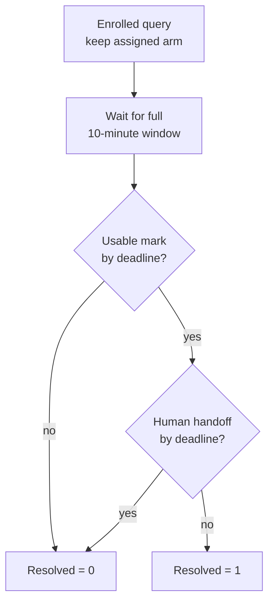

---
{
  "id": "experiment-design-ab-testing",
  "title": "Experiment Design and A/B Testing",
  "slug": "experiment-design-ab-testing",
  "section": "ML Algorithms & Evaluation",
  "category": "Evaluation & Benchmarks",
  "difficulty": "Medium",
  "order": 12,
  "coverImage": "illustrations/_generated/chapter_flow_dark.png",
  "companies": [
    "OpenAI",
    "Anthropic",
    "Google",
    "Meta"
  ],
  "shortDescription": "Randomize queries for a retrieval rewrite, then hold the launch unless both resolution lift and safety guardrails pass.",
  "keyConceptsTested": [
    "control and treatment",
    "randomization unit and SUTVA",
    "primary and guardrail metrics",
    "absolute and relative lift",
    "confidence intervals and power planning",
    "sample ratio mismatch",
    "sequential testing and mSPRT",
    "CUPED variance reduction",
    "multi-armed bandits and interleaving"
  ]
}
---

A customer submits a multi-sentence technical support question about a failing API batch integration. The support assistant retrieves documentation chunks and writes a fluent reply in clean prose. Even fluent answers can cite the wrong configuration guide, take ten seconds to stream, or send the user to a human support agent five minutes later. Should the engineering team ship a <span data-glossary="query-rewriting">query rewrite</span> ahead of retrieval?

In [Decoding Algorithms](/learn/decoding-algorithms), you controlled how retrieved passages turned into an answer and logged the decoding configuration. Here we focus on a customer-support RAG assistant and isolate an upstream retrieval change: does rewriting the user's raw query improve answer resolution? Keeping generation prompts, index snapshots, and model weights fixed ensures the experiment tests retrieval rather than rewriting style. An <span data-glossary="ab-testing">A/B test</span>, also called a randomized controlled experiment, assigns eligible queries randomly to either the existing pipeline (**control**) or the modified pipeline (**treatment**) and compares their outcomes. It estimates a defined causal effect for the enrolled population under stated assumptions, while future query distributions can shift and still require ongoing evaluation. That measurement supports one of three clear product decisions: ship the rewrite, hold and investigate unresolved risk, or <span data-glossary="rollback">roll it back</span>.

<figure>
  
  <figcaption>Only the retrieval query changes. Control sends the raw user query; treatment rewrites it. Both arms share the pinned greedy decoder and log outcomes and <span data-glossary="guardrail">guardrails</span>. A matching configuration log or clean sample-ratio check does not validate measurement or rule out interference.</figcaption>
</figure>

## Test one change at a time

Start with a concrete incoming request that both arms must answer:

> My batch export returns HTTP 429 after two retries even though our dashboard still shows spare daily quota. Which setting should I change?

Your existing pipeline retrieves documentation passages directly from the raw question and generates an answer, and the control path keeps that exact behavior. A candidate treatment first rewrites the request into a targeted retrieval query: `batch export HTTP 429 burst rate limit retry configuration`. The rewrite prompt instructs the model not to invent numeric thresholds; models can still violate instructions, so sample and audit generated queries directly. Both arms pass their retrieved context through the exact same generator prompt template, base model, and greedy decoder. Under trustworthy randomization and measurement, their outcome difference isolates the causal effect of assigning queries to the rewrite policy, including its latency cost and occasional rewrite failures.

One-change experiments keep attribution simple, whereas changing both retrieval and decoding blends two effects together. A deliberately structured factorial experiment can evaluate multiple factors and their interaction at once, while silently altering the prompt or decoder inside one arm invalidates a rewrite-only claim.

| Component | Control | Treatment | Why it matters |
|---|---|---|---|
| Query sent to retriever | Raw user query | Rewritten retrieval query | This is the single intentional change. |
| Knowledge-base index snapshot | `rag-docs-2026-05-01` | `rag-docs-2026-05-01` | Different corpus snapshots confound retrieval gains. |
| Generator and prompt | Same pinned version | Same pinned version | Generation tweaks cannot masquerade as retrieval wins. |
| Decoder configuration | `selection=greedy`, same schema | `selection=greedy`, same schema | Decoding randomness and formatting stay identical across arms. |

Write a concrete hypothesis that can fail on real traffic:

> Query rewriting will increase the resolved-query rate while keeping grounding-audit failures, <span data-glossary="p95-latency">p95 latency</span>, and human-agent fallbacks inside their safety budgets.

Here, **p95 latency** measures the 95th percentile of first-response completion times across enrolled queries, protecting the slower tail instead of hiding timeouts inside a mean. Teams must predeclare how aborted or timed-out requests enter tail latency before collecting data, because silently dropping failed calls makes a brittle treatment appear faster. Lock the decision rules before live numbers tempt anybody to shift goalposts. The experiment brief sets an MDE, or minimum detectable effect: a true improvement size at which planned traffic gives the chosen detection power under the planning model. The MDE guides sample sizing rather than acting as a hard detection cutoff, and it stays distinct from the business threshold needed to ship.

| Brief field | Locked choice |
|---|---|
| Enrollment moment | First submitted message on an eligible support query |
| Randomization unit | Query ID |
| Primary metric | Resolved query rate |
| Resolved definition | Usable-answer mark within 10 minutes of enrollment, with no human-agent handoff fallback by that deadline |
| Denominator | All enrolled queries, analyzed in their assigned arm, after the 10-minute window matures |
| Guardrail: evidence | Upper end of a two-sided approximate 95% interval for grounding-failure increase must stay below +0.5 percentage points |
| Guardrail: speed | p95 latency must not increase by more than 150 ms |
| Guardrail: support load | Human-handoff fallback rate must not increase by more than 0.5 percentage points |
| MDE for <span data-glossary="statistical-power">power planning</span> | +2.0 percentage points in resolution rate |
| Launch rule for resolution | Approximate 95% interval lower bound above zero and observed lift of at least +2.0 percentage points |
| Analysis rule | One fixed-horizon look after planned enrollment and all 10-minute windows mature |

The grounding rule asks whether the collected data rule out a safety regression as large as its budget, making it a **non-inferiority** check whose entire confidence interval must stay inside the allowed margin rather than merely showing a small point difference. Speed and human handoffs stay simple point-estimate screens in this compact design, though a full production brief attaches uncertainty checks to every guardrail and computes p95 intervals from request-level latency samples rather than aggregate percentiles alone. We name this binary metric “resolved” for clarity, noting that it tracks **usable answer without an early human handoff** rather than guaranteed downstream task success. A user might mark a fluent answer helpful before discovering a subtle edge case later, whereas a timely fallback can protect customer trust while counting as a metric failure. Teams should validate the short-window proxy against longer-term resolution outcomes and inspect whether rewriting shifts rating behavior. Random assignment supports causal claims only when assignment, logging, and stopping policies remain intact.[^kohavi2020] The very first choice in that design protocol is selecting the randomization unit.

## Assign each query unit once

Assign the query session ID, not each individual chat turn, because users frequently ask follow-up questions after reading an initial answer. If turn one enters treatment and turn two falls back to control, the follow-up depends directly on the rewritten first response and the unit has experienced a blend of both policies. Keeping a single assignment per unit keeps the contrast interpretable.

To define a single treatment outcome for each unit, causal inference commonly uses the **Stable Unit Treatment Value Assumption (SUTVA)**:[^hernanRobins2020WhatIf]

1. **No interference between units**: Unit $i$'s outcome depends only on unit $i$'s assigned treatment, unaffected by the assignment of unit $j$.
2. **No consequential hidden treatment versions**: Each arm specifies a well-defined policy, so unrecorded model or prompt swaps should not alter the counterfactual outcome associated with that arm.

When individual follow-up messages serve as units, earlier answers spill directly into later messages and violate the no-interference requirement. Switching arms mid-query violates the single-version requirement because neither intended query-level policy was cleanly delivered. Sequentially randomized adaptive designs can study turn-level decisions, but they require distinct sequential estimands and weighted estimators rather than naive cross-arm averages.

Two common interference paths arise across concurrent support queries:

- **Behavioral spillover**: A support specialist or repeat user sees a treatment explanation that clarifies an API setting and reuses that knowledge 20 minutes later on a control query.
- **Shared compute contention**: Extra LLM rewrite inference calls and heavier dense vector scans consume shared GPU worker queues, slowing down control responses running on the same cluster.

When strong spillovers occur inside account or organization cohorts, cluster randomization at the account level contains within-account contamination. Account structure alone does not mandate cluster randomization; align the unit with the scientific question and expected interference mechanism. For equal cluster sizes $m$ with within-cluster correlation $\rho_{\text{ICC}}$, a standard variance inflation formula gives the design effect:

$$
\text{DEFF} = 1 + (m - 1)\rho_{\text{ICC}}
$$

With $m=20$ queries per account and ICC $0.10$, variance inflates by a factor of $2.9$ rather than $1$. Unequal cluster sizes and cluster-robust estimators require dedicated variance formulas, because logging more follow-ups inside the same account cannot substitute for independent accounts and cluster randomization still leaves shared-GPU contention intact.[^clusterComposition2014][^microsoftCluster2020] A <span data-glossary="stable-assignment">stable hash</span> assigns each query ID deterministically across every follow-up turn. Including an experiment version salt ensures fresh randomization for subsequent tests without permanent user lock-in. Lock the salt before traffic arrives, treat IDs as immutable, and remember that modular hashing targets approximate traffic balance rather than forcing exact 50/50 counts.

<!-- leetllm: test, output=show, deps=numpy, output_title="Stable query assignment" -->
```python title="stable-assignment.py"
import hashlib
import numpy as np

EXPERIMENT = "rag-query-rewrite:v1"


def arm_for(query_id: str) -> str:
    payload = f"{EXPERIMENT}:{query_id}".encode()
    bucket = int.from_bytes(hashlib.sha256(payload).digest()[:8], "big") % 100
    return "treatment" if bucket < 50 else "control"


queries = ["qry-014", "qry-014", "qry-001", "qry-021"]
for query_id in queries:
    print(query_id, arm_for(query_id))

unique_queries = sorted(set(queries))
treatment_share = float(np.mean([arm_for(q) == "treatment" for q in unique_queries]))
assert arm_for("qry-014") == arm_for("qry-014")
print(f"unique treatment share across sample: {treatment_share:.1%}")
print("repeat assignment is stable")
```

<!-- leetllm: output:start -->
```text title="Stable query assignment" output compact
qry-014 treatment
qry-014 treatment
qry-001 treatment
qry-021 control
unique treatment share across sample: 66.7%
repeat assignment is stable
```
<!-- leetllm: output:end -->

When the same query appears twice in telemetry, its assigned arm matches both times. Production pipelines log the experiment version, bucket, and assigned arm on every turn so downstream joins can audit consistency. Hashing supplies deterministic routing, while event logging provides an auditable record.

```checkpoint
Why should one query session keep the same experiment assignment across all follow-ups?
---
Switching variants between messages contaminates the treatment contrast and exposes one query session to both policies. Assign the experimental unit once and keep its bucket sticky.
```

## Define an outcome from events

An assistant should not receive resolution credit simply for streaming fluent tokens. Success requires a usable-answer mark within ten minutes of enrollment and no fallback to a human agent through that ten-minute deadline. A missing positive mark after ten minutes counts as unresolved, whereas missing event logs require pipeline debugging instead of silently encoding lost rows as either wins or losses.

Queries whose treatment rewrite timed out stay in the treatment denominator under an **intention-to-treat (ITT)** comparison, which estimates the policy effect of assigning traffic to the rewriter including its operational reliability. Filtering out failed rewrites selects on a post-assignment event and breaks randomization, often selectively discarding complex long queries even if cluster saturation can also trigger timeouts independently of query difficulty. Wait until every enrolled query completes its ten-minute follow-up window before scoring, because an unanswered nine-minute query is still pending rather than resolved or failed. The six matured rows below illustrate how event timestamps map onto resolution, grounding checks, and response latency, highlighting how a human handoff at minute six differs from one at minute eighteen:

<!-- leetllm: test, output=show, deps=numpy, output_title="Outcome definition on event rows" -->
```python title="define-resolution.py"
import numpy as np

query_outcomes = [
    {"arm": "control", "solved": True,  "handoff_after_min": None, "grounded": True,  "latency_ms": 1080},
    {"arm": "control", "solved": True,  "handoff_after_min": 4,    "grounded": True,  "latency_ms": 1200},
    {"arm": "control", "solved": False, "handoff_after_min": 2,    "grounded": False, "latency_ms": 980},
    {"arm": "treatment", "solved": True, "handoff_after_min": None, "grounded": True, "latency_ms": 1120},
    {"arm": "treatment", "solved": True, "handoff_after_min": 18,   "grounded": True, "latency_ms": 1240},
    {"arm": "treatment", "solved": True, "handoff_after_min": 6,    "grounded": True, "latency_ms": 1280},
]
# Every row in this sample has completed a 20-minute observation window.
query_outcomes = [{**row, "observed_minutes": 20} for row in query_outcomes]


def resolved(row: dict) -> bool | None:
    if row["observed_minutes"] < 10:
        return None  # Pending is not an unresolved outcome.
    handoff_too_soon = row["handoff_after_min"] is not None and row["handoff_after_min"] <= 10
    return row["solved"] and not handoff_too_soon


for arm in ("control", "treatment"):
    rows = [row for row in query_outcomes if row["arm"] == arm]
    res_flags = np.array([resolved(row) for row in rows], dtype=bool)
    ground_flags = np.array([row["grounded"] for row in rows], dtype=bool)
    print(f"{arm}: resolved={int(res_flags.sum())}/{len(rows)} grounded={int(ground_flags.sum())}/{len(rows)}")

assert resolved({**query_outcomes[0], "observed_minutes": 9}) is None
assert not resolved({**query_outcomes[0], "handoff_after_min": 10})
print("pending window is not scored; a handoff at exactly 10 minutes disqualifies")
```

<!-- leetllm: output:start -->
```text title="Outcome definition on event rows" output compact
control: resolved=1/3 grounded=2/3
treatment: resolved=2/3 grounded=3/3
pending window is not scored; a handoff at exactly 10 minutes disqualifies
```
<!-- leetllm: output:end -->

These six rows teach the deterministic scoring rule rather than an experiment outcome. Notice that `handoff_after_min=18` leaves the treatment query counted as resolved because the handoff arrived after the locked ten-minute cutoff, keeping the metric specification transparent and reproducible. When longer-horizon follow-ups matter operationally, extend the deadline or track secondary 24-hour escalation rates separately before launch.



## Read lift from counts

After the observation window matures, inspect a compact worked example of 2,000 queries per arm whose counts are simple enough to verify directly. Notice right away that treatment has the higher raw resolution rate, yet guardrails, confidence intervals, and sample-size requirements can still block a premature ship call. In particular, 2,000 queries per arm is not powered for the brief's locked +2.0 percentage-point MDE: the shortcut planning formula below recommends 9,246 queries per arm, and the exact two-proportion power calculation requires 9,336 per arm for 80% power. Keep those two sample sizes distinct in practice by using this 2,000-query summary to trace lift, confidence intervals, and launch gates while reserving the powered enrollment estimate for live traffic sizing.

| Variant | Queries | Resolved | Resolution rate | p95 latency | Human handoffs | Grounding audit failures |
|---|---:|---:|---:|---:|---:|---:|
| Control: raw query | 2,000 | 760 | 38.0% | 1180 ms | 310 | 22 |
| Treatment: rewritten query | 2,000 | 840 | 42.0% | 1260 ms | 306 | 23 |

Before subtracting the rates, define the **estimand**: the average causal effect of assignment to the rewrite policy on resolution across eligible queries, weighting each query unit once and keeping rewrite timeouts plus follow-ups inside the assigned denominator. In this worked example, every query finishes an answer under the same blinded grounding audit; production pipelines must predeclare how absent responses or sampled audits enter denominators instead of silently excluding treatment errors.

The **absolute lift** measures additional resolved queries per 100 enrolled queries by subtracting control from treatment:

$$
\widehat{\Delta} = \hat{p}_{treatment} - \hat{p}_{control}
= \frac{840}{2000} - \frac{760}{2000}
= 0.04
$$

This corresponds to **+4.0 percentage points** of estimated lift, subject to sampling variability and any limits of the 10-minute proxy. The **relative lift** divides that absolute change by the baseline control rate:

$$
\frac{0.04}{0.38} \approx 0.105
$$

Reporting 10.5 percent relative lift as "up 10.5 points" conflates relative and absolute scales, so always name the units explicitly in dashboards and decision summaries:

<!-- leetllm: test, output=show, deps=numpy, output_title="Absolute and relative lift" -->
```python title="compute-lift.py"
import numpy as np

counts = np.array([760.0, 840.0])
totals = np.array([2000.0, 2000.0])
p_control, p_treatment = counts / totals
absolute_lift = float(p_treatment - p_control)
relative_lift = float(absolute_lift / p_control)

print(f"control rate: {p_control:.1%}")
print(f"treatment rate: {p_treatment:.1%}")
print(f"absolute lift: {absolute_lift * 100:.1f} percentage points")
print(f"relative lift: {relative_lift:.1%}")
```

<!-- leetllm: output:start -->
```text title="Absolute and relative lift" output compact
control rate: 38.0%
treatment rate: 42.0%
absolute lift: 4.0 percentage points
relative lift: 10.5%
```
<!-- leetllm: output:end -->

```checkpoint
Treatment resolves 840 of 2,000 queries and control resolves 760 of 2,000. What's the clearest user-facing interpretation of absolute lift?
---
The treatment arm has 4.0 more usable, non-fallback completions per 100 enrolled queries: 42.0% instead of 38.0%. This estimates a proxy effect rather than confirmed downstream satisfaction.
```

## Put uncertainty around the lift

Repeating the experiment on fresh traffic would shift both resolved counts through sampling noise, so every point estimate needs a precision interval. In [Hypothesis Tests, Intervals, and pass@k](/learn/hypothesis-tests-confidence-intervals-passk) you computed intervals for paired differences; here the two arms enroll independent query sets, so the variance of the difference adds the two Bernoulli sampling variances. For reasonably large sample counts per arm, a standard normal approximation provides a practical interval:

$$
SE(\widehat{\Delta}) =
\sqrt{
\frac{\hat{p}_{control}(1 - \hat{p}_{control})}{n_{control}} +
\frac{\hat{p}_{treatment}(1 - \hat{p}_{treatment})}{n_{treatment}}
}
$$

Using the two-sided 95% normal quantile ($z_{0.975} \approx 1.96$) leaves 2.5 percent in each tail. Over repeated experiments satisfying independence and asymptotic normality, this interval procedure covers the true population lift roughly 95% of the time; any single realized interval is an observed range rather than a 95% posterior probability over a fixed effect, and it does not generalize automatically to new query mixes:

<!-- leetllm: test, output=show, deps=numpy,scipy, output_title="Approximate lift interval" -->
```python title="resolution-lift-interval.py"
import numpy as np
from scipy.stats import norm

counts = np.array([760.0, 840.0])
totals = np.array([2000.0, 2000.0])
p_control, p_treatment = counts / totals
diff = float(p_treatment - p_control)
se = float(np.sqrt(np.sum(np.array([p_control, p_treatment]) * (1.0 - np.array([p_control, p_treatment])) / totals)))
z_crit = float(norm.ppf(0.975))
low = diff - z_crit * se
high = diff + z_crit * se

print(f"estimated lift: {diff * 100:.1f} pp")
print(f"standard error: {se * 100:.2f} pp")
print(f"approximate 95% interval: [{low * 100:.1f}, {high * 100:.1f}] pp")
```

<!-- leetllm: output:start -->
```text title="Approximate lift interval" output compact
estimated lift: 4.0 pp
standard error: 1.55 pp
approximate 95% interval: [1.0, 7.0] pp
```
<!-- leetllm: output:end -->

With a `+4.0` percentage-point estimate and a `95%` confidence interval from `+1.0` to `+7.0` points, the lower endpoint clears zero and supports a positive treatment effect assuming sound randomization and clean logs. Remember that confidence intervals describe uncertainty about the average effect in this experiment; forecasting the spread of future experiment draws requires a prediction interval, and rare metrics, clustered units, or multiple comparisons demand specialized inference chosen before seeing outcomes.

## More rows aren't always more evidence

Suppose a telemetry join accidentally repeats every query outcome across four individual chat-turn rows. Both resolved proportions remain identical, leaving the point estimate unchanged, while treating replicated rows as independent draws shrinks the calculated standard error by half and creates false precision:

<!-- leetllm: test, output=show, deps=numpy,scipy, output_title="Duplicate rows create false precision" -->
```python title="check-analysis-unit.py"
import numpy as np
from scipy.stats import norm

p_c, p_t, n_queries = 0.38, 0.42, 2000
lift = p_t - p_c
z_crit = float(norm.ppf(0.975))
for copies in (1, 4):
    assumed_n = n_queries * copies
    se = float(np.sqrt((p_c * (1 - p_c) + p_t * (1 - p_t)) / assumed_n))
    low, high = lift - z_crit * se, lift + z_crit * se
    label = "unique queries" if copies == 1 else "duplicated turn rows (WRONG)"
    print(f"{label}: SE={se * 100:.2f} pp, CI=[{low * 100:.1f}, {high * 100:.1f}] pp")
```

<!-- leetllm: output:start -->
```text title="Duplicate rows create false precision" output compact
unique queries: SE=1.55 pp, CI=[1.0, 7.0] pp
duplicated turn rows (WRONG): SE=0.77 pp, CI=[2.5, 5.5] pp
```
<!-- leetllm: output:end -->

Row duplication inflates the formula's denominator without adding independent units, so always aggregate telemetry to one record per randomized query before running inference. Real within-account correlation is milder than identical row replication, yet the same independence principle applies: cluster-randomized experiments require cluster-robust standard errors or cluster-level resampling rather than turn-level formulas, and matching the assignment unit, estimand, and variance estimator remains essential.[^microsoftCluster2020]

## Plan for a meaningful win

Underpowered tests frequently report "inconclusive" even when a retrieval upgrade genuinely helps. Before shipping an experiment, specify a **minimum detectable effect (MDE)** representing the true improvement size for which the design targets adequate detection probability. Power planning balances three connected design parameters:

1. **False positive rate (Type I error, $\alpha$)**: The tolerated false-alarm probability under a zero true effect, set here to $\alpha = 0.05$ two-sided ($z_{1-\alpha/2} \approx 1.96$).
2. **False negative rate (Type II error, $\beta$)**: The tolerated risk of failing to reject the null when true lift equals the MDE, set here to $\beta = 0.20$.
3. **Statistical power ($1 - \beta$)**: The probability of rejecting the null hypothesis at the MDE, set here to 80% ($z_{1-\beta} \approx 0.8416$) as a standard planning convention rather than an immutable law.

Holding observed rates fixed at 38% and 42% across increasing arm sizes shows why 200 or 500 queries per arm cannot exclude zero despite looking promising at `+4.0` percentage points, whereas 2,000 queries per arm narrows the interval enough to exclude zero:

<!-- leetllm: test, output=show, deps=numpy,scipy, output_title="Traffic narrows uncertainty" -->
```python title="interval-width-by-traffic.py"
import numpy as np
from scipy.stats import norm

p_control, p_treatment = 0.38, 0.42
lift = p_treatment - p_control
z_crit = float(norm.ppf(0.975))

for n in np.array([200, 500, 2000]):
    se = float(np.sqrt(p_control * (1 - p_control) / n + p_treatment * (1 - p_treatment) / n))
    low = lift - z_crit * se
    high = lift + z_crit * se
    print(f"{int(n):>4} per arm: [{low * 100:>4.1f}, {high * 100:>4.1f}] pp")
```

<!-- leetllm: output:start -->
```text title="Traffic narrows uncertainty" output compact
 200 per arm: [-5.6, 13.6] pp
 500 per arm: [-2.1, 10.1] pp
2000 per arm: [ 1.0,  7.0] pp
```
<!-- leetllm: output:end -->

Although 2,000 queries per arm detects the large `+4.0` point shift in this sample, powering an experiment to detect the smaller `+2.0` percentage-point MDE reliably requires much more traffic. Using an equal-allocation two-arm shortcut with binary outcome variance $\sigma^2 = p(1 - p)$ near baseline rate $p$ yields the planning formula:

$$
n \approx
\frac{2p(1-p)(z_{1-\alpha/2} + z_{power})^2}{\delta^2}
$$

Notice the squared effect size $\delta^2$ in the denominator: cutting the MDE in half from +2.0 to +1.0 percentage points quadruples the required sample size. Below we compute both the normal-approximation shortcut (`9,246` per arm) and the full `statsmodels` two-proportion power calculation (`9,336` per arm):[^statsmodelsTwoPropPower2026]

<!-- leetllm: test, output=show, deps=numpy,scipy,statsmodels, output_title="Planning enrollment from MDE" -->
```python title="plan-sample-size.py"
from math import ceil
from scipy.stats import norm
from statsmodels.stats.proportion import proportion_effectsize
from statsmodels.stats.power import NormalIndPower

baseline_rate = 0.38
mde = 0.02
alpha = 0.05
target_power = 0.80

z_alpha = float(norm.ppf(1 - alpha / 2))
z_power = float(norm.ppf(target_power))
n_per_arm = ceil(
    2 * baseline_rate * (1 - baseline_rate) * (z_alpha + z_power) ** 2 / mde**2
)
effect = proportion_effectsize(baseline_rate + mde, baseline_rate)
n_statsmodels = ceil(NormalIndPower().solve_power(effect_size=effect, power=target_power, alpha=alpha, ratio=1.0))

print(f"MDE: {mde * 100:.1f} pp")
print(f"target power: {target_power:.0%}")
print(f"planning estimate: {n_per_arm:,} queries per arm")
print(f"two-proportion power estimate: {n_statsmodels:,} queries per arm")
```

<!-- leetllm: output:start -->
```text title="Planning enrollment from MDE" output compact
MDE: 2.0 pp
target power: 80%
planning estimate: 9,246 queries per arm
two-proportion power estimate: 9,335 queries per arm
```
<!-- leetllm: output:end -->

Use sample-size estimates before data collection begins rather than for post-hoc storytelling after seeing noisy results. An 80% power figure describes rejecting the zero-effect null, not clearing every gate condition: if the true effect equals `+2.0` points, a symmetric estimate clears an observed `+2.0`-point minimum ship threshold only about half the time, and guardrail checks reduce overall launch probability further. Predeclare a minimum calendar horizon spanning full weekly query cycles and seasonal traffic shifts, because filling the target query quota during one atypical traffic burst cannot guarantee steady performance across normal days.

## Check traffic before outcomes

A **<span data-glossary="sample-ratio-mismatch">sample ratio mismatch (SRM)</span>** occurs when enrolled arm counts depart sharply from the intended split. When a 50/50 design logs 1,650 control queries and 2,350 treatment queries, pause analysis immediately rather than celebrating apparent lift, because broken hashing, dropped timeouts, eligibility filter bugs, or bot filtering could differ across arms. Running a one-degree-of-freedom chi-square goodness-of-fit test against a strict `10.83` cutoff (roughly $p < 0.001$; Microsoft's platform uses $0.0005$[^microsoftSrm2020]) catches severe imbalances before metric interpretation:

<!-- leetllm: test, output=show, deps=numpy,scipy, output_title="Sample ratio integrity check" -->
```python title="check-assignment-split.py"
import numpy as np
from scipy.stats import chisquare

observed = np.array([1650, 2350])
expected = np.array([observed.sum() / 2.0, observed.sum() / 2.0])
chi_square, p_value = chisquare(observed, f_exp=expected)
alert_threshold = 10.83

print("planned split: 50% / 50%")
print(f"observed: control={int(observed[0])}, treatment={int(observed[1])}")
print(f"chi-square statistic: {float(chi_square):.1f} (p={float(p_value):.2e})")
print("pause analysis for SRM investigation:", bool(chi_square > alert_threshold))
```

<!-- leetllm: output:start -->
```text title="Sample ratio integrity check" output compact
planned split: 50% / 50%
observed: control=1650, treatment=2350
chi-square statistic: 122.5 (p=1.79e-28)
pause analysis for SRM investigation: True
```
<!-- leetllm: output:end -->

An SRM alert signals a likely telemetry or assignment failure without identifying the exact line of code, so trace event logs before trusting any lift number.[^kohavi2020] Always test distinct randomized query IDs rather than raw turn counts, because treatment rewrites might naturally reduce or increase follow-up turns. Conversely, passing an SRM check confirms allocation balance without proving that every downstream outcome or latency field is bug-free.

## Don't stop the first time noise looks good

Suppose treatment truly has no effect and both arms resolve 40% of queries. A single preplanned two-sided 5% test triggers a false positive about 5% of the time across apparent wins and apparent regressions combined, rather than 5% for positive wins alone. Repeatedly checking the same fixed-horizon cutoff across 20 interim batches gives cumulative noise many chances to cross early, inflating false alarms because later batches overlap with earlier observations rather than forming independent trials.[^johari2017] Below we run 5,000 seeded A/A null simulations with 20 sequential looks adding 100 queries per arm at each step (`true_rate = 0.40`) to measure how strongly first-crossing optional stopping inflates Type I error:

<!-- leetllm: test, output=show, deps=numpy,scipy, output_title="Peeking simulation" -->
```python title="simulate-peeking.py"
import random
import numpy as np
from scipy.stats import norm

rng = random.Random(11)
trials, looks, batch_size, true_rate = 5_000, 20, 100, 0.40
z_cutoff = round(float(norm.ppf(0.975)), 2)

ctrl = np.array([[rng.binomialvariate(batch_size, true_rate) for _ in range(looks)] for _ in range(trials)])
trt = np.array([[rng.binomialvariate(batch_size, true_rate) for _ in range(looks)] for _ in range(trials)])
n_grid = np.arange(1, looks + 1) * batch_size
p_c = np.cumsum(ctrl, axis=1) / n_grid
p_t = np.cumsum(trt, axis=1) / n_grid
se = np.sqrt((p_c * (1.0 - p_c) + p_t * (1.0 - p_t)) / n_grid)
sig = (se > 0) & (np.abs(p_t - p_c) / np.where(se > 0, se, 1.0) > z_cutoff)

print(f"planned final look, either direction: {sig[:, -1].mean():.1%}")
for schedule in (5, 10, 20):
    step = looks // schedule
    rate = sig[:, step - 1 :: step].any(axis=1).mean()
    print(f"stop at first crossing, {schedule:2} looks: {float(rate):.1%}")
```

<!-- leetllm: output:start -->
```text title="Peeking simulation" output compact
planned final look, either direction: 5.6%
stop at first crossing,  5 looks: 15.7%
stop at first crossing, 10 looks: 20.6%
stop at first crossing, 20 looks: 26.2%
```
<!-- leetllm: output:end -->

<figure>
  
  <figcaption>Both arms have the same true resolution rate. Checking fixed-horizon intervals after every batch and stopping at the first crossing raises false alarms from 4.6% to 24.9% over 20 looks. Use sequential methods calibrated to continuous monitoring.</figcaption>
</figure>

Repeated unplanned looks break fixed-horizon confidence intervals because adaptive stopping alters the sampling procedure itself. The same multiplicity issue applies when teams scan dozens of variants, metrics, or user segments and highlight whichever interval happens to exclude zero. Predeclare the hypothesis family and adjust with a method like Bonferroni correction, or mark exploratory subgroup findings as hypotheses to verify on fresh traffic.[^nistBonferroni2026]

```checkpoint
Why can't a fixed-horizon experiment stop the first time an ordinary 95% interval excludes zero?
---
Repeated unplanned looks give random noise more chances to cross the threshold. Use the planned final look or a sequential method designed for repeated monitoring.
```

## Sequential testing and continuous monitoring

Product teams want dashboards that update in real time and allow early stopping when a treatment wins convincingly or degrades quality. Two principled statistical frameworks enable continuous monitoring without inflating overall Type I error:

### Alpha spending functions

Group sequential designs budget total false-alarm probability across looks using a **cumulative alpha spending function** $A(t)$, where the information fraction $t = I_n / I_{\max}$ roughly tracks $n / N_{\max}$ when variance scales proportionally with enrollment. Lan and DeMets allow flexible interim look schedules under the design's correlation structure. One spending curve approximating **O'Brien-Fleming** behavior for two-sided error $\alpha$ is:[^gsdesign2026spending]

$$
A(t) = 2\left[1-\Phi\left(\frac{\Phi^{-1}(1-\alpha/2)}{\sqrt{t}}\right)\right],
\qquad 0<t\le1,\quad A(0)=0
$$

Because $A(t)$ represents a cumulative **error budget** ($A(1)=0.05$), interim z-cutoffs stay strict early and tighten the final z-cutoff slightly to account for correlation across looks. For example, a six-look O'Brien-Fleming gsDesign schedule places the final critical z near **2.045** rather than 1.96, often requiring a small enrollment bump to preserve power; comparing raw single-look p-values directly against $A(t)$ is invalid without solving the joint crossing distribution.[^gsdesign2026spending]

### Mixture sequential probability ratio tests (mSPRT)

The **mixture Sequential Probability Ratio Test (mSPRT)** constructs always-valid sequential inference for a declared observation model.[^johari2021alwaysValid] For a simple point null with density $f_0$, independent draws, and a fixed prior mixing distribution $H(\theta)$ chosen before viewing outcomes, the mixture likelihood ratio is:

$$
\Lambda_n = \int \prod_{i=1}^n \frac{f_\theta(Y_i)}{f_0(Y_i)} dH(\theta)
$$

Because $\Lambda_0 = 1$ and $\Lambda_n$ forms a nonnegative null martingale with expectation 1, Ville's inequality guarantees:

$$
\mathbb{P}\left(\sup_{n \ge 1} \Lambda_n \ge \frac{1}{\alpha}\right) \le \alpha
$$

This bound controls false crossings of $1/\alpha$ at any data-dependent stopping rule, yielding the always-valid running p-value $\min(1, 1 / \max_{0 \le s \le n} \Lambda_s)$ and anytime confidence sequences obtained by inverting the test across candidate parameter values.[^johari2021alwaysValid] Keep in mind that two-arm A/B nulls share an unknown baseline rate (making the null composite rather than simple), so plugging empirical control rates directly into $f_0$ does not automatically preserve the martingale property; live A/B platforms rely on dedicated two-sample sequential statistics and still must handle multiple metrics explicitly. To see how an always-valid p-value preserves memory of an earlier crossing even when later evidence weakens, trace ten successes followed by ten failures against a known null rate of `0.40` with prior weight split evenly between alternatives `0.20` and `0.60`:

<!-- leetllm: test, output=show, deps=numpy, output_title="A mixture likelihood ratio remembers a crossing" -->
```python title="known-null-mixture-test.py"
import numpy as np

null_rate = 0.40
alternatives = np.array([0.20, 0.60])
outcomes = np.array([1] * 10 + [0] * 10)

increments = np.where(
    outcomes[:, None] == 1,
    alternatives / null_rate,
    (1.0 - alternatives) / (1.0 - null_rate),
)
mixture_series = np.cumprod(increments, axis=0).mean(axis=1)
peak_series = np.maximum.accumulate(np.maximum(1.0, mixture_series))

for n in (10, 20):
    ratio_now = float(mixture_series[n - 1])
    max_ratio = float(peak_series[n - 1])
    p_anytime = min(1.0, 1.0 / max_ratio)
    print(f"n={n}: current LR={ratio_now:.3f}, max LR={max_ratio:.3f}, anytime p={p_anytime:.4f}")
```

<!-- leetllm: output:start -->
```text title="A mixture likelihood ratio remembers a crossing" output compact
n=10: current LR=28.833, max LR=28.833, anytime p=0.0347
n=20: current LR=0.509, max LR=28.833, anytime p=0.0347
```
<!-- leetllm: output:end -->

Under either alternative $q$, each null-distributed increment has expectation $0.4(q/0.4) + 0.6((1-q)/0.6) = 1$, forming the core martingale conservation property. Ten subsequent failures pull the current likelihood ratio down to `0.509`, while the running anytime p-value remains anchored at `0.0347` because of the peak at step 10; full production runs compute log-likelihoods to prevent numerical underflow or overflow.

## Reduce noise with pre-experiment data

Gaining precision does not always require buying more traffic. **<span data-glossary="cuped">CUPED</span>** (Controlled-experiment Using Pre-Experiment Data) adjusts each unit's outcome using an informative measurement captured before assignment, such as a historical resolution rate for the querying workspace or customer cohort prior to experiment start (never a post-assignment response of the new query itself). That pre-treatment baseline removes predictable unit-to-unit variance from the difference estimate. Let $Y$ be the observed outcome and $X$ a pre-experiment covariate unaffected by assignment; CUPED computes the centered adjusted outcome:

$$
Y_{adjusted} = Y - \theta(X - \bar{X})
$$

Because randomization keeps $\mathbb{E}[\bar{X}_{treatment} - \bar{X}_{control}] = 0$ and both arms share the **same pooled coefficient** $\theta$ and centering mean $\bar{X}$, the adjustment leaves the expected treatment difference unchanged while shrinking its variance:

$$
\operatorname{Var}(Y_{adjusted}) = \operatorname{Var}(Y) + \theta^2 \operatorname{Var}(X) - 2\theta \operatorname{Cov}(Y, X)
$$

Setting the derivative with respect to $\theta$ to zero yields the variance-minimizing slope $\theta^* = \operatorname{Cov}(Y, X) / \operatorname{Var}(X)$, reducing outcome variance by factor $1 - \rho^2$:

$$
\operatorname{Var}(Y_{adjusted}) = \operatorname{Var}(Y)\left(1 - \rho^2\right)
$$

Here $\rho$ is the Pearson correlation between $X$ and $Y$ when $\operatorname{Var}(X) > 0$; poorly estimated slopes need not reduce noise, so complex multi-covariate adjustments use predeclared linear regression or cross-fitting. Deng, Xu, Kohavi, and Walker reported roughly 45% to 50% variance reduction on Bing experiments using pre-period metrics, effectively halving required sample sizes.[^deng2013]

In the simulation below over 20,000 units with a frozen binary prior flag ($\rho \approx 0.470$), CUPED tightens the standard error and confidence interval noticeably; after running it, flipping the covariate to `1 - baseline_flag` reverses the sign of $\theta$ while preserving identical variance reduction because squared correlation $\rho^2$ is symmetric in sign:

<!-- leetllm: test, output=show, deps=numpy,scipy, output_title="CUPED variance reduction" -->
```python title="cuped-for-resolution.py"
import random
import numpy as np
from scipy.stats import pearsonr

rng = random.Random(27)
n = 20_000
arm = np.array([rng.randrange(2) for _ in range(n)])
baseline_flag = np.array([rng.binomialvariate(1, 0.45) for _ in range(n)], dtype=float)
resolved_now = np.array(
    [
        rng.binomialvariate(1, min(1.0, max(0.0, 0.18 + 0.46 * int(prior) + 0.04 * int(assigned))))
        for prior, assigned in zip(baseline_flag, arm)
    ],
    dtype=float,
)

theta = float(np.cov(resolved_now, baseline_flag, ddof=1)[0, 1] / np.var(baseline_flag, ddof=1))
adjusted = resolved_now - theta * (baseline_flag - baseline_flag.mean())


def lift_and_se(outcome: np.ndarray) -> tuple[float, float]:
    ctrl = outcome[arm == 0]
    trt = outcome[arm == 1]
    lift = float(trt.mean() - ctrl.mean())
    se = float(np.sqrt(ctrl.var(ddof=1) / len(ctrl) + trt.var(ddof=1) / len(trt)))
    return lift, se


raw_lift, raw_se = lift_and_se(resolved_now)
cuped_lift, cuped_se = lift_and_se(adjusted)
variance_reduction = 1.0 - float(adjusted.var(ddof=1) / resolved_now.var(ddof=1))
corr, _ = pearsonr(resolved_now, baseline_flag)

print(f"raw estimate:   lift={raw_lift * 100:.2f} pp, se={raw_se * 100:.2f} pp")
print(f"CUPED estimate: lift={cuped_lift * 100:.2f} pp, se={cuped_se * 100:.2f} pp")
print(f"outcome variance reduced: {variance_reduction:.1%}")
for label, lift, se in (("raw", raw_lift, raw_se), ("CUPED", cuped_lift, cuped_se)):
    print(f"{label} approximate 95% interval: [{(lift - 1.96 * se) * 100:.2f}, {(lift + 1.96 * se) * 100:.2f}] pp")
print(f"covariate correlation: {float(corr):.3f}")
```

<!-- leetllm: output:start -->
```text title="CUPED variance reduction" output compact
raw estimate:   lift=4.68 pp, se=0.70 pp
CUPED estimate: lift=4.39 pp, se=0.61 pp
outcome variance reduced: 22.1%
raw approximate 95% interval: [3.32, 6.04] pp
CUPED approximate 95% interval: [3.19, 5.59] pp
covariate correlation: 0.470
```
<!-- leetllm: output:end -->

<figure>
  
  <figcaption>Using a frozen pre-period flag reduces approximate 95% interval half-widths from 1.36 pp to 1.20 pp. Always verify that covariates precede assignment and report uncertainty calibrated to the adjusted estimator.</figcaption>
</figure>

Notice that raw and adjusted point estimates (`+4.68 pp` vs `+4.39 pp`) differ slightly in a finite sample, and estimating $\theta$ from current outcomes makes the fixed-slope expectation argument asymptotic rather than exact in tiny samples. Adjusted values can also fall outside `[0, 1]` because they are residualized variance-reduction scores rather than raw binary labels. Never adjust on a post-assignment variable such as rewrite-period latency, since conditioning on intermediate variables blocks causal pathways or induces collider bias; freezing pre-experiment features keeps the adjustment rule easy to verify.[^deng2013]

## Bandits versus fixed A/B tests

Deciding between a fixed-allocation A/B test and a multi-armed bandit comes down to whether your main objective is **causal effect estimation with guardrails** or **maximizing cumulative reward during traffic allocation**:

- **Fixed-allocation A/B testing**: Uses predeclared traffic weights (such as 50/50 or 90/10) to produce clean, evenly powered causal estimates across primary and guardrail metrics before making a staged launch decision.
- **Reward-seeking multi-armed bandits**: Shift traffic dynamically toward better-performing variants to minimize cumulative pseudo-regret $R(T) = \sum_{t=1}^T(\mu^* - \mu_{a_t})$, where $\mu^*$ is the best arm's mean reward.[^russo2018ThompsonTutorial] Best-arm identification is a distinct sequential objective with its own stopping rules.

In **Thompson Sampling**, each arm tracks a Beta posterior over its binary resolution rate, drawing a parameter $\theta_k \sim \operatorname{Beta}(\alpha_k, \beta_k)$ per arm and routing to the higher sample. Live RAG deployments route each new query unit once, hold follow-ups sticky, and update posteriors only after the ten-minute window matures; the simulation below models immediate Bernoulli rewards over 2,000 draws:

<!-- leetllm: test, output=show, deps=numpy,scipy, output_title="Thompson sampling allocation" -->
```python title="simulate-bandit.py"
import random

import numpy as np
from scipy.stats import beta

rng = random.Random(42)
p_control = 0.38
p_treatment = 0.42

alpha_c, beta_c = 1, 1
alpha_t, beta_t = 1, 1
n_pulls = 2000

for _ in range(n_pulls):
    sample_c = rng.betavariate(alpha_c, beta_c)
    sample_t = rng.betavariate(alpha_t, beta_t)
    if sample_t > sample_c:
        reward = 1 if rng.random() < p_treatment else 0
        alpha_t += reward
        beta_t += 1 - reward
    else:
        reward = 1 if rng.random() < p_control else 0
        alpha_c += reward
        beta_c += 1 - reward

pulls = np.array([alpha_c + beta_c - 2, alpha_t + beta_t - 2])
means = np.array([alpha_c - 1, alpha_t - 1]) / pulls
low_t, high_t = beta.interval(0.95, alpha_t, beta_t)

print(f"control pulls: {pulls[0]} ({pulls[0] / n_pulls:.1%}), sample mean: {means[0]:.1%}")
print(f"treatment pulls: {pulls[1]} ({pulls[1] / n_pulls:.1%}), sample mean: {means[1]:.1%}")
print(f"allocation ratio: {pulls[1] / pulls[0]:.2f}x")
print(f"treatment posterior 95% interval: [{low_t:.1%}, {high_t:.1%}]")
```

<!-- leetllm: output:start -->
```text title="Thompson sampling allocation" output compact
control pulls: 463 (23.2%), sample mean: 38.2%
treatment pulls: 1537 (76.8%), sample mean: 41.7%
allocation ratio: 3.32x
treatment posterior 95% interval: [39.3%, 44.2%]
```
<!-- leetllm: output:end -->

This seeded run routes 76.8% of pulls to the arm with the higher **known simulation rate**. The run never compares realized resolution with a fixed-allocation counterfactual, so it shows the routing mechanism and nothing about regret on real traffic. Another seed can favor the worse arm for a while before the posteriors separate.

Adaptive routing changes both the inference and the operations around an experiment, in three ways:

1. **Bias is not always upward.** Adaptive sampling, stopping, and selecting which arm to report can introduce different biases, including opposite signs.[^shin2019banditBias] A single observed sample mean cannot reveal its repeated-run bias.
2. **Ordinary inference is not automatically calibrated.** Allocation and arm sample sizes depend on earlier rewards even when each arm has conditionally independent stationary rewards. Use estimators and sequential uncertainty methods designed for that policy, with logged routing propensities and enough continued exploration. Adaptation does not make causal inference impossible; it makes the estimator choice matter.
3. **The reward does not encode every guardrail.** A resolution-only algorithm can favor a variant with unacceptable latency or grounding. Constrained or contextual bandits can incorporate more structure, but they need a justified reward, a constraint design, and monitoring.[^russo2018ThompsonTutorial]

Choose the design for the objective, outcome delay, traffic, and inference requirements. A fixed allocation is a straightforward fit for our rewrite-only causal question. A bandit can fit ongoing routing with an immediate reward, whereas nonstationarity, delayed resolution outcomes, and multi-metric guardrails complicate this stationary Bernoulli model. Neither “marketing only” nor “no scientific learning” defines bandits.

## Pair answer evaluations on the same prompt

In conversational AI, prompts vary widely in difficulty. Some queries ask for a single policy lookup; others need several retrieved passages stitched into one answer. In a standard between-subject A/B test (query A gets Control, query B gets Treatment), this difficulty variance adds directly to the standard error of the lift.

Two related designs should be distinguished. **Search interleaving** mixes two ranked result lists into one presentation and attributes user clicks using a specified credit rule.[^chapelle2012] **Paired answer evaluation** generates both candidates for the same prompt and compares them with a judge, as in the original Chatbot Arena.[^zheng2023] Showing two complete answers side by side isn't search-list interleaving.

For numerical scores on paired prompts:

$$
\operatorname{Var}(Y_T - Y_C) = \operatorname{Var}(Y_T) + \operatorname{Var}(Y_C) - 2\operatorname{Cov}(Y_T, Y_C)
$$

Positive covariance reduces the variance of a difference. A shared additive prompt effect cancels exactly in the model below. Real systems can respond differently to the same prompt, so estimate covariance from paired outcomes before predicting the precision gain. A head-to-head preference vote also needs inference for that vote metric, not necessarily a difference of two numerical scores.

<!-- leetllm: test, output=show, deps=numpy,scipy, output_title="Paired evaluation variance reduction" -->
```python title="compare-paired-evaluation.py"
import random

import numpy as np
from scipy.stats import ttest_ind, ttest_rel

rng = random.Random(42)
n_evals = 1000

# Synthetic shared prompt effect on an unbounded numerical score.
# Gaussian scores are not restricted to a real 1-10 rating scale.
query_difficulty = np.array([rng.gauss(5.0, 1.8) for _ in range(n_evals)])
queries_c = np.array([rng.gauss(5.0, 1.8) for _ in range(n_evals)])
queries_t = np.array([rng.gauss(5.0, 1.8) for _ in range(n_evals)])

# Independent A/B test (two distinct sets of queries)
scores_c_indep = queries_c + np.array([rng.gauss(0, 0.6) for _ in range(n_evals)])
scores_t_indep = queries_t + 0.45 + np.array([rng.gauss(0, 0.6) for _ in range(n_evals)])
lift_indep = scores_t_indep.mean() - scores_c_indep.mean()
test_indep = ttest_ind(scores_t_indep, scores_c_indep, equal_var=False)
se_indep = lift_indep / test_indep.statistic

# Paired test: both candidates scored on the same queries.
scores_c_paired = query_difficulty + np.array([rng.gauss(0, 0.6) for _ in range(n_evals)])
scores_t_paired = query_difficulty + 0.45 + np.array([rng.gauss(0, 0.6) for _ in range(n_evals)])
diffs = scores_t_paired - scores_c_paired
lift_paired = diffs.mean()
test_paired = ttest_rel(scores_t_paired, scores_c_paired)
se_paired = lift_paired / test_paired.statistic
var_reduction = 1 - (se_paired / se_indep) ** 2

print(f"independent A/B: lift={lift_indep:.3f}, SE={se_indep:.3f}")
print(f"paired test: lift={lift_paired:.3f}, SE={se_paired:.3f}")
print(f"variance reduction: {var_reduction:.1%}")
```

<!-- leetllm: output:start -->
```text title="Paired evaluation variance reduction" output compact
independent A/B: lift=0.570, SE=0.085
paired test: lift=0.443, SE=0.027
variance reduction: 89.5%
```
<!-- leetllm: output:end -->

In this particular simulation, the **variance of the lift estimate** falls 89.5%, and SE falls from 0.085 to 0.027. Both designs score 2,000 answers, and the paired design reaches its precision with only 1,000 shared prompts. The number comes from a synthetic additive prompt effect, so it is not a measured gain for real models or a universal interleaving speedup.

Randomize answer order, blind identities when possible, predeclare tie handling, and check judge reliability. A preferred answer is not automatically grounded or useful in a live deployment. If a user sees both answers, later behavior reflects that combined experience, so the preference comparison does not estimate the original one-answer resolution effect.

```checkpoint
Does using the same prompts always reduce the uncertainty of a difference?
---
No. The covariance term determines the gain. It helps when scores covary positively, gives no gain at zero covariance, and can increase variance when covariance is negative.
```

## Treat AI evaluation as a stack

An online experiment answers whether users benefit under live use. It should not be the first time you discover that a treatment emits unsupported claims, so check the treatment in layers, each with a different question:

| Layer | Question | Example evidence |
|---|---|---|
| Offline regression set | Does treatment still follow the source documents on known cases? | Hand-labeled prompts, groundedness and refusal checks |
| Online primary outcome | Does it help users finish their question? | Resolution rate |
| Product guardrails | Did it hurt speed or cost? | p95 latency, human-handoff rate, cost per query |
| Integrity check | Did we compare the promised systems? | Assignment split, index snapshot, prompt/model/decoder versions |

If you use a large language model as a <span data-glossary="llm-as-judge">judge</span> for an offline rubric, treat it as a measured evaluator rather than truth. Pin its model and prompt version, then compare it with human labels on a retained <span data-glossary="calibration">calibration</span> set. Zheng et al. study LLM judges as approximations to human preference and document <span data-glossary="position-bias">position bias</span>, verbosity effects, and reasoning limitations. They also report possible self-enhancement patterns, but note that their limited data could not tell whether the models actually exhibit that bias.[^zheng2023]

This lab makes the pinned configuration explicit with an array comparison. A comparison with two different decoder versions is rejected before anybody reads its lift.

<!-- leetllm: test, output=show, deps=numpy, output_title="Pinned configuration lock" -->
```python title="validate-config-lock.py"
import numpy as np

control = {
    "index": "docs-2026-05-01",
    "generator": "rag-generator-v7",
    "generator_prompt": "rag-generator-prompt-v3",
    "decoder": {"selection": "greedy", "schema": "rag-answer-v2"},
}
treatment = {
    "index": "docs-2026-05-01",
    "generator": "rag-generator-v7",
    "generator_prompt": "rag-generator-prompt-v3",
    "decoder": {"selection": "greedy", "schema": "rag-answer-v2"},
    "new_component": "query-rewrite-v1",
}

locked_fields = ("index", "generator", "generator_prompt", "decoder")


def validate_config(control, treatment):
    same = np.array([control[field] == treatment[field] for field in locked_fields])
    mismatches = [field for field, ok in zip(locked_fields, same) if not ok]
    if mismatches:
        raise ValueError(f"unplanned changes: {mismatches}")
    return mismatches


mismatches = validate_config(control, treatment)

print("intentional treatment change:", treatment["new_component"])
print("unplanned mismatches:", mismatches)
print("locked fields match:", not mismatches)

bad_treatment = {**treatment, "decoder": {"selection": "greedy", "schema": "rag-answer-v3"}}
try:
    validate_config(control, bad_treatment)
except ValueError as error:
    print("rejected:", error)
else:
    raise AssertionError("unplanned decoder change was accepted")
```

<!-- leetllm: output:start -->
```text title="Pinned configuration lock" output compact
intentional treatment change: query-rewrite-v1
unplanned mismatches: []
locked fields match: True
rejected: unplanned changes: ['decoder']
```
<!-- leetllm: output:end -->

## Make the launch decision auditable

The configuration check compares a few declared fields. It does not verify the deployed code, the outcome logs, the randomization, or the no-interference assumption, so keep those integrity checks in the experiment record too. Now combine the evidence. The brief requires a positive interval, an observed lift of at least `+2.0` points, guardrails inside their budgets, and trustworthy traffic. The last lab prints each condition instead of burying the call in a slide deck, and it reuses the compact 2,000-query worked example from the earlier lift tables so every line can be checked by hand.

For the locked MDE of +2.0 points, the fuller independent-arm calculation targets about 9,336 queries per arm before accounting for other design requirements. The smaller sample below is arithmetic practice, not permission for an unplanned early look.

<!-- leetllm: test, output=show, deps=numpy,scipy,statsmodels, output_title="Launch decision report" -->
```python title="launch-decision.py"
import numpy as np
from scipy.stats import norm
from statsmodels.stats.proportion import confint_proportions_2indep

report = {
    "control": {"n": 2000, "resolved": 760, "p95_latency_ms": 1180, "handoffs": 310, "grounding_failures": 22},
    "treatment": {"n": 2000, "resolved": 840, "p95_latency_ms": 1260, "handoffs": 306, "grounding_failures": 23},
    "minimum_ship_lift": 0.02,
    "srm_alert": False,
}

if report["srm_alert"]:
    raise ValueError("Investigate SRM before computing lift")

c = report["control"]
t = report["treatment"]
z = norm.ppf(0.975)

counts = np.array([[c["resolved"], c["n"]], [t["resolved"], t["n"]]])
p_c, p_t = counts[:, 0] / counts[:, 1]
lift = p_t - p_c
low, _ = confint_proportions_2indep(
    t["resolved"], t["n"], c["resolved"], c["n"], method="wald", compare="diff"
)

latency_delta = t["p95_latency_ms"] - c["p95_latency_ms"]
handoff_delta = t["handoffs"] / t["n"] - c["handoffs"] / c["n"]
grounding_delta = t["grounding_failures"] / t["n"] - c["grounding_failures"] / c["n"]
_, grounding_upper = confint_proportions_2indep(
    t["grounding_failures"], t["n"], c["grounding_failures"], c["n"], method="wald", compare="diff"
)

# Evidence rule was declared in the brief, before outcomes were observed.
checks = {
    "traffic_integrity": not report["srm_alert"],
    "positive_lift_interval": low > 0,
    "observed_lift_threshold": lift >= report["minimum_ship_lift"],
    "latency_budget": latency_delta <= 150,
    "handoff_budget": handoff_delta <= 0.005,
    "grounding_budget": grounding_delta <= 0.005,
    "grounding_noninferiority": grounding_upper < 0.005,
}

for name, passed in checks.items():
    print(f"{name}: {'PASS' if passed else 'FAIL'}")
print(
    f"lift={lift * 100:.1f} pp, low_end={low * 100:.1f} pp, "
    f"ship_threshold={report['minimum_ship_lift'] * 100:.1f} pp, latency_delta={latency_delta} ms, "
    f"grounding_delta={grounding_delta * 100:.2f} pp, grounding_upper={grounding_upper * 100:.2f} pp"
)
print(f"critical value z={z:.2f}")
print("launch gate:", "PASS" if all(checks.values()) else "HOLD AND INVESTIGATE")
```

<!-- leetllm: output:start -->
```text title="Launch decision report" output compact
traffic_integrity: PASS
positive_lift_interval: PASS
observed_lift_threshold: PASS
latency_budget: PASS
handoff_budget: PASS
grounding_budget: PASS
grounding_noninferiority: FAIL
lift=4.0 pp, low_end=1.0 pp, ship_threshold=2.0 pp, latency_delta=80 ms, grounding_delta=0.05 pp, grounding_upper=0.70 pp
critical value z=1.96
launch gate: HOLD AND INVESTIGATE
```
<!-- leetllm: output:end -->

<figure>
  
  <figcaption>The resolution interval stays above zero and its estimate clears the <code>+2.0</code>-point threshold. The grounding-failure interval's upper end is <code>+0.70</code> points against a <code>+0.5</code>-point budget, so the gate stays at investigate. The result leaves the risk unresolved, and more evidence is needed to confirm or rule out a regression. Latency and handoff results pass point screens only; uncertainty checks remain necessary.</figcaption>
</figure>

This gate separates evidence from business value. `positive_lift_interval` asks whether the interval's lower bound is above zero, while `observed_lift_threshold` asks whether the point estimate clears the predeclared `+2.0` point bar. Those checks answer different questions.

The interval begins at `+1.0`, so the evidence supports a positive lift while allowing effects below `+2.0` points. A more conservative brief could require the lower bound to clear `+2.0` points, and it would keep this result under investigation. Guardrails can look safe on a point estimate while their uncertainty still crosses the budget. Our brief already declared the grounding rule: the upper endpoint must stay below +0.5 points. Using the upper end of a two-sided 95% interval corresponds to an approximate one-sided 97.5% bound, not a one-sided 95% bound, so keep that choice fixed rather than switching cutoffs after seeing the result.

For grounding failures as a rate, the unpooled SE is:

$$
SE(\widehat{\Delta}_g) =
\sqrt{
\frac{\hat{g}_{c}(1 - \hat{g}_{c})}{n_{c}} +
\frac{\hat{g}_{t}(1 - \hat{g}_{t})}{n_{t}}
}
$$

In this worked example, grounding rates are 1.10% for control and 1.15% for treatment, so $\widehat{\Delta}_g = +0.05$ pp. The unpooled SE is about 0.333 pp, which puts the rough 95% interval at about $[-0.60, +0.70]$ pp. Its upper end exceeds the +0.5 pp budget, so `grounding_noninferiority` fails even though the observed change is small.

For these numbers, the lift and point-estimate checks pass, but the grounding rule keeps the decision at `HOLD AND INVESTIGATE`. The interval includes no change and still extends into an unacceptable regression, so the result lacks the precision to rule out that harm. If this were the planned final look, "investigate" would not mean adding queries and rerunning the same ordinary interval until the guardrail passes. That would reintroduce the stopping problem from the peeking simulation. Keep the inconclusive result in the experiment record, then plan a fresh confirmatory experiment or follow a continuation rule already justified by the sequential design. Widening the grounding budget after seeing its interval would change the launch question too.[^johari2021alwaysValid]

The rare-event grounding interval is only a normal approximation with 22 and 23 failures, so a real launch needs a preselected method suited to those counts plus audit sampling. Even a passing gate would leave the omitted latency and handoff uncertainty rules unresolved, and it reads an SRM flag rather than validating all instrumentation. Change treatment latency to `1490` and rerun: resolution still improves, but the speed budget also fails, because a treatment does not earn launch by winning only its favorite metric.

## Practice: break the launch gate

Change one field at a time and predict the gate before rerunning it. These are counterfactual exercises, not permission to edit a live experiment's brief after seeing results:

1. Change treatment latency from `1260` to `1490`. Which check fails, and why does the resolution lift not override it?
2. Restore latency, then change `minimum_ship_lift` from `0.02` to `0.05`. Which check fails even though the interval still excludes zero?
3. Restore the threshold, then set `srm_alert` to `True`. Why should analysis pause before anybody argues about the observed lift?

### Expected observations

1. `latency_budget` fails because treatment is now `310 ms` slower than control, beyond the locked `150 ms` budget.
2. `observed_lift_threshold` fails because the observed `+4.0` point lift is below the new `+5.0` point business threshold. Statistical evidence and launch value answer different questions.
3. The code raises `ValueError: Investigate SRM before computing lift`. SRM can signal broken assignment, filtering, or logging, so the outcome calculation does not run at all. A warning badge shown after an untrustworthy lift would invite people to argue about a number that should never have been computed.

## Freeze the experiment record

Save the assignment unit and hash rule, metric query and outcome window, planned analysis schedule, sample-ratio-mismatch check, effect estimate with uncertainty, guardrails, and final decision. Those artifacts let a reviewer rerun the gate without reconstructing policy from a dashboard. A trustworthy experiment ends as a reproducible decision record, not a screenshot of a favorable number. Lift units, sequential stopping rules, adjustment scope, paired variance, and assignment practice appear in the checkpoints that follow.

```checkpoint
At a planned final look, control resolves 300 of 1,000 queries and treatment 350 of 1,000. Which report gives the correct lift units?

- Absolute lift 16.7 percentage points; relative lift about 5%.
- Absolute lift 5 percentage points; relative lift about 16.7%.
- Absolute lift 5 percentage points; relative lift about 14.3%.
- Absolute lift 50 percentage points; relative lift about 16.7%.
---
Absolute lift 5 percentage points; relative lift about 16.7%.

The rates are 0.30 and 0.35, a difference of 0.05 or five percentage points. Relative lift divides by the control rate: 0.05/0.30=1/6≈16.7%. Dividing by the treatment rate would give the wrong 14.3% comparison.
```

```checkpoint
An implementation computes a Lan-DeMets cumulative spending value A(t) at each interim look, then rejects whenever that look’s ordinary p-value is below A(t). What remains missing?

- Multiplying each observed effect by its information fraction to remove the correlation between looks.
- Joint crossing cutoffs calibrated to the spending budget and correlated look process.
- Resetting cumulative alpha to its full budget after each non-rejecting interim result.
- Replacing information fraction with elapsed wall-clock time while keeping the same ordinary tests.
---
Joint crossing cutoffs calibrated to the spending budget and correlated look process.

A spending function allocates cumulative error probability. It is not itself each look’s ordinary p cutoff. Sequential cutoffs must account for the correlation and earlier crossings under the chosen monitoring design.
```

```checkpoint
A team can adjust for a frozen pre-experiment service-history score or for rewrite-period latency that changes under treatment. Both predict the outcome. Which plan preserves a valid baseline adjustment?

- Use rewrite-period latency because its stronger prediction removes treatment-independent noise.
- Search both adjustments after seeing results and report the one producing the largest observed lift.
- Use the frozen score to assign similar histories to the same arm, then treat arm means as randomized.
- Predeclare the unaffected history score, a common adjustment rule, and suitable adjusted uncertainty.
---
Predeclare the unaffected history score, a common adjustment rule, and suitable adjusted uncertainty.

The frozen unaffected feature can support baseline variance reduction. Treatment-period latency can be a mediator or collider, so predictive strength alone does not make it a valid baseline. Searching for the largest lift changes the analysis, and using the score to determine the arm is not random assignment.
```

```checkpoint
Paired numerical scores have control variance 9, treatment variance 16, and covariance 10. What is the variance of treatment minus control, compared with an independent-prompt contrast using the same marginal variances?

- Paired 5 versus independent 25; the shared positive covariance reduces difference variance.
- Paired 45 versus independent 25; covariance contributes twice with a positive sign.
- Paired 15 versus independent 25; covariance is subtracted once from the variance sum.
- Paired 5 versus independent 5; the same marginal variances imply the same pairing benefit.
---
Paired 5 versus independent 25; the shared positive covariance reduces difference variance.

Var(T−C)=16+9−2×10=5. Under independent prompts the covariance is zero and the corresponding sum is 25. This concerns numerical difference scores, not an automatic inference rule for preference votes or live query resolution.
```

```checkpoint
Ten percent of treatment-assigned rewrites time out. Logs and full follow-up are complete. An analyst drops those queries and compares only successful rewrites with the entire control arm. What effect does that analysis target?

- The original assignment effect, because timeouts did not execute the intended retrieval change.
- A selected execution subset; the stated assignment effect requires retaining timed-out treatment queries.
- The original assignment effect after dividing the treatment success rate by its 90% completion fraction.
- A measurement-failure effect that can be repaired by assigning timed-out queries to control.
---
A selected execution subset; the stated assignment effect requires retaining timed-out treatment queries.

Rewrite completion is affected by treatment, so selecting completed executions generally loses the original randomized contrast. With complete outcomes, intention-to-treat keeps each query in its assigned denominator. Moving timeouts to control or scaling a selected rate does not reconstruct that estimand.
```

```mastery-quiz
[
  {
    "question": "A rewrite-only experiment pins the same generator and decoder, but its treatment silently uses a newer knowledge-base index. The treatment has a positive resolution estimate. Which effect is identified by this comparison?",
    "options": [
      "The rewrite effect, because an unchanged generator makes retrieval-index differences irrelevant.",
      "The newer-index effect, because query rewrites affect wording rather than which passages are retrieved.",
      "The assignment effect of the combined changes, rather than an isolated rewrite effect under the intended brief.",
      "The rewrite effect after subtracting the percentage of documents changed between the index snapshots."
    ],
    "answer": "The assignment effect of the combined changes, rather than an isolated rewrite effect under the intended brief.",
    "explanation": "The assigned paths differ in both rewriting and index content. Their contrast can describe the combined policy under suitable assignment and measurement, but it cannot isolate the intended rewrite-only effect or recover it by subtracting a document-change percentage."
  },
  {
    "question": "A query session has been observed for 12 minutes. It received a usable mark at minute 7 and a human handoff fallback at minute 9. Another has been observed for only 8 minutes, with a usable mark and no handoff so far. The outcome requires a usable mark by minute 10 and no handoff through minute 10. How should the two outcomes be recorded?",
    "options": [
      "First unresolved; second pending until its follow-up window matures.",
      "First resolved; second resolved because both usable marks arrived early.",
      "First unresolved; second unresolved because it has not completed ten minutes.",
      "First pending until the handoff is reviewed; second resolved after its usable mark."
    ],
    "answer": "First unresolved; second pending until its follow-up window matures.",
    "explanation": "The human handoff at minute 9 disqualifies the first mature query. The second has not completed the required observation window, so it is pending rather than a confirmed success or failure. A later handoff could still change its outcome."
  },
  {
    "question": "A join replicates each randomized query into nine identical message rows in both arms. An independence-based analysis uses those rows as its sample size. Which pair describes the reported lift and calculated standard error?",
    "options": [
      "Lift becomes nine times larger; standard error stays unchanged.",
      "Lift stays unchanged; standard error becomes correctly three times smaller.",
      "Lift stays unchanged; standard error becomes incorrectly nine times smaller.",
      "Lift stays unchanged; standard error becomes incorrectly three times smaller."
    ],
    "answer": "Lift stays unchanged; standard error becomes incorrectly three times smaller.",
    "explanation": "Success counts and denominators both multiply by nine, preserving the rates and their difference. The independence formula scales SE as 1/sqrt(n), so the fictitious ninefold sample count divides SE by three without adding evidence."
  },
  {
    "question": "A planning shortcut holds baseline variation, alpha, and target power fixed. The MDE changes from 3 percentage points to 1 percentage point. What happens to enrollment per arm, and does the MDE specify the observed launch threshold?",
    "options": [
      "Enrollment triples; the observed launch threshold becomes 1 percentage point.",
      "Enrollment falls to one third; the observed launch threshold remains separate.",
      "Enrollment increases ninefold; the observed launch threshold remains separate.",
      "Enrollment increases ninefold; the observed launch threshold becomes 1 percentage point."
    ],
    "answer": "Enrollment increases ninefold; the observed launch threshold remains separate.",
    "explanation": "The shortcut scales enrollment with 1/MDE², so (3/1)²=9. The MDE is a true alternative used for detection-power planning. The business rule on the observed estimate is a separate predeclared condition."
  },
  {
    "question": "An experiment planned a 50/50 split and enrolled 90 distinct control queries and 110 distinct treatment queries. The sample ratio mismatch (SRM) check raises an alert when Pearson’s chi-square statistic exceeds 10.83. What should the team report?",
    "options": [
      "A statistic of 2 gives no alert. Audit outcome logging separately.",
      "A statistic of 20 raises an alert. Trace query IDs before interpreting lift.",
      "A statistic of 2 gives no alert. Use the arm counts to mark outcome logging as complete.",
      "A statistic of 1 gives no alert. Audit outcome logging separately."
    ],
    "answer": "A statistic of 2 gives no alert. Audit outcome logging separately.",
    "explanation": "With 200 queries, the expected count is 100 per arm. Each arm differs from 100 by 10 and contributes 10²/100 = 1, so the statistic is 2, below 10.83. Reporting 1 drops one arm’s contribution. The raw gap of 20 comes from subtracting the arm counts. Even a balanced split can contain missing outcomes, so the arm counts cannot certify the outcome logs."
  },
  {
    "question": "A team planned a single final analysis. At batch 6 its ordinary two-sided interval first excludes zero, but the interval includes zero again at batch 12. The team reports batch 6 as the stopping point because it looked decisive. Which analysis issue needs repair?",
    "options": [
      "The later interval cancels the earlier result, so averaging the two interval endpoints restores the planned error rate.",
      "Equal arm counts at both batches make the selected batch 6 result a valid fixed-horizon analysis.",
      "The two batches are independent tests, so the selected interval retains its original single-test interpretation.",
      "The result-dependent stop changes the testing procedure; use the planned final look or a calibrated sequential design."
    ],
    "answer": "The result-dependent stop changes the testing procedure; use the planned final look or a calibrated sequential design.",
    "explanation": "Cumulative looks share observations and the first-crossing decision gives noise extra opportunities. Choosing a favorable earlier batch after seeing results does not preserve the original fixed-horizon calibration. Neither averaging intervals nor equal allocation repairs that stopping policy."
  },
  {
    "question": "A known-null Bernoulli stream has p0=0.5 and equally weighted alternatives 0.25 and 0.75. The observed outcomes are success, success, failure. Each alternative’s likelihood ratio multiplies by q/p0 on success and (1-q)/(1-p0) on failure. Include the starting value 1 in the running maximum. What are the current mixture ratio and running maximum after the third outcome?",
    "options": [
      "0.75 now, with a peak of 1.25.",
      "1.25 now, with a peak of 1.25.",
      "0.75 now, with a peak of 2.25.",
      "1.125 now, with a peak of 2.25."
    ],
    "answer": "0.75 now, with a peak of 1.25.",
    "explanation": "The first success gives ratios of 0.5 and 1.5, averaging 1. The second gives 0.25 and 2.25, averaging 1.25. The failure multiplies those ratios by 1.5 and 0.5, so the final average is (0.375 + 1.125)/2 = 0.75. The mixture peaked at 1.25. Reporting 1.25 now skips the failure. A peak of 2.25 belongs to the 0.75 model alone. Using that model alone throughout gives 1.125 now and a peak of 2.25."
  },
  {
    "question": "A common fixed-coefficient CUPED model has Var(Y)=25, Var(X)=4, and Cov(Y,X)=6, with X unaffected by treatment. Which optimal coefficient and adjusted variance follow?",
    "options": [
      "Theta 1.5; adjusted variance 10.",
      "Theta 0.24; adjusted variance 16.",
      "Theta 1.5; adjusted variance 16.",
      "Theta 1.5; adjusted variance 9."
    ],
    "answer": "Theta 1.5; adjusted variance 16.",
    "explanation": "Theta=Cov/Var(X)=6/4=1.5. Adjusted variance is 25+1.5²×4−2×1.5×6=16. The removed predictable variance is 9; it is not the residual variance. Correlation is 0.6, so using 1−rho instead of 1−rho² would incorrectly yield 10."
  },
  {
    "question": "A support assistant uses Thompson sampling with one binary outcome per query. Its rewrite arm starts with Beta(2, 3). A query in that arm finishes its outcome window with a success. A follow-up message then arrives for the same query session. What is the updated posterior for the rewrite arm, and how should the assistant route the follow-up?",
    "options": [
      "Beta(3, 3). Draw a new assignment for the follow-up.",
      "Beta(3, 3). Keep the follow-up in the rewrite arm.",
      "Beta(2, 4). Keep the follow-up in the rewrite arm.",
      "Beta(4, 3). Draw a new assignment for the follow-up."
    ],
    "answer": "Beta(3, 3). Keep the follow-up in the rewrite arm.",
    "explanation": "One success adds 1 to the first parameter, giving Beta(3, 3). Beta(2, 4) updates the failure parameter. A new draw could switch the same query session to a different policy. Reporting Beta(4, 3) and drawing again treats the follow-up as another trial, counting the same success twice. The follow-up uses the query session’s stored arm."
  },
  {
    "question": "At the planned look, the observed resolution lift of +5 percentage points clears its +2-point target and its +1-point lower endpoint clears zero. Only the grounding check remains. Of 1,000 audits per arm, 8 fail in control and 9 in treatment. Let c and t be the control and treatment failure rates as proportions. The upper endpoint is (t − c) + 1.96 × sqrt(c(1 − c)/1000 + t(1 − t)/1000). It must be below +0.50 percentage points for launch. What upper endpoint and decision should the team report?",
    "options": [
      "Pass with an upper endpoint of +0.10 percentage points.",
      "Hold with an upper endpoint of +0.80 percentage points.",
      "Hold with an upper endpoint of +0.90 percentage points.",
      "Pass with an upper endpoint of −0.70 percentage points."
    ],
    "answer": "Hold with an upper endpoint of +0.90 percentage points.",
    "explanation": "The failure rates are 0.008 and 0.009, a difference of +0.10 percentage points. The standard error is about 0.41055 points. Adding 1.96 times that error gives an upper endpoint of +0.90 points, so the data still allow an increase beyond the +0.50-point budget. The margin alone rounds to +0.80 points. Subtracting it gives the lower endpoint of −0.70 points. Using the observed change alone gives +0.10 points. Skipping the square root gives +0.1033 points, which also rounds to +0.10."
  }
]
```

> **Next:** Continue to [Causal Inference and Counterfactuals](/learn/causal-inference-confounding-counterfactuals). Random assignment made the treatment comparison credible. Next you'll examine what changes when assignment isn't random, which variables confound an observed outcome, and how to reason about the result an alternative action might have produced.
