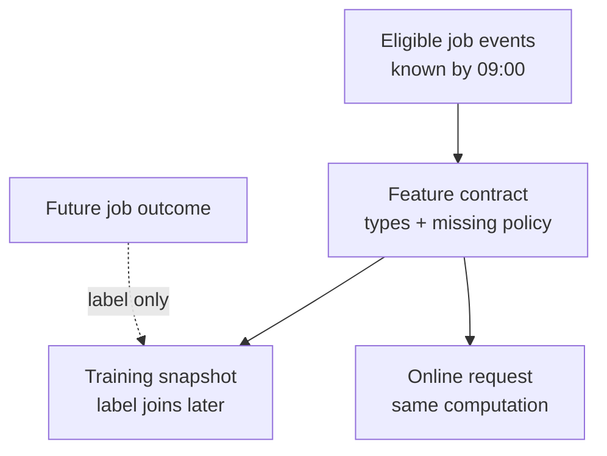

---
{
  "id": "feature-engineering-production-ml",
  "title": "Feature Engineering for Production ML",
  "slug": "feature-engineering-production-ml",
  "section": "Production ML Systems",
  "category": "MLOps & Deployment",
  "difficulty": "Medium",
  "order": 1,
  "coverImage": "illustrations/_generated/chapter_flow_dark.png",
  "companies": ["Amazon", "DoorDash", "Uber", "Google"],
  "shortDescription": "Turn training-job events into stable prediction inputs while preventing leakage and training-serving mismatch.",
  "keyConceptsTested": [
    "point-in-time correctness",
    "temporal leakage",
    "feature contracts",
    "out-of-fold target encoding",
    "robust scaling",
    "missingness indicators",
    "training-serving skew",
    "CACE principle"
  ]
}
---

At 09:00 UTC on May 1, 2026, the cluster scheduler evaluates whether training job `J-204` will finish after its May 2, 09:00 UTC deadline. That deadline is the job's <span data-glossary="sla">service-level agreement (SLA)</span> in this worked example. A notebook reports 0.98 ROC-AUC, but it queried the complete event log: it used a noon heartbeat, imputed values with statistics fitted across all partitions, and read escalation flags generated after the deadline. That score measures access to future information as well as predictive ability. The 0.98 figure is an invented warning built from synthetic data.

The [dataset-pipeline lesson](/learn/dataset-pipelines-data-quality) showed how malformed rows and related records contaminate evaluation. Those rows were already assembled. Here events are still arriving, and the 09:00 feature has to be the same number in the training table and on the live request.

Those inputs are **features**. `hours_since_last_heartbeat` compresses many scheduler pings into one number. Its definition must fix the time boundary, measurement units, and missing-data behavior, not just the column name.

## The temporal decision barrier and point-in-time correctness

At that 09:00 evaluation, only some fields on the job record are eligible inputs. The table assumes the listed measurements were already available to the scorer. Before querying, distinguish those from fields generated after the decision. A source column existing in today's export doesn't make it historically available.

| Candidate field | Known at prediction time? | Use as feature? |
| --- | --- | --- |
| runner pool | yes | yes, categorical |
| queued minutes | yes | yes, numeric |
| hours since most recent heartbeat | yes | yes, numeric |
| cluster queue backlog | yes | yes, numeric |
| finished timestamp | no | no, it defines the eventual label |
| post-SLA escalation | no | no, it leaks the outcome |

The job eventually finishes on May 3, so its later label is `missed_sla = 1`. Define how cancellations and still-running jobs are labeled too; a missing finish timestamp isn't automatically an on-time completion. A feature must respect the <span data-glossary="prediction-timestamp">prediction timestamp</span>. Post-SLA escalation is <span data-glossary="feature-leakage">feature leakage</span> when it was unavailable at this decision.[^sklearn2026leakage]

The tempting shortcut is easy to spot in an exported table that already has the post-SLA escalation bit populated. A rule checking escalation achieves perfect accuracy offline, yet fails in production because the escalation event occurs hours after scoring time:

<!-- leetllm: test, output=show -->
```python title="leaky-escalation-rule.py"
rows = [
    {"missed_sla": 1, "escalation": True, "queue_backlog": 18},
    {"missed_sla": 0, "escalation": False, "queue_backlog": 3},
    {"missed_sla": 1, "escalation": True, "queue_backlog": 9},
    {"missed_sla": 0, "escalation": False, "queue_backlog": 22},
]

def accuracy(predict):
    hits = sum(predict(row) == row["missed_sla"] for row in rows)
    return hits / len(rows)

print("escalation rule:", accuracy(lambda row: int(row["escalation"])))
print("backlog > 10:", accuracy(lambda row: int(row["queue_backlog"] > 10)))
```

<!-- leetllm: output:start -->
```text title="Output" output compact
escalation rule: 1.0
backlog > 10: 0.5
```
<!-- leetllm: output:end -->

On these four sample rows, the escalation rule gets every label right because the escalation flag copies the final outcome. The backlog rule gets two right. Neither number reflects production quality, but the contrast exposes leakage: the perfect rule requires information unavailable at 09:00.

Sculley et al. identify undeclared data dependencies, hidden feedback loops, and configuration debt as ML-specific technical debt.[^sculley2015] Feature definitions sit in that dependency graph. An implicit time boundary can conceal a problem that ordinary offline scores don't expose.

Work through the temporal cutoff by hand before writing a transform. Prediction time is `09:00`, and heartbeats exist at `01:00`, `08:30`, and `12:00`. Which timestamps belong in the row?

Assuming the first two had reached the scorer by 09:00, they are eligible. The latest is `08:30`, so heartbeat age is 30 minutes, or `0.5` hours. The noon ping would produce $-3.0$ hours. Exclude it from this decision's inputs; clipping it to zero would still reveal a future event.

For a latest-heartbeat feature, a <span data-glossary="point-in-time-join">point-in-time join</span> can use a backward `ASOF` lookup. Within the same job's eligible events, select:

$$
e^* = \operatorname*{arg\,max}_{e \in \mathcal{E}_{\text{job}}:\, t_{\text{event}}(e) \le t_{\text{pred}},\, t_{\text{available}}(e) \le t_{\text{pred}}} t_{\text{event}}(e)
$$

Define a missing policy for an empty eligible set and a deterministic revision rule for tied event times. Rolling counts or averages instead aggregate an eligible window; not every feature is the latest event's value. Databricks' time-series designation enables backward joins rather than ordinary exact-key matching.[^databricks2026pit]

Track two distinct clocks:

- **Event time** ($t_{\text{event}}$): when the telemetry event occurred.
- **Availability time** ($t_{\text{available}}$): when that event or revision became accessible to the scoring path. A lake's ingestion timestamp is a useful proxy only if it represents that availability.

An 08:50 heartbeat arriving at 09:15 was unavailable at 09:00. Corrections and backfills have the same problem. As checked October 10, 2026, Feast's default historical join constrains event time; a created timestamp normally resolves duplicate event times. Its `filter_by_created_timestamp=True` option also applies the availability cutoff when the configured column represents availability. That column must be non-null, and backend support varies.[^feast2026pit]

<figure>
  
  <figcaption>Read both clocks before selecting the latest heartbeat. Neither a late arrival nor a future event belongs in the 09:00 row. The eventual outcome is supervision, not an input to this prediction.</figcaption>
</figure>



Both offline training and online serving need identical feature definitions, code versions, and source availability rules. Labels join later and stay outside model inputs. Matching code alone won't guarantee matching source data.

```checkpoint
Would filtering each row at its timestamp make a random split a faithful test of next month's scheduler traffic?
---
Not necessarily. Point-in-time filtering controls each row's inputs; a chronological evaluation also tests fitting on earlier jobs and scoring later ones. Related jobs and labels not yet available at the training cutoff need their own rules. Random splits can be appropriate for an exchangeable deployment population, but they don't reproduce this forward-time task by themselves.
```

## Numerical transformations: scale, skewness, and missingness

Filtering out future timestamps still doesn't give you a clean model input. Raw numerical telemetry presents three operational challenges: scale differences, heavy-tailed skewness, and sensor missingness.

### Standardization and robust scaling

Suppose `queued_minutes` ranges from 0 to 120 minutes, while transferred bytes reach trillions. Such scale differences can make gradient-based optimization poorly conditioned and change the effect of regularization. Scaling is model-dependent; an exact threshold tree can represent equivalent splits after an invertible monotone rescaling.

In standard $Z$-score normalization, you subtract the mean and divide by the standard deviation:

$$
z = \frac{x - \mu}{\sigma}
$$

Fit $\mu$ and $\sigma$ on the appropriate training partition, including inside each evaluation fold. Reusing those artifacts at inference preserves the fitted representation. A declared adaptive online scaler is another design, but must be evaluated in update order; silently fitting a new scaler on the test or serving batch changes the protocol. Define constant-feature handling when $\sigma=0$. Welford's algorithm can maintain running statistics without rescanning history:[^welford1962]

$$
\mu_k = \mu_{k-1} + \frac{x_k - \mu_{k-1}}{k}, \quad M_{2,k} = M_{2,k-1} + (x_k - \mu_{k-1})(x_k - \mu_k), \quad \sigma_k^2 = \frac{M_{2,k}}{k}
$$

Here $M_{2,k}$ is the sum of squared deviations after $k$ observations; initialize the count and accumulator before the first update. Dividing by $k$ gives population variance for the observed values, while sample variance uses $k-1$ when $k>1$. Numerical stability doesn't make non-finite readings valid telemetry.

Telemetry can have heavy tails. In the eight-job sample below, one 12,000-minute wait dominates the mean and standard deviation, shrinking differences among ordinary waits in standardized units.

Robust scaling uses the median and interquartile range (IQR):

$$
z_{\text{robust}} = \frac{x - Q_{50}}{Q_{75} - Q_{25}}
$$

These quantiles are less sensitive to a few extreme magnitudes, not immune to contamination or finite-sample changes. The transform neither clips outliers nor guarantees better predictions. Choose a quantile convention and a zero-IQR policy. For nonnegative values, $\log(1+x)$ compresses a right tail but still grows without bound.[^sklearnRobustScaler2026]

Consider how a single 12,000-minute outlier distorts the representation of a normal job waiting 42 minutes under each transform:

<!-- leetllm: test, output=show -->
```python title="robust-scaling-transforms.py"
import math
from statistics import quantiles

wait_times = [5.0, 12.0, 18.0, 24.0, 30.0, 42.0, 55.0, 12000.0]

mean = sum(wait_times) / len(wait_times)
std = math.sqrt(sum((x - mean) ** 2 for x in wait_times) / len(wait_times))

sorted_w = sorted(wait_times)
median = (sorted_w[3] + sorted_w[4]) / 2.0
q1, _, q3 = quantiles(wait_times, n=4, method="inclusive")
iqr = q3 - q1

normal_job = 42.0
outlier_job = 12000.0

z_normal = (normal_job - mean) / std
z_outlier = (outlier_job - mean) / std

robust_normal = (normal_job - median) / iqr
robust_outlier = (outlier_job - median) / iqr

log_normal = math.log1p(normal_job)
log_outlier = math.log1p(outlier_job)

print(f"mean: {mean:.1f}, std: {std:.1f}")
print(f"normal job 42m -> z: {z_normal:.3f}, robust: {robust_normal:.3f}, log1p: {log_normal:.3f}")
print(f"outlier job 12000m -> z: {z_outlier:.3f}, robust: {robust_outlier:.3f}, log1p: {log_outlier:.3f}")
```

<!-- leetllm: output:start -->
```text title="Output" output compact
mean: 1523.2, std: 3959.9
normal job 42m -> z: -0.374, robust: 0.522, log1p: 3.761
outlier job 12000m -> z: 2.646, robust: 416.452, log1p: 9.393
```
<!-- leetllm: output:end -->

The mean is 1,523.2 and the population standard deviation is 3,959.9 minutes. Standardization places the 5-minute and 42-minute waits about 0.0093 units apart. Their information hasn't vanished: positive affine scaling is invertible in exact arithmetic. The issue is its interaction with optimization, precision, and penalties.

With inclusive interpolated quartiles, $Q_{25}=16.5$, median $=27.0$, and $Q_{75}=45.25$, so IQR $=28.75$. The 42-minute wait becomes $0.522$, but the outlier still becomes $416.452$. If your aim is to bound extreme inputs, robust scaling alone doesn't do that. The quartile method is part of the reproducible definition.[^pythonQuantiles2026]

```checkpoint
Welford processes readings [3, 7, 11], starting count 0 and M2=0. What final mean, M2 and population variance follow?

1. 7;16;16/3.
2. 7;32;16.
3. 21;32;32/3.
4. 7;32;32/3.
---
**Answer:** 7;32;32/3.

Means are 3, 5, 7. M2 increments are 0, 8, 24, giving 32. Population variance divides by 3; sample variance would divide by 2 and equal 16. The sum 21 is not the mean.
```

### Missingness indicators preserve the measurement gap

Missing values require an explicit policy. Filling missing `queue_backlog` with zero alone merges an unknown backlog with a measured empty queue. Missingness could reflect an outage, delayed collection, unsupported instrumentation, or another cause. It isn't itself proof of cluster stress.

Pairing an imputed default value with a binary missingness indicator preserves that distinction:

$$
x_{\text{imputed}} = 0.0, \quad x_{\text{missing}} = \begin{cases} 1 & \text{if } x \text{ is null} \\ 0 & \text{if } x \text{ is present} \end{cases}
$$

The extra bit lets the model distinguish measurement availability. Whether that signal predicts deadline misses must be tested, particularly if instrumentation changes after training.

```checkpoint
Why is zero imputation without a missingness indicator risky for production telemetry?
---
Under this contract, observed zero represents an empty queue and null represents no measurement. Without the extra bit, both produce the same input. That removes the distinction; it doesn't tell us how a particular trained model will respond.
```

## Categorical encodings: one-hot pitfalls and smoothed target encoding

Numeric estimators need a representation for `runner_pool`. Feeding arbitrary codes `0`, `1`, and `2` as a scalar introduces an order and spacing into linear or distance-based models. Some estimators instead accept declared categorical features and treat their codes as category identities. Match the encoding to the estimator.

### One-hot encoding and its limits

One-hot encoding resolves this by allocating an orthogonal binary dimension for each distinct category:

$$
\text{a100-pool} \to [1, 0, 0], \quad \text{h100-pool} \to [0, 1, 0], \quad \text{other} \to [0, 0, 1]
$$

Three choices matter as cardinality grows:

1. **Storage and model size:** Sparse one-hot matrices avoid allocating every zero, but column metadata and model parameters still grow with category count. Dense conversion can be expensive; wide encoding doesn't imply slow inference in every implementation.
2. **Tree split structure:** Grouping many categories via binary indicators may require multiple splits. Native categorical splitting is an alternative; neither encoding guarantees superior generalization.
3. **Unseen categories:** Choose rejection, a reserved bucket, an infrequent-category bucket, or an all-zero representation deliberately. Scikit-learn's `handle_unknown="ignore"` emits all zeros; it doesn't create an `other` bit. The example below explicitly maps unknown pools to a category included at fit time.[^sklearnOneHot2026]

```checkpoint
An encoder has known categories[a, b, other]. Unknown c arrives. Compare handle_unknown=ignore directly with an explicit c→other mapping before transform. What bits follow?

1. Ignore[0,0,1]; explicit[0,0,1].
2. Ignore[0,0,0]; explicit[1,0,0].
3. Ignore[0,0,0]; explicit[0,0,1].
4. Ignore[1,1,1]; explicit[0,0,1].
---
**Answer:** Ignore[0,0,0]; explicit[0,0,1].

Ignoring unknowns emits all zero category bits. Explicit mapping activates the reserved other coordinate. These are distinct contracts; ignoring does not create an other bit.
```

### Out-of-fold target encoding with m-estimate smoothing

For a binary target, **target encoding** represents a category using an estimate of its conditional target mean:

$$
S_c = \mathbb{E}[y \mid X = c]
$$

Computing each training row's encoding from its own label introduces a target dependency. For a singleton category with `missed_sla=1`, the unsmoothed mean is exactly `1.0`. This can encourage overfitting; it doesn't force every downstream model to memorize or achieve near-perfect accuracy.[^sklearnTargetEncoder2026]

Separate two jobs:

1. **Out-of-fold (K-fold) target encoding:** Split the training data into $K$ partitions. For samples in fold $k$, calculate the category target means using only the remaining $K-1$ folds.
2. **m-estimate smoothing:** Shrink category estimates toward a prior target mean $\mu$:

$$
\hat{S}_c = \frac{n_c \bar{y}_c + m \mu}{n_c + m}
$$

Here $n_c$ is the category count and $\bar y_c$ its target mean among allowed fitting rows. For each held-out fold, compute both category statistics and the prior $\mu$ from those rows, not all partitions. The nonnegative weight $m$ controls shrinkage; it can be fixed or selected within training. Empirical Bayes estimates hyperparameters from data; a fixed $m$ isn't automatically that procedure. Binary Laplace add-one smoothing is a particular prior choice, not a synonym for every m-estimate.

Smoothing still uses an included row's label. Cross-fitting removes that direct dependency; smoothing stabilizes small-category estimates. Neither alone repairs future-label or related-entity leakage.

Notice how rare categories behave under naive encoding versus smoothed m-estimate encoding:

<!-- leetllm: test, output=show, id=target-smoothing -->
```python title="target-encoding-smoothing.py"
records = [
    {"pool": "a100-pool", "missed_sla": 0},
    {"pool": "a100-pool", "missed_sla": 0},
    {"pool": "a100-pool", "missed_sla": 1},
    {"pool": "a100-pool", "missed_sla": 0},
    {"pool": "h100-pool", "missed_sla": 1},
    {"pool": "h100-pool", "missed_sla": 1},
    {"pool": "h100-pool", "missed_sla": 1},
    {"pool": "l4-pool",   "missed_sla": 1},
]

global_mean = sum(r["missed_sla"] for r in records) / len(records)
smoothing_m = 5.0

pool_counts = {}
pool_sums = {}
for r in records:
    p = r["pool"]
    pool_counts[p] = pool_counts.get(p, 0) + 1
    pool_sums[p] = pool_sums.get(p, 0) + r["missed_sla"]

naive_encoding = {p: pool_sums[p] / pool_counts[p] for p in pool_counts}
smoothed_encoding = {
    p: (pool_sums[p] + smoothing_m * global_mean) / (pool_counts[p] + smoothing_m)
    for p in pool_counts
}

print(f"global prior SLA miss rate: {global_mean:.3f}")
print("naive encoding (l4-pool leaks target!):", {k: round(v, 3) for k, v in naive_encoding.items()})
print("smoothed m-estimate (l4-pool shrinks to prior):", {k: round(v, 3) for k, v in smoothed_encoding.items()})
```

<!-- leetllm: output:start -->
```text title="Output" output compact
global prior SLA miss rate: 0.625
naive encoding (l4-pool leaks target!): {'a100-pool': 0.25, 'h100-pool': 1.0, 'l4-pool': 1.0}
smoothed m-estimate (l4-pool shrinks to prior): {'a100-pool': 0.458, 'h100-pool': 0.766, 'l4-pool': 0.688}
```
<!-- leetllm: output:end -->

For `l4-pool`, smoothing changes `1.0` to `0.688`, but its own label contributes to both the category sum and the full-data prior. This cell demonstrates shrinkage, not a safe training representation.

Now exclude a row's entire fold from its category statistics *and prior*. These two explicit folds illustrate cross-fitting under an exchangeable-row assumption. Predict the encoding of `l4-pool` when its category is absent from the fitting fold:

<!-- leetllm: test, output=show, continue=target-smoothing -->
```python title="out-of-fold-target-encoding.py"
folds = ([0, 2, 4, 6], [1, 3, 5, 7])

def encode_oof(data, folds, m):
    encoded = [None] * len(data)
    for held_out in folds:
        fitting = [row for i, row in enumerate(data) if i not in held_out]
        prior = sum(row["missed_sla"] for row in fitting) / len(fitting)
        for i in held_out:
            category = data[i]["pool"]
            labels = [row["missed_sla"] for row in fitting if row["pool"] == category]
            encoded[i] = (sum(labels) + m * prior) / (len(labels) + m)
    return encoded

oof = encode_oof(records, folds, smoothing_m)
changed = [dict(row) for row in records]
changed[-1]["missed_sla"] = 0

print("OOF values:", [round(value, 3) for value in oof])
print(f"l4-pool: naive={naive_encoding['l4-pool']:.3f}, smoothed={smoothed_encoding['l4-pool']:.3f}, OOF={oof[-1]:.3f}")
print("own encoding unchanged after label flip:", encode_oof(changed, folds, smoothing_m)[-1] == oof[-1])
```

<!-- leetllm: output:start -->
```text title="Output" output compact
OOF values: [0.357, 0.679, 0.357, 0.679, 0.583, 0.821, 0.583, 0.75]
l4-pool: naive=1.000, smoothed=0.688, OOF=0.750
own encoding unchanged after label flip: True
```
<!-- leetllm: output:end -->

The fitting fold's prior is `0.75`, not the full-data `0.625`. Flipping this row's label leaves its own encoding unchanged because neither its category sum nor its prior uses that label. The model still gets different training values from the full-training mapping later used for validation or serving; that's intentional cross-fitting, not an accidental implementation mismatch.

For the scheduler's forward-time task, ordinary shuffled folds can still use future jobs' outcomes. Fit each historical encoding from earlier **matured labels**, respect related-job boundaries, and define a warm-up policy before any prior labels exist. Scikit-learn 1.9 accepts custom splitters in `TargetEncoder`, but requires each sample to appear in a validation fold exactly once; a plain `TimeSeriesSplit` doesn't meet that coverage rule. A dedicated forward encoder may be needed. Its `fit_transform` cross-fits; `fit` followed by `transform` on the same training rows doesn't.[^sklearnTargetEncoder2026]

An earlier job isn't necessarily a usable labeled job. In this small replay, all jobs are unrelated and use the same runner pool. The first job's outcome is available at `08:00`; the second job was scored earlier but its outcome arrives at `10:00`. Predict the smoothed encoding at `09:00`:

<!-- leetllm: test, output=show -->
```python title="encode-from-matured-labels.py"
from datetime import datetime

def clock(hour):
    return datetime.fromisoformat(f"2026-05-01T{hour}:00:00+00:00")

history = [
    {"scored_at": clock("06"), "label_available_at": clock("08"), "missed_sla": 0},
    {"scored_at": clock("07"), "label_available_at": clock("10"), "missed_sla": 1},
]

def same_pool_encoding(cutoff):
    eligible = [
        row["missed_sla"] for row in history
        if row["scored_at"] < cutoff and row["label_available_at"] <= cutoff
    ]
    if not eligible:
        return None  # Warm-up policy: no target-encoded score.
    prior = sum(eligible) / len(eligible)
    m = 5.0
    return (sum(eligible) + m * prior) / (len(eligible) + m)

for hour in ("07", "09", "10"):
    print(f"{hour}:00 encoding:", same_pool_encoding(clock(hour)))
print("using every earlier job at 09:00:", sum(r["missed_sla"] for r in history) / len(history))
```

<!-- leetllm: output:start -->
```text title="Output" output compact
07:00 encoding: None
09:00 encoding: 0.0
10:00 encoding: 0.5
using every earlier job at 09:00: 0.5
```
<!-- leetllm: output:end -->

At `09:00`, the `1` label is future information even though its job was scored at `07:00`. At `10:00`, that label becomes eligible under the fixture's inclusive availability boundary. Because every job has the same category, its mean and the allowed global prior coincide, so smoothing doesn't change either value. With multiple categories, compute both statistics from the eligible rows as in the OOF cell. A frozen encoder uses its artifact's fitting cutoff; an encoder updated with newly matured labels needs an explicit update policy and replay of those versions. A complete training or update pipeline also needs to define and replay its other stages.

```checkpoint
Why must target encoding statistics be computed out-of-fold during training?
---
Including a row in its category mean introduces its own label into the input. Smoothing reduces that contribution but doesn't remove it. Compute the prior from allowed fitting rows too; temporal tasks additionally require label availability and forward-time rules.
```

```checkpoint
A category has one fitting label 0. Use smoothing weight 3 and a fixed prior 0.4. What encoded value follows, and does the category statistic still use that row label?

1. 0; label excluded.
2. 0.4; label included.
3. 0.3; label excluded.
4. 0.3; label included.
---
**Answer:** 0.3; label included.

The value is (0+3×0.4)/(1+3)=0.3. The category sum still includes the row label, even with an externally fixed prior. Shrinkage reduces extremes without removing own-label dependence.
```

```checkpoint
At 09:00, three earlier same-pool jobs have labels 0, 1 and 0. Their labels become available at 08:00, 08:30 and 09:30, respectively. The encoder uses only mature labels, and its one-category mean equals its allowed global prior. What encoding at 09:00 and at the inclusive 09:30 boundary follows?

1. 1/3 then 1/3.
2. 0.5 then 1/3.
3. 0.5 then 2/3.
4. 1 then 0.5.
---
**Answer:** 0.5 then 1/3.

The first two labels are mature at 09:00, so their mean is (0+1)/2=0.5. The last zero becomes eligible at 09:30, giving (0+1+0)/3=1/3. With one category, smoothing toward the same allowed global prior leaves these values fixed. Including that late zero before availability would leak future evidence.
```

## Feature contracts and strict row validation

A mathematical definition still needs runtime enforcement. Suppose the cluster backlog feed disconnects or an unknown runner pool arrives. What should the row mean in each case?

Each surviving field requires a data type, an explicit missing-value rule, and a validated reason to exist. That's the <span data-glossary="feature-contract">feature contract</span> for this job-SLA scorer:

| Feature | Type | Missing rule | Why it helps |
| --- | --- | --- | --- |
| `queued_minutes` | numeric | reject if absent; allow `0` | records time already spent waiting in the queue |
| `hours_since_last_heartbeat` | numeric | reject missing timestamp; cap observed age at 180 hours | measures elapsed time since an eligible ping |
| `queue_backlog` | numeric | emit `0` plus `queue_backlog_missing=1` when absent | measures the reported queue pressure |
| `runner_pool` | categorical | reject if absent; map unseen to `other` | identifies the assigned resource pool |
| `priority_job` | boolean | require an explicit Boolean | identifies the declared scheduling class |

The 180-hour cap represents an explicit engineering boundary, not an estimated statistical parameter. Learned parameters (such as a training-set mean or target encoding mappings) and fixed limits (such as this cap) both belong in the versioned preprocessing package.

These are candidate signals, not established causal explanations. Confirm that each measurement was available at cutoff. When filtering incoming event streams, an 08:50 heartbeat arriving at 09:15 cannot replace the 08:30 heartbeat because it has not yet landed at 09:00 scoring time:

<!-- leetllm: test, output=show -->
```python title="keep-visible-events.py"
from datetime import datetime

prediction_time = datetime.fromisoformat("2026-05-01T09:00:00+00:00")
heartbeats = [
    ("01:00", "01:01"),
    ("08:30", "08:31"),
    ("08:50", "09:15"),
    ("12:00", "12:01"),
]

def timestamp(clock):
    return datetime.fromisoformat(f"2026-05-01T{clock}:00+00:00")

visible_heartbeats = [
    timestamp(event_time) for event_time, available_time in heartbeats
    if timestamp(event_time) <= prediction_time and timestamp(available_time) <= prediction_time
]
if not visible_heartbeats:
    raise ValueError("no heartbeat available by prediction_time")
print("visible heartbeats:", len(visible_heartbeats))
print("latest visible:", max(visible_heartbeats).isoformat())
print("heartbeat age hours:", (prediction_time - max(visible_heartbeats)).total_seconds() / 3600)
print("08:50 late arrival eligible:", timestamp("09:15") <= prediction_time)
```

<!-- leetllm: output:start -->
```text title="Output" output compact
visible heartbeats: 2
latest visible: 2026-05-01T08:30:00+00:00
heartbeat age hours: 0.5
08:50 late arrival eligible: False
```
<!-- leetllm: output:end -->

The next builder validates a row already selected by the historical query. It doesn't inspect ingestion metadata or prove the entire source snapshot's availability. The query above and the row contract solve different problems. Extra source fields are ignored; the output contains only allowlisted keys. Check which fields survive from `J-204` and which two are omitted:

<!-- leetllm: test, output=show, id=feature-contract -->
```python title="build-feature-row.py"
from datetime import datetime, timezone
from math import isfinite

allowed_feature_keys = {
    "runner_pool",
    "queued_minutes",
    "hours_since_last_heartbeat",
    "queue_backlog",
    "queue_backlog_missing",
    "priority_job",
}
known_runner_pools = {"a100-pool", "h100-pool"}
future_only_keys = {"finished_at", "post_sla_escalation"}
heartbeat_cap_hours = 180.0

def nonnegative_number(value, name):
    if value is True or value is False or not isinstance(value, (int, float)):
        raise ValueError(f"{name} must be numeric, not a string or boolean")
    value = float(value)
    if not isfinite(value) or value < 0:
        raise ValueError(f"{name} must be finite and nonnegative")
    return value

def parse_timestamp(value):
    if not isinstance(value, str):
        raise ValueError("last_heartbeat_at must be an ISO timestamp string")
    parsed = datetime.fromisoformat(value)
    if parsed.utcoffset() is None:
        raise ValueError("last_heartbeat_at must include a timezone")
    return parsed.astimezone(timezone.utc)

def make_features(row, prediction_time):
    if not isinstance(prediction_time, datetime) or prediction_time.utcoffset() is None:
        raise ValueError("prediction_time must be a timezone-aware datetime")
    required_keys = {"queued_minutes", "last_heartbeat_at", "priority_job"}
    missing_keys = sorted(required_keys - row.keys())
    if missing_keys:
        raise ValueError(f"missing required fields: {missing_keys}")

    queued_minutes = nonnegative_number(row["queued_minutes"], "queued_minutes")

    runner_pool = row.get("runner_pool")
    if not isinstance(runner_pool, str) or not runner_pool.strip():
        raise ValueError("runner_pool is missing")
    runner_pool = runner_pool.strip().casefold()

    if row["priority_job"] is not True and row["priority_job"] is not False:
        raise ValueError("priority_job must be boolean")

    last_heartbeat = parse_timestamp(row["last_heartbeat_at"])
    if last_heartbeat > prediction_time:
        raise ValueError("last_heartbeat_at is after prediction_time")
    heartbeat_age = min(
        (prediction_time - last_heartbeat).total_seconds() / 3600, heartbeat_cap_hours
    )

    queue_backlog = row.get("queue_backlog")
    if queue_backlog is not None:
        queue_backlog = nonnegative_number(queue_backlog, "queue_backlog")
    features = {
        "runner_pool": runner_pool if runner_pool in known_runner_pools else "other",
        "queued_minutes": queued_minutes,
        "hours_since_last_heartbeat": heartbeat_age,
        "queue_backlog": 0.0 if queue_backlog is None else queue_backlog,
        "queue_backlog_missing": int(queue_backlog is None),
        "priority_job": int(row["priority_job"]),
    }

    blocked_fields = sorted(features.keys() - allowed_feature_keys)
    if blocked_fields:
        raise ValueError(f"unexpected feature fields: {blocked_fields}")
    return features

prediction_time = datetime.fromisoformat("2026-05-01T09:00:00+00:00")
job = {
    "job_id": "J-204",
    "runner_pool": "a100-pool",
    "queued_minutes": 42,
    "queue_backlog": 18,
    "priority_job": False,
    "last_heartbeat_at": "2026-05-01T08:30:00+00:00",
    "finished_at": "2026-05-03T14:00:00+00:00",
    "post_sla_escalation": True,
}

features = make_features(job, prediction_time)
print(features)
print("future fields leaked:", sorted(features.keys() & future_only_keys))
```

<!-- leetllm: output:start -->
```text title="Output" output compact
{'runner_pool': 'a100-pool', 'queued_minutes': 42.0, 'hours_since_last_heartbeat': 0.5, 'queue_backlog': 18.0, 'queue_backlog_missing': 0, 'priority_job': 0}
future fields leaked: []
```
<!-- leetllm: output:end -->

`finished_at` and `post_sla_escalation` remain outside `features`; their presence in the source payload isn't a rejection. The numeric validator does reject `True`, even though Python can cast it to `1.0`. Its allowlist and types don't establish the correctness or timing of the upstream measurements.

The next cell tests boundary conditions. Predict the missing-backlog behavior, unseen runner pool handling, and how malformed inputs trigger validation errors:

<!-- leetllm: test, output=show, continue=feature-contract, id=feature-checks -->
```python title="check-feature-boundaries.py"
missing_backlog = make_features({**job, "queue_backlog": None}, prediction_time)
assert missing_backlog["queue_backlog"] == 0.0
assert missing_backlog["queue_backlog_missing"] == 1
unseen_pool = make_features({**job, "runner_pool": "l4-pool"}, prediction_time)
assert unseen_pool["runner_pool"] == "other"
zero_queue = make_features({**job, "queued_minutes": 0}, prediction_time)
assert zero_queue["queued_minutes"] == 0.0
same_instant = make_features(
    {**job, "last_heartbeat_at": "2026-05-01T04:30:00-04:00"}, prediction_time
)
assert same_instant == features

print("missing backlog:", missing_backlog["queue_backlog"], missing_backlog["queue_backlog_missing"])
print("unseen pool:", unseen_pool["runner_pool"])
print("zero queue and equivalent timezone offset: accepted")

invalid_cases = {
    "absent pool": {"runner_pool": None},
    "future heartbeat": {"last_heartbeat_at": "2026-05-01T12:00:00+00:00"},
    "missing heartbeat": {"last_heartbeat_at": None},
    "timezone missing": {"last_heartbeat_at": "2026-05-01T08:30:00"},
    "negative queue": {"queued_minutes": -1},
    "boolean queue": {"queued_minutes": True},
    "nonfinite backlog": {"queue_backlog": float("nan")},
    "string priority": {"priority_job": "false"},
}
for name, change in invalid_cases.items():
    try:
        make_features({**job, **change}, prediction_time)
    except ValueError:
        print(name + ": rejected")
    else:
        raise AssertionError(name + " was accepted")
```

<!-- leetllm: output:start -->
```text title="Output" output compact
missing backlog: 0.0 1
unseen pool: other
zero queue and equivalent timezone offset: accepted
absent pool: rejected
future heartbeat: rejected
missing heartbeat: rejected
timezone missing: rejected
negative queue: rejected
boolean queue: rejected
nonfinite backlog: rejected
string priority: rejected
```
<!-- leetllm: output:end -->

For a model consuming positional numeric vectors, fix the layout. Vectorization maps the named dictionary into ordered elements:

<!-- leetllm: test, output=show -->
```python title="vectorize-features.py"
pool_categories = ("a100-pool", "h100-pool", "other")
numeric_order = (
    "queued_minutes",
    "hours_since_last_heartbeat",
    "queue_backlog",
    "queue_backlog_missing",
    "priority_job",
)
features = {
    "runner_pool": "a100-pool",
    "queued_minutes": 42.0,
    "hours_since_last_heartbeat": 0.5,
    "queue_backlog": 18.0,
    "queue_backlog_missing": 0,
    "priority_job": 0,
}

feature_order = tuple("pool=" + pool for pool in pool_categories) + numeric_order
vector = [int(features["runner_pool"] == pool) for pool in pool_categories]
vector += [features[name] for name in numeric_order]
print("order:", feature_order)
print("vector:", vector)
```

<!-- leetllm: output:start -->
```text title="Output" output compact
order: ('pool=a100-pool', 'pool=h100-pool', 'pool=other', 'queued_minutes', 'hours_since_last_heartbeat', 'queue_backlog', 'queue_backlog_missing', 'priority_job')
vector: [1, 0, 0, 42.0, 0.5, 18.0, 0, 0]
```
<!-- leetllm: output:end -->

The final vector contains eight numerical entries. Reordering category columns can pair the active bit with a different learned weight even if the raw strings match. Package the category list, clipping thresholds, missing-data indicators, and column order with the model artifact.

```checkpoint
What happens if the online serving layer applies a different vector ordering than training?
---
If dimensions stay the same, weights can silently pair with the wrong meanings. Swapping two slots matters when the model uses them differently; an explicit layout/version check can catch it even when a generic numeric schema can't.
```

## Changing preprocessing changes what the model receives

Job `J-188` last recorded a heartbeat 200 hours before scoring. During model training, the preprocessing pipeline clipped that age to the 180.0-hour ceiling. If an engineer later deploys a serving change that raises the cap to 360 hours without retraining the model, `J-188` now enters the model as `200.0`.

Sculley et al. call attention to such dependencies with the **CACE principle**: Changing Anything Changes Everything.[^sculley2015] It is a warning about coupled systems, not a theorem that every edit changes every prediction or requires retraining.

The existing weights stay fixed after a serving-only cap edit. Inputs above 180 hours may change; inputs below both caps don't. A model that ignores heartbeat age could be unaffected. Models with interactions can respond differently across pools or backlog levels, and refitting can change other weights as well. Re-evaluate the changed preprocessing/model pair before deciding whether to retain it, restore the old cap, or retrain.

<figure>
  
  <figcaption>A changed input can move a fixed model across a decision threshold. The linear score formula maps the shifted input across the threshold. Measuring model accuracy requires labeled outcomes. Operational feedback requires a separate policy that acts on predictions.</figcaption>
</figure>

<!-- leetllm: test, output=show, id=feature-cace -->
```python title="changing-heartbeat-cap.py"
def heartbeat_age_hours(raw_hours, cap_hours):
    return min(raw_hours, cap_hours)

raw_age = 200.0
training_vector = heartbeat_age_hours(raw_age, 180.0)
live_vector = heartbeat_age_hours(raw_age, 360.0)
print("raw hours:", raw_age)
print("training hb_age_h:", training_vector)
print("live hb_age_h after cap change:", live_vector)
print("same slot, different meaning:", training_vector != live_vector)
```

<!-- leetllm: output:start -->
```text title="Output" output compact
raw hours: 200.0
training hb_age_h: 180.0
live hb_age_h after cap change: 200.0
same slot, different meaning: True
```
<!-- leetllm: output:end -->

Make the score consequence visible with a fixed logistic rule. Its coefficients illustrate the risk: under a 180-hour cap the score lands at 0.445 (below threshold 0.50), whereas expanding the cap to 360 hours raises the score to 0.545, crossing the alert boundary:

<!-- leetllm: test, output=show, continue=feature-cace, id=cap-scores -->
```python title="cap-change-score.py"
import math

def toy_score(raw_hours, cap, heartbeat_weight=0.02):
    age = heartbeat_age_hours(raw_hours, cap)
    logit = heartbeat_weight * age + 0.01 * 18.0 - 4.0
    return 1.0 / (1.0 + math.exp(-logit))

for cap in (180.0, 360.0):
    score = toy_score(200.0, cap)
    print(f"cap={cap:.0f}h -> score={score:.3f}, alert={score >= 0.5}")
print("fresh job unchanged:", toy_score(0.5, 180.0) == toy_score(0.5, 360.0))
print("zero heartbeat weight unchanged:", toy_score(200.0, 180.0, 0.0) == toy_score(200.0, 360.0, 0.0))
```

<!-- leetllm: output:start -->
```text title="Output" output compact
cap=180h -> score=0.445, alert=False
cap=360h -> score=0.545, alert=True
fresh job unchanged: True
zero heartbeat weight unchanged: True
```
<!-- leetllm: output:end -->

An alert isn't an eviction. If a controller consumes the score and requeues jobs, it may alter future backlogs, outcomes, and training data. The direction and magnitude depend on that policy and the system; this example doesn't simulate a controller or establish a feedback effect.

For fixed fitted preprocessing, apply the training artifact at inference. Here is the explicit unknown-pool mapping in scikit-learn:

<!-- leetllm: test, output=show, deps=pandas,scikit-learn, continue=cap-scores -->
```python title="library-feature-contract.py"
import pandas as pd
from sklearn.preprocessing import OneHotEncoder

pool_categories = ["a100-pool", "h100-pool", "other"]
encoder = OneHotEncoder(categories=[pool_categories], sparse_output=False)
training_pools = pd.DataFrame({"runner_pool": ["a100-pool", "h100-pool"]})
encoder.fit(training_pools)

rows = pd.DataFrame(
    [
        {"runner_pool": "a100-pool", "queued_minutes": 42.0, "raw_heartbeat_hours": 0.5},
        {"runner_pool": "l4-pool", "queued_minutes": 18.0, "raw_heartbeat_hours": 200.0},
    ]
)
rows["hb_age_h"] = rows["raw_heartbeat_hours"].map(lambda hours: heartbeat_age_hours(hours, 180.0))

mapped_pools = rows["runner_pool"].map(
    lambda pool: pool if pool in {"a100-pool", "h100-pool"} else "other"
)
encoded = encoder.transform(mapped_pools.to_frame())

print("category order:", encoder.categories_[0].tolist())
for pool, values, age in zip(rows["runner_pool"], encoded, rows["hb_age_h"]):
    print(f"{pool}: pool bits={values.astype(int).tolist()}, hb_age_h={age}")
assert encoded[1].tolist() == [0.0, 0.0, 1.0]
```

<!-- leetllm: output:start -->
```text title="Output" output compact
category order: ['a100-pool', 'h100-pool', 'other']
a100-pool: pool bits=[1, 0, 0], hb_age_h=0.5
l4-pool: pool bits=[0, 0, 1], hb_age_h=180.0
```
<!-- leetllm: output:end -->

`l4-pool` maps to `[0, 0, 1]`, and its 200-hour heartbeat clips to `180.0`. For this fixed preprocessing contract, reuse the fitted encoder rather than refitting on serving batches. Learned vocabularies and normalization parameters belong to the relevant training partition.

```checkpoint
Does changing the cap force every model score to change?
---
No. Inputs below both caps are unchanged, and a model may ignore the affected feature. The preprocessing/model combination has changed and needs evaluation; choose whether to retrain based on its measured impact.
```

```checkpoint
A fixed model receives heartbeat age min(raw, cap). Raise the cap from 100 to 300 hours. Compare raw ages 240 and 2. What new inputs follow, and which model pair needs evaluation?

1. Inputs 240 and 2; evaluate revised preprocessing with fixed model.
2. Inputs 300 and 2; evaluate revised preprocessing with fixed model.
3. Inputs 240 and 100; evaluate original preprocessing with fixed model.
4. Inputs 100 and 2; evaluate original preprocessing with fixed model.
---
**Answer:** Inputs 240 and 2; evaluate revised preprocessing with fixed model.

The old inputs were 100 and 2; the new inputs are 240 and 2. Only the older case changes. Weights remain fixed, so evaluate the changed preprocessing/model pair before choosing a repair or retraining.
```

```checkpoint
A fixed standardizer was fitted on training with mean 10 and standard deviation 2. For input 14, serving silently refits its mean to 14 while keeping scale 2. What original/revised coordinates and contract result follow?

1. 2 then 0; fixed-artifact contract fails.
2. 2 then 2; fixed-artifact contract passes.
3. 0 then 2; fixed-artifact contract passes.
4. 7 then 7; fixed-artifact contract fails.
---
**Answer:** 2 then 0; fixed-artifact contract fails.

The stored transform gives (14−10)/2=2. Replacing the mean gives 0, changing the fitted representation. An explicitly evaluated adaptive policy is different; silently fitting the serving batch violates this fixed-artifact contract.
```

## Compare the offline row with the live row

Suppose the offline table reports `queue_backlog=18.0` while the captured live row contains `0.0` for the same job and cutoff. Both pass numeric validation, yet the inputs differ. This is **training-serving skew**; its prediction effect depends on the model.

Possible sources include:

1. **Discrepancy in logic:** Offline features computed using SQL/PySpark batch queries, while online features computed using Java/Go microservices with subtle differences in rounding or null handling.
2. **Time-travel leakage in backfills:** Offline pipelines joining the *current* state of a database table rather than replaying historical point-in-time state.
3. **Freshness lag:** Online key-value stores falling behind streaming message queues during traffic spikes.

### The unified feature store pattern

A **feature store** can organize definitions and historical/online retrieval:

- **Registry:** records feature schemas, sources, and associated definitions or metadata.
- **Offline path:** builds training rows from retained history and configured time-aware joins.
- **Online path:** retrieves current entity features with a serving latency target. Feast's online stores retain the latest values, not historical versions.[^feast2026online]

A registry doesn't automatically execute equivalent transforms, synchronize updates, enforce availability-time replay, or guarantee millisecond latency. Check the product, backend, and deployment. A versioned shared preprocessing package and logged serving rows can be enough for a small application; a separate online store isn't needed for every batch model.

Product names also hide different generations. Google's current documentation marks Optimized online serving deprecated, with critical patches only from May 17, 2026 and a planned February 17, 2027 shutdown. It directs feature-serving migrations to Bigtable online serving, which supports scheduled and continuous synchronization. Check the selected generation rather than treating every Vertex AI Feature Store capability as interchangeable. Verified October 10, 2026.[^googleFeatureServing2026]

Sample both offline and online paths on identical entities before promoting a new model candidate:

<!-- leetllm: test, output=show -->
```python title="check-parity.py"
def mismatches(offline, online):
    missing = object()
    differences = {}
    for key in sorted(offline.keys() | online.keys()):
        left, right = offline.get(key, missing), online.get(key, missing)
        if left != right:
            differences[key] = (
                "<missing>" if left is missing else left,
                "<missing>" if right is missing else right,
            )
    return differences

offline = {"runner_pool": "a100-pool", "queue_backlog": 18.0, "priority_job": 0}
online_rows = {
    "matching": {"runner_pool": "a100-pool", "queue_backlog": 18.0, "priority_job": 0},
    "stale cache": {"runner_pool": "a100-pool", "queue_backlog": 0.0, "priority_job": 0},
    "missing field": {"runner_pool": "a100-pool", "queue_backlog": 18.0},
}

for name, online in online_rows.items():
    differences = mismatches(offline, online)
    print(name, "mismatches:", differences, "parity gate passed:", not differences)

assert mismatches({"value": None}, {}) == {"value": (None, "<missing>")}
```

<!-- leetllm: output:start -->
```text title="Output" output compact
matching mismatches: {} parity gate passed: True
stale cache mismatches: {'queue_backlog': (18.0, 0.0)} parity gate passed: False
missing field mismatches: {'priority_job': (0, '<missing>')} parity gate passed: False
```
<!-- leetllm: output:end -->

The latter two rows fail this declared parity gate; the matching sample doesn't approve a whole release. Compare captured serving inputs with a replay of the same source availability, preprocessing version, and layout. A current latest-only lookup can't reconstruct an old request. This helper uses scalar equality, which doesn't distinguish `False` from `0` in Python; validate types separately. Cross-engine floats may need declared tolerances and explicit non-finite handling.

Monitor feature integrity continuously in production:

| Production check | Failure it catches | Action |
| --- | --- | --- |
| null rate by feature | measurements became unavailable | investigate source and apply the missing-data policy |
| unseen-category rate | categories differ from the fitted vocabulary | inspect catalog changes and evaluate their treatment |
| freshness lag | expected updates aren't available on time | apply the declared lag policy |
| offline/online parity sample | replay and captured serving inputs disagree | inspect timing, versions, types, and source state |

These checks expose symptoms, not unique causes. Freshness needs a definition per feed or feature: expected update schedule, processing watermark, or entity update age. A write elsewhere in the store doesn't prove this job's data is current. Heartbeat age is separate: an old heartbeat can be the correct value in a fully caught-up feed.

Lag thresholds depend on each feature's staleness tolerance and upstream cadence. The fallback must work with independently trustworthy inputs. Switching models while reusing the same stale measurements may not help. Check the boundary cases:

<!-- leetllm: test, output=show -->
```python title="apply-freshness-policy.py"
import math

def scoring_policy(freshness_lag_minutes):
    if (
        freshness_lag_minutes is True
        or freshness_lag_minutes is False
        or not isinstance(freshness_lag_minutes, (int, float))
        or not math.isfinite(freshness_lag_minutes)
        or freshness_lag_minutes < 0
    ):
        return "abstain and alert"
    if freshness_lag_minutes <= 15:
        return "normal scoring"
    if freshness_lag_minutes <= 45:
        return "fallback model"
    return "abstain and alert"

for lag in [8, 15, 30, 45, 90, -1, float("nan")]:
    print(f"{lag} minutes -> {scoring_policy(lag)}")
```

<!-- leetllm: output:start -->
```text title="Output" output compact
8 minutes -> normal scoring
15 minutes -> normal scoring
30 minutes -> fallback model
45 minutes -> fallback model
90 minutes -> abstain and alert
-1 minutes -> abstain and alert
nan minutes -> abstain and alert
```
<!-- leetllm: output:end -->

Reject a field that wasn't available at 09:00, and catch a live row that doesn't match the offline row. These checks are not a trained pipeline. The builder emits raw numeric values, the scaling cell is separate, and neither trains an SLA classifier. A wrong-but-well-typed backlog still needs that parity comparison. Windowed counts and late events are the next place the same cutoff can slip.

```checkpoint
Why can't training-serving skew be detected by monitoring offline validation accuracy alone?
---
Offline validation evaluates models strictly against offline data. If the online inference service uses a different programming language, outdated caching layers, or subtle schema differences, the live model encounters a shifted input distribution that offline tests never see.
```

```mastery-quiz
[
  {
    "question": "A historical scorer acted at 14:00. A later export contains a 16:00 completion and a 16:05 escalation flag. Which feature/label assignment respects this decision?",
    "options": [
      "Completion as input; escalation as input.",
      "Completion as input; escalation as later label.",
      "Completion as zero input; escalation as missingness bit.",
      "Completion as later label; escalation outside inputs."
    ],
    "answer": "Completion as later label; escalation outside inputs.",
    "explanation": "Both fields became available after 14:00. Completion can later establish the outcome under the declared label rule; neither future completion nor escalation is an eligible input. Imputation does not repair future-information access."
  },
  {
    "question": "A numeric contract imputes missing backlog to zero and adds a missingness bit. What [backlog, missing] pairs represent measured zero and an absent reading?",
    "options": [
      "[0,1] and [0,0].",
      "[0,0] and [0,1].",
      "[0,0] and [1,0].",
      "[0,1] and [0,1]."
    ],
    "answer": "[0,0] and [0,1].",
    "explanation": "Measured zero keeps a zero missingness bit; absence has the same imputed value but bit one. The pair preserves measurement availability without identifying an outage cause."
  },
  {
    "question": "At a 10:00 cutoff, heartbeat events are 09:00/available 09:01, 09:40/available 09:50, 09:55/available 10:10 and 10:05/available 10:06. What latest eligible event and age follow?",
    "options": [
      "09:55; five minutes.",
      "10:05; negative five minutes.",
      "09:40; twenty minutes.",
      "09:00; sixty minutes."
    ],
    "answer": "09:40; twenty minutes.",
    "explanation": "09:40 is the greatest event time satisfying both cutoffs. The later 09:55 event had not arrived, and 10:05 is a future event. Twenty minutes is one third of an hour; clipping future age would not repair its eligibility."
  },
  {
    "question": "A fitted robust transform uses median 20 and IQR 8. What value does raw 100 receive, and is that transform clipping?",
    "options": [
      "0.1; no, rescaling.",
      "10; no, rescaling.",
      "1; yes, clipping.",
      "12.5; no, rescaling."
    ],
    "answer": "10; no, rescaling.",
    "explanation": "(100−20)/8=10. Robust scaling changes center and scale without bounding the result. Dividing by raw value or omitting the center gives different transforms; predictive benefit still requires evaluation."
  },
  {
    "question": "Two of the five jobs in a fitting fold missed their deadlines. None used the held-out job's pool. With a smoothing weight of 4, what target encoding does that job receive before and after its label changes from 0 to 1?",
    "options": [
      "0 then 0.",
      "0 then 1.",
      "0.4 then 0.4.",
      "0.4 then 0.6."
    ],
    "answer": "0.4 then 0.4.",
    "explanation": "The pool contributes zero jobs and zero misses, so its estimate is (0 + 4 × 2/5) / (0 + 4) = 0.4. Returning zero twice drops the prior. Returning 0 then 1 copies the job's label. Raising the estimate to 0.6 counts the new miss in a fold that still has only two misses."
  },
  {
    "question": "Aligned rows have queued 20 and heartbeat 0.5, but offline backlog 12 versus live backlog 4. Use a linear scoring model 0.01×queued+0.02×heartbeat+0.01×backlog. What scores and parity verdict follow?",
    "options": [
      "Offline 0.33; live 0.25; fail.",
      "Offline 0.33; live 0.33; pass.",
      "Offline 0.25; live 0.33; fail.",
      "Offline 0.12; live 0.04; pass."
    ],
    "answer": "Offline 0.33; live 0.25; fail.",
    "explanation": "The shared contribution from queued time and heartbeat age is 0.20 + 0.01 = 0.21. Adding backlog gives 0.33 offline versus 0.25 live, so the aligned values fail parity. Valid numeric formats do not guarantee identical distributions between offline training snapshots and live serving features."
  },
  {
    "question": "At 14:30:00, feed A reports Boolean `False` for lag. Feeds B and C have watermarks of 14:05:59 and 14:06:00. The scheduler scores normally through 6 minutes of lag, uses fallback through 24 minutes, and abstains for longer or invalid lags. Which actions should it take for A, B, and C?",
    "options": [
      "Normal, abstain, fallback.",
      "Abstain, abstain, fallback.",
      "Normal, fallback, fallback.",
      "Abstain, abstain, abstain."
    ],
    "answer": "Abstain, abstain, fallback.",
    "explanation": "Normal scoring for A would treat a Boolean as zero minutes. B is 24 minutes and one second behind. Using fallback for B would discard the extra second. C is exactly 24 minutes behind, so abstaining for C would exclude the last instant covered by fallback."
  },
  {
    "question": "At 16:20, job Pine sent [12, 5] under layout v2. The archive lists v1 as [backlog, queued minutes] and v2 as [queued minutes, backlog]. Pine's backlog of 8 became available at 16:15, Birch's backlog of 2 at 16:19, and Pine's update to 11 at 16:22. How did Pine's captured backlog compare with its source backlog at the decision cutoff?",
    "options": [
      "3 fewer jobs.",
      "4 more jobs.",
      "6 fewer jobs.",
      "3 more jobs."
    ],
    "answer": "3 fewer jobs.",
    "explanation": "Layout v2 puts backlog in the second slot, so Pine sent 5. Pine's latest available count at 16:20 was 8. The capture held 3 fewer jobs. Reading the capture with v1 gives 12, or 4 more. Using Pine's later count of 11 gives 6 fewer. Using Birch's count of 2 gives 3 more."
  },
  {
    "question": "Use category order [a100, h100, other], then numeric order [queued, heartbeat, backlog, missing, priority]. For h100, queued 10, heartbeat 2, backlog 8, present measurement and priority True, what vector is correct?",
    "options": [
      "[1,0,0,10,2,8,0,1].",
      "[0,1,0,2,10,8,0,1].",
      "[0,1,0,10,2,8,0,1].",
      "[0,1,0,10,2,8,1,0]."
    ],
    "answer": "[0,1,0,10,2,8,0,1].",
    "explanation": "h100 activates the second category coordinate. Numeric values follow their declared order; present backlog has missing bit 0, and Boolean True becomes priority 1. Shape alone does not identify swapped slots or incorrect bits."
  },
  {
    "question": "Before encoding, the offline row holds the Boolean `True` for priority and the live row holds the integer `1`. The builder requires a Boolean source and emits an integer bit. How does Python's scalar `==` compare the two raw values, and which raw inputs pass the builder's type check?",
    "options": [
      "Equal. Both inputs pass.",
      "Unequal. Only the offline input passes.",
      "Unequal. Both inputs pass.",
      "Equal. Only the offline input passes."
    ],
    "answer": "Equal. Only the offline input passes.",
    "explanation": "Python compares `True` and `1` as equal. An unequal verdict would require the comparison to distinguish their types. The offline Boolean passes the source check. Accepting both inputs would let an integer through a check that requires a Boolean. The builder produces the integer bit after that check."
  }
]
```

> **Next:** [Batch and Streaming Feature Pipelines](/learn/batch-streaming-feature-pipelines) carries these cutoff and availability rules into windowed aggregation, late arrivals, and continuously updated features.
