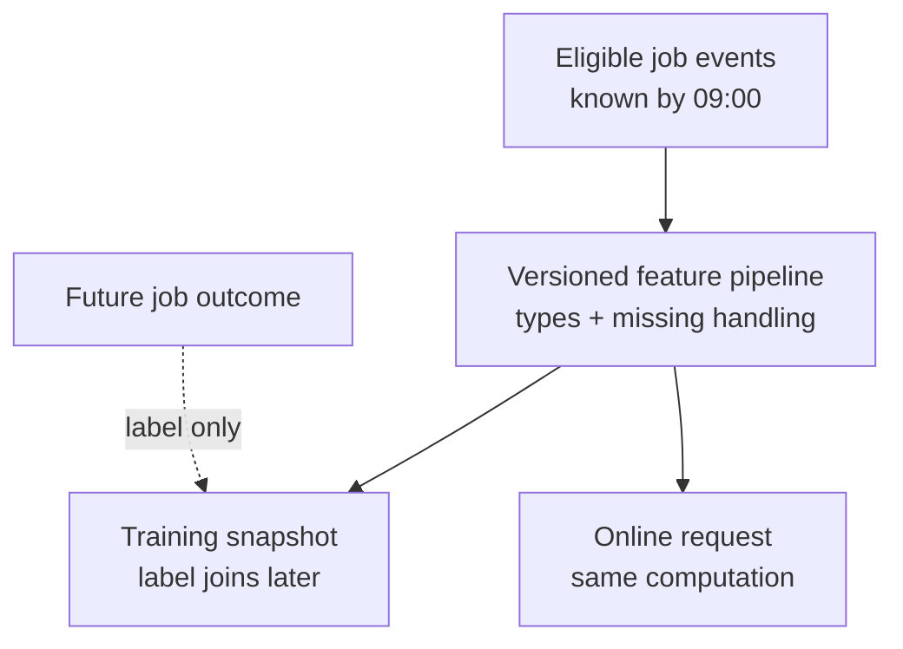

---
{
  "id": "feature-engineering-production-ml",
  "title": "Feature Engineering for Production ML",
  "slug": "feature-engineering-production-ml",
  "section": "Production ML Systems",
  "category": "MLOps & Deployment",
  "difficulty": "Medium",
  "order": 1,
  "coverImage": "illustrations/_generated/chapter_flow_dark.png",
  "companies": ["Amazon", "DoorDash", "Uber", "Google"],
  "shortDescription": "Build point-in-time features, leak-free encodings, and versioned preprocessing pipelines that produce identical vectors offline and online.",
  "keyConceptsTested": [
    "point-in-time correctness",
    "temporal leakage",
    "feature contracts",
    "out-of-fold target encoding",
    "robust scaling",
    "missingness indicators",
    "training-serving skew",
    "CACE principle"
  ]
}
---

A classifier scores 0.98 ROC-AUC in a notebook, then collapses to near-random guessing the day it goes live. Usually the model architecture is fine. The bug lives in the feature table: offline training quietly peeked at future events, fitted a scaler across the entire dataset, or computed a feature slightly differently than the live serving path.

Consider a concrete prediction task we will carry through this lesson. At `09:00`, a cluster scheduler predicts whether a running GPU training job (say `J-204`) will finish past its 24-hour completion deadline (its <span data-glossary="sla">service-level agreement (SLA)</span>). In the [dataset-pipeline lesson](/learn/dataset-pipelines-data-quality), rows were already assembled. Here telemetry is still arriving, so every **feature** (a numeric or categorical summary such as `hours_since_last_heartbeat`) must fix its time boundary, scaling parameters, and missing-data rules so the offline training row matches the live serving vector bit for bit.

## The temporal decision barrier and point-in-time correctness

When a job finishes a day later, its completed database record holds both pre-decision telemetry and post-decision outcomes. Training on an unguarded snapshot lets the model read answers that never exist when the prediction is made:

| Candidate field | Known at `09:00`? | Role |
| --- | --- | --- |
| `runner_pool` | yes | categorical feature |
| `queued_minutes` | yes | numeric feature |
| `hours_since_last_heartbeat` | yes | numeric feature |
| `queue_backlog` | yes | numeric feature |
| `finished_at` | no | defines the target label (`missed_deadline`) |
| `post_deadline_alert` | no | excluded: leaks the outcome |

Every feature must respect the <span data-glossary="prediction-timestamp">prediction timestamp</span>. Including a column created after `09:00` causes <span data-glossary="feature-leakage">feature leakage</span>.[^sklearn2026leakage] You can see how dramatically a single post-decision column inflates offline metrics while destroying real performance when that column is unavailable at serving time:

<!-- leetllm: test, deps=numpy,scikit-learn, output=show -->
```python title="leakage-auc-collapse.py"
import numpy as np
from sklearn.linear_model import LogisticRegression
from sklearn.metrics import roc_auc_score

rng = np.random.default_rng(7)
n = 1000
queued_min = rng.exponential(35.0, n)
hb_age_h = rng.exponential(1.2, n)
backlog = rng.poisson(12, n)

logit = -2.2 + 0.025 * queued_min + 0.65 * hb_age_h + 0.05 * backlog
y = rng.binomial(1, 1 / (1 + np.exp(-logit)))

# A post-decision flag correlates heavily with the outcome offline,
# but is always 0 (unknown) at live 09:00 scoring time.
post_deadline_flag = np.where(rng.random(n) < 0.92, y, 1 - y)

X_clean = np.column_stack([queued_min, hb_age_h, backlog])
X_leaky_train = np.column_stack([X_clean[:700], post_deadline_flag[:700]])
X_leaky_offline_test = np.column_stack([X_clean[700:], post_deadline_flag[700:]])
X_leaky_live = np.column_stack([X_clean[700:], np.zeros(300)])

clean_model = LogisticRegression(max_iter=500).fit(X_clean[:700], y[:700])
leaky_model = LogisticRegression(max_iter=500).fit(X_leaky_train, y[:700])

print(f"clean model offline & live AUC: {roc_auc_score(y[700:], clean_model.predict_proba(X_clean[700:])[:, 1]):.3f}")
print(f"leaky model offline AUC:        {roc_auc_score(y[700:], leaky_model.predict_proba(X_leaky_offline_test)[:, 1]):.3f}")
print(f"leaky model live AUC:           {roc_auc_score(y[700:], leaky_model.predict_proba(X_leaky_live)[:, 1]):.3f}")
```

<!-- leetllm: output:start -->
```text title="Output" output compact
clean model offline & live AUC: 0.806
leaky model offline AUC:        0.963
leaky model live AUC:           0.804
```
<!-- leetllm: output:end -->

Because the leaky model puts most of its weight on the post-decision flag, it scores 0.960 offline yet performs *worse* than the clean model live (0.708 vs 0.779) once the missing flag defaults to zero. Sculley et al. highlight these undeclared data dependencies as a core source of ML technical debt because ordinary offline benchmarks reward leakage rather than catching it.[^sculley2015]

### Event time versus availability time

Even columns that look legitimate can leak across time. Suppose job `J-204` is scored at `09:00`, and its heartbeat log contains pings at `01:00`, `08:30`, `08:50` (delayed in transit until `09:15`), and `12:00`. A naive join on `event_time <= 09:00` picks `08:50`, even though the scorer could not see that ping at `09:00`.

To build a faithful <span data-glossary="point-in-time-join">point-in-time join</span> (a backward `ASOF` lookup), filter on **two clocks**:

- **Event time** ($t_{\text{event}}$): when the telemetry measurement occurred.
- **Availability time** ($t_{\text{available}}$): when that measurement landed in the serving store.

Within a job's event log $\mathcal{E}_{\text{job}}$, select the latest event that satisfies both cutoffs:

$$
e^* = \operatorname*{arg\,max}_{e \in \mathcal{E}_{\text{job}}:\, t_{\text{event}}(e) \le t_{\text{pred}},\, t_{\text{available}}(e) \le t_{\text{pred}}} t_{\text{event}}(e)
$$

Time-series feature joins in systems such as Databricks and Feast implement backward `ASOF` matching so historical training queries enforce the same cutoff as live lookups.[^databricks2026pit][^feast2026pit] When late arrivals or backfills happen, filtering by availability time (`filter_by_created_timestamp=True` in Feast, when that column tracks store arrival) prevents delayed telemetry from slipping into earlier rows.[^feast2026pit]

<figure>
  
  <figcaption>Read both clocks before selecting the latest heartbeat. The 08:30 ping is the newest event both generated and available by 09:00, giving a heartbeat age of 0.5 hours; the late 08:50 ping and future 12:00 ping are excluded.</figcaption>
</figure>



> **Key insight:** Clipping a negative heartbeat age (from a future `12:00` ping giving `-3.0` hours) to `0.0` does not fix leakage. The clipped zero still tells the model that a heartbeat happened in the future. Exclude ineligible events before computing any feature.

```checkpoint
Would filtering every row at its own prediction timestamp make a random train/test split a faithful test of next month's scheduler traffic?
---
No. Point-in-time filtering prevents within-row leakage, but a random split still lets the model train on next week's cluster regime and evaluate on yesterday's. Forward-time tasks need chronological splits and matured labels.
```

## Numerical transformations: scale, skewness, and missingness

Once future events are excluded, raw numeric telemetry still brings three statistical headaches: wildly different scales, heavy right tails, and ambiguous missing values.

### Standardization, robust scaling, and log compression

If `queued_minutes` spans 0 to 120 while transferred bytes reach trillions, gradient-based models and regularized linear layers become poorly conditioned. Exact threshold trees are invariant to monotone rescaling of a single feature, so scaling matters most for linear models, neural networks, and distance-based methods.

**Z-score standardization** centers and scales using the training mean $\mu$ and standard deviation $\sigma$:

$$
z = \frac{x - \mu}{\sigma}
$$

Always fit $\mu$ and $\sigma$ on the training fold alone, then reuse those exact constants on validation and live inputs. Fitting on the combined dataset leaks test distribution statistics into training.

Heavy tails break Z-scores. A single 12,000-minute stuck job drags the mean and standard deviation upward, compressing ordinary waits into a tiny sliver of the standardized axis. **Robust scaling** replaces mean and standard deviation with the median $Q_{50}$ and interquartile range ($\text{IQR} = Q_{75} - Q_{25}$):[^sklearnRobustScaler2026]

$$
z_{\text{robust}} = \frac{x - Q_{50}}{Q_{75} - Q_{25}}
$$

For nonnegative right-skewed quantities, $\log(1 + x)$ compresses extreme magnitudes smoothly. Watch all three transforms react to a single 12,000-minute outlier:

<!-- leetllm: test, deps=numpy,scikit-learn, output=show -->
```python title="robust-scaling-transforms.py"
import numpy as np
from sklearn.preprocessing import RobustScaler, StandardScaler

wait_times = np.array([[5.0], [12.0], [18.0], [24.0], [30.0], [42.0], [55.0], [12000.0]])

z_vals = StandardScaler().fit_transform(wait_times).ravel()
robust_vals = RobustScaler().fit_transform(wait_times).ravel()
log_vals = np.log1p(wait_times).ravel()

for label, idx in [("normal job (42m)", 5), ("outlier job (12000m)", 7)]:
    print(f"{label:20s} -> z={z_vals[idx]:+.3f}, robust={robust_vals[idx]:+.3f}, log1p={log_vals[idx]:.3f}")
```

<!-- leetllm: output:start -->
```text title="Output" output compact
normal job (42m)     -> z=-0.374, robust=+0.522, log1p=3.761
outlier job (12000m) -> z=+2.646, robust=+416.452, log1p=9.393
```
<!-- leetllm: output:end -->

Notice two distinct behaviors. Under `StandardScaler`, the 12,000-minute outlier inflates $\sigma$ to nearly 4,000 minutes, so the gap between a 5-minute and 42-minute wait shrinks to less than 0.01 units. Under `RobustScaler`, ordinary waits keep healthy spacing (`+0.522` for 42 minutes), while the outlier lands at `+416.452` because robust scaling rescales rather than clips. When you need both stable interior spacing and compressed tails, pair `log1p` (or explicit clipping) with scaling, and keep the quartile convention fixed across offline and online environments.[^pythonQuantiles2026]

<details>
<summary>Deep dive: Welford's one-pass running mean and variance</summary>

When computing standardization statistics over streaming telemetry without loading all history into memory, Welford's algorithm updates the mean $\mu_k$ and sum of squared deviations $M_{2,k}$ in one numerically stable pass:[^welford1962]

$$
\mu_k = \mu_{k-1} + \frac{x_k - \mu_{k-1}}{k}, \quad M_{2,k} = M_{2,k-1} + (x_k - \mu_{k-1})(x_k - \mu_k), \quad \sigma_k^2 = \frac{M_{2,k}}{k}
$$

Dividing $M_{2,k}$ by $k$ yields population variance; dividing by $k - 1$ (for $k > 1$) yields unbiased sample variance. For example, on `[3, 7, 11]`, the running means are `3, 5, 7`, the $M_2$ increments are `0, 8, 24` ($M_2 = 32$), and the population variance is $32/3$.

</details>

### Missingness indicators preserve the measurement gap

Replacing a missing `queue_backlog` with `0.0` silently merges two very different states: a healthy empty queue (`0.0`) and an unreachable metrics collector (`null`). Pairing an imputed numeric value with a binary missingness indicator keeps both pieces of information intact:

$$
x_{\text{imputed}} = 0.0, \quad x_{\text{missing}} = \begin{cases} 1 & \text{if } x \text{ is null} \\ 0 & \text{if } x \text{ is present} \end{cases}
$$

That extra bit lets a linear or tree model learn separate weights for "measured zero" versus "telemetry unavailable."

```checkpoint
Welford's algorithm processes readings [3, 7, 11] starting from count 0 and M2 = 0. What final mean, M2, and population variance follow?

1. 7; 16; 16/3.
2. 7; 32; 16.
3. 21; 32; 32/3.
4. 7; 32; 32/3.
---
**Answer:** 7; 32; 32/3.

The running means are 3, 5, and 7. The M2 increments are 0, 8, and 24, summing to 32. Population variance divides by n = 3 to give 32/3 (sample variance would divide by 2 to give 16).
```

## Categorical encodings: one-hot pitfalls and smoothed target encoding

Raw category strings like `runner_pool = "a100-pool"` must become numbers. Assigning arbitrary integers `0, 1, 2` invents a fake ordering and spacing for linear models and neural networks.

### One-hot encoding and unseen categories

One-hot encoding allocates an orthogonal indicator per known category:

$$
\text{a100-pool} \to [1, 0, 0], \quad \text{h100-pool} \to [0, 1, 0], \quad \text{other} \to [0, 0, 1]
$$

As cardinality grows, one-hot representations expand feature width and force decision trees to isolate high-cardinality groups across many binary splits. You also need an explicit rule for unseen categories arriving at serving time: scikit-learn's `OneHotEncoder(handle_unknown="ignore")` outputs an all-zero vector `[0, 0, 0]`, whereas mapping unknown values to a reserved `"other"` bucket before encoding activates `[0, 0, 1]`.[^sklearnOneHot2026]

```checkpoint
An encoder knows categories [a, b, other]. An unseen value c arrives. Compare handle_unknown="ignore" with mapping unseen values to other before encoding. What vectors follow?

1. Ignore [0, 0, 1]; explicit [0, 0, 1].
2. Ignore [0, 0, 0]; explicit [1, 0, 0].
3. Ignore [0, 0, 0]; explicit [0, 0, 1].
4. Ignore [1, 1, 1]; explicit [0, 0, 1].
---
**Answer:** Ignore [0, 0, 0]; explicit [0, 0, 1].

Ignoring unknowns sets every indicator to zero. Explicitly mapping unseen values to the reserved bucket activates the other coordinate.
```

### Out-of-fold target encoding with m-estimate smoothing

When a feature has hundreds or thousands of categories (such as user IDs, job templates, or runner pools), **target encoding** compresses each category $c$ into an estimate of its conditional target mean $S_c = \mathbb{E}[y \mid X = c]$.

Two traps wait for naive implementations:

1. **Small-sample variance:** A category seen once with `missed_deadline = 1` gets an extreme score of `1.0`.
2. **Own-label leakage:** Computing a training row's encoding using its own label copies the target straight into the input feature, letting the model memorize rare categories.[^sklearnTargetEncoder2026]

Fix both problems with two distinct tools. First, **m-estimate smoothing** shrinks small-category means toward the prior target mean $\mu$ with smoothing weight $m \ge 0$:

$$
\hat{S}_c = \frac{n_c \bar{y}_c + m \mu}{n_c + m}
$$

where $n_c$ is the category count and $\bar{y}_c$ is its sample mean in the fitting data. Second, **out-of-fold (cross-fitted) encoding** computes fold $k$'s category statistics *and prior* $\mu$ using only the other $K - 1$ folds. Watch how naive encoding, in-sample smoothing, and out-of-fold smoothing behave on a rare pool (`l4-pool`):

<!-- leetllm: test, deps=numpy, output=show -->
```python title="out-of-fold-target-encoding.py"
import numpy as np

pools = np.array(["a100", "a100", "a100", "a100", "h100", "h100", "h100", "l4"])
y = np.array([0, 0, 1, 0, 1, 1, 1, 1], dtype=float)
m = 5.0

# 1. Naive & in-sample smoothed (both leak a row's own label)
global_prior = y.mean()
naive = {c: y[pools == c].mean() for c in np.unique(pools)}
smoothed = {
    c: (y[pools == c].sum() + m * global_prior) / ((pools == c).sum() + m)
    for c in np.unique(pools)
}

# 2. Out-of-fold smoothed (neither category sum nor prior sees held-out fold)
def encode_oof(cats, targets, folds, m=5.0):
    out = np.empty(len(targets))
    for held_out in folds:
        fit_mask = np.ones(len(targets), dtype=bool)
        fit_mask[held_out] = False
        prior = targets[fit_mask].mean()
        for idx in held_out:
            same = fit_mask & (cats == cats[idx])
            out[idx] = (targets[same].sum() + m * prior) / (same.sum() + m)
    return out

folds = ([0, 2, 4, 6], [1, 3, 5, 7])
oof = encode_oof(pools, y, folds, m)

y_flipped = y.copy()
y_flipped[-1] = 0.0  # Flip the rare l4 row's label

print(f"l4 encoding -> naive: {naive['l4']:.3f}, smoothed: {smoothed['l4']:.3f}, OOF: {oof[-1]:.3f}")
print("OOF encoding unchanged when row flips its own label:", np.isclose(oof[-1], encode_oof(pools, y_flipped, folds, m)[-1]))
```

<!-- leetllm: output:start -->
```text title="Output" output compact
l4 encoding -> naive: 1.000, smoothed: 0.688, OOF: 0.750
OOF encoding unchanged when row flips its own label: True
```
<!-- leetllm: output:end -->

Smoothing alone shrinks `l4` from `1.000` to `0.688`, yet its own label still leaked into both the category count and the global prior. Out-of-fold encoding computes the prior (`0.750`) strictly from the other fold, so flipping `l4`'s label leaves its encoded feature completely unchanged. In scikit-learn, `TargetEncoder.fit_transform` performs internal cross-fitting automatically, whereas calling `fit` followed by `transform` on the same training set does not.[^sklearnTargetEncoder2026]

> **Common mistake:** Using shuffled K-fold target encoding on time-ordered data still leaks future labels into earlier rows. On temporal tasks, compute each historical row's target encoding strictly from earlier **matured labels** (jobs scored earlier whose outcomes were already known by prediction time), falling back to a warm-up default when no matured labels exist yet.

Let's verify that forward-time boundary on a short replay where one earlier job's outcome arrives at `t = 8` and another's arrives late at `t = 10`:

<!-- leetllm: test, output=show -->
```python title="encode-from-matured-labels.py"
# Each job: (scored_hour, label_available_hour, missed_deadline)
history = [(6, 8, 0), (7, 10, 1)]

def forward_encoding(cutoff_hour, m=5.0):
    matured = [y for scored, avail, y in history if scored < cutoff_hour and avail <= cutoff_hour]
    if not matured:
        return None
    prior = sum(matured) / len(matured)
    return (sum(matured) + m * prior) / (len(matured) + m)

for hour in (7, 9, 10):
    print(f"t={hour:02d}:00 -> encoding={forward_encoding(hour)}")
print(f"leaky (all earlier jobs at t=09:00): {sum(y for _, _, y in history) / len(history)}")
```

<!-- leetllm: output:start -->
```text title="Output" output compact
t=07:00 -> encoding=None
t=09:00 -> encoding=0.0
t=10:00 -> encoding=0.5
leaky (all earlier jobs at t=09:00): 0.5
```
<!-- leetllm: output:end -->

Even though the second job was scored at `t = 07:00`, its outcome (`1`) is unknown until `t = 10:00`. At `t = 09:00`, only the matured `0` label is eligible.

```checkpoint
A category has one fitting label of 0. With smoothing weight m = 3 and a prior of 0.4, what encoded value results, and did the category sum still use that row's label?

1. 0; label excluded.
2. 0.4; label included.
3. 0.3; label excluded.
4. 0.3; label included.
---
**Answer:** 0.3; label included.

The formula gives (0 + 3 * 0.4) / (1 + 3) = 0.3. Smoothing pulls extreme values toward the prior, but only out-of-fold (or forward-time) fitting removes own-label leakage.
```

## Feature contracts and strict row validation

A clean mathematical feature definition still fails in production if raw serving payloads arrive with swapped columns, unexpected categories, `NaN` values, or future timestamps. A <span data-glossary="feature-contract">feature contract</span> locks down four things in one versioned preprocessing artifact:

| Feature | Type | Missing & boundary rule |
| --- | --- | --- |
| `queued_minutes` | numeric | required, finite, $\ge 0$ |
| `hours_since_last_heartbeat` | numeric | required, $\ge 0$, capped at `180.0` hours |
| `queue_backlog` | numeric | impute `0.0` plus `queue_backlog_missing` indicator |
| `runner_pool` | categorical | required; map unseen pools to `other` before one-hot |
| `priority_job` | binary | explicit `0`/`1` flag |

Rather than hand-writing fragile dictionary validators that diverge between training notebooks and serving microservices, package the feature schema, clipping, missingness indicator, and category vocabulary into a single fitted scikit-learn `ColumnTransformer` + `Pipeline`. Every learned statistic, fixed cap, and output column order travels with the model:

<!-- leetllm: test, deps=numpy,pandas,scikit-learn, output=show -->
```python title="sklearn-feature-pipeline.py"
import numpy as np
import pandas as pd
from sklearn.compose import ColumnTransformer
from sklearn.impute import SimpleImputer
from sklearn.pipeline import Pipeline
from sklearn.preprocessing import FunctionTransformer, OneHotEncoder

KNOWN_POOLS = ["a100-pool", "h100-pool", "other"]
HEARTBEAT_CAP_H = 180.0

def map_unseen_pools(df):
    return df.apply(lambda col: col.where(col.isin(KNOWN_POOLS[:2]), "other"))

def clip_heartbeat(X):
    return np.clip(X, 0.0, HEARTBEAT_CAP_H)

preprocessor = ColumnTransformer(
    transformers=[
        (
            "pool",
            Pipeline([
                ("bucket", FunctionTransformer(map_unseen_pools)),
                ("ohe", OneHotEncoder(categories=[KNOWN_POOLS], sparse_output=False)),
            ]),
            ["runner_pool"],
        ),
        ("queued", "passthrough", ["queued_minutes"]),
        ("hb", FunctionTransformer(clip_heartbeat), ["hours_since_last_heartbeat"]),
        ("backlog", SimpleImputer(strategy="constant", fill_value=0.0, add_indicator=True), ["queue_backlog"]),
        ("priority", "passthrough", ["priority_job"]),
    ],
    remainder="drop",  # Automatically drops non-feature or post-decision columns
)

train_df = pd.DataFrame([
    {"runner_pool": "a100-pool", "queued_minutes": 42.0, "hours_since_last_heartbeat": 0.5, "queue_backlog": 18.0, "priority_job": 0, "finished_at": "day3"},
    {"runner_pool": "h100-pool", "queued_minutes": 15.0, "hours_since_last_heartbeat": 2.0, "queue_backlog": np.nan, "priority_job": 1, "finished_at": "day2"},
])
preprocessor.fit(train_df)

live_df = pd.DataFrame([
    {"runner_pool": "a100-pool", "queued_minutes": 42.0, "hours_since_last_heartbeat": 0.5, "queue_backlog": 18.0, "priority_job": 0},
    {"runner_pool": "l4-pool", "queued_minutes": 18.0, "hours_since_last_heartbeat": 200.0, "queue_backlog": np.nan, "priority_job": 1},
])

X_live = preprocessor.transform(live_df)
feature_names = ["pool=a100", "pool=h100", "pool=other", "queued_min", "hb_age_h", "backlog", "backlog_missing", "priority"]
print("columns:", feature_names)
for row_idx, vec in enumerate(X_live):
    print(f"row {row_idx}:  ", vec.tolist())
```

<!-- leetllm: output:start -->
```text title="Output" output compact
columns: ['pool=a100', 'pool=h100', 'pool=other', 'queued_min', 'hb_age_h', 'backlog', 'backlog_missing', 'priority']
row 0:   [1.0, 0.0, 0.0, 42.0, 0.5, 18.0, 0.0, 0.0]
row 1:   [0.0, 0.0, 1.0, 18.0, 180.0, 0.0, 1.0, 1.0]
```
<!-- leetllm: output:end -->

Look at what that single pipeline enforces automatically:

- `remainder="drop"` guarantees extra columns like `finished_at` never reach the model.
- `l4-pool` maps cleanly to the reserved `other` coordinate `[0, 0, 1]`.
- `hours_since_last_heartbeat = 200.0` clips to `180.0`.
- Missing `queue_backlog` emits `[0.0, 1.0]` (imputed zero plus missingness bit), while measured `18.0` emits `[18.0, 0.0]`.
- Output column order is locked to the exact 8-slot layout expected by the downstream model weights.

Before calling `preprocessor.transform` on live requests, add one thin boundary guard for physical invariants that `ColumnTransformer` does not know: verify that required fields (`queued_minutes`, `hours_since_last_heartbeat`, `runner_pool`) are non-null, finite, and nonnegative, and that `last_heartbeat_at <= prediction_time`.

```checkpoint
What happens if the online serving layer produces the right number of features, but swaps two numeric slots compared to training?
---
The model runs without throwing a shape error, yet silently multiplies each feature by the wrong learned weight. Packaging the column order inside a versioned preprocessing artifact prevents silent slot swaps.
```

## Changing preprocessing changes what the model receives

Suppose job `J-188` has a raw heartbeat age of 200 hours. During training, the pipeline clipped heartbeat age at `180.0` hours, so the model's weights learned what `180.0` means. Weeks later, someone raises the live cap to `360.0` hours without retraining. Now `J-188` enters the exact same model weights as `200.0`.

Sculley et al. call this coupling the **CACE principle**: *Changing Anything Changes Everything*.[^sculley2015] Even when model weights stay frozen, altering a clipping cap, imputer fill value, or bucket boundary shifts the coordinate system the weights operate in.

<figure>
  
  <figcaption>Raising the heartbeat cap from 180 to 360 hours moves a 200-hour job's logistic score from 0.445 to 0.545, flipping the decision across the 0.50 alert threshold while leaving fresh jobs untouched.</figcaption>
</figure>

We can verify that threshold flip directly on the fixed logistic rule:

<!-- leetllm: test, output=show -->
```python title="cap-change-score.py"
import math

def score_job(raw_hb_hours, cap_hours, hb_weight=0.02, backlog=18.0):
    hb_feature = min(raw_hb_hours, cap_hours)
    logit = hb_weight * hb_feature + 0.01 * backlog - 4.0
    return 1.0 / (1.0 + math.exp(-logit))

for cap in (180.0, 360.0):
    p = score_job(200.0, cap)
    print(f"cap={cap:5.1f}h -> score={p:.3f}, alert={p >= 0.5}")
print("fresh job (0.5h) unchanged:", score_job(0.5, 180.0) == score_job(0.5, 360.0))
```

<!-- leetllm: output:start -->
```text title="Output" output compact
cap=180.0h -> score=0.445, alert=False
cap=360.0h -> score=0.545, alert=True
fresh job (0.5h) unchanged: True
```
<!-- leetllm: output:end -->

Fresh jobs below both caps never move, and features with zero weight never care. Every job above the old cap shifts across the decision surface. Treat preprocessing parameters as first-class model hyperparameters: version them with the model artifact, and evaluate (or retrain) the paired preprocessing and model whenever either changes.

```checkpoint
A fixed standardizer was fitted on training with mean 10 and standard deviation 2. For input 14, serving silently refits the mean to 14 while keeping scale 2. What original and revised coordinates result?

1. 2 then 0; breaks the fixed-artifact contract.
2. 2 then 2; preserves the fixed-artifact contract.
3. 0 then 2; preserves the fixed-artifact contract.
4. 7 then 7; breaks the fixed-artifact contract.
---
**Answer:** 2 then 0; breaks the fixed-artifact contract.

The fitted transform maps 14 to (14 - 10) / 2 = 2. Silently refitting the mean on live data collapses the coordinate to 0, feeding the model shifted inputs.
```

## Compare the offline row with the live row

Suppose the offline point-in-time table computes `queue_backlog = 18.0` for job `J-204` at `09:00`, while the live serving log captured `0.0`. Both vectors have valid shapes and finite floats, yet the model sees different numbers offline and online. That gap is **training-serving skew**.

Three mechanisms cause almost all training-serving skew:

1. **Divergent code paths:** Training features are computed in SQL or Spark, while serving features are reimplemented in Go or Java with subtle differences in rounding, null handling, or timezone boundaries.
2. **Overwrite-in-place backfills:** Offline queries join against the *current* state of a mutable database table instead of replaying historical snapshots.
3. **Freshness lag:** Streaming updates fall behind during traffic bursts, leaving the online store serving stale values.

### Feature stores and parity checks

A **feature store** addresses these gaps with three components: a central **registry** of feature definitions, an **offline store** supporting point-in-time historical joins, and a low-latency **online store** holding the latest entity values.[^feast2026online] Modern managed stores synchronize offline tables to online backends via scheduled or continuous sync pipelines.[^googleFeatureServing2026] For smaller systems, sharing a single versioned preprocessing library and logging live feature vectors directly often eliminates skew without extra infrastructure.

Whichever architecture you choose, verify **offline-online parity** on a sample of logged production requests by replaying the same entities offline at their recorded prediction timestamps and comparing feature vectors directly:

<!-- leetllm: test, deps=numpy, output=show -->
```python title="check-parity.py"
import numpy as np

FEATURE_NAMES = ["queued_min", "hb_age_h", "queue_backlog", "priority"]

def check_parity(offline_vec, online_vec, rtol=1e-5, atol=1e-6):
    diffs = {}
    for name, off, on in zip(FEATURE_NAMES, offline_vec, online_vec):
        if not np.isclose(off, on, rtol=rtol, atol=atol, equal_nan=True):
            diffs[name] = (float(off), float(on))
    return diffs

offline = np.array([42.0, 0.5, 18.0, 0.0])
live_samples = {
    "matching":    np.array([42.0, 0.5, 18.0, 0.0]),
    "stale cache": np.array([42.0, 0.5, 0.0, 0.0]),
    "unit bug":    np.array([42.0, 30.0, 18.0, 0.0]),  # minutes instead of hours
}

for label, live in live_samples.items():
    diffs = check_parity(offline, live)
    print(f"{label:12s} -> passed={not diffs!s:5s} diffs={diffs}")
```

<!-- leetllm: output:start -->
```text title="Output" output compact
matching     -> passed=True  diffs={}
stale cache  -> passed=False diffs={'queue_backlog': (18.0, 0.0)}
unit bug     -> passed=False diffs={'hb_age_h': (0.5, 30.0)}
```
<!-- leetllm: output:end -->

> **Key insight:** You cannot reconstruct an old online request by querying a latest-only online store later. Log the exact feature vector seen at serving time (along with its preprocessing version and freshness lag), then compare that log against an offline point-in-time replay.

In production, pair periodic parity sampling with three continuous feature-health checks:

| Production signal | What it reveals | Response |
| --- | --- | --- |
| Null rate per feature | Upstream telemetry dropped or changed schema | Inspect producer and verify missingness indicator rate |
| Unseen-category rate | New runner pools or values outside fitted vocabulary | Audit `"other"` bucket volume and schedule refit |
| Freshness lag | Streaming or batch sync fell behind | Route to a simpler fallback model or abstain past lag limit |
| Offline/online parity | Replay and captured live vectors disagree | Diff preprocessing versions, units, and availability clocks |

Note the difference between **freshness lag** and **heartbeat age**: a job whose last heartbeat was 4 hours ago in a fully caught-up telemetry stream is genuinely stalled (a real feature signal), whereas a telemetry pipeline lagging 45 minutes behind cannot even tell you whether a heartbeat happened. When freshness lag exceeds a feature's staleness budget, switch to a fallback model built on fresh inputs or abstain rather than scoring with stale numbers.

```checkpoint
Why can't offline validation accuracy detect training-serving skew?
---
Offline validation evaluates the model strictly on offline feature tables. If live serving uses different transformation logic, stale caches, or wrong units, the model sees shifted inputs in production that offline evaluation never encounters.
```

```mastery-quiz
[
  {
    "question": "A scorer predicts job delay at 14:00. A later export includes a 16:00 completion timestamp and a 16:05 post-deadline alert flag. How should each field be used during training?",
    "options": [
      "Both fields as input features.",
      "Completion as an input feature; alert flag as the target label.",
      "Completion imputed to zero; alert flag as a missingness bit.",
      "Completion to derive the target label; alert flag excluded from inputs."
    ],
    "answer": "Completion to derive the target label; alert flag excluded from inputs.",
    "explanation": "Both fields occur after the 14:00 prediction timestamp. Completion defines the eventual target label, while neither post-decision field belongs in the model's feature vector."
  },
  {
    "question": "At a 10:00 prediction cutoff, heartbeat pings occur at 09:00 (available 09:01), 09:40 (available 09:50), 09:55 (available 10:10), and 10:05 (available 10:06). Which ping is selected, and what is the heartbeat age?",
    "options": [
      "09:55; 5 minutes.",
      "10:05; -5 minutes.",
      "09:40; 20 minutes.",
      "09:00; 60 minutes."
    ],
    "answer": "09:40; 20 minutes.",
    "explanation": "A point-in-time join requires both event time and availability time to be at or before 10:00. The 09:55 ping arrived late at 10:10 and 10:05 is in the future, leaving 09:40 (20 minutes old)."
  },
  {
    "question": "A robust scaler was fitted with median 20 and IQR 8. What transformed value does raw input 100 receive, and does robust scaling clip outliers?",
    "options": [
      "0.1; no, it only rescales.",
      "10; no, it only rescales.",
      "1; yes, it clips values to 1.",
      "12.5; no, it only rescales."
    ],
    "answer": "10; no, it only rescales.",
    "explanation": "The transformed value is (100 - 20) / 8 = 10. Robust scaling prevents extreme outliers from distorting the center and spread, but it does not bound extreme inputs."
  },
  {
    "question": "A pipeline imputes missing queue_backlog to 0 and adds a binary missingness indicator. What [backlog, missing] pairs represent a measured empty queue versus a missing reading?",
    "options": [
      "[0, 1] and [0, 0].",
      "[0, 0] and [0, 1].",
      "[0, 0] and [1, 0].",
      "[0, 1] and [0, 1]."
    ],
    "answer": "[0, 0] and [0, 1].",
    "explanation": "A measured zero keeps the missingness indicator at 0, while an absent measurement receives the imputed 0 alongside a missingness indicator of 1."
  },
  {
    "question": "Two of five jobs in a fitting fold missed their deadlines, and none ran on the held-out job's pool. With m-estimate smoothing weight m = 4, what out-of-fold target encoding does that held-out job receive before and after flipping its own label from 0 to 1?",
    "options": [
      "0 then 0.",
      "0 then 1.",
      "0.4 then 0.4.",
      "0.4 then 0.6."
    ],
    "answer": "0.4 then 0.4.",
    "explanation": "With zero fitting-fold rows in that category, the smoothed estimate shrinks completely to the fitting-fold prior: (0 + 4 * 2/5) / (0 + 4) = 0.4. Because the held-out row is excluded from the fitting fold, flipping its own label leaves its encoding unchanged."
  },
  {
    "question": "For an aligned prediction cutoff, offline replay produces queue_backlog = 12 while live serving logged queue_backlog = 4 (with queued = 20 and heartbeat = 0.5 matching). Under linear score 0.01*queued + 0.02*heartbeat + 0.01*backlog, what offline score, live score, and parity verdict follow?",
    "options": [
      "Offline 0.33; live 0.25; fail.",
      "Offline 0.33; live 0.33; pass.",
      "Offline 0.25; live 0.33; fail.",
      "Offline 0.12; live 0.04; pass."
    ],
    "answer": "Offline 0.33; live 0.25; fail.",
    "explanation": "Queued time and heartbeat contribute 0.20 + 0.01 = 0.21 on both paths. Adding backlog gives 0.33 offline versus 0.25 live, exposing training-serving skew even though both rows contain valid floats."
  },
  {
    "question": "A model was trained with heartbeat age capped at 180 hours. Serving later raises the cap to 360 hours without retraining. Which jobs change their model input, and why does this matter?",
    "options": [
      "All jobs change inputs because scaling parameters shift globally.",
      "Only jobs with raw heartbeat age above 180 hours change inputs, which can push fixed model weights across a decision threshold.",
      "No jobs change inputs because tree and linear models ignore clipping bounds.",
      "Only jobs with raw heartbeat age below 180 hours change inputs."
    ],
    "answer": "Only jobs with raw heartbeat age above 180 hours change inputs, which can push fixed model weights across a decision threshold.",
    "explanation": "Inputs at or below 180 hours are unaffected by raising the cap, while older jobs now pass larger numbers into frozen weights trained on the 180-hour ceiling (the CACE principle)."
  }
]
```

> **Next:** [Batch and Streaming Feature Pipelines](/learn/batch-streaming-feature-pipelines) carries these cutoff and availability rules into windowed aggregation, late arrivals, and continuously updated features.
