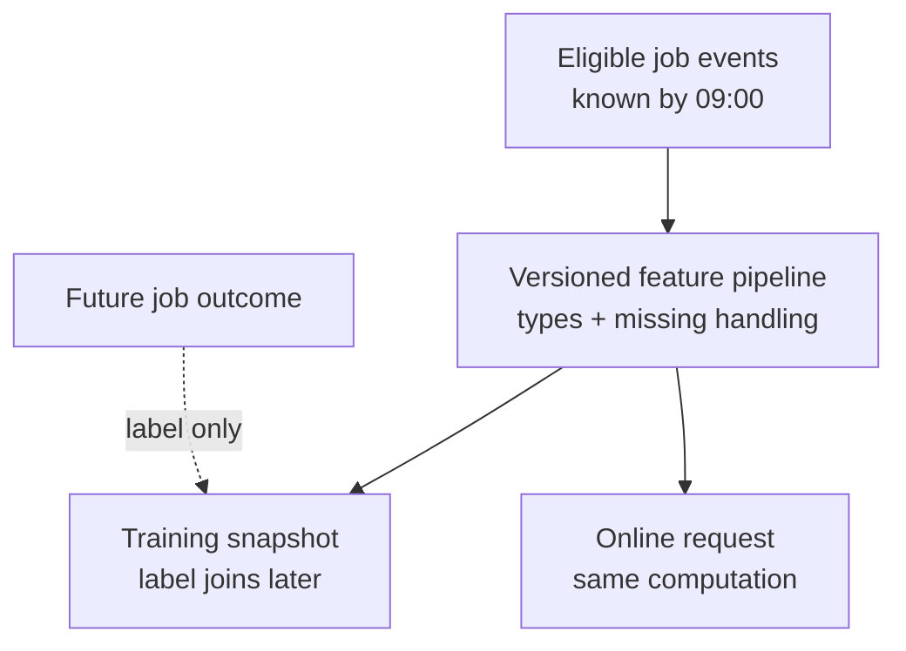

---
{
  "id": "feature-engineering-production-ml",
  "title": "Feature Engineering & Point-in-Time Pipelines",
  "slug": "feature-engineering-production-ml",
  "section": "Classical ML & Evaluation",
  "category": "MLOps & Deployment",
  "difficulty": "Easy",
  "order": 7,
  "coverImage": "illustrations/_generated/chapter_flow_dark.png",
  "companies": [
    "Amazon",
    "DoorDash",
    "Uber",
    "Google"
  ],
  "shortDescription": "Build point-in-time features, leak-free encodings, watermarked streaming aggregates, dual offline/online stores, and freshness SLAs that keep training and serving vectors identical.",
  "keyConceptsTested": [
    "point-in-time correctness",
    "temporal leakage",
    "feature contracts",
    "out-of-fold target encoding",
    "robust scaling",
    "missingness indicators",
    "dual offline/online feature stores",
    "watermarks and late-event routing",
    "freshness SLAs",
    "training-serving skew",
    "CACE principle"
  ],
  "aliases": [
    "batch-streaming-feature-pipelines",
    "monitoring-predictive-models"
  ]
}
---

A classifier scores 0.96 ROC-AUC in a notebook, then mispredicts live traffic the day it ships. Usually the model architecture is fine. The bug lives in the feature pipeline: offline training peeked at future events, fitted a scaler across the full dataset, or computed a feature slightly differently than the live serving path.

Consider one prediction task we will carry through this lesson. At `09:00`, a cluster scheduler predicts whether a running GPU training job (`J-204`) will finish past its 24-hour completion deadline (its <span data-glossary="sla">service-level agreement (SLA)</span>). Unlike the static tables in [dataset pipelines](/learn/cross-validation-leakage-generalization), telemetry here is still arriving. Every **feature** (such as `hours_since_last_heartbeat`) must lock down its time cutoff, scaling constants, missing-data rules, and serving freshness so offline training matches online inference bit for bit.

## Point-in-time correctness and the dual-clock barrier

When a job finishes a day later, its completed record holds both pre-decision telemetry and post-decision outcomes. Training on an unguarded snapshot exposes answers that never exist at `09:00`:

| Candidate field | Known at `09:00`? | Role |
| --- | --- | --- |
| `runner_pool` | yes | categorical feature |
| `queued_minutes` | yes | numeric feature |
| `hours_since_last_heartbeat` | yes | numeric feature |
| `queue_backlog` | yes | numeric feature |
| `finished_at` | no | defines target label (`missed_deadline`) |
| `post_deadline_alert` | no | excluded: leaks the outcome |

Any column created after the <span data-glossary="prediction-timestamp">prediction timestamp</span> causes <span data-glossary="feature-leakage">feature leakage</span>.[^sklearn2026leakage] Watch what happens when a post-decision flag enters offline training, then defaults to zero at live `09:00` scoring time:

<!-- leetllm: test, deps=numpy,scikit-learn, output=show -->
```python title="leakage-auc-collapse.py"
import numpy as np
from sklearn.linear_model import LogisticRegression
from sklearn.metrics import log_loss, roc_auc_score

rng = np.random.default_rng(7)
n = 1000
queued_min = rng.exponential(35.0, n)
hb_age_h = rng.exponential(1.2, n)
backlog = rng.poisson(12, n)

logit = -2.2 + 0.025 * queued_min + 0.65 * hb_age_h + 0.05 * backlog
y = rng.binomial(1, 1 / (1 + np.exp(-logit)))

# Correlates strongly with y offline, but is always 0 at live 09:00 scoring.
post_flag = np.where(rng.random(n) < 0.92, y, 1 - y)

X_clean = np.column_stack([queued_min, hb_age_h, backlog])
X_leak_tr = np.column_stack([X_clean[:700], post_flag[:700]])
X_leak_off = np.column_stack([X_clean[700:], post_flag[700:]])
X_leak_live = np.column_stack([X_clean[700:], np.zeros(300)])

clean_m = LogisticRegression(max_iter=500).fit(X_clean[:700], y[:700])
leaky_m = LogisticRegression(max_iter=500).fit(X_leak_tr, y[:700])

for name, m, X_ev in [
    ("clean offline & live", clean_m, X_clean[700:]),
    ("leaky offline", leaky_m, X_leak_off),
    ("leaky live", leaky_m, X_leak_live),
]:
    p = m.predict_proba(X_ev)[:, 1]
    print(f"{name:21s} AUC={roc_auc_score(y[700:], p):.3f}  log_loss={log_loss(y[700:], p):.3f}")
```

<!-- leetllm: output:start -->
```text title="Output" output compact
clean offline & live  AUC=0.806  log_loss=0.547
leaky offline         AUC=0.963  log_loss=0.258
leaky live            AUC=0.804  log_loss=0.955
```
<!-- leetllm: output:end -->

Offline, the leaky model looks stellar (AUC `0.963`, log loss `0.258`) because it loads its weight onto `post_flag`. Once that flag defaults to `0` live, AUC falls to `0.804` (below the clean model's `0.806`) and log loss jumps from `0.547` to `0.955` because missing the flag biases every probability downward. Sculley et al. flag undeclared data dependencies like this as a primary source of ML technical debt because standard offline benchmarks reward leakage rather than catching it.[^sculley2015]

### Event time versus availability time

Even valid columns leak across time when telemetry arrives late. Suppose `J-204` is scored at `09:00` and its log holds pings at `01:00`, `08:30`, `08:50` (delayed in transit until `09:15`), and `12:00`. A naive join on `event_time <= 09:00` picks `08:50`, even though serving could not see it at `09:00`.

A faithful <span data-glossary="point-in-time-join">point-in-time join</span> (backward `ASOF`) filters on **two clocks**, event time ($t_{\text{event}}$, when the ping happened) and availability time ($t_{\text{available}}$, when it landed in the store):

$$
e^* = \operatorname*{arg\,max}_{e \in \mathcal{E}_{\text{job}}:\, t_{\text{event}}(e) \le t_{\text{pred}},\, t_{\text{available}}(e) \le t_{\text{pred}}} t_{\text{event}}(e)
$$

Databricks and Feast implement backward `ASOF` joins so historical queries mirror live reads; filtering by store arrival (`filter_by_created_timestamp=True` in Feast when populated with arrival time) keeps late backfills out of earlier rows.[^databricks2026pit][^feast2026pit]

<figure>
  
  <figcaption>Read both clocks before selecting the latest heartbeat. The 08:30 ping is the newest event both generated and available by 09:00, giving a heartbeat age of 0.5 hours; the late 08:50 ping and future 12:00 ping are excluded.</figcaption>
</figure>



> **Key insight:** Clipping a negative heartbeat age (from a future `12:00` ping giving `-3.0` hours) to `0.0` does not remove leakage. The clipped zero still signals a future ping. Exclude ineligible events before computing any feature.

## Numerical scaling, skewness, and missingness

Raw telemetry brings mismatched scales, heavy tails, and ambiguous nulls. While exact threshold trees are invariant to monotone per-feature rescaling, linear models, neural networks, and distance methods suffer without consistent scaling.

**Z-score standardization** computes $z = (x - \mu)/\sigma$ using constants fitted strictly on the training fold. Heavy tails break Z-scores: one 12,000-minute stuck job inflates $\sigma$ and crushes normal waits together. **Robust scaling** replaces mean and standard deviation with median $Q_{50}$ and interquartile range ($\text{IQR} = Q_{75} - Q_{25}$), $z_{\text{robust}} = (x - Q_{50}) / (Q_{75} - Q_{25})$, while $\log(1 + x)$ smoothly compresses nonnegative right tails:[^sklearnRobustScaler2026]

<!-- leetllm: test, deps=numpy,scikit-learn, output=show -->
```python title="robust-scaling-transforms.py"
import numpy as np
from sklearn.preprocessing import RobustScaler, StandardScaler

wait_times = np.array([[5.0], [12.0], [18.0], [24.0], [30.0], [42.0], [55.0], [12000.0]])
z_vals = StandardScaler().fit_transform(wait_times).ravel()
robust_vals = RobustScaler().fit_transform(wait_times).ravel()
log_vals = np.log1p(wait_times).ravel()

for label, idx in [("normal job (42m)", 5), ("outlier job (12000m)", 7)]:
    print(f"{label:20s} -> z={z_vals[idx]:+.3f}, robust={robust_vals[idx]:+.3f}, log1p={log_vals[idx]:.3f}")
```

<!-- leetllm: output:start -->
```text title="Output" output compact
normal job (42m)     -> z=-0.374, robust=+0.522, log1p=3.761
outlier job (12000m) -> z=+2.646, robust=+416.452, log1p=9.393
```
<!-- leetllm: output:end -->

Under `StandardScaler`, the 12,000-minute outlier inflates $\sigma$ to nearly 4,000 minutes, shrinking the 5-to-42-minute span to under 0.01 units. `RobustScaler` preserves clean spacing (`+0.522` at 42 minutes) while rescaling rather than clipping the outlier (`+416.452`). Pair `log1p` (or an explicit cap) with scaling when you need bounded tails, and keep the quartile convention identical offline and online.[^pythonQuantiles2026]

<details>
<summary>Deep dive: Welford's one-pass running mean and variance</summary>

To track standardization statistics over streaming telemetry in $O(1)$ memory, Welford's recurrence updates $\mu_k$ and $M_{2,k}$ stably in one pass:[^welford1962]

$$
\mu_k = \mu_{k-1} + \frac{x_k - \mu_{k-1}}{k}, \quad M_{2,k} = M_{2,k-1} + (x_k - \mu_{k-1})(x_k - \mu_k), \quad \sigma_k^2 = \frac{M_{2,k}}{k}
$$

Divide $M_{2,k}$ by $k$ for population variance or $k - 1$ for unbiased sample variance. On `[3, 7, 11]`, $\mu$ steps through `3, 5, 7`, $M_2$ reaches `32`, and population variance is $32/3$.

</details>

For missing numeric fields like `queue_backlog`, imputing `0.0` alone conflates a healthy empty queue with an unreachable collector. Pair the fill value with a binary **missingness indicator** (`queue_backlog_missing = 1` when null, `0` when present) so the model learns separate weights for each state.

## Categorical encodings: one-hot and out-of-fold target encoding

**One-hot encoding** maps known strings (`a100-pool`, `h100-pool`, `other`) to orthogonal unit vectors. Always define the unseen-category rule explicitly: `OneHotEncoder(handle_unknown="ignore")` outputs `[0, 0, 0]`, whereas bucketing unknowns to `"other"` activates `[0, 0, 1]`.[^sklearnOneHot2026]

For high-cardinality categories (templates, user IDs, or hundreds of pools), **target encoding** replaces each category $c$ with an estimate of $\mathbb{E}[y \mid X = c]$. Naive means suffer from small-sample variance and own-label leakage.[^sklearnTargetEncoder2026] Combine **m-estimate smoothing** ($\hat{S}_c = (n_c \bar{y}_c + m\mu) / (n_c + m)$) with **out-of-fold fitting** (computing fold $k$'s counts and prior $\mu$ strictly from the other $K - 1$ folds). On time-ordered data, replace shuffled folds with **matured historical labels** (earlier jobs whose outcomes arrived by the cutoff):

<!-- leetllm: test, deps=numpy, output=show -->
```python title="target-encoding-oof-and-temporal.py"
import numpy as np

pools = np.array(["a100", "a100", "a100", "a100", "h100", "h100", "h100", "l4"])
y = np.array([0, 0, 1, 0, 1, 1, 1, 1], dtype=float)
m = 5.0

prior = y.mean()
naive_l4 = y[pools == "l4"].mean()
smooth_l4 = (y[pools == "l4"].sum() + m * prior) / ((pools == "l4").sum() + m)

def encode_oof(cats, targets, folds, m=5.0):
    out = np.empty(len(targets))
    for held in folds:
        fit = np.ones(len(targets), dtype=bool)
        fit[held] = False
        p = targets[fit].mean()
        for i in held:
            same = fit & (cats == cats[i])
            out[i] = (targets[same].sum() + m * p) / (same.sum() + m)
    return out

folds = ([0, 2, 4, 6], [1, 3, 5, 7])
oof = encode_oof(pools, y, folds, m)
y_flip = y.copy()
y_flip[-1] = 0.0
print(f"l4 -> naive={naive_l4:.3f}, smoothed={smooth_l4:.3f}, OOF={oof[-1]:.3f}")
print("OOF invariant to own label flip:", np.isclose(oof[-1], encode_oof(pools, y_flip, folds, m)[-1]))

# Temporal replay: (scored_hour, label_available_hour, missed_deadline)
history = [(6, 8, 0), (7, 10, 1)]
for hr in (7, 9, 10):
    mat = [lbl for sc, av, lbl in history if sc < hr and av <= hr]
    enc = None if not mat else sum(mat) / len(mat)
    print(f"matured encoding at t={hr:02d}:00 -> {enc}")
```

<!-- leetllm: output:start -->
```text title="Output" output compact
l4 -> naive=1.000, smoothed=0.688, OOF=0.750
OOF invariant to own label flip: True
matured encoding at t=07:00 -> None
matured encoding at t=09:00 -> 0.0
matured encoding at t=10:00 -> 0.5
```
<!-- leetllm: output:end -->

Smoothing alone shrinks `l4` from `1.000` to `0.688`, yet leaks `l4`'s own label into the count and prior. Out-of-fold encoding yields `0.750` regardless of `l4`'s label (in scikit-learn, `TargetEncoder.fit_transform` cross-fits automatically[^sklearnTargetEncoder2026]). In the temporal replay, job 2 was scored at `07:00` but its outcome arrives at `10:00`, so at `09:00` only the matured `0` label is visible.

## Versioned feature pipelines and the CACE principle

Package your <span data-glossary="feature-contract">feature contract</span> (types, unseen-category bucketing, clipping bounds, missingness indicators, and exact output slot order) inside one fitted `ColumnTransformer` + `Pipeline` so training and serving run the exact same code:

<!-- leetllm: test, deps=numpy,pandas,scikit-learn, output=show -->
```python title="sklearn-feature-pipeline.py"
import numpy as np
import pandas as pd
from sklearn.compose import ColumnTransformer
from sklearn.impute import SimpleImputer
from sklearn.pipeline import Pipeline
from sklearn.preprocessing import FunctionTransformer, OneHotEncoder

KNOWN_POOLS = ["a100-pool", "h100-pool", "other"]

preprocessor = ColumnTransformer(
    transformers=[
        ("pool", Pipeline([
            ("bucket", FunctionTransformer(lambda df: df.apply(lambda c: c.where(c.isin(KNOWN_POOLS[:2]), "other")))),
            ("ohe", OneHotEncoder(categories=[KNOWN_POOLS], sparse_output=False)),
        ]), ["runner_pool"]),
        ("queued", "passthrough", ["queued_minutes"]),
        ("hb", FunctionTransformer(lambda X: np.clip(X, 0.0, 180.0)), ["hours_since_last_heartbeat"]),
        ("backlog", SimpleImputer(strategy="constant", fill_value=0.0, add_indicator=True), ["queue_backlog"]),
        ("priority", "passthrough", ["priority_job"]),
    ],
    remainder="drop",
)

train_df = pd.DataFrame([
    {"runner_pool": "a100-pool", "queued_minutes": 42.0, "hours_since_last_heartbeat": 0.5, "queue_backlog": 18.0, "priority_job": 0, "finished_at": "day3"},
    {"runner_pool": "h100-pool", "queued_minutes": 15.0, "hours_since_last_heartbeat": 2.0, "queue_backlog": np.nan, "priority_job": 1, "finished_at": "day2"},
]).pipe(lambda d: (preprocessor.fit(d), d)[1])

live_df = pd.DataFrame([
    {"runner_pool": "a100-pool", "queued_minutes": 42.0, "hours_since_last_heartbeat": 0.5, "queue_backlog": 18.0, "priority_job": 0},
    {"runner_pool": "l4-pool", "queued_minutes": 18.0, "hours_since_last_heartbeat": 200.0, "queue_backlog": np.nan, "priority_job": 1},
])

for i, vec in enumerate(preprocessor.transform(live_df)):
    print(f"row {i}: {vec.tolist()}")
```

<!-- leetllm: output:start -->
```text title="Output" output compact
row 0: [1.0, 0.0, 0.0, 42.0, 0.5, 18.0, 0.0, 0.0]
row 1: [0.0, 0.0, 1.0, 18.0, 180.0, 0.0, 1.0, 1.0]
```
<!-- leetllm: output:end -->

`remainder="drop"` strips `finished_at`, `l4-pool` lands in `other` (`[0, 0, 1]`), heartbeat `200.0` clips to `180.0`, and missing `queue_backlog` emits `[0.0, 1.0]`. Ahead of `transform`, guard physical invariants: required fields must be non-null, finite, and nonnegative, with `last_heartbeat_at <= prediction_time`.

### Why preprocessing must be versioned with model weights

Suppose `J-188` has a raw heartbeat age of 200 hours. The pipeline trained with a `180.0`-hour cap, and someone later raises the live cap to `360.0` without retraining. Sculley et al. call this **CACE** (*Changing Anything Changes Everything*):[^sculley2015] shifting a cap or fill value alters the coordinate system frozen weights operate in, flipping `J-188` across the 0.50 alert threshold (`0.445` to `0.545`) while leaving fresh jobs untouched.

<figure>
  
  <figcaption>Raising the heartbeat cap from 180 to 360 hours moves a 200-hour job's logistic score from 0.445 to 0.545, flipping the decision across the 0.50 alert threshold while leaving fresh jobs untouched.</figcaption>
</figure>

<!-- leetllm: test, output=show -->
```python title="cap-change-score.py"
import math

def score_job(raw_hb, cap, hb_w=0.02, backlog=18.0):
    logit = hb_w * min(raw_hb, cap) + 0.01 * backlog - 4.0
    return 1.0 / (1.0 + math.exp(-logit))

for cap in (180.0, 360.0):
    p = score_job(200.0, cap)
    print(f"cap={cap:5.1f}h -> score={p:.3f}, alert={p >= 0.5}")
print("fresh job (0.5h) unchanged:", score_job(0.5, 180.0) == score_job(0.5, 360.0))
```

<!-- leetllm: output:start -->
```text title="Output" output compact
cap=180.0h -> score=0.445, alert=False
cap=360.0h -> score=0.545, alert=True
fresh job (0.5h) unchanged: True
```
<!-- leetllm: output:end -->

## Dual offline/online feature stores

Training scans months of telemetry across millions of jobs; live scheduling needs one job's latest state in under 10 ms. A <span data-glossary="feature-store">feature store</span> separates both storage engines behind one shared feature registry:[^feast2026online][^google2026mlops][^googleFeatureServing2026]

| Attribute | Offline feature store | Online feature store |
| --- | --- | --- |
| Storage engine | Iceberg or Delta over Parquet | Redis, DynamoDB, or entity KV store |
| Access pattern | Range scans and backward `ASOF` joins | Single-key lookup by `job_id` |
| Temporal depth | Append-only revision history | Latest materialized row per entity |
| Workload | Point-in-time training builds | Low-latency scoring and freshness checks |

A shared event bus (such as Kafka) fans telemetry to both paths: a stream processor (such as Apache Flink) maintains latest state online while a lakehouse sink archives raw payloads plus arrival times offline.

> **Common mistake:** Never materialize a static elapsed-age float like `hours_since_last_heartbeat = 0.5` in Redis. Store `event_time` instead and compute `(requested_at - event_time)` at request time so elapsed age stays accurate when a job goes quiet.

Protect online state from retries and out-of-order deliveries with two rules:

1. **Monotonic `(event_time, source_version)` checks:** Never let a stale version-1 retry overwrite a newer version-2 correction. If two events share the exact same `(event_time, source_version)` with conflicting payloads, quarantine the entity rather than letting arrival order win.
2. **Atomic idempotent counters:** Cumulative aggregates (`recent_gpu_resets`) double-count retries under last-write-wins. Commit an event-ID deduplication entry and the counter update in **one atomic database transaction** (with retention TTL exceeding the broker replay window), because Kafka transactions do not make external Redis writes atomic.[^kafkaDeliverySemantics2026]

## Stream windowing, watermarks, and out-of-order events

Rolling aggregates (`failed_heartbeats_1h`) slice unbounded streams into **tumbling** (fixed non-overlapping), **sliding** (overlapping), or **session** (inactivity-gap) windows.[^flinkWindows2026] Event-time windows rely on a **<span data-glossary="watermark">watermark</span>** to decide when to emit.[^beam2026watermarks][^flinkWindows2026] Under bounded out-of-orderness, the watermark trails the highest seen event time by delay budget $\Delta_{\text{delay}}$:

$$
W(t) = \max_{e \in S}(e.t_{\text{event}}) - \Delta_{\text{delay}}
$$

In Apache Flink, the periodic generator subtracts one extra millisecond so window ends pass strictly before firing, and multi-partition operators advance by the *minimum* watermark across active shards (so idle partitions need an idleness timeout to avoid stalling downstream emission).[^flinkBoundedWatermarks2026][^flinkWatermarks2026]

Keep **record lag** (distance behind the watermark) separate from **window allowed lateness** (how long a closed window holds state for late arrivals).[^flinkWindows2026] When a late event triggers a revised **whole-window total** (`2`, then `3`), replace the keyed row on strictly higher revisions rather than adding re-emissions:

<!-- leetllm: test, output=show -->
```python title="watermark-lateness-and-revisions.py"
from datetime import datetime, timedelta

dt = datetime.fromisoformat
watermark = dt("2026-05-01T12:20:00")
max_record_lag = timedelta(minutes=45)
win_start, win_end = dt("2026-05-01T11:00:00"), dt("2026-05-01T12:00:00")
win_allowance = timedelta(minutes=30)

late_ping = dt("2026-05-01T11:05:00")
action = "on-time" if late_ping >= watermark else ("late-update" if watermark - late_ping <= max_record_lag else "quarantine-for-replay")
win_open = win_start <= late_ping < win_end and watermark < win_end + win_allowance
print("11:05 ping record-lag action:", action)
print("11:00-12:00 window still open:", win_open)

emissions = [{"rev": 1, "count": 2}, {"rev": 2, "count": 3}, {"rev": 1, "count": 2}]
mat = {}
for row in emissions:
    prev = mat.get("J-204|11:00")
    if prev is None or row["rev"] > prev["rev"]:
        mat["J-204|11:00"] = row
print("naive sum:", emissions[0]["count"] + emissions[1]["count"], "| materialized:", mat["J-204|11:00"]["count"])
```

<!-- leetllm: output:start -->
```text title="Output" output compact
11:05 ping record-lag action: quarantine-for-replay
11:00-12:00 window still open: True
naive sum: 5 | materialized: 3
```
<!-- leetllm: output:end -->

An `11:05` ping lags a `12:20` watermark by 75 minutes (`quarantine-for-replay` under a 45-minute record budget) even while `[11:00, 12:00)` remains open under a 30-minute post-closure allowance.

## Freshness SLAs and offline-online parity

A 2 ms Redis read still serves stale data if an upstream collector stalls. Track **source progress** (`feature_as_of`) separately from cache write time (`last_updated_at`), and distinguish **freshness lag** (pipeline fell behind) from **heartbeat age** (job genuinely stopped pinging). Enforce explicit **freshness SLA** tiers:

- **Normal (`<= 15m`):** Score with the primary streaming model.
- **Fallback (`15m < lag <= 45m`):** Route to a validated fallback model without stale streaming inputs and log degraded mode in the <span data-glossary="tracing">trace</span>.
- **Abstain (`> 45m`):** Withhold automated scheduling and fall back to deterministic rules.

To catch <span data-glossary="training-serving-skew">training-serving skew</span> (divergent SQL/serving code, overwrite-in-place backfills, or unit bugs), log each live vector, preprocessing version, and <span data-glossary="feature-freshness">feature freshness</span> at inference time, then replay a sample offline at the recorded timestamps:

<!-- leetllm: test, deps=numpy, output=show -->
```python title="freshness-and-parity.py"
from datetime import datetime, timedelta
import numpy as np

def serving_mode(feature_as_of, requested_at):
    if feature_as_of is None:
        return "abstain: unknown freshness"
    lag = requested_at - feature_as_of
    if lag < timedelta(0):
        raise ValueError("feature timestamp is in the future")
    if lag <= timedelta(minutes=15):
        return "normal scoring"
    if lag <= timedelta(minutes=45):
        return "fallback model (degraded)"
    return "abstain"

req = datetime.fromisoformat("2026-05-01T12:00:00")
for ts in ("2026-05-01T11:52:00", "2026-05-01T11:30:00", "2026-05-01T10:30:00"):
    print(f"as_of={ts[11:16]} -> {serving_mode(datetime.fromisoformat(ts), req)}")

NAMES = ["queued_min", "hb_age_h", "queue_backlog", "priority"]
offline = np.array([42.0, 0.5, 18.0, 0.0])
for label, live in {
    "matching":    np.array([42.0, 0.5, 18.0, 0.0]),
    "stale cache": np.array([42.0, 0.5, 0.0, 0.0]),
    "unit bug":    np.array([42.0, 30.0, 18.0, 0.0]),
}.items():
    diffs = {n: (float(o), float(l)) for n, o, l in zip(NAMES, offline, live) if not np.isclose(o, l, rtol=1e-5, atol=1e-6, equal_nan=True)}
    print(f"{label:12s} -> passed={not diffs!s:5s} diffs={diffs}")
```

<!-- leetllm: output:start -->
```text title="Output" output compact
as_of=11:52 -> normal scoring
as_of=11:30 -> fallback model (degraded)
as_of=10:30 -> abstain
matching     -> passed=True  diffs={}
stale cache  -> passed=False diffs={'queue_backlog': (18.0, 0.0)}
unit bug     -> passed=False diffs={'hb_age_h': (0.5, 30.0)}
```
<!-- leetllm: output:end -->

> **Key insight:** You cannot reconstruct an old online request by querying a latest-only Redis key later. Log the served vector, preprocessing version, and `feature_as_of` at inference time, then compare against offline point-in-time replay while monitoring null rates, unseen-category rates, freshness lag, and parity diffs.

## Monitoring drift, delayed labels, and safe rollouts

A healthy HTTP 200 dashboard with 40 ms latency still hides failing predictions when live feature distributions shift or delayed ground-truth outcomes degrade. Production ML monitoring runs on **two separate clocks**:

1. **The fast request clock:** Synchronous pre-scoring checks that catch missing fields, out-of-range values, and stale snapshots *before* bad predictions hit downstream schedulers.
2. **The slow outcome clock:** Asynchronous quality evaluation that waits for the <span data-glossary="label-delay">label delay</span> to mature before measuring precision, recall, calibration, and error cost.

### Measuring distribution drift before labels arrive

Well-formed requests can still look nothing like training traffic. **<span data-glossary="data-drift">Data drift</span>** flags input distribution shifts early so you know where to investigate before labels mature.[^klaise2020] Three complementary metrics cover binned and continuous features:

- **<span data-glossary="population-stability-index">Population Stability Index (PSI)</span>:** Over fixed buckets with reference shares $e_i$ and current shares $a_i$, PSI sums both KL divergence directions (Jeffreys divergence):

$$
\text{PSI} = D_{\text{KL}}(A \parallel E) + D_{\text{KL}}(E \parallel A) = \sum_i (a_i - e_i) \ln\left(\frac{a_i}{e_i}\right)
$$

  Every term is nonnegative and attributes shift directly to individual buckets. Keep bin edges fixed across windows, apply consistent smoothing for zero-count bins, and treat `0.10 / 0.25` rules of thumb as investigation triggers rather than automatic retraining commands.[^potgieter2026psi]
- **Two-sample Kolmogorov-Smirnov (KS):** Measures the maximum vertical gap between unbinned empirical CDFs, $D = \sup_x |F_{\text{ref}}(x) - F_{\text{curr}}(x)| \in [0, 1]$.[^scipyKs2Sample2026] On high-volume traffic, trivial shifts trigger tiny p-values, so always inspect effect size $D$ alongside p-values.
- **1D Wasserstein-1 (Earth Mover's Distance):** Measures the area between CDFs in the **original feature units**, $W_1(u, v) = \int_{-\infty}^{\infty} |U(x) - V(x)|\, dx$, catching variance and shape changes even when two windows share the exact same mean.[^scipyWasserstein2026]

### Covariate shift, concept drift, and label shift

Factoring $P(X, Y) = P(X) P(Y \mid X) = P(Y) P(X \mid Y)$ separates three distinct failure modes:

| Shift type | What moved | Example | First response |
| --- | --- | --- | --- |
| **Covariate shift** | $P(X)$ changes, $P(Y \mid X)$ stays fixed | Weekend surge brings older heartbeats, while miss risk per age stays constant | Inspect traffic mix and slice metrics |
| **Concept drift** | $P(Y \mid X)$ changes | Faster GPUs clear backlogs of 35 in minutes instead of hours | Retrain on recent mature snapshots |
| **Label shift** | $P(Y)$ changes, $P(X \mid Y)$ stays fixed[^lipton2018labelshift] | Overall outage prevalence rises while per-class feature patterns hold steady | Audit base rate and recalibrate thresholds |

Watch out for traffic-mix illusions: if Pool A keeps a constant 10% miss rate and Pool B keeps a constant 40% miss rate, shifting traffic from 50/50 to 80/20 moves the aggregate miss rate from 25% to 16% even though *neither* pool changed behavior. Slice metrics by pool before declaring concept drift.

### Delayed labels, calibration, and safe release triage

Ground-truth evaluation tracks three timestamps per prediction: prediction time $t_{\text{pred}}$, maturity time `label_due_at`, and warehouse ingestion time $t_{\text{ingest}}$. A cohort ending at $T_2$ with horizon $\Delta t_{\text{maturity}}$ is fully mature only once:

$$
t_{\text{now}} \ge T_2 + \Delta t_{\text{maturity}}
$$

Never count immature predictions as negatives (early failures often arrive sooner than long-running successes). Keep **immature** rows (`label_due_at > now`) separate from **mature-but-missing** rows (`label_due_at <= now` without a label yet), and report **mature label coverage** alongside <span data-glossary="precision-recall">precision, recall</span>, weighted error cost, and probability <span data-glossary="calibration">calibration</span> (such as Brier score) reconstructed using each prediction's **stored serving threshold**.[^guo2017] Remember that interventions alter observed calibration: if on-call engineers rescue every job flagged at `0.80` so only 20% miss their deadline, you are observing the intervened regime rather than untreated risk.

Triage monitoring alerts in strict order before retraining:

1. **Repair upstream feeds first:** Missing fields or stale snapshots corrupt retraining data too.
2. **Fix training-serving parity:** Retraining never fixes a hardcoded serving bug or unit mismatch.
3. **Investigate drift before retraining:** Confirm whether a PSI or Wasserstein spike reflects a broken feed, a harmless traffic mix shift, or real mature error-cost regression.
4. **Promote immutable bundles through canary gates:** When clean mature data justifies retraining, freeze data snapshot digest, code revision, weights, feature spec, threshold, and a `previous_model` rollback pointer into an immutable candidate bundle, then flip a serving alias through canary checks with automated rollback rather than overwriting `latest`.[^google2026mlops]

```mastery-quiz
[
  {
    "question": "At a 10:00 prediction cutoff, heartbeat pings occur at 09:00 (available 09:01), 09:40 (available 09:50), 09:55 (available 10:10), and 10:05 (available 10:06). Which ping is selected, and what is the heartbeat age?",
    "options": [
      "09:55; 5 minutes.",
      "10:05; -5 minutes.",
      "09:40; 20 minutes.",
      "09:00; 60 minutes."
    ],
    "answer": "09:40; 20 minutes.",
    "explanation": "Both event time and availability time must be <= 10:00. The 09:55 ping arrived late at 10:10 and 10:05 is in the future, leaving 09:40 (20 minutes old)."
  },
  {
    "question": "A robust scaler was fitted with median 20 and IQR 8. What transformed value does raw input 100 receive, and does robust scaling clip outliers?",
    "options": [
      "0.1; no, it only rescales.",
      "10; no, it only rescales.",
      "1; yes, it clips values to 1.",
      "12.5; no, it only rescales."
    ],
    "answer": "10; no, it only rescales.",
    "explanation": "(100 - 20) / 8 = 10. Robust scaling protects the center and spread from outliers, but it does not clip extreme values."
  },
  {
    "question": "Two of five jobs in a fitting fold missed their deadlines, and none ran on the held-out job's pool. With m = 4, what out-of-fold target encoding does that held-out job receive before and after flipping its own label from 0 to 1?",
    "options": [
      "0 then 0.",
      "0 then 1.",
      "0.4 then 0.4.",
      "0.4 then 0.6."
    ],
    "answer": "0.4 then 0.4.",
    "explanation": "With zero fitting-fold rows in that pool, m-estimate smoothing returns the fitting-fold prior (0 + 4 * 0.4) / 4 = 0.4, unaffected by the held-out row's own label."
  },
  {
    "question": "A stream sink receives whole-window totals for [14:00, 15:00): revision 1 emits count 4, revision 2 emits count 6 after a late arrival, and a retry later redelivers revision 1 (count 4). What should the materialized count be?",
    "options": [
      "10, by summing revisions 1 and 2.",
      "14, by summing all three emissions.",
      "4, because revision 1 arrived last.",
      "6, by replacing only on strictly higher revision numbers."
    ],
    "answer": "6, by replacing only on strictly higher revision numbers.",
    "explanation": "Whole-window re-emissions replace the keyed row only when revision strictly increases, preventing double-counting and blocking stale retries."
  },
  {
    "question": "A serving SLA scores normally for lag <= 15m, uses a fallback model for 15m < lag <= 45m, and abstains past 45m. At 12:00, feature_as_of is 11:25 even though Redis rewrote the cache row at 11:59. Which mode applies?",
    "options": [
      "Normal scoring, because Redis updated 1 minute ago.",
      "Fallback model, because source progress lags by 35 minutes.",
      "Abstain, because source progress lags by 35 minutes.",
      "Normal scoring, because cache write time overrides source progress."
    ],
    "answer": "Fallback model, because source progress lags by 35 minutes.",
    "explanation": "Freshness lag measures source progress (12:00 - 11:25 = 35 minutes), not cache write time, routing the request to the fallback model."
  }
]
```

> **Next:** Continue to [Neural Networks from Scratch](/learn/neural-networks-from-scratch).
