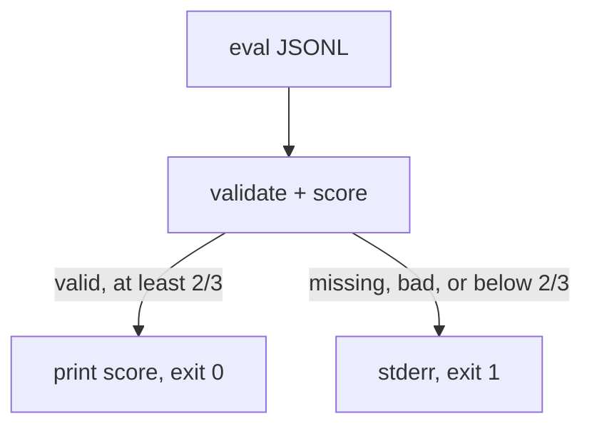

---
{
  "id": "git-shell-linux-reproducible-ai",
  "title": "Git, Shell, Linux for AI",
  "slug": "git-shell-linux-reproducible-ai",
  "section": "Computing Foundations",
  "category": "MLOps & Deployment",
  "difficulty": "Easy",
  "order": 1,
  "coverImage": "illustrations/_generated/chapter_flow_dark.png",
  "companies": [
    "OpenAI",
    "Anthropic",
    "Google",
    "Meta",
    "xAI"
  ],
  "shortDescription": "Make a teammate's clone reprint the 0.667 eval instead of crashing on a file that stayed on your laptop.",
  "keyConceptsTested": [
    "git init/clone/commit with optional LFS",
    ".gitignore for models, .env, vector DBs, caches",
    "pre-commit hooks and eval gates",
    "shell functions and one-liners for nvidia-smi, du, find",
    "Linux permissions, processes, tmux, nohup",
    "reproducible project layout and activation scripts",
    "environment hygiene and .env.example templates",
    "failure diagnosis across machines"
  ],
  "relatedQuestions": [
    "docker-containerization-reproducible-ai",
    "python-for-ai-engineering",
    "numpy-and-tensor-shapes"
  ]
}
---

Your laptop runs an evaluation script, compares three saved model predictions against ground truth, and prints `0.667`: two answers matched. A teammate clones your repo, runs the exact same script, and crashes immediately with a `FileNotFoundError`. The Python code arrived over Git, but the dataset it reads stayed behind on your hard drive.

The project is a minimal repo called `prompt-eval`, tested from a <span data-glossary="reproducible-environment">fresh clone</span>. Its evaluation (an **eval**) compares saved predictions with expected answers. It needs no live API calls or secret tokens. Git carries the source code and eval data, and shell scripts define the setup and eval commands.

The final check runs on your own machine. It tests whether the committed files can rebuild the local Python environment and reproduce the score. Another machine can still have a different operating system, Python version, or GPU driver. Those differences stay outside this check. The crash is a missing file. Before hunting for it, the terminal has to show which directory you are in.

## Meet the terminal, shell, and repository

The **terminal** is the window where that directory becomes visible. The <span data-glossary="shell">shell</span> running inside it, typically Bash or Zsh, parses commands and launches processes. Linux is common on remote AI servers and multi-GPU clusters, so you'll use these command-line habits there too.

Use Bash or Zsh on macOS, Linux, or Windows Subsystem for Linux (WSL), with Git and Python 3.12 or newer installed. You don't need a GPU to complete this project. The GPU commands later in the lesson show how to inspect a remote machine.

Before writing code, make your working path visible. A filesystem **path** locates a file or directory (`.` represents your current directory and `..` points to its parent). We run `pwd` (print working directory) to check the current folder, `mkdir` to create our project directory, and `cd` to move into it. Run these commands line by line in your workspace:

```bash title="terminal"
pwd
mkdir prompt-eval
cd prompt-eval || exit 1
pwd
git --version
python3 --version
git init -b main
```

Notice `cd prompt-eval || exit 1`. If the directory change fails, the shell exits with status 1. This prevents subsequent commands from running in the wrong folder. An **exit status** is the number a command returns when it ends. Status 0 signals success, while a nonzero status usually signals failure. If a command fails, read its error before running the next command.

<span data-glossary="git">Git</span> tracks changes through snapshots called **commits**. A directory managed by Git is a **repository** (or **repo**). Running `git init -b main` creates Git's internal directory at `.git/` and names your initial branch `main`. A **branch** names a line of development. We'll use `main` throughout this lab. Leave the files inside `.git/` to Git and its commands.

Before creating your first commit, assign an author name and email. These settings stay local to `prompt-eval`. (Add `--global` only if you want to use this identity across every repository on your machine):

```bash title="terminal-identity"
git config user.name "Your Name"
git config user.email "you@example.com"
git status
```

`git status` confirms you're on `main` with no commits yet. Git distinguishes three states: the **working tree** contains your editable files, the **staging area** selects contents for the next commit, and history contains existing commits. The staging area is also called the **index**. Running `git add` stages a file's current contents. Running `git commit` records the staged snapshot.[^progit] If you edit a file after staging it, run `git add` again to include that edit.

These states explain the missing-file bug. A file can exist on your laptop without appearing in any commit. Before adding our eval code, decide which files the project needs from Git and which files should stay local.

## Ignore the files that shouldn't travel

Before adding the scorer, separate project inputs from local residue. Create `.gitignore` with patterns for <span data-glossary="secrets-management">secrets</span>, caches, generated indexes, and model artifacts:

```gitignore title=".gitignore"
# Python
__pycache__/
*.py[cod]
*$py.class
.venv/
venv/
.uv-cache/

# Environment & secrets (do not commit these)
.env*
!.env.example
*.pem
*.key
secrets/

# Generated model and vector artifacts that do not travel with the repo
checkpoints/
models/local/
*.pt
*.pth
chroma/
faiss_index/
*.db
*.sqlite3

# OS and editor noise
.DS_Store
.idea/
.vscode/
*.swp

# Evaluation caches that should be regenerated
eval_cache/
runs/
wandb/
mlruns/

# Do not ignore *.gguf, *.safetensors, or *.bin here.
# .gitattributes routes those extensions through Git LFS when configured.
```

`.gitignore` keeps matching untracked files out of ordinary `git add` operations. It doesn't remove tracked files or rewrite Git history. It also isn't an access control: `git add -f` can stage an ignored file. If `git ls-files '.env*'` returns a file containing credentials, stop before sharing your branch. Remove that file from tracking with `git rm --cached`. If an active credential entered commit history, rotate it with your provider. Deleting the file in a later commit leaves the key readable in earlier revisions.[^gitignore2026]

Use <span data-glossary="git-lfs">Git LFS</span> only when a large artifact truly belongs in this repo. GitHub warns above 50 MiB and blocks ordinary Git files above 100 MiB; LFS keeps a small pointer in Git while storing the bytes separately.[^github_large] Generated checkpoints and local model directories stay ignored.

Production datasets and frequently changing weights usually belong in object storage or a data registry, with a versioned manifest in Git. LFS <span data-glossary="quota">quotas</span> and file caps depend on the host and plan, so treat LFS as a pointer mechanism, not a dataset store.

An ignored path won't be picked up by LFS tracking. Keep selected LFS patterns out of `.gitignore`, then check whether the separate `git-lfs` tool is installed before adding weights:

```bash title="terminal-2"
cat > .gitattributes << 'EOF'
# This file is populated by `git lfs track` when LFS is available.
EOF

if command -v git-lfs >/dev/null 2>&1; then
  git lfs install --local
  git lfs track "*.gguf" "*.safetensors" "models/*.bin"
  git lfs track
else
  echo "Git LFS isn't installed. Safe for now: don't commit model weights yet."
fi

git add .gitattributes
```

Commit this skeleton before adding the eval dataset. Inspect the staged changes with `git diff --cached`, then record them. `git commit` saves locally; it doesn't upload anything to GitHub.

```bash title="terminal-3"
git add .gitignore .gitattributes
git diff --cached
git commit -m "chore: initial AI project skeleton with safe .gitignore and LFS"
```

On a normal LFS checkout, Git materializes the object. Without LFS, or with `GIT_LFS_SKIP_SMUDGE=1`, a clone may contain pointer text instead. `git lfs pull` downloads and checks out missing objects after LFS is installed.[^gitlfs2026pull] Commit `.gitattributes` when tracking patterns change, and document which workflows need those bytes. The skeleton still has nothing for the scorer to read. Where do the three expected answers live?

## Commit the three-row eval set

Our repository has directory structure, but no evaluation data yet. We'll add three prompt-classification examples, each pairing a user prompt with an expected intent label and a saved model prediction. The shell idiom `cat > path << 'EOF'` writes every line up to `EOF` into the target file, replacing any existing content:

```bash title="terminal-4"
mkdir -p eval
cat > eval/eval_cases.jsonl << 'EOF'
{"prompt": "Classify intent: Summarize the quarterly benchmark report.", "expected": "summarize", "prediction": "summarize"}
{"prompt": "Classify intent: Compare latency across two batch sizes.", "expected": "compare", "prediction": "explain"}
{"prompt": "Classify intent: Translate this docstring into Spanish.", "expected": "translate", "prediction": "translate"}
EOF
```

Row 2 is the intentional miss (`compare` vs `explain`). Two of three labels match, so accuracy is $2 / 3$, printed to three decimal places as `0.667`. Three fixed examples are enough to check the workflow, not enough to measure model quality. The downloadable [eval file](assets/eval_cases.jsonl) contains the same rows; the browser's runnable example reads that copy.

## A scorer that fails out loud

Give the check a small program that reads <span data-glossary="jsonl">JSONL</span>, one JSON object per line, and computes exact-match accuracy. You don't need to understand every Python statement yet. Follow its three jobs: validate the rows, count matching labels, and report whether at least two thirds match. [Python for AI Engineering](/learn/python-for-ai-engineering) later explains the functions, exceptions, and tests behind this work.

A **gate** is a check that blocks a later action when it fails. Valid rows at or above the threshold print a score and return status 0; missing, malformed, empty, or below-threshold input returns nonzero. Run `mkdir -p scripts`, then save the utility below as `scripts/score_eval.py`. The shell wrapper will invoke it on every clone.



<!-- leetllm: test, output=show -->
```python title="scripts/score_eval.py"
import json
import sys
from pathlib import Path

REQUIRED = ("prompt", "expected", "prediction")
EVAL_FILE = Path("eval/eval_cases.jsonl")
ASSET_FILE = Path("assets/eval_cases.jsonl")

path = EVAL_FILE if EVAL_FILE.exists() else ASSET_FILE
if not path.exists():
    print(f"ERROR: {path} missing; commit the eval file", file=sys.stderr)
    raise SystemExit(1)

rows = []
for line_number, line in enumerate(path.read_text(encoding="utf-8").splitlines(), start=1):
    if not line.strip():
        continue
    try:
        row = json.loads(line)
    except json.JSONDecodeError as error:
        print(f"ERROR: line {line_number}: {error.msg}", file=sys.stderr)
        raise SystemExit(1)
    if not isinstance(row, dict):
        print(f"ERROR: line {line_number} must be a JSON object", file=sys.stderr)
        raise SystemExit(1)
    missing = [field for field in REQUIRED if field not in row]
    if missing:
        print(f"ERROR: line {line_number} missing {missing}", file=sys.stderr)
        raise SystemExit(1)
    if any(not isinstance(row[field], str) or not row[field].strip() for field in REQUIRED):
        print(f"ERROR: line {line_number} requires nonempty text fields", file=sys.stderr)
        raise SystemExit(1)
    rows.append(row)

if not rows:
    print("ERROR: eval file is empty", file=sys.stderr)
    raise SystemExit(1)

def normalize(label: str) -> str:
    return label.strip().lower()

correct = sum(normalize(row["expected"]) == normalize(row["prediction"]) for row in rows)
total = len(rows)
score = correct / total
print(f"Eval rows: {total}")
print(f"Exact-match accuracy on eval set: {score:.3f} ({correct}/{total})")
# Count gate: fail below 2/3 correct (same rule Docker and Python reuse).
if correct * 3 < total * 2:
    print("Gate failed: score regressed below 2/3", file=sys.stderr)
    raise SystemExit(1)
print("Gate passed. You may commit.")
```

<!-- leetllm: output:start -->
```text title="Output" output compact
Eval rows: 3
Exact-match accuracy on eval set: 0.667 (2/3)
Gate passed. You may commit.
```
<!-- leetllm: output:end -->

Labels are normalized with `strip().lower()`, which removes surrounding whitespace and ignores letter case. The gate compares integer counts (`correct * 3 < total * 2`) instead of asking whether a rounded float equals `0.667`. A score of `1.000` also passes; `0.667` is this eval file's expected output, not the only permitted score.

Read the printed count for what happened, then read the exit status for whether the command may continue. Errors use **standard error** (`stderr`), a separate output stream from ordinary results. Shell scripts can capture or redirect those streams independently.

```checkpoint
Why does the gate compare integer counts instead of testing whether a floating-point score equals `0.667`?
---
`2 / 3` isn't exactly `0.667`. Binary floating-point arithmetic can introduce subtle rounding errors, whereas cross-multiplying integer counts (`correct * 3 >= total * 2`) tests the exact two-thirds threshold without float precision traps.
```

## The pre-commit gate that protects the score

The scorer works, but remembering to trigger it manually every time doesn't scale. We'll create an executable shell wrapper that both our local <span data-glossary="pre-commit-hook">pre-commit hook</span> and the clean-clone test can invoke.

```bash title="terminal-5"
mkdir -p scripts
cat > scripts/run_eval.sh << 'EOF'
#!/usr/bin/env bash
set -euo pipefail

EVAL_FILE="eval/eval_cases.jsonl"
if [[ ! -f "$EVAL_FILE" ]]; then
  echo "ERROR: $EVAL_FILE missing. Did you forget to commit the eval file or pull the latest repo?" >&2
  exit 1
fi

PYTHON_BIN="${PYTHON_BIN:-python3}"
if ! command -v "$PYTHON_BIN" >/dev/null 2>&1; then
  echo "ERROR: Python 3 is required by the provided scorer. Install it or set PYTHON_BIN." >&2
  exit 1
fi

if [[ -f scripts/score_eval.py ]]; then
  "$PYTHON_BIN" scripts/score_eval.py
else
  echo "ERROR: scripts/score_eval.py missing. Add the Python scorer from this chapter." >&2
  exit 1
fi
EOF
chmod +x scripts/run_eval.sh
```

Put the shared eval command in a tracked script. A personal shell alias and an installed `.git/hooks/` script stay local. A committed `repro.sh` arrives with a clone.

```bash title="terminal-6"
cat > repro.sh << 'EOF'
#!/usr/bin/env bash
set -euo pipefail

./scripts/run_eval.sh
EOF
chmod +x repro.sh
```

Now connect that command to Git with a **pre-commit hook**. Git runs this executable script before recording a commit. By default, active hooks live inside `.git/hooks/` and don't travel in a clone.[^git2026hooks] We'll commit the hook source in `scripts/`, then install a local copy on each checkout. The installer below refuses to overwrite a different hook or ignore an existing `core.hooksPath` setting.

```bash title="terminal-7"
cat > scripts/pre-commit-ai-eval.sh << 'EOF'
#!/usr/bin/env bash
set -euo pipefail

echo "Running AI eval gate before commit..."
./scripts/run_eval.sh
echo "Eval gate passed."
EOF

cat > scripts/install_hooks.sh << 'EOF'
#!/usr/bin/env bash
set -euo pipefail

repo_root="$(git rev-parse --show-toplevel 2>/dev/null)" || {
  echo "ERROR: run this command inside a Git working tree" >&2
  exit 1
}
cd "$repo_root"

if configured_hooks_path="$(git config --get core.hooksPath)"; then
  echo "ERROR: core.hooksPath is already set to $configured_hooks_path; add the eval gate there deliberately" >&2
  exit 1
fi

hooks_dir="$(git rev-parse --git-path hooks)"
if [[ "$hooks_dir" != /* ]]; then
  hooks_dir="$repo_root/$hooks_dir"
fi
hook_path="$hooks_dir/pre-commit"

mkdir -p "$hooks_dir"
if [[ -e "$hook_path" ]] && ! cmp -s scripts/pre-commit-ai-eval.sh "$hook_path"; then
  echo "ERROR: $hook_path already exists; merge the eval command into it instead of overwriting it" >&2
  exit 1
fi

cp scripts/pre-commit-ai-eval.sh "$hook_path"
chmod +x "$hook_path"
echo "Installed $hook_path"
EOF

chmod +x scripts/pre-commit-ai-eval.sh scripts/install_hooks.sh
./scripts/install_hooks.sh
```

Run the eval, then commit the files. The commit runs the eval again through the installed hook:

```bash title="terminal-8"
./repro.sh
git add scripts/pre-commit-ai-eval.sh scripts/score_eval.py scripts/run_eval.sh scripts/install_hooks.sh repro.sh eval/eval_cases.jsonl
git commit -m "feat: add three-row eval and pre-commit gate that protects 0.667"
```

```text title="Output" output compact
Eval rows: 3
Exact-match accuracy on eval set: 0.667 (2/3)
Gate passed. You may commit.
Running AI eval gate before commit...
Eval rows: 3
Exact-match accuracy on eval set: 0.667 (2/3)
Gate passed. You may commit.
Eval gate passed.
```

Consider what happens if a fourth row fails. Suppose you append one wrong prediction so two of four labels match: accuracy falls to $2/4 = 0.5$. The scorer returns status 1 because $0.5 < 2/3$, and the hook blocks the commit. A missing eval file also returns status 1, but its error names the missing file. Use that message to distinguish a score regression from a setup failure.

If the scorer reports a regression or the eval file disappears, the commit stops. This hook reads working-tree files, not the staged snapshot. A passing unstaged edit could therefore hide a failing version in the commit. Review `git diff` for unstaged edits and `git diff --cached` for the version you're about to commit, then test the committed version in a clone.

`--no-verify` can bypass a local hook, so it provides fast feedback rather than a hard enforcement check. Run `./repro.sh` in <span data-glossary="continuous-integration">continuous integration (CI)</span>, an automated check of a committed version, too. That shared check catches a bypassed or missing local hook without borrowing working-tree edits.

## Trace a regression through Git history

The gate tells you when behavior changes, but it doesn't name which file or commit broke it. When yesterday's passing `0.667` suddenly regresses to exit status 1, capture the terminal output and exit code before modifying any code:

```bash title="terminal-history"
./repro.sh
repro_status=$?
printf 'repro exit status: %s\n' "$repro_status"
git status --short
git log --oneline --decorate -5
git show --stat --oneline HEAD
```

`git log` names the snapshots that led here. `git show` reveals what the latest snapshot changed, while `git status --short` separates committed history from edits still sitting in the worktree. A green rerun with a dirty worktree is weaker evidence than a green commit with a clean status.

When the bad behavior could have entered anywhere in a long history, test the middle instead of reading every diff. `git bisect` checks one candidate commit at a time and narrows the range. Start from a clean worktree or set aside uncommitted edits, because bisect checks out candidate snapshots:

```bash title="terminal-bisect"
git bisect start
git bisect bad HEAD
# Replace the value with a commit known to pass ./repro.sh.
GOOD_COMMIT="replace-with-known-good-commit"
git bisect good "$GOOD_COMMIT"
```

At each candidate, run the gate and read its output before classifying the commit:

```bash title="terminal-bisect-test"
./repro.sh
printf 'repro exit status: %s\n' "$?"
```

Enter `git bisect good` if the check passes, `git bisect bad` if it reproduces the regression, or `git bisect skip` if an unrelated setup problem prevents testing. Repeat the test and classification at each new candidate until Git reports the first bad commit. Only then inspect it and return to your original branch:

```bash title="terminal-bisect-finish"
git show refs/bisect/bad
git bisect reset
```

The shell's zero-versus-nonzero status maps directly to `git bisect good` and `git bisect bad`. If a candidate commit can't execute because of a broken environment, use `git bisect skip` rather than falsely condemning that revision. Once Git identifies the first bad snapshot, running `git show <commit>` gives you the exact diff that introduced the bug.[^progit]

## Personal shortcuts vs repo commands

The hook now runs on your development machine, but shortcuts defined in `~/.zshrc` or `~/.bashrc` stay strictly local. Shell functions can accelerate daily development on your personal machine; they can never serve as a repository's official setup step.

For NVIDIA setups, `nvidia-smi --query-gpu` with `--format=csv` provides a scriptable interface for custom shell helpers.[^nvsmi] The functions below assume GNU utilities on a Linux GPU system. Command options often differ on macOS, which doesn't ship NVIDIA drivers; run these helpers on remote GPU instances, and rely on `./repro.sh` as the portable repo entrypoint.

```bash title="terminal-9"
# GPU snapshot (works on NVIDIA, falls back gracefully)
gpu() {
  if command -v nvidia-smi >/dev/null 2>&1; then
    nvidia-smi --query-gpu=index,name,memory.used,memory.total,utilization.gpu --format=csv,noheader
  else
    echo "No NVIDIA GPU or nvidia-smi not in PATH"
  fi
}

# Dataset size at a glance
ds() {
  local target="${1:-.}"
  # Prevent a relative name beginning with '-' from becoming a find option.
  [[ "$target" == /* ]] || target="./$target"
  du -sh -- "$target" || return
  local counts
  counts=$(find "$target" -type f -name '*.jsonl' -exec sh -c '
    for file do
      wc -l < "$file" || exit
    done
  ' sh {} +) || return
  awk '{ rows += $1 } END { print "JSONL newline count:", rows + 0 }' <<< "$counts"
}

# One-command reproduction of the current eval
repro() {
  if [[ -x ./repro.sh ]]; then
    ./repro.sh
  else
    echo "No executable ./repro.sh in the current directory" >&2
    return 1
  fi
}
```

After saving the functions, run `source ~/.zshrc` or `source ~/.bashrc` once to reload the configuration. `gpu`, `ds`, and `repro` then become shortcuts. Keep `./repro.sh` in setup docs and CI. If a clone needs the alias, the command still isn't reproducible.

Try `ds eval`: the eval file contributes three newline characters. Now pass a nonexistent directory. The helper must return nonzero and leave the newline count unprinted. A broken helper that hides `find` errors and sums an empty stream would report zero successfully, confusing unavailable data with an empty dataset.

The helper captures counts before printing their sum. Each `wc` reads through stdin, so its output contains only a count, even if the filename contains spaces or newlines. The `+` form batches paths into `sh`; `find` returns nonzero if a batch fails. Keep `local counts` separate from the assignment: combining them as `local counts=$(...)` can mask the command's failure with the declaration's successful status.[^gnuFindutils2026][^bashBuiltins2026]

## Inspect data, then reclaim a GPU

Remote debugging on cloud nodes starts with a fundamental question: is the input dataset malformed, or is the training process hung? First inspect large datasets without flooding your SSH session. Running `cat train.jsonl` dumps millions of lines into your terminal buffer; start with a single line and targeted row counts instead:

```bash title="terminal-inspect"
head -n 1 eval/eval_cases.jsonl    # peek at the schema of one row
wc -l eval/eval_cases.jsonl        # count rows without loading the file
grep -c '"expected"' eval/eval_cases.jsonl  # how many rows have the field
```

The pipe operator `|` routes stdout from one process into stdin of the next. Running `grep '"translate"' eval/eval_cases.jsonl | wc -l` streams lines through the filter and counts matches on the fly. Remember that `wc -l` counts newline characters (`\n`), not JSON objects: a final line lacking a trailing newline won't be counted, and blank lines will be counted. Similarly, `grep` performs plain string matching rather than schema validation. These utilities offer rapid checks, not replacements for full data validation.

Without `pipefail`, Bash normally uses the final command's status for a pipeline. That means `wc` could report success (status 0) even if `grep` couldn't open the file. With `pipefail`, a failure in an earlier stage makes the pipeline return nonzero too. Bash still waits for the pipeline to finish; this option doesn't immediately cancel the other stages.[^bashPipelines2026]

`set -euo pipefail` is useful, but it doesn't replace explicit error handling. `-u` catches unset variables; `-e` exits on many unhandled nonzero statuses. Commands tested by `if`, `while`, `!`, or parts of `&&` / `||` lists have exceptions. Testing a function this way can also disable `-e` inside the function. Check important failures deliberately, and remember that `grep` returns 1 for a valid search with no matches.[^bashSetBuiltin2026]

For example, ask whether a label appears instead of treating every nonzero status as a crash. A nonexistent file is a different outcome from an existing file with no matching label:

```bash title="terminal-grep-status"
if grep -q '"translate"' eval/eval_cases.jsonl; then
  echo "At least one translate label appears"
else
  search_status=$?
  if [[ "$search_status" -eq 1 ]]; then
    echo "No translate label appears"
  else
    echo "ERROR: search failed with status $search_status" >&2
  fi
fi
```

If the output is surprising, verify location before blaming Python. A **relative path** such as `eval/eval_cases.jsonl` starts from the current directory; an **absolute path** starts at `/`. Quote variables that contain paths so spaces don't split one path into several arguments. Then check the exact capability a command needs:

```bash title="terminal-permissions"
pwd
ls -l scripts/run_eval.sh eval/eval_cases.jsonl
test -r eval/eval_cases.jsonl && echo "eval file is readable"
test -x scripts/run_eval.sh && echo "eval script is executable"
```

`chmod +x scripts/run_eval.sh` adds the executable bit. It doesn't make a script trustworthy, grant access to its input, or fix a filesystem mounted with execution disabled. Avoid `chmod 777`: it grants write access far beyond what this repo needs and hides the ownership problem.

Now inspect a <span data-glossary="gpu">GPU</span> whose memory remains allocated after a training script hangs or an SSH session ends. A detached <span data-glossary="pytorch">PyTorch</span> process can keep GPU memory allocated. Use the `nvidia-smi` Processes table to look for the owner.[^nvsmi] A **process ID (PID)** identifies a process. Check its owner and command before sending a signal. If you own the job or have permission to stop it, request a graceful shutdown first. Consider a forced shutdown only if it doesn't exit.

```bash title="terminal-kill"
nvidia-smi  # read the PID in the bottom "Processes" table
PID=12345   # replace this only after you identify your own process

ps -o user=,pid=,ppid=,stat=,etime=,cmd= -p "$PID"
kill -TERM "$PID"
for _ in {1..10}; do  # give graceful shutdown up to ten seconds
  kill -0 "$PID" 2>/dev/null || break
  sleep 1
done

if kill -0 "$PID" 2>/dev/null; then
  ps -o user=,pid=,ppid=,stat=,etime=,cmd= -p "$PID"
  echo "Still alive. Recheck owner and command before: kill -KILL $PID"
fi
```

Only signal a process you own or have permission to manage. `kill -0` checks whether a PID exists and whether you may signal it; it doesn't prove that the PID still belongs to the same program. Re-inspect owner and command before SIGKILL. If VRAM remains allocated but `nvidia-smi` shows no owning compute PID, there's no process ID to kill. Check container or PID-namespace visibility and other driver clients, then move to container-runtime or driver diagnosis.

Start with SIGTERM. Signal 15 gives the process a chance to close files and release CUDA memory. SIGKILL (signal 9) can't be caught or handled and can leave lock files or corrupt <span data-glossary="model-checkpoint">checkpoints</span>, so reserve it for a process that refuses to exit.[^signal]

```checkpoint
You find a live training PID holding GPU memory. Which signal should you send first, and when should you escalate?
---
After checking ownership and permission to stop the job, send SIGTERM first. A program with a shutdown handler can then flush files. Wait for a short grace period and recheck the process identity before considering SIGKILL; a live PID alone isn't enough.
```

## Keep a long job alive across SSH

Our small eval ends quickly. A training job can run for hours through SSH, so choose how it should continue after a disconnect. Your choice depends on whether you'll need an interactive terminal when you reconnect.

- `nohup python train.py > train.log 2>&1 </dev/null &` runs a noninteractive process that ignores hangup and writes a log. It won't give you a session to type into later.
- `tmux new -s training` gives you a detachable session. Detach with `Ctrl-b d`, reconnect, then run `tmux attach -t training`; the job keeps its terminal while you're away.[^tmux2026]
- `nice -n 10 python train.py` requests a niceness increase of 10, which generally gives the command less CPU priority. It doesn't cap RAM or GPU, and it doesn't keep a process alive after logout.[^gnucoreutils2026]
- When disk fills up, find heavy paths with `du -ah /workspace | sort -rh | head -20`. When you need the training PID, `pgrep -af 'python.*train.py'` finds candidates without matching the search command itself.

Use `tmux` when you may need to inspect or steer the run later. Use `nohup` for a noninteractive job whose progress you can inspect through its log. Neither protects against a machine reboot, an out-of-memory kill, or a cluster scheduler stopping the job. They also don't make its inputs or environment reproducible.

Git carried the scripts and eval data. Python still needs a declared, rebuildable environment on the next machine.

## Rebuild Python on every clone

Another setup failure is `ModuleNotFoundError`: the code arrived, but the selected Python environment lacks a required package. Python's built-in `venv` module creates isolated <span data-glossary="virtual-environment">virtual environments</span>. These environments can contain absolute paths to their interpreters, so copying a `.venv` to another location can break it. Rebuild `.venv` in each fresh clone.[^python2026venv] Our scorer uses only the standard library. The activation script also checks <span data-glossary="cuda">CUDA</span> availability if `torch` is installed.

```bash title="terminal-10"
cat > .python-version << 'EOF'
3.12
EOF

cat > requirements.txt << 'EOF'
# Empty because this chapter's scorer uses only Python's standard library.
# When packages arrive, use a committed lockfile or fully hashed requirements.
EOF

cat > .env.example << 'EOF'
# Copy to .env and fill locally. Never commit the real value.
EVAL_API_KEY=
EOF

cat > activate.sh << 'EOF'
#!/usr/bin/env bash

_activate_fail() {
  echo "ERROR: $1" >&2
}

_activate_main() {
  # Allow an explicit interpreter; version managers can read .python-version.
  PYTHON_BIN="${PYTHON_BIN:-python3}"
  if ! command -v "$PYTHON_BIN" >/dev/null 2>&1; then
    _activate_fail "install python3 or set PYTHON_BIN=/path/to/python"
    return 1
  fi

  if ! "$PYTHON_BIN" - << 'PY'
import sys
raise SystemExit(0 if sys.version_info >= (3, 12) else 1)
PY
  then
    _activate_fail "Python 3.12 or newer is required; set PYTHON_BIN to a supported interpreter"
    return 1
  fi

  # 1. Create or reuse a local virtualenv
  if [[ ! -d .venv ]]; then
    "$PYTHON_BIN" -m venv .venv || {
      _activate_fail "could not create .venv"
      return 1
    }
  fi
  source .venv/bin/activate || {
    _activate_fail "could not activate .venv"
    return 1
  }

  if ! python -c 'import sys; raise SystemExit(0 if sys.version_info >= (3, 12) else 1)'; then
    _activate_fail "existing .venv uses an older Python; recreate it with Python 3.12 or newer"
    return 1
  fi
  # Make run_eval.sh use this environment, even after an interpreter override.
  export PYTHON_BIN="$VIRTUAL_ENV/bin/python"

  # 2. Install only a fully pinned, fully hashed requirements set.
  if grep -Ev '^[[:space:]]*(#|$)' requirements.txt >/dev/null 2>&1; then
    python -m pip install --require-hashes -r requirements.txt || {
      _activate_fail "requirements must pin and hash every package"
      return 1
    }
  else
    _requirements_status=$?
    if [[ $_requirements_status -gt 1 ]]; then
      _activate_fail "could not read requirements.txt"
      return 1
    fi
  fi
  unset _requirements_status

  # 3. Print the local environment without requiring GPU packages yet
  if ! python - << 'PY'
import os, sys
print("Python executable:", sys.executable)
print("Python:", sys.version.split()[0])
visible_devices = os.environ.get("CUDA_VISIBLE_DEVICES")
print(
    "CUDA_VISIBLE_DEVICES:",
    visible_devices if visible_devices is not None else "<unset; no mask applied>",
)
try:
    import torch
except ModuleNotFoundError:
    print("PyTorch: not installed yet (OK for this chapter)")
else:
    print("PyTorch:", torch.__version__)
    print("CUDA available:", torch.cuda.is_available())
    if torch.cuda.is_available():
        print("GPU:", torch.cuda.get_device_name(0))
PY
  then
    _activate_fail "environment probe failed"
    return 1
  fi

  echo "Environment ready. Run './repro.sh' to execute the eval gate."
}

if _activate_main; then
  _activate_status=0
else
  _activate_status=$?
fi
unset -f _activate_main _activate_fail
if [[ $_activate_status -ne 0 ]]; then
  return "$_activate_status" 2>/dev/null || exit "$_activate_status"
fi
unset _activate_status
EOF
chmod +x activate.sh
```

The outer status check matters because this file is sourced. A helper can return nonzero while later commands keep running and make setup look successful. `_activate_main` checks its important steps explicitly; the surrounding `if` captures its result before cleanup, and the file-level `return` passes that status back to the caller. Run `source activate.sh && ./repro.sh` to continue only after successful setup. If your calling shell has `-e` enabled, handle a setup failure in a conditional too rather than assuming a nonzero `source` will leave that shell open.

The scorer's dependency set is empty today. Once packages arrive, plain version ranges won't reproduce an install. Choose one complete dependency specification: commit `pyproject.toml` plus `uv.lock` and run `uv sync --locked`, or commit a requirements file that pins every direct and transitive package and includes accepted artifact hashes for `pip --require-hashes`.[^uv2026sync][^pip2026secureinstalls] A <span data-glossary="dependency-lockfile">lockfile</span> constrains Python packages; it doesn't pin the OS, driver, or system libraries. <span data-glossary="docker">Docker</span> packages that layer next.

`.python-version` suggests Python 3.12 to version managers; it doesn't install Python or enforce that version by itself. This lab checks for 3.12 or newer because it uses only the standard library. A project that depends on one exact Python release should pin and verify that release too.

`.env.example` demonstrates how to record a variable name without its secret value. This scorer doesn't need `EVAL_API_KEY`; leave it empty. `activate.sh` deliberately doesn't `source .env`: sourcing treats every line as shell code. When an application does need a key, export trusted values through your shell or a dedicated environment loader and fail clearly when the required variable is absent.

> **Expected output:** `source activate.sh` should print an executable inside `prompt-eval/.venv`, a Python version of 3.12 or newer, the current `CUDA_VISIBLE_DEVICES` state, and `Environment ready`. If setup prints `ERROR`, fix that first and don't run the eval from a half-created environment.

Create `README.md` with the same setup order another machine should follow:

```bash title="terminal-readme"
cat > README.md << 'EOF'
## Quick start

git clone git@github.com:your-org/prompt-eval.git
cd prompt-eval
./scripts/install_hooks.sh
if command -v git-lfs >/dev/null 2>&1; then
  git lfs install --local
  git lfs pull
fi
source activate.sh && ./repro.sh
EOF
```

Track the setup files before testing a clone. If the hook is configured, committing these files runs the same eval gate first.

```bash title="terminal-commit-setup"
git add .python-version requirements.txt .env.example activate.sh README.md
git commit -m "chore: add reproducible environment setup"
git status --short
```

With ordinary status settings, no output from `git status --short` means the tracked files and staging area match the new commit and no unignored, untracked files were reported. Ignored files can still exist. Now test the stronger claim: did the required project files actually enter the commit?

## When the clone still fails

| Symptom | Possible cause | Fix that belongs in the repo |
|---|---|---|
| `CUDA not found` on the GPU box | Host driver or container runtime is missing, the image lacks a compatible CUDA stack, or `CUDA_VISIBLE_DEVICES` is explicitly empty/invalid and hides the GPU | Compare `nvidia-smi`, the printed `CUDA_VISIBLE_DEVICES`, and `torch.cuda.is_available()`; remove an accidental mask or choose a valid device index, then document the required image and runtime. An unset variable normally exposes all available devices. An empty string hides every GPU.[^cudaEnvironment2026] |
| `ModuleNotFoundError` for a package that worked on the laptop | Dependency lock is incomplete or environment wasn't synced from it | Rebuild from an empty env, lock every direct and transitive dependency, commit the lock, and install with `uv sync --locked` or a fully hashed requirements file |
| Eval exits because the three-row JSONL is missing | eval file existed only as an untracked local file | Move `eval_cases.jsonl` to `eval/`, commit it, and verify it appears in a clone |
| Pre-commit hook doesn't run on a fresh clone | installed copy under Git's private hook path is clone-local | Keep `scripts/pre-commit-ai-eval.sh` and `scripts/install_hooks.sh` tracked, then run the installer after cloning |
| Installer refuses to replace an existing hook | another tool or teammate already owns `pre-commit` | Merge `./scripts/run_eval.sh` into existing hook deliberately; don't silently overwrite another team script |
| Pull introduces a model pointer that won't load | Git LFS is missing, smudge was skipped, or object wasn't uploaded | Run `git lfs install` and `git lfs pull`, inspect pointer status, and make CI verify required LFS objects before a release |

Keep each diagnosis and its prevention in the repo. The next clone should spell out each missing file or requirement instead of forcing machine-specific guesswork.

## Prove it with a throwaway clone

The code, eval cases, and setup scripts are committed. Now test them in a separate checkout without copying untracked project files. The clone must receive the eval file and scripts, build a fresh `.venv`, and install its local pre-commit hook. This eval requires no secret tokens. Both copies should print `0.667` when running `./repro.sh`.

<figure>
  
  <figcaption>Follow the files a clone receives and the local environment rebuilt from them. The <code>.venv</code>, installed hook, and secrets remain local; the check still shares the host OS, tools, and driver.</figcaption>
</figure>

`mktemp -d` generates a clean, unique temporary directory. The clone receives committed files without borrowing the original worktree's untracked inputs or installed `.git/hooks/`. Calling the tracked `./repro.sh` avoids relying on a personal alias. Adding `--no-local` uses regular Git transport instead of the local hardlink optimization; a local-path clone still doesn't need a network server.[^git2026clone] Wrapping the commands in a subshell `(...)` keeps activation changes out of your active terminal.

```bash title="terminal-clean-clone"
repo_root="$(pwd)"
clone_root="$(mktemp -d)"

(
  set -e
  git clone --no-local "$repo_root" "$clone_root/prompt-eval"
  cd "$clone_root/prompt-eval" || exit 1
  ./scripts/install_hooks.sh
  source activate.sh || exit 1
  ./repro.sh
  git status --short
)
clone_status=$?

printf 'Clone check exit status: %s\n' "$clone_status"
echo "Temporary clone kept for inspection: $clone_root/prompt-eval"
```

Check all four results: activation prints its Python executable and version, the eval prints three rows and `0.667 (2/3)`, `git status --short` prints nothing, and the clone check exits 0. The ignored `.venv` may exist without making the tree dirty. A setup or eval failure stops the subshell instead of being hidden by a later successful `git status`.

This file-isolation test runs on the same machine and shares your installed tools, environment variables, network access, and operating system. If it needs an untracked project file, add the nonsecret input or its setup instructions to Git, commit, and rerun. Testing on another machine or in CI exposes the next layer of assumptions.

Before sharing a commit, inspect `git status`, run `./repro.sh`, and repeat the temporary clone. Record any missing file, variable, package, permission, or machine requirement in the tracked setup files first.

```checkpoint
Why is a clean temporary clone stronger evidence than rerunning `repro` in your working directory?
---
The clone doesn't contain your untracked files or installed hook copies, and the test invokes tracked scripts rather than a personal alias. A passing run shows that those files and setup commands traveled through Git. The same-machine test still inherits host tools and environment variables; it doesn't prove OS or driver parity.
```

```mastery-quiz
[
  {
    "question": "A config file is staged with threshold 0.8, then edited to 0.6 without another git add. A working-tree hook checks a score of 0.7 and passes. What does a plain commit record, and how does that score compare with the recorded threshold in a clean clone?",
    "options": [
      "Threshold 0.6; the score passes.",
      "Threshold 0.8; the score fails.",
      "Threshold 0.8; the score passes.",
      "Threshold 0.6; the score fails."
    ],
    "answer": "Threshold 0.8; the score fails.",
    "explanation": "The commit records the index, which still contains 0.8. The passing hook read the later 0.6 working version. A score of 0.7 is below the committed threshold, so the clean-clone check fails. A hook success does not stage its inputs."
  },
  {
    "question": "A credential placeholder was already tracked before .env was added to .gitignore. A required model file is untracked and matches both an ignore pattern and an LFS tracking pattern. Which preparation correctly handles both current-index membership and ordinary model addition?",
    "options": [
      "Leave .env indexed; remove the model ignore pattern and use the LFS tracking attributes.",
      "Untrack .env with git rm --cached; leave the model ignore pattern and rely on ordinary git add.",
      "Untrack .env with git rm --cached; remove the model ignore pattern and use the LFS tracking attributes.",
      "Leave .env indexed; leave the model ignore pattern and rely on ordinary git add."
    ],
    "answer": "Untrack .env with git rm --cached; remove the model ignore pattern and use the LFS tracking attributes.",
    "explanation": "An ignore pattern does not remove an already tracked file. git rm --cached removes current tracking while leaving the working file; old committed credentials would still require exposure response and rotation. An ignored untracked model is omitted by ordinary add even when an LFS attribute matches it. Keep required LFS paths trackable and verify the separate objects."
  },
  {
    "question": "A UTF-8 eval file contains four single-line JSON objects that the scorer accepts. One line feed (LF) byte separates adjacent objects, and the file ends at the last object's closing brace. The first two predictions match exactly. The third predicts ' READY ' for 'ready'. The fourth predicts 'open' for 'closed'. The scorer trims and lowercases labels and requires at least two thirds to match. In order, what are the wc -l count, parsed object count, match count, and gate decision?",
    "options": [
      "4; 4; 3; pass.",
      "3; 3; 3; pass.",
      "3; 4; 2; fail.",
      "3; 4; 3; pass."
    ],
    "answer": "3; 4; 3; pass.",
    "explanation": "The four objects have three gaps between them. Each gap contains one LF byte, so wc -l reports three. A count of four would require a final LF. Python reads the fourth object through the end of the file, so dropping it would give the wrong total of three. Counting only exact matches would miss the third prediction, which becomes 'ready' after normalization. Three of four match, and 3 × 3 = 9 exceeds 2 × 4 = 8, so the gate passes."
  },
  {
    "question": "A foreground Bash pipeline finishes with left-to-right stage statuses 3, 0, 5, 0. In the order default pipeline status, status with pipefail, which pair is correct?",
    "options": [
      "0; 5.",
      "0; 3.",
      "5; 5.",
      "3; 0."
    ],
    "answer": "0; 5.",
    "explanation": "The default status comes from the last stage, which succeeded. With pipefail, the rightmost nonzero stage returns 5. The first failed stage would give 3, which is not the pipefail selection rule. Bash still waits for the foreground pipeline to complete."
  },
  {
    "question": "A Linux helper must count newline characters across JSONL files whose names can contain spaces or newlines. If a selected input cannot be read, it must return failure before printing a total. Which implementation guarantees that behavior?",
    "options": [
      "Split find output into whitespace-separated names, then sum wc results after suppressing read errors.",
      "Pass names as find -exec arguments, capture successful stdin-based wc counts, and return on command failure.",
      "Pass names as find -exec arguments, declare local counts=$(...) and use the declaration status as the read verdict.",
      "Parse find output one printed line at a time, then print zero when no numeric count reaches the sum."
    ],
    "answer": "Pass names as find -exec arguments, capture successful stdin-based wc counts, and return on command failure.",
    "explanation": "Argument passing preserves each path identity, while wc reading stdin emits a numeric count without a filename. Separate declaration from the assignment and propagate its failure before summing. Whitespace or line-based parsing corrupts legitimate names; local can mask a failed substitution, and zero cannot stand for an unreadable input."
  },
  {
    "question": "You sent TERM to an evaluation process you own. After the grace period, its PID exists, but its recorded start time and command now name a different job. Which response fits that observation?",
    "options": [
      "Signal the replacement with KILL because the PID passed its existence check.",
      "Repeat TERM for the replacement because it has the same numeric PID.",
      "Keep the original completion log and inspect the replacement process separately before sending any signal.",
      "Treat the new command as the original cleanup handler and signal it without another ownership check."
    ],
    "answer": "Keep the original completion log and inspect the replacement process separately before sending any signal.",
    "explanation": "A reused PID does not preserve process identity. kill -0 reports existence and signaling permission, so it cannot justify stopping a replacement job. Inspect its owner, start time, and command before sending any signal. TERM and observed completion are distinct events."
  },
  {
    "question": "A remote training task needs an interactive terminal after reconnection. It should also receive less CPU scheduling priority. Which pairing addresses those two requirements?",
    "options": [
      "nohup for a reattachable terminal; nice for CPU scheduling priority.",
      "tmux for a reattachable terminal; nice for CPU scheduling priority.",
      "tmux for a reattachable terminal; nice for a GPU-memory limit.",
      "nohup for a reattachable terminal; nice for a GPU-memory limit."
    ],
    "answer": "tmux for a reattachable terminal; nice for CPU scheduling priority.",
    "explanation": "tmux retains a terminal session that can be detached and reattached. nice changes CPU scheduling priority and sets no GPU-memory cap. nohup supports a noninteractive hangup-resistant process but does not create a reattachable terminal. Host reboot, OOM and scheduler termination still need separate handling."
  },
  {
    "question": "A clone pins a package that accepts either of two versions of a helper library. The helper has no pin. In a Bash script with errexit off (set +e), source activate.sh returns 1 because installation failed. Which repair lets a teammate rebuild the same package versions and run the evaluation only after setup succeeds?",
    "options": [
      "Record direct and transitive dependencies with a complete lock or pinned hashes; run evaluation through source activate.sh && ./repro.sh after repair.",
      "Record only direct versions with hashes; run evaluation through source activate.sh && ./repro.sh after repair.",
      "Record direct and transitive dependencies with a complete lock or pinned hashes; run evaluation through source activate.sh; ./repro.sh after repair.",
      "Record only direct versions with hashes; run evaluation through source activate.sh; ./repro.sh after repair."
    ],
    "answer": "Record direct and transitive dependencies with a complete lock or pinned hashes; run evaluation through source activate.sh && ./repro.sh after repair.",
    "explanation": "A complete lock records the helper version too. With hashed requirements, pin every direct and transitive version and include hashes for the accepted artifacts. Hashing only the direct package leaves the helper version open. Bash runs the command after && only if setup returns 0. A semicolon sequences the commands if the calling shell continues. With errexit off here, the evaluation starts after setup returns 1. With errexit on, that same unhandled failure in the semicolon example ends the script before the evaluation starts."
  },
  {
    "question": "A host machine has physical GPUs 0, 1, 2 and 3, all exposed by its runtime. An application starts with CUDA_VISIBLE_DEVICES=3,1. In the order physical device behind application index 0, behind application index 1, visible-device count after replacing the mask with an empty string in a fresh application, which tuple is correct?",
    "options": [
      "0; 1; 4.",
      "3; 1; 4.",
      "0; 1; 0.",
      "3; 1; 0."
    ],
    "answer": "3; 1; 0.",
    "explanation": "The list selects physical device 3 before physical device 1, so application indices are renumbered in that order. An empty mask exposes zero devices to a fresh CUDA application. Unsetting a mask is different from setting it empty; neither action provides a missing driver or container device."
  },
  {
    "question": "A new valid eval file has eleven examples and eight normalized matches. Two wrong predictions are added and the resulting file is committed. A same-host clean clone runs the declared setup and scorer on that commit. Which gate result and check scope follow?",
    "options": [
      "Pass, because the earlier eleven-row file passed; this check verifies host OS and driver parity.",
      "Fail, because 24 is below 26; this check verifies the committed file and setup behavior on the tested host.",
      "Fail, because 24 is below 26; this check verifies host OS and driver parity.",
      "Pass, because the earlier eleven-row file passed; this check verifies the committed file and setup behavior on the tested host."
    ],
    "answer": "Fail, because 24 is below 26; this check verifies the committed file and setup behavior on the tested host.",
    "explanation": "The final eval file has eight matches in thirteen rows. Cross multiplication gives 8 × 3 = 24 and 13 × 2 = 26, so it fails. The earlier passing input does not override the changed eval file. A local clean clone removes hidden project-file dependencies while still sharing host tools, environment, OS and driver."
  }
]
```

> **Next:** Continue to [Docker for Reproducible AI](/learn/docker-containerization-reproducible-ai). Git now carries the eval cases, setup scripts, pinned packages, and pre-commit check so any clean clone rebuilds `.venv` and reprints `0.667`. What stays outside Git is the machine beneath `.venv`: the operating system, system libraries, runtime user, and filesystem layout. Docker packages those remaining layers into a container image so the same Python check runs identically on another laptop or in CI.
