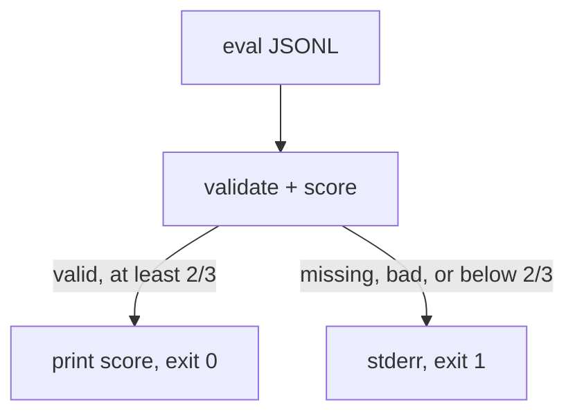

---
{
  "id": "git-shell-linux-reproducible-ai",
  "title": "Git, Shell, Linux for AI",
  "slug": "git-shell-linux-reproducible-ai",
  "section": "Computing Foundations",
  "category": "MLOps & Deployment",
  "difficulty": "Easy",
  "order": 1,
  "coverImage": "illustrations/_generated/chapter_flow_dark.png",
  "companies": [
    "OpenAI",
    "Anthropic",
    "Google",
    "Meta",
    "xAI"
  ],
  "shortDescription": "Make a teammate's clone reprint the 0.667 eval instead of crashing on a file that stayed on your laptop.",
  "keyConceptsTested": [
    "git init/clone/commit with optional LFS",
    ".gitignore for models, .env, vector DBs, caches",
    "pre-commit hooks and eval checks",
    "shell functions and one-liners for nvidia-smi, du, find",
    "Linux permissions, processes, tmux, nohup",
    "reproducible project layout and activation scripts",
    "environment hygiene and .env.example templates",
    "failure diagnosis across machines"
  ],
  "relatedQuestions": [
    "docker-containerization-reproducible-ai",
    "python-for-ai-engineering",
    "numpy-and-tensor-shapes"
  ]
}
---

Your laptop runs an evaluation script over three saved model predictions and prints `0.667`: two answers matched. A teammate clones your repository, runs the same command, and hits `FileNotFoundError`. The Python code traveled through Git, while the dataset stayed untracked on your hard drive.

In this lesson, you will build a minimal repo called `prompt-eval` and test it from a <span data-glossary="reproducible-environment">fresh clone</span>. Git tracks the code, starter eval set, and setup scripts; shell commands keep daily debugging fast on local machines and remote Linux GPU boxes alike.

## Meet the terminal, shell, and repository

Your **terminal** runs a <span data-glossary="shell">shell</span> (Bash or Zsh on macOS, Linux, or Windows WSL) that parses commands and reports an **exit status** (`0` for success, nonzero for failure). Initialize the repo with Git and Python 3.12+:

```bash title="terminal"
pwd
mkdir prompt-eval
cd prompt-eval || exit 1
git init -b main
git config user.name "Your Name"
git config user.email "you@example.com"
git status
```

`cd prompt-eval || exit 1` stops immediately if creating or entering the directory fails, rather than initializing Git in the parent folder.

<span data-glossary="git">Git</span> separates three states: your **working tree** (files on disk), the **staging area / index** (`git add`), and **commit history** (`git commit`).[^progit] A file sitting in your working tree never reaches a teammate's clone until you stage and commit it.

## Ignore the files that shouldn't travel

Before adding any code, create `.gitignore` to keep <span data-glossary="secrets-management">secrets</span>, virtual environments, caches, and generated model artifacts out of commits:

```gitignore title=".gitignore"
# Python
__pycache__/
*.py[cod]
*$py.class
.venv/
venv/
.uv-cache/

# Environment & secrets (do not commit these)
.env*
!.env.example
*.pem
*.key
secrets/

# Generated model and vector artifacts that do not travel with the repo
checkpoints/
models/local/
*.pt
*.pth
chroma/
faiss_index/
*.db
*.sqlite3

# OS and editor noise
.DS_Store
.idea/
.vscode/
*.swp

# Evaluation caches that should be regenerated
eval_cache/
runs/
wandb/
mlruns/

# Do not ignore *.gguf, *.safetensors, or *.bin here.
# .gitattributes routes those extensions through Git LFS when configured.
```

> **Common mistake:** `.gitignore` only filters untracked files. If `.env` was committed earlier, untrack it with `git rm --cached .env` and rotate the exposed credential immediately, because deleting it in a later commit leaves it readable in earlier history.[^gitignore2026]

<details>
<summary>Deep dive: When to use Git LFS for model weights</summary>

GitHub warns above 50 MiB and blocks regular Git blobs above 100 MiB.[^github_large] <span data-glossary="git-lfs">Git LFS</span> stores small pointer files in Git while hosting large binary blobs separately (keep LFS patterns *out* of `.gitignore`, or `git add` skips them). On a clone without LFS or with `GIT_LFS_SKIP_SMUDGE=1`, run `git lfs pull` to materialize pointer files.[^gitlfs2026pull] Production datasets and rapidly changing checkpoints belong in object storage with a versioned manifest in Git rather than burning LFS <span data-glossary="quota">quotas</span>.

```bash title="terminal-2"
cat > .gitattributes << 'EOF'
# This file is populated by `git lfs track` when LFS is available.
EOF

if command -v git-lfs >/dev/null 2>&1; then
  git lfs install --local
  git lfs track "*.gguf" "*.safetensors" "models/*.bin"
  git lfs track
else
  echo "Git LFS isn't installed. Safe for now: don't commit model weights yet."
fi

git add .gitignore .gitattributes
git diff --cached
git commit -m "chore: initial AI project skeleton with safe .gitignore and LFS"
```

</details>

## Commit the three-row eval set

Create `eval/eval_cases.jsonl` with three prompt-classification examples:

```bash title="terminal-4"
mkdir -p eval
cat > eval/eval_cases.jsonl << 'EOF'
{"prompt": "Classify intent: Summarize the quarterly benchmark report.", "expected": "summarize", "prediction": "summarize"}
{"prompt": "Classify intent: Compare latency across two batch sizes.", "expected": "compare", "prediction": "explain"}
{"prompt": "Classify intent: Translate this docstring into Spanish.", "expected": "translate", "prediction": "translate"}
EOF
```

Row 2 intentionally misses (`compare` vs `explain`), giving an exact-match accuracy of $2/3$ (`0.667`). The downloadable [eval file](assets/eval_cases.jsonl) mirrors these three rows so the runnable scorer below works directly.

## A scorer that fails out loud

A reliable evaluation script reads <span data-glossary="jsonl">JSONL</span> (one JSON object per line), validates the required text fields, checks whether at least two-thirds match, and communicates its verdict through its exit status: `0` on pass, `1` (with diagnostics on `stderr`) on missing files, bad JSON, or a score regression.



Save the script as `scripts/score_eval.py`:

<!-- leetllm: test, output=show -->
```python title="scripts/score_eval.py"
import json
import sys
from pathlib import Path

REQUIRED = ("prompt", "expected", "prediction")
EVAL_FILE = Path("eval/eval_cases.jsonl")
ASSET_FILE = Path("assets/eval_cases.jsonl")

path = EVAL_FILE if EVAL_FILE.exists() else ASSET_FILE
if not path.exists():
    print(f"ERROR: {path} missing; commit the eval file", file=sys.stderr)
    raise SystemExit(1)

rows = []
for line_number, line in enumerate(path.read_text(encoding="utf-8").splitlines(), start=1):
    if not line.strip():
        continue
    try:
        row = json.loads(line)
        values = [row[field].strip() for field in REQUIRED]
    except (json.JSONDecodeError, KeyError, TypeError, AttributeError) as error:
        print(f"ERROR: line {line_number} invalid eval row: {error}", file=sys.stderr)
        raise SystemExit(1)
    if not all(values):
        print(f"ERROR: line {line_number} requires nonempty text fields", file=sys.stderr)
        raise SystemExit(1)
    rows.append(row)

if not rows:
    print("ERROR: eval file is empty", file=sys.stderr)
    raise SystemExit(1)

correct = sum(
    row["expected"].strip().lower() == row["prediction"].strip().lower()
    for row in rows
)
total = len(rows)
print(f"Eval rows: {total}")
print(f"Exact-match accuracy on eval set: {correct / total:.3f} ({correct}/{total})")
if correct * 3 < total * 2:
    print("Eval failed: score regressed below 2/3", file=sys.stderr)
    raise SystemExit(1)
print("Eval passed. You may commit.")
```

<!-- leetllm: output:start -->
```text title="Output" output compact
Eval rows: 3
Exact-match accuracy on eval set: 0.667 (2/3)
Eval passed. You may commit.
```
<!-- leetllm: output:end -->

> **Key insight:** Cross-multiplying integer counts (`correct * 3 < total * 2`) tests the exact two-thirds threshold without floating-point rounding traps against `0.667`.

```checkpoint
Why does the scorer compare integer counts instead of testing whether a floating-point score equals `0.667`?
---
`2 / 3` isn't exactly `0.667`. Binary floating-point arithmetic can introduce subtle rounding errors, whereas cross-multiplying integer counts (`correct * 3 >= total * 2`) tests the exact two-thirds threshold without float precision traps.
```

## The pre-commit gate that protects the score

Wrap the scorer in two tracked entrypoints: `scripts/run_eval.sh` (which verifies the dataset and Python interpreter) and a root `repro.sh` that teammates and CI can call directly:

```bash title="terminal-5"
mkdir -p scripts
cat > scripts/run_eval.sh << 'EOF'
#!/usr/bin/env bash
set -euo pipefail

EVAL_FILE="eval/eval_cases.jsonl"
if [[ ! -f "$EVAL_FILE" ]]; then
  echo "ERROR: $EVAL_FILE missing. Did you forget to commit the eval file or pull the latest repo?" >&2
  exit 1
fi

PYTHON_BIN="${PYTHON_BIN:-python3}"
if ! command -v "$PYTHON_BIN" >/dev/null 2>&1; then
  echo "ERROR: Python 3 is required by the provided scorer. Install it or set PYTHON_BIN." >&2
  exit 1
fi

"$PYTHON_BIN" scripts/score_eval.py
EOF

cat > repro.sh << 'EOF'
#!/usr/bin/env bash
set -euo pipefail
./scripts/run_eval.sh
EOF
chmod +x scripts/run_eval.sh repro.sh
```

Now wire `run_eval.sh` into a Git <span data-glossary="pre-commit-hook">pre-commit hook</span>. Because `.git/hooks/` stays strictly local to each clone, commit the hook template and an installer script that refuses to clobber an existing hook or custom `core.hooksPath`:[^git2026hooks]

```bash title="terminal-7"
cat > scripts/pre-commit-ai-eval.sh << 'EOF'
#!/usr/bin/env bash
set -euo pipefail
echo "Running AI eval check before commit..."
./scripts/run_eval.sh
EOF

cat > scripts/install_hooks.sh << 'EOF'
#!/usr/bin/env bash
set -euo pipefail

repo_root="$(git rev-parse --show-toplevel 2>/dev/null)" || {
  echo "ERROR: run this command inside a Git working tree" >&2
  exit 1
}
cd "$repo_root"

if configured_hooks_path="$(git config --get core.hooksPath)"; then
  echo "ERROR: core.hooksPath is already set to $configured_hooks_path; add the eval check there deliberately" >&2
  exit 1
fi

hooks_dir="$(git rev-parse --git-path hooks)"
[[ "$hooks_dir" == /* ]] || hooks_dir="$repo_root/$hooks_dir"
hook_path="$hooks_dir/pre-commit"

mkdir -p "$hooks_dir"
if [[ -e "$hook_path" ]] && ! cmp -s scripts/pre-commit-ai-eval.sh "$hook_path"; then
  echo "ERROR: $hook_path already exists; merge the eval command into it instead of overwriting it" >&2
  exit 1
fi

cp scripts/pre-commit-ai-eval.sh "$hook_path"
chmod +x "$hook_path"
echo "Installed $hook_path"
EOF

chmod +x scripts/pre-commit-ai-eval.sh scripts/install_hooks.sh
./scripts/install_hooks.sh
./repro.sh
git add scripts/pre-commit-ai-eval.sh scripts/score_eval.py scripts/run_eval.sh scripts/install_hooks.sh repro.sh eval/eval_cases.jsonl
git commit -m "feat: add three-row eval and pre-commit check that protects 0.667"
```

Keep two hook quirks in mind: a working-tree hook inspects files on disk rather than only what you ran `git add` on (so unstaged edits can hide a broken staged version), and `--no-verify` bypasses local hooks. Run `./repro.sh` in <span data-glossary="continuous-integration">continuous integration (CI)</span> to verify the committed snapshot itself.

## Trace a regression through Git history

When `./repro.sh` suddenly exits `1`, inspect your status and recent commits before editing anything:

```bash title="terminal-history"
./repro.sh; printf 'repro exit status: %s\n' "$?"
git status --short
git log --oneline --decorate -5
git show --stat --oneline HEAD
```

When a regression slipped in dozens of commits ago, binary-search commit history with `git bisect` instead of reading every diff:[^progit]

```bash title="terminal-bisect"
git bisect start
git bisect bad HEAD
git bisect good "<known-good-commit>"

# At each checked-out commit, run ./repro.sh, then classify:
#   git bisect good   (if ./repro.sh exited 0)
#   git bisect bad    (if it reproduced the regression)
#   git bisect skip   (if an unrelated environment issue blocked testing)

git show refs/bisect/bad   # inspect the first bad commit
git bisect reset           # return to your original branch
```

## Personal shortcuts vs repo commands

Shell helpers in `~/.zshrc` or `~/.bashrc` speed up daily work on Linux GPU servers, while `./repro.sh` stays the tracked command in README and CI.[^nvsmi]

```bash title="terminal-9"
# GPU snapshot (NVIDIA hosts)
gpu() {
  if command -v nvidia-smi >/dev/null 2>&1; then
    nvidia-smi --query-gpu=index,name,memory.used,memory.total,utilization.gpu --format=csv,noheader
  else
    echo "No NVIDIA GPU or nvidia-smi not in PATH"
  fi
}

# Dataset size and JSONL newline count
ds() {
  local target="${1:-.}"
  [[ "$target" == /* ]] || target="./$target"
  du -sh -- "$target" || return
  local counts
  counts=$(find "$target" -type f -name '*.jsonl' -exec sh -c '
    for file do wc -l < "$file" || exit; done
  ' sh {} +) || return
  awk '{ rows += $1 } END { print "JSONL newline count:", rows + 0 }' <<< "$counts"
}

repro() {
  [[ -x ./repro.sh ]] && ./repro.sh || { echo "No executable ./repro.sh" >&2; return 1; }
}
```

<details>
<summary>Deep dive: Why <code>ds()</code> separates <code>local counts</code> and feeds <code>wc -l</code> through stdin</summary>

Passing filenames via `find ... -exec ... sh {} +` handles spaces and newlines in paths safely, and reading `< "$file"` makes `wc -l` emit only a bare number.[^gnuFindutils2026] Declaring `local counts` on its own line matters because combining `local counts=$(...)` replaces the command substitution's nonzero exit code with `local`'s `0` status, hiding unreadable directories.[^bashBuiltins2026]

</details>

## Inspect data, then reclaim a GPU

Never `cat` a multi-gigabyte JSONL shard over SSH. Peek at one row and count lines or matches with pipes:

```bash title="terminal-inspect"
head -n 1 eval/eval_cases.jsonl
wc -l eval/eval_cases.jsonl
grep -c '"expected"' eval/eval_cases.jsonl
```

Remember that `wc -l` counts newline characters (`\n`), not JSON objects: a file without a trailing newline reports one fewer line than objects.

<details>
<summary>Deep dive: Bash <code>pipefail</code> and <code>grep</code> exit codes</summary>

By default, a pipeline returns only its *last* command's status, so `grep missing.jsonl | wc -l` exits `0`. Enabling `set -o pipefail` returns the rightmost nonzero stage status instead (after waiting for the pipeline to finish).[^bashPipelines2026] Also remember that `grep` exits `1` for "no match" and `2` for real errors like a missing file, and `set -e` does not abort inside `if` conditions:[^bashSetBuiltin2026]

```bash title="terminal-grep-status"
if grep -q '"translate"' eval/eval_cases.jsonl; then
  echo "At least one translate label appears"
else
  search_status=$?
  [[ "$search_status" -eq 1 ]] && echo "No translate label appears" || echo "ERROR: search failed ($search_status)" >&2
fi
```

</details>

When permissions fail, check the exact read or execute bit (`ls -l`, `test -r`, `test -x`) and use `chmod +x` on scripts instead of `chmod 777`.

If a hung <span data-glossary="pytorch">PyTorch</span> job leaves <span data-glossary="gpu">GPU</span> VRAM pinned, inspect the PID in `nvidia-smi`, verify you own that exact process, send `SIGTERM` (signal 15) so it can flush <span data-glossary="model-checkpoint">checkpoints</span> and release CUDA memory, and re-verify the command in `ps` before ever sending `SIGKILL` (signal 9) so you never kill a reused PID:[^nvsmi][^signal]

```bash title="terminal-kill"
nvidia-smi  # find your PID in the Processes table
PID=12345   # replace with your own process ID

ps -o user=,pid=,ppid=,stat=,etime=,cmd= -p "$PID"
kill -TERM "$PID"
for _ in {1..10}; do
  kill -0 "$PID" 2>/dev/null || break
  sleep 1
done

if kill -0 "$PID" 2>/dev/null; then
  ps -o user=,pid=,ppid=,stat=,etime=,cmd= -p "$PID"
  echo "Still alive. Confirm owner and command before: kill -KILL $PID"
fi
```

```checkpoint
You find a live training PID holding GPU memory. Which signal should you send first, and when should you switch to `SIGKILL`?
---
After checking ownership and permission to stop the job, send SIGTERM first. A program with a shutdown handler can then flush files. Wait for a short grace period and recheck the process identity before considering SIGKILL; a live PID alone isn't enough.
```

## Keep a long job alive across SSH

Choose session management based on whether you need to reattach interactively:

- **`tmux new -s training`**: keeps a detachable interactive terminal (`Ctrl-b d` to detach, `tmux attach -t training` to return).[^tmux2026]
- **`nohup python train.py > train.log 2>&1 </dev/null &`**: ignores hangup for noninteractive background runs whose output goes to a log file.
- **`nice -n 10 python train.py`**: lowers CPU scheduling priority (does not cap GPU VRAM or survive SSH logout).[^gnucoreutils2026]
- **Quick triage**: `du -ah /workspace | sort -rh | head -20` locates disk hogs; `pgrep -af 'python.*train.py'` finds matching training processes.

## Rebuild Python on every clone

Python <span data-glossary="virtual-environment">virtual environments</span> embed absolute interpreter paths, so never commit `.venv/`.[^python2026venv] Instead, commit `.python-version`, `requirements.txt` (or `pyproject.toml` + `uv.lock` for `uv sync --locked`[^uv2026sync][^pip2026secureinstalls]), `.env.example` (key names only, never real secrets), and an `activate.sh` script that rebuilds `.venv` and prints the active Python and <span data-glossary="cuda">CUDA</span> state:

```bash title="terminal-10"
cat > .python-version << 'EOF'
3.12
EOF

cat > requirements.txt << 'EOF'
# Empty because this chapter's scorer uses only Python's standard library.
# When packages arrive, use a committed lockfile or fully hashed requirements.
EOF

cat > .env.example << 'EOF'
# Copy to .env and fill locally. Never commit the real value.
EVAL_API_KEY=
EOF

cat > activate.sh << 'EOF'
#!/usr/bin/env bash

_activate_fail() { echo "ERROR: $1" >&2; }

_activate_main() {
  PYTHON_BIN="${PYTHON_BIN:-python3}"
  command -v "$PYTHON_BIN" >/dev/null 2>&1 || { _activate_fail "install python3 or set PYTHON_BIN"; return 1; }

  "$PYTHON_BIN" -c 'import sys; raise SystemExit(0 if sys.version_info >= (3, 12) else 1)' || {
    _activate_fail "Python 3.12+ is required"
    return 1
  }

  [[ -d .venv ]] || "$PYTHON_BIN" -m venv .venv || { _activate_fail "could not create .venv"; return 1; }
  source .venv/bin/activate || { _activate_fail "could not activate .venv"; return 1; }
  python -c 'import sys; raise SystemExit(0 if sys.version_info >= (3, 12) else 1)' || {
    _activate_fail "existing .venv uses an older Python; recreate it"
    return 1
  }
  export PYTHON_BIN="$VIRTUAL_ENV/bin/python"

  if grep -Ev '^[[:space:]]*(#|$)' requirements.txt >/dev/null 2>&1; then
    python -m pip install --require-hashes -r requirements.txt || {
      _activate_fail "requirements must pin and hash every package"
      return 1
    }
  fi

  python - << 'PY'
import os, sys
print("Python executable:", sys.executable)
print("Python:", sys.version.split()[0])
vis = os.environ.get("CUDA_VISIBLE_DEVICES")
print("CUDA_VISIBLE_DEVICES:", vis if vis is not None else "<unset; no mask applied>")
try:
    import torch
except ModuleNotFoundError:
    print("PyTorch: not installed yet (OK for this chapter)")
else:
    print("PyTorch:", torch.__version__, "| CUDA available:", torch.cuda.is_available())
    if torch.cuda.is_available():
        print("GPU:", torch.cuda.get_device_name(0))
PY
  echo "Environment ready. Run './repro.sh' to execute the eval check."
}

if _activate_main; then _activate_status=0; else _activate_status=$?; fi
unset -f _activate_main _activate_fail
[[ $_activate_status -ne 0 ]] && { return "$_activate_status" 2>/dev/null || exit "$_activate_status"; }
unset _activate_status
EOF
chmod +x activate.sh
```

Run `source activate.sh && ./repro.sh` so the eval runs only when environment setup returns `0`. (Avoid `source .env`, which executes arbitrary lines as shell code.) Record the setup order in `README.md` and commit:

```bash title="terminal-readme"
cat > README.md << 'EOF'
## Quick start

git clone git@github.com:your-org/prompt-eval.git
cd prompt-eval
./scripts/install_hooks.sh
if command -v git-lfs >/dev/null 2>&1; then
  git lfs install --local
  git lfs pull
fi
source activate.sh && ./repro.sh
EOF

git add .python-version requirements.txt .env.example activate.sh README.md
git commit -m "chore: add reproducible environment setup"
```

## When the clone still fails

| Symptom | Likely cause | Fix that belongs in the repo |
|---|---|---|
| `CUDA not found` on GPU host | Missing driver/runtime, mismatched CUDA wheel, or empty `CUDA_VISIBLE_DEVICES` (unset exposes all GPUs; empty string hides all GPUs[^cudaEnvironment2026]) | Compare `nvidia-smi`, `CUDA_VISIBLE_DEVICES`, and `torch.cuda.is_available()`; document required image and runtime |
| `ModuleNotFoundError` on clone | Unpinned transitive package or stale env | Commit complete `uv.lock` or hashed requirements and rebuild `.venv` |
| Eval file missing | `eval_cases.jsonl` stayed untracked | Commit `eval/eval_cases.jsonl` and verify in a fresh clone |
| Pre-commit hook doesn't fire | `.git/hooks/` is clone-local | Track `scripts/install_hooks.sh` and run it after cloning |
| Pull leaves LFS pointer text | Git LFS missing or smudge skipped | Run `git lfs install && git lfs pull`; verify LFS blobs in CI |

## Prove it with a throwaway clone

Test your repository the way a teammate experiences it: clone into a fresh temporary directory (`--no-local` uses standard Git transport without hardlinks[^git2026clone]), rebuild `.venv`, install the hook, and run `./repro.sh` inside a subshell:

<figure>
  
  <figcaption>Committed code, eval data, and setup scripts arrive in the fresh clone and rebuild <code>.venv</code> and the local hook from scratch, while original secrets and caches stay behind.</figcaption>
</figure>

```bash title="terminal-clean-clone"
repo_root="$(pwd)"
clone_root="$(mktemp -d)"

(
  set -e
  git clone --no-local "$repo_root" "$clone_root/prompt-eval"
  cd "$clone_root/prompt-eval" || exit 1
  ./scripts/install_hooks.sh
  source activate.sh || exit 1
  ./repro.sh
  git status --short
)
printf 'Clone check exit status: %s\n' "$?"
echo "Temporary clone kept for inspection: $clone_root/prompt-eval"
```

Expect `0.667 (2/3)`, empty `git status --short`, and exit status `0`. This confirms no untracked laptop files are hiding behind your score; the next lesson packages the OS and Python runtime itself with Docker.

```checkpoint
Why is a clean temporary clone stronger evidence than rerunning `repro` in your working directory?
---
The clone doesn't contain your untracked files or installed hook copies, and the test invokes tracked scripts rather than a personal alias. A passing run shows that those files and setup commands traveled through Git, though a same-machine clone still shares your host OS and drivers.
```

```mastery-quiz
[
  {
    "question": "A config file is staged with threshold 0.8, then edited to 0.6 without another git add. A working-tree hook checks a score of 0.7 and passes. What does a plain commit record, and how does that score compare with the recorded threshold in a clean clone?",
    "options": [
      "Threshold 0.6; the score passes.",
      "Threshold 0.8; the score fails.",
      "Threshold 0.8; the score passes.",
      "Threshold 0.6; the score fails."
    ],
    "answer": "Threshold 0.8; the score fails.",
    "explanation": "The commit records the index, which still contains 0.8. The passing hook read the later 0.6 working version. A score of 0.7 is below the committed threshold, so the clean-clone check fails. A hook success does not stage its inputs."
  },
  {
    "question": "A credential placeholder was already tracked before .env was added to .gitignore. A required model file is untracked and matches both an ignore pattern and an LFS tracking pattern. Which preparation correctly handles both current-index membership and ordinary model addition?",
    "options": [
      "Leave .env indexed; remove the model ignore pattern and use the LFS tracking attributes.",
      "Untrack .env with git rm --cached; leave the model ignore pattern and rely on ordinary git add.",
      "Untrack .env with git rm --cached; remove the model ignore pattern and use the LFS tracking attributes.",
      "Leave .env indexed; leave the model ignore pattern and rely on ordinary git add."
    ],
    "answer": "Untrack .env with git rm --cached; remove the model ignore pattern and use the LFS tracking attributes.",
    "explanation": "An ignore pattern does not remove an already tracked file. git rm --cached removes current tracking while leaving the working file; old committed credentials would still require exposure response and rotation. An ignored untracked model is omitted by ordinary add even when an LFS attribute matches it. Keep required LFS paths trackable and verify the separate objects."
  },
  {
    "question": "A UTF-8 eval file contains four single-line JSON objects that the scorer accepts. One line feed (LF) byte separates adjacent objects, and the file ends at the last object's closing brace. The first two predictions match exactly. The third predicts ' READY ' for 'ready'. The fourth predicts 'open' for 'closed'. The scorer trims and lowercases labels and requires at least two thirds to match. In order, what are the wc -l count, parsed object count, match count, and threshold decision?",
    "options": [
      "4; 4; 3; pass.",
      "3; 3; 3; pass.",
      "3; 4; 2; fail.",
      "3; 4; 3; pass."
    ],
    "answer": "3; 4; 3; pass.",
    "explanation": "The four objects have three gaps between them. Each gap contains one LF byte, so wc -l reports three. A count of four would require a final LF. Python reads the fourth object through the end of the file, so dropping it would give the wrong total of three. Counting only exact matches would miss the third prediction, which becomes 'ready' after normalization. Three of four match, and 3 × 3 = 9 exceeds 2 × 4 = 8, so the check passes."
  },
  {
    "question": "A foreground Bash pipeline finishes with left-to-right stage statuses 3, 0, 5, 0. In the order default pipeline status, status with pipefail, which pair is correct?",
    "options": [
      "0; 5.",
      "0; 3.",
      "5; 5.",
      "3; 0."
    ],
    "answer": "0; 5.",
    "explanation": "The default status comes from the last stage, which succeeded. With pipefail, the rightmost nonzero stage returns 5. The first failed stage would give 3, which is not the pipefail selection rule. Bash still waits for the foreground pipeline to complete."
  },
  {
    "question": "A Linux helper must count newline characters across JSONL files whose names can contain spaces or newlines. If a selected input cannot be read, it must return failure before printing a total. Which implementation ensures that behavior?",
    "options": [
      "Split find output into whitespace-separated names, then sum wc results after suppressing read errors.",
      "Pass names as find -exec arguments, capture successful stdin-based wc counts, and return on command failure.",
      "Pass names as find -exec arguments, declare local counts=$(...) and use the declaration status as the read verdict.",
      "Parse find output one printed line at a time, then print zero when no numeric count reaches the sum."
    ],
    "answer": "Pass names as find -exec arguments, capture successful stdin-based wc counts, and return on command failure.",
    "explanation": "Argument passing preserves each path identity, while wc reading stdin emits a numeric count without a filename. Separate declaration from the assignment and propagate its failure before summing. Whitespace or line-based parsing corrupts legitimate names; local can mask a failed substitution, and zero cannot stand for an unreadable input."
  },
  {
    "question": "You sent TERM to an evaluation process you own. After the grace period, its PID exists, but its recorded start time and command now name a different job. Which response fits that observation?",
    "options": [
      "Signal the replacement with KILL because the PID passed its existence check.",
      "Repeat TERM for the replacement because it has the same numeric PID.",
      "Keep the original completion log and inspect the replacement process separately before sending any signal.",
      "Treat the new command as the original cleanup handler and signal it without another ownership check."
    ],
    "answer": "Keep the original completion log and inspect the replacement process separately before sending any signal.",
    "explanation": "A reused PID does not preserve process identity. kill -0 reports existence and signaling permission, so it cannot justify stopping a replacement job. Inspect its owner, start time, and command before sending any signal. TERM and observed completion are distinct events."
  },
  {
    "question": "A remote training task needs an interactive terminal after reconnection. It should also receive less CPU scheduling priority. Which pairing addresses those two requirements?",
    "options": [
      "nohup for a reattachable terminal; nice for CPU scheduling priority.",
      "tmux for a reattachable terminal; nice for CPU scheduling priority.",
      "tmux for a reattachable terminal; nice for a GPU-memory limit.",
      "nohup for a reattachable terminal; nice for a GPU-memory limit."
    ],
    "answer": "tmux for a reattachable terminal; nice for CPU scheduling priority.",
    "explanation": "tmux retains a terminal session that can be detached and reattached. nice changes CPU scheduling priority and sets no GPU-memory cap. nohup supports a noninteractive hangup-resistant process but does not create a reattachable terminal. Host reboot, OOM and scheduler termination still need separate handling."
  },
  {
    "question": "A clone pins a package that accepts either of two versions of a helper library. The helper has no pin. In a Bash script with errexit off (set +e), source activate.sh returns 1 because installation failed. Which repair lets a teammate rebuild the same package versions and run the evaluation only after setup succeeds?",
    "options": [
      "Record direct and transitive dependencies with a complete lock or pinned hashes; run evaluation through source activate.sh && ./repro.sh after repair.",
      "Record only direct versions with hashes; run evaluation through source activate.sh && ./repro.sh after repair.",
      "Record direct and transitive dependencies with a complete lock or pinned hashes; run evaluation through source activate.sh; ./repro.sh after repair.",
      "Record only direct versions with hashes; run evaluation through source activate.sh; ./repro.sh after repair."
    ],
    "answer": "Record direct and transitive dependencies with a complete lock or pinned hashes; run evaluation through source activate.sh && ./repro.sh after repair.",
    "explanation": "A complete lock records the helper version too. With hashed requirements, pin every direct and transitive version and include hashes for the accepted artifacts. Hashing only the direct package leaves the helper version open. Bash runs the command after && only if setup returns 0. A semicolon sequences the commands if the calling shell continues. With errexit off here, the evaluation starts after setup returns 1. With errexit on, that same unhandled failure in the semicolon example ends the script before the evaluation starts."
  },
  {
    "question": "A host machine has physical GPUs 0, 1, 2 and 3, all exposed by its runtime. An application starts with CUDA_VISIBLE_DEVICES=3,1. In the order physical device behind application index 0, behind application index 1, visible-device count after replacing the mask with an empty string in a fresh application, which tuple is correct?",
    "options": [
      "0; 1; 4.",
      "3; 1; 4.",
      "0; 1; 0.",
      "3; 1; 0."
    ],
    "answer": "3; 1; 0.",
    "explanation": "The list selects physical device 3 before physical device 1, so application indices are renumbered in that order. An empty mask exposes zero devices to a fresh CUDA application. Unsetting a mask is different from setting it empty; neither action provides a missing driver or container device."
  },
  {
    "question": "A new valid eval file has eleven examples and eight normalized matches. Two wrong predictions are added and the resulting file is committed. A same-host clean clone runs the declared setup and scorer on that commit. Which check result and scope follow?",
    "options": [
      "Pass, because the earlier eleven-row file passed; this check verifies host OS and driver parity.",
      "Fail, because 24 is below 26; this check verifies the committed file and setup behavior on the tested host.",
      "Fail, because 24 is below 26; this check verifies host OS and driver parity.",
      "Pass, because the earlier eleven-row file passed; this check verifies the committed file and setup behavior on the tested host."
    ],
    "answer": "Fail, because 24 is below 26; this check verifies the committed file and setup behavior on the tested host.",
    "explanation": "The final eval file has eight matches in thirteen rows. Cross multiplication gives 8 × 3 = 24 and 13 × 2 = 26, so it fails. The earlier passing input does not override the changed eval file. A local clean clone removes hidden project-file dependencies while still sharing host tools, environment, OS and driver."
  }
]
```

> **Next:** Continue to [Docker for Reproducible AI](/learn/docker-containerization-reproducible-ai). Git now carries the eval cases, setup scripts, pinned packages, and pre-commit check so any clean clone rebuilds `.venv` and reprints `0.667`. What stays outside Git is the machine beneath `.venv`: the operating system, system libraries, runtime user, and filesystem layout. Docker packages those remaining layers into a container image so the same Python check runs identically on another laptop or in CI.
