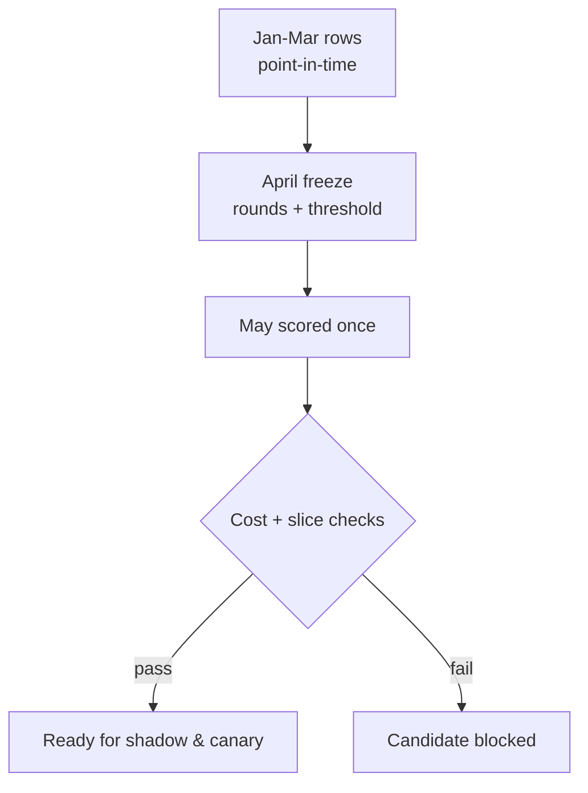

---
{
  "id": "gradient-boosted-trees-production",
  "title": "Gradient Boosted Trees in Production",
  "slug": "gradient-boosted-trees-production",
  "section": "Production ML Systems",
  "category": "Fine-Tuning & Training",
  "difficulty": "Medium",
  "order": 3,
  "coverImage": "illustrations/_generated/chapter_flow_dark.png",
  "companies": [
    "Amazon",
    "Uber",
    "DoorDash",
    "Shopify"
  ],
  "shortDescription": "Build, tune, threshold, and evaluate a gradient-boosted tree model end to end against strong baselines and slice checks.",
  "keyConceptsTested": [
    "gradient boosting",
    "tabular baseline",
    "residual correction",
    "early stopping",
    "slice evaluation",
    "model artifact"
  ]
}
---

Before training a complex ensemble, ask a blunt question: can a learned model actually beat a one-line heuristic once you account for real error costs?

Suppose a cluster scheduler must decide which running training jobs are likely to miss their completion deadline. At dispatch time it observes five signals: input size, heartbeat age, queue backlog, priority tier, and whether the job runs a large model. The true outcome arrives hours later. On tabular problems like this, <span data-glossary="gradient-boosting">gradient-boosted decision trees</span> remain a remarkably strong workhorse.[^grinsztajn2022] Even as tabular foundation models such as TabPFN become competitive on small datasets, boosted trees dominate medium-to-large production tables because they handle nonlinear interactions, skewed scales, and fast inference cleanly.[^hollmann2025tabpfn]

In this lesson we build a boosted classifier from scratch in intuition, verify the second-order math behind XGBoost, LightGBM, and CatBoost, select an early-stopping round and cost-optimal threshold on chronological validation data, and test whether the frozen model truly justifies itself on unseen future traffic.

## Freeze the clock before training

Let `missed_deadline = 1` mean a training job blew past its completion window. Before fitting a single tree, freeze a <span data-glossary="train-validation-test-split">time-ordered split</span> so every hyperparameter and threshold is chosen strictly from the past:

| Split | Calendar range | Role |
| --- | --- | --- |
| Train | January through March | Fit tree splits and leaf weights |
| Validation | April | Choose stopping round and decision threshold |
| Test | May | Evaluate the frozen candidate once on future jobs |

Randomly shuffling time-ordered jobs leaks correlated cluster disruptions across train and test, making offline metrics look rosier than future deployment. Every feature must also exist at scoring time to avoid <span data-glossary="feature-leakage">feature leakage</span>, and labels must be matured by the split boundary (a March job still running on April 1 cannot feed its final outcome into an April 1 training run).[^sklearn2026leakage]



Let's generate a seeded synthetic dataset across these three calendar periods. May adds `+0.18` to the log-odds to mimic mild operational drift:

<!-- leetllm: test, output=show, deps=numpy,scikit-learn, id=boosting-production-lab -->
```python title="build-monthly-fixture.py"
import json
from hashlib import sha256

import numpy as np
from sklearn.ensemble import GradientBoostingClassifier, HistGradientBoostingClassifier
from sklearn.metrics import log_loss, roc_auc_score

rng = np.random.default_rng(11)
FEATURES = ["input_gb", "heartbeat_age_hours", "backlog", "priority", "large_model"]

def sigmoid(z):
    return 1.0 / (1.0 + np.exp(-z))

def make_jobs(month, count, drift=0.0):
    input_gb = rng.integers(40, 1601, count)
    heartbeat_age = rng.integers(1, 41, count)
    backlog = rng.integers(0, 31, count)
    priority = rng.integers(0, 2, count)
    large_model = (input_gb >= 900).astype(int)
    logit = (
        -5.2
        + 0.13 * heartbeat_age
        + 0.07 * backlog
        + 0.85 * priority
        + 0.75 * large_model
        + drift
    )
    y = rng.binomial(1, sigmoid(logit))
    X = np.column_stack([input_gb, heartbeat_age, backlog, priority, large_model])
    return {"month": month, "X": X, "y": y}

train = make_jobs("Jan-Mar", 360)
valid = make_jobs("April", 140)
test = make_jobs("May", 140, drift=0.18)

for split in (train, valid, test):
    print(f"{split['month']:7s}: rows={len(split['y'])} misses={int(split['y'].sum())}")
```

<!-- leetllm: output:start -->
```text title="Output" output compact
Jan-Mar: rows=360 misses=119
April  : rows=140 misses=58
May    : rows=140 misses=55
```
<!-- leetllm: output:end -->

<figure>
  
  <figcaption>May adds <code>+0.18</code> to each job's logit, raising per-row miss risk. Finite-sample variation still gives 55 misses in May versus 58 in April.</figcaption>
</figure>

### Missing-value routing across tree implementations

Different tree libraries handle `NaN` differently, and knowing which behavior you have prevents runtime surprises. XGBoost learns a default left/right direction for missing values at every split during training.[^chen2016xgboost] Scikit-learn's `HistGradientBoostingClassifier` learns split routing too; if a feature had zero missing values during training, it deterministically routes a serving-time `NaN` to whichever child had more training samples.[^sklearnHistGradientBoosting2026] Classic `GradientBoostingClassifier`, by contrast, rejects `NaN` outright:

<!-- leetllm: test, output=show, continue=boosting-production-lab, id=missing-support -->
```python title="check-estimator-missing-value-support.py"
small_X = np.array([[0.0], [1.0], [np.nan], [3.0]])
small_y = np.array([0, 0, 1, 1])

try:
    GradientBoostingClassifier(random_state=11).fit(small_X, small_y)
    classic_ok = True
except ValueError:
    classic_ok = False

hist_model = HistGradientBoostingClassifier(
    max_iter=2, min_samples_leaf=1, early_stopping=False, random_state=11
).fit(small_X, small_y)
hist_ok = bool(np.isfinite(hist_model.predict_proba([[np.nan]])).all())

print(f"classic accepts NaN: {classic_ok} | histogram accepts NaN: {hist_ok}")
```

<!-- leetllm: output:start -->
```text title="Output" output compact
classic accepts NaN: False | histogram accepts NaN: True
```
<!-- leetllm: output:end -->

## Publish the cheapest baseline

Never benchmark a boosted tree in a vacuum. Compare it against two trivial alternatives: a single-feature rule (`heartbeat_age_hours >= 18`) and the constant strategies (always alert, never alert).

To compare them fairly, quantify asymmetric error costs first:

- Missed priority job (false negative on priority tier): `150`
- Missed standard job (false negative on standard tier): `60`
- False alarm (false positive on an on-time job): `8`
- Correct alert or correct quiet run: `0`

If a job's true miss probability is $p(x) = P(y = 1 \mid x)$, alerting incurs expected cost $(1 - p(x)) C_{\text{FP}}$, while staying quiet incurs $p(x) C_{\text{FN}}$. Alerting is cheaper whenever:

$$
(1 - p(x)) C_{\text{FP}} \le p(x) C_{\text{FN}} \implies p(x) \ge \frac{C_{\text{FP}}}{C_{\text{FP}} + C_{\text{FN}}} = \tau^*
$$

Plugging in our costs gives two **Bayes-optimal thresholds**:

- Standard jobs: $\tau^*_{\text{standard}} = \frac{8}{8 + 60} \approx 0.118$
- Priority jobs: $\tau^*_{\text{priority}} = \frac{8}{8 + 150} \approx 0.051$

> **Key insight:** A default `0.50` probability threshold is optimal only when false positives and false negatives cost the same. When missing a failure costs 7.5x to 18.75x more than a false alarm, the optimal cutoff drops well below `0.15`.

Now evaluate our three non-ML baselines on April validation using this cost function:

<!-- leetllm: test, output=show, continue=missing-support, id=rule-baseline -->
```python title="score-rule-baseline.py"
def confusion(y, pred):
    return {
        "tp": int(np.sum((y == 1) & (pred == 1))),
        "fp": int(np.sum((y == 0) & (pred == 1))),
        "fn": int(np.sum((y == 1) & (pred == 0))),
        "tn": int(np.sum((y == 0) & (pred == 0))),
    }

def cost_stats(split, scores, threshold):
    pred = (scores >= threshold).astype(int)
    priority = split["X"][:, FEATURES.index("priority")] == 1
    missed = (split["y"] == 1) & (pred == 0)
    false_alarm = (split["y"] == 0) & (pred == 1)
    total_cost = int(
        150 * np.sum(missed & priority)
        + 60 * np.sum(missed & ~priority)
        + 8 * np.sum(false_alarm)
    )
    return {
        "threshold": threshold,
        "cost": total_cost,
        "priority_misses": int(np.sum(missed & priority)),
        **confusion(split["y"], pred),
    }

hb_idx = FEATURES.index("heartbeat_age_hours")
rule_valid = (valid["X"][:, hb_idx] >= 18).astype(float)
always_alert_valid = cost_stats(valid, np.ones(len(valid["y"])), 0.50)
never_alert_valid = cost_stats(valid, np.zeros(len(valid["y"])), 0.50)

print("heartbeat rule:", cost_stats(valid, rule_valid, 0.50))
print("always-alert cost:", always_alert_valid["cost"], "| never-alert cost:", never_alert_valid["cost"])
```

<!-- leetllm: output:start -->
```text title="Output" output compact
heartbeat rule: {'threshold': 0.5, 'cost': 1560, 'priority_misses': 8, 'tp': 48, 'fp': 30, 'fn': 10, 'tn': 52}
always-alert cost: 656 | never-alert cost: 6450
```
<!-- leetllm: output:end -->

Surprise! The `heartbeat >= 18` rule costs `1560`, while blindly alerting on every job costs only `656` (`82 * 8`). Any boosted model must beat `656` by suppressing false alarms *without* letting expensive deadline misses slip through.

```checkpoint
Why include an always-alert baseline alongside the heartbeat-age heuristic?
---
Under asymmetric costs, always alerting costs only 656 on April compared to 1560 for the heartbeat rule. Beating a weak heuristic alone would give a model an unearned win.
```

## Rebuild one boosting step by hand

How does **gradient boosting** actually learn? Start with a simple constant prediction, inspect its errors, fit a shallow tree to correct those errors, add a shrunken fraction of that tree to your running score, and repeat.[^friedman2001gbm]

In regression with squared error, the correction direction is literally the residual $y - \hat{y}$. Consider three jobs with actual delays `[2, 8, 20]` hours and an initial guess of `6` hours for all three, giving residuals `[-4, +2, +14]`. A one-split tree on `large_model` puts the first two jobs in one leaf (mean residual `-1`) and the third job in its own leaf (mean residual `+14`). Multiplying by a <span data-glossary="learning-rate">learning rate</span> $\nu = 0.25$ gives the stage-wise update:

$$
F_m(x) = F_{m-1}(x) + \nu \, h_m(x)
$$

<!-- leetllm: test, output=show, continue=rule-baseline, id=residual-correction -->
```python title="apply-one-residual-correction.py"
actual_delay = np.array([2.0, 8.0, 20.0])
pred = np.array([6.0, 6.0, 6.0])
large_model = np.array([0, 0, 1])

residual = actual_delay - pred
correction = np.where(large_model == 1, residual[large_model == 1].mean(), residual[large_model == 0].mean())
updated = pred + 0.25 * correction

print("residuals:  ", residual.tolist())
print("updated:    ", updated.tolist())
print(f"MSE before: {np.mean((actual_delay - pred)**2):.2f} -> after: {np.mean((actual_delay - updated)**2):.3f}")
```

<!-- leetllm: output:start -->
```text title="Output" output compact
residuals:   [-4.0, 2.0, 14.0]
updated:     [5.75, 5.75, 9.5]
MSE before: 72.00 -> after: 43.125
```
<!-- leetllm: output:end -->

Mean squared error drops from `72.0` to `43.125`. Notice that the second job (`actual = 8`) moved slightly worse (`6.0 -> 5.75`) because it shares a leaf with the first job; boosting reduces *average* loss per round and leaves finer corrections for later trees.

<figure>
  
  <figcaption>A single split on <code>large_model</code> groups two jobs into one leaf (mean residual -1) and isolates the third (+14). With learning rate 0.25, MSE drops from 72.0 to 43.125.</figcaption>
</figure>

### From residuals to second-order classification gradients

For binary classification, trees add up in **log-odds (logit)** space $F(x)$ rather than bounded probability space, converting to probabilities via $p = \sigma(F) = 1 / (1 + e^{-F})$. Under binary log loss, the first and second derivatives with respect to the raw logit $F$ are remarkably clean:

$$
g_i = \frac{\partial l}{\partial F_i} = p_i - y_i, \qquad h_i = \frac{\partial^2 l}{\partial F_i^2} = p_i (1 - p_i)
$$

The negative <span data-glossary="gradient">gradient</span> $-g_i = y_i - p_i$ still looks like a residual: positive labels push the logit up, negative labels push it down.[^sklearnGradientBoostingMechanics2026] Modern engines like XGBoost and LightGBM go one step further by minimizing a second-order Taylor approximation with leaf-count penalty $\gamma$ and L2 leaf-weight penalty $\lambda$:[^chen2016xgboost][^xgboostTreeObjective2026]

$$
\tilde{L}^{(t)} \approx \sum_{i=1}^n \left[ l(y_i, F_{t-1}(x_i)) + g_i f_t(x_i) + \frac{1}{2} h_i f_t^2(x_i) \right] + \gamma T + \frac{1}{2}\lambda \sum_{j=1}^T w_j^2
$$

Setting the derivative with respect to leaf weight $w_j$ to zero yields the closed-form Newton leaf weight and split gain:

$$
w_j^* = -\frac{\sum_{i \in I_j} g_i}{\sum_{i \in I_j} h_i + \lambda}
$$

$$
\text{Gain} = \frac{1}{2} \left[ \frac{\left(\sum_{i \in I_L} g_i\right)^2}{\sum_{i \in I_L} h_i + \lambda} + \frac{\left(\sum_{i \in I_R} g_i\right)^2}{\sum_{i \in I_R} h_i + \lambda} - \frac{\left(\sum_{i \in I} g_i\right)^2}{\sum_{i \in I} h_i + \lambda} \right] - \gamma
$$

Why does L2 regularization $\lambda$ matter so much in classification? Look at the denominator $\sum h_i + \lambda$. When a prediction is confident and *wrong* ($y = 1, p = 0.01$), the gradient is large ($g = -0.99$) while the curvature $h = p(1 - p) = 0.0099$ is tiny. Without $\lambda$, the Newton step explodes to `+100.0`! Adding $\lambda = 1$ tames that step to `0.98`:

<!-- leetllm: test, output=show, continue=residual-correction, id=newton-curvature -->
```python title="inspect-gradient-and-curvature-together.py"
for p in (0.99, 0.50, 0.01):
    g = p - 1.0
    h = p * (1.0 - p)
    print(f"p={p:.2f} | g={g:+.2f}, h={h:.4f} | w(lambda=0)={-g/h:6.2f} | w(lambda=1)={-g/(h+1.0):.2f}")
```

<!-- leetllm: output:start -->
```text title="Output" output compact
p=0.99 | g=-0.01, h=0.0099 | w(lambda=0)=  1.01 | w(lambda=1)=0.01
p=0.50 | g=-0.50, h=0.2500 | w(lambda=0)=  2.00 | w(lambda=1)=0.40
p=0.01 | g=-0.99, h=0.0099 | w(lambda=0)=100.00 | w(lambda=1)=0.98
```
<!-- leetllm: output:end -->

That single ratio explains why `reg_lambda`, `min_child_weight` (minimum $\sum h_i$ in a leaf), and `max_delta_step` are the primary stability knobs in XGBoost.[^xgboostParameters2026]

### Modern GBDT engine comparison

XGBoost, LightGBM, and CatBoost optimize the same gradient-boosted objective, differing mainly in how they bucket continuous features into histograms and grow tree structure:

<figure>
  
  <figcaption>Default tree growth differs across engines: level-by-level (depthwise), highest-gain leaf first (leafwise), or one shared predicate per level (oblivious/symmetric trees).</figcaption>
</figure>

| Engine | Default growth policy | Signature strengths | Key capacity knobs |
| --- | --- | --- | --- |
| **XGBoost** | `depthwise` (also supports `lossguide`)[^xgboostParameters2026][^xgboostTreeMethods2026] | Fast `hist` binning, sparsity-aware missing routing, strong L1/L2 controls | `max_depth`, `min_child_weight`, `reg_lambda` |
| **LightGBM** | Leaf-wise (best-gain leaf first)[^lightgbmFeatures2026][^lightgbmParameters2026] | Histogram subtraction ($O(KF)$ split scan), native categorical grouping, optional GOSS/EFB[^ke2017lightgbm][^lightgbm2026missing] | `num_leaves`, `min_data_in_leaf`, `max_bin` |
| **CatBoost** | `SymmetricTree` (shared split per depth)[^prokhorenkova2018][^catboostParameters2026] | Fast branchless evaluation ($d$ tests index $2^d$ leaves), ordered target stats for categoricals | `depth`, `l2_leaf_reg`, `boosting_type` |

<figure>
  
  <figcaption>Histogram split search buckets continuous features into $K$ bins storing $(G, H)$ sums, scanning only $K - 1$ split boundaries instead of every unique value. Cutting after bin 2 yields gain $2/3$ versus $6/35$ at the outer cuts.</figcaption>
</figure>

<details>
<summary>Deep dive: Calibration and ordered boosting details</summary>

- **Histogram cost:** Building histograms scans $O(NF)$ entries for $N$ rows and $F$ features, while finding the best split scans $O(KF)$ bins (typically $K = 255$). LightGBM accelerates sibling nodes by subtracting the smaller child's histogram from the parent's.[^lightgbmFeatures2026]
- **CatBoost ordered statistics:** Ordered target statistics prevent own-label leakage on categorical columns, while optional `Ordered` boosting mitigates prediction shift (`Plain` is the CPU default).[^prokhorenkova2018][^catboostParameters2026]
- **Probability calibration:** Tree ensembles often produce well-ordered but slightly miscalibrated probabilities. If downstream decisions rely on exact probability values rather than an empirically tuned threshold, inspect a reliability curve and fit isotonic or sigmoid calibration on a separate held-out split.[^sklearnCalibration2026]

</details>

## Fit a booster with an explicit stopping rule

How many trees should we grow? Too few underfit; too many memorize January-March noise and hurt April generalization.

Do not use scikit-learn's built-in `validation_fraction` for time-ordered data, because it carves out a random stratified split instead of holding out the future month.[^sklearnGradientBoosting2026] Instead, train up to a generous ceiling (160 rounds) on January-March and score every stage on April with `staged_predict_proba`:

<!-- leetllm: test, output=show, continue=newton-curvature, id=fitted-candidate -->
```python title="fit-and-early-stop.py"
round_search = GradientBoostingClassifier(
    loss="log_loss", n_estimators=160, learning_rate=0.05, max_depth=2, random_state=11
).fit(train["X"], train["y"])

train_losses = [log_loss(train["y"], p[:, 1], labels=[0, 1]) for p in round_search.staged_predict_proba(train["X"])]
valid_losses = [log_loss(valid["y"], p[:, 1], labels=[0, 1]) for p in round_search.staged_predict_proba(valid["X"])]
best_round = int(np.argmin(valid_losses) + 1)

candidate = GradientBoostingClassifier(
    loss="log_loss", n_estimators=best_round, learning_rate=0.05, max_depth=2, random_state=11
).fit(train["X"], train["y"])
valid_scores = candidate.predict_proba(valid["X"])[:, 1]

print(f"best round: {best_round} (train loss={train_losses[best_round-1]:.4f}, april loss={valid_losses[best_round-1]:.4f})")
print(f"round 160:  (train loss={train_losses[-1]:.4f}, april loss={valid_losses[-1]:.4f})")
print(f"april AUC -> heartbeat rule: {roc_auc_score(valid['y'], rule_valid):.3f} | booster: {roc_auc_score(valid['y'], valid_scores):.3f}")
```

<!-- leetllm: output:start -->
```text title="Output" output compact
best round: 50 (train loss=0.3491, april loss=0.5643)
round 160:  (train loss=0.2684, april loss=0.5922)
april AUC -> heartbeat rule: 0.731 | booster: 0.792
```
<!-- leetllm: output:end -->

Training loss keeps dropping all the way to round 160 (`0.2684`), while April validation loss bottoms out at round 50 (`0.5643`) and climbs afterward (`0.5922`) as the ensemble starts <span data-glossary="overfitting">overfitting</span>. We freeze the candidate at 50 trees trained strictly on January-March (keeping April untouched so our threshold search remains valid).

<figure>
  
  <figcaption>Training loss falls smoothly through round 160, while April validation loss reaches its minimum (<code>0.5643</code>) at round 50 and then degrades.</figcaption>
</figure>

The booster's April <span data-glossary="roc-auc">ROC-AUC</span> reaches `0.792`, ahead of the binary heartbeat rule's `0.731`. Still, AUC only measures ranking order across every possible cutoff; it does not tell the scheduler where to pull the trigger.

```checkpoint
Validation loss hits its minimum at round 50 and rises through round 160. Which round count should the frozen model use?
---
Freeze at round 50. Rounds 51 through 160 only improve training fit while worsening held-out April log loss.
```

## Measure threshold cost, not AUC alone

Now pick a single <span data-glossary="decision-threshold">decision threshold</span> on April validation scores using our asymmetric cost function. Notice why a narrow hand-picked grid (`[0.15, 0.20, ..., 0.40]`) can fool you: because misses cost up to 18.75x more than false alarms, the true optimum sits below `0.15`. Evaluating every unique validation score guarantees finding the exact minimum on April:

<!-- leetllm: test, output=show, continue=fitted-candidate, id=test-evidence -->
```python title="choose-threshold-and-score-may.py"
for t in (0.15, 0.25, 0.40):
    s = cost_stats(valid, valid_scores, t)
    print(f"coarse t={t:.2f} -> april cost={s['cost']} priority_misses={s['priority_misses']}")

all_cutoffs = np.r_[0.0, np.unique(valid_scores), np.nextafter(1.0, 2.0)]
selected_threshold = float(min(all_cutoffs, key=lambda t: (cost_stats(valid, valid_scores, t)["cost"], t)))
april_boosted = cost_stats(valid, valid_scores, selected_threshold)
print(f"exact search -> threshold={selected_threshold:.6f}, april cost={april_boosted['cost']} (vs always-alert {always_alert_valid['cost']})")

# Open May test split once with frozen model and frozen threshold
test_scores = candidate.predict_proba(test["X"])[:, 1]
test_stats = cost_stats(test, test_scores, selected_threshold)
rule_test = (test["X"][:, hb_idx] >= 18).astype(float)
may_rule = cost_stats(test, rule_test, 0.50)
may_always_alert = cost_stats(test, np.ones(len(test["y"])), 0.50)

print(f"May test AUC: {roc_auc_score(test['y'], test_scores):.3f}")
print(f"May costs -> booster: {test_stats['cost']} | always-alert: {may_always_alert['cost']} | rule: {may_rule['cost']}")
print("May booster breakdown:", test_stats)
```

<!-- leetllm: output:start -->
```text title="Output" output compact
coarse t=0.15 -> april cost=1316 priority_misses=6
coarse t=0.25 -> april cost=1912 priority_misses=10
coarse t=0.40 -> april cost=2604 priority_misses=14
exact search -> threshold=0.062667, april cost=568 (vs always-alert 656)
May test AUC: 0.882
May costs -> booster: 584 | always-alert: 680 | rule: 1044
May booster breakdown: {'threshold': 0.06266686815353625, 'cost': 584, 'priority_misses': 0, 'tp': 55, 'fp': 73, 'fn': 0, 'tn': 12}
```
<!-- leetllm: output:end -->

<figure>
  
  <figcaption>Threshold choice dominates total error cost. At <code>0.50</code>, missed deadlines push April cost to <code>3,134</code>; the cost-optimal cutoff <code>0.062667</code> drops it to <code>568</code>, beating always-alert (<code>656</code>).</figcaption>
</figure>

On unseen May traffic, the frozen 50-tree booster with threshold `0.062667` achieves cost `584`, beating both the heartbeat rule (`1044`) and always-alert (`680`). It catches all `55` deadline misses while suppressing `12` false alarms (`tn = 12`). That also surfaces an honest engineering question: saving 12 false alarms out of 140 jobs is a real gain, and the team can now weigh it cleanly against the cost of operating a model.

## Gate slices before promotion

Aggregate cost can hide localized failures on critical workloads. Before inspecting test results, declare the <span data-glossary="evaluation-slice">evaluation slices</span> that matter most, along with both a recall floor and a minimum positive-sample floor (so `1 / 1 = 1.00` recall on a tiny slice never passes by luck):

- `priority` jobs: recall $\ge 0.90$ with at least `10` actual misses.
- `large_model` jobs: recall $\ge 0.85$ with at least `10` actual misses.

Let's evaluate both slices on May, verify the support floor on small slices, and see what happens if someone accidentally resets the threshold to `0.50` while leaving the model weights untouched:

<!-- leetllm: test, output=show, continue=test-evidence, id=slice-gates -->
```python title="check-required-slices.py"
def evaluate_slice(split, scores, threshold, name, mask, min_recall, min_positives=10):
    pred = (scores >= threshold).astype(int)
    stats = confusion(split["y"][mask], pred[mask])
    positives = stats["tp"] + stats["fn"]
    recall = stats["tp"] / positives if positives else None
    passed = positives >= min_positives and recall is not None and recall >= min_recall
    recall_str = f"{recall:.3f}" if recall is not None else "undefined"
    print(f"{name:14s}: positives={positives:2d} recall={recall_str:9s} min={min_recall:.2f} pass={passed}")
    return {"name": name, "positives": positives, "recall": recall, "passed": passed}

pri_mask = test["X"][:, FEATURES.index("priority")] == 1
lg_mask = test["X"][:, FEATURES.index("large_model")] == 1

print("-- Frozen threshold (0.062667) --")
required_slices = [
    evaluate_slice(test, test_scores, selected_threshold, "priority", pri_mask, 0.90),
    evaluate_slice(test, test_scores, selected_threshold, "large_model", lg_mask, 0.85),
]
print("-- Support boundary checks --")
nine_mask = np.zeros(len(test["y"]), dtype=bool)
nine_mask[np.flatnonzero(test["y"] == 1)[:9]] = True
evaluate_slice(test, np.ones(len(test["y"])), selected_threshold, "nine_pos", nine_mask, 0.85)

print("-- Threshold reset to 0.50 (same trees!) --")
evaluate_slice(test, test_scores, 0.50, "priority@0.5", pri_mask, 0.90)
evaluate_slice(test, test_scores, 0.50, "large@0.5", lg_mask, 0.85)
```

<!-- leetllm: output:start -->
```text title="Output" output compact
-- Frozen threshold (0.062667) --
priority      : positives=36 recall=1.000     min=0.90 pass=True
large_model   : positives=31 recall=1.000     min=0.85 pass=True
-- Support boundary checks --
nine_pos      : positives= 9 recall=1.000     min=0.85 pass=False
-- Threshold reset to 0.50 (same trees!) --
priority@0.5  : positives=36 recall=0.722     min=0.90 pass=False
large@0.5     : positives=31 recall=0.645     min=0.85 pass=False
```
<!-- leetllm: output:end -->

<figure>
  
  <figcaption>The frozen policy clears both slice recall and support checks. Changing only the threshold to <code>0.50</code> drops priority recall to <code>0.722</code> and large-model recall to <code>0.645</code>, while 9 positives fails the 10-positive support floor despite 1.000 recall.</figcaption>
</figure>

Notice how fragile versioning only the tree weights would be: keeping the exact same 50 trees while reverting the threshold to `0.50` collapses priority recall from `1.000` to `0.722`. Always version the threshold together with the model.

```checkpoint
Why doesn't a higher ROC-AUC choose the production intervention threshold?
---
AUC summarizes ranking across all possible cutoffs without weighting error costs. Choosing an operating point requires concrete false-alarm and missed-deadline costs plus recall checks on critical slices.
```

## Interpret attributions and optimize serving latency

Once a model triggers live alerts, two practical questions follow: *why* did it flag this specific job, and *how fast* does inference run?

### Local explanations with TreeSHAP

Global split counts and gain importances summarize average tree usage across the dataset, but they favor high-cardinality features and cannot explain a single prediction's direction. **TreeSHAP** computes exact local Shapley attributions in $O(T L D^2)$ time (for $T$ trees, maximum $L$ leaves, and depth $D$), decomposing a prediction into a base value plus per-feature additive credits:[^lundberg2018TreeSHAP][^shapTreeExplainer2026]

$$
f(x) = \phi_0 + \sum_{j=1}^M \phi_j(x)
$$

> **Common mistake:** Adding TreeSHAP values directly to a baseline *probability*. By default, TreeSHAP explains the raw **log-odds** output $f(x)$. A base logit of `-1.00` plus contributions `+0.42` and `+0.26` sums to `-0.32` ($\sigma(-0.32) \approx 0.421$). Always record both `model_output` and `feature_perturbation` (tree-path-dependent vs interventional background data), because correlated features split credit differently across those two conventions.[^shapTreeExplainer2026]

Local attributions are also a fast debugging lens: if a single feature suddenly dominates alert scores, inspect its upstream data pipeline and availability clock for subtle leakage or drift.

### Counting tree work before optimizing runtimes

Early stopping already gave us a large serving win: 50 depth-2 trees do less than a third of the traversal work of the 160-tree search cap:

<!-- leetllm: test, output=show, continue=slice-gates, id=serving-work -->
```python title="inspect-fitted-tree-work.py"
for name, model in (("search (160)", round_search), ("selected (50)", candidate)):
    trees = model.estimators_.ravel()
    print(f"{name:14s}: trees={len(trees):3d} max_comparisons={sum(t.tree_.max_depth for t in trees):3d} stored_nodes={sum(t.tree_.node_count for t in trees):4d}")
```

<!-- leetllm: output:start -->
```text title="Output" output compact
search (160)  : trees=160 max_comparisons=320 stored_nodes=1100
selected (50) : trees= 50 max_comparisons=100 stored_nodes= 350
```
<!-- leetllm: output:end -->

<figure>
  
  <figcaption>Early stopping cuts worst-case comparisons per row from 320 to 100 and stored nodes from 1,100 to 350. Always profile end-to-end request latency, since feature lookup often dominates tree scoring.</figcaption>
</figure>

Scikit-learn already traverses packed node arrays in compiled Cython code.[^sklearnTreeImplementation2026] When profiling shows that tree scoring (not feature retrieval or serialization) is actually the bottleneck, you can export models to <span data-glossary="onnx">ONNX</span> or compile native C libraries via Treelite and TL2cgen.[^treeliteExchange2026][^tl2cgen2026] Always verify numerical parity near the decision threshold and recheck missing-value routing after any runtime conversion.

## Ship a model that can be operated

A model file alone cannot reproduce a production decision. Package the serialized estimator together with its feature schema, split manifest, threshold, and slice results:

| Artifact | Purpose |
| --- | --- |
| `feature_schema.json` | Column order, types, units, availability clocks, and missing rules |
| `model.onnx` or `model.skops` | Versioned serialized estimator |
| `threshold_config.json` | Operating threshold and cost assumptions |
| `evaluation_summary.json` | Holdout cost, baseline comparisons, and slice recall metrics |

For persistence, prefer **ONNX** when serving from a language-agnostic score-only runtime, or `skops.io` when keeping Python estimators while inspecting types before loading. Standard `pickle` and `joblib` execute arbitrary code on load and break across scikit-learn upgrades, so pin Python, NumPy, SciPy, and scikit-learn versions whenever using them.[^sklearn2026modelpersistence]

Here is a compact evaluation summary capturing everything needed to compare this candidate against baselines:

<!-- leetllm: test, output=show, continue=serving-work -->
```python title="publish-candidate-summary.py"
baseline_costs = {"heartbeat_rule": may_rule["cost"], "always_alert": may_always_alert["cost"]}
beats_baselines = all(test_stats["cost"] < c for c in baseline_costs.values())
slices_ok = all(s["passed"] for s in required_slices)

summary = {
    "model": {"family": "gbdt", "learning_rate": 0.05, "max_depth": 2, "rounds": best_round},
    "threshold": selected_threshold,
    "may_auc": round(roc_auc_score(test["y"], test_scores), 3),
    "may_cost": test_stats["cost"],
    "baseline_costs": baseline_costs,
    "beats_baselines": beats_baselines,
    "required_slices_pass": slices_ok,
}
digest = sha256(json.dumps(summary, sort_keys=True).encode()).hexdigest()[:12]
print("beats baselines & slices:", beats_baselines and slices_ok)
print("frozen rounds & threshold:", best_round, round(selected_threshold, 6))
print("summary digest:", digest)
```

<!-- leetllm: output:start -->
```text title="Output" output compact
beats baselines & slices: True
frozen rounds & threshold: 50 0.062667
summary digest: 43d1cc8943ef
```
<!-- leetllm: output:end -->

Before routing live interventions through a new booster, run it on <span data-glossary="shadow-traffic">shadow traffic</span> to validate end-to-end latency, feature freshness, and alert volume without disturbing running jobs.

```mastery-quiz
[
  {
    "question": "A retraining run starts March 31 at 18:00, and a job's label arrives April 1 at 02:00. Separately, a fitted scikit-learn HistGradientBoostingClassifier saw no missing values for a feature at a split with 17 training rows left and 9 right; a live row now sends NaN. Which pair follows the taught behavior?",
    "options": [
      "Include the late label; route the NaN left.",
      "Exclude the late label; route the NaN right.",
      "Exclude the late label; route the NaN left.",
      "Include the late label; route the NaN right."
    ],
    "answer": "Exclude the late label; route the NaN left.",
    "explanation": "The April 1 label was unavailable at the March 31 cutoff and must be excluded. When HistGradientBoostingClassifier sees no training NaNs for a feature, it routes a serving NaN to the child with more training samples (17 on the left)."
  },
  {
    "question": "A job has true miss probability 0.06. A false alarm costs 9, a standard miss costs 90, and a priority miss costs 180 (correct actions cost 0). Which actions minimize expected cost?",
    "options": [
      "Standard: no alert (cost 5.40). Priority: alert (cost 8.46).",
      "Standard: alert (cost 8.46). Priority: no alert (cost 10.80).",
      "Standard: no alert (cost 0.54). Priority: no alert (cost 0.54).",
      "Standard: alert (cost 5.40). Priority: alert (cost 10.80)."
    ],
    "answer": "Standard: no alert (cost 5.40). Priority: alert (cost 8.46).",
    "explanation": "Alerting costs (1 - 0.06) * 9 = 8.46 for either tier. Staying quiet costs 0.06 * 90 = 5.40 for standard (cheaper to stay quiet) and 0.06 * 180 = 10.80 for priority (cheaper to alert)."
  },
  {
    "question": "In squared-error boosting, actual delays are [1, 5, 13] and current predictions are [5, 5, 5]. A tree groups the first two rows into one leaf and the third into another, using each leaf's mean residual with learning rate 0.5. What updated predictions and MSE result?",
    "options": [
      "[3, 5, 9], MSE = 20/3.",
      "[1, 1, 13], MSE = 16/3.",
      "[6, 6, 1], MSE = 170/3.",
      "[4, 4, 9], MSE = 26/3."
    ],
    "answer": "[4, 4, 9], MSE = 26/3.",
    "explanation": "Residuals are [-4, 0, 8]. Leaf means are -2 and +8; scaling by 0.5 shifts predictions to [4, 4, 9]. Squared errors are [9, 1, 16], giving MSE = 26/3 (down from 80/3)."
  },
  {
    "question": "For a candidate split, left totals are G = -2, H = 1 and right totals are G = 2, H = 1 (parent G = 0, H = 2). With lambda = 1 and gamma = 0.25, what net split gain and leaf weights follow?",
    "options": [
      "Gain 1.50; left weight +1, right weight -1.",
      "Gain 1.75; left weight +1, right weight -1.",
      "Gain 3.75; left weight +2, right weight -2.",
      "Gain 2.00; left weight -1, right weight +1."
    ],
    "answer": "Gain 1.75; left weight +1, right weight -1.",
    "explanation": "Each child contributes 4 / (1 + 1) = 2 while the parent term is 0, so Gain = 0.5 * (2 + 2) - 0.25 = 1.75. Optimal leaf weights are -G / (H + lambda), giving +1 on the left and -1 on the right."
  },
  {
    "question": "An eligible frontier has leaf A (depth 2, gain 0.3), leaf B (depth 3, gain 0.9), and leaf C (depth 1, gain 0.6). Which leaf do depthwise and leafwise policies split next, and how many predicates and leaves does a full depth-5 symmetric tree have?",
    "options": [
      "Depthwise C; leafwise B; symmetric 5 predicates and 32 leaves.",
      "Depthwise B; leafwise C; symmetric 5 predicates and 32 leaves.",
      "Depthwise C; leafwise B; symmetric 32 predicates and 5 leaves.",
      "Depthwise A; leafwise C; symmetric 5 predicates and 16 leaves."
    ],
    "answer": "Depthwise C; leafwise B; symmetric 5 predicates and 32 leaves.",
    "explanation": "Depthwise expands the shallowest eligible node (C at depth 1), while leafwise expands the highest-gain leaf (B at gain 0.9). A depth-5 symmetric tree evaluates 5 shared predicates to index 2^5 = 32 leaves."
  },
  {
    "question": "A required slice demands at least 10 actual positives and recall >= 0.90. Candidate A catches 8 of 8 positives; Candidate B catches 18 of 20. Which passes?",
    "options": [
      "A passes (recall 1.00); B fails (recall 0.90).",
      "A fails (support 8 < 10); B passes (support 20, recall 0.90).",
      "Both A and B pass.",
      "Both A and B fail."
    ],
    "answer": "A fails (support 8 < 10); B passes (support 20, recall 0.90).",
    "explanation": "Candidate A has too few positive cases to meet the support floor despite 100% recall, while Candidate B meets both the support floor (20 >= 10) and the recall floor (18/20 = 0.90)."
  },
  {
    "question": "A two-feature TreeSHAP game in raw log-odds has v(empty) = 1, v(A) = 3, v(B) = 2, and v(A, B) = 8. What Shapley attributions do A and B receive?",
    "options": [
      "A = 2, B = 5.",
      "A = 5, B = 2.",
      "A = 4, B = 3.",
      "A = 3, B = 4."
    ],
    "answer": "A = 4, B = 3.",
    "explanation": "Feature A adds 3 - 1 = 2 when entering first and 8 - 2 = 6 when entering second, averaging 4. Feature B adds 2 - 1 = 1 first and 8 - 3 = 5 second, averaging 3. Together with the base value, 1 + 4 + 3 = 8."
  }
]
```

> **Next:** Continue to [Ranking and Recommendation Systems](/learn/ranking-recommendation-systems). This scheduler scores one job, then applies a frozen threshold. Ranking instead chooses an order among candidates, and the items shown influence which feedback becomes tomorrow's training data.
