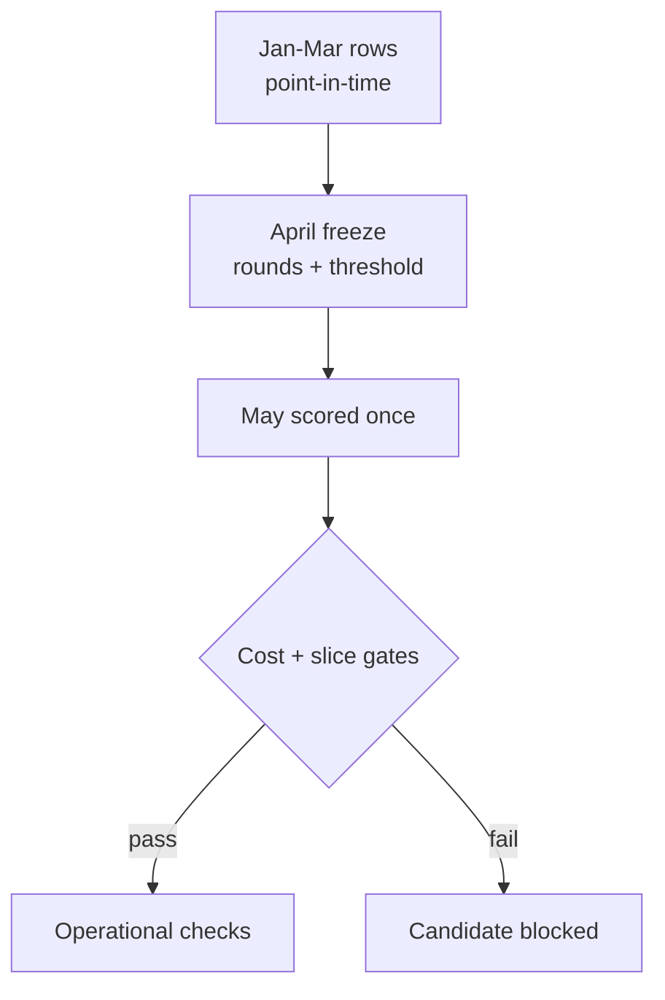

---
{
  "id": "gradient-boosted-trees-production",
  "title": "Gradient Boosted Trees in Production",
  "slug": "gradient-boosted-trees-production",
  "section": "Production ML Systems",
  "category": "Fine-Tuning & Training",
  "difficulty": "Medium",
  "order": 3,
  "coverImage": "illustrations/_generated/chapter_flow_dark.png",
  "companies": [
    "Amazon",
    "Uber",
    "DoorDash",
    "Shopify"
  ],
  "shortDescription": "See whether an SLA-risk booster beats a cheap alert after rounds and thresholds are frozen on later jobs.",
  "keyConceptsTested": [
    "gradient boosting",
    "tabular baseline",
    "residual correction",
    "early stopping",
    "slice evaluation",
    "model artifact"
  ]
}
---

At 09:00, a cluster scheduler has to decide whether to intervene before a training job misses its SLA (service-level agreement). The queue worker knows the input size, heartbeat age, backlog depth, and priority tier. The true label arrives hours later, once the worker finishes or times out. Historical records can train a model, but an upcoming job still needs a score and a concrete rule that translates that score into an operational action.

A <span data-glossary="gradient-boosting">gradient-boosted tree</span> is a useful tabular baseline. Grinsztajn et al.'s 2022 benchmark found strong tree results on its medium-sized datasets, around 10,000 rows; that isn't a permanent ranking of all tabular methods.[^grinsztajn2022] Later work, including TabPFN's 2025 study, demonstrates competitive neural foundation models in a defined small-data regime.[^hollmann2025tabpfn] This lesson asks a narrower question: can a booster justify its maintenance cost against cheap alerting policies?

Each new tree fits a correction based on the current loss <span data-glossary="gradient">gradient</span>. Before that correction is worth operating, the rows it saw have to be rows the scheduler could have seen, and the score has to beat a rule that needs no model.

## Freeze the clock before training

Suppose `missed_sla = 1` indicates that a training run blew past its promised completion window. Before fitting an ensemble, answer one foundational question: which rows and features were genuinely available when each historical decision occurred? A <span data-glossary="train-validation-test-split">time-ordered split</span> makes that boundary explicit:

| Split | Calendar range | Operational role |
| --- | --- | --- |
| train | January through March | fit tree ensemble weights and splits |
| validation | April | select round count, stopping point, and operating threshold |
| test | May | evaluate frozen candidate on unseen future traffic |

A random shuffle can spread one cluster disruption across fitting and holdout rows, making evidence optimistic for a future-incident deployment. Chronological evaluation matches that target, but dates alone don't enforce feature availability or incident separation. If an incident straddles a cutoff, explicitly purge or assign its linked rows while preserving the intended time boundary. A random split can still suit a different, exchangeable prediction population.

Point-in-time correctness extends to every individual feature. Official guidance warns against training on information unavailable at scoring time.[^sklearn2026leakage] A feature recorded after the dispatch timestamp represents <span data-glossary="feature-leakage">feature leakage</span>, even if the column appears innocuous. Labels obey availability clocks as well: a March job still running on April 1 can't feed its final outcome into an April 1 retraining run.

Missing-value support depends on the estimator. XGBoost learns default routing during sparsity-aware split search.[^chen2016xgboost] Scikit-learn's `HistGradientBoostingClassifier` learns routing too; if a feature had no missing training values, it sends a prediction-time NaN to the child with more samples. That fallback is deterministic, not arbitrary.[^sklearnHistGradientBoosting2026] The classic `GradientBoostingClassifier` used in this lab rejects NaNs in the checked environment.

Native routing does not validate new sensor failure modes. Verify missing-value behavior against production input expectations, and keep any imputer fitted on training rows only. Unknown categorical values require explicit handling policies.

Read the evaluation flow below as a sequence of strict gates. April freezes the hyperparameters and the operational threshold; May scores the candidate exactly once. Passing metric checks triggers operational review rather than authorizing immediate automated release.



Build a seeded synthetic dataset with three month-labelled groups. Each row already satisfies point-in-time feature and label cutoffs. Labels depend on heartbeat age, backlog, priority, and a large-model flag derived from input size. A sigmoid converts an additive score to a probability, then a Bernoulli draw produces `0` or `1`. May adds `0.18` to that score. Its expected risk rises for otherwise identical rows, but its sampled miss count does not always exceed April's due to finite-sample variation.

<!-- leetllm: test, output=show, deps=numpy,scikit-learn, id=boosting-production-lab -->
```python title="build-monthly-fixture.py"
import json
from hashlib import sha256

import numpy as np
from sklearn.ensemble import GradientBoostingClassifier
from sklearn.metrics import log_loss, roc_auc_score


rng = np.random.default_rng(11)
FEATURES = [
    "input_gb",
    "heartbeat_age_hours",
    "backlog",
    "priority",
    "large_model",
]


def sigmoid(value):
    return 1 / (1 + np.exp(-value))


def make_jobs(month, count, drift=0.0):
    input_gb = rng.integers(40, 1601, count)
    heartbeat_age = rng.integers(1, 41, count)
    backlog = rng.integers(0, 31, count)
    priority = rng.integers(0, 2, count)
    large_model = (input_gb >= 900).astype(int)
    logit = (
        -5.2
        + 0.13 * heartbeat_age
        + 0.07 * backlog
        + 0.85 * priority
        + 0.75 * large_model
        + drift
    )
    missed_sla = rng.binomial(1, sigmoid(logit))
    X = np.column_stack([input_gb, heartbeat_age, backlog, priority, large_model])
    return {"month": month, "X": X, "y": missed_sla}


train = make_jobs("Jan-Mar", 360)
valid = make_jobs("April", 140)
test = make_jobs("May", 140, drift=0.18)

for split in (train, valid, test):
    print(f"{split['month']}: rows={len(split['y'])} missed_sla={int(split['y'].sum())}")
```

<!-- leetllm: output:start -->
```text title="Output" output compact
Jan-Mar: rows=360 missed_sla=119
April: rows=140 missed_sla=58
May: rows=140 missed_sla=55
```
<!-- leetllm: output:end -->

<figure>
  
  <figcaption>May adds <code>0.18</code> to each otherwise-identical row's logit. The sampled May group has three fewer misses than April; the feature rows and Bernoulli outcomes differ across the two months.</figcaption>
</figure>

The seed reproduces these rows in a fixed dependency environment. `X` contains one job per row and the five features in `FEATURES` order. The name `large_model` is a synthetic proxy for input size; input gigabytes do not determine model size. A real table must follow point-in-time constraints and include only information available before the decision.

Test missing-value handling directly. This four-row probe checks acceptance during an outage; evaluate the later fitted SLA candidate to measure score quality.

<!-- leetllm: test, output=show, continue=boosting-production-lab, id=missing-support -->
```python title="check-estimator-missing-value-support.py"
from sklearn.ensemble import HistGradientBoostingClassifier

small_X = np.array([[0.0], [1.0], [np.nan], [3.0]])
small_y = np.array([0, 0, 1, 1])
try:
    GradientBoostingClassifier(random_state=11).fit(small_X, small_y)
except ValueError as error:
    if "Input X contains NaN" not in str(error):
        raise
    print("classic accepts NaN:", False)
else:
    raise AssertionError("the checked classic estimator should reject NaN")

missing_probe = HistGradientBoostingClassifier(
    max_iter=2, min_samples_leaf=1, early_stopping=False, random_state=11,
).fit(small_X, small_y)
finite_output = bool(np.isfinite(missing_probe.predict_proba([[np.nan]])).all())
print("histogram accepts NaN with finite output:", finite_output)
assert finite_output
```

<!-- leetllm: output:start -->
```text title="Output" output compact
classic accepts NaN: False
histogram accepts NaN with finite output: True
```
<!-- leetllm: output:end -->

The classic estimator refuses a NaN, and the histogram estimator returns a finite probability. Neither result says the score is worth an alert. If the booster disappeared, what alert would the scheduler still have?

## Publish the cheapest baseline

A heartbeat-age rule needs no model: alert whenever `heartbeat_age_hours >= 18`. Two constant policies bound that choice: alert on every job, or never alert at all. Omitting those heuristics gives a booster an unearned win.

Define an explicit error cost matrix before ranking candidates:

- A missed priority job (False Negative on priority tier) costs `150`.
- A missed standard job (False Negative on standard tier) costs `60`.
- A false alarm (False Positive alert on a job that would finish on time) costs `8`.
- A correct alert (True Positive) and an uninterrupted normal run (True Negative) cost `0`.

These cost units make a miss 7.5 to 18.75 times as costly as a false alarm, reflecting asymmetric operational risk. True alerts cost zero under this table; real investigations or interventions may carry additional costs. Estimate those costs before changing resource allocation.

Let $p(x) = P(y = 1 \mid x)$ be the true conditional breach probability. If the scheduler alerts ($\hat{y} = 1$), its expected error cost under this table is the false alarm penalty weighted by the probability of finishing on time:
$$
\mathbb{E}[\text{Cost} \mid \text{alert}] = (1 - p(x)) \cdot C_{\text{FP}}
$$
If the scheduler chooses not to alert ($\hat{y} = 0$), its expected error cost is the missed-SLA penalty weighted by the probability of failure:
$$
\mathbb{E}[\text{Cost} \mid \text{no alert}] = p(x) \cdot C_{\text{FN}}
$$
Choose an alert when its expected cost is no larger, breaking ties toward alerting:
$$
(1 - p(x)) \cdot C_{\text{FP}} \le p(x) \cdot C_{\text{FN}}
$$
Expanding and collecting terms for $p(x)$ gives:
$$
C_{\text{FP}} \le p(x) \cdot (C_{\text{FP}} + C_{\text{FN}}) \implies p(x) \ge \frac{C_{\text{FP}}}{C_{\text{FP}} + C_{\text{FN}}}
$$
The theoretical Bayes-optimal decision threshold $\tau^*$ is:
$$
\tau^* = \frac{C_{\text{FP}}}{C_{\text{FP}} + C_{\text{FN}}}
$$
Plugging in our concrete operational costs:

- For standard jobs ($C_{\text{FP}} = 8, C_{\text{FN}} = 60$): $\tau^*_{\text{standard}} = \frac{8}{8 + 60} = \frac{8}{68} \approx 0.118$.
- For priority jobs ($C_{\text{FP}} = 8, C_{\text{FN}} = 150$): $\tau^*_{\text{priority}} = \frac{8}{8 + 150} = \frac{8}{158} \approx 0.051$.

Under these assumptions, 0.50 is the cost-optimal boundary only for equal error costs. A higher threshold will not produce different actions if no scores lie between the boundaries; it does not automatically degrade performance unless scores occupy the transition zone. Estimated or miscalibrated scores, nonzero correct-action costs, and alert-capacity constraints can change the decision rule.

Give two jobs the same true breach probability of 0.08. Standard tier remains below 0.118 and triggers no alert, whereas priority tier exceeds 0.051 and prompts an alert under the cost policy:

<!-- leetllm: test, output=show, continue=missing-support, id=cost-policy-check -->
```python title="compare-tier-specific-expected-cost.py"
risk_probability = 0.08
for tier, miss_cost in [("standard", 60), ("priority", 150)]:
    alert_cost = (1 - risk_probability) * 8
    no_alert_cost = risk_probability * miss_cost
    action = "alert" if alert_cost <= no_alert_cost else "no alert"
    print(f"{tier}: alert={alert_cost:.2f} no_alert={no_alert_cost:.2f} choose={action}")
```

<!-- leetllm: output:start -->
```text title="Output" output compact
standard: alert=7.36 no_alert=4.80 choose=no alert
priority: alert=7.36 no_alert=12.00 choose=alert
```
<!-- leetllm: output:end -->

The distinction comes from the costs, not a different probability. Later we'll search one global threshold on estimated validation scores. That is a deliberately smaller policy family than this tier-specific Bayes rule.

The helper below scores the heuristic heartbeat rule and constant policies on April using this cost policy.

<!-- leetllm: test, output=show, continue=cost-policy-check, id=rule-baseline -->
```python title="score-rule-baseline.py"
def confusion(y, predicted):
    return {
        "tp": int(np.sum((y == 1) & (predicted == 1))),
        "fp": int(np.sum((y == 0) & (predicted == 1))),
        "fn": int(np.sum((y == 1) & (predicted == 0))),
        "tn": int(np.sum((y == 0) & (predicted == 0))),
    }


def cost_stats(split, scores, threshold):
    predicted = (scores >= threshold).astype(int)
    priority = split["X"][:, FEATURES.index("priority")] == 1
    missed = (split["y"] == 1) & (predicted == 0)
    false_alarm = (split["y"] == 0) & (predicted == 1)
    return {
        "threshold": threshold,
        "cost": int(
            150 * np.sum(missed & priority)
            + 60 * np.sum(missed & ~priority)
            + 8 * np.sum(false_alarm)
        ),
        "priority_misses": int(np.sum(missed & priority)),
        **confusion(split["y"], predicted),
    }


heartbeat_age_index = FEATURES.index("heartbeat_age_hours")
rule_valid = (valid["X"][:, heartbeat_age_index] >= 18).astype(int)
print("rule validation:", cost_stats(valid, rule_valid.astype(float), threshold=0.50))
always_alert_valid = cost_stats(valid, np.ones(len(valid["y"])), threshold=0.50)
never_alert_valid = cost_stats(valid, np.zeros(len(valid["y"])), threshold=0.50)
print("always-alert validation cost:", always_alert_valid["cost"])
print("never-alert validation cost:", never_alert_valid["cost"])
assert always_alert_valid["cost"] == 8 * int(np.sum(valid["y"] == 0))
```

<!-- leetllm: output:start -->
```text title="Output" output compact
rule validation: {'threshold': 0.5, 'cost': 1560, 'priority_misses': 8, 'tp': 48, 'fp': 30, 'fn': 10, 'tn': 52}
always-alert validation cost: 656
never-alert validation cost: 6450
```
<!-- leetllm: output:end -->

The heartbeat rule catches `48` of April's `58` misses at cost `1560`. Alerting on all `140` jobs catches every miss and costs only `82 * 8 = 656`. The booster faces a rigorous challenge: it must suppress false alarms without introducing expensive misses that quickly wipe out savings.

```checkpoint
Why include an always-alert policy alongside the heartbeat-age rule?
---
Under this cost table, always alerting costs only 656 on April, versus 1560 for the heartbeat rule. Beating the weaker rule alone wouldn't justify a model. Both comparisons need the same rows and costs.
```

## Rebuild one boosting step by hand

Start with one shallow tree. It partitions rows into a few rules, then leaves a pattern of errors behind. **Gradient boosting** adds another tree to correct that pattern, then repeats the move. Friedman describes this as stage-wise function approximation using loss gradients.[^friedman2001gbm]

Keep the job setting but temporarily predict delay hours for three jobs. Start from a deliberately imperfect constant prediction of six hours; a squared-error model normally initializes with the training mean instead.

| Lane | Actual delay | First prediction | Residual |
| --- | ---: | ---: | ---: |
| local standard | 2 | 6 | -4 |
| regional standard | 8 | 6 | +2 |
| large-model economy | 20 | 6 | +14 |

A fixed two-leaf correction groups the first two jobs together and puts the large-model job alone. Their mean residuals are `(-4 + 2)/2 = -1` and `14`. This demonstrates leaf fitting, not a search over possible splits. Under squared-error regression, the residual `actual - prediction` gives the correction direction. A negative residual asks for a smaller prediction; a positive one asks for a larger prediction.

A <span data-glossary="learning-rate">learning rate</span> keeps only part of the tree's proposed move. That restraint gives later trees room to correct the correction instead of letting one noisy partition dominate the ensemble.

<!-- leetllm: test, output=show, continue=rule-baseline, id=residual-correction -->
```python title="apply-one-residual-correction.py"
actual_delay = np.array([2.0, 8.0, 20.0])
prediction = np.array([6.0, 6.0, 6.0])
large_model = np.array([0, 0, 1])
residual = actual_delay - prediction

correction = np.where(
    large_model == 1,
    residual[large_model == 1].mean(),
    residual[large_model == 0].mean(),
)
learning_rate = 0.25
updated = prediction + learning_rate * correction

print("residuals:", residual.tolist())
print("tree correction:", correction.tolist())
before_mse = np.mean((actual_delay - prediction) ** 2)
after_mse = np.mean((actual_delay - updated) ** 2)
assert after_mse < before_mse
print("updated predictions:", updated.tolist())
print("before mse:", round(float(before_mse), 2))
print("after mse:", round(float(after_mse), 2))
```

<!-- leetllm: output:start -->
```text title="Output" output compact
residuals: [-4.0, 2.0, 14.0]
tree correction: [-1.0, -1.0, 14.0]
updated predictions: [5.75, 5.75, 9.5]
before mse: 72.0
after mse: 43.12
```
<!-- leetllm: output:end -->

Read the output by leaf. Shrinkage keeps only a quarter of each move: the predictions become `[5.75, 5.75, 9.5]`. Mean squared error falls from `72` to `43.125` hours squared. The second job gets worse individually because it shares the first job's leaf; reducing average loss doesn't improve every row.

<figure>
  
  <figcaption>The <code>large_model</code> cut gives two jobs a shared correction and keeps the third in its own leaf. Shrinkage reduces average error, though the regional job's prediction gets worse.</figcaption>
</figure>

Friedman writes that update as stage-wise addition with shrinkage. If $F_{m-1}$ is the current score and $h_m$ is the new tree,

$$
F_m(x) = F_{m-1}(x) + \nu \, h_m(x)
$$

where $\nu$ is the learning rate (here $0.25$).[^friedman2001gbm]

Classification changes the units of the correction. An SLA-risk classifier doesn't fit delay-hour residuals. Its additive score is a **logit**, or log odds. Score `0` maps to probability `0.50`; score `1` maps to about `0.731`. The conversion is $p=1/(1+e^{-F})$, where $F$ is the score. Trees change $F$, not the bounded probability directly.

Binary **log loss** penalizes confident wrong probabilities: a positive label at probability `0.50` costs `-log(0.50) ≈ 0.693`, while probability `0.90` costs about `0.105`. For a negative label, use `-log(1-p)` instead. Averaging those losses scores the probability predictions.

At an initial probability of `0.50`, that negative binary log-loss gradient is `gold - probability`. Equivalently, the score gradient $\partial L/\partial F$ is `probability - gold`. A row labelled `1` therefore asks for an upward move, while a row labelled `0` asks for a downward move.

<!-- leetllm: test, output=show, continue=residual-correction, id=classification-gradient -->
```python title="inspect-log-loss-gradient.py"
gold = np.array([0.0, 1.0, 1.0])
probability = np.full(3, 0.50)
negative_gradient = gold - probability

print("initial probability:", probability.tolist())
print("gold - probability:", negative_gradient.tolist())
```

<!-- leetllm: output:start -->
```text title="Output" output compact
initial probability: [0.5, 0.5, 0.5]
gold - probability: [-0.5, 0.5, 0.5]
```
<!-- leetllm: output:end -->

The output makes that direction concrete: `-0.5` asks for a lower logit on the first row, and each `+0.5` asks for a higher one. These are gradient targets, not necessarily the final leaf values. A classification booster fits partitions using these directions, computes loss-appropriate leaf updates, adds the shrunken score correction, and recomputes probabilities.[^sklearnGradientBoostingMechanics2026] The fitted classifier below starts from the training class proportion, `119/360 ≈ 0.331`, not the artificial `0.50` used to inspect the signs.[^sklearnGradientBoosting2026]

XGBoost's regularized objective illustrates a second-order approximation. Write $F_{t-1}(x_i)$ for the current **raw score**, not its sigmoid-transformed probability:[^chen2016xgboost][^xgboostTreeObjective2026]
$$
\tilde{L}^{(t)} \approx \sum_{i=1}^n \left[ l(y_i, F_{t-1}(x_i)) + g_i f_t(x_i) + \frac{1}{2} h_i f_t^2(x_i) \right] + \Omega(f_t)
$$
Here $g_i$ and $h_i$ are the first and second derivatives of loss with respect to the raw score. For binary log loss, $g_i = p_i-y_i$ and $h_i=p_i(1-p_i)$. In this formulation, $\Omega(f_t)=\gamma T+\frac12\lambda\sum_{j=1}^{T}w_j^2$ penalizes leaf count and leaf weights.

Solving for the optimal weight $w_j^*$ of leaf $j$ containing sample indices $I_j$ yields:
$$
w_j^* = -\frac{\sum_{i \in I_j} g_i}{\sum_{i \in I_j} h_i + \lambda}
$$
The resulting approximate objective gain from splitting parent $I$ into $I_L$ and $I_R$ is:
$$
\text{Gain} = \frac{1}{2} \left[ \frac{\left(\sum_{i \in I_L} g_i\right)^2}{\sum_{i \in I_L} h_i + \lambda} + \frac{\left(\sum_{i \in I_R} g_i\right)^2}{\sum_{i \in I_R} h_i + \lambda} - \frac{\left(\sum_{i \in I} g_i\right)^2}{\sum_{i \in I} h_i + \lambda} \right] - \gamma
$$
This gain already subtracts $\gamma$; positive net gain is the improvement criterion in this simplified calculation. The leaf formula minimizes the quadratic surrogate for a fixed partition, not the exact loss over every possible tree.

**A small Hessian doesn't necessarily damp a confident error.** It sits in the denominator. Compare three positive-label rows: a confident correct probability, an ambiguous probability, and a confident wrong probability.

<!-- leetllm: test, output=show, continue=classification-gradient, id=newton-curvature -->
```python title="inspect-gradient-and-curvature-together.py"
for estimated_probability in [0.99, 0.50, 0.01]:
    gradient = estimated_probability - 1
    curvature = estimated_probability * (1 - estimated_probability)
    unregularized = -gradient / curvature
    regularized = -gradient / (curvature + 1.0)
    print(
        f"p={estimated_probability:.2f} g={gradient:.2f} h={curvature:.4f} "
        f"w(lambda=0)={unregularized:.2f} w(lambda=1)={regularized:.2f}"
    )
```

<!-- leetllm: output:start -->
```text title="Output" output compact
p=0.99 g=-0.01 h=0.0099 w(lambda=0)=1.01 w(lambda=1)=0.01
p=0.50 g=-0.50 h=0.2500 w(lambda=0)=2.00 w(lambda=1)=0.40
p=0.01 g=-0.99 h=0.0099 w(lambda=0)=100.00 w(lambda=1)=0.98
```
<!-- leetllm: output:end -->

The two confident rows share the same curvature and have very different gradients. This calculation isolates one-row leaf arithmetic. An XGBoost training step also applies leaf admission, regularization, shrinkage, and optional update limits. XGBoost exposes `min_child_weight`, `reg_lambda`, and `max_delta_step` for those controls.[^xgboostParameters2026]

### Modern GBDT engine comparison

Don't identify an entire library with one growth policy. Current options checked on September 21, 2026 include:

<figure>
  
  <figcaption>Split nodes and leaves show how each policy grows structure. Tune capacity and sampling, then compare holdout quality for the recorded engine configuration.</figcaption>
</figure>

- **XGBoost:** `grow_policy="depthwise"` is the default; supported histogram/approximate methods also offer `"lossguide"`. Depth-wise expansion isn't depth-first traversal and doesn't force every branch to the same depth. Split methods include `exact`, `approx`, and `hist`; current `auto` selects `hist`. Approx uses Hessian-weighted sketches per tree; hist builds a global sketch using supplied sample weights. Column subsampling is configurable, with method-dependent support.[^xgboostParameters2026][^xgboostTreeMethods2026]
- **LightGBM:** Leaf-wise growth chooses the leaf with largest gain; `num_leaves`, `max_depth`, and leaf-support settings control capacity. Evaluate generalization on held-out data. Histogram construction still processes rows, roughly $O(NF)$ for $N$ dense rows and $F$ features; scanning split bins and subtracting histograms use roughly $O(KF)$ for $K$ bins. `max_bin` defaults to 255 and is configurable; memory savings depend on the data and representation.[^lightgbmFeatures2026][^lightgbmParameters2026] GOSS is optional: `data_sample_strategy` defaults to `bagging`. GOSS retains large-gradient rows and reweights a sampled small-gradient subset; EFB bundles sparse features with little overlap.[^ke2017lightgbm][^lightgbmParameters2026] Categorical search can group categories, while small-cardinality features use one-versus-rest splits under `max_cat_to_onehot`; declaring a column categorical still matters.[^lightgbm2026missing][^lightgbmParameters2026]
- **CatBoost:** `SymmetricTree` is the default growth policy; `Depthwise` and `Lossguide` also exist. A full symmetric depth-$d$ tree uses $d$ predicates to index $2^d$ leaves for efficient evaluation. Benchmark branch behavior on the target workload. Ordered target statistics address own-label leakage in categorical encoding; Ordered boosting addresses the paper's prediction-shift mechanism. Apply temporal validation separately. `boosting_type` is a separate choice, and its CPU default is `Plain`.[^prokhorenkova2018][^catboostParameters2026]

<figure>
  
  <figcaption>Each of four rows occupies one ordered bin at $p=0.5$, with derivatives $g=p-y$ and $h=p(1-p)$. Each bin stores the gradient sum $G$ and Hessian sum $H$. With $\lambda=1$ and $\gamma=0$, cutting after bin two separates opposing gradients and gives regularized gain $2/3$, versus $6/35$ at the other two cuts.</figcaption>
</figure>

When a policy needs a score of `0.20` to mean roughly a 20% miss rate, inspect <span data-glossary="calibration">calibration</span> with a reliability curve. Brier score measures overall probability error, not calibration alone. Calibration methods such as isotonic regression or sigmoid fitting need data separate from the base model's fitting rows; their selection must also stay outside May.[^sklearnCalibration2026] We don't add calibration in this lab: we select a threshold empirically rather than assume the scores are exact probabilities.

## Fit a booster with an explicit stopping rule

This lab uses scikit-learn's `GradientBoostingClassifier` so the code stays small. It builds an additive model stage by stage and fits each tree to the negative gradient of `log_loss`. A larger job might use XGBoost, but the stopping question stays the same: which round still helps April?

Fix tree depth and learning rate first. Then train up to a generous maximum of rounds on January through March. Early stopping can select a smaller number of trees.

Don't use sklearn's `validation_fraction` helper for this split. When early stopping is enabled with `n_iter_no_change`, it reserves a stratified random portion of the training <span data-glossary="matrix">matrix</span>, not a later month.[^sklearnGradientBoosting2026] April is our later calendar group, so score it yourself with `staged_predict_proba` and keep that boundary intact.

The first snippet only establishes the 160-round ceiling. The next one compares every stage on January-March and April, so you can see when fit on old rows stops helping future-like rows.

<!-- leetllm: test, output=show, continue=newton-curvature, id=round-search -->
```python title="fit-round-search.py"
round_search = GradientBoostingClassifier(
    loss="log_loss",
    n_estimators=160,
    learning_rate=0.05,
    max_depth=2,
    random_state=11,
)
round_search.fit(train["X"], train["y"])
print("trained stage cap:", round_search.n_estimators_)
```

<!-- leetllm: output:start -->
```text title="Output" output compact
trained stage cap: 160
```
<!-- leetllm: output:end -->

<!-- leetllm: test, output=show, continue=round-search, id=early-stop -->
```python title="choose-early-stop-round.py"
train_losses = [
    log_loss(train["y"], probabilities[:, 1], labels=[0, 1])
    for probabilities in round_search.staged_predict_proba(train["X"])
]
validation_losses = [
    log_loss(valid["y"], probabilities[:, 1], labels=[0, 1])
    for probabilities in round_search.staged_predict_proba(valid["X"])
]
best_round = int(np.argmin(validation_losses) + 1)

print("round 1 train / april:", round(train_losses[0], 4), round(validation_losses[0], 4))
print("best round:", best_round)
print(f"round {best_round} train / april:", round(train_losses[best_round - 1], 4), round(validation_losses[best_round - 1], 4))
print("round 160 train / april:", round(train_losses[-1], 4), round(validation_losses[-1], 4))
```

<!-- leetllm: output:start -->
```text title="Output" output compact
round 1 train / april: 0.6163 0.6805
best round: 50
round 50 train / april: 0.3491 0.5643
round 160 train / april: 0.2684 0.5922
```
<!-- leetllm: output:end -->

In this run, training loss falls through round `160`, while April's minimum is at round `50`. Later losses fluctuate above that minimum. Extra trees improve fitting loss without improving this validation metric, a symptom of <span data-glossary="overfitting">overfitting</span>. Another sample or deployment regime could select a different round count.

<figure>
  
  <figcaption>The plot samples every tenth round; the code checks all 160. After round <code>50</code>, training loss drops from <code>0.3491</code> to <code>0.2684</code> while April loss rises from <code>0.5643</code> to <code>0.5922</code>. The validation minimum selects the candidate, not the training cap.</figcaption>
</figure>

This is retrospective stage selection: we trained all 160 rounds, then selected the minimum April loss. It doesn't save training compute as an online patience-based stopping rule would. Record the validation rows, metric, tie rule, and selected count. `argmin` takes the first minimum, favoring fewer rounds in a tie. We refit with that count on the same January-March rows; adding April to fitting would change the model and invalidate the threshold selected from these April scores.

<!-- leetllm: test, output=show, continue=early-stop, id=fitted-candidate -->
```python title="fit-frozen-candidate.py"
candidate = GradientBoostingClassifier(
    loss="log_loss",
    n_estimators=best_round,
    learning_rate=0.05,
    max_depth=2,
    random_state=11,
)
candidate.fit(train["X"], train["y"])
valid_scores = candidate.predict_proba(valid["X"])[:, 1]

print("frozen rounds:", candidate.n_estimators_)
print("rule validation auc:", round(roc_auc_score(valid["y"], rule_valid), 3))
print("boosted validation auc:", round(roc_auc_score(valid["y"], valid_scores), 3))
```

<!-- leetllm: output:start -->
```text title="Output" output compact
frozen rounds: 50
rule validation auc: 0.731
boosted validation auc: 0.792
```
<!-- leetllm: output:end -->

The booster has April <span data-glossary="roc-auc">AUC</span> `0.792`, versus `0.731` for the binary heartbeat rule. **Area under the receiver operating characteristic curve (AUC)** measures how often a positive case outranks a negative one, giving half credit to ties. The binary rule creates many ties, so this comparison doesn't measure the full ranking information in heartbeat age itself. More importantly, neither AUC chooses where an operator should intervene.

```checkpoint
Validation loss is lowest at round 50 and rises through round 160. Which round count should the frozen candidate use?
---
Use round 50, selected on the declared validation slice. Continuing to the training cap would keep trees that improved training fit but worsened held-out loss.
```

## Measure threshold cost, not AUC alone

The classifier outputs a score, not an action. The scheduler still has to choose whether to intervene, notify, or leave a job on its normal path. A missed priority SLA can cost more than an unnecessary notification, so `0.50` is not a neutral operating policy.

Search candidate <span data-glossary="decision-threshold">thresholds</span> on April only. Start with a coarse grid to expose a mistake: if its best threshold is the lowest one tested, values below it may be better. Then evaluate every distinct validation score, plus all-alert and no-alert boundaries. Predictions use `score >= threshold`, so these candidates represent every distinct single-threshold decision set on April. The sort key minimizes cost and breaks ties toward the lower threshold.

<!-- leetllm: test, output=show, continue=fitted-candidate, id=threshold-policy -->
```python title="choose-sla-threshold.py"
thresholds = [0.15, 0.20, 0.25, 0.30, 0.40]
for threshold in thresholds:
    stats = cost_stats(valid, valid_scores, threshold)
    print(
        f"threshold={threshold:.2f} cost={stats['cost']} "
        f"priority_misses={stats['priority_misses']}"
    )

complete_thresholds = np.r_[0.0, np.unique(valid_scores), np.nextafter(1.0, 2.0)]
selected_threshold = float(min(
    complete_thresholds,
    key=lambda threshold: (cost_stats(valid, valid_scores, threshold)["cost"], threshold),
))
april_rule = cost_stats(valid, rule_valid.astype(float), threshold=0.50)
april_boosted = cost_stats(valid, valid_scores, selected_threshold)
print("selected threshold:", round(selected_threshold, 6))
print("april rule cost:", april_rule["cost"])
print("april always-alert cost:", always_alert_valid["cost"])
print("april boosted cost:", april_boosted["cost"])
assert april_boosted["cost"] <= always_alert_valid["cost"]
```

<!-- leetllm: output:start -->
```text title="Output" output compact
threshold=0.15 cost=1316 priority_misses=6
threshold=0.20 cost=1884 priority_misses=10
threshold=0.25 cost=1912 priority_misses=10
threshold=0.30 cost=2038 priority_misses=11
threshold=0.40 cost=2604 priority_misses=14
selected threshold: 0.062667
april rule cost: 1560
april always-alert cost: 656
april boosted cost: 568
```
<!-- leetllm: output:end -->

The coarse grid picks `0.15` at cost `1316`, losing to always alerting at `656`. Complete search selects approximately `0.062667` at cost `568`: it catches all `58` misses and suppresses `11` false alarms. Keep the full-precision threshold; the rounded number is for display.

This is the minimum observed April cost within the **single global threshold** family. It does not evaluate the priority-tier Bayes threshold: the model scores were uncalibrated, the policy family differs, and April is finite. Both rounds and threshold were selected on April, so its reported improvement includes selection optimism. May supplies later evidence.

<figure>
  
  <figcaption>Each bar adds false-alarm and missed-SLA cost. The selected policy costs <code>568</code>, slightly below all-alert at <code>656</code>; at <code>0.50</code>, missed-SLA cost brings the total to <code>3,134</code>. These values reflect this April validation sample.</figcaption>
</figure>

Freeze the round count, threshold, and cost policy together. May can be opened once for final candidate evidence.

<!-- leetllm: test, output=show, continue=threshold-policy, id=test-evidence -->
```python title="score-frozen-test-month.py"
test_scores = candidate.predict_proba(test["X"])[:, 1]
test_stats = cost_stats(test, test_scores, selected_threshold)
rule_test = (test["X"][:, heartbeat_age_index] >= 18).astype(int)
may_rule = cost_stats(test, rule_test.astype(float), threshold=0.50)

print("test auc:", round(roc_auc_score(test["y"], test_scores), 3))
print("may rule cost:", may_rule["cost"])
may_always_alert = cost_stats(test, np.ones(len(test["y"])), threshold=0.50)
print("may always-alert cost:", may_always_alert["cost"])
print("test policy:", test_stats)
```

<!-- leetllm: output:start -->
```text title="Output" output compact
test auc: 0.882
may rule cost: 1044
may always-alert cost: 680
test policy: {'threshold': 0.06266686815353625, 'cost': 584, 'priority_misses': 0, 'tp': 55, 'fp': 73, 'fn': 0, 'tn': 12}
```
<!-- leetllm: output:end -->

May differs through both random sampling and the drift term; one run doesn't isolate their effects. The frozen policy costs `584`, below the heartbeat rule's `1044` and always-alert's `680`. It catches all `55` misses but alerts on `128` of `140` jobs. Saving `96` synthetic cost units relative to always alerting isn't automatically worth model maintenance. Keep the threshold frozen: May evaluates the earlier choice, not a new search. Now inspect where those results came from.

## Gate slices before promotion

Pick <span data-glossary="evaluation-slice">required slices</span> before reading test results. An aggregate score can look fine while one workload carries all the misses, so the slice names and thresholds belong in the release contract.

**Recall** is caught misses divided by all actual misses: for example, catching `9` of `10` gives `0.90`. Support matters too. A slice with no positives has undefined recall, and perfect recall on one positive case has high uncertainty. The slice gate below requires at least `10` SLA-miss jobs per slice, recall of at least `0.90` for priority jobs, and recall of at least `0.85` for large-model jobs; production release gates size positive-support floors from binomial confidence widths.

The gate below reports both pieces of evidence. Predict what should happen if a slice has high recall but fewer than `10` positive cases.

<!-- leetllm: test, output=show, continue=test-evidence, id=slice-gates -->
```python title="check-required-slices.py"
def slice_gate(split, scores, threshold, name, mask, minimum_recall, minimum_positives):
    predicted = (scores >= threshold).astype(int)
    stats = confusion(split["y"][mask], predicted[mask])
    positives = stats["tp"] + stats["fn"]
    measured_recall = stats["tp"] / positives if positives else None
    enough_support = positives >= minimum_positives
    passed = enough_support and measured_recall is not None and measured_recall >= minimum_recall
    result = {
        "name": name,
        "rows": int(np.sum(mask)),
        "positives": positives,
        "recall": round(measured_recall, 3) if measured_recall is not None else None,
        "minimum_recall": minimum_recall,
        "minimum_positives": minimum_positives,
        "confusion": stats,
        "passed": passed,
    }
    recall_text = f"{measured_recall:.3f}" if measured_recall is not None else "undefined"
    print(
        f"{name}: positives={positives} recall={recall_text} "
        f"minimum_recall={minimum_recall:.2f} "
        f"minimum_positives={minimum_positives} pass={passed}"
    )
    return result


priority_index = FEATURES.index("priority")
large_model_index = FEATURES.index("large_model")
required_slice_results = [
    slice_gate(
        test,
        test_scores,
        selected_threshold,
        "priority",
        test["X"][:, priority_index] == 1,
        minimum_recall=0.90,
        minimum_positives=10,
    ),
    slice_gate(
        test,
        test_scores,
        selected_threshold,
        "large_model",
        test["X"][:, large_model_index] == 1,
        minimum_recall=0.85,
        minimum_positives=10,
    ),
]
required_slices_pass = all(result["passed"] for result in required_slice_results)
print("all required slices pass:", required_slices_pass)
```

<!-- leetllm: output:start -->
```text title="Output" output compact
priority: positives=36 recall=1.000 minimum_recall=0.90 minimum_positives=10 pass=True
large_model: positives=31 recall=1.000 minimum_recall=0.85 minimum_positives=10 pass=True
all required slices pass: True
```
<!-- leetllm: output:end -->

Both required slices pass with recall `1.0`. They overlap, so they aren't independent replications, and always alerting would also pass these recall gates. Interpret recall together with the cost and alert-volume comparison. A retrain, feature shift, or threshold edit can break one segment while aggregate metrics still look acceptable.

Exercise the gate's boundaries before relying on it. These masks simulate no positive cases and nine perfectly detected positive cases; neither should pass a ten-positive requirement.

<!-- leetllm: test, output=show, continue=slice-gates, id=slice-boundaries -->
```python title="check-slice-support-boundaries.py"
empty = slice_gate(
    test, test_scores, selected_threshold, "empty",
    np.zeros(len(test["y"]), dtype=bool), 0.85, 10,
)
nine_mask = np.zeros(len(test["y"]), dtype=bool)
nine_mask[np.flatnonzero(test["y"] == 1)[:9]] = True
nine = slice_gate(
    test, np.ones(len(test["y"])), selected_threshold, "nine positives",
    nine_mask, 0.85, 10,
)
assert empty["recall"] is None and not empty["passed"]
assert nine["recall"] == 1.0 and not nine["passed"]
```

<!-- leetllm: output:start -->
```text title="Output" output compact
empty: positives=0 recall=undefined minimum_recall=0.85 minimum_positives=10 pass=False
nine positives: positives=9 recall=1.000 minimum_recall=0.85 minimum_positives=10 pass=False
```
<!-- leetllm: output:end -->

To diagnose a gate, reproduce one predeclared failure: change only the threshold to `0.50` and leave the fitted trees untouched. This teaching stress test isolates the threshold change. Tuning on May would require fresh final evidence.

<!-- leetllm: test, output=show, continue=slice-boundaries, id=threshold-regression -->
```python title="reproduce-threshold-regression.py"
bad_threshold = 0.50
bad_slice_results = [
    slice_gate(
        test,
        test_scores,
        bad_threshold,
        "priority",
        test["X"][:, priority_index] == 1,
        minimum_recall=0.90,
        minimum_positives=10,
    ),
    slice_gate(
        test,
        test_scores,
        bad_threshold,
        "large_model",
        test["X"][:, large_model_index] == 1,
        minimum_recall=0.85,
        minimum_positives=10,
    ),
]
print("release blocked:", not all(result["passed"] for result in bad_slice_results))
```

<!-- leetllm: output:start -->
```text title="Output" output compact
priority: positives=36 recall=0.722 minimum_recall=0.90 minimum_positives=10 pass=False
large_model: positives=31 recall=0.645 minimum_recall=0.85 minimum_positives=10 pass=False
release blocked: True
```
<!-- leetllm: output:end -->

Nothing about the fitted trees changed. The threshold edit alone drops priority recall from `1.0` to `0.722` and large-model recall from `1.0` to `0.645`. Versioning only the model file would miss a policy regression.

<figure>
  
  <figcaption>The frozen policy clears both recall and support gates. Changing only the threshold to <code>0.50</code> drops both recall bars below their minimums; zero and nine positive cases fail the support floor.</figcaption>
</figure>

```checkpoint
Why doesn't a higher AUC choose the production intervention threshold?
---
AUC measures ordering across thresholds. Operations still needs a threshold chosen against concrete false-alarm and missed-SLA costs, including critical slices such as priority jobs.
```

## Interpret attributions and optimize serving latency

An operator needs to understand which inputs drove an alert and whether scoring meets the application's measured latency budget. Explanation and profiling answer different questions.

### Attribution: TreeSHAP vs global split gain

Gain, split count, and impurity decrease are different summaries; check the estimator's definition. They can favor features with many candidate splits and distribute credit unevenly among correlated inputs. None gives the direction of one feature's contribution to one job's score.

TreeSHAP provides local Shapley attributions for a specified explanation game. The original tree algorithm avoids exhaustive coalition enumeration with an $O(TLD^2)$ procedure, where $T$ is tree count, $L$ maximum leaves, and $D$ maximum depth. Generic exact enumeration can be exponential, but model-agnostic approximations also exist.[^lundberg2018TreeSHAP] Exactness depends on the selected game and supported implementation; it doesn't resolve every ambiguity about correlated features.

Record the background and `feature_perturbation`. Current `TreeExplainer` uses interventional handling when `auto` has background data and tree-path-dependent handling otherwise. Those assumptions can change the attribution. Also record `model_output`: contributions to a raw logit aren't probability percentage points.[^shapTreeExplainer2026]

For the explained output $f$:
$$
f(x) = \phi_0 + \sum_{j=1}^M \phi_j(x)
$$
Here $\phi_0$ is the base output under the chosen background convention. Each $\phi_j$ averages the feature's marginal contribution across coalitions under that convention.[^shapTreeExplainer2026]

Tree SHAP values sum in raw log-odds rather than probability space: a base logit of `-1.00` plus feature contributions `+0.42` and `+0.26` yields `-0.32` (`sigmoid(-0.32) ≈ 0.421`), whereas adding those log-odds terms directly to a baseline probability produces an invalid number.

Use local attributions to choose an investigation. A large contribution from `ticket_escalated_flag` suggests inspecting its lineage and availability clock; it doesn't prove the column leaked. Correlated inputs and genuine predecision escalations can also explain reliance. A waterfall plot explains model output, not whether the inputs are trustworthy or changing a feature would improve the job's outcome. An alert payload should include the actual values, attributed output units, feature version, and freshness.

### Serving latency: count work, then measure the request

The selected candidate has fewer trees than the search cap. That is verifiable; a fixed speedup or sub-millisecond p99 isn't. Latency depends on the runtime, hardware, tree layout, batch size, threads, feature retrieval, validation, and concurrent load.

<figure>
  
  <figcaption>The depth-2 candidate uses 100 comparisons per row at most, against 320 for the search model. Node and tree counts come from the fitted estimators; measure model-only and full-request latency under representative load.</figcaption>
</figure>

A Python API doesn't imply per-node interpreted traversal. Scikit-learn's tree implementation already stores node arrays and traverses them in compiled code. Irregular accesses and data-dependent branches can still matter, but a profile must establish their cost on the actual workload.[^sklearnTreeImplementation2026] Neither 64-byte alignment nor zero branch misses is a universal runtime contract.

As checked September 21, 2026, **Treelite is a model exchange/serialization library; its compiler moved to TL2cgen.** TL2cgen generates C code and native binaries from supported Treelite models.[^treeliteExchange2026][^tl2cgen2026] ONNX is another possible serving representation when conversion supports the estimator. None guarantees a speedup.

Treat truncation, pruning, or a new runtime as candidate changes. Removing trees can change probabilities and threshold actions even when individual weights look small. Check validation quality and critical slices, then compare scores and actions near the full-precision threshold, missing-value handling, and feature order. Measure latency under representative load, separating model-only timing from the complete request.

<!-- leetllm: test, output=show, continue=threshold-regression, id=serving-work -->
```python title="inspect-fitted-tree-work.py"
for name, fitted_model in [("search", round_search), ("selected", candidate)]:
    fitted_trees = fitted_model.estimators_.ravel()
    comparison_bound = sum(tree.tree_.max_depth for tree in fitted_trees)
    stored_nodes = sum(tree.tree_.node_count for tree in fitted_trees)
    print(
        f"{name}: trees={len(fitted_trees)} "
        f"comparison_bound={comparison_bound} nodes={stored_nodes}"
    )
```

<!-- leetllm: output:start -->
```text title="Output" output compact
search: trees=160 comparison_bound=320 nodes=1100
selected: trees=50 comparison_bound=100 nodes=350
```
<!-- leetllm: output:end -->

## Ship a model that can be operated

The model file is only one part of a releasable candidate. Export the evidence that explains both the score and the action it triggers:

| Artifact | Why it matters |
| --- | --- |
| `feature_contract.json` | records column meanings, units, availability times, and missing-value rules |
| `split_manifest.json` | records row IDs, grouping, cutoff times, and label-availability checks |
| `model.skops` or `model.onnx` | versioned fitted model |
| `threshold_policy.json` | turns score into action |
| `slice_metrics.json` | records required-slice support and regressions |
| `serving_schema.json` | defines the names, types, ranges, and shape the server must validate |

Record an evaluation manifest for the candidate. Choose persistence based on how the serving process uses the model: <span data-glossary="onnx">ONNX</span> suits a score-only runtime that doesn't need the Python object, while `skops.io` lets you inspect untrusted types before loading the object. Pickle, joblib, and cloudpickle are trusted-source-only because loading them can execute code. None of those Python formats support loading an estimator trained on a different scikit-learn version, so pin Python, scikit-learn, NumPy, SciPy, and the serializer together.[^sklearn2026modelpersistence]

The evaluation manifest below records measured results and a narrow evaluation gate: beat both baselines and pass the required slices. It doesn't serialize the estimator or bind its bytes, training data, source revision, or dependency lock. A hash identifies this JSON payload, not the model it describes. Operational checks remain pending even if the metric gate passes.

<!-- leetllm: test, output=show, continue=serving-work -->
```python title="publish-candidate-receipt.py"
baseline_costs = {"heartbeat_rule": may_rule["cost"], "always_alert": may_always_alert["cost"]}
beats_baselines = all(test_stats["cost"] < value for value in baseline_costs.values())
evaluation_passed = beats_baselines and required_slices_pass
receipt = {
    "artifact": "sla-risk-candidate-v1",
    "feature_contract": "point-in-time-snapshot-v1",
    "model": {
        "family": "gradient_boosted_trees",
        "learning_rate": 0.05,
        "max_depth": 2,
        "rounds": best_round,
    },
    "policy": {
        "sla_risk_threshold": selected_threshold,
        "costs": {
            "false_alarm": 8,
            "standard_miss": 60,
            "priority_miss": 150,
        },
    },
    "split_manifest": {"train": "Jan-Mar", "validation": "April", "test": "May"},
    "test_auc": round(roc_auc_score(test["y"], test_scores), 3),
    "test_policy": test_stats,
    "baseline_costs": baseline_costs,
    "beats_baselines": beats_baselines,
    "required_slice_metrics": required_slice_results,
    "required_slices_pass": required_slices_pass,
    "evaluation_passed": evaluation_passed,
    "release_status": "operational_checks_pending" if evaluation_passed else "blocked",
}
payload = json.dumps(receipt, sort_keys=True)
print("release status:", receipt["release_status"])
print("frozen rounds and threshold:", best_round, selected_threshold)
print("receipt sha256:", sha256(payload.encode()).hexdigest()[:12])
```

<!-- leetllm: output:start -->
```text title="Output" output compact
release status: operational_checks_pending
frozen rounds and threshold: 50 0.06266686815353625
receipt sha256: f0088a0e1691
```
<!-- leetllm: output:end -->

Before promotion, attach the actual model digest, immutable data/split identifiers, code revision, dependency versions, and validation results. Check schema enforcement, realistic serving latency, alert capacity, rollback behavior, and the delayed-label review process. <span data-glossary="shadow-traffic">Shadow traffic</span> can expose serving problems without letting candidate scores trigger interventions, but it still consumes resources and needs access controls. It can't establish intervention benefit by itself.

The model saved twelve false alarms in May compared with always alerting. Whether that benefit pays for operating it remains a product decision, not a consequence of passing two recall gates.

```mastery-quiz
[
  {
    "question": "A retraining run starts March 31 at 18:00. A job's final label arrives April 1 at 02:00. Separately, a fitted scikit-learn HistGradientBoostingClassifier saw no missing values for a feature; its split has 17 training rows left and 9 right. A serving row now has NaN for that feature. Which pair follows the taught contracts?",
    "options": [
      "Include the late label; route the NaN left.",
      "Exclude the late label; route the NaN right.",
      "Exclude the late label; route the NaN left.",
      "Include the late label; route the NaN right."
    ],
    "answer": "Exclude the late label; route the NaN left.",
    "explanation": "The label was unavailable at the fitting cutoff, so it cannot enter this retraining run. For the stated histogram estimator fallback, no training missing values means a new NaN goes to the child with more training rows, here 17 on the left. This default routing fallback does not guarantee score quality during systemic telemetry outages, and the lab's classic estimator rejects NaNs."
  },
  {
    "question": "Assume a true breach probability of 0.06, false-alert cost 9, standard-miss cost 90, priority-miss cost 180, correct-action cost zero and no alert-capacity constraint. What actions minimize expected cost for standard and priority jobs?",
    "options": [
      "Standard: no alert, cost 5.4. Priority: alert, cost 8.46.",
      "Standard: alert, cost 8.46. Priority: no alert, cost 10.8.",
      "Standard: no alert, cost 0.54. Priority: no alert, cost 0.54.",
      "Standard: alert, cost 5.4. Priority: alert, cost 10.8."
    ],
    "answer": "Standard: no alert, cost 5.4. Priority: alert, cost 8.46.",
    "explanation": "Alert cost is (1−0.06)×9=8.46 in either tier. No-alert cost is 0.06×90=5.4 for standard and 0.06×180=10.8 for priority. The tier boundaries are 9/99 and 9/189. These probability-based actions use different assumptions from one empirical global threshold on uncalibrated scores."
  },
  {
    "question": "A squared-error toy has actual values [1,5,13] and current predictions [5,5,5]. A fixed tree groups the first two rows and puts the third alone. It uses each leaf's mean residual and learning rate 0.5. Which updated predictions and mean squared error result?",
    "options": [
      "[3,5,9], with MSE 20/3.",
      "[1,1,13], with MSE 16/3.",
      "[6,6,1], with MSE 170/3.",
      "[4,4,9], with MSE 26/3."
    ],
    "answer": "[4,4,9], with MSE 26/3.",
    "explanation": "Residuals are [−4,0,8]. The shared leaf proposes −2 and the last leaf +8. Half-sized moves give [4,4,9]. Squared errors 9,1,16 average to 26/3, down from 80/3. The second row worsens individually; this calculation fits leaves for a supplied partition rather than searching for the tree."
  },
  {
    "question": "For a proposed binary split, left totals are G=−2,H=1 and right totals are G=2,H=1. The parent has G=0,H=2. Use lambda=1 and gamma=0.25 in the taught quadratic surrogate, with no further constraints. Which net gain and leaf weights result?",
    "options": [
      "Gain 1.5; left weight 1 and right weight −1.",
      "Gain 1.75; left weight 1 and right weight −1.",
      "Gain 3.75; left weight 2 and right weight −2.",
      "Gain 2; left weight −1 and right weight 1."
    ],
    "answer": "Gain 1.75; left weight 1 and right weight −1.",
    "explanation": "The child terms are 4/(1+1)=2 each, and the parent term is zero. Net gain is 0.5×(2+2)−0.25=1.75, subtracting gamma once. Each weight is −G/(H+lambda), giving +1 and −1. A later shrinkage factor scales these proposed logit updates."
  },
  {
    "question": "An eligible frontier has leaf A at depth 2 with gain 0.3, leaf B at depth 3 with gain 0.9 and leaf C at depth 1 with gain 0.6. Compare a closest-to-root depthwise policy with a highest-gain leafwise policy. A separate full symmetric tree has depth 5. Which tuple is correct?",
    "options": [
      "Depthwise C; leafwise B; symmetric 5 predicates and 32 leaves.",
      "Depthwise B; leafwise C; symmetric 5 predicates and 32 leaves.",
      "Depthwise C; leafwise B; symmetric 32 predicates and 5 leaves.",
      "Depthwise A; leafwise C; symmetric 5 predicates and 16 leaves."
    ],
    "answer": "Depthwise C; leafwise B; symmetric 5 predicates and 32 leaves.",
    "explanation": "Closest-to-root chooses the shallowest eligible leaf C; highest-gain chooses B. A symmetric tree shares one predicate per level, so five outcomes index 2^5=32 leaf values. Growth policy is separate from histogram construction and from Plain versus Ordered boosting; depthwise is not depth-first traversal."
  },
  {
    "question": "A search actually trains all 6 stages on its fitting rows. Later validation losses are [0.66,0.62,0.60,0.61,0.60,0.63]. It selects the first minimum, then refits that many stages on the original fitting rows. Which record is accurate?",
    "options": [
      "Select stage 5; all 6 stages were trained; select the cutoff on stage-3 scores.",
      "Select stage 3; only 3 stages were trained; select the cutoff on stage-6 scores.",
      "Select stage 3; all 6 stages were trained; select the cutoff on the resulting candidate's scores.",
      "Select stage 5; only 3 stages were trained; select the cutoff on the resulting candidate's scores."
    ],
    "answer": "Select stage 3; all 6 stages were trained; select the cutoff on the resulting candidate's scores.",
    "explanation": "Stages 3 and 5 tie, so the first minimum is stage 3. Retrospective selection does not undo the already-trained six-stage search. A cutoff belongs to scores from the actual selected/refitted candidate. Adding validation rows to that refit changes the candidate and needs a separately justified policy-selection design."
  },
  {
    "question": "Seven validation jobs fall into three score groups. At 0.30 and at 0.55, one job in each group missed its deadline and one finished on time. At 0.80, two jobs missed their deadlines and one finished on time. A job triggers an alert if its score is at least the threshold. A false alert costs 5 units, a missed deadline without an alert costs 4 units, and correct decisions cost zero. Which listed threshold gives the lowest total cost on these jobs?",
    "options": [
      "0.30",
      "0.55",
      "0.80",
      "1.00"
    ],
    "answer": "0.80",
    "explanation": "At 0.80, all three jobs with that score trigger alerts. One false alert costs 5 units, and the two missed deadlines below the threshold cost 8 more, for a total of 13. At 0.55, both jobs scoring 0.55 also trigger alerts. Catching one more missed deadline saves 4 units, but the extra false alert costs 5, bringing the total to 14. At 0.30, alerts catch every missed deadline, but three false alerts cost 15. At 1.00, all four missed deadlines go without alerts and cost 16."
  },
  {
    "question": "Two candidates have already passed their aggregate-cost and all other release checks. A required slice needs at least 10 actual positives and recall≥0.90. Candidate A catches 8 of 8 positives; candidate B catches 18 of 20. What does this slice gate decide?",
    "options": [
      "A passes at recall 1.00; B fails at recall 0.90.",
      "A fails on support 8; B passes on support 20 and recall 0.90.",
      "A passes on support 8; B passes on support 20 and recall 0.90.",
      "A fails at recall 1.00; B fails on support 20."
    ],
    "answer": "A fails on support 8; B passes on support 20 and recall 0.90.",
    "explanation": "A's perfect observed recall does not meet the predeclared support floor. B has sufficient support and 18/20=0.90≥0.90. Undefined recall at zero positives would also fail. Passing this finite-sample gate does not guarantee population recall; other operational checks remain separate from this slice calculation."
  },
  {
    "question": "A two-feature explanation game has v(empty)=1, v(A)=3, v(B)=2 and v(A,B)=8, all in raw-score units. Average each feature's marginal contribution over the two feature orders. Which credits and interpretation follow?",
    "options": [
      "A=2,B=5; base 1 plus credits reconstructs 8 under this game.",
      "A=5,B=2; base 1 plus credits reconstructs 8 under this game.",
      "A=4,B=3; base 1 plus credits reconstructs 8 under this game.",
      "A=3,B=4; base 1 plus credits reconstructs 8 under this game."
    ],
    "answer": "A=4,B=3; base 1 plus credits reconstructs 8 under this game.",
    "explanation": "A contributes 3−1=2 when first and 8−2=6 when second, averaging 4. B contributes 2−1=1 when first and 8−3=5 when second, averaging 3. Base 1+4+3=8. These raw-score contributions depend on the chosen game and establish neither data availability nor a causal intervention effect."
  },
  {
    "question": "A serial request execution profile shows feature extraction work taking 22 ms and tree scoring taking 3 ms. An optimized inference runtime reduces scoring to 1 ms while feature work remains unchanged. Its metadata manifest hashes only JSON configuration fields, and no parity or load test has run. Which result and next decision are justified?",
    "options": [
      "Total 23 ms, 8% latency reduction; require parity, complete-request evidence, and model artifact digest verification.",
      "Total 12.5 ms, 50% latency reduction; require parity, complete-request evidence, and model artifact digest verification.",
      "Total 23 ms, 8% latency reduction; the metadata manifest binds changed model bytes and clears deployment.",
      "Total 22 ms, 12% latency reduction; the metadata manifest binds changed model bytes and clears deployment."
    ],
    "answer": "Total 23 ms, 8% latency reduction; require parity, complete-request evidence, and model artifact digest verification.",
    "explanation": "The total request time drops from 25 to 23 ms, giving a 2/25 = 8% latency reduction. This calculation represents analytical profiling rather than a measured end-to-end benchmark. A configuration JSON checksum cannot bind unrecorded model weights. Production validation requires verifying score/action parity across decision thresholds, missing-value routing, end-to-end request latency under concurrent load, immutable model digests, and operational rollback readiness."
  }
]
```

> **Next:** Continue to [Ranking and Recommendation Systems](/learn/ranking-recommendation-systems). This scheduler scores one job, then applies a frozen threshold. Ranking instead chooses an order among candidates, and the items shown influence which feedback becomes tomorrow's training data.
