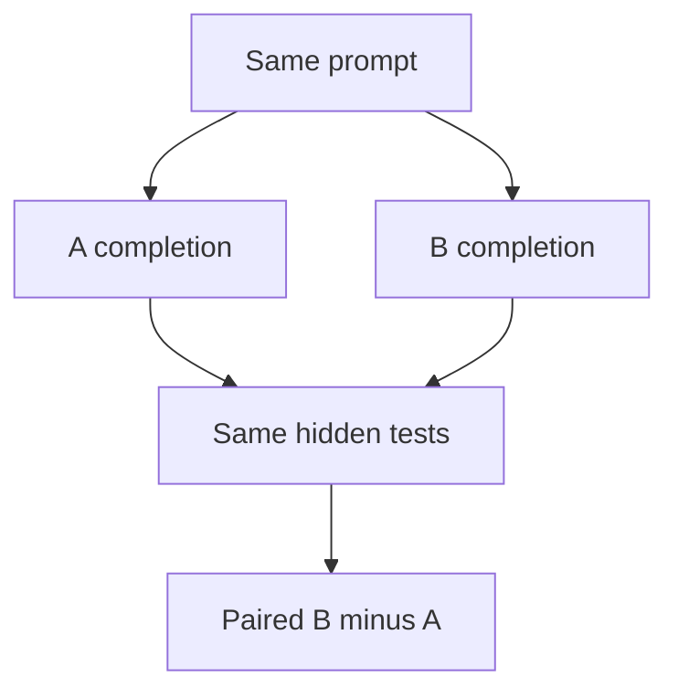

---
{
  "id": "hypothesis-tests-confidence-intervals-passk",
  "title": "Statistics, Bayesian Estimation & pass@k",
  "slug": "hypothesis-tests-confidence-intervals-passk",
  "section": "Math & Tensor Foundations",
  "category": "Evaluation & Benchmarks",
  "difficulty": "Easy",
  "order": 5,
  "coverImage": "illustrations/_generated/chapter_flow_dark.png",
  "companies": [
    "OpenAI",
    "Anthropic",
    "Google",
    "Meta"
  ],
  "shortDescription": "Bound pass rates with Wilson and Beta-Binomial intervals, compare checkpoints with paired tests and bootstrap lifts, and compute unbiased pass@k.",
  "keyConceptsTested": [
    "Wilson score and bootstrap intervals",
    "MLE, MAP, and Beta-Binomial updates",
    "credible vs confidence intervals",
    "paired sign tests and power",
    "paired variance reduction",
    "Bonferroni multiple comparisons",
    "unbiased pass@k and macro-averaging"
  ],
  "aliases": [
    "bayesian-inference-priors-posteriors",
    "statistics-estimation-uncertainty"
  ]
}
---

Model B passes 4 of 6 coding tasks while Model A passes 3. On a dashboard, `+16.7` percentage points looks decisive. Look at the rows, though: five tasks tied, and one single task separated the two checkpoints. Is that lead real progress or a coin flip?

In [Distributions and Sampling](/learn/probability-for-machine-learning), we watched binomial draws wobble around a fixed probability. Here we turn binary <span data-glossary="hidden-tests">hidden-test</span> pass counts into engineering decisions: bounding one rate with Wilson and bootstrap intervals, updating beliefs with MLE, MAP, and Beta-Binomial posteriors, comparing two checkpoints via paired sign tests and bootstrap lifts, and scoring multi-attempt code generation with unbiased `pass@k`.

## Bound a single rate: Wald, Wilson, and bootstrap

Before comparing two models, bound the uncertainty of one pass rate. On $n$ independent pass/fail tasks with observed rate $\hat{p} = k / n$, the **standard error** is $\widehat{\text{SE}} = \sqrt{\hat{p}(1 - \hat{p}) / n}$. Because $n$ sits under a square root, halving uncertainty requires $4\times$ as many tasks. Away from `0` and `1`, the normal approximation gives the quick **Wald interval** $\hat{p} \pm 1.96\,\widehat{\text{SE}}$.

At boundary counts (`0/10` or `10/10`), Wald breaks: $\hat{p}(1 - \hat{p}) = 0$ collapses the interval to `[0, 0]` or `[1, 1]`, pretending ten trials give absolute certainty. The **Wilson score <span data-glossary="confidence-interval">confidence interval</span>** avoids collapse by inverting a score test evaluated at candidate rates rather than plugging in $\hat{p}$:[^nistBinomialIntervals2026]

$$
\text{center} = \frac{\hat{p} + z^2 / (2n)}{1 + z^2 / n},
\qquad
\text{margin} = \frac{z}{1 + z^2 / n}\sqrt{\frac{\hat{p}(1 - \hat{p})}{n} + \frac{z^2}{4n^2}}
$$

Nonparametric **<span data-glossary="bootstrap-resampling">bootstrap</span>** resampling draws $n$ rows with replacement thousands of times and takes the 2.5th and 97.5th percentiles.[^efron1979][^scipyBootstrap2026] Bootstrap handles arbitrary statistics cleanly, though it also collapses on all-zero or all-one samples. When tasks arrive in correlated groups (such as prompt variants per repository), resample **whole clusters** rather than individual rows.

<!-- leetllm: test, output=show -->
```python title="wilson-vs-wald-and-bootstrap.py"
import numpy as np


def wald_ci(k: int, n: int, z: float = 1.96) -> tuple[float, float]:
    p = k / n
    se = np.sqrt(p * (1.0 - p) / n)
    return float(p - z * se), float(p + z * se)


def wilson_ci(k: int, n: int, z: float = 1.96) -> tuple[float, float]:
    p = k / n
    denom = 1.0 + z * z / n
    center = (p + z * z / (2.0 * n)) / denom
    margin = (z / denom) * np.sqrt(p * (1.0 - p) / n + z * z / (4.0 * n * n))
    return float(max(0.0, center - margin)), float(min(1.0, center + margin))


rng = np.random.default_rng(7)
for k, n in [(16, 100), (8, 10), (0, 10), (10, 10)]:
    w_lo, w_hi = wald_ci(k, n)
    s_lo, s_hi = wilson_ci(k, n)
    labels = np.array([1] * k + [0] * (n - k))
    b_lo, b_hi = np.quantile(rng.choice(labels, size=(10_000, n), replace=True).mean(axis=1), [0.025, 0.975])
    print(f"{k:>2}/{n:<3} Wald=[{w_lo:.3f}, {w_hi:.3f}] Wilson=[{s_lo:.3f}, {s_hi:.3f}] Boot=[{b_lo:.3f}, {b_hi:.3f}]")
```

<!-- leetllm: output:start -->
```text title="Output" output compact
16/100 Wald=[0.088, 0.232] Wilson=[0.101, 0.244] Boot=[0.090, 0.240]
 8/10  Wald=[0.552, 1.048] Wilson=[0.490, 0.943] Boot=[0.500, 1.000]
 0/10  Wald=[0.000, 0.000] Wilson=[0.000, 0.278] Boot=[0.000, 0.000]
10/10  Wald=[1.000, 1.000] Wilson=[0.722, 1.000] Boot=[1.000, 1.000]
```
<!-- leetllm: output:end -->

At `8/10`, Wald overshoots `1.0` (`1.048`); at `0/10`, both Wald and bootstrap collapse to `[0, 0]` while Wilson keeps `[0.000, 0.278]`.

> **Common mistake:** A frequentist 95% confidence interval means the *procedure* covers the fixed rate $p$ in 95% of repeated runs, not a 95% probability on $p$ for this sample.[^nistConfidenceIntervals2026] Direct probability statements about $p$ require Bayesian estimation.

## MLE, MAP, and Beta-Binomial Bayesian updates

Suppose an agent scores $s = 8$ passes and $f = 2$ failures ($n = 10$), and you ask: *what is the probability that true pass rate $p$ exceeds `0.70`?*

Given $p$, the binomial <span data-glossary="likelihood">likelihood</span> is $P(D \mid p) \propto p^s (1 - p)^f$, maximized by the **maximum likelihood estimate (MLE)** $\hat{p}_{\text{MLE}} = s / n = 0.800$. Pairing this likelihood with a **<span data-glossary="beta-distribution">Beta</span>** <span data-glossary="prior-probability">prior</span> $\operatorname{Beta}(\alpha, \beta)$ (density $\propto p^{\alpha - 1}(1 - p)^{\beta - 1}$) adds exponents directly, making Beta the **<span data-glossary="conjugate-prior">conjugate prior</span>** for binomial counts:[^bartlett2014betabinomial][^scipyBeta2026]

$$
p \mid D \sim \operatorname{Beta}(\alpha + s,\; \beta + f)
$$

With a mild symmetric prior $\operatorname{Beta}(2, 2)$, `8` passes and `2` failures yield the exact <span data-glossary="posterior-probability">posterior</span> $\operatorname{Beta}(10, 4)$, separating three summaries:

| Estimator | Formula ($a = \alpha + s,\; b = \beta + f$) | Value at 8/10, Beta(2, 2) | Target |
|---|---|---:|---|
| **MLE** | $s / n$ | `0.800` | Peak of data likelihood alone |
| **MAP** (mode, $a, b > 1$) | $(a - 1) / (a + b - 2)$ | `0.750` | Peak of posterior density |
| **Posterior mean** | $a / (a + b)$ | `0.714` | Expected value and next-task predictive rate |

The posterior mean blends prior mean `0.500` (weight `4`) and observed rate `0.800` (weight `10`): $\frac{4}{14}(0.5) + \frac{10}{14}(0.8) = \frac{10}{14} \approx 0.714$. For a future batch of tasks, integrating over posterior uncertainty in $p$ gives the **beta-binomial** <span data-glossary="posterior-predictive">posterior predictive</span>, which is wider than a fixed-rate binomial.[^scipyBetaBinomial2026]

Quantiles of `Beta(a, b)` yield an equal-tailed **<span data-glossary="credible-interval">credible interval</span>**, and `beta.sf(0.70, a, b)` gives $P(p > 0.70 \mid D)$ directly:

<!-- leetllm: test, deps=scipy, output=show -->
```python title="mle-map-and-beta-binomial.py"
from scipy.stats import beta

for label, s, f, a0, b0 in [
    ("8/10, Beta(1,1)", 8, 2, 1, 1),
    ("8/10, Beta(2,2)", 8, 2, 2, 2),
    ("8/10, Beta(20,20)", 8, 2, 20, 20),
    ("80/100, Beta(2,2)", 80, 20, 2, 2),
]:
    a, b = a0 + s, b0 + f
    lo, hi = beta.ppf([0.05, 0.95], a, b)
    print(
        f"{label:17s} -> Beta({a:>2},{b:>2}) "
        f"MLE={s/(s+f):.3f} MAP={(a-1)/(a+b-2):.3f} mean={a/(a+b):.3f} "
        f"90% CI=[{lo:.3f}, {hi:.3f}] P(p>0.7)={beta.sf(0.70, a, b):.3f}"
    )
```

<!-- leetllm: output:start -->
```text title="Output" output compact
8/10, Beta(1,1)   -> Beta( 9, 3) MLE=0.800 MAP=0.800 mean=0.750 90% CI=[0.530, 0.921] P(p>0.7)=0.687
8/10, Beta(2,2)   -> Beta(10, 4) MLE=0.800 MAP=0.750 mean=0.714 90% CI=[0.505, 0.887] P(p>0.7)=0.579
8/10, Beta(20,20) -> Beta(28,22) MLE=0.800 MAP=0.562 mean=0.560 90% CI=[0.444, 0.673] P(p>0.7)=0.019
80/100, Beta(2,2) -> Beta(82,22) MLE=0.800 MAP=0.794 mean=0.788 90% CI=[0.720, 0.851] P(p>0.7)=0.981
```
<!-- leetllm: output:end -->

> **Key insight:** Under `Beta(2, 2)` and `8/10`, the posterior mean (`0.714`) clears `0.70`, yet `42.1%` of posterior mass still lies below `0.70` (`P(p > 0.70 | D) = 0.579`). Test prior sensitivity on small samples; by `80/100`, data dominate and `P(p > 0.70 | D)` climbs to `0.981`.

## Paired comparisons and exact sign tests

Now compare Model A (`3/6`) and Model B (`4/6`) on the identical prompts, decoder settings, and hidden unit tests so harness drift cannot confound the difference. Join logs by `task_id` and count timeouts as failures.



<figure>
  
  <figcaption>Each row pairs the same task and hidden tests across both models. Five task differences are zero; task 2 is +1 for Model B, supplying the only discordant pair for the sign test.</figcaption>
</figure>

| Task | Hidden-test requirement | Model A | Model B | `B - A` |
|---|---|---:|---:|---:|
| 1 | timestamp range is inclusive | 1 | 1 | `0` |
| 2 | permission fallback preserves denial | 0 | 1 | `+1` |
| 3 | retry budget caps at configured limit | 1 | 1 | `0` |
| 4 | event deduplication keeps latest version | 0 | 0 | `0` |
| 5 | <span data-glossary="quota">quota</span> rounding is deterministic | 1 | 1 | `0` |
| 6 | cache invalidation skips expired keys | 0 | 0 | `0` |

Only disagreements reveal direction (`B wins = 1, A wins = 0, ties = 5`). Under the <span data-glossary="null-hypothesis">null hypothesis</span> ($H_0$), each independent disagreement is a fair coin flip ($p = 0.5$): the exact **sign test** (or exact **McNemar test** for paired binary outcomes).[^dixonmood1946][^statsmodelsMcNemar2026] For $d$ disagreements and $b$ wins by Model B, the preplanned one-sided <span data-glossary="p-value">p-value</span> is:

$$
p = \sum_{w=b}^{d} \binom{d}{w} \left(\frac{1}{2}\right)^d
$$

One win in one disagreement gives `p = 0.500`; `13` wins in `16` gives `0.0106` (two-sided `0.0213`). Never choose a one-sided direction after seeing who won.[^scipyBinomtest2026]

> **Common mistake:** A p-value is the probability of data at least this extreme *assuming $H_0$ holds*, not the probability that $H_0$ is true or that Model B is better.[^asaPValues2016]

<figure>
  
  <figcaption>With one discordant task, each fair-coin outcome has probability 0.50. With 16 disagreements, the exact right-tail mass from 13 through 16 B wins totals 0.0106 under H₀.</figcaption>
</figure>

<!-- leetllm: test, deps=scipy, output=show -->
```python title="paired-sign-test.py"
import numpy as np
from scipy.stats import binomtest

diff = np.array([1, 1, 1, 0, 1, 0]) - np.array([1, 0, 1, 0, 1, 0])
b_wins, a_wins = int(np.sum(diff == 1)), int(np.sum(diff == -1))
print(f"6-task lift: {diff.mean():+.3f} (B={b_wins}, A={a_wins}, ties={int(np.sum(diff == 0))})")
print(f"one-sided p (1 vs 0):  {binomtest(b_wins, b_wins + a_wins, p=0.5, alternative='greater').pvalue:.3f}")
print(f"one-sided p (13 vs 3): {binomtest(13, 16, p=0.5, alternative='greater').pvalue:.4f}")
```

<!-- leetllm: output:start -->
```text title="Output" output compact
6-task lift: +0.167 (B=1, A=0, ties=5)
one-sided p (1 vs 0):  0.500
one-sided p (13 vs 3): 0.0106
```
<!-- leetllm: output:end -->

### Power, error types, and multiple comparisons

| Reality \ Decision | Don't reject $H_0$ | Reject $H_0$ |
|---|---|---|
| **$H_0$ is true** | Correct non-rejection ($\ge 1 - \alpha$) | **Type I error**: false positive ($\le \alpha$) |
| **$H_1$ is true** | **Type II error** ($\beta$): missed gain | **Statistical power** ($1 - \beta$): detected gain |

Because the smallest one-sided sign-test p-value on $d$ disagreements is $2^{-d}$, even a sweep needs `5` disagreements to cross `0.05` (`1/32 = 0.03125`). A high p-value reflects weak evidence against $H_0$, never equivalence. Meanwhile, searching `20` prompt variants at $\alpha = 0.05$ raises family false-positive risk to $1 - 0.95^{20} \approx 64\%$. The **Bonferroni correction** tests each candidate at $\alpha / M = 0.0025$ (valid even under dependence),[^nistBonferroni2026] under which `0.0106` would fail if cherry-picked. Lock the sample size in advance and validate winners on an untouched holdout.[^asaPValues2016]

## Paired variance reduction and bootstrap lift intervals

Running both models on identical prompts removes shared task-difficulty noise. For task scores $X_i, Y_i \in \{0, 1\}$, unpaired batches add variances ($\frac{\sigma_X^2 + \sigma_Y^2}{N}$), whereas paired differences $D_i = Y_i - X_i$ subtract twice the covariance:[^pennStatePairedBinary2026]

$$
\operatorname{Var}(\bar{D}) = \frac{\sigma_X^2 + \sigma_Y^2 - 2\operatorname{Cov}(X, Y)}{N}
$$

When 45% of tasks are shared passes, 45% shared failures, and 5% each are A-only or B-only passes, both models have 50% marginal pass rates ($\sigma^2 = 0.25$) and $\operatorname{Cov}(X, Y) = 0.20$ ($\rho = 0.80$). At $N = 40$, pairing cuts mean-difference variance $5\times$, from `0.0125` (`SE = 0.112`) to `0.0025` (`SE = 0.050`), matching `200` unpaired tasks per model.

<figure>
  
  <figcaption>Both designs have 50% marginal pass rates, but positive shared-task covariance (ρ = 0.80) concentrates paired differences at zero, cutting mean-difference variance by 5x at N = 40.</figcaption>
</figure>

Build one **bootstrap interval for $B - A$** by resampling complete task rows with replacement. On a 40-task suite with `27` ties, `8` B-only wins, and `5` A-only wins (lift `+7.5` pp):

<!-- leetllm: test, output=show -->
```python title="paired-bootstrap-and-claim.py"
import numpy as np


def comparison_claim(lift: float, interval: tuple[float, float], min_useful: float = 0.02) -> str:
    low, high = interval
    if low > min_useful:
        return f"clears useful-lift bar: lift {lift:+.3f}"
    if low > 0:
        return f"positive lift, useful size unconfirmed: lift {lift:+.3f}"
    if high < 0:
        return f"regression: lift {lift:+.3f}"
    return f"inconclusive (crosses zero): lift {lift:+.3f}"


differences = np.array([0] * 27 + [1] * 8 + [-1] * 5)
rng = np.random.default_rng(7)
boot_lifts = differences[rng.integers(0, len(differences), size=(20_000, len(differences)))].mean(axis=1)

obs = float(differences.mean())
lo, hi = (float(x) for x in np.quantile(boot_lifts, [0.025, 0.975]))
print(f"observed lift: {obs * 100:+.1f} pp | 95% CI: [{lo * 100:+.1f}, {hi * 100:+.1f}] pp | resamples<=0: {np.mean(boot_lifts <= 0):.0%}")
for label, iv in [("40-task", (lo, hi)), ("narrow", (0.01, 0.14)), ("clear", (0.03, 0.12))]:
    print(f"{label:8s} -> {comparison_claim(obs, iv)}")
```

<!-- leetllm: output:start -->
```text title="Output" output compact
observed lift: +7.5 pp | 95% CI: [-10.0, +25.0] pp | resamples<=0: 24%
40-task  -> inconclusive (crosses zero): lift +0.075
narrow   -> positive lift, useful size unconfirmed: lift +0.075
clear    -> clears useful-lift bar: lift +0.075
```
<!-- leetllm: output:end -->

<figure>
  
  <figcaption>Bootstrap resampling the 40 paired rows gives a 95% interval of −10 to +25 percentage points around the +7.5-point observed lift, spanning both losses and gains.</figcaption>
</figure>

The `24%` share of resamples at or below zero is an empirical bootstrap frequency, neither a p-value nor a Bayesian posterior probability. Even when an interval clears zero (`[+1.0, +14.0]` pp), shipping a pricier model requires clearing a predeclared **minimum useful lift** (`+2.0` pp).

## Multi-attempt coding evaluation with pass@k

Coding assistants often sample multiple candidates and test whether at least one passes hidden <span data-glossary="unit-test">unit tests</span>. HumanEval formalizes this as **`pass@k`**, keeping two integers distinct: $k$ is the operational attempt budget, and $n \ge k$ is the i.i.d. pool sampled per task to estimate it accurately.[^chen2021]

If $c = 2$ of $n = 10$ candidates pass, `pass@5` is the complement of drawing `5` failures from the `8` failing candidates: $1 - \binom{8}{5}/\binom{10}{5} = 1 - 56/252 = 0.778$:

$$
\text{pass@k} = 1 - \frac{\binom{n - c}{k}}{\binom{n}{k}} = 1 - \prod_{i = n - c + 1}^{n} \left(1 - \frac{k}{i}\right)
$$

This combinatorial product is the **unbiased minimum-variance estimator** of $1 - (1 - p)^k$ and avoids factorial overflow.[^chen2021] For $k = 1$, it reduces to $c / n$. By contrast, the naive plug-in $1 - (1 - c/n)^k$ models drawing *with replacement* and is strictly downward-biased for $k > 1$ (`0.672` vs `0.778` here, a `10.6`-point shortfall).

<details>
<summary>Deep dive: Jensen's inequality proof of the downward bias</summary>

For $k > 1$ and $p \in (0, 1)$, $g(p) = 1 - (1 - p)^k$ is strictly concave ($g''(p) = -k(k - 1)(1 - p)^{k - 2} < 0$). Jensen's inequality therefore forces $\mathbb{E}[1 - (1 - \hat{p})^k] < 1 - (1 - p)^k$.

</details>

<figure>
  
  <figcaption>With 2 passing candidates out of 10, the unbiased combinatorial estimator gives 77.8% at k = 5, while the naive plug-in underestimates it at 67.2%, a 10.6-percentage-point shortfall.</figcaption>
</figure>

Always compute `pass@k` **per task first**, then macro-average across tasks. Pooling candidates across heterogeneous tasks breaks the nonlinear metric: if half of tasks always pass and half always fail, true macro `pass@5` is `0.500`, whereas applying $1 - (1 - 0.5)^5$ to the pooled average fabricates `0.969`.

<!-- leetllm: test, output=show -->
```python title="unbiased-pass-at-k-and-macro.py"
from itertools import product
import numpy as np


def pass_at_k(n: int, c: int, k: int) -> float:
    if n <= 0 or not 0 <= c <= n or not 1 <= k <= n:
        raise ValueError("require n > 0, 0 <= c <= n, and 1 <= k <= n")
    if n - c < k:
        return 1.0
    return float(1.0 - np.prod(1.0 - k / np.arange(n - c + 1, n + 1, dtype=np.float64)))


unbiased = pass_at_k(10, 2, 5)
naive = 1.0 - (1.0 - 2 / 10) ** 5
print(f"n=10, c=2, k=5 -> unbiased={unbiased:.4f} | naive={naive:.4f} | gap={unbiased - naive:.4f}")

counts = np.array([0, 1, 2, 4])
for budget in (1, 3, 5):
    scores = np.array([pass_at_k(10, int(c), budget) for c in counts])
    print(f"macro pass@{budget}: {scores.mean():.3f}  per-task={[round(float(s), 3) for s in scores]}")

scores_k5 = np.array([pass_at_k(10, int(c), 5) for c in counts])
idx = np.array(list(product(range(len(scores_k5)), repeat=len(scores_k5))))
lo, hi = np.quantile(scores_k5[idx].mean(axis=1), [0.025, 0.975])
print(f"macro pass@5 95% task-bootstrap CI: [{lo:.3f}, {hi:.3f}]")
```

<!-- leetllm: output:start -->
```text title="Output" output compact
n=10, c=2, k=5 -> unbiased=0.7778 | naive=0.6723 | gap=0.1055
macro pass@1: 0.175  per-task=[0.0, 0.1, 0.2, 0.4]
macro pass@3: 0.417  per-task=[0.0, 0.3, 0.533, 0.833]
macro pass@5: 0.563  per-task=[0.0, 0.5, 0.778, 0.976]
macro pass@5 95% task-bootstrap CI: [0.194, 0.877]
```
<!-- leetllm: output:end -->

Hold the task suite, unit tests, attempt budget $k$, decoding settings, and timeout rules fixed across models.[^humanEvalEstimator2026] Greedy decoding makes all candidates identical (collapsing `pass@5` to `pass@1`), higher <span data-glossary="temperature">temperature</span> trades `pass@1` reliability for larger-$k$ diversity, stopping early on first pass breaks the i.i.d. pool, hidden-test `pass@k` credits oracle selection rather than top-1 ranking, and untrusted generated code must run inside an isolated <span data-glossary="sandbox">sandbox</span>.[^chen2021][^humanEvalRepository2026]

```checkpoint
A teammate writes: "Model B wins because its pass@5 hit 64% while Model A's pass@1 was 58%." What three things are missing?
---
1. Matched protocol and budget (compare both at the same k, decoding settings, test suite, and declared pool n >= k).
2. A paired B - A lift and confidence interval across shared tasks.
3. Practical serving cost for generating and verifying five candidates.
```

> **Key insight:** Pair every benchmark score with its uncertainty interval (Wilson or Beta-Binomial for single rates, paired bootstrap for lifts), matched protocol (`k`, `n`, decoding, timeouts), multiple-comparison count, and compute budget.

```mastery-quiz
[
  {
    "question": "A checkpoint passes 0 of 10 independent tasks. Why is the Wilson score 95% interval preferred over the Wald interval here?",
    "options": [
      "Wald collapses to [0.000, 0.000], whereas Wilson keeps a nonzero upper bound (about 0.278) reflecting small-sample uncertainty.",
      "Wald produces a wider interval than Wilson at 0/10, making small benchmarks look too noisy.",
      "Wilson guarantees a 95% Bayesian posterior probability that the true rate lies below 0.278.",
      "Wilson removes the need to keep the 10 tasks independent."
    ],
    "answer": "Wald collapses to [0.000, 0.000], whereas Wilson keeps a nonzero upper bound (about 0.278) reflecting small-sample uncertainty.",
    "explanation": "At 0/10, Wald standard error sqrt(p_hat*(1-p_hat)/n) is zero, collapsing to a point. Wilson inverts a score test using candidate rates, giving [0.000, 0.278] while remaining a frequentist confidence procedure."
  },
  {
    "question": "Starting from Beta(2, 2), an agent passes 8 of 10 independent tasks. What are the posterior distribution, MLE, MAP, and posterior mean?",
    "options": [
      "Beta(10, 4); MLE = 0.800; MAP = 0.750; posterior mean = 0.714.",
      "Beta(10, 4); MLE = 0.800; MAP = 0.714; posterior mean = 0.750.",
      "Beta(8, 2); MLE = 0.800; MAP = 0.750; posterior mean = 0.714.",
      "Beta(10, 4); MLE = 0.714; MAP = 0.750; posterior mean = 0.800."
    ],
    "answer": "Beta(10, 4); MLE = 0.800; MAP = 0.750; posterior mean = 0.714.",
    "explanation": "Beta-Binomial conjugacy gives Beta(2+8, 2+2) = Beta(10, 4). MLE is 8/10 = 0.800, MAP mode is (10-1)/(10+4-2) = 0.750, and posterior mean is 10/14 = 0.714."
  },
  {
    "question": "Both models have marginal variance 0.25 and shared-task covariance 0.15. Comparing 50 paired tasks against two unpaired 50-task batches, what are the paired and unpaired mean-difference variances?",
    "options": [
      "0.004 paired; 0.010 unpaired.",
      "0.010 paired; 0.004 unpaired.",
      "0.007 paired; 0.010 unpaired.",
      "0.016 paired; 0.010 unpaired."
    ],
    "answer": "0.004 paired; 0.010 unpaired.",
    "explanation": "Paired variance is (0.25 + 0.25 - 2 * 0.15) / 50 = 0.004, versus (0.25 + 0.25) / 50 = 0.010 unpaired."
  },
  {
    "question": "A team ships Model B only if evidence supports lift above 4 percentage points. On 60 paired tasks, the 95% bootstrap lift interval is [+3, +11] pp. What verdict follows?",
    "options": [
      "Positive lift is supported, but useful size above 4 points is unconfirmed; hold under this rule.",
      "Useful size is confirmed because the midpoint (+7 points) exceeds 4 points.",
      "Positive lift is unconfirmed because the interval is too wide.",
      "Ship immediately because the upper bound (+11 points) exceeds 4 points."
    ],
    "answer": "Positive lift is supported, but useful size above 4 points is unconfirmed; hold under this rule.",
    "explanation": "The lower endpoint (+3 pp) sits above 0 but below +4 pp, supporting a positive lift without yet confirming the required practical size."
  },
  {
    "question": "Two tasks each sample n = 6 i.i.d. candidates with correct counts c = [0, 3]. For k = 2, what is unbiased macro pass@2, and what does wrongly pooling all 12 candidates produce?",
    "options": [
      "0.40 macro; 5/11 (about 0.455) pooled.",
      "5/11 macro; 0.40 pooled.",
      "0.25 macro; 7/16 pooled.",
      "0.80 macro; 5/11 pooled."
    ],
    "answer": "0.40 macro; 5/11 (about 0.455) pooled.",
    "explanation": "Per-task pass@2 scores are 0 and 1 - C(3,2)/C(6,2) = 0.80, averaging to 0.40. Pooling gives 1 - C(9,2)/C(12,2) = 5/11."
  }
]
```

> **Next:** Continue to [Linear Regression from Scratch](/learn/linear-regression-from-scratch).
