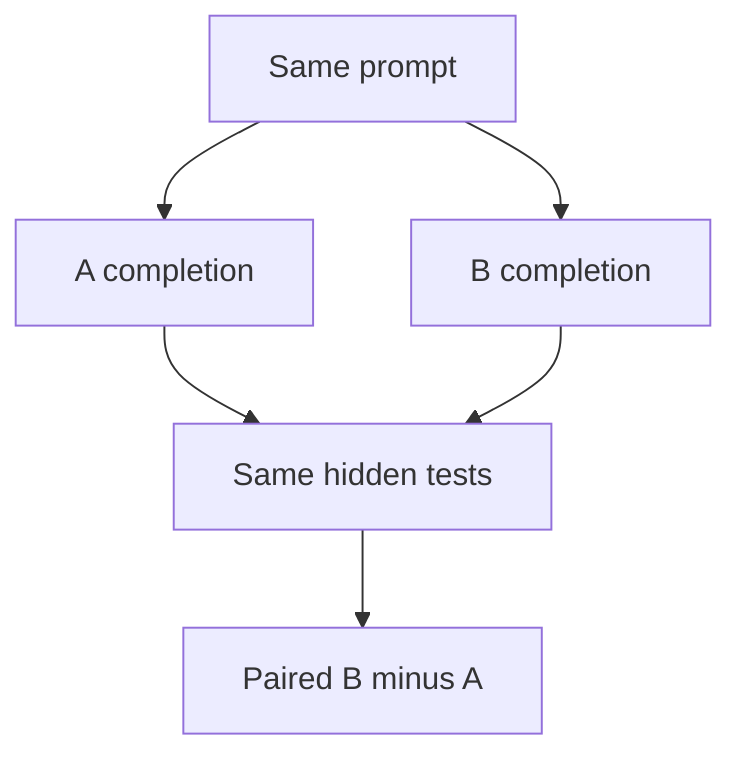

---
{
  "id": "hypothesis-tests-confidence-intervals-passk",
  "title": "Hypothesis Tests, Intervals, and pass@k",
  "slug": "hypothesis-tests-confidence-intervals-passk",
  "section": "Math & Statistics",
  "category": "Evaluation & Benchmarks",
  "difficulty": "Easy",
  "order": 9,
  "coverImage": "illustrations/_generated/chapter_flow_dark.png",
  "companies": [
    "OpenAI",
    "Anthropic",
    "Google",
    "Meta"
  ],
  "shortDescription": "Judge one extra coding pass with a paired interval, and read pass@k only under a matched attempt budget.",
  "keyConceptsTested": [
    "null hypothesis",
    "paired comparisons",
    "p-value intuition",
    "Type I and Type II errors",
    "paired variance reduction",
    "bootstrap confidence intervals",
    "pass@k",
    "functional correctness",
    "evaluation protocols",
    "multiple comparisons and fixed analysis plans",
    "practical significance"
  ]
}
---

Model B passes 4 of 6 coding tasks while Model A passes 3. On a dashboard, `+16.7` percentage points looks like a clear win. Look at the rows, though: five tasks tied, and only one single task separated the two checkpoints. Is that lead a real improvement or a coin flip?

In [Statistics and Uncertainty](/learn/statistics-estimation-uncertainty) we bounded uncertainty around a single rate, and in [Distributions and Sampling](/learn/distributions-sampling-simulation) we watched repeated binomial draws wobble around a fixed probability. Now we shift to comparing two models head to head: exact paired hypothesis tests, paired variance reduction, bootstrap lift intervals, and the unbiased `pass@k` estimator for multi-attempt code generation. All six example tasks test small coding utilities against the same <span data-glossary="hidden-tests">hidden tests</span> under binary pass/fail scoring, small enough to verify every calculation by hand.

<figure>
  
  <figcaption>Each row pairs the same task and hidden tests across both models. Five task differences are zero; task 2 is +1 for Model B, supplying the only discordant pair for the sign test.</figcaption>
</figure>

## Start with paired pass or fail outcomes

Both models receive the identical prompt and face the identical hidden unit tests. Keeping prompts, decoding settings, and test harnesses matched isolates the model difference rather than confounding it with harness changes. Treat each task as a single paired observation:



Inspect the six outcomes and spot where the two columns disagree:

| Task | Hidden-test requirement | Model A | Model B |
|---|---|---:|---:|
| 1 | timestamp range is inclusive | pass | pass |
| 2 | permission fallback preserves denial | fail | pass |
| 3 | retry budget caps at configured limit | pass | pass |
| 4 | event deduplication keeps latest version | fail | fail |
| 5 | <span data-glossary="quota">quota</span> rounding is deterministic | pass | pass |
| 6 | cache invalidation skips expired keys | fail | fail |

Encode `pass` as `1` and `fail` as `0`. Model A solves `3/6 = 0.500`, Model B solves `4/6 = 0.667`, and the observed lift is `+1/6 = +0.167` (`+16.7` percentage points):

<!-- leetllm: test, output=show -->
```python title="paired-pass-rates.py"
import numpy as np

model_a = np.array([1, 0, 1, 0, 1, 0])
model_b = np.array([1, 1, 1, 0, 1, 0])

rate_a = float(model_a.mean())
rate_b = float(model_b.mean())
lift = rate_b - rate_a

print(f"Model A pass@1: {rate_a:.3f}")
print(f"Model B pass@1: {rate_b:.3f}")
print(f"observed lift:   {lift:+.3f} ({lift * 100:+.1f} percentage points)")
```

<!-- leetllm: output:start -->
```text title="Output" output compact
Model A pass@1: 0.500
Model B pass@1: 0.667
observed lift:   +0.167 (+16.7 percentage points)
```
<!-- leetllm: output:end -->

Looking only at aggregate totals conceals the pairing. Subtract Model A's score from Model B's score on each row:

| Result on one task | Difference `B - A` | Count |
|---|---:|---:|
| both pass | `0` | 3 |
| both fail | `0` | 2 |
| B passes, A fails | `+1` | 1 |
| A passes, B fails | `-1` | 0 |

Only disagreement tasks reveal which model performed better. Ties still shape both overall pass rates and the magnitude of the lift, but not the sign test's conditional win count. That distinction drives the first hypothesis test.

<!-- leetllm: test, output=show -->
```python title="count-disagreements.py"
import numpy as np

model_a = np.array([1, 0, 1, 0, 1, 0])
model_b = np.array([1, 1, 1, 0, 1, 0])

differences = model_b - model_a
b_wins = int(np.sum(differences == 1))
a_wins = int(np.sum(differences == -1))
ties = int(np.sum(differences == 0))

print("paired differences:", differences.tolist())
print(f"B wins={b_wins}, A wins={a_wins}, ties={ties}")
print("directional evidence comes from disagreements:", b_wins + a_wins)
```

<!-- leetllm: output:start -->
```text title="Output" output compact
paired differences: [0, 1, 0, 0, 0, 0]
B wins=1, A wins=0, ties=5
directional evidence comes from disagreements: 1
```
<!-- leetllm: output:end -->

Always join evaluation logs by `task_id` rather than completion order, and apply a consistent timeout/failure rule so missing rows stay paired. Now ask how surprising that single B win really is.

## How surprising is one B win?

Only one task disagreed, and Model B won it. Under the <span data-glossary="null-hypothesis">null hypothesis</span> ($H_0$), both models are equally likely to win any disagreement ($p = 0.5$). Under the preplanned directional alternative ($H_1$), Model B wins more often ($p > 0.5$).

Conditioning on the $d$ independent disagreements turns each one into a fair coin flip: this is the exact **sign test** (and for paired binary outcomes, the exact **McNemar test**, whose standard two-sided form checks either direction).[^dixonmood1946][^statsmodelsMcNemar2026] When tasks are grouped by repository or template rather than independent, use a cluster-level analysis instead.

For $d$ disagreements and $b$ wins by Model B, the one-sided <span data-glossary="p-value">p-value</span> sums the null probability of observing at least $b$ wins:

$$
p = \sum_{w=b}^{d} \binom{d}{w} \left(\frac{1}{2}\right)^d
$$

With $d = 1$ and $b = 1$, a fair coin lands heads with probability `0.500`: completely unremarkable. By contrast, winning `13` of `16` disagreements lands in a rare tail of `0.0106`.

> **Common mistake:** A p-value is the probability of seeing data at least this extreme *assuming $H_0$ holds*, not the probability that $H_0$ is true or that Model B is better.[^asaPValues2016]

<figure>
  
  <figcaption>With one discordant task, each fair-coin outcome has probability 0.50. With 16 disagreements, the exact right-tail mass from 13 through 16 B wins totals 0.0106 under H₀.</figcaption>
</figure>

<!-- leetllm: test, deps=scipy, output=show -->
```python title="exact-directional-p-value.py"
from scipy.stats import binomtest


def b_wins_one_sided_p_value(b_wins: int, a_wins: int) -> float:
    disagreements = b_wins + a_wins
    if disagreements == 0:
        return 1.0
    return float(binomtest(b_wins, disagreements, p=0.5, alternative="greater").pvalue)


print(f"one B win, zero A wins: p={b_wins_one_sided_p_value(1, 0):.3f}")
print(f"thirteen B wins, three A wins: p={b_wins_one_sided_p_value(13, 3):.4f}")
```

<!-- leetllm: output:start -->
```text title="Output" output compact
one B win, zero A wins: p=0.500
thirteen B wins, three A wins: p=0.0106
```
<!-- leetllm: output:end -->

Thirteen wins to three is a completely different story. If you had declared "Model B is better" before seeing the outcomes, that one-sided tail probability is $0.0106$. If you had planned to detect a difference in either direction, the symmetric two-sided binomial test yields about $0.0213$ here. Never pick the favorable direction after inspecting who won.[^scipyBinomtest2026]

```checkpoint
Model B passes four tasks and Model A passes three, but there is only one disagreement. What is the safe conclusion?
---
Model B scored higher in this small sample. The single disagreement gives weak evidence for a durable improvement, so you should collect more paired tasks before claiming the model is better.
```

A p-value answers whether a win is surprising under the null. It doesn't tell you how large the lift is, or whether the test had enough power to detect a real gain.

```checkpoint
A preplanned directional test observes 9 B-only wins and 1 A-only win across 10 independent disagreements. What are its one-sided fair-sign tail and symmetric two-sided tail?

1. 9/10 and 1/10.
2. 1/1024 and 2/1024.
3. 10/1024 and 20/1024.
4. 11/1024 and 22/1024.
---
**Answer:** 11/1024 and 22/1024.

The right tail includes exactly 9 and 10 wins: [C(10, 9)+C(10, 10)]/2^10=11/1024. The symmetric opposite tail doubles it. Choosing direction after seeing who won would alter the plan.
```

```checkpoint
A planned one-sided fair-sign test uses alpha=.025. If B wins every disagreement, what is the fewest disagreements that can reach the threshold?

1. 4 disagreements, p=1/16.
2. 5 disagreements, p=1/32.
3. 6 disagreements, p=1/64.
4. 7 disagreements, p=1/128.
---
**Answer:** 6 disagreements, p=1/64.

The minimum possible tail is 2^(−d). At 5 it is 0.03125>.025; at 6 it is 0.015625≤.025. This conditional limit is not a full power calculation for a task population with random ties.
```

## Type I errors, Type II errors, and statistical power

Every hypothesis test balances two complementary mistakes:

| Reality \ Decision | Don't reject $H_0$ | Reject $H_0$ |
|---|---|---|
| **$H_0$ is true** | Correct non-rejection (probability $\ge 1 - \alpha$) | **Type I error**: false positive (probability $\le \alpha$) |
| **$H_1$ is true** (B is genuinely better) | **Type II error** ($\beta$): missed improvement | **Statistical power** ($1 - \beta$): detected improvement |

- **Type I error ($\alpha$):** falsely concluding Model B is better when it is not. A preplanned level-$\alpha$ test bounds this false-positive rate at or below $\alpha$.
- **Type II error ($\beta$) and power ($1 - \beta$):** failing to detect a real gain of size $\delta$. Power grows with larger effect size $\delta$, larger task count $N$, lower task variance $\sigma^2$, and less stringent significance threshold $\alpha$.

Notice why tiny benchmarks starve power: with $d$ disagreements, the smallest possible one-sided sign-test p-value is $2^{-d}$, so even a clean sweep needs at least `5` disagreements to dip below $\alpha = 0.05$ (`1/32 = 0.03125`).

> **Common mistake:** A high p-value ($p > 0.05$) is absence of evidence, not evidence of equality. Proving two models perform within a small tolerance requires an explicit equivalence test, not a non-significant difference test.

```checkpoint
A simulator is configured with a real advantage for B. A valid planned test fails to reject H₀ in one run. Which classification and interpretation fit that run?

1. Type I error; that non-rejection confirms task-distribution equivalence.
2. Type II error; that non-rejection does not prove equivalence.
3. Type II error; that non-rejection proves equal task distributions.
4. Type I error; that non-rejection means the specified advantage was absent.
---
**Answer:** Type II error; that non-rejection does not prove equivalence.

Under a specified true alternative, a missed rejection is Type II. Power is detection probability under that alternative. In a real evaluation the unknown truth is not revealed by a high p-value; equivalence needs its own tolerance-based analysis.
```

## Looking for a winner changes the test

Suppose the 13-to-3 result was the best of twenty prompt variants tried against Model A. Reporting only its $p = 0.0106$ leaves out nineteen opportunities to find a small p-value by pure chance.

A significance level, such as $\alpha = 0.05$, limits the false-rejection probability for a single, preplanned test under its null. Searching a catalog changes the family-wise error rate: if twenty independent tests each falsely reject with probability $0.05$, the probability of at least one false rejection is:

$$
1 - (1 - 0.05)^{20} \approx 64\%
$$

One standard safeguard is the **Bonferroni correction**: for twenty planned comparisons, test each individual comparison at $\alpha / M = 0.05 / 20 = 0.0025$. This adjustment bounds the family-wise error rate even when tests are dependent, provided each p-value is valid. Our $0.0106$ result doesn't clear that bar. Bonferroni can be conservative, but the core discipline is to account for all comparisons searched, not just the winner.[^nistBonferroni2026]

Repeatedly inspecting the same benchmark and halting execution the moment $p < 0.05$ is another form of hidden search. Fix the sample size and analysis protocol in advance, or use sequential testing methods designed for continuous monitoring. If an evaluation suite guided prompt or hyperparameter selection, validate the chosen checkpoint on an untouched holdout benchmark. A low p-value isn't a replacement for clean data splits.[^asaPValues2016]

## When pairing reduces variance

Evaluating Model A and Model B on the exact same prompts removes prompt-difficulty noise whenever both models tend to find the same tasks easy or hard. Let $X_i, Y_i \in \{0, 1\}$ denote Model A's and Model B's outcomes on task $i$. On two separate, unpaired batches of size $N$, the variance of the difference in sample means adds their variances:

$$
\text{Var}(\bar{Y} - \bar{X}) = \frac{\sigma_X^2 + \sigma_Y^2}{N}
$$

On $N$ paired tasks, averaging the row differences $D_i = Y_i - X_i$ subtracts twice their covariance:[^pennStatePairedBinary2026]

$$
\text{Var}(\bar{D}) = \frac{\text{Var}(Y_i - X_i)}{N} = \frac{\sigma_X^2 + \sigma_Y^2 - 2\text{Cov}(X, Y)}{N}
$$

Whenever $\text{Cov}(X, Y) > 0$, pairing shrinks variance (zero covariance leaves it unchanged; negative covariance increases it). Suppose 45% of tasks are shared passes, 45% shared failures, 5% B-only passes, and 5% A-only passes. Both models have 50% marginal pass rates ($\sigma_X^2 = \sigma_Y^2 = 0.25$), covariance $\text{Cov}(X, Y) = 0.45 - 0.25 = 0.20$, and correlation $\rho = 0.80$.

At $N = 40$, unpaired evaluation has variance $(0.25 + 0.25)/40 = 0.0125$ ($\text{SE} = 0.1118$, normal margin $\pm 21.9$ points). Pairing drops variance by $5\times$:

$$
\text{Var}(\bar{D}) = \frac{0.25 + 0.25 - 2(0.20)}{40} = \frac{0.10}{40} = 0.0025
$$

The standard error falls to `0.050` (normal margin $\pm 9.8$ points): you would need `200` unpaired tasks per model to match the precision of `40` paired tasks.

<figure>
  
  <figcaption>Both designs have 50% marginal pass rates, but positive shared-task covariance (ρ = 0.80) concentrates paired differences at zero, cutting mean-difference variance by 5x at N = 40.</figcaption>
</figure>

```checkpoint
A benchmark has 6 independent repositories, each contributing 10 related prompt variants. To estimate uncertainty across new repositories while retaining A/B pairing, which bootstrap is appropriate?

1. Resample 60 A scores and 60 B scores independently across their completion order.
2. Resample 60 individual paired rows and treat prompt variants as independent.
3. Resample 6 winning variants and replicate each one ten times to preserve sample size.
4. Resample 6 repository clusters and carry each selected cluster’s paired task rows.
---
**Answer:** Resample 6 repository clusters and carry each selected cluster’s paired task rows.

The declared independent unit is repository. Resampling whole clusters retains within-repository dependence and task pairing. More correlated variants do not provide more independent repository draws.
```

## An interval for B minus A

Comparing two separate pass-rate intervals hides the pairing; instead, build a single <span data-glossary="confidence-interval">confidence interval</span> for the paired lift $B - A$. Remember that a 95% confidence level describes long-run coverage across repeated experiments, and unlike a single-proportion Wilson interval, paired differences are cleanly bounded by <span data-glossary="bootstrap-resampling">bootstrap</span> resampling whole task rows with replacement.[^nistConfidenceIntervals2026][^nistBinomialIntervals2026][^efron1979][^scipyBootstrap2026]

Move from 6 tasks to a 40-task suite with `17` shared passes, `10` shared failures, `8` B-only wins, and `5` A-only wins (observed lift `+3/40 = +7.5` percentage points), and resample all 40 paired differences:

<!-- leetllm: test, output=show -->
```python title="paired-bootstrap-interval.py"
import numpy as np

differences = np.array([0] * 27 + [1] * 8 + [-1] * 5)
rng = np.random.default_rng(7)
boot_idx = rng.integers(0, len(differences), size=(20_000, len(differences)))
bootstrap_lifts = differences[boot_idx].mean(axis=1)

low, high = np.quantile(bootstrap_lifts, [0.025, 0.975])
observed = float(differences.mean())
at_or_below_zero = float(np.mean(bootstrap_lifts <= 0))

print(f"observed paired lift: {observed * 100:+.1f} percentage points")
print(f"approximate 95% bootstrap interval: {low * 100:+.1f} to {high * 100:+.1f} points")
print("interval includes zero:", bool(low <= 0 <= high))
print(f"share of resamples with lift <= 0: {at_or_below_zero:.0%}")
```

<!-- leetllm: output:start -->
```text title="Output" output compact
observed paired lift: +7.5 percentage points
approximate 95% bootstrap interval: -10.0 to +25.0 points
interval includes zero: True
share of resamples with lift <= 0: 24%
```
<!-- leetllm: output:end -->

Always resample whole task rows so multi-metric evaluations keep both models paired.

> **Common mistake:** The printed `24%` share of resamples at or below zero is a bootstrap resample frequency around the observed `+7.5`-point lift, not a null-hypothesis p-value and not a Bayesian posterior probability that Model B is worse.

<figure>
  
  <figcaption>Bootstrap resampling the 40 paired rows gives a 95% interval of −10 to +25 percentage points around the +7.5-point observed lift, spanning both losses and gains.</figcaption>
</figure>

Bootstrap intervals remain approximate on tiny or degenerate samples (for instance, six ties always resample to `[0, 0]`). Even when an interval excludes zero, practical value requires clearing a pre-declared **minimum useful lift**: if hosting Model B requires at least `+2` percentage points to pay for extra compute, an interval of `[+1, +14]` points shows positive lift without yet confirming useful size. The helper below separates those three verdicts:

<!-- leetllm: test, output=show -->
```python title="language-from-lift-interval.py"
def comparison_claim(
    observed_lift: float,
    interval: tuple[float, float],
    minimum_useful_lift: float = 0.02,
) -> str:
    low, high = interval
    if low > high or minimum_useful_lift < 0:
        raise ValueError("require ordered endpoints and a nonnegative useful lift")
    if low > minimum_useful_lift:
        return f"clears useful-lift threshold: estimated lift {observed_lift:+.3f}"
    if low > 0:
        return f"positive lift, useful size unconfirmed: estimate {observed_lift:+.3f}"
    if high < 0:
        return f"evidence of regression: estimated lift {observed_lift:+.3f}"
    return f"inconclusive: estimated lift {observed_lift:+.3f}, interval includes zero"


print(comparison_claim(0.075, (-0.100, 0.250)))
print(comparison_claim(0.075, (0.010, 0.140)))
print(comparison_claim(0.075, (0.030, 0.120)))
```

<!-- leetllm: output:start -->
```text title="Output" output compact
inconclusive: estimated lift +0.075, interval includes zero
positive lift, useful size unconfirmed: estimate +0.075
clears useful-lift threshold: estimated lift +0.075
```
<!-- leetllm: output:end -->

So far each task evaluated a single completion from each model. Coding evaluations often permit several candidate attempts. That measures a different capability, and it demands its own evaluation protocol.

```checkpoint
Two observed paired task rows have differences [0, 1]. A toy bootstrap samples two complete rows with replacement and computes their mean. Over all four equally likely ordered resamples, what fraction has mean zero, and which distribution generated that fraction?

1. 0.25; the observed empirical row distribution.
2. 0.50; the observed empirical row distribution.
3. 0.25; the equal-win null-hypothesis distribution.
4. 0.50; the equal-win null-hypothesis distribution.
---
**Answer:** 0.25; the observed empirical row distribution.

The ordered resamples are [0, 0], [0, 1], [1, 0] and [1, 1], with means 0, 0.5, 0.5 and 1. One of four gives zero. These rows are resampled from the observed empirical distribution, not generated under the fair-sign null. This fraction is neither the null-tail p-value nor a posterior probability about the true lift.
```

## pass@k measures attempts

A coding assistant can generate multiple candidate functions, allowing an automated test harness to verify whether at least one candidate passes hidden tests. That is the capability measured by `pass@k` in functional code-generation benchmarks like HumanEval.[^chen2021] The metric fixes a budget of $k$ candidate attempts per task. An alternative completion may solve a task that the model's first attempt missed.

HumanEval comprises 164 handwritten Python coding problems with an average of 7.7 <span data-glossary="unit-test">unit tests</span> each. In that paper, the authors generated $n = 200$ samples per task ($n \ge k$) and reported $k$ up to $100$. Those parameters reflect their specific experimental design, not a rigid requirement. The estimator below works for any predeclared $n \ge k$ that you run.

Consider this sample of three platform-helper tasks with three completions each, paying attention to the retry-state row where only the third candidate passes. Each task contributes one binary result for Attempt 1 (`first_attempt_hit`) and one for whether any of the three completions succeeded (`any_of_3_hit`), while a full HumanEval-style harness evaluates all sampled candidates to compute an unbiased estimate:

| Task | Attempt 1 | Attempt 2 | Attempt 3 | first_attempt_hit | any_of_3_hit |
|---|---:|---:|---:|---:|---:|
| parse timestamp window | pass | fail | fail | 1 | 1 |
| retry-state fallback | fail | fail | pass | 0 | 1 |
| quota split rounding | fail | fail | fail | 0 | 0 |

<!-- leetllm: test, output=show -->
```python title="pass-at-k-from-attempt-table.py"
import numpy as np

attempts = np.array([
    [1, 0, 0],
    [0, 0, 1],
    [0, 0, 0],
])

first_attempt_hit = float(attempts[:, 0].mean())
any_of_3_hit = float(attempts.any(axis=1).mean())

print(f"first_attempt_hit: {first_attempt_hit:.3f}")
print(f"any_of_3_hit: {any_of_3_hit:.3f}")
print("extra solved tasks from extra attempts:", int((any_of_3_hit - first_attempt_hit) * len(attempts)))
```

<!-- leetllm: output:start -->
```text title="Output" output compact
first_attempt_hit: 0.333
any_of_3_hit: 0.667
extra solved tasks from extra attempts: 1
```
<!-- leetllm: output:end -->

The ordered table answered a product question about a known first completion. For reporting standard HumanEval metrics, treat the $n$ candidates as an unordered pool and evaluate the combinatorial estimator on the count of correct completions. For the same three tasks with $n = 3$ samples each, the correct counts are $c = [1, 1, 0]$. The unbiased `pass@1` score is the mean of $c/n$:

$$
\frac{1}{3}\left(\frac{1}{3} + \frac{1}{3} + \frac{0}{3}\right) \approx 0.222
$$

When $k = 1$, the combinatorial formula simplifies to $c/n$, regardless of which completion came first, and when $n = k = 3$ it equals `any_of_3_hit`. Keeping $k$ and $n$ distinct clarifies the budget: $k$ fixes the operational attempt budget under evaluation, while $n \ge k$ is the sampled pool used to estimate that score cleanly. Always publish $k$, the pool size $n$, decoding parameters, and the test suites behind the run, remembering that higher <span data-glossary="temperature">temperature</span> often raises larger-$k$ diversity without improving single-attempt reliability.[^chen2021]

```checkpoint
Two fixed iid studies use the same task distribution, decoder and k=3. One predeclares n=50 and the other n=100. Which target and reporting interpretation follows?

1. Different pass@k targets; rescale k to 6 for the larger sample pool.
2. Same pass@3 target; report only the larger pool’s hidden-test score.
3. Different pass@k targets; reduce the larger pool to its first 3 samples.
4. Same pass@3 target; report n and the study’s sampling uncertainty.
---
**Answer:** Same pass@3 target; report n and the study’s sampling uncertainty.

n is estimation pool size while k is the operational attempt budget. Both fixed n≥k pools estimate the same target under the stated sampling protocol. Precision and n still need reporting.
```

```checkpoint
Two tasks have ordered attempt outcomes[0, 1]and[1, 0]. Treat those positions as fixed pools of two. What are first-attempt hit, realized any-of-two hit and combinatorial macro pass@1?

1. 0.5; 0.5; 1.0.
2. 1.0; 1.0; 0.5.
3. 0.5; 1.0; 0.5.
4. 0.5; 1.0; 1.0.
---
**Answer:** 0.5; 1.0; 0.5.

One first candidate passes, two tasks have a pass somewhere, and both unordered pools have c/n=1/2. The ordered realized statistic and the combinatorial target should retain their definitions even when numbers happen to match.
```

```checkpoint
When a task has `n=10` candidates and `c=2` correct, what is HumanEval-style pass@1?
---
`0.2`. For `k=1` the combinatorial estimator is `c/n`. It doesn't depend on which of the ten samples came first in generation order.
```

## Derive the HumanEval estimator by hand

Suppose a model generates $n = 10$ independent candidate solutions for one problem, and hidden tests pass $c = 2$ of them. To estimate `pass@5` (the chance that a random 5-candidate draw contains at least one solution), count the complement: how many 5-candidate subsets fail completely? With $n - c = 8$ failures, there are $\binom{10}{5} = 252$ total subsets and $\binom{8}{5} = 56$ all-failing subsets, giving $1 - 56/252 = 0.778$:

$$
\text{pass@k} = 1 - \frac{\binom{n-c}{k}}{\binom{n}{k}}
$$

Averaged over all $k$-subsets of $n$ i.i.d. draws from a fixed decoder, this combinatorial formula is the **unbiased minimum-variance estimator** of the true probability $1 - (1 - p)^k$.[^chen2021] Note that stopping early on the first pass or feeding compiler errors back into later attempts breaks the i.i.d. pool assumption and measures an iterative agent loop instead; also remember that hidden-test `pass@k` credits any pool containing a solution without testing whether a ranker can pick it. Verify the hand counts with `scipy.special.comb`:

<!-- leetllm: test, deps=scipy, output=show, id=pass-at-k-hand-calculation -->
```python title="pass-at-k-hand-calculation.py"
from scipy.special import comb

n = 10
c = 2
k = 5
all_groups = int(comb(n, k, exact=True))
all_failing_groups = int(comb(n - c, k, exact=True))
score = 1 - all_failing_groups / all_groups

print("all groups:", all_groups)
print("all-failing groups:", all_failing_groups)
print(f"pass@5: {score:.3f}")
```

<!-- leetllm: output:start -->
```text title="Output" output compact
all groups: 252
all-failing groups: 56
pass@5: 0.778
```
<!-- leetllm: output:end -->

## How the naive plug-in underestimates pass@k

Substituting the observed rate $\hat{p} = c / n$ directly into $1 - (1 - \hat{p})^k$ is a **downward-biased** estimator of $1 - (1 - p)^k$ for every $k > 1$.[^chen2021] Intuitively, $(1 - c/n)^k$ models drawing $k$ candidates *with replacement* from the finite pool, whereas without replacement each failing candidate you draw shrinks the remaining failure pool and increases the chance of hitting a pass next.

<details>
<summary>Deep dive: Jensen's inequality proof of the downward bias</summary>

For $k > 1$ and $p \in (0, 1)$, $g(p) = 1 - (1 - p)^k$ has strictly negative second derivative:

$$
g''(p) = -k(k - 1)(1 - p)^{k - 2} < 0
$$

Because $g$ is strictly concave, Jensen's inequality forces:

$$
\mathbb{E}\left[1 - (1 - \hat{p})^k\right] < 1 - \left(1 - \mathbb{E}[\hat{p}]\right)^k = 1 - (1 - p)^k
$$

Plugging a noisy empirical proportion into a concave curve pulls the expectation strictly downward.

</details>

<figure>
  
  <figcaption>With 2 passing candidates out of 10, the unbiased combinatorial estimator gives 77.8% at k = 5, while the naive plug-in underestimates it at 67.2%, a 10.6-percentage-point shortfall.</figcaption>
</figure>

For $n = 10$, $c = 2$, and $k = 5$, compare both calculations directly:

<!-- leetllm: test, output=show, continue=pass-at-k-hand-calculation, id=passk-bias -->
```python title="naive-vs-unbiased-passk.py"
p_hat = c / n
naive_score = 1.0 - (1.0 - p_hat) ** k
unbiased_score = score  # From previous cell: 1 - comb(8, 5) / comb(10, 5)

shortfall = unbiased_score - naive_score
print(f"Plug-in pass@5 1-(1-c/n)^k:            {naive_score:.4f}")
print(f"Unbiased combinatorial pass@5:         {unbiased_score:.4f}")
print(f"Plug-in shortfall vs unbiased estimate: {shortfall:.4f}")

assert abs(naive_score - 0.67232) < 1e-5
```

<!-- leetllm: output:start -->
```text title="Output" output compact
Plug-in pass@5 1-(1-c/n)^k:            0.6723
Unbiased combinatorial pass@5:         0.7778
Plug-in shortfall vs unbiased estimate: 0.1055
```
<!-- leetllm: output:end -->

Two edge-case checks confirm the logic:

- When $c = 0$, no selected group can pass.
- When fewer than $k$ failures exist ($n - c < k$), every $k$-sized group contains at least one passing candidate.

Floating-point implementations of large combinations or factorials can overflow. Exact integer combinations can also be costly to materialize at scale. The HumanEval paper provides an equivalent product formulation that avoids large factorials:[^chen2021]

$$
\frac{\binom{n-c}{k}}{\binom{n}{k}} = \prod_{i=n-c+1}^{n} \left(1 - \frac{k}{i}\right)
$$

It evaluates the failure probability factor by factor with vectorized NumPy multiplication, avoiding large intermediate integers.

<!-- leetllm: test, output=show, continue=passk-bias, id=pass-at-k -->
```python title="stable-pass-at-k.py"
import numpy as np


def pass_at_k(n: int, c: int, k: int) -> float:
    if n <= 0 or not 0 <= c <= n or not 1 <= k <= n:
        raise ValueError("require n > 0, 0 <= c <= n, and 1 <= k <= n")
    if n - c < k:
        return 1.0
    denominators = np.arange(n - c + 1, n + 1, dtype=np.float64)
    return float(1.0 - np.prod(1.0 - k / denominators))


print(f"n=10, c=2, k=1: {pass_at_k(10, 2, 1):.3f}")
print(f"n=10, c=2, k=5: {pass_at_k(10, 2, 5):.3f}")
print(f"no passing candidates: {pass_at_k(10, 0, 5):.3f}")
print(f"not enough failures: {pass_at_k(10, 8, 5):.3f}")

try:
    pass_at_k(10, 11, 5)
except ValueError as error:
    print(error)
```

<!-- leetllm: output:start -->
```text title="Output" output compact
n=10, c=2, k=1: 0.200
n=10, c=2, k=5: 0.778
no passing candidates: 0.000
not enough failures: 1.000
require n > 0, 0 <= c <= n, and 1 <= k <= n
```
<!-- leetllm: output:end -->

```checkpoint
For n=8, c=2, k=3, which pair gives the combinatorial estimate and empirical-rate plug-in, respectively?

1. 9/14≈0.642857; 37/64=0.578125.
2. 37/64=0.578125; 9/14≈0.642857.
3. 1/4=0.250000; 37/64=0.578125.
4. 9/14≈0.642857; 3/4=0.750000.
---
**Answer:** 9/14≈0.642857; 37/64=0.578125.

There are 56 three-position subsets and 20 all-failing subsets, so success 36/56=9/14. The plug-in gives 1−(.75)^3=37/64. They differ because of replacement rules; the plug-in is also downward biased under repeated iid pools.
```

## Average pass@k across tasks

A benchmark score macro-averages task-level results. A complex permission-verification function counts as one task; it shouldn't be drowned out by hundreds of completions from an easy string helper. The estimator runs per task before the benchmark computes its overall mean. Tasks can have different success probabilities: if half always pass and half always fail, both macro `pass@1` and macro `pass@5` equal 0.5. Applying $1-(1-0.5)^5$ to that aggregate rate instead gives 0.969. The nonlinear transformation must happen within each task before averaging; an aggregate `pass@5` generally can't be inverted to recover aggregate `pass@1`.

Suppose four tasks each produce $n = 10$ candidates, with the following counts of correct completions:

```text
[0, 1, 2, 4]
```

Compute each task's estimate first, then average those four estimates. A task with zero passing completions contributes zero across every value of $k$.

<!-- leetllm: test, output=show, continue=pass-at-k, id=passk-macro -->
```python title="macro-average-pass-at-k.py"
correct_counts = np.array([0, 1, 2, 4])
for k in (1, 3, 5):
    task_scores = np.array([pass_at_k(10, int(c), k) for c in correct_counts])
    print(f"pass@{k}: {task_scores.mean():.3f}  per-task={[round(float(s), 3) for s in task_scores]}")
```

<!-- leetllm: output:start -->
```text title="Output" output compact
pass@1: 0.175  per-task=[0.0, 0.1, 0.2, 0.4]
pass@3: 0.417  per-task=[0.0, 0.3, 0.533, 0.833]
pass@5: 0.563  per-task=[0.0, 0.5, 0.778, 0.976]
```
<!-- leetllm: output:end -->

Notice that `pass@5` climbs to $0.563$ while `pass@1` sits at $0.175$. That extra search capacity helps if your production product can verify multiple candidates. It doesn't indicate that single-completion quality improved. The metric grew because the attempt budget expanded, not because the underlying tasks became easier.

## Changed protocols create fake wins

A fair `pass@k` comparison holds the task suite, unit tests, attempt budget $k$, decoding settings, token limits, and timeout rules fixed (timeouts count as failures in the denominator, never dropped rows). Keep $n$ distinct from $k$: two studies with different predeclared pool sizes $n \ge k$ estimate the same underlying `pass@k`, though larger $n$ lowers variance.[^humanEvalEstimator2026]

Deterministic decoding shows why search diversity matters: when every completion is identical, extra attempts add zero search capacity, so `pass@5` equals `pass@1`.

<!-- leetllm: test, output=show, continue=passk-macro, id=passk-det -->
```python title="deterministic-candidates-add-no-search.py"
identical_failed_candidates = np.zeros(10, dtype=int)
identical_passing_candidates = np.ones(10, dtype=int)

for name, outcomes in [
    ("same failed candidate", identical_failed_candidates),
    ("same passing candidate", identical_passing_candidates),
]:
    correct = int(outcomes.sum())
    print(name, f"pass@1={pass_at_k(10, correct, 1):.1f}", f"pass@5={pass_at_k(10, correct, 5):.1f}")
```

<!-- leetllm: output:start -->
```text title="Output" output compact
same failed candidate pass@1=0.0 pass@5=0.0
same passing candidate pass@1=1.0 pass@5=1.0
```
<!-- leetllm: output:end -->

Duplicate completions remain in $n$ and $c$ as valid draws from the decoder. Remember also to isolate untrusted generated code: unit tests verify functional behavior on a test suite, whereas running model-generated code safely requires an isolated <span data-glossary="sandbox">sandbox</span> (HumanEval's authors used gVisor and network isolation, and the open-source harness expects you to supply that sandbox yourself).[^chen2021][^humanEvalRepository2026]

## Build an evaluation report

Combine the 40-task paired `pass@1` comparison and the 4-task `pass@5` candidate pool into a single scorecard that reports intervals alongside the exact evaluation protocol:

<!-- leetllm: test, output=show -->
```python title="evaluation-report.py"
from itertools import product
import numpy as np


def pass_at_k(n: int, c: int, k: int) -> float:
    if n <= 0 or not 0 <= c <= n or not 1 <= k <= n:
        raise ValueError("require n > 0, 0 <= c <= n, and 1 <= k <= n")
    if n - c < k:
        return 1.0
    denominators = np.arange(n - c + 1, n + 1, dtype=np.float64)
    return float(1.0 - np.prod(1.0 - k / denominators))


model_a = np.array([1] * 17 + [0] * 10 + [0] * 8 + [1] * 5)
model_b = np.array([1] * 17 + [0] * 10 + [1] * 8 + [0] * 5)
paired_differences = model_b - model_a
paired_lift = float(paired_differences.mean())

rng = np.random.default_rng(7)
boot_idx = rng.integers(0, len(paired_differences), size=(20_000, len(paired_differences)))
lift_resamples = paired_differences[boot_idx].mean(axis=1)
lift_lo, lift_hi = np.quantile(lift_resamples, [0.025, 0.975])

correct_counts_b = [0, 1, 2, 4]
task_scores = np.array([pass_at_k(10, correct, 5) for correct in correct_counts_b])
pass5 = float(task_scores.mean())
# Exhaustive task-level bootstrap of macro pass@5 across all 4^4 = 256 resamples.
boot_indices = np.array(list(product(range(len(task_scores)), repeat=len(task_scores))))
boot_means = task_scores[boot_indices].mean(axis=1)
pass5_lo, pass5_hi = np.quantile(boot_means, [0.025, 0.975])
protocol = {
    "paired_suite_tasks": len(model_a),
    "paired_candidates_per_model_per_task": 1,
    "candidate_pool_tasks": len(correct_counts_b),
    "metric": "hidden-test functional correctness",
    "samples_per_task": 10,
    "reported_k": 5,
    "scope": "40 paired tasks + 4 pool tasks",
}

print(f"paired pass@1 lift: {paired_lift * 100:+.1f} percentage points")
print(f"approximate 95% lift interval: [{lift_lo * 100:+.1f}, {lift_hi * 100:+.1f}] points")
print(f"Model B pass@5 on candidate pool: {pass5:.3f}")
print(f"pass@5 95% task-bootstrap interval: [{pass5_lo:.3f}, {pass5_hi:.3f}]")
for key, value in protocol.items():
    print(f"{key}: {value}")
```

<!-- leetllm: output:start -->
```text title="Output" output compact
paired pass@1 lift: +7.5 percentage points
approximate 95% lift interval: [-10.0, +25.0] points
Model B pass@5 on candidate pool: 0.563
pass@5 95% task-bootstrap interval: [0.194, 0.877]
paired_suite_tasks: 40
paired_candidates_per_model_per_task: 1
candidate_pool_tasks: 4
metric: hidden-test functional correctness
samples_per_task: 10
reported_k: 5
scope: 40 paired tasks + 4 pool tasks
```
<!-- leetllm: output:end -->

Resampling tasks and recomputing macro `pass@k` captures task-sampling uncertainty (holding the generated pools fixed); for comparing two models at the same $k$, compute per-task `pass@k` for both and resample their paired differences.

> **Key insight:** Statistical significance and practical value are separate questions. Pair every headline benchmark score with its matched protocol (`k`, `n`, decoding settings, timeouts), multiple-comparison count, paired lift interval, and compute cost.

## Practice: review a benchmark claim

A teammate writes: "Model B is better because its `pass@5` reached `64%`, whereas Model A's `pass@1` was `58%`."

Spot the three missing pieces:

1. **Matched attempt budgets:** compare both models at the same `k`, prompt suite, test suite, and decoding settings (reporting pool size `n >= k`).
2. **Paired lift interval:** report the paired `B - A` lift and its confidence interval rather than two disconnected point estimates.
3. **Practical cost:** verify whether any multi-attempt `pass@5` workflow fits latency and compute budgets.

A crisp rewritten claim:

> On 200 paired coding tasks under a matched `pass@1` protocol, Model B scored `+2.5` percentage points higher, with its 95% paired lift interval and latency budget reported below. `pass@5` is reported separately because it reflects a larger five-attempt search budget.

```checkpoint
Why is an interval for `B - A` preferable to comparing two separate intervals here?
---
The tasks are paired: both models solve the same prompts under the same tests. An interval for `B - A` preserves that pairing and directly measures the quantity the decision needs, which is the model lift.
```

```checkpoint
Why can `pass@5` be much higher than `pass@1` without proving better single-candidate behavior?
---
`pass@5` permits five candidate attempts per task. It answers whether at least one of five samples passes, while `pass@1` evaluates one sample. The added search budget can raise the score.
```

```mastery-quiz
[
  {
    "question": "On five independent tasks, one attempt per model gives A = [1, 0, 1, 0, 0] and B = [1, 1, 0, 0, 1], where 1 means a pass. How many tasks did only B pass and how many did only A pass? What is B’s pass rate minus A’s, and what is the one-sided sign-test probability for the planned claim that B is better?",
    "options": [
      "3 B-only, 2 A-only, lift 0.50, tail 0.50.",
      "2 B-only, 1 A-only, lift 0.20, tail 1.00.",
      "2 B-only, 1 A-only, lift 0.20, tail 0.50.",
      "3 B-only, 2 A-only, lift 0.50, tail 1.00."
    ],
    "answer": "2 B-only, 1 A-only, lift 0.20, tail 0.50.",
    "explanation": "Only B passed tasks 2 and 5. Only A passed task 3. The lift is one extra pass across five tasks, or 0.20. The totals of 3 and 2 both include the shared pass on task 1. Dividing the extra pass by A’s 2 passes gives a relative increase of 0.50. For the sign test, the three disagreements have eight equally likely outcomes under the fair-sign null. Three give B exactly two wins and one gives B three, so the right tail is 4/8. Counting equally extreme results in both directions gives 1.00."
  },
  {
    "question": "A task population has both marginal outcome variances 0.25 and covariance 0.15. Compare 50 independent paired tasks with independent batches of 50 observations per model having the same marginals. What are the paired and independent-batch mean-difference variances?",
    "options": [
      "0.004 paired; 0.010 independent.",
      "0.010 paired; 0.004 independent.",
      "0.007 paired; 0.010 independent.",
      "0.016 paired; 0.010 independent."
    ],
    "answer": "0.004 paired; 0.010 independent.",
    "explanation": "Paired variance=(.25+.25−2×.15)/50=.004. Independent-batch variance=(.25+.25)/50=.010. The covariance sign and size come from the stated population, not merely sharing prompts."
  },
  {
    "question": "Two models attempt the same 60 independent tasks. Only B passes on 12 tasks, only A passes on 6, and they tie on 42. The approximate 95% confidence interval for B’s pass rate minus A’s is −3 to +23 percentage points. Which pairs should the bootstrap sample from, what is the observed lift across all tasks, and what does the interval say about which model leads in the population?",
    "options": [
      "The 18 untied pairs, +33⅓ points, the interval allows a lead for A.",
      "The 60 paired tasks, +10 points, the interval allows a lead for A.",
      "The 18 untied pairs, +33⅓ points, the interval rules out a lead for A.",
      "The 60 paired tasks, +10 points, the interval rules out a lead for A."
    ],
    "answer": "The 60 paired tasks, +10 points, the interval allows a lead for A.",
    "explanation": "Draw whole task pairs with replacement so each task keeps both results. B gained 12 passes and lost 6 relative to A, for a lift of 6/60, or 10 percentage points. Using only the disagreements gives 6/18, or 33⅓ points, and describes only tasks where one model passed. The lower endpoint of −3 points allows a lead for A and the upper endpoint of +23 allows a lead for B."
  },
  {
    "question": "One fixed iid candidate pool has n=12, c=3, and k=2. Which all-subset count, all-failing count and pass@2 estimate follow?",
    "options": [
      "66; 9; 19/22.",
      "144; 81; 7/16.",
      "66; 36; 7/16.",
      "66; 36; 5/11."
    ],
    "answer": "66; 36; 5/11.",
    "explanation": "C(12, 2)=66 and C(9, 2)=36. The estimate is 1−36/66=5/11. The with-replacement plug-in instead gives 1−(.75)^2=7/16."
  },
  {
    "question": "Two tasks each have n=6, c=[0, 3], and k=2. What is the macro pass@2, and what would incorrectly pooling all 12 candidates into one task produce?",
    "options": [
      "5/11 macro; 0.40 pooled.",
      "0.25 macro; 7/16 pooled.",
      "0.40 macro; 5/11 pooled.",
      "0.80 macro; 5/11 pooled."
    ],
    "answer": "0.40 macro; 5/11 pooled.",
    "explanation": "Task scores are 0 and 1−C(3, 2)/C(6, 2)=.8, so macro=.4. Pooling gives 1−C(9, 2)/C(12, 2)=5/11, which pools draws as if all samples came from a single homogeneous task."
  },
  {
    "question": "A team will switch coding assistants only if its evaluation supports a lift of more than 4 percentage points. The paired 95% confidence interval for B minus A is [3, 11] percentage points. What does the interval support, and should the team switch?",
    "options": [
      "Useful size supported; release because the upper endpoint exceeds 4 points.",
      "Positive lift supported; useful size unconfirmed, so hold under this rule.",
      "Positive lift unconfirmed; hold because the interval crosses zero.",
      "Useful size supported; release because the midpoint exceeds 4 points."
    ],
    "answer": "Positive lift supported; useful size unconfirmed, so hold under this rule.",
    "explanation": "The interval excludes zero but still includes effects below the required 4 points. Endpoint interpretation must target the useful threshold, not just the sign or midpoint."
  },
  {
    "question": "A plan uses 8 valid comparisons and family alpha=.04. Candidate p=.006 is smallest. What Bonferroni per-test threshold and candidate decision follow?",
    "options": [
      "Threshold 0.005; reject = false.",
      "Threshold 0.040; reject = true.",
      "Threshold 0.005; reject = true.",
      "Threshold 0.320; reject = false."
    ],
    "answer": "Threshold 0.005; reject = false.",
    "explanation": "Allocate 0.04/8=.005 per comparison. The candidate 0.006 does not clear it. The union bound does not require comparison independence. For independent tests with exact size 0.04, the unadjusted family risk would be 1−.96^8≈.279."
  },
  {
    "question": "A benchmark always generates six independent patches per task from the same decoder. On one task the draws are P, Q, P, R, S, R in that order. Only R passes. One proposal would score each distinct patch once. Another would test each patch immediately and skip the remaining draws after the first pass. What pass@1 should the original pool report, and how many patches would the second generator produce on this sequence?",
    "options": [
      "A pass@1 of 1/4 and 4 generated patches.",
      "A pass@1 of 1/3 and 4 generated patches.",
      "A pass@1 of 1/3 and 6 generated patches.",
      "A pass@1 of 1/4 and 6 generated patches."
    ],
    "answer": "A pass@1 of 1/3 and 4 generated patches.",
    "explanation": "R passes in positions 4 and 6, so the original estimate is 2/6 = 1/3. Counting each distinct patch once gives 1/4 and loses how often the decoder produced R. The second generator reaches R on draw 4 and ends the run there. If the runner had generated all six patches first, it could stop testing at the first R and still have six generated patches."
  },
  {
    "question": "A repair tool sends users the higher-ranked of two patches before it sees any hidden test results. For 24 of 30 bugs, at least one patch passes. For 7 of those 24, only the lower-ranked patch passes. Which pair of checks measures success for users and assesses whether the evaluator confines untrusted patches?",
    "options": [
      "Count 17 of 30 bugs as successes. Check patch outputs on additional edge cases.",
      "Count 24 of 30 bugs as successes. Verify the runner's restrictions on file and network access.",
      "Count 24 of 30 bugs as successes. Check patch outputs on additional edge cases.",
      "Count 17 of 30 bugs as successes. Verify the runner's restrictions on file and network access."
    ],
    "answer": "Count 17 of 30 bugs as successes. Verify the runner's restrictions on file and network access.",
    "explanation": "Counting all 24 bugs would credit 7 fixes the user never received. The patch the tool sent passed for 24 − 7 = 17 of the 30 bugs. Extra edge cases can reveal wrong outputs. A patch can return the expected output and still read a private file, so the evaluator needs a separate check of its sandbox."
  },
  {
    "question": "A fixed rejection rule is applied to 2000 null studies and 2000 studies under a specified advantage. It rejects 70 null studies and 1320 advantage studies. What are the observed Type I frequency and power?",
    "options": [
      "0.035; 0.66.",
      "0.66; 0.035.",
      "0.965; 0.34.",
      "0.035; 0.34."
    ],
    "answer": "0.035; 0.66.",
    "explanation": "False rejections 70/2000=.035 estimate size under the null. Detections 1320/2000=.66 estimate power under the specified alternative; its observed missed-detection fraction is 0.34. Finite simulations are estimates, not exact guarantees."
  }
]
```

> **Next:** Continue to [Neural Networks from Scratch](/learn/neural-networks-from-scratch). Now that you can separate a real paired lift from sampling noise and interpret `pass@k` under a fixed attempt budget, step into model architecture: four XOR points show why neural networks need hidden layers, how gradients flow through backpropagation, and how NumPy and PyTorch compute the exact same updates.
