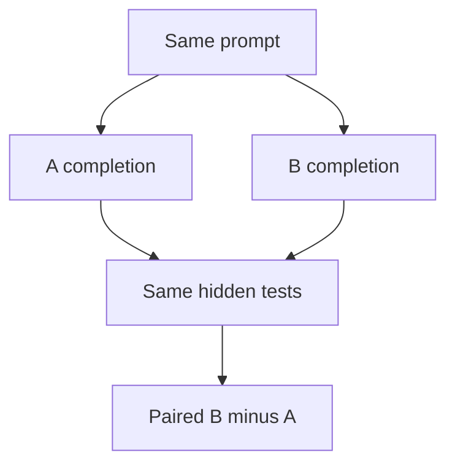

---
{
  "id": "hypothesis-tests-confidence-intervals-passk",
  "title": "Hypothesis Tests, Intervals, and pass@k",
  "slug": "hypothesis-tests-confidence-intervals-passk",
  "section": "Math & Statistics",
  "category": "Evaluation & Benchmarks",
  "difficulty": "Easy",
  "order": 9,
  "coverImage": "illustrations/_generated/chapter_flow_dark.png",
  "companies": [
    "OpenAI",
    "Anthropic",
    "Google",
    "Meta"
  ],
  "shortDescription": "Judge one extra coding pass with a paired interval, and read pass@k only under a matched attempt budget.",
  "keyConceptsTested": [
    "null hypothesis",
    "paired comparisons",
    "p-value intuition",
    "Type I and Type II errors",
    "paired variance reduction",
    "bootstrap confidence intervals",
    "pass@k",
    "functional correctness",
    "evaluation protocols",
    "multiple comparisons and fixed analysis plans",
    "practical significance"
  ]
}
---

When Model B passes one extra coding task over Model A on a small benchmark, raw accuracy counts leave the central question unanswered: does that lead reflect a genuine model upgrade or ordinary sampling noise? Across six platform-helper tasks covering timestamp windows, permission fallbacks, retry budgets, event deduplication, quota rounding, and cache invalidation, both checkpoints answer the same prompts and face the same <span data-glossary="hidden-tests">hidden tests</span> under binary pass/fail scoring, keeping every calculation small enough to verify by hand.

The [estimation lesson](/learn/statistics-estimation-uncertainty) bounded uncertainty around a single rate, while [sampling and simulation](/learn/distributions-sampling-simulation) showed how repeated draws scatter an estimate. Here the target shifts to the difference between two systems evaluated side by side. The Python examples use NumPy and SciPy to test, resample, and score paired coding benchmarks, starting from a simple observation: when five tasks tie and one favors Model B, only that disagreement carries directional evidence.

<figure>
  
  <figcaption>Each row pairs the same task and tests. Five task differences are zero; the permission task is +1 for B. Those five ties still set the aggregate rates, while the one disagreement determines the sign-test win count.</figcaption>
</figure>

## Start with paired pass or fail outcomes

Both models receive the exact same prompt and face the exact same hidden unit tests. That pairing anchors the benchmark design: if prompts, test harnesses, or decoding parameters also change, the comparison measures those complete configurations rather than isolating the checkpoint change. Treat each task as a single paired observation rather than two disconnected scores, keeping one prompt fanning out to two completions before evaluating the identical unit tests and computing each task difference.



Now inspect the six task outcomes, watching for rows where the two result columns disagree:

| Task | Hidden-test requirement | Model A | Model B |
|---|---|---:|---:|
| 1 | timestamp range is inclusive | pass | pass |
| 2 | permission fallback preserves denial | fail | pass |
| 3 | retry budget caps at configured limit | pass | pass |
| 4 | event deduplication keeps latest version | fail | fail |
| 5 | <span data-glossary="quota">quota</span> rounding is deterministic | pass | pass |
| 6 | cache invalidation skips expired keys | fail | fail |

Convert `pass` to `1` and `fail` to `0` to compute the per-model solve rates directly. Model A solves `3 / 6 = 0.500`, Model B solves `4 / 6 = 0.667`, and the observed lift is `1 / 6 = +0.167`, or `+16.7` percentage points. The snippet below reproduces those three summaries alongside the raw task arrays.

<!-- leetllm: test, output=show -->
```python title="paired-pass-rates.py"
import numpy as np

model_a = np.array([1, 0, 1, 0, 1, 0])
model_b = np.array([1, 1, 1, 0, 1, 0])

rate_a = float(model_a.mean())
rate_b = float(model_b.mean())
lift = rate_b - rate_a

print(f"Model A pass@1: {rate_a:.3f}")
print(f"Model B pass@1: {rate_b:.3f}")
print(f"observed lift:   {lift:+.3f} ({lift * 100:+.1f} percentage points)")
```

<!-- leetllm: output:start -->
```text title="Output" output compact
Model A pass@1: 0.500
Model B pass@1: 0.667
observed lift:   +0.167 (+16.7 percentage points)
```
<!-- leetllm: output:end -->

Looking only at aggregate totals conceals the pairing. Subtract Model A's score from Model B's score on each row:

| Result on one task | Difference `B - A` | Count |
|---|---:|---:|
| both pass | `0` | 3 |
| both fail | `0` | 2 |
| B passes, A fails | `+1` | 1 |
| A passes, B fails | `-1` | 0 |

Only disagreement tasks reveal which model performed better. Ties still shape both overall pass rates and the magnitude of the lift, but not the sign test's conditional win count. That distinction drives the first hypothesis test.

<!-- leetllm: test, output=show -->
```python title="count-disagreements.py"
import numpy as np

model_a = np.array([1, 0, 1, 0, 1, 0])
model_b = np.array([1, 1, 1, 0, 1, 0])

differences = model_b - model_a
b_wins = int(np.sum(differences == 1))
a_wins = int(np.sum(differences == -1))
ties = int(np.sum(differences == 0))

print("paired differences:", differences.tolist())
print(f"B wins={b_wins}, A wins={a_wins}, ties={ties}")
print("directional evidence comes from disagreements:", b_wins + a_wins)
```

<!-- leetllm: output:start -->
```text title="Output" output compact
paired differences: [0, 1, 0, 0, 0, 0]
B wins=1, A wins=0, ties=5
directional evidence comes from disagreements: 1
```
<!-- leetllm: output:end -->

Matching lengths alone do not guarantee pairing: real evaluation records must be joined by task ID, not their completion order. A missing model result must be resolved under the declared timeout or failure policy before comparing the same tasks.

A one-task lead exists in this sample. If both models are equally capable, count how often a fair comparison produces at least this many wins for Model B.

## How surprising is one B win?

Only one row disagreed, and Model B won it. If the two models were equally strong, that row could have fallen either way. The <span data-glossary="null-hypothesis">null hypothesis</span> ($H_0$) sets that baseline: on disagreement tasks, Model A and Model B are equally likely to win ($p = 0.5$). The directional alternative hypothesis ($H_1$) states that Model B wins more frequently ($p > 0.5$).

Drop the ties and treat each remaining pair as a fair coin toss under the null: Model B wins or Model A wins. That is the exact sign test on disagreements. Dixon and Mood presented the sign test in 1946.[^dixonmood1946] For paired binary outcomes, this conditional binomial calculation also underlies the exact McNemar test of equal marginal pass probabilities; its usual two-sided form asks about either direction.[^statsmodelsMcNemar2026]

This calculation assumes independent task pairs drawn from the task distribution you want to evaluate. Twenty near-duplicate prompts aren't twenty independent pieces of evidence. For related tasks derived from the same repository or template, use a cluster-level analysis instead of treating each variant as an independent observation.

Our six-task benchmark has one disagreement, and Model B won it. A one-sided <span data-glossary="p-value">p-value</span> for the planned claim "Model B is better" asks how often random chance hands Model B at least this many wins when both models are equally strong. Under $d = 1$ disagreement and $b = 1$ win, a single win cannot look rare because a fair coin has only two outcomes; formally, with $d$ disagreements and $b$ wins for Model B, the one-sided right-tail probability sums every outcome at least as favorable to Model B as the observed result:

$$
p = \sum_{w=b}^{d} \binom{d}{w} \left(\frac{1}{2}\right)^d
$$

A p-value is this tail probability calculated under the null hypothesis, rather than the probability that $H_0$ is true or that Model B is genuinely better.[^asaPValues2016] With a single disagreement, Model B wins with probability $0.5$, leaving no surprise under chance variation; by contrast, a 16-disagreement batch with 13 B wins lands in a rare tail totaling 0.0106 under $H_0$. The next function evaluates that exact tail with `scipy.stats.binomtest` for both cases:

<figure>
  
  <figcaption>With one discordant task, the two fair-coin outcomes each have probability 0.50. For 16 disagreements, the exact right-tail mass from 13 through 16 B wins is 0.0106 under H₀.</figcaption>
</figure>

<!-- leetllm: test, deps=scipy, output=show -->
```python title="exact-directional-p-value.py"
from scipy.stats import binomtest


def b_wins_one_sided_p_value(b_wins: int, a_wins: int) -> float:
    disagreements = b_wins + a_wins
    if disagreements == 0:
        return 1.0
    return float(binomtest(b_wins, disagreements, p=0.5, alternative="greater").pvalue)


print(f"one B win, zero A wins: p={b_wins_one_sided_p_value(1, 0):.3f}")
print(f"thirteen B wins, three A wins: p={b_wins_one_sided_p_value(13, 3):.4f}")
```

<!-- leetllm: output:start -->
```text title="Output" output compact
one B win, zero A wins: p=0.500
thirteen B wins, three A wins: p=0.0106
```
<!-- leetllm: output:end -->

Thirteen wins to three is a completely different story. If you had declared "Model B is better" before seeing the outcomes, that one-sided tail probability is $0.0106$. If you had planned to detect a difference in either direction, the symmetric two-sided binomial test yields about $0.0213$ here. Never pick the favorable direction after inspecting who won.[^scipyBinomtest2026]

```checkpoint
Model B passes four tasks and Model A passes three, but there is only one disagreement. What is the safe conclusion?
---
Model B scored higher in this small sample. The single disagreement gives weak evidence for a durable improvement, so you should collect more paired tasks before claiming the model is better.
```

A p-value answers whether a win is surprising under the null. It doesn't tell you how large the lift is, or whether the test had enough power to detect a real gain.

```checkpoint
A preplanned directional test observes 9 B-only wins and 1 A-only win across 10 independent disagreements. What are its one-sided fair-sign tail and symmetric two-sided tail?

1. 9/10 and 1/10.
2. 1/1024 and 2/1024.
3. 10/1024 and 20/1024.
4. 11/1024 and 22/1024.
---
**Answer:** 11/1024 and 22/1024.

The right tail includes exactly 9 and 10 wins: [C(10, 9)+C(10, 10)]/2^10=11/1024. The symmetric opposite tail doubles it. Choosing direction after seeing who won would alter the plan.
```

```checkpoint
A planned one-sided fair-sign test uses alpha=.025. If B wins every disagreement, what is the fewest disagreements that can reach the threshold?

1. 4 disagreements, p=1/16.
2. 5 disagreements, p=1/32.
3. 6 disagreements, p=1/64.
4. 7 disagreements, p=1/128.
---
**Answer:** 6 disagreements, p=1/64.

The minimum possible tail is 2^(−d). At 5 it is 0.03125>.025; at 6 it is 0.015625≤.025. This conditional limit is not a full power calculation for a task population with random ties.
```

## Type I errors, Type II errors, and statistical power

Every model-review decision is a choice made under uncertainty. In statistical evaluation, two distinct mistakes can occur:

| Reality \ Decision | Don't reject $H_0$ | Reject $H_0$ |
|---|---|---|
| **$H_0$ is true** | Correct non-rejection (probability at least $1 - \alpha$ for a valid level-$\alpha$ test) | **Type I error**: falsely conclude B is better (probability at most $\alpha$) |
| **$H_1$ is true** (B is genuinely better) | **Type II error** ($\beta$): miss the improvement | **Statistical power** ($1 - \beta$): detect the improvement |

A **Type I error** is a false positive: rejecting a true null hypothesis. The fair-coin calculation uses equality as the threshold of the directional null that B wins no more often than A. A valid, preplanned level-$\alpha$ test controls its false-rejection probability at or below $\alpha$ under its assumptions. For our discrete exact test, the achievable probability can be smaller than the chosen threshold. Rejecting this statistical null is evidence about pass rates, not an automatic instruction to deploy.

A **Type II error** ($\beta$) is a false negative: failing to reject the null hypothesis when Model B is genuinely superior. An engineer trains a refined checkpoint that produces a real 3 percentage point lift, but the evaluation suite contains too few tasks to confirm it, so the model gets shelved.

**Statistical power** ($1 - \beta$) measures the probability of detecting a real improvement of a specific effect size $\delta$. Power depends directly on four interacting variables:

1. **Effect size ($\delta$):** At the same noise level, larger improvements are easier to detect; a one- or two-percentage-point gain may need many more tasks.
2. **Sample size ($N$):** Larger task suites provide more chances to observe disagreements and narrow the sampling error.
3. **Variance ($\sigma^2$):** Noisy prompts obscure the underlying difference.
4. **Significance threshold ($\alpha$):** Stricter false-positive gates (like $\alpha = 0.01$) demand stronger evidence, which lowers power unless sample size increases.

Conditional on observing just one disagreement, neither possible outcome can reject at the one-sided 5% threshold: even a B win has $p = 0.50$. More generally, the smallest possible one-sided p-value with $d$ disagreements is $2^{-d}$, so at least five disagreements are needed even if B wins every one. That's a limitation of the conditional test, not a power calculation for every possible six-task experiment. Power must average over future outcomes under a specified alternative, including how many disagreements arise.

A result with $p > 0.05$ does not prove that the models are identical. It may reflect a small effect, limited power, or no improvement. To show that differences are smaller than a useful tolerance, plan an equivalence analysis around that tolerance rather than interpreting non-rejection as equality.

```checkpoint
A simulator is configured with a real advantage for B. A valid planned test fails to reject H₀ in one run. Which classification and interpretation fit that run?

1. Type I error; that non-rejection confirms task-distribution equivalence.
2. Type II error; that non-rejection does not prove equivalence.
3. Type II error; that non-rejection proves equal task distributions.
4. Type I error; that non-rejection means the specified advantage was absent.
---
**Answer:** Type II error; that non-rejection does not prove equivalence.

Under a specified true alternative, a missed rejection is Type II. Power is detection probability under that alternative. In a real evaluation the unknown truth is not revealed by a high p-value; equivalence needs its own tolerance-based analysis.
```

## Looking for a winner changes the test

Suppose the 13-to-3 result was the best of twenty prompt variants tried against Model A. Reporting only its $p = 0.0106$ leaves out nineteen opportunities to find a small p-value by pure chance.

A significance level, such as $\alpha = 0.05$, limits the false-rejection probability for a single, preplanned test under its null. Searching a catalog changes the family-wise error rate: if twenty independent tests each falsely reject with probability $0.05$, the probability of at least one false rejection is:

$$
1 - (1 - 0.05)^{20} \approx 64\%
$$

One standard safeguard is the **Bonferroni correction**: for twenty planned comparisons, test each individual comparison at $\alpha / M = 0.05 / 20 = 0.0025$. This adjustment bounds the family-wise error rate even when tests are dependent, provided each p-value is valid. Our $0.0106$ result doesn't clear that bar. Bonferroni can be conservative, but the core discipline is to account for all comparisons searched, not just the winner.[^nistBonferroni2026]

Repeatedly inspecting the same benchmark and halting execution the moment $p < 0.05$ is another form of hidden search. Fix the sample size and analysis protocol in advance, or use sequential testing methods designed for continuous monitoring. If an evaluation suite guided prompt or hyperparameter selection, validate the chosen checkpoint on an untouched holdout benchmark. A low p-value isn't a replacement for clean data splits.[^asaPValues2016]

## When pairing reduces variance

Pairing removes a change in prompt mix from the comparison, and its effect on precision depends on the covariance between the two models' outcomes. Let $X_i \in \{0, 1\}$ represent Model A's pass/fail outcome on task $i$, and let $Y_i \in \{0, 1\}$ represent Model B's outcome. If you evaluate Model A on $N$ independent prompts and Model B on a separate, unpaired batch of $N$ prompts, the variance of the estimated difference between the two sample means adds their individual variances:

$$
\text{Var}(\bar{Y} - \bar{X}) = \frac{\sigma_X^2 + \sigma_Y^2}{N}
$$

For example, both models might solve the timestamp helper and both might miss a cache-invalidation edge case, producing positive shared covariance. Specialized models can instead succeed on different tasks, so positive covariance and a particular correlation aren't guaranteed. In a paired design, the estimator takes the sample mean of the row-by-row differences $D_i = Y_i - X_i$, so the paired analysis must preserve the covariance actually present in the outcomes:[^pennStatePairedBinary2026]

$$
\text{Var}(\bar{D}) = \frac{\text{Var}(Y_i - X_i)}{N} = \frac{\sigma_X^2 + \sigma_Y^2 - 2\text{Cov}(X, Y)}{N}
$$

Positive covariance reduces this variance, zero covariance leaves it unchanged, and negative covariance increases it relative to independent batches with the same marginal outcome distributions. Consider a task population where 45% of tasks produce two passes, 45% two failures, 5% a B-only pass, and 5% an A-only pass. Both marginal pass rates are 50%, giving $\sigma_X^2 = \sigma_Y^2 = 0.25$, covariance $E[XY] - E[X]E[Y] = 0.45 - 0.25 = 0.20$, and correlation $\rho = 0.80$. Under an unpaired test with $N = 40$ observations per model, the variance is $\text{Var}(\bar{Y} - \bar{X}) = (0.25 + 0.25)/40 = 0.0125$.

That variance corresponds to a standard error of $\sqrt{0.0125} \approx 0.1118$ (11.2 percentage points) and a nominal normal-approximation margin ($\pm 1.96 \times \text{SE}$) of $\pm 21.9$ percentage points. Both reference bands in the figure center at zero true lift purely to compare spread, rather than computing intervals from observed task rows. Under a paired design on the same population, the covariance term activates and drops the variance by a factor of five:

$$
\text{Var}(\bar{D}) = \frac{0.25 + 0.25 - 2(0.20)}{40} = \frac{0.50 - 0.40}{40} = \frac{0.10}{40} = 0.0025
$$

The standard error shrinks to $\sqrt{0.0025} = 0.050$ (5.0 percentage points), giving a nominal normal margin of $\pm 9.8$ points. With only four expected disagreements in this population, normal coverage remains rough, so the exact variance reduction doesn't make the normal interval exact. Under these chosen parameters, 200 independent observations per model would match the variance of 40 paired observations, though statistical power still depends on the test, effect size, and decision threshold.

<figure>
  
  <figcaption>Both distributions have 50% marginal pass rates. Positive shared-task covariance concentrates paired differences at zero, reducing mean-difference variance from 0.0125 to 0.0025 at N = 40. The normal margins are rough references for four expected disagreements, not exact coverage.</figcaption>
</figure>

```checkpoint
A benchmark has 6 independent repositories, each contributing 10 related prompt variants. To estimate uncertainty across new repositories while retaining A/B pairing, which bootstrap is appropriate?

1. Resample 60 A scores and 60 B scores independently across their completion order.
2. Resample 60 individual paired rows and treat prompt variants as independent.
3. Resample 6 winning variants and replicate each one ten times to preserve sample size.
4. Resample 6 repository clusters and carry each selected cluster’s paired task rows.
---
**Answer:** Resample 6 repository clusters and carry each selected cluster’s paired task rows.

The declared independent unit is repository. Resampling whole clusters retains within-repository dependence and task pairing. More correlated variants do not provide more independent repository draws.
```

## An interval for B minus A

A <span data-glossary="confidence-interval">confidence interval</span> should target the quantity behind the decision. When the question is "How much better is Model B than Model A on this task suite?", comparing two separate pass-rate intervals hides the pairing, so the evaluation report needs a single interval for the row-by-row paired lift $B - A$.

The 95% label describes the intended long-run coverage of the interval procedure over repeated experiments rather than claiming a 95% probability for one realized interval.[^nistConfidenceIntervals2026] A common shortcut, the Wald interval $\hat{p} \pm 1.96\sqrt{\hat{p}(1-\hat{p})/N}$, uses a symmetric normal approximation that can produce impossible bounds outside $[0, 1]$ or collapse to zero width on uniform batches; the estimation chapter used Wilson intervals for one proportion, whereas paired differences call for resampling whole task rows.[^nistBinomialIntervals2026] Just as <span data-glossary="bootstrap-resampling">bootstrap</span> resampling handled single metrics earlier, keeping Model A's outcome beside Model B's in each resampled row preserves pairing and maps out sampling variation via the 2.5th and 97.5th percentiles.[^efron1979][^scipyBootstrap2026]

Six tasks build intuition, but six rows are too few for a stable interval. Consider a larger 40-task evaluation suite where only 13 tasks disagree (`17` shared passes, `10` shared failures, `8` B-only passes, `5` A-only passes), giving an observed lift of $(8 - 5) / 40 = +0.075$, or $+7.5$ percentage points; let us resample those 40 paired differences to check whether that lead stays strictly positive:

<!-- leetllm: test, output=show -->
```python title="paired-bootstrap-interval.py"
import numpy as np

differences = np.array([0] * 27 + [1] * 8 + [-1] * 5)
rng = np.random.default_rng(7)
boot_idx = rng.integers(0, len(differences), size=(20_000, len(differences)))
bootstrap_lifts = differences[boot_idx].mean(axis=1)

low, high = np.quantile(bootstrap_lifts, [0.025, 0.975])
observed = float(differences.mean())
at_or_below_zero = float(np.mean(bootstrap_lifts <= 0))

print(f"observed paired lift: {observed * 100:+.1f} percentage points")
print(f"approximate 95% bootstrap interval: {low * 100:+.1f} to {high * 100:+.1f} points")
print("interval includes zero:", bool(low <= 0 <= high))
print(f"share of resamples with lift <= 0: {at_or_below_zero:.0%}")
```

<!-- leetllm: output:start -->
```text title="Output" output compact
observed paired lift: +7.5 percentage points
approximate 95% bootstrap interval: -10.0 to +25.0 points
interval includes zero: True
share of resamples with lift <= 0: 24%
```
<!-- leetllm: output:end -->

Resampling the `differences` array is equivalent to resampling complete rows for this binary example because each row contributes one difference. With richer multi-metric evals, keep the full row together so the analysis preserves the pairing. The task row, not an isolated model score, remains the fundamental unit of resampling.

The printed 24% is a fraction of bootstrap resamples, not a p-value and not a Bayesian posterior probability that Model B is worse. These resamples center around the observed sample lift; they weren't generated under the zero-lift null hypothesis.

<figure>
  
  <figcaption>Resampling the 40 paired rows gives a central 95% percentile interval from −10 to +25 points around the observed +7.5-point lift. The histogram summarizes variability across bootstrap resamples; the true lift remains unknown.</figcaption>
</figure>

Bootstrap intervals are approximate, especially with small or discrete samples. For instance, resampling six observed ties produces only zero lifts and a `[0, 0]` interval, even though six ties don't prove the models are identical on future tasks. Running more bootstrap iterations can't conjure missing evidence out of thin air. For this 40-task suite, the actionable conclusion is: "Model B gained 7.5 points in this paired sample, but the approximate interval spans losses as well as gains."

Set a minimum useful lift threshold before examining results. If deploying Model B requires at least two percentage points of improvement to justify higher hosting costs, an interval of `[+1, +14]` points excludes zero but does not meet the required threshold. The next function formalizes those decisions:

<!-- leetllm: test, output=show -->
```python title="language-from-lift-interval.py"
def comparison_claim(
    observed_lift: float,
    interval: tuple[float, float],
    minimum_useful_lift: float = 0.02,
) -> str:
    low, high = interval
    if low > high or minimum_useful_lift < 0:
        raise ValueError("require ordered endpoints and a nonnegative useful lift")
    if low > minimum_useful_lift:
        return f"clears useful-lift threshold: estimated lift {observed_lift:+.3f}"
    if low > 0:
        return f"positive lift, useful size unconfirmed: estimate {observed_lift:+.3f}"
    if high < 0:
        return f"evidence of regression: estimated lift {observed_lift:+.3f}"
    return f"inconclusive: estimated lift {observed_lift:+.3f}, interval includes zero"


print(comparison_claim(0.075, (-0.100, 0.250)))
print(comparison_claim(0.075, (0.010, 0.140)))
print(comparison_claim(0.075, (0.030, 0.120)))
```

<!-- leetllm: output:start -->
```text title="Output" output compact
inconclusive: estimated lift +0.075, interval includes zero
positive lift, useful size unconfirmed: estimate +0.075
clears useful-lift threshold: estimated lift +0.075
```
<!-- leetllm: output:end -->

So far each task evaluated a single completion from each model. Coding evaluations often permit several candidate attempts. That measures a different capability, and it demands its own evaluation protocol.

```checkpoint
Two observed paired task rows have differences [0, 1]. A toy bootstrap samples two complete rows with replacement and computes their mean. Over all four equally likely ordered resamples, what fraction has mean zero, and which distribution generated that fraction?

1. 0.25; the observed empirical row distribution.
2. 0.50; the observed empirical row distribution.
3. 0.25; the equal-win null-hypothesis distribution.
4. 0.50; the equal-win null-hypothesis distribution.
---
**Answer:** 0.25; the observed empirical row distribution.

The ordered resamples are [0, 0], [0, 1], [1, 0] and [1, 1], with means 0, 0.5, 0.5 and 1. One of four gives zero. These rows are resampled from the observed empirical distribution, not generated under the fair-sign null. This fraction is neither the null-tail p-value nor a posterior probability about the true lift.
```

## pass@k measures attempts

A coding assistant can generate multiple candidate functions, allowing an automated test harness to verify whether at least one candidate passes hidden tests. That is the capability measured by `pass@k` in functional code-generation benchmarks like HumanEval.[^chen2021] The metric fixes a budget of $k$ candidate attempts per task. An alternative completion may solve a task that the model's first attempt missed.

HumanEval comprises 164 handwritten Python coding problems with an average of 7.7 <span data-glossary="unit-test">unit tests</span> each. In that paper, the authors generated $n = 200$ samples per task ($n \ge k$) and reported $k$ up to $100$. Those parameters reflect their specific experimental design, not a rigid requirement. The estimator below works for any predeclared $n \ge k$ that you run.

Consider this sample of three platform-helper tasks with three completions each, paying attention to the retry-state row where only the third candidate passes. Each task contributes one binary result for Attempt 1 (`first_attempt_hit`) and one for whether any of the three completions succeeded (`any_of_3_hit`), while a full HumanEval-style harness evaluates all sampled candidates to compute an unbiased estimate:

| Task | Attempt 1 | Attempt 2 | Attempt 3 | first_attempt_hit | any_of_3_hit |
|---|---:|---:|---:|---:|---:|
| parse timestamp window | pass | fail | fail | 1 | 1 |
| retry-state fallback | fail | fail | pass | 0 | 1 |
| quota split rounding | fail | fail | fail | 0 | 0 |

<!-- leetllm: test, output=show -->
```python title="pass-at-k-from-attempt-table.py"
import numpy as np

attempts = np.array([
    [1, 0, 0],
    [0, 0, 1],
    [0, 0, 0],
])

first_attempt_hit = float(attempts[:, 0].mean())
any_of_3_hit = float(attempts.any(axis=1).mean())

print(f"first_attempt_hit: {first_attempt_hit:.3f}")
print(f"any_of_3_hit: {any_of_3_hit:.3f}")
print("extra solved tasks from extra attempts:", int((any_of_3_hit - first_attempt_hit) * len(attempts)))
```

<!-- leetllm: output:start -->
```text title="Output" output compact
first_attempt_hit: 0.333
any_of_3_hit: 0.667
extra solved tasks from extra attempts: 1
```
<!-- leetllm: output:end -->

The ordered table answered a product question about a known first completion. For reporting standard HumanEval metrics, treat the $n$ candidates as an unordered pool and evaluate the combinatorial estimator on the count of correct completions. For the same three tasks with $n = 3$ samples each, the correct counts are $c = [1, 1, 0]$. The unbiased `pass@1` score is the mean of $c/n$:

$$
\frac{1}{3}\left(\frac{1}{3} + \frac{1}{3} + \frac{0}{3}\right) \approx 0.222
$$

When $k = 1$, the combinatorial formula simplifies to $c/n$, regardless of which completion came first, and when $n = k = 3$ it equals `any_of_3_hit`. Keeping $k$ and $n$ distinct clarifies the budget: $k$ fixes the operational attempt budget under evaluation, while $n \ge k$ is the sampled pool used to estimate that score cleanly. Always publish $k$, the pool size $n$, decoding parameters, and the test suites behind the run, remembering that higher <span data-glossary="temperature">temperature</span> often raises larger-$k$ diversity without improving single-attempt reliability.[^chen2021]

```checkpoint
Two fixed iid studies use the same task distribution, decoder and k=3. One predeclares n=50 and the other n=100. Which target and reporting interpretation follows?

1. Different pass@k targets; rescale k to 6 for the larger sample pool.
2. Same pass@3 target; report only the larger pool’s hidden-test score.
3. Different pass@k targets; reduce the larger pool to its first 3 samples.
4. Same pass@3 target; report n and the study’s sampling uncertainty.
---
**Answer:** Same pass@3 target; report n and the study’s sampling uncertainty.

n is estimation pool size while k is the operational attempt budget. Both fixed n≥k pools estimate the same target under the stated sampling protocol. Precision and n still need reporting.
```

```checkpoint
Two tasks have ordered attempt outcomes[0, 1]and[1, 0]. Treat those positions as fixed pools of two. What are first-attempt hit, realized any-of-two hit and combinatorial macro pass@1?

1. 0.5; 0.5; 1.0.
2. 1.0; 1.0; 0.5.
3. 0.5; 1.0; 0.5.
4. 0.5; 1.0; 1.0.
---
**Answer:** 0.5; 1.0; 0.5.

One first candidate passes, two tasks have a pass somewhere, and both unordered pools have c/n=1/2. The ordered realized statistic and the combinatorial target should retain their definitions even when numbers happen to match.
```

```checkpoint
When a task has `n=10` candidates and `c=2` correct, what is HumanEval-style pass@1?
---
`0.2`. For `k=1` the combinatorial estimator is `c/n`. It doesn't depend on which of the ten samples came first in generation order.
```

## Derive the HumanEval estimator by hand

Suppose the assistant generates $n = 10$ candidate implementations for a function, and hidden tests accept $c = 2$ of them. Counting all-failing subsets avoids summing overlapping winning subsets: since $10 - 2 = 8$ candidates fail, there are $\binom{10}{5} = 252$ total five-candidate groups and $\binom{8}{5} = 56$ all-failing groups, leaving $1 - 56 / 252 = 0.778$ for `pass@5`. In general notation:

$$
\text{pass@k} = 1 - \frac{\binom{n-c}{k}}{\binom{n}{k}}
$$

The target parameter is the generative probability $1 - (1-p)^k$ that at least one of $k$ independent completions passes, and this combinatorial formula is its **unbiased minimum-variance estimator** across all $k$-subsets of the $n$ draws.[^chen2021] Notice why averaging subsets stays unbiased without raising sample size: every fixed subset of `k` positions has expectation $1-(1-p)^k$, yet subsets overlap and share completions. Because **i.i.d.** assumes a fixed pool size $n$ drawn from one unchanged policy, halting early on a pass or feeding error traces back into subsequent completions shifts the target to an iterative agent harness rather than this single-turn estimator; moreover, hidden tests credit pools containing a solution without measuring whether a production reranker can select it. Run `scipy.special.comb` below to confirm the hand counts:

<!-- leetllm: test, deps=scipy, output=show, id=pass-at-k-hand-calculation -->
```python title="pass-at-k-hand-calculation.py"
from scipy.special import comb

n = 10
c = 2
k = 5
all_groups = int(comb(n, k, exact=True))
all_failing_groups = int(comb(n - c, k, exact=True))
score = 1 - all_failing_groups / all_groups

print("all groups:", all_groups)
print("all-failing groups:", all_failing_groups)
print(f"pass@5: {score:.3f}")
```

<!-- leetllm: output:start -->
```text title="Output" output compact
all groups: 252
all-failing groups: 56
pass@5: 0.778
```
<!-- leetllm: output:end -->

## How the naive plug-in underestimates pass@k

A tempting shortcut calculates the empirical success rate and substitutes it into the generative formula:

$$
\text{pass@k}_{\text{naive}} = 1 - (1 - \hat{p})^k
$$

where $\hat{p} = c / n$ is the observed single-sample pass rate. Chen and colleagues demonstrated that $1 - (1 - \hat{p})^k$ is a **biased underestimate** of the generative pass@k probability $1 - (1 - p)^k$.[^chen2021]

Two distinct mathematical principles explain this shortfall:

1. **Jensen's inequality on concave functions:**
   Consider the function $g(p) = 1 - (1 - p)^k$. For $k > 1$ and $p \in (0, 1)$, the second derivative with respect to $p$ is strictly negative:
   $$
   g''(p) = -k(k - 1)(1 - p)^{k - 2} < 0
   $$
   Because $g(p)$ is strictly concave, Jensen's inequality guarantees that the expected value of the plug-in estimator is strictly smaller than the true function evaluated at the mean:
   $$
   \mathbb{E}\left[1 - (1 - \hat{p})^k\right] < 1 - \left(1 - \mathbb{E}[\hat{p}]\right)^k = 1 - (1 - p)^k
   $$
   Plugging a noisy empirical proportion into a concave curve inevitably pushes the estimate downward.
2. **Sampling with replacement versus without replacement:**
   The plug-in expression $(1 - c/n)^k$ represents drawing $k$ samples *with replacement* from the finite pool of $n$ completions. Each draw assumes an unchanged failure rate of $(n - c) / n$. But in an actual without-replacement draw, pulling a failing completion removes that failure from the denominator. The proportion of successes among the remaining candidates rises from $c/n$ to $c / (n - 1)$. Drawing without replacement depletes the failure pool, making a success more probable on subsequent picks.

For $0 < c < n$ and $k > 1$, the naive plug-in is strictly smaller than the unbiased combinatorial estimate on the same $(n, c, k)$.

<figure>
  
  <figcaption>The pool contains two passing candidates among ten. At k = 5, the finite-pool estimator is 77.8% and the plug-in estimate is 67.2%. The gap compares estimators under these counts; the unknown true pass@5 remains outside the figure.</figcaption>
</figure>

For $n = 10$, $c = 2$, and $k = 5$, compare both calculations directly:

<!-- leetllm: test, output=show, continue=pass-at-k-hand-calculation, id=passk-bias -->
```python title="naive-vs-unbiased-passk.py"
p_hat = c / n
naive_score = 1.0 - (1.0 - p_hat) ** k
unbiased_score = score  # From previous cell: 1 - comb(8, 5) / comb(10, 5)

shortfall = unbiased_score - naive_score
print(f"Plug-in pass@5 1-(1-c/n)^k:            {naive_score:.4f}")
print(f"Unbiased combinatorial pass@5:         {unbiased_score:.4f}")
print(f"Plug-in shortfall vs unbiased estimate: {shortfall:.4f}")

assert abs(naive_score - 0.67232) < 1e-5
```

<!-- leetllm: output:start -->
```text title="Output" output compact
Plug-in pass@5 1-(1-c/n)^k:            0.6723
Unbiased combinatorial pass@5:         0.7778
Plug-in shortfall vs unbiased estimate: 0.1055
```
<!-- leetllm: output:end -->

Two edge-case checks confirm the logic:

- When $c = 0$, no selected group can pass.
- When fewer than $k$ failures exist ($n - c < k$), every $k$-sized group contains at least one passing candidate.

Floating-point implementations of large combinations or factorials can overflow. Exact integer combinations can also be costly to materialize at scale. The HumanEval paper provides an equivalent product formulation that avoids large factorials:[^chen2021]

$$
\frac{\binom{n-c}{k}}{\binom{n}{k}} = \prod_{i=n-c+1}^{n} \left(1 - \frac{k}{i}\right)
$$

It evaluates the failure probability factor by factor with vectorized NumPy multiplication, avoiding large intermediate integers.

<!-- leetllm: test, output=show, continue=passk-bias, id=pass-at-k -->
```python title="stable-pass-at-k.py"
import numpy as np


def pass_at_k(n: int, c: int, k: int) -> float:
    if n <= 0 or not 0 <= c <= n or not 1 <= k <= n:
        raise ValueError("require n > 0, 0 <= c <= n, and 1 <= k <= n")
    if n - c < k:
        return 1.0
    denominators = np.arange(n - c + 1, n + 1, dtype=np.float64)
    return float(1.0 - np.prod(1.0 - k / denominators))


print(f"n=10, c=2, k=1: {pass_at_k(10, 2, 1):.3f}")
print(f"n=10, c=2, k=5: {pass_at_k(10, 2, 5):.3f}")
print(f"no passing candidates: {pass_at_k(10, 0, 5):.3f}")
print(f"not enough failures: {pass_at_k(10, 8, 5):.3f}")

try:
    pass_at_k(10, 11, 5)
except ValueError as error:
    print(error)
```

<!-- leetllm: output:start -->
```text title="Output" output compact
n=10, c=2, k=1: 0.200
n=10, c=2, k=5: 0.778
no passing candidates: 0.000
not enough failures: 1.000
require n > 0, 0 <= c <= n, and 1 <= k <= n
```
<!-- leetllm: output:end -->

```checkpoint
For n=8, c=2, k=3, which pair gives the combinatorial estimate and empirical-rate plug-in, respectively?

1. 9/14≈0.642857; 37/64=0.578125.
2. 37/64=0.578125; 9/14≈0.642857.
3. 1/4=0.250000; 37/64=0.578125.
4. 9/14≈0.642857; 3/4=0.750000.
---
**Answer:** 9/14≈0.642857; 37/64=0.578125.

There are 56 three-position subsets and 20 all-failing subsets, so success 36/56=9/14. The plug-in gives 1−(.75)^3=37/64. They differ because of replacement rules; the plug-in is also downward biased under repeated iid pools.
```

## Average pass@k across tasks

A benchmark score macro-averages task-level results. A complex permission-verification function counts as one task; it shouldn't be drowned out by hundreds of completions from an easy string helper. The estimator runs per task before the benchmark computes its overall mean. Tasks can have different success probabilities: if half always pass and half always fail, both macro `pass@1` and macro `pass@5` equal 0.5. Applying $1-(1-0.5)^5$ to that aggregate rate instead gives 0.969. The nonlinear transformation must happen within each task before averaging; an aggregate `pass@5` generally can't be inverted to recover aggregate `pass@1`.

Suppose four tasks each produce $n = 10$ candidates, with the following counts of correct completions:

```text
[0, 1, 2, 4]
```

Compute each task's estimate first, then average those four estimates. A task with zero passing completions contributes zero across every value of $k$.

<!-- leetllm: test, output=show, continue=pass-at-k, id=passk-macro -->
```python title="macro-average-pass-at-k.py"
correct_counts = np.array([0, 1, 2, 4])
for k in (1, 3, 5):
    task_scores = np.array([pass_at_k(10, int(c), k) for c in correct_counts])
    print(f"pass@{k}: {task_scores.mean():.3f}  per-task={[round(float(s), 3) for s in task_scores]}")
```

<!-- leetllm: output:start -->
```text title="Output" output compact
pass@1: 0.175  per-task=[0.0, 0.1, 0.2, 0.4]
pass@3: 0.417  per-task=[0.0, 0.3, 0.533, 0.833]
pass@5: 0.563  per-task=[0.0, 0.5, 0.778, 0.976]
```
<!-- leetllm: output:end -->

Notice that `pass@5` climbs to $0.563$ while `pass@1` sits at $0.175$. That extra search capacity helps if your production product can verify multiple candidates. It doesn't indicate that single-completion quality improved. The metric grew because the attempt budget expanded, not because the underlying tasks became easier.

## Changed protocols create fake wins

To compare models fairly under a fixed sampling policy, keep the task suite, unit tests, candidate budget $k$, and decoding rules matched. Record token cutoffs, execution timeouts, and candidate selection rules. A timeout shouldn't quietly vanish from the denominator.

Record $n$ as well, but don't confuse it with $k$. Two independently sampled pools with different predeclared $n \ge k$ estimate the same underlying `pass@k`; their precision can differ. Matching $n$ is a convenient balanced setup, not a mathematical necessity for a valid fixed-$k$ benchmark. Don't omit challenging tasks simply because they generated fewer completions than requested: finish the protocol or report that the score can't be computed.[^humanEvalEstimator2026]

A deterministic decoder illustrates the risk. If every generated candidate is identical, extra sampling slots can't uncover an alternative correct solution. For a fixed deterministic decoding pipeline, `pass@5` equals `pass@1`. A temperature-zero setting alone does not guarantee reproducibility of the whole serving pipeline.

<!-- leetllm: test, output=show, continue=passk-macro, id=passk-det -->
```python title="deterministic-candidates-add-no-search.py"
identical_failed_candidates = np.zeros(10, dtype=int)
identical_passing_candidates = np.ones(10, dtype=int)

for name, outcomes in [
    ("same failed candidate", identical_failed_candidates),
    ("same passing candidate", identical_passing_candidates),
]:
    correct = int(outcomes.sum())
    print(name, f"pass@1={pass_at_k(10, correct, 1):.1f}", f"pass@5={pass_at_k(10, correct, 5):.1f}")
```

<!-- leetllm: output:start -->
```text title="Output" output compact
same failed candidate pass@1=0.0 pass@5=0.0
same passing candidate pass@1=1.0 pass@5=1.0
```
<!-- leetllm: output:end -->

Serving engines can introduce nondeterminism from external system factors, so record the exact runtime flags. A degenerate deterministic output distribution remains compatible with independent draws: every draw returns the identical completion. Duplicate completions alone don't prove a protocol violation. They remain in $n$ and $c$. A larger $k$ represents a larger compute expenditure, not an unearned model upgrade.

Another risk is subtler: code that passes basic unit tests can still harbor edge-case bugs or malicious side effects. Unit-test evaluation verifies functional correctness under that specific suite. It does not authorize executing untrusted code directly on host infrastructure.

HumanEval's authors described an isolated <span data-glossary="sandbox">sandbox</span> using gVisor and network restrictions.[^chen2021] The released harness isn't that complete isolation environment: its README requires users to provide a robust security sandbox. Treat functional correctness testing and execution isolation as separate layers.[^humanEvalRepository2026]

## Build an evaluation report

A model review needs one scorecard, not two disconnected headlines. The 40-task paired suite evaluates single-attempt lift. A separate four-task pool evaluates Model B's multi-candidate search behavior. Both require reported uncertainty and a documented protocol. The second pool isn't a direct comparison with Model A.

This self-contained script runs the calculations and reports each result alongside its protocol metadata:

<!-- leetllm: test, output=show -->
```python title="evaluation-report.py"
from itertools import product
import numpy as np


def pass_at_k(n: int, c: int, k: int) -> float:
    if n <= 0 or not 0 <= c <= n or not 1 <= k <= n:
        raise ValueError("require n > 0, 0 <= c <= n, and 1 <= k <= n")
    if n - c < k:
        return 1.0
    denominators = np.arange(n - c + 1, n + 1, dtype=np.float64)
    return float(1.0 - np.prod(1.0 - k / denominators))


model_a = np.array([1] * 17 + [0] * 10 + [0] * 8 + [1] * 5)
model_b = np.array([1] * 17 + [0] * 10 + [1] * 8 + [0] * 5)
paired_differences = model_b - model_a
paired_lift = float(paired_differences.mean())

rng = np.random.default_rng(7)
boot_idx = rng.integers(0, len(paired_differences), size=(20_000, len(paired_differences)))
lift_resamples = paired_differences[boot_idx].mean(axis=1)
lift_lo, lift_hi = np.quantile(lift_resamples, [0.025, 0.975])

correct_counts_b = [0, 1, 2, 4]
task_scores = np.array([pass_at_k(10, correct, 5) for correct in correct_counts_b])
pass5 = float(task_scores.mean())
# Exhaustive task-level bootstrap of macro pass@5 across all 4^4 = 256 resamples.
boot_indices = np.array(list(product(range(len(task_scores)), repeat=len(task_scores))))
boot_means = task_scores[boot_indices].mean(axis=1)
pass5_lo, pass5_hi = np.quantile(boot_means, [0.025, 0.975])
protocol = {
    "paired_suite_tasks": len(model_a),
    "paired_candidates_per_model_per_task": 1,
    "candidate_pool_tasks": len(correct_counts_b),
    "metric": "hidden-test functional correctness",
    "samples_per_task": 10,
    "reported_k": 5,
    "scope": "40 paired tasks + 4 pool tasks",
}

print(f"paired pass@1 lift: {paired_lift * 100:+.1f} percentage points")
print(f"approximate 95% lift interval: [{lift_lo * 100:+.1f}, {lift_hi * 100:+.1f}] points")
print(f"Model B pass@5 on candidate pool: {pass5:.3f}")
print(f"pass@5 95% task-bootstrap interval: [{pass5_lo:.3f}, {pass5_hi:.3f}]")
for key, value in protocol.items():
    print(f"{key}: {value}")
```

<!-- leetllm: output:start -->
```text title="Output" output compact
paired pass@1 lift: +7.5 percentage points
approximate 95% lift interval: [-10.0, +25.0] points
Model B pass@5 on candidate pool: 0.563
pass@5 95% task-bootstrap interval: [0.194, 0.877]
paired_suite_tasks: 40
paired_candidates_per_model_per_task: 1
candidate_pool_tasks: 4
metric: hidden-test functional correctness
samples_per_task: 10
reported_k: 5
scope: 40 paired tasks + 4 pool tasks
```
<!-- leetllm: output:end -->

For $k > 1$, `pass@k` is a nonlinear function of task-level completion counts, which is subsequently averaged across tasks. Resampling tasks and recalculating macro `pass@k` models task-sampling uncertainty. Comparing Model A and Model B at the same $k$ requires per-task estimates from both models: resample the paired differences between them, not two disconnected sets of tasks.

With four toy tasks the bootstrap interval is wide. Its nominal coverage depends on the sampling design and assumptions, so this calculation alone does not support a launch decision. This task bootstrap holds the generated completions fixed when resampling rows; it does not model how an entirely new batch of completions on the same tasks would vary. For grouped benchmark sets, resample independent clusters rather than treating every prompt as independent.

Before approving a production rollout, verify that your evaluation report contains:

- An interval for the paired lift rather than two disconnected headline numbers
- The macro pass@k point estimate alongside an empirical bootstrap interval
- The planned hypothesis direction chosen before inspecting test results
- The total count of comparisons evaluated and any family-wise error adjustments
- Explicit checkpoint hashes, prompt templates, decoding seeds, and timeout configs
- Sandboxing guarantees and test suite coverage audits
- Latency and cost ceilings for candidate generation in production

Statistical significance and operational value address different questions. Evidence for a pass-rate gain does not guarantee that its size justifies additional generation, verification latency, serving cost, or security exposure.

## Practice: review a benchmark claim

A teammate submits this update: "Model B is better because its `pass@5` reached 64%, whereas Model A's `pass@1` was 58%."

Write a code review comment addressing three specific issues:

1. Request matched attempt budgets $k$, prompt suites, test suites, and decoding settings, while noting the sample size $n \ge k$.
2. Ask for the paired lift and its confidence interval under that matched protocol.
3. Inquire whether the extra generation budget, verification latency, and compute cost are viable for production serving.

A rigorous rewritten claim should read:

> Under the same 200 paired platform-helper tasks and a matched `pass@1` protocol, Model B's observed pass rate was 2.5 percentage points higher. The paired 95% interval and serving cost guardrails are reported below; the point estimate alone doesn't justify a production swap. `pass@5` is documented separately because it reflects a larger candidate search budget.

```checkpoint
Why is an interval for `B - A` preferable to comparing two separate intervals here?
---
The tasks are paired: both models solve the same prompts under the same tests. An interval for `B - A` preserves that pairing and directly measures the quantity the decision needs, which is the model lift.
```

```checkpoint
Why can `pass@5` be much higher than `pass@1` without proving better single-candidate behavior?
---
`pass@5` permits five candidate attempts per task. It answers whether at least one of five samples passes, while `pass@1` evaluates one sample. The added search budget can raise the score.
```

```mastery-quiz
[
  {
    "question": "On five independent tasks, one attempt per model gives A = [1, 0, 1, 0, 0] and B = [1, 1, 0, 0, 1], where 1 means a pass. How many tasks did only B pass and how many did only A pass? What is B’s pass rate minus A’s, and what is the one-sided sign-test probability for the planned claim that B is better?",
    "options": [
      "3 B-only, 2 A-only, lift 0.50, tail 0.50.",
      "2 B-only, 1 A-only, lift 0.20, tail 1.00.",
      "2 B-only, 1 A-only, lift 0.20, tail 0.50.",
      "3 B-only, 2 A-only, lift 0.50, tail 1.00."
    ],
    "answer": "2 B-only, 1 A-only, lift 0.20, tail 0.50.",
    "explanation": "Only B passed tasks 2 and 5. Only A passed task 3. The lift is one extra pass across five tasks, or 0.20. The totals of 3 and 2 both include the shared pass on task 1. Dividing the extra pass by A’s 2 passes gives a relative increase of 0.50. For the sign test, the three disagreements have eight equally likely outcomes under the fair-sign null. Three give B exactly two wins and one gives B three, so the right tail is 4/8. Counting equally extreme results in both directions gives 1.00."
  },
  {
    "question": "A task population has both marginal outcome variances 0.25 and covariance 0.15. Compare 50 independent paired tasks with independent batches of 50 observations per model having the same marginals. What are the paired and independent-batch mean-difference variances?",
    "options": [
      "0.004 paired; 0.010 independent.",
      "0.010 paired; 0.004 independent.",
      "0.007 paired; 0.010 independent.",
      "0.016 paired; 0.010 independent."
    ],
    "answer": "0.004 paired; 0.010 independent.",
    "explanation": "Paired variance=(.25+.25−2×.15)/50=.004. Independent-batch variance=(.25+.25)/50=.010. The covariance sign and size come from the stated population, not merely sharing prompts."
  },
  {
    "question": "Two models attempt the same 60 independent tasks. Only B passes on 12 tasks, only A passes on 6, and they tie on 42. The approximate 95% confidence interval for B’s pass rate minus A’s is −3 to +23 percentage points. Which pairs should the bootstrap sample from, what is the observed lift across all tasks, and what does the interval say about which model leads in the population?",
    "options": [
      "The 18 untied pairs, +33⅓ points, the interval allows a lead for A.",
      "The 60 paired tasks, +10 points, the interval allows a lead for A.",
      "The 18 untied pairs, +33⅓ points, the interval rules out a lead for A.",
      "The 60 paired tasks, +10 points, the interval rules out a lead for A."
    ],
    "answer": "The 60 paired tasks, +10 points, the interval allows a lead for A.",
    "explanation": "Draw whole task pairs with replacement so each task keeps both results. B gained 12 passes and lost 6 relative to A, for a lift of 6/60, or 10 percentage points. Using only the disagreements gives 6/18, or 33⅓ points, and describes only tasks where one model passed. The lower endpoint of −3 points allows a lead for A and the upper endpoint of +23 allows a lead for B."
  },
  {
    "question": "One fixed iid candidate pool has n=12, c=3, and k=2. Which all-subset count, all-failing count and pass@2 estimate follow?",
    "options": [
      "66; 9; 19/22.",
      "144; 81; 7/16.",
      "66; 36; 7/16.",
      "66; 36; 5/11."
    ],
    "answer": "66; 36; 5/11.",
    "explanation": "C(12, 2)=66 and C(9, 2)=36. The estimate is 1−36/66=5/11. The with-replacement plug-in instead gives 1−(.75)^2=7/16."
  },
  {
    "question": "Two tasks each have n=6, c=[0, 3], and k=2. What is the macro pass@2, and what would incorrectly pooling all 12 candidates into one task produce?",
    "options": [
      "5/11 macro; 0.40 pooled.",
      "0.25 macro; 7/16 pooled.",
      "0.40 macro; 5/11 pooled.",
      "0.80 macro; 5/11 pooled."
    ],
    "answer": "0.40 macro; 5/11 pooled.",
    "explanation": "Task scores are 0 and 1−C(3, 2)/C(6, 2)=.8, so macro=.4. Pooling gives 1−C(9, 2)/C(12, 2)=5/11, which pools draws as if all samples came from a single homogeneous task."
  },
  {
    "question": "A team will switch coding assistants only if its evaluation supports a lift of more than 4 percentage points. The paired 95% confidence interval for B minus A is [3, 11] percentage points. What does the interval support, and should the team switch?",
    "options": [
      "Useful size supported; release because the upper endpoint exceeds 4 points.",
      "Positive lift supported; useful size unconfirmed, so hold under this rule.",
      "Positive lift unconfirmed; hold because the interval crosses zero.",
      "Useful size supported; release because the midpoint exceeds 4 points."
    ],
    "answer": "Positive lift supported; useful size unconfirmed, so hold under this rule.",
    "explanation": "The interval excludes zero but still includes effects below the required 4 points. Endpoint interpretation must target the useful threshold, not just the sign or midpoint."
  },
  {
    "question": "A plan uses 8 valid comparisons and family alpha=.04. Candidate p=.006 is smallest. What Bonferroni per-test threshold and candidate decision follow?",
    "options": [
      "Threshold 0.005; reject = false.",
      "Threshold 0.040; reject = true.",
      "Threshold 0.005; reject = true.",
      "Threshold 0.320; reject = false."
    ],
    "answer": "Threshold 0.005; reject = false.",
    "explanation": "Allocate 0.04/8=.005 per comparison. The candidate 0.006 does not clear it. The union bound does not require comparison independence. For independent tests with exact size 0.04, the unadjusted family risk would be 1−.96^8≈.279."
  },
  {
    "question": "A benchmark always generates six independent patches per task from the same decoder. On one task the draws are P, Q, P, R, S, R in that order. Only R passes. One proposal would score each distinct patch once. Another would test each patch immediately and skip the remaining draws after the first pass. What pass@1 should the original pool report, and how many patches would the second generator produce on this sequence?",
    "options": [
      "A pass@1 of 1/4 and 4 generated patches.",
      "A pass@1 of 1/3 and 4 generated patches.",
      "A pass@1 of 1/3 and 6 generated patches.",
      "A pass@1 of 1/4 and 6 generated patches."
    ],
    "answer": "A pass@1 of 1/3 and 4 generated patches.",
    "explanation": "R passes in positions 4 and 6, so the original estimate is 2/6 = 1/3. Counting each distinct patch once gives 1/4 and loses how often the decoder produced R. The second generator reaches R on draw 4 and ends the run there. If the runner had generated all six patches first, it could stop testing at the first R and still have six generated patches."
  },
  {
    "question": "A repair tool sends users the higher-ranked of two patches before it sees any hidden test results. For 24 of 30 bugs, at least one patch passes. For 7 of those 24, only the lower-ranked patch passes. Which pair of checks measures success for users and assesses whether the evaluator confines untrusted patches?",
    "options": [
      "Count 17 of 30 bugs as successes. Check patch outputs on additional edge cases.",
      "Count 24 of 30 bugs as successes. Verify the runner's restrictions on file and network access.",
      "Count 24 of 30 bugs as successes. Check patch outputs on additional edge cases.",
      "Count 17 of 30 bugs as successes. Verify the runner's restrictions on file and network access."
    ],
    "answer": "Count 17 of 30 bugs as successes. Verify the runner's restrictions on file and network access.",
    "explanation": "Counting all 24 bugs would credit 7 fixes the user never received. The patch the tool sent passed for 24 − 7 = 17 of the 30 bugs. Extra edge cases can reveal wrong outputs. A patch can return the expected output and still read a private file, so the evaluator needs a separate check of its sandbox."
  },
  {
    "question": "A fixed rejection rule is applied to 2000 null studies and 2000 studies under a specified advantage. It rejects 70 null studies and 1320 advantage studies. What are the observed Type I frequency and power?",
    "options": [
      "0.035; 0.66.",
      "0.66; 0.035.",
      "0.965; 0.34.",
      "0.035; 0.34."
    ],
    "answer": "0.035; 0.66.",
    "explanation": "False rejections 70/2000=.035 estimate size under the null. Detections 1320/2000=.66 estimate power under the specified alternative; its observed missed-detection fraction is 0.34. Finite simulations are estimates, not exact guarantees."
  }
]
```

> **Next:** Continue to [Neural Networks from Scratch](/learn/neural-networks-from-scratch). Separate a lucky extra pass from a paired lift, and read pass@k as a claim about a fixed attempt budget. The next lesson uses a different task. A small CodeAssist network turns two request features into a timeout-risk score. These evaluation habits are what you still need before trusting that score.
