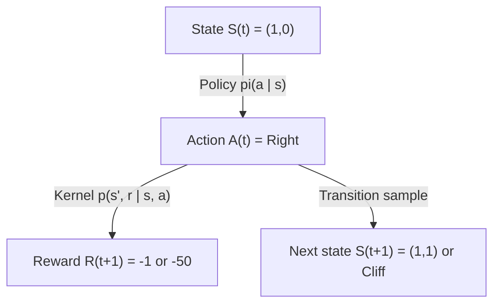

---
{
  "id": "introduction-to-reinforcement-learning-fundamentals",
  "title": "Reinforcement Learning Basics",
  "slug": "introduction-to-reinforcement-learning-fundamentals",
  "section": "Training, Fine-Tuning & Alignment",
  "category": "Model Architecture",
  "difficulty": "Hard",
  "order": 10,
  "coverImage": "illustrations/_generated/chapter_flow_dark.png",
  "companies": [
    "OpenAI",
    "Anthropic",
    "Google",
    "DeepMind"
  ],
  "shortDescription": "Formulate a 3x4 cliff gridworld as a Markov decision process, solve Bellman backups, compare Q-learning against SARSA, and derive REINFORCE policy gradients for RLHF and RLVR.",
  "keyConceptsTested": [
    "Markov decision process",
    "Bellman optimality and expectation equations",
    "value iteration",
    "Q-learning vs SARSA",
    "termination vs truncation",
    "exploration and reward hacking",
    "potential-based reward shaping",
    "policy gradients and REINFORCE",
    "PPO and GRPO bridge to RLHF and RLVR"
  ]
}
---

A rover needs to reach a beacon across a canyon. A four-step shortcut hugs the cliff edge; a six-step route climbs onto the upper ridge first. On firm ground, the shortcut wins easily. Add a crosswind that nudges moves sideways, and the safer ridge becomes the optimal route.

Place the rover on a 3x4 grid starting at `(1,0)`, with the beacon at `(2,3)` and terminal cliff cells at `(2,0)`, `(2,1)`, and `(2,2)`. Reaching the beacon earns `+20` and ends the episode; falling into a cliff earns `-50` and ends it. Every other move costs `-1` (including bumping an outer wall and staying put). Unlike supervised learning, where every input has a target label, <span data-glossary="reinforcement-learning">reinforcement learning</span> learns a **policy** $\pi(a \mid s)$ from sequential actions and delayed rewards.[^sutton2018]

<figure>
  
  <figcaption>Both routes reach the same beacon. The four-move shortcut passes beside the cliff; the six-move ridge route buys distance from it.</figcaption>
</figure>

## Episodes, discounted return, and the cliff MDP

One trip from start to beacon or cliff is an **episode**. On firm ground, the shortcut collects `[-1, -1, -1, +20]` while the ridge collects five `-1` steps before `+20`. Looking only at the first `-1` reward cannot separate them; the rover must evaluate the full **discounted return**:[^sutton2018]

$$
G_t = R_{t+1} + \gamma R_{t+2} + \gamma^2 R_{t+3} + \dots + \gamma^{T-t-1} R_T = \sum_{k=0}^{T-t-1} \gamma^k R_{t+1+k}, \qquad \gamma \in [0, 1).
$$

With discount factor $\gamma = 0.90$, the four-step shortcut yields $G_0 = -1 - 0.9 - 0.81 + 0.729(20) = 11.87$, while the six-step ridge yields $7.7147$. Larger $\gamma$ values weigh distant outcomes more heavily; $\gamma = 0$ makes the agent completely myopic.

Now add wind: the intended move succeeds 80% of the time and slips 10% to either perpendicular direction (`slip = 0.20`). At `(1,1)`, choosing `Right` can land safely at `(1,2)`, drift up to `(0,1)`, or drop into the cliff at `(2,1)`. A <span data-glossary="markov-decision-process">Markov decision process (MDP)</span> formalizes this loop with states $\mathcal{S}$, actions $\mathcal{A}$, transition kernel $p(s', r \mid s, a)$, rewards $R$, and discount $\gamma$.[^sutton2018]



The **Markov property** requires the current state to contain everything needed to predict the next transition:

$$
P(S_{t+1}=s', R_{t+1}=r \mid S_t, A_t, \dots, S_0, A_0) = P(S_{t+1}=s', R_{t+1}=r \mid S_t, A_t).
$$

If tire temperature affected slipping, coordinates alone would violate the Markov property until we appended temperature to $S_t$. Terminal cliff and beacon states have zero future value once entered.

## Bellman expectation and optimality backups

Working backward from the beacon turns multi-step planning into a one-step calculation. One step above the beacon at `(1,3)`, moving `Down` earns `20`. At `(1,2)`, moving `Right` pays `-1` and reaches `(1,3)`, yielding `-1 + 0.90(20) = 17.0`. One cell west at `(1,1)`, moving `Right` yields `-1 + 0.90(17.0) = 14.3`.

That recursive identity is the **Bellman backup**. For a fixed policy $\pi$, the state value $V^\pi(s)$ and action value $Q^\pi(s,a)$ satisfy the <span data-glossary="bellman-equation">Bellman expectation equation</span>:[^sutton2018]

$$
V^\pi(s) = \sum_a \pi(a\mid s)\left[R(s,a)+\gamma\sum_{s'}P(s'\mid s,a)V^\pi(s')\right].
$$

Replacing the policy average with a maximum yields the **Bellman optimality equations**:

$$
Q^*(s,a)=R(s,a)+\gamma\sum_{s'}P(s'\mid s,a)V^*(s'),
\qquad V^*(s)=\max_a Q^*(s,a).
$$

Compare cell `(1,1)` with and without wind. At `slip = 0.0`, `Right` earns $Q^*((1,1), \text{Right}) = 14.30$ and easily beats `Up` (`9.68`). At `slip = 0.20`, however, `Right` splits across `(1,2)` (`V* = 9.340`), `(0,1)` (`V* = 8.455`), and the cliff (`-50`):

$$
Q^*((1,1), \text{Right}) = 0.80(-1 + 0.90 \cdot 9.340) + 0.10(-1 + 0.90 \cdot 8.455) + 0.10(-50) \approx 1.59.
$$

Stepping `Up` into `(0,1)` keeps perpendicular slips horizontal and avoids the cliff, earning `6.31` and flipping the optimal route onto the ridge.

**Value iteration** computes $V^*$ by initializing all states to zero and repeatedly applying Bellman optimality sweeps until convergence. Because each sweep contracts the worst-case value error by $\gamma = 0.90$, values converge cleanly to the unique fixed point.[^sutton2018]

<figure>
  
  <figcaption>The beacon's reward reaches the start after four synchronous sweeps. Each predecessor computes its own step cost plus the discounted value available one move ahead.</figcaption>
</figure>

Build the 3x4 MDP transition tensor once and solve both regimes with value iteration:

<!-- leetllm: test, deps=numpy, output=show -->
```python title="gridworld-mdp-and-value-iteration.py"
import numpy as np

ROWS, COLS, N_STATES, N_ACTIONS = 3, 4, 12, 4
ARROWS = ("^", ">", "v", "<")
DELTAS = ((-1, 0), (0, 1), (1, 0), (0, -1))
GOAL, CLIFFS = (2, 3), {(2, 0), (2, 1), (2, 2)}
TERMINALS = CLIFFS | {GOAL}
GAMMA = 0.90

def build_mdp(slip: float):
    probs = np.zeros((N_STATES, N_ACTIONS, N_STATES))
    exp_r = np.zeros((N_STATES, N_ACTIONS))
    for r in range(ROWS):
        for c in range(COLS):
            s = r * COLS + c
            if (r, c) in TERMINALS:
                probs[s, :, s] = 1.0
                continue
            for a in range(N_ACTIONS):
                for p, mv in ((1 - slip, a), (slip / 2, (a - 1) % 4), (slip / 2, (a + 1) % 4)):
                    if p == 0.0:
                        continue
                    nr = min(max(r + DELTAS[mv][0], 0), ROWS - 1)
                    nc = min(max(c + DELTAS[mv][1], 0), COLS - 1)
                    rew = -50.0 if (nr, nc) in CLIFFS else (20.0 if (nr, nc) == GOAL else -1.0)
                    probs[s, a, nr * COLS + nc] += p
                    exp_r[s, a] += p * rew
    return probs, exp_r

def value_iteration(probs, exp_r, tol=1e-9):
    v = np.zeros(N_STATES)
    for _ in range(500):
        q = exp_r + GAMMA * (probs @ v)
        new_v = q.max(axis=1)
        for tr, tc in TERMINALS:
            new_v[tr * COLS + tc] = 0.0
        if np.max(np.abs(new_v - v)) < tol:
            v = new_v
            break
        v = new_v
    return v, exp_r + GAMMA * (probs @ v)

for slip in (0.0, 0.20):
    probs, exp_r = build_mdp(slip)
    v, q = value_iteration(probs, exp_r)
    icons = [ARROWS[q[s].argmax()] for s in range(N_STATES)]
    for tr, tc in CLIFFS:
        icons[tr * COLS + tc] = "X"
    icons[GOAL[0] * COLS + GOAL[1]] = "G"
    print(f"slip={slip:.2f} | V*(1,0)={v[4]:.3f} | Q*((1,1), a)={np.round(q[5], 2).tolist()}")
    print("  row0:", icons[0:4], "row1:", icons[4:8])
```

<!-- leetllm: output:start -->
```text title="Output" output compact
slip=0.00 | V*(1,0)=11.870 | Q*((1,1), a)=[9.68, 14.3, -50.0, 9.68]
  row0: ['>', '>', '>', 'v'] row1: ['>', '>', '>', 'v']
slip=0.20 | V*(1,0)=4.284 | Q*((1,1), a)=[6.31, 1.59, -38.97, -2.05]
  row0: ['>', '>', '>', 'v'] row1: ['^', '^', '^', 'v']
```
<!-- leetllm: output:end -->

Every cell directly above the cliff flips from `>` to `^` once wind is introduced, lowering the optimal start value from `11.870` to `4.284`.

## Model-free TD learning: Q-learning versus SARSA

Real environments rarely hand us `probs[s, a, ns]`. **Temporal-difference (TD)** learning estimates action values directly from sampled transitions $(S_t, A_t, R_{t+1}, S_{t+1})$ by bootstrapping off the current value table before an episode ends.[^sutton2018][^watkins1992qlearning]

To keep discovering better moves, the rover acts **<span data-glossary="epsilon-greedy">$\epsilon$-greedily</span>**: pick a random action with probability $\epsilon$ and the highest-Q action otherwise. Two classic TD control updates differ only in how they bootstrap the next state:

- **<span data-glossary="q-learning">Q-learning</span> (<span data-glossary="off-policy">off-policy</span>):** Bootstraps toward the greedy maximum continuation $\max_{a'} Q(S_{t+1}, a')$, learning optimal greedy values even while exploring randomly:[^watkins1992qlearning]
  $$
  Q(S_t, A_t) \leftarrow Q(S_t, A_t) + \alpha \Bigl[ R_{t+1} + \gamma \max_{a'} Q(S_{t+1}, a') - Q(S_t, A_t) \Bigr].
  $$
- **<span data-glossary="on-policy">SARSA</span> (on-policy):** Bootstraps toward $Q(S_{t+1}, A_{t+1})$ using the action $A_{t+1}$ actually sampled by the exploratory policy, so exploratory cliff falls pull cliff-edge values down:
  $$
  Q(S_t, A_t) \leftarrow Q(S_t, A_t) + \alpha \Bigl[ R_{t+1} + \gamma Q(S_{t+1}, A_{t+1}) - Q(S_t, A_t) \Bigr].
  $$

Train both algorithms on firm ground (`slip = 0.0`) with fixed $\epsilon = 0.20$. At any cliff-edge cell, random exploration picks `Down` with probability `0.20 / 4 = 5%`:

<!-- leetllm: test, deps=numpy, output=show -->
```python title="q-learning-vs-sarsa-cliff.py"
import numpy as np

ARROWS = ("^", ">", "v", "<")
DELTAS = ((-1, 0), (0, 1), (1, 0), (0, -1))
CLIFFS, GOAL = {(2, 0), (2, 1), (2, 2)}, (2, 3)

def step_env(s, a):
    r, c = divmod(s, 4)
    nr = min(max(r + DELTAS[a][0], 0), 2)
    nc = min(max(c + DELTAS[a][1], 0), 3)
    done = (nr, nc) in CLIFFS or (nr, nc) == GOAL
    rew = -50.0 if (nr, nc) in CLIFFS else (20.0 if (nr, nc) == GOAL else -1.0)
    return nr * 4 + nc, rew, done

def eps_greedy(rng, q_row, eps):
    return int(rng.integers(4)) if rng.random() < eps else int(q_row.argmax())

def train(method: str, episodes=10000, eps=0.20, alpha=0.1, gamma=0.90, seed=7):
    rng = np.random.default_rng(seed)
    q = np.zeros((12, 4))
    for _ in range(episodes):
        s = 4  # Start (1, 0)
        a = eps_greedy(rng, q[s], eps)
        for _ in range(100):
            ns, rew, done = step_env(s, a)
            na = eps_greedy(rng, q[ns], eps)
            next_v = q[ns].max() if method == "q" else q[ns, na]
            target = rew if done else rew + gamma * next_v
            q[s, a] += alpha * (target - q[s, a])
            if done:
                break
            s, a = ns, na
    return q

for name, key in (("Q-learning", "q"), ("SARSA     ", "sarsa")):
    q = train(key)
    row1 = [ARROWS[q[s].argmax()] for s in range(4, 8)]
    print(f"{name} row1 policy: {row1} | Q(1,0)={np.round(q[4], 2).tolist()}")
```

<!-- leetllm: output:start -->
```text title="Output" output compact
Q-learning row1 policy: ['>', '>', '>', 'v'] | Q(1,0)=[7.71, 11.87, -50.0, 9.68]
SARSA      row1 policy: ['^', '^', '>', 'v'] | Q(1,0)=[5.24, 3.97, -50.0, 1.32]
```
<!-- leetllm: output:end -->

Q-learning recovers the exact deterministic optimum (`11.87`) along the cliff edge, whereas SARSA climbs away from the cliff because its target prices in the 5% chance of stepping off during exploration. Annealing $\epsilon \to 0$ over training brings SARSA's target into agreement with Q-learning's.[^sutton2018][^watkins1992qlearning]

### Termination versus time-limit truncation

How an episode stops changes the TD target. A genuine **terminal** state (cliff or beacon) has zero remaining return (`V(S_T) = 0`), whereas a **truncation** from a maximum step limit cuts off a trajectory that still had real future value.[^gymnasiumTimeLimits2026] Standard APIs like Gymnasium separate `terminated` from `truncated` so updates mask bootstrapping only on `terminated`:

<!-- leetllm: test, deps=numpy, output=show -->
```python title="termination-vs-truncation-target.py"
import numpy as np

gamma, reward = 0.90, -1.0
v_next = np.array([17.0, 17.0])
terminated = np.array([True, False])  # terminal vs step-limit truncation
targets = reward + gamma * v_next * (~terminated)
print(f"terminal target: {targets[0]:.1f} | truncated target: {targets[1]:.1f}")
```

<!-- leetllm: output:start -->
```text title="Output" output compact
terminal target: -1.0 | truncated target: 14.3
```
<!-- leetllm: output:end -->

> **Common mistake:** Zeroing out the bootstrap value on `truncated` episodes creates a `15.3`-point value cliff at the step limit and teaches the agent to act myopically right before timeout.

## Exploration, reward hacking, and potential-based shaping

An RL agent only learns about actions it visits. Balancing **exploration** (trying uncertain actions to discover higher-return paths) against **exploitation** (taking the current best action) is the core dilemma of online RL. Initializing $Q = 0$ creates mild optimism when ordinary steps cost `-1`, while $\epsilon$-greedy noise or entropy bonuses keep policies from collapsing prematurely onto suboptimal local paths.

When true rewards are sparse, adding ad-hoc progress bonuses often backfires. Suppose we award `+8` every time the rover enters `(0,3)` near the beacon. From `(0,2)`, moving `Right` collects `+7` net, stepping `Left` costs `-1`, and shuttling back and forth forever earns far more than finishing the mission:

<!-- leetllm: test, deps=numpy, output=show -->
```python title="reward-hacking-loop.py"
import numpy as np

gamma = 0.90
goal_return = float(np.dot([7.0, -1.0, 20.0], gamma ** np.arange(3)))
t = np.arange(120)
shuttle_return = float(np.dot(np.where(t % 2 == 0, 7.0, -1.0), gamma ** t))
print(f"reach beacon in 3 steps: {goal_return:.3f}")
print(f"infinite bonus shuttle:  {shuttle_return:.3f}")
```

<!-- leetllm: output:start -->
```text title="Output" output compact
reach beacon in 3 steps: 22.300
infinite bonus shuttle:  32.105
```
<!-- leetllm: output:end -->

The shuttle converges to $(7 - 0.9)/(1 - 0.81) = 32.105$, beating the beacon's `22.300`. That is **reward hacking**: maximizing the proxy reward diverges from the real goal.

**Potential-based reward shaping** fixes this mathematically. Assign each state a potential $\Phi(s)$ (with $\Phi(s_{\text{terminal}}) = 0$) and add $F(s, s') = \gamma \Phi(s') - \Phi(s)$. Across any episode, the discounted shaping terms telescope:

$$
\sum_{t=0}^{T-1}\gamma^t F(S_t,S_{t+1}) = -\Phi(S_0) + \gamma^T \Phi(S_T) = -\Phi(S_0).
$$

Every completed path from $S_0$ gets the exact same constant shift, leaving the optimal policy completely unchanged while giving dense step-by-step guidance.[^ng1999]

## Policy gradients, REINFORCE, and baselines

Tables work for 12 grid cells, not for language models choosing among 128,000 tokens. **<span data-glossary="policy-gradient">Policy gradient</span>** methods parameterize a stochastic policy $\pi_\theta(a \mid s)$ directly and climb expected return $J(\theta) = \sum_\tau P_\theta(\tau) G_0(\tau)$ via gradient ascent.[^williams1992reinforce]

Applying the log-derivative identity $\nabla_\theta P_\theta(\tau) = P_\theta(\tau) \nabla_\theta \log P_\theta(\tau)$ cancels the unknown environment transition probabilities $p(s', r \mid s, a)$ completely (since they do not depend on $\theta$). Dropping past rewards that an action cannot affect and subtracting a state-dependent baseline $b(S_t)$ gives **REINFORCE** with reward-to-go:[^williams1992reinforce][^openaiSpinningUpPolicyGradient2026]

$$
\nabla_\theta J(\theta) = \mathbb{E}_{\tau \sim \pi_\theta}\!\left[ \sum_{t=0}^{T-1} \gamma^t \bigl(G_t - b(S_t)\bigr)\, \nabla_\theta \log \pi_\theta(A_t \mid S_t) \right].
$$

For softmax logits $\theta_s$, the score function is crisp: $\nabla_{\theta_s} \log \pi_\theta(a \mid s) = e_a - \pi_\theta(\cdot \mid s)$. A positive weight $(G_t - b(S_t)) > 0$ raises the chosen action's logit and trims alternatives; a negative weight pushes probability away from it.

Why can we subtract any action-independent baseline $b(s)$ without biasing the gradient? Because action probabilities sum to 1:

$$
\sum_a \pi_\theta(a \mid s) b(s) \nabla_\theta \log \pi_\theta(a \mid s) = b(s) \nabla_\theta \sum_a \pi_\theta(a \mid s) = b(s) \nabla_\theta 1 = 0.
$$

Setting $b(s) = V^\pi(s)$ centers the update on the **<span data-glossary="advantage">advantage</span>** $A^\pi(s,a) = Q^\pi(s,a) - V^\pi(s)$ ("was this action better or worse than average from state $s$?"), slashing gradient variance dramatically.

Verify the exact softmax policy gradient against finite differences, then run multi-step REINFORCE with a running-mean baseline on the windy canyon (`slip = 0.20`):

<!-- leetllm: test, deps=numpy, output=show -->
```python title="reinforce-exact-and-baseline.py"
import numpy as np

def softmax(z):
    e = np.exp(z - z.max())
    return e / e.sum()

# 1. Exact softmax policy gradient vs finite differences
q_start, logits = np.array([6.0, 2.0, -40.0, -2.0]), np.zeros(4)
probs = softmax(logits)
analytic_grad = probs * (q_start - np.dot(probs, q_start))
eps = 1e-6
fd_grad = np.array([
    (np.dot(softmax(logits + eps * np.eye(4)[i]), q_start)
     - np.dot(softmax(logits - eps * np.eye(4)[i]), q_start)) / (2 * eps)
    for i in range(4)
])
print("analytic vs FD match:", np.allclose(analytic_grad, fd_grad, atol=1e-6))
print("softmax grad(Up,Right,Down,Left):", np.round(analytic_grad, 3).tolist())

# 2. Multi-step REINFORCE with running baseline on windy gridworld (slip=0.20)
DELTAS = ((-1, 0), (0, 1), (1, 0), (0, -1))
CLIFFS, GOAL = {(2, 0), (2, 1), (2, 2)}, (2, 3)

rng = np.random.default_rng(11)
theta = np.zeros((12, 4))
baseline, lr, gamma = 0.0, 0.01, 0.90
recent = []

for _ in range(3000):
    r, c, traj = 1, 0, []
    while (r, c) not in CLIFFS and (r, c) != GOAL:
        s = r * 4 + c
        p = softmax(theta[s])
        a = int(rng.choice(4, p=p))
        u = rng.random()
        mv = a if u < 0.80 else ((a - 1) % 4 if u < 0.90 else (a + 1) % 4)
        nr, nc = min(max(r + DELTAS[mv][0], 0), 2), min(max(c + DELTAS[mv][1], 0), 3)
        rew = -50.0 if (nr, nc) in CLIFFS else (20.0 if (nr, nc) == GOAL else -1.0)
        traj.append((s, a, rew, p))
        r, c = nr, nc

    G, returns = 0.0, []
    for _, _, rew, _ in reversed(traj):
        G = rew + gamma * G
        returns.append(G)
    returns.reverse()

    grad = np.zeros_like(theta)
    for t, ((s, a, _, p), g_t) in enumerate(zip(traj, returns)):
        grad_logp = -p.copy()
        grad_logp[a] += 1.0
        grad[s] += (gamma ** t) * (g_t - baseline) * grad_logp
    theta += lr * grad
    baseline = 0.99 * baseline + 0.01 * returns[0]
    recent.append(returns[0])

print(f"last-300 mean return: {np.mean(recent[-300:]):.3f}")
print("learned P(a | (1,0)): ", np.round(softmax(theta[4]), 3).tolist())
```

<!-- leetllm: output:start -->
```text title="Output" output compact
analytic vs FD match: True
softmax grad(Up,Right,Down,Left): [3.625, 2.625, -7.875, 1.625]
last-300 mean return: 2.872
learned P(a | (1,0)):  [0.997, 0.001, 0.0, 0.002]
```
<!-- leetllm: output:end -->

Without ever reading the transition matrix, REINFORCE learns purely from sampled returns and shifts `99.7%` of its start-state probability onto `Up` to climb the ridge.

```checkpoint
Why must the baseline in REINFORCE stay independent of the action $A_t$ just sampled?
---
Only an action-independent baseline $b(S_t)$ factors out of $\sum_a \pi_\theta(a \mid S_t) \nabla_\theta \log \pi_\theta(a \mid S_t) = \nabla_\theta 1 = 0$. If $b$ depended on $A_t$ (such as using the current episode return itself), subtracting it would bias or cancel the policy gradient.
```

## The bridge to LLM post-training: RLHF and RLVR

Every modern LLM post-training loop maps directly onto the MDP and policy-gradient equations above:

| RL primitive | Canyon rover | LLM post-training (RLHF / RLVR) |
|---|---|---|
| State $S_t$ | Grid coordinates `(r, c)` | Prompt plus tokens generated so far |
| Action $A_t$ | Move (`Up`, `Right`, `Down`, `Left`) | Next token sampled from vocabulary |
| Policy $\pi_\theta(a \mid s)$ | Softmax over 4 move logits | Language model next-token distribution |
| Reward $R_T$ | `+20` beacon / `-50` cliff | Reward-model score (RLHF) or pass/fail verifier (RLVR) |
| Baseline $b(S_t)$ | Running mean or $V^\pi(s)$ | Learned critic network (PPO) or group mean (GRPO) |

Two modern algorithms refine vanilla REINFORCE for language models:

- **RLHF with <span data-glossary="ppo">PPO</span>:** A learned reward model scores completed responses, a separate value network (critic) estimates $V(S_t)$ to form advantages, and PPO clips the new-to-old probability ratio $r_t(\theta) = \pi_\theta / \pi_{\text{old}}$ within $[1-\epsilon, 1+\epsilon]$ alongside a KL penalty to a frozen reference model so updates never wreck fluent language.[^ouyang2022][^schulman2017] For example, if a positive-advantage token's probability rises from `0.20` to `0.28` (ratio `1.4`), a `1.2` clip caps the update's incentive at `1.2`.
- **RLVR with GRPO:** On tasks with programmatic verifiers (math equivalence, unit tests), Reinforcement Learning with Verifiable Rewards replaces the noisy learned reward model with exact binary/outcome checks. **GRPO** also drops the separate critic network by sampling a group of completions for the same prompt and normalizing their rewards relative to the group mean and standard deviation.[^shao2024] For group scores `[0, 1, 2]`, subtracting the mean gives `[-1, 0, 1]` and dividing by the population standard deviation ($\sqrt{2/3} \approx 0.816$) gives `[-1.225, 0, 1.225]`, pushing probability toward stronger completions and away from weaker ones with the exact same log-probability gradient machinery.

| Algorithm | Needs transition model? | Needs separate critic? | Core update signal |
|---|---|---|---|
| **Value iteration** | Yes | No (tabular $V$) | Exact Bellman optimality backup |
| **Q-learning / SARSA** | No | No (tabular $Q$) | One-step TD error (greedy vs on-policy) |
| **REINFORCE** | No | Optional baseline | Monte Carlo return $(G_t - b) \nabla \log \pi_\theta$ |
| **PPO (RLHF)** | No | Yes (value head) | Clipped ratio + critic advantage + KL penalty |
| **GRPO (RLVR)** | No | No (group baseline) | Group-normalized verifier advantage + KL penalty |

```mastery-quiz
[
  {
    "question": "An action lands right with probability 0.70 (reward -2, next value 12), up with probability 0.20 (reward -2, next value 9), and in a terminal pit with probability 0.10 (reward -30, next value 0). With discount 0.80, what is its action value Q(s, a)?",
    "options": [
      "3.36",
      "-4.80",
      "8.16",
      "7.60"
    ],
    "answer": "3.36",
    "explanation": "Average complete branches: 0.70(-2 + 0.80 x 12) + 0.20(-2 + 0.80 x 9) + 0.10(-30) = 0.70(7.6) + 0.20(5.2) - 3.0 = 5.32 + 1.04 - 3.0 = 3.36."
  },
  {
    "question": "A transition earns -2. At the next state, Right has Q=15 and Up has Q=5, and exploration selects Up. With discount 0.80, what TD targets do Q-learning and SARSA compute?",
    "options": [
      "Q-learning 10; SARSA 2",
      "Q-learning 2; SARSA 10",
      "Both compute 10",
      "Both compute 2"
    ],
    "answer": "Q-learning 10; SARSA 2",
    "explanation": "Q-learning bootstraps off the greedy maximum: -2 + 0.80(15) = 10. SARSA bootstraps off the action actually chosen by exploration: -2 + 0.80(5) = 2."
  },
  {
    "question": "An environment stops a continuing episode at a 200-step limit (truncated=True, terminated=False). The last reward is -1, next-state value is 15, and gamma is 0.90. What is the correct TD target?",
    "options": [
      "-1.0",
      "12.5",
      "15.0",
      "14.0"
    ],
    "answer": "12.5",
    "explanation": "Time-limit truncation cuts off an unfinished trajectory rather than reaching a zero-value terminal state, so keep the bootstrap term: -1 + 0.90(15) = 12.5."
  },
  {
    "question": "A task adds potential-based shaping F(s, s') = gamma * Phi(s') - Phi(s), starting at Phi(S_0) = 3 and ending in a terminal state with Phi = 0. What is the total discounted shaping contribution?",
    "options": [
      "-3, regardless of which completed route is taken",
      "0, because shaping terms cancel per step",
      "+3, because the starting potential is added",
      "Depends on the number of steps taken"
    ],
    "answer": "-3, regardless of which completed route is taken",
    "explanation": "The discounted sum telescopes to -Phi(S_0) + gamma^T Phi(S_T) = -3, shifting every completed route equally and preserving the optimal policy."
  },
  {
    "question": "In GRPO, a prompt's three sampled completions receive verifier scores [2, 3, 7]. What centered rewards appear before dividing by the group standard deviation?",
    "options": [
      "[-2, -1, 3]",
      "[-1, 0, 4]",
      "[2, 3, 7]",
      "[-1, 0, 1]"
    ],
    "answer": "[-2, -1, 3]",
    "explanation": "The group mean is (2 + 3 + 7)/3 = 4, so subtracting the mean yields [-2, -1, 3], preserving the relative margin of the top completion."
  }
]
```

> **Next:** Continue to [Reward Modeling from Preference Data](/learn/reward-modeling-from-preference-data).
